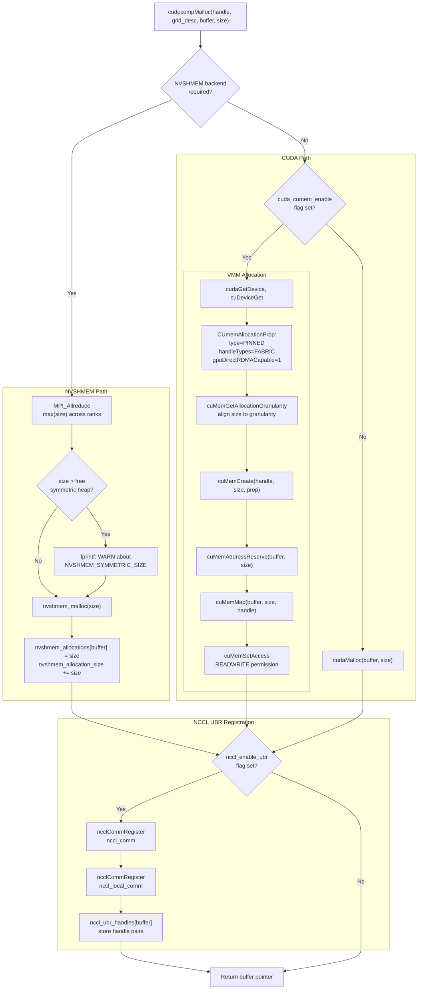
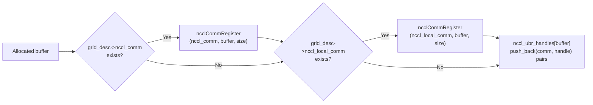
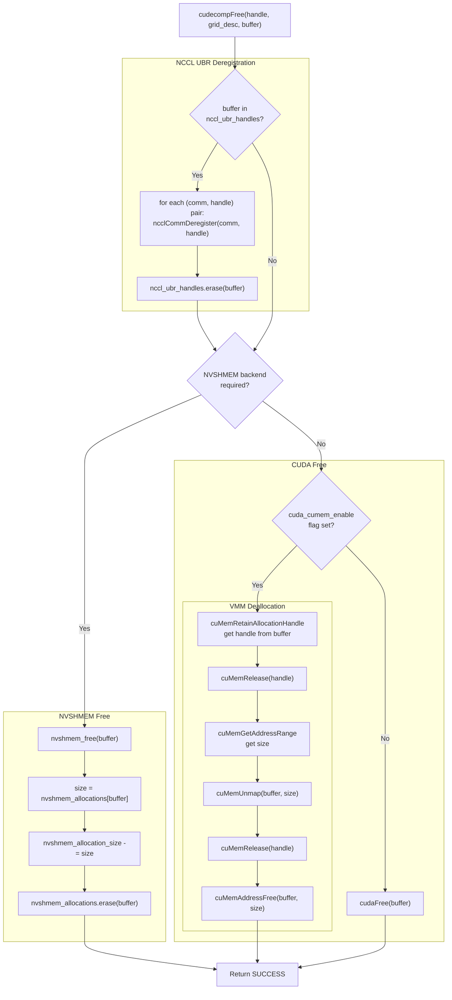
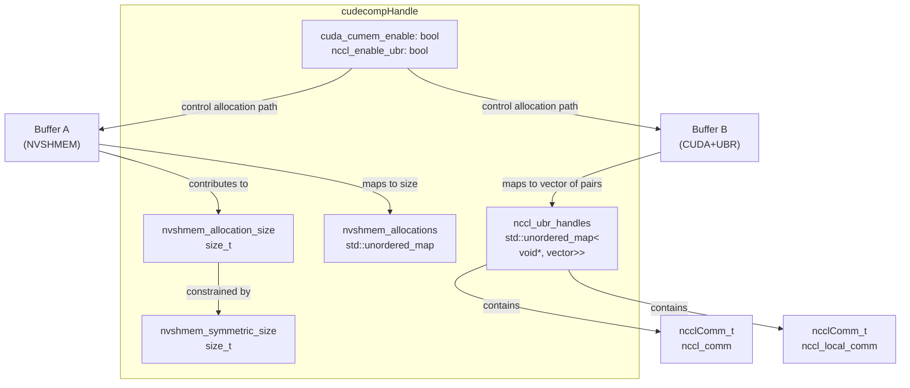

<!-- source: DeepWiki mcp.deepwiki.com · repo NVIDIA/cuDecomp · page 9 Memory Management · fetched 2026-10-26 -->

# Memory Management

<details>
<summary>Relevant source files</summary>

The following files were used as context for generating this wiki page:

- [include/internal/common.h](include/internal/common.h)
- [src/cudecomp.cc](src/cudecomp.cc)

</details>


This document describes cuDecomp's memory management system, specifically the `cudecompMalloc` and `cudecompFree` functions that handle backend-specific allocation requirements. Memory allocated through cuDecomp may require special handling depending on the configured communication backends (NVSHMEM, NCCL, or MPI).

For information about communication backends themselves, see [Communication Backend Details](#8). For information about the autotuning system that selects backends, see [Performance Autotuning](#7).

## Overview

cuDecomp provides specialized memory allocation functions that abstract away the complexity of backend-specific requirements. The allocation path depends on which communication backends are configured in the grid descriptor:

- **NVSHMEM backends** require symmetric heap allocations of identical size across all ranks
- **NCCL backends** benefit from User Buffer Registration (UBR) to reduce runtime overhead
- **CUDA VMM** (Virtual Memory Management) enables fabric-aware allocations for optimal multi-GPU performance
- **Standard CUDA** allocations serve as the fallback path

All allocations are tracked internally to ensure proper cleanup using the correct deallocation method.

**Sources:** [src/cudecomp.cc:1131-1286](), [include/internal/common.h:71-94]()

## Allocation Decision Flow

The `cudecompMalloc` function in [src/cudecomp.cc:1131-1227]() follows a decision tree to determine the appropriate allocation method:



**Sources:** [src/cudecomp.cc:1131-1227](), [include/internal/common.h:71-94]()

## Memory Allocation Function

### Function Signature

```c
cudecompResult_t cudecompMalloc(cudecompHandle_t handle,
                                cudecompGridDesc_t grid_desc,
                                void** buffer,
                                size_t buffer_size_bytes);
```

### Backend Detection

The allocation path is determined by checking the `transpose_comm_backend` and `halo_comm_backend` fields in the grid descriptor configuration [src/cudecomp.cc:1138-1139]():

| Backend Type | Detection Helper Function | Line Reference |
|--------------|---------------------------|----------------|
| NVSHMEM | `transposeBackendRequiresNvshmem()` | [include/internal/common.h:290-292]() |
| NVSHMEM | `haloBackendRequiresNvshmem()` | [include/internal/common.h:294-296]() |
| NCCL | `transposeBackendRequiresNccl()` | [include/internal/common.h:282-284]() |
| NCCL | `haloBackendRequiresNccl()` | [include/internal/common.h:286-288]() |

**Sources:** [src/cudecomp.cc:1138-1162](), [include/internal/common.h:282-296]()

## NVSHMEM Allocation Path

### Symmetric Size Synchronization

NVSHMEM requires all ranks to allocate buffers of identical size from the symmetric heap. The implementation enforces this by finding the maximum requested size across all ranks [src/cudecomp.cc:1141-1142]():

```c
CHECK_MPI(MPI_Allreduce(MPI_IN_PLACE, &buffer_size_bytes, 1, 
                        MPI_LONG_LONG_INT, MPI_MAX, handle->mpi_comm));
```

### Symmetric Heap Management

The handle tracks total NVSHMEM allocations in `nvshmem_allocation_size` and compares against `nvshmem_symmetric_size` (parsed from the `NVSHMEM_SYMMETRIC_SIZE` environment variable). If space is insufficient, a warning is issued on rank 0 [src/cudecomp.cc:1144-1152]().

The symmetric size parsing occurs during initialization in [src/cudecomp.cc:371-403](), supporting suffixes: `k/K` (KiB), `m/M` (MiB), `g/G` (GiB), `t/T` (TiB). The default is 1 GiB.

### Allocation Tracking

Each NVSHMEM allocation is recorded in the `nvshmem_allocations` map [include/internal/common.h:93]():

```c
std::unordered_map<void*, size_t> nvshmem_allocations;
```

The map stores the buffer pointer as the key and allocation size as the value, enabling proper deallocation tracking [src/cudecomp.cc:1157-1158]().

**Sources:** [src/cudecomp.cc:1140-1161](), [src/cudecomp.cc:371-403](), [include/internal/common.h:88-94]()

## CUDA Allocation Path

### CUDA VMM (Virtual Memory Management)

When `cuda_cumem_enable` is true [include/internal/common.h:97](), cuDecomp uses CUDA's fabric-aware Virtual Memory Management APIs. This path is only available with CUDA 12.3 or later and requires driver support [src/cudecomp.cc:1163-1199]().

#### VMM Allocation Steps

The VMM allocation process in [src/cudecomp.cc:1165-1199]():

1. **Setup allocation properties** with `CU_MEM_HANDLE_TYPE_FABRIC` handle type
2. **Check RDMA support** via `CU_DEVICE_ATTRIBUTE_GPU_DIRECT_RDMA_WITH_CUDA_VMM_SUPPORTED`
3. **Align size** to minimum granularity from `cuMemGetAllocationGranularity`
4. **Create memory handle** with `cuMemCreate`
5. **Reserve virtual address** with `cuMemAddressReserve`
6. **Map memory** with `cuMemMap`
7. **Set access permissions** to read/write with `cuMemSetAccess`

#### VMM Enablement

The `cuda_cumem_enable` flag is controlled by the `CUDECOMP_ENABLE_CUMEM` environment variable [src/cudecomp.cc:269-305](). The initialization code performs runtime checks for:
- CUDA version >= 12.3
- Driver version >= 12.3
- Device fabric handle support

If any check fails, the flag is disabled and a warning is printed on rank 0.

### Standard CUDA Allocation

When VMM is not enabled, the standard `cudaMalloc` path is used [src/cudecomp.cc:1201]().

**Sources:** [src/cudecomp.cc:1163-1202](), [src/cudecomp.cc:269-305](), [include/internal/common.h:97]()

## NCCL User Buffer Registration (UBR)

### Purpose and Benefits

NCCL User Buffer Registration (UBR) is an optimization available in NCCL 2.19+ that pre-registers buffers with NCCL communicators. This eliminates the need for NCCL to perform registration on every communication call, reducing latency.

### Registration Process

When both conditions are met:
1. The backend requires NCCL (transpose or halo)
2. `handle->nccl_enable_ubr` is true

The buffer is registered with all relevant communicators [src/cudecomp.cc:1203-1218]():



### UBR Handle Tracking

Registrations are tracked in the `nccl_ubr_handles` map [include/internal/common.h:72-73]():

```c
std::unordered_map<void*, std::vector<std::pair<ncclComm_t, void*>>> nccl_ubr_handles;
```

Each buffer maps to a vector of (communicator, registration_handle) pairs, since a buffer may be registered with both the global and local NCCL communicators.

### Enabling UBR

UBR is controlled by the `CUDECOMP_ENABLE_NCCL_UBR` environment variable, parsed during initialization [src/cudecomp.cc:265-267]():

```c
const char* nccl_enable_ubr_str = std::getenv("CUDECOMP_ENABLE_NCCL_UBR");
if (nccl_enable_ubr_str) { 
    handle->nccl_enable_ubr = std::strtol(nccl_enable_ubr_str, nullptr, 10) == 1; 
}
```

**Sources:** [src/cudecomp.cc:1203-1219](), [src/cudecomp.cc:265-267](), [include/internal/common.h:71-73]()

## Memory Deallocation

### Function Signature

```c
cudecompResult_t cudecompFree(cudecompHandle_t handle,
                              cudecompGridDesc_t grid_desc,
                              void* buffer);
```

### Deallocation Flow

The `cudecompFree` function in [src/cudecomp.cc:1229-1286]() reverses the allocation process:



### NCCL UBR Deregistration

If UBR was used, all registration handles are deregistered before freeing the buffer [src/cudecomp.cc:1235-1246]():

```c
if (handle->nccl_ubr_handles.count(buffer) != 0) {
    for (const auto& entry : handle->nccl_ubr_handles[buffer]) {
        CHECK_NCCL(ncclCommDeregister(entry.first, entry.second));
    }
    handle->nccl_ubr_handles.erase(buffer);
}
```

### NVSHMEM Deallocation

For NVSHMEM buffers, the deallocation updates tracking structures [src/cudecomp.cc:1248-1258]():

```c
nvshmem_free(buffer);
size_t buffer_size_bytes = handle->nvshmem_allocations[buffer];
handle->nvshmem_allocation_size -= buffer_size_bytes;
handle->nvshmem_allocations.erase(buffer);
```

### VMM Deallocation

VMM deallocations follow a multi-step process [src/cudecomp.cc:1264-1275]():
1. Retain the allocation handle from the buffer address
2. Release the handle (first time)
3. Get the allocation size
4. Unmap the virtual address
5. Release the handle (second time)
6. Free the virtual address range

**Sources:** [src/cudecomp.cc:1229-1286]()

## Memory Tracking Structures

The `cudecompHandle` structure maintains several maps for memory tracking [include/internal/common.h:54-117]():



### Tracking Map Usage

| Map | Key | Value | Purpose |
|-----|-----|-------|---------|
| `nccl_ubr_handles` | `void*` (buffer) | `vector<pair<ncclComm_t, void*>>` | Tracks NCCL UBR registration handles for deregistration |
| `nvshmem_allocations` | `void*` (buffer) | `size_t` (allocation size) | Tracks NVSHMEM buffer sizes for deallocation accounting |

**Sources:** [include/internal/common.h:71-94]()

## Environment Variables

The following environment variables control memory management behavior:

| Variable | Type | Default | Description | Line Reference |
|----------|------|---------|-------------|----------------|
| `CUDECOMP_ENABLE_NCCL_UBR` | int | 0 | Enable NCCL User Buffer Registration | [src/cudecomp.cc:265-267]() |
| `CUDECOMP_ENABLE_CUMEM` | int | 0 | Enable CUDA VMM fabric allocations | [src/cudecomp.cc:269-305]() |
| `NVSHMEM_SYMMETRIC_SIZE` | size | 1G | NVSHMEM symmetric heap size (k/M/G/T suffixes) | [src/cudecomp.cc:383-402]() |
| `NVSHMEM_DISABLE_CUDA_VMM` | int | 0 | Disable NVSHMEM VMM (recommended: set to 1) | [src/cudecomp.cc:372-381]() |

### NVSHMEM VMM Recommendation

During initialization, cuDecomp warns if `NVSHMEM_DISABLE_CUDA_VMM` is not set [src/cudecomp.cc:377-381]():

```c
if (handle->rank == 0 && handle->nvshmem_vmm) {
    printf("CUDECOMP:WARN: NVSHMEM_DISABLE_CUDA_VMM is unset. We currently recommend "
           "setting it (i.e. NVSHMEM_DISABLE_CUDA_VMM=1) for best compatibility with "
           "MPI libraries. See the documentation for more details.\n");
}
```

This recommendation exists because NVSHMEM VMM allocations can cause compatibility issues with certain MPI implementations.

**Sources:** [src/cudecomp.cc:264-403]()

## Usage Example

The typical usage pattern for cuDecomp memory management:

```c
// Allocate work buffers
void *work_transpose, *work_halo;
int64_t transpose_size, halo_size;

cudecompGetTransposeWorkspaceSize(handle, grid_desc, &transpose_size);
cudecompGetHaloWorkspaceSize(handle, grid_desc, axis, halo_extents, &halo_size);

cudecompMalloc(handle, grid_desc, &work_transpose, transpose_size * dtype_size);
cudecompMalloc(handle, grid_desc, &work_halo, halo_size * dtype_size);

// Perform operations...

// Free work buffers
cudecompFree(handle, grid_desc, work_transpose);
cudecompFree(handle, grid_desc, work_halo);
```

## Best Practices

### Allocation Size Considerations

1. **NVSHMEM**: Always allocate sufficient symmetric heap space using `NVSHMEM_SYMMETRIC_SIZE`. Monitor warnings on rank 0 for insufficient space.

2. **VMM**: VMM allocations are aligned to device granularity, which may be larger than requested. Expect some memory overhead.

3. **Workspace Sizing**: Use `cudecompGetTransposeWorkspaceSize` and `cudecompGetHaloWorkspaceSize` to query required buffer sizes before allocation.

### Backend-Specific Buffers

Buffers allocated with `cudecompMalloc` are tied to a specific grid descriptor. Do not:
- Use an NVSHMEM-allocated buffer with a non-NVSHMEM grid descriptor
- Use a UBR-registered buffer after the grid descriptor is destroyed
- Mix buffers allocated through `cudecompMalloc` with buffers allocated directly via `cudaMalloc` in cuDecomp API calls

### Performance Recommendations

1. **Enable UBR**: Set `CUDECOMP_ENABLE_NCCL_UBR=1` when using NCCL backends for 2.19+ to reduce communication latency.

2. **Enable VMM**: Set `CUDECOMP_ENABLE_CUMEM=1` on systems with fabric support (multi-GPU NVLink or MNNVL) for optimal performance.

3. **Reuse Buffers**: Allocate work buffers once and reuse them across multiple transpose/halo operations to avoid allocation overhead.

**Sources:** [src/cudecomp.cc:1131-1286](), [include/internal/common.h:54-117]()

---

