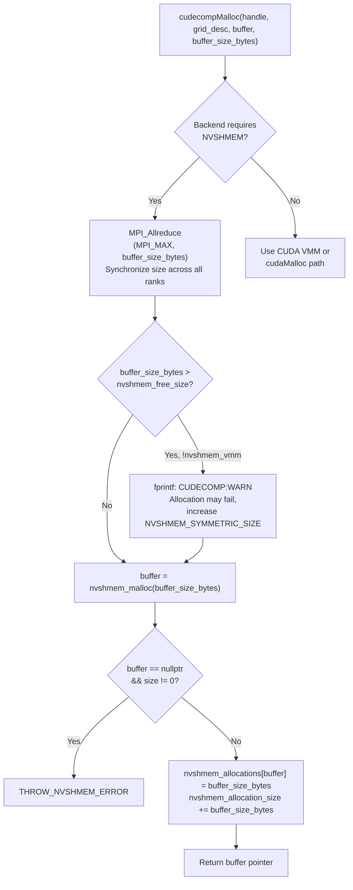
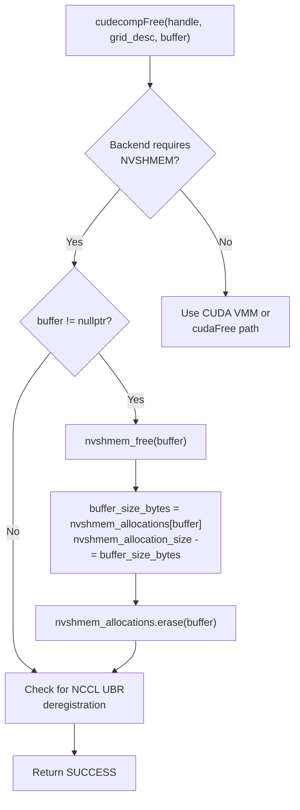
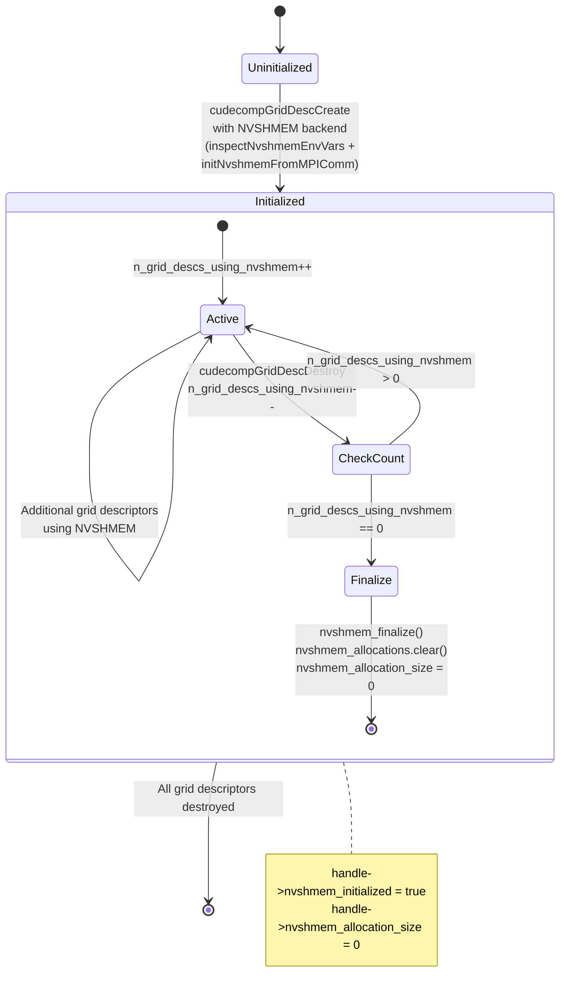

<!-- source: DeepWiki mcp.deepwiki.com · repo NVIDIA/cuDecomp · page 9.1 NVSHMEM Memory Allocation · fetched 2026-10-26 -->

# NVSHMEM Memory Allocation

<details>
<summary>Relevant source files</summary>

The following files were used as context for generating this wiki page:

- [include/internal/common.h](include/internal/common.h)
- [src/cudecomp.cc](src/cudecomp.cc)

</details>


## Purpose and Scope

This page documents the NVSHMEM-specific memory allocation strategy used by cuDecomp when NVSHMEM communication backends are enabled. It covers symmetric heap requirements, allocation size synchronization, tracking mechanisms, and environment variable configuration.

For general memory management concepts and backend selection, see [Memory Management](#9). For NCCL-specific optimizations including User Buffer Registration, see [NCCL User Buffer Registration](#9.2). For NVSHMEM communication backend details, see [NVSHMEM Backend](#8.3).

**Sources:** [src/cudecomp.cc:1131-1286](), [include/internal/common.h:88-94]()

## Symmetric Heap Requirements

NVSHMEM operates on a **symmetric heap**, meaning all participating processes must allocate memory from a shared address space with identical layouts. This fundamental requirement has critical implications:

- **Identical Sizes**: All ranks must allocate the same buffer size, even if local requirements differ
- **Address Space Reservation**: Memory is reserved from a pre-allocated symmetric heap pool
- **Heap Exhaustion**: The symmetric heap has a fixed size (default 1 GiB), which can be exhausted

When a grid descriptor requires NVSHMEM backends (either `CUDECOMP_TRANSPOSE_COMM_NVSHMEM*` or `CUDECOMP_HALO_COMM_NVSHMEM*`), all allocations via `cudecompMalloc` must use NVSHMEM's symmetric allocation primitives.

**Sources:** [src/cudecomp.cc:1138-1161]()

## Allocation Workflow

The following diagram shows how cuDecomp handles NVSHMEM allocations, including the critical size synchronization step:



**Key Points:**
- **Size Synchronization**: `MPI_Allreduce` with `MPI_MAX` ensures all ranks allocate the maximum requested size
- **Warning System**: If `!nvshmem_vmm` and the allocation exceeds available space, rank 0 emits a warning
- **Allocation Tracking**: Successful allocations are recorded in the `nvshmem_allocations` map
- **Error Handling**: Null pointer returns trigger an NVSHMEM-specific error

**Sources:** [src/cudecomp.cc:1138-1161]()

## Size Tracking and Limits

cuDecomp maintains detailed tracking of NVSHMEM allocations to monitor symmetric heap usage:

| Field | Type | Purpose |
|-------|------|---------|
| `nvshmem_allocations` | `std::unordered_map<void*, size_t>` | Maps allocated buffer pointers to their sizes |
| `nvshmem_allocation_size` | `size_t` | Running total of all NVSHMEM allocations |
| `nvshmem_symmetric_size` | `size_t` | Total symmetric heap size (from environment variable) |

### Size Limit Warning

When not using VMM allocations (`nvshmem_vmm == false`), cuDecomp checks available space before allocation:

```cpp
size_t nvshmem_free_size = handle->nvshmem_symmetric_size - handle->nvshmem_allocation_size;
if (!handle->nvshmem_vmm && handle->rank == 0 && buffer_size_bytes > nvshmem_free_size) {
  fprintf(stderr,
          "CUDECOMP:WARN: Attempting an NVSHMEM allocation of %lld bytes but *approximately* "
          "%zu free bytes of %zu total bytes of symmetric heap space available. If the allocation fails, "
          "set NVSHMEM_SYMMETRIC_SIZE >= %zu and try again.\n",
          buffer_size_bytes, nvshmem_free_size, handle->nvshmem_symmetric_size,
          handle->nvshmem_symmetric_size + (buffer_size_bytes - nvshmem_free_size));
}
```

This warning includes a recommendation for the minimum `NVSHMEM_SYMMETRIC_SIZE` value needed.

**Sources:** [src/cudecomp.cc:1144-1152](), [include/internal/common.h:91-94]()

## Deallocation and Cleanup

The following diagram shows the NVSHMEM deallocation path:



**Key Points:**
- Deallocation updates both the map and the running total
- The buffer pointer is used as the key to look up the original allocation size
- NCCL UBR deregistration (if enabled) happens after NVSHMEM cleanup

**Sources:** [src/cudecomp.cc:1248-1261]()

## Environment Variables

### NVSHMEM_SYMMETRIC_SIZE

This environment variable controls the total symmetric heap size. cuDecomp parses it during initialization:

```cpp
char* symmetric_size_str = std::getenv("NVSHMEM_SYMMETRIC_SIZE");
if (symmetric_size_str) {
  int scale;
  if (std::strchr(symmetric_size_str, 'k') || std::strchr(symmetric_size_str, 'K')) {
    scale = 10;  // KiB
  } else if (std::strchr(symmetric_size_str, 'm') || std::strchr(symmetric_size_str, 'M')) {
    scale = 20;  // MiB
  } else if (std::strchr(symmetric_size_str, 'g') || std::strchr(symmetric_size_str, 'G')) {
    scale = 30;  // GiB
  } else if (std::strchr(symmetric_size_str, 't') || std::strchr(symmetric_size_str, 'T')) {
    scale = 40;  // TiB
  } else {
    scale = 0;   // bytes
  }
  handle->nvshmem_symmetric_size = std::ceil(std::strtod(symmetric_size_str, nullptr) * (1ull << scale));
} else {
  // NVSHMEM symmetric size defaults to 1 GiB
  handle->nvshmem_symmetric_size = 1ull << 30;
}
```

**Default**: 1 GiB (if not set)

**Supported Units**: `K`, `M`, `G`, `T` (case-insensitive)

**Example**: `export NVSHMEM_SYMMETRIC_SIZE=4G`

### NVSHMEM_DISABLE_CUDA_VMM

Controls whether NVSHMEM uses CUDA Virtual Memory Management (VMM) for allocations:

```cpp
handle->nvshmem_vmm = true;
char* vmm_str = std::getenv("NVSHMEM_DISABLE_CUDA_VMM");
if (vmm_str) { 
  handle->nvshmem_vmm = std::strtol(vmm_str, nullptr, 10) == 0; 
}

if (handle->rank == 0 && handle->nvshmem_vmm) {
  printf("CUDECOMP:WARN: NVSHMEM_DISABLE_CUDA_VMM is unset. We currently recommend setting it "
         "(i.e. NVSHMEM_DISABLE_CUDA_VMM=1) for best compatibility with MPI libraries. See the documentation "
         "for more details.\n");
}
```

**Default**: VMM enabled (not recommended)

**Recommendation**: Set `NVSHMEM_DISABLE_CUDA_VMM=1` for compatibility with MPI libraries

**Effect**: When VMM is disabled, size checking and warnings are more accurate

**Sources:** [src/cudecomp.cc:370-403]()

## NVSHMEM Lifecycle Management

NVSHMEM initialization and finalization are managed carefully to avoid unnecessary symmetric heap consumption:



**Key Lifecycle Points:**

1. **Lazy Initialization**: NVSHMEM is only initialized when a grid descriptor requires it
2. **Reference Counting**: `n_grid_descs_using_nvshmem` tracks active usage
3. **Automatic Cleanup**: When the count reaches zero, NVSHMEM is finalized to reclaim memory
4. **Multiple Grid Descriptors**: Multiple grid descriptors can share one NVSHMEM instance

**Sources:** [src/cudecomp.cc:686-695](), [src/cudecomp.cc:758-774](), [src/cudecomp.cc:886-905]()

## Data Structure Reference

The `cudecompHandle` structure contains these NVSHMEM-related fields:

```cpp
struct cudecompHandle {
  // ... other fields ...
  
  // NVSHMEM management and warning generation
  bool nvshmem_initialized = false;                      // Tracks NVSHMEM initialization state
  int n_grid_descs_using_nvshmem = 0;                    // Count of grid descriptors using NVSHMEM
  bool nvshmem_mixed_buffer_warning_issued = false;      // Warn once if NVSHMEM buffer used with MPI
  size_t nvshmem_symmetric_size;                         // Total symmetric heap size (from env var)
  bool nvshmem_vmm;                                      // Whether NVSHMEM uses VMM allocations
  std::unordered_map<void*, size_t> nvshmem_allocations; // Maps buffer pointer to allocation size
  size_t nvshmem_allocation_size = 0;                    // Running total of NVSHMEM allocations
};
```

**Field Details:**

| Field | Purpose | Updated By |
|-------|---------|------------|
| `nvshmem_initialized` | Tracks whether `nvshmemx_init_attr` has been called | `cudecompGridDescCreate`, `cudecompGridDescDestroy`, `cudecompFinalize` |
| `n_grid_descs_using_nvshmem` | Reference count for NVSHMEM usage | `cudecompGridDescCreate`, `cudecompGridDescDestroy` |
| `nvshmem_mixed_buffer_warning_issued` | Prevents duplicate warnings about mixing NVSHMEM/MPI buffers | Communication routines |
| `nvshmem_symmetric_size` | Parsed from `NVSHMEM_SYMMETRIC_SIZE` or defaults to 1 GiB | `inspectNvshmemEnvVars` |
| `nvshmem_vmm` | Parsed from `NVSHMEM_DISABLE_CUDA_VMM` | `inspectNvshmemEnvVars` |
| `nvshmem_allocations` | Tracks individual allocations for proper cleanup | `cudecompMalloc`, `cudecompFree` |
| `nvshmem_allocation_size` | Monitors heap usage for warnings | `cudecompMalloc`, `cudecompFree` |

**Sources:** [include/internal/common.h:88-94]()

## Best Practices

1. **Set NVSHMEM_SYMMETRIC_SIZE appropriately**: Calculate total buffer requirements and add margin
2. **Disable VMM**: Use `NVSHMEM_DISABLE_CUDA_VMM=1` for better MPI compatibility
3. **Monitor warnings**: Pay attention to symmetric heap exhaustion warnings from rank 0
4. **Plan buffer sizes**: Remember that `MPI_Allreduce` synchronizes to the maximum across all ranks
5. **Reuse grid descriptors**: Multiple grid descriptors sharing NVSHMEM increase memory pressure

**Sources:** [src/cudecomp.cc:370-403](), [src/cudecomp.cc:1138-1161]()

---

