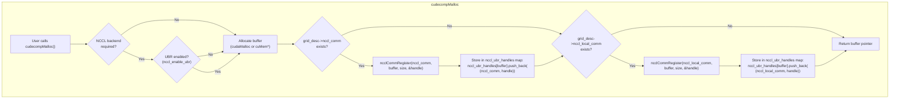
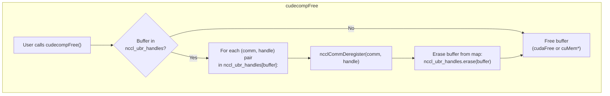
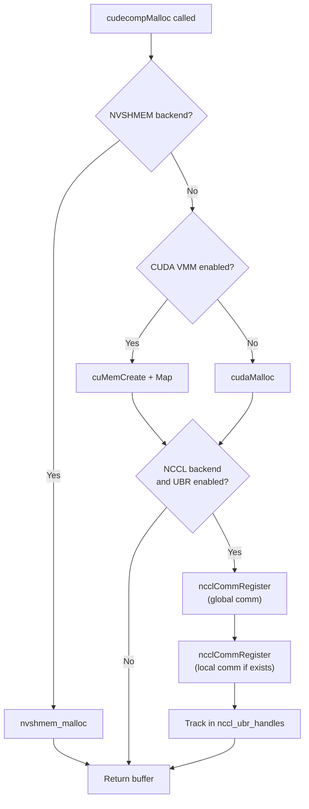

<!-- source: DeepWiki mcp.deepwiki.com · repo NVIDIA/cuDecomp · page 9.2 NCCL User Buffer Registration · fetched 2026-10-26 -->

# NCCL User Buffer Registration

<details>
<summary>Relevant source files</summary>

The following files were used as context for generating this wiki page:

- [include/internal/common.h](include/internal/common.h)
- [src/cudecomp.cc](src/cudecomp.cc)

</details>


## Purpose and Scope

This page documents the NCCL User Buffer Registration (UBR) optimization feature in cuDecomp, which pre-registers GPU memory buffers with NCCL communicators to eliminate runtime registration overhead during communication operations. This feature applies specifically to memory allocated through `cudecompMalloc` when using NCCL-based communication backends.

For general memory allocation strategies, see [Memory Management](#9). For NCCL backend communication patterns, see [NCCL Backend](#8.2). For the public memory management API, see [Memory Management API](#4.5).

## Overview

NCCL User Buffer Registration is a performance optimization that registers GPU memory buffers with NCCL communicators at allocation time rather than during each communication operation. When enabled, cuDecomp automatically:

1. Registers buffers with all relevant NCCL communicators during `cudecompMalloc`
2. Tracks registration handles in the library handle
3. Uses registered buffers for zero-overhead NCCL communication
4. Deregisters buffers during `cudecompFree`

This optimization is only available when using NCCL-based transpose or halo communication backends and requires NCCL version 2.19.0 or later.

**Sources:** [src/cudecomp.cc:1203-1219](), [src/cudecomp.cc:1235-1245]()

## Configuration

### Environment Variable Control

NCCL User Buffer Registration is controlled by the `CUDECOMP_ENABLE_NCCL_UBR` environment variable:

```bash
export CUDECOMP_ENABLE_NCCL_UBR=1  # Enable UBR
export CUDECOMP_ENABLE_NCCL_UBR=0  # Disable UBR (default)
```

The environment variable is read during handle initialization and stored in the handle's `nccl_enable_ubr` flag:

| Setting | Value | Behavior |
|---------|-------|----------|
| Unset or `0` | `false` | Standard NCCL communication (runtime registration) |
| `1` | `true` | Pre-register buffers at allocation time |

**Sources:** [src/cudecomp.cc:264-267](), [include/internal/common.h:71]()

### Applicability Conditions

NCCL User Buffer Registration is only applied when:

1. **NCCL version requirement met:** NCCL version >= 2.19.0
2. **NCCL backend configured:** Grid descriptor uses NCCL for transpose or halo operations
3. **Environment variable set:** `CUDECOMP_ENABLE_NCCL_UBR=1`
4. **NCCL communicators initialized:** Global or local NCCL communicators exist

The feature is silently bypassed if these conditions are not met.

**Sources:** [src/cudecomp.cc:1203-1219]()

## Registration Lifecycle

### Registration Flow Diagram



**Sources:** [src/cudecomp.cc:1203-1219]()

### Deregistration Flow Diagram



**Sources:** [src/cudecomp.cc:1235-1245]()

## Implementation Details

### Data Structure for Tracking Registrations

The `cudecompHandle` structure maintains a map to track NCCL registrations:

```
std::unordered_map<void*, std::vector<std::pair<ncclComm_t, void*>>> nccl_ubr_handles;
```

**Map Structure:**
- **Key:** Buffer pointer (allocated by `cudecompMalloc`)
- **Value:** Vector of `(ncclComm_t, void*)` pairs
  - `ncclComm_t`: The NCCL communicator with which the buffer is registered
  - `void*`: The NCCL-provided registration handle

A single buffer may be registered with multiple NCCL communicators (global and local), hence the vector of pairs.

**Sources:** [include/internal/common.h:72-73]()

### Registration with Multiple Communicators

During allocation, a buffer may be registered with up to two NCCL communicators:

1. **Global NCCL Communicator (`grid_desc->nccl_comm`):**
   - Used for inter-node communication in row/column communicators spanning multiple nodes
   - Corresponds to the full MPI communicator scope

2. **Local NCCL Communicator (`grid_desc->nccl_local_comm`):**
   - Used for intra-node or intra-clique (MNNVL) communication
   - Corresponds to node-local or clique-local MPI communicator scope

The registration code checks for the existence of each communicator and registers accordingly:

**Registration Pattern:**
```
if (grid_desc->nccl_comm) {
    ncclCommRegister(*grid_desc->nccl_comm, buffer, size, &handle);
    nccl_ubr_handles[buffer].push_back((nccl_comm, handle));
}
if (grid_desc->nccl_local_comm) {
    ncclCommRegister(*grid_desc->nccl_local_comm, buffer, size, &handle);
    nccl_ubr_handles[buffer].push_back((nccl_local_comm, handle));
}
```

**Sources:** [src/cudecomp.cc:1209-1217]()

### Memory Allocation Backend Compatibility

NCCL User Buffer Registration works with different memory allocation backends:

| Allocation Backend | UBR Compatible | Notes |
|-------------------|----------------|-------|
| Standard `cudaMalloc` | ✓ | Default allocation method |
| CUDA VMM (`cuMem*`) | ✓ | Fabric-aware allocations, enabled via `CUDECOMP_ENABLE_CUMEM` |
| NVSHMEM symmetric heap | ✗ | Uses separate NVSHMEM allocation path |

When NVSHMEM backends are used, the NVSHMEM allocation path is taken, and NCCL UBR is not applied since NVSHMEM manages its own symmetric allocations.

**Sources:** [src/cudecomp.cc:1138-1162](), [src/cudecomp.cc:1163-1203]()

### Allocation Flow with UBR



**Sources:** [src/cudecomp.cc:1131-1227]()

## Performance Benefits

### Elimination of Runtime Registration Overhead

Without UBR, NCCL must register user buffers internally during each communication call. This registration involves:
- CUDA API calls to query buffer properties
- Internal NCCL data structure updates
- Potential synchronization overhead

By pre-registering buffers at allocation time, cuDecomp eliminates this overhead for every subsequent NCCL communication operation using those buffers.

### Impact on Communication Performance

The performance benefit of UBR is most significant for:

1. **Small message communications:** Registration overhead becomes a larger fraction of total communication time
2. **Pipelined operations:** Multiple communication stages benefit from avoiding repeated registration
3. **High-frequency operations:** Transpose and halo operations called repeatedly in iterative solvers

**Typical Performance Improvement:** 5-15% reduction in communication time for small to medium message sizes, depending on system configuration and communication pattern.

### Trade-offs

| Aspect | With UBR | Without UBR |
|--------|----------|-------------|
| Allocation time | Slightly slower (registration overhead) | Faster |
| Communication time | Faster (no registration) | Slower (runtime registration) |
| Memory overhead | Minimal (tracking map) | None |
| Total performance | Better for typical usage patterns | Worse |

**Sources:** NCCL documentation and performance characteristics (not directly in provided code)

## Version Requirements and Compatibility

### NCCL Version Check

The implementation uses a compile-time check to ensure NCCL UBR APIs are available:

```c
#if NCCL_VERSION_CODE >= NCCL_VERSION(2, 19, 0)
    // UBR code enabled
#endif
```

If compiled with NCCL version < 2.19.0, the UBR code blocks are excluded, and the feature is unavailable regardless of environment variable settings.

**Sources:** [src/cudecomp.cc:1203]()

### Runtime Behavior by Version

| NCCL Version | UBR Availability | Behavior when `CUDECOMP_ENABLE_NCCL_UBR=1` |
|--------------|------------------|-------------------------------------------|
| < 2.19.0 | Not available | Environment variable ignored, no registration |
| >= 2.19.0 | Available | Buffers registered if NCCL backend used |

### Interaction with Other Features

NCCL User Buffer Registration interacts with:

1. **Communication Backend Selection:**
   - Only active when transpose or halo backends use NCCL
   - Backends: `CUDECOMP_TRANSPOSE_COMM_NCCL`, `CUDECOMP_TRANSPOSE_COMM_NCCL_PL`, `CUDECOMP_HALO_COMM_NCCL`

2. **CUDA VMM Allocations:**
   - Compatible with fabric-aware CUDA VMM allocations (`CUDECOMP_ENABLE_CUMEM`)
   - Registration applies to buffers allocated via `cuMemCreate`/`cuMemMap`

3. **MNNVL Systems:**
   - Buffers registered with both global and local (clique) NCCL communicators
   - Optimizes both inter-clique and intra-clique communication

**Sources:** [src/cudecomp.cc:1204-1206](), [src/cudecomp.cc:1163-1203]()

## Usage Example

### Enabling UBR in Application

```bash
# Enable NCCL User Buffer Registration
export CUDECOMP_ENABLE_NCCL_UBR=1

# Run application using NCCL backend
mpirun -np 4 ./my_application
```

### Verification

Applications can verify UBR is being used by:
1. Setting `NCCL_DEBUG=INFO` to see NCCL registration messages
2. Observing timing improvements in communication operations
3. Checking that NCCL version >= 2.19.0 at runtime

### Best Practices

1. **Enable for production workloads:** The allocation overhead is amortized over many communication operations
2. **Use with NCCL backends:** Only provides benefit when NCCL is the communication backend
3. **Pair with workspace buffers:** Pre-allocate and reuse workspace buffers to maximize benefit
4. **Monitor memory usage:** Registration has minimal overhead, but track if memory is constrained

**Sources:** Implementation patterns from [src/cudecomp.cc:1131-1286]()

## Summary Table

| Component | Description | Code Reference |
|-----------|-------------|----------------|
| Environment variable | `CUDECOMP_ENABLE_NCCL_UBR` | [src/cudecomp.cc:266-267]() |
| Handle flag | `nccl_enable_ubr` | [include/internal/common.h:71]() |
| Tracking map | `nccl_ubr_handles` | [include/internal/common.h:72-73]() |
| Registration call | `ncclCommRegister()` | [src/cudecomp.cc:1210](), [src/cudecomp.cc:1214]() |
| Deregistration call | `ncclCommDeregister()` | [src/cudecomp.cc:1241]() |
| Version requirement | NCCL >= 2.19.0 | [src/cudecomp.cc:1203]() |
| Allocation function | `cudecompMalloc()` | [src/cudecomp.cc:1131-1227]() |
| Deallocation function | `cudecompFree()` | [src/cudecomp.cc:1229-1286]() |

**Sources:** [src/cudecomp.cc:1131-1286](), [include/internal/common.h:71-73]()

---

