# Page: Overview

# Overview

<details>
<summary>Relevant source files</summary>

The following files were used as context for generating this wiki page:

- [README.md](README.md)
- [docs/env_vars.rst](docs/env_vars.rst)
- [docs/overview.rst](docs/overview.rst)
- [include/cudecomp.h](include/cudecomp.h)
- [src/cudecomp.cc](src/cudecomp.cc)

</details>


## Purpose and Scope

This page provides a high-level introduction to the cuDecomp library, its architecture, and core concepts. It explains what cuDecomp is, why it exists, and how its components fit together. For detailed API documentation, see [API Reference](#4). For building and installation instructions, see [Getting Started](#2). For detailed explanations of decomposition strategies and communication patterns, see [Core Concepts](#3).

## What is cuDecomp?

cuDecomp is a library for managing 1D (slab) and 2D (pencil) parallel decompositions of 3D Cartesian spatial domains on NVIDIA GPUs. It provides routines to perform global transpositions and halo communication, enabling efficient parallel computation on distributed GPU systems.

The library addresses a key challenge in GPU cluster computing: modern GPU systems have complex network topologies with varying bandwidth characteristics (fast NVLink/NVSwitch within nodes, slower inter-node connections via InfiniBand or Ethernet). cuDecomp helps navigate this complexity by:

1. **Providing flexible decomposition strategies** - distributing 3D domains across GPUs in optimal configurations
2. **Supporting multiple communication backends** - leveraging CUDA-aware MPI, NCCL, and NVSHMEM
3. **Offering runtime autotuning** - automatically selecting optimal decomposition and communication strategies

cuDecomp is designed for applications requiring global transpositions (FFT-based solvers, ADI methods) or stencil operations (finite difference methods), where communication patterns significantly impact overall performance.

Sources: [README.md:1-14](), [docs/overview.rst:1-28](), [include/cudecomp.h:18-22]()

## Library Architecture

### Component Overview

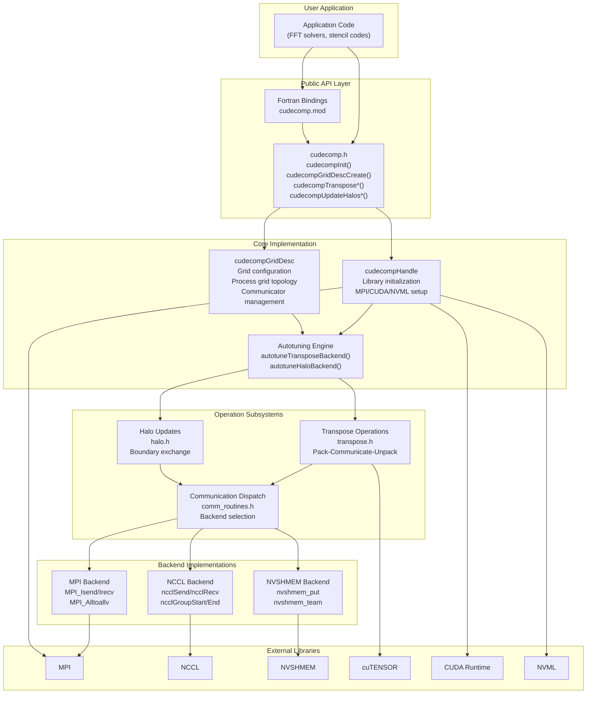

**cuDecomp High-Level Architecture**

The library architecture consists of several layers:

- **Public API Layer**: Exposes C functions in `cudecomp.h` and Fortran bindings for application integration
- **Core Implementation**: Manages library state through `cudecompHandle` and `cudecompGridDesc` structures, implements autotuning
- **Operation Subsystems**: Handles transpose and halo operations with backend-agnostic dispatch
- **Backend Implementations**: Provides MPI, NCCL, and NVSHMEM communication implementations
- **External Libraries**: Leverages MPI for process management, NCCL/NVSHMEM for GPU communication, cuTENSOR for local permutations, NVML for topology detection

Sources: [src/cudecomp.cc:1-551](), [include/cudecomp.h:1-631]()

## Core Data Structures

### Handle and Grid Descriptor Relationship

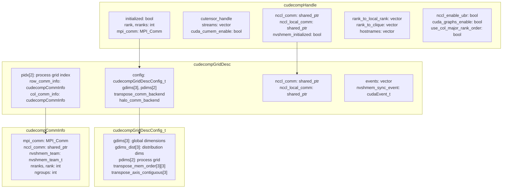

**Core Data Structure Relationships**

The library uses two primary data structures:

**cudecompHandle** ([src/cudecomp.cc:409-511]()): Created once per application via `cudecompInit()`. Contains:
- MPI communicator and rank information
- Shared CUDA/cuTENSOR resources
- Global NCCL communicators
- GPU topology information (MNNVL cliques, local ranks)
- Configuration flags from environment variables

**cudecompGridDesc** ([src/cudecomp.cc:565-822]()): Created via `cudecompGridDescCreate()`, potentially multiple instances. Contains:
- Grid configuration (global dimensions, process grid dimensions)
- Communication backend selections
- Row and column communicator information (`cudecompCommInfo`)
- References to shared communicators
- CUDA events for synchronization

**cudecompGridDescConfig_t** ([include/cudecomp.h:113-132]()): User-facing configuration structure defining:
- Global grid dimensions (`gdims[3]`)
- Process grid dimensions (`pdims[2]`)
- Communication backend choices
- Memory layout preferences

Sources: [src/cudecomp.cc:409-822](), [include/cudecomp.h:101-132]()

## Pencil Decomposition Strategy

### Decomposition Orientations

cuDecomp decomposes a 3D global grid with dimensions `[X, Y, Z]` across a 2D process grid with dimensions `[P_row, P_col]`. Data can exist in three orientations:

| Orientation | Contiguous Axis | Distributed Dimensions | Typical Shape |
|-------------|-----------------|------------------------|---------------|
| X-pencils | X | Y, Z | `[X, Y/P_row, Z/P_col]` |
| Y-pencils | Y | X, Z | `[X/P_row, Y, Z/P_col]` |
| Z-pencils | Z | X, Y | `[X/P_row, Y/P_col, Z]` |

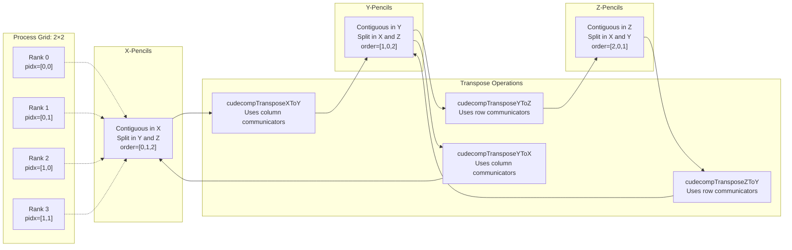

**Pencil Orientations and Transpose Operations**

The process grid is defined by `config.pdims[0]` (P_row) and `config.pdims[1]` (P_col). By default, ranks are assigned in row-major order, but this can be changed via the `CUDECOMP_USE_COL_MAJOR_RANK_ORDER` environment variable.

Each process computes its position in the process grid as `pidx[0]` (row index) and `pidx[1]` (column index). Processes with the same `pidx[0]` belong to the same row communicator; those with the same `pidx[1]` belong to the same column communicator.

Transpose operations redistribute data between orientations:
- **X-to-Y and Y-to-X**: Use column communicators (processes with same `pidx[1]`)
- **Y-to-Z and Z-to-Y**: Use row communicators (processes with same `pidx[0]`)

Sources: [docs/overview.rst:31-65](), [src/cudecomp.cc:740-757](), [include/cudecomp.h:431-545]()

## Communication Backend Architecture

### Backend Selection and Dispatch

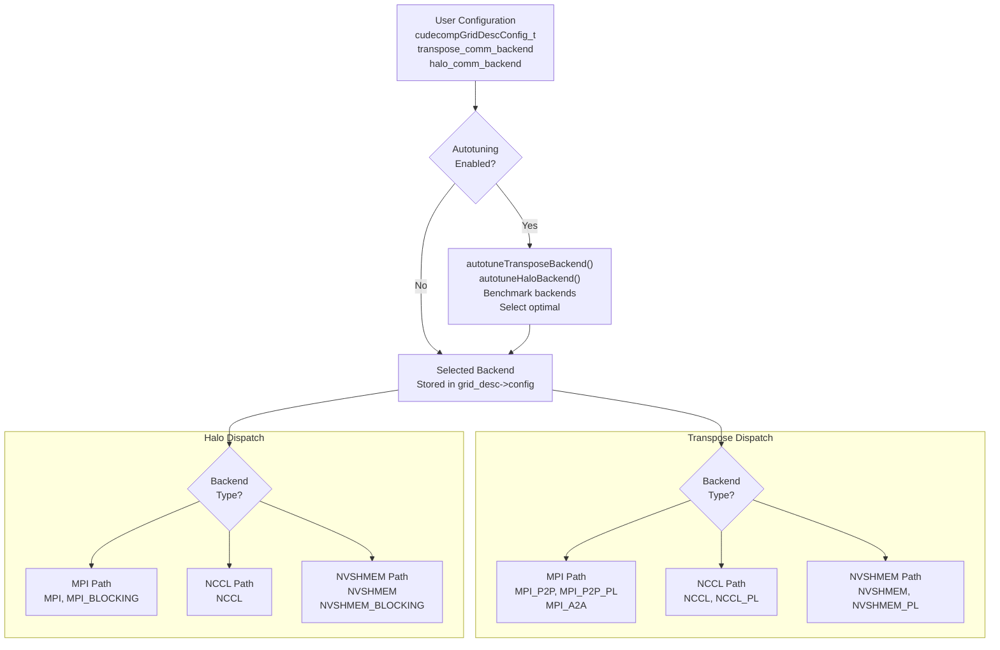

**Communication Backend Selection Flow**

cuDecomp supports three communication backend families:

**MPI Backends** ([include/cudecomp.h:45-47]()):
- `CUDECOMP_TRANSPOSE_COMM_MPI_P2P`: Point-to-point using `MPI_Isend`/`MPI_Irecv`
- `CUDECOMP_TRANSPOSE_COMM_MPI_P2P_PL`: Pipelined point-to-point for overlap
- `CUDECOMP_TRANSPOSE_COMM_MPI_A2A`: Collective using `MPI_Alltoallv`
- `CUDECOMP_HALO_COMM_MPI`: Non-blocking halo exchange
- `CUDECOMP_HALO_COMM_MPI_BLOCKING`: Blocking halo exchange

**NCCL Backends** ([include/cudecomp.h:48-49](), [include/cudecomp.h:60]()):
- `CUDECOMP_TRANSPOSE_COMM_NCCL`: Standard NCCL communication
- `CUDECOMP_TRANSPOSE_COMM_NCCL_PL`: Pipelined NCCL for overlap
- `CUDECOMP_HALO_COMM_NCCL`: NCCL-based halo exchange

**NVSHMEM Backends** ([include/cudecomp.h:50-51](), [include/cudecomp.h:61-62]()):
- `CUDECOMP_TRANSPOSE_COMM_NVSHMEM`: Standard NVSHMEM communication
- `CUDECOMP_TRANSPOSE_COMM_NVSHMEM_PL`: Pipelined NVSHMEM for overlap
- `CUDECOMP_HALO_COMM_NVSHMEM`: Non-blocking NVSHMEM halo exchange
- `CUDECOMP_HALO_COMM_NVSHMEM_BLOCKING`: Blocking NVSHMEM halo exchange

Backend selection occurs during grid descriptor creation. If autotuning is enabled via `cudecompGridDescAutotuneOptions_t`, cuDecomp benchmarks available backends and selects the fastest. Otherwise, the user-specified backend is used.

Sources: [include/cudecomp.h:44-63](), [src/cudecomp.cc:89-124](), [src/cudecomp.cc:632-696]()

## Library Initialization and Resource Lifecycle

### Initialization Sequence

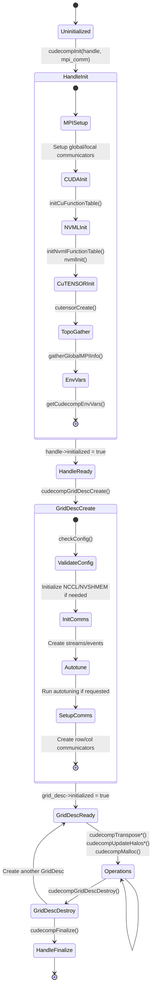

**cuDecomp Resource Lifecycle**

The library follows a two-stage initialization model:

**Stage 1: Handle Initialization** ([src/cudecomp.cc:409-511]()):
1. Create `cudecompHandle` structure
2. Duplicate MPI communicator, create local communicator via `MPI_Comm_split_type`
3. Initialize CUDA driver function table ([src/cudecomp.cc:426]())
4. Initialize NVML function table and library ([src/cudecomp.cc:429-431]())
5. Initialize cuTENSOR handle ([src/cudecomp.cc:434-440]())
6. Gather global MPI information: hostnames, local ranks, MNNVL clique info ([src/cudecomp.cc:443]())
7. Read environment variables for feature flags ([src/cudecomp.cc:446]())
8. Detect GPU topology: NVLink peers, P2P copy engine count ([src/cudecomp.cc:449-498]())

**Stage 2: Grid Descriptor Creation** ([src/cudecomp.cc:565-822]()):
1. Validate configuration ([src/cudecomp.cc:587]())
2. Initialize NCCL communicators if needed ([src/cudecomp.cc:632-683]())
3. Initialize NVSHMEM if needed ([src/cudecomp.cc:685-696]())
4. Create CUDA streams and events ([src/cudecomp.cc:698-714]())
5. Run autotuning if requested ([src/cudecomp.cc:724-734]())
6. Create row and column MPI communicators ([src/cudecomp.cc:748-757]())
7. Setup NVSHMEM teams if needed ([src/cudecomp.cc:758-774]())

Multiple grid descriptors can coexist under a single handle, allowing different decomposition strategies within one application.

**Cleanup** proceeds in reverse order: grid descriptors are destroyed via `cudecompGridDescDestroy()` ([src/cudecomp.cc:824-907]()), followed by handle finalization via `cudecompFinalize()` ([src/cudecomp.cc:513-551]()).

Sources: [src/cudecomp.cc:409-822](), [src/cudecomp.cc:824-907](), [src/cudecomp.cc:513-551]()

## Typical Usage Pattern

A typical cuDecomp application follows this pattern:

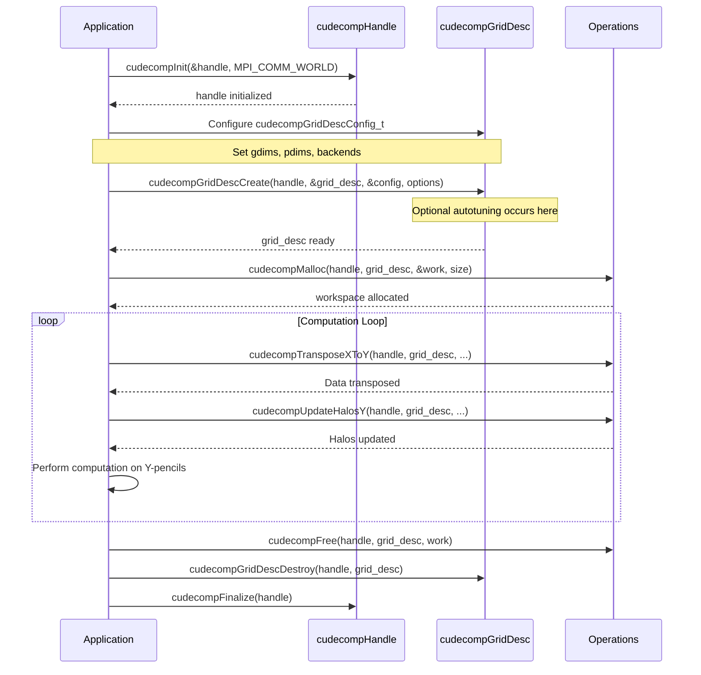

**Typical Application Workflow**

1. **Initialize library**: `cudecompInit()` with MPI communicator
2. **Configure grid**: Populate `cudecompGridDescConfig_t` with global dimensions, process grid, and backend preferences
3. **Create grid descriptor**: `cudecompGridDescCreate()` with optional autotuning
4. **Allocate workspaces**: `cudecompMalloc()` for transpose and halo workspaces
5. **Perform operations**: Call `cudecompTranspose*()` and `cudecompUpdateHalos*()` functions
6. **Cleanup**: Free workspaces, destroy grid descriptor, finalize library

For detailed examples, see [Examples and Use Cases](#11). For step-by-step tutorials, see [Quick Start Tutorial](#2.2).

Sources: [include/cudecomp.h:205-625](), [README.md:1-14]()

## Feature Highlights

### Runtime Autotuning

cuDecomp can automatically select optimal process grid dimensions and communication backends through runtime benchmarking. Autotuning is controlled via `cudecompGridDescAutotuneOptions_t` ([include/cudecomp.h:137-189]()):

- **Process grid autotuning**: Tests different `pdims` configurations to minimize communication time
- **Backend autotuning**: Benchmarks MPI, NCCL, and NVSHMEM backends to find the fastest
- **Configurable trials**: Control warmup and timed trials per configuration
- **Skip threshold**: Early termination for slow configurations

For details, see [Performance Autotuning](#7).

### Memory Management

cuDecomp provides `cudecompMalloc()` and `cudecompFree()` functions that select appropriate allocators based on communication backend requirements:

- **Standard CUDA**: `cudaMalloc` for MPI/NCCL-only configurations
- **NVSHMEM symmetric heap**: `nvshmem_malloc` for NVSHMEM backends
- **CUDA VMM**: Fabric-aware allocations for multi-node NVLink systems (controlled by `CUDECOMP_ENABLE_CUMEM`)
- **NCCL UBR**: Optional buffer registration with NCCL communicators (controlled by `CUDECOMP_ENABLE_NCCL_UBR`)

For details, see [Memory Management](#9).

### Hardware Topology Detection

cuDecomp automatically detects GPU topology features via NVML:

- **MNNVL support**: Detects multi-node NVLink connections and creates clique communicators
- **NVSwitch detection**: Identifies systems with NVSwitch for optimized communication
- **P2P copy engine count**: Determines available peer-to-peer copy engines

For details, see [Hardware-Specific Features](#10).

### Performance Monitoring

cuDecomp includes built-in performance monitoring controlled by environment variables:

- **`CUDECOMP_ENABLE_PERFORMANCE_REPORT`**: Enable performance tracking
- **`CUDECOMP_PERFORMANCE_REPORT_DETAIL`**: Control report verbosity
- **`CUDECOMP_PERFORMANCE_REPORT_WRITE_DIR`**: Export data to CSV files

For details, see [Internal Architecture - Performance Monitoring](#14.3).

Sources: [src/cudecomp.cc:264-368](), [docs/env_vars.rst:1-100]()

## Language Support

cuDecomp provides both C and Fortran interfaces:

- **C API**: Declared in `cudecomp.h` ([include/cudecomp.h:1-631]())
- **Fortran bindings**: Provided through `cudecomp_fort` module with `_F` suffixed functions ([src/cudecomp.cc:553-563]())

Fortran support requires NVHPC SDK compilers. For details, see [Fortran Interface](#4.6).

Sources: [include/cudecomp.h:1-631](), [src/cudecomp.cc:553-563](), [README.md:30-31]()

---

# Page: Getting Started

# Getting Started

<details>
<summary>Relevant source files</summary>

The following files were used as context for generating this wiki page:

- [CMakeLists.txt](CMakeLists.txt)
- [README.md](README.md)
- [docs/env_vars.rst](docs/env_vars.rst)
- [docs/overview.rst](docs/overview.rst)
- [include/cudecomp.h](include/cudecomp.h)

</details>


This page provides an introduction to building and running your first cuDecomp program. It covers the essential prerequisites, basic build instructions, and the fundamental workflow for initializing and using the library. For detailed build configuration options, see [Building and Installation](#2.1). For a complete working example with code, see [Quick Start Tutorial](#2.2).

## Purpose and Scope

This Getting Started guide will help you:
- Understand the required dependencies and toolchain
- Build the cuDecomp library from source
- Learn the basic initialization sequence
- Understand the minimal set of API calls needed for decomposition operations

This page does not cover advanced topics like performance autotuning or detailed API usage. For core concepts like pencil decomposition and communication backends, see [Core Concepts](#3).

## Prerequisites

cuDecomp requires specific toolchain components and libraries. The library is designed to work with the NVIDIA HPC SDK, which bundles all required dependencies.

### Required Dependencies

| Dependency | Purpose | Minimum Version |
|------------|---------|-----------------|
| NVHPC SDK | C++/CUDA/Fortran compilers, CUDA runtime, cuTENSOR, NCCL | Recommended (latest) |
| MPI | Inter-process communication | CUDA-aware MPI required |
| CMake | Build system | 3.16+ |

### Optional Dependencies

| Dependency | Purpose | Enable Via |
|------------|---------|------------|
| NVSHMEM | Symmetric memory communication backend | `CUDECOMP_ENABLE_NVSHMEM=ON` |

**Important**: cuDecomp requires CUDA-aware MPI. Verify your MPI library supports this feature. On Cray systems, the Cray MPI with GPU Transport Layer (GTL) is automatically detected and linked [CMakeLists.txt:68-94]().

Sources: [CMakeLists.txt:1-147](), [README.md:30-39]()

## Building the Library

### Basic Build Process

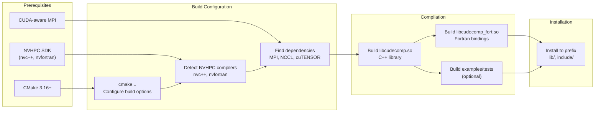

**Basic Build**

The minimal build requires only the core library without examples:

```bash
mkdir build
cd build
cmake ..
make -j
```

This creates `libcudecomp.so` in `build/lib/` and installs `cudecomp.h` to `build/include/` [CMakeLists.txt:149-254]().

**Build with Examples and NVSHMEM**

To build additional examples, tests, and enable NVSHMEM backends:

```bash
cmake -DCUDECOMP_BUILD_EXTRAS=ON -DCUDECOMP_ENABLE_NVSHMEM=ON ..
make -j
```

Sources: [README.md:15-27](), [CMakeLists.txt:15-22]()

### Build Options

The following CMake options control the build configuration:

| Option | Default | Description |
|--------|---------|-------------|
| `CUDECOMP_BUILD_FORTRAN` | `ON` | Build Fortran bindings (`libcudecomp_fort.so`) |
| `CUDECOMP_ENABLE_NVTX` | `ON` | Enable NVTX profiling ranges |
| `CUDECOMP_ENABLE_NVSHMEM` | `OFF` | Enable NVSHMEM communication backends |
| `CUDECOMP_BUILD_EXTRAS` | `OFF` | Build benchmarks, examples, and tests |
| `CUDECOMP_NCCL_HOME` | (empty) | Override NCCL installation path |
| `CUDECOMP_NVSHMEM_HOME` | (empty) | Override NVSHMEM installation path |
| `CUDECOMP_CUDA_CC_LIST` | (auto-detected) | CUDA compute capabilities to build for |

The build system automatically detects CUDA compute capabilities based on the CUDA toolkit version [CMakeLists.txt:52-64]().

Sources: [CMakeLists.txt:15-64]()

### Compiler Detection

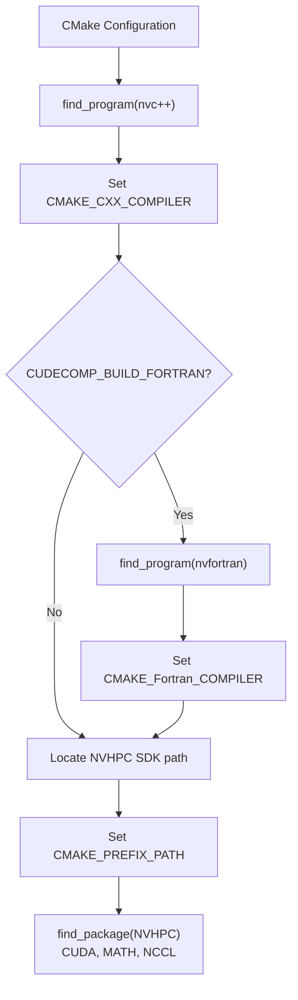

The build system locates the NVHPC SDK compilers and automatically configures paths to find CUDA, cuTENSOR, and NCCL libraries bundled with the SDK [CMakeLists.txt:23-122]().

Sources: [CMakeLists.txt:23-146]()

## Library Initialization Workflow

### Basic API Call Sequence

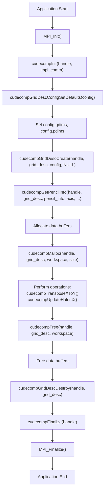

This diagram shows the complete lifecycle of a cuDecomp application, from initialization through operation and cleanup.

Sources: [include/cudecomp.h:204-261]()

### Minimal Code Structure

A minimal cuDecomp program follows this pattern:

1. **Initialize the library** with `cudecompInit()`, passing an MPI communicator [include/cudecomp.h:213]()
2. **Configure decomposition** using `cudecompGridDescConfig_t` structure [include/cudecomp.h:113-132]()
3. **Create grid descriptor** with `cudecompGridDescCreate()` [include/cudecomp.h:251]()
4. **Query pencil geometry** using `cudecompGetPencilInfo()` [include/cudecomp.h:305]()
5. **Allocate workspaces** with `cudecompMalloc()` [include/cudecomp.h:366]()
6. **Perform operations** like transposes or halo updates
7. **Clean up** in reverse order: free workspaces, destroy grid descriptor, finalize library

### Key Data Structures

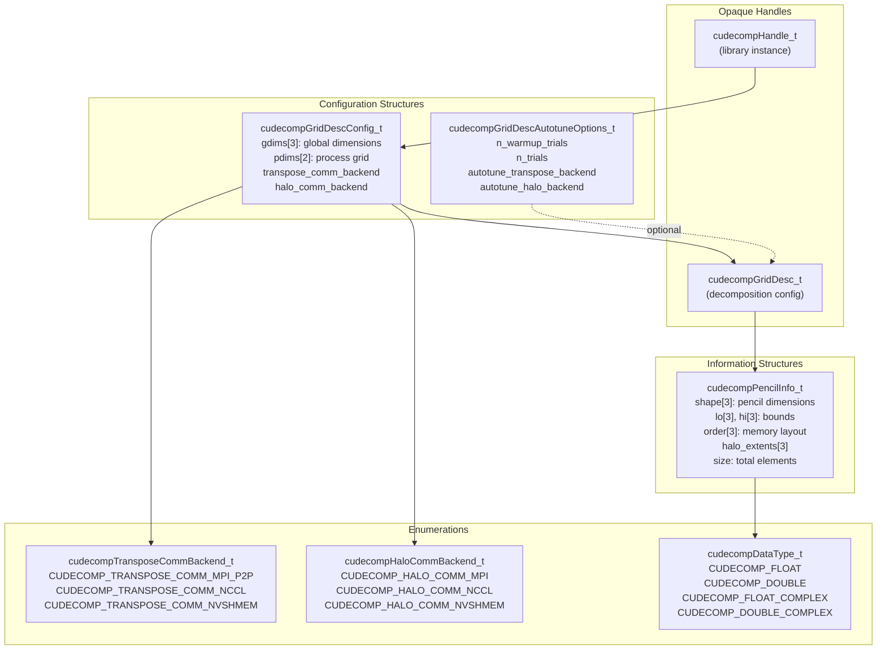

- `cudecompHandle_t`: Opaque pointer representing a library instance, initialized by `cudecompInit()` [include/cudecomp.h:103]()
- `cudecompGridDesc_t`: Opaque pointer representing a decomposition configuration, created by `cudecompGridDescCreate()` [include/cudecomp.h:108]()
- `cudecompGridDescConfig_t`: User-visible structure defining the global grid dimensions, process grid, and communication backends [include/cudecomp.h:113-132]()
- `cudecompPencilInfo_t`: Structure containing geometry information about a pencil, returned by `cudecompGetPencilInfo()` [include/cudecomp.h:194-202]()

Sources: [include/cudecomp.h:42-202]()

### API Function Categories

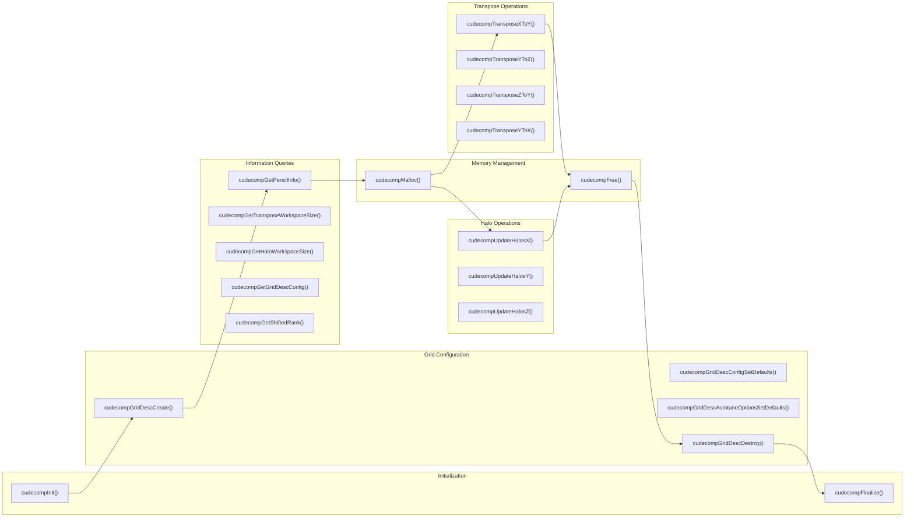

The cuDecomp API is organized into six functional categories, each serving a specific purpose in the decomposition workflow.

Sources: [include/cudecomp.h:204-625]()

## Process Grid and Pencils

The decomposition is controlled by two key configuration parameters:

- **`gdims[3]`**: Global grid dimensions `[X, Y, Z]` in column-major order
- **`pdims[2]`**: Process grid dimensions `[P_row, P_col]`

The library creates three pencil orientations:
- **X-pencils**: Shape `[X, Y/P_row, Z/P_col]`, contiguous in X direction
- **Y-pencils**: Shape `[X/P_row, Y, Z/P_col]`, contiguous in Y direction
- **Z-pencils**: Shape `[X/P_row, Y/P_col, Z]`, contiguous in Z direction

Transpose operations redistribute data between these orientations using either row or column communicators [docs/overview.rst:31-65]().

## Communication Backends

cuDecomp supports multiple communication backends, selectable via the `transpose_comm_backend` and `halo_comm_backend` fields in `cudecompGridDescConfig_t`:

| Backend | Enum Value | Requirements |
|---------|------------|--------------|
| MPI P2P | `CUDECOMP_TRANSPOSE_COMM_MPI_P2P` | CUDA-aware MPI |
| MPI P2P Pipelined | `CUDECOMP_TRANSPOSE_COMM_MPI_P2P_PL` | CUDA-aware MPI |
| MPI Alltoallv | `CUDECOMP_TRANSPOSE_COMM_MPI_A2A` | CUDA-aware MPI |
| NCCL | `CUDECOMP_TRANSPOSE_COMM_NCCL` | NCCL library |
| NCCL Pipelined | `CUDECOMP_TRANSPOSE_COMM_NCCL_PL` | NCCL library |
| NVSHMEM | `CUDECOMP_TRANSPOSE_COMM_NVSHMEM` | NVSHMEM library, `CUDECOMP_ENABLE_NVSHMEM=ON` |
| NVSHMEM Pipelined | `CUDECOMP_TRANSPOSE_COMM_NVSHMEM_PL` | NVSHMEM library, `CUDECOMP_ENABLE_NVSHMEM=ON` |

Pipelined backends overlap communication with computation for better performance. The optimal backend depends on system topology, scale, and problem size. Use autotuning to select automatically (see [Performance Autotuning](#7)).

Sources: [include/cudecomp.h:42-63]()

## Next Steps

After successfully building the library, proceed to:

- **[Quick Start Tutorial](#2.2)**: Complete working example with code
- **[Core Concepts](#3)**: Understanding decomposition, pencils, and communication patterns
- **[API Reference](#4)**: Detailed documentation of all functions
- **[Examples and Use Cases](#11)**: Real-world applications including FFT solvers

For runtime configuration, see the environment variables documented in [docs/env_vars.rst:1-100]().

Sources: [README.md:1-43](), [docs/overview.rst:1-66]()

---

# Page: Building and Installation

# Building and Installation

<details>
<summary>Relevant source files</summary>

The following files were used as context for generating this wiki page:

- [.github/workflows/build.yml](.github/workflows/build.yml)
- [CMakeLists.txt](CMakeLists.txt)
- [cmake/test_std_fs.cc](cmake/test_std_fs.cc)

</details>


This page provides comprehensive instructions for building and installing cuDecomp from source using CMake. It covers compiler requirements, dependency management, CMake configuration options, and build procedures. For a quick walkthrough of writing your first cuDecomp program after installation, see [Quick Start Tutorial](#2.2). For details on the build system architecture for contributors, see [Build System Architecture](#13.1).

## Prerequisites

### Compiler Requirements

cuDecomp requires the NVIDIA HPC SDK (NVHPC) for compilation. The library uses `nvc++` for C++/CUDA code and `nvfortran` for Fortran bindings.

**Supported NVHPC SDK Versions:**

| NVHPC Version | CUDA Version | Ubuntu Version | Status |
|---------------|--------------|----------------|--------|
| 25.9          | 13.0         | 24.04          | Tested |
| 25.7          | 12.9         | 22.04          | Tested |
| 22.11         | 11.8         | 20.04          | Tested |

The build system automatically locates the NVHPC compilers and uses them by default:
- [CMakeLists.txt:24-30]() detects `nvc++` and `nvfortran` executables
- [CMakeLists.txt:32-34]() configures CMake to use the NVHPC CMake module

The system enforces C++17 standard ([CMakeLists.txt:2](), [CMakeLists.txt:4-7]()) to support modern C++ features used throughout the library.

Sources: [CMakeLists.txt:1-50](), [.github/workflows/build.yml:33-38]()

### Core Dependencies

#### Required Dependencies

**MPI (Message Passing Interface)**
- Required for distributed communication
- Located via `find_package(MPI REQUIRED)` at [CMakeLists.txt:75]()
- In Cray environments, additional GTL (GPU Transfer Library) and GDRCopy libraries are automatically linked for CUDA-aware MPI support ([CMakeLists.txt:77-94]())

**CUDA Runtime and Math Libraries**
- Automatically provided by NVHPC SDK
- cuTENSOR library required for tensor transpose operations
- cuFFT used by examples and benchmarks
- Located via `find_package(NVHPC REQUIRED COMPONENTS CUDA MATH)` at [CMakeLists.txt:97]()

**NCCL (NVIDIA Collective Communications Library)**
- Required for GPU-to-GPU communication
- Can be provided by NVHPC SDK or overridden via `CUDECOMP_NCCL_HOME`
- Located at [CMakeLists.txt:104-122]()

#### Optional Dependencies

**NVSHMEM (NVIDIA Symmetric Memory)**
- Enables partitioned global address space (PGAS) communication
- Controlled by `CUDECOMP_ENABLE_NVSHMEM` CMake option
- Can be provided by NVHPC SDK or overridden via `CUDECOMP_NVSHMEM_HOME`
- Version detection at [CMakeLists.txt:222-233]() handles different NVSHMEM versions (2.5, 2.7, 2.11+) with appropriate linking strategies

Sources: [CMakeLists.txt:74-146]()

### System Requirements

**CMake Version**: Minimum 3.16 required ([CMakeLists.txt:1]())

**CUDA Compute Capabilities**: Automatically selected based on CUDA version:

| CUDA Version | Default Compute Capabilities |
|--------------|------------------------------|
| ≥ 13.0       | 75, 80, 90, 100              |
| ≥ 12.8       | 70, 80, 90, 100              |
| ≥ 11.8       | 70, 80, 90                   |
| < 11.8       | 70, 80                       |

Override defaults with `CUDECOMP_CUDA_CC_LIST` ([CMakeLists.txt:51-64]())

Sources: [CMakeLists.txt:1](), [CMakeLists.txt:51-64]()

## CMake Configuration Options

The following diagram shows the dependency structure and how CMake options control the build:

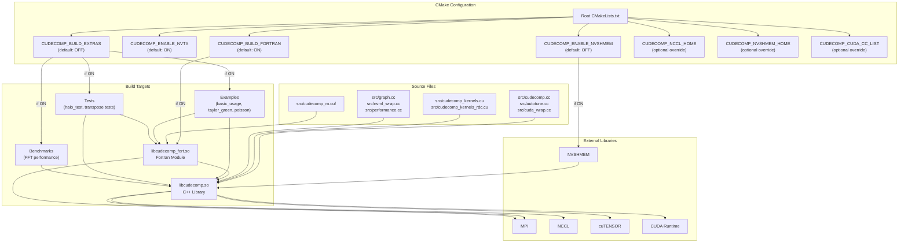

Sources: [CMakeLists.txt:15-21](), [CMakeLists.txt:149-306]()

### Configuration Option Reference

| Option | Type | Default | Description |
|--------|------|---------|-------------|
| `CUDECOMP_BUILD_FORTRAN` | BOOL | `ON` | Build Fortran bindings and `libcudecomp_fort.so` |
| `CUDECOMP_ENABLE_NVTX` | BOOL | `ON` | Enable NVTX profiling ranges for performance analysis |
| `CUDECOMP_ENABLE_NVSHMEM` | BOOL | `OFF` | Enable NVSHMEM backend for communication |
| `CUDECOMP_BUILD_EXTRAS` | BOOL | `OFF` | Build examples, tests, and benchmarks |
| `CUDECOMP_NCCL_HOME` | STRING | (empty) | Path to override NVHPC-provided NCCL installation |
| `CUDECOMP_NVSHMEM_HOME` | STRING | (empty) | Path to override NVHPC-provided NVSHMEM installation |
| `CUDECOMP_CUDA_CC_LIST` | STRING | (auto) | List of CUDA compute capabilities (e.g., "70;80;90") |

Sources: [CMakeLists.txt:15-21]()

## Building the Library

### Basic Build Procedure

The standard build procedure uses out-of-source builds:

```bash
# Clone the repository
git clone https://github.com/NVIDIA/cuDecomp.git
cd cuDecomp

# Create build directory
mkdir build
cd build

# Configure with CMake
cmake ..

# Build with parallel compilation
make -j$(nproc)
```

This produces:
- `build/lib/libcudecomp.so` - Main C++ library
- `build/lib/libcudecomp_fort.so` - Fortran bindings (if enabled)
- `build/include/cudecomp.h` - C++ header
- `build/include/cudecomp.mod` - Fortran module (if enabled)

Sources: [CMakeLists.txt:149-291]()

### Build with NVSHMEM Support

To enable NVSHMEM backend:

```bash
mkdir build-nvshmem
cd build-nvshmem
cmake -DCUDECOMP_ENABLE_NVSHMEM=ON ..
make -j$(nproc)
```

The build system automatically:
1. Locates NVSHMEM headers at [CMakeLists.txt:129-142]()
2. Detects NVSHMEM version from headers [CMakeLists.txt:222-233]()
3. Links appropriate libraries based on version:
   - Version < 2.5: Links `libnvshmem.a` ([CMakeLists.txt:236]())
   - Version ≥ 2.5: Links `libnvshmem_host.so` and `libnvshmem_device.a` ([CMakeLists.txt:238-239]())
4. Applies version-specific workarounds for NCCL symbol export issues ([CMakeLists.txt:242-246]())
5. Links NVML stubs for older NVSHMEM versions ([CMakeLists.txt:248-250]())

Sources: [CMakeLists.txt:126-251]()

### Build with Examples and Tests

To build the complete project including examples, tests, and benchmarks:

```bash
mkdir build-extras
cd build-extras
cmake -DCUDECOMP_BUILD_EXTRAS=ON ..
make -j$(nproc)
```

This builds:
- **Examples**: `basic_usage`, `taylor_green` (C++ and Fortran variants), `poisson` (Fortran)
- **Tests**: `halo_test` (C++ and Fortran), transpose validation tests
- **Benchmarks**: R2C and C2C FFT benchmarks in single and double precision

The extras are configured via subdirectories at [CMakeLists.txt:293-306]()

Sources: [CMakeLists.txt:293-306]()

### Custom Compiler and Dependency Paths

Override default paths for dependencies:

```bash
cmake \
  -DCUDECOMP_NCCL_HOME=/custom/nccl/path \
  -DCUDECOMP_NVSHMEM_HOME=/custom/nvshmem/path \
  -DCUDECOMP_CUDA_CC_LIST="80;90" \
  ..
```

When `CUDECOMP_NCCL_HOME` is set, CMake searches for `nccl.h` and `libnccl.so` in the specified location ([CMakeLists.txt:105-114]()), bypassing the NVHPC-provided version.

Sources: [CMakeLists.txt:20-21](), [CMakeLists.txt:105-122](), [CMakeLists.txt:128-142]()

### Fortran-Only Build

To disable Fortran bindings:

```bash
cmake -DCUDECOMP_BUILD_FORTRAN=OFF ..
make -j$(nproc)
```

This skips:
- Detection of `nvfortran` compiler ([CMakeLists.txt:27-30]())
- Building `libcudecomp_fort.so` ([CMakeLists.txt:263-291]())
- Fortran examples and tests in extras ([CMakeLists.txt:300-305]())

Sources: [CMakeLists.txt:16](), [CMakeLists.txt:27-30](), [CMakeLists.txt:263-291]()

## Installation

Install the library to a custom prefix:

```bash
cmake -DCMAKE_INSTALL_PREFIX=/install/path ..
make install
```

The installation layout:

```
/install/path/
├── lib/
│   ├── libcudecomp.so
│   └── libcudecomp_fort.so  (if Fortran enabled)
└── include/
    ├── cudecomp.h
    └── cudecomp.mod         (if Fortran enabled)
```

Installation targets are defined at:
- C++ library and header: [CMakeLists.txt:256-260]()
- Fortran library: [CMakeLists.txt:285-288]()
- Fortran module: [CMakeLists.txt:290]()

Sources: [CMakeLists.txt:256-291]()

## Build Target Details

The following diagram maps source files to build outputs and shows compilation flags:

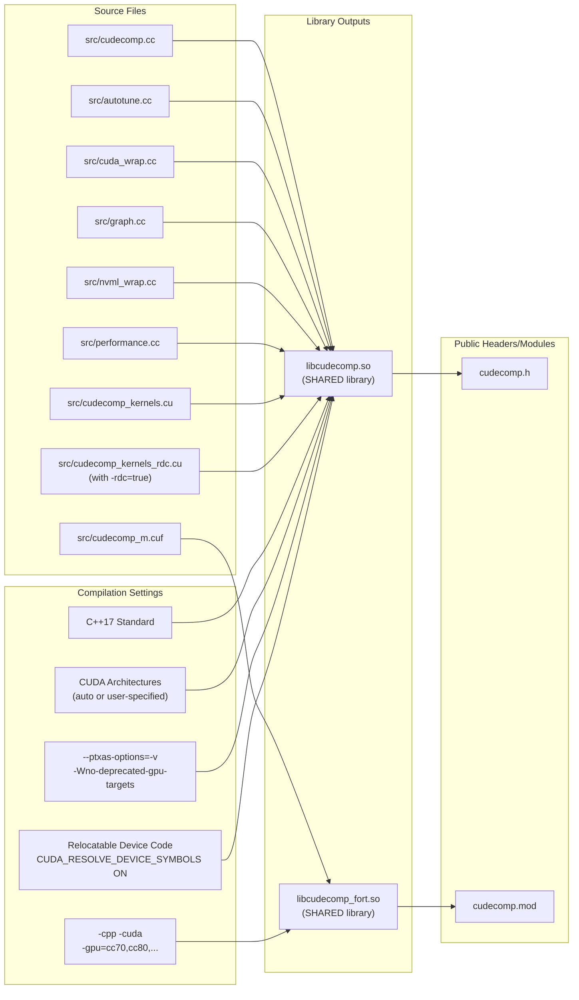

Sources: [CMakeLists.txt:165-178](), [CMakeLists.txt:275-280]()

### Special Compilation Requirements

**Relocatable Device Code (RDC)**
- `src/cudecomp_kernels_rdc.cu` compiled with `-rdc=true` flag ([CMakeLists.txt:177]())
- Enables separate compilation and linking of device code
- Library configured with `CUDA_RESOLVE_DEVICE_SYMBOLS ON` ([CMakeLists.txt:178]())

**NVCC Flags**
- `--ptxas-options=-v`: Verbose PTX assembly output for register usage analysis ([CMakeLists.txt:162]())
- `-Wno-deprecated-gpu-targets`: Suppress warnings for older compute capabilities ([CMakeLists.txt:163]())

**Fortran CUDA Integration**
- Uses `-cuda` flag to enable CUDA Fortran features ([CMakeLists.txt:275]())
- GPU target string generated from `CUDECOMP_CUDA_CC_LIST` ([CMakeLists.txt:264-269]())
- Format: `-gpu=cc70,cc80,cuda12.9` combines compute capabilities and CUDA version

Sources: [CMakeLists.txt:162-163](), [CMakeLists.txt:177-178](), [CMakeLists.txt:264-275]()

## Build System Architecture

### Compiler Detection and Setup

The build system performs the following initialization sequence:

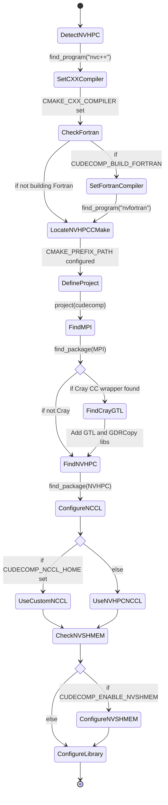

Sources: [CMakeLists.txt:23-146]()

### Cray Environment Support

When Cray compiler wrappers are detected ([CMakeLists.txt:68-72]()), the build system automatically:

1. Detects `CRAY_LD_LIBRARY_PATH` environment variable
2. Searches for `libmpi_gtl_cuda.so` in Cray library paths ([CMakeLists.txt:81-84]())
3. Locates GDRCopy library (`libgdrapi.so`) ([CMakeLists.txt:88-90]())
4. Links both libraries to enable CUDA-aware MPI on Cray systems ([CMakeLists.txt:193-196]())

These libraries enable GPU Direct RDMA capabilities on Cray XC and Cray EX systems.

Sources: [CMakeLists.txt:68-94](), [CMakeLists.txt:193-196]()

### std::filesystem Compatibility

The build system tests for `std::filesystem` linking support:

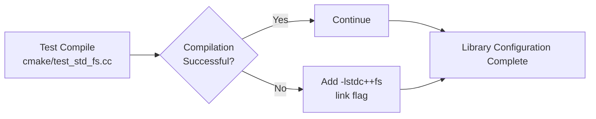

This handles GCC toolchain versions that require explicit linking of `std::filesystem` symbols ([CMakeLists.txt:199-208]()).

Sources: [CMakeLists.txt:199-208](), [cmake/test_std_fs.cc:1-6]()

## CI/CD Build Testing

The cuDecomp CI/CD system validates builds across multiple configurations using GitHub Actions workflows.

### Build Matrix

The CI workflow ([.github/workflows/build.yml]()) tests three configurations:

| Configuration | NVHPC SDK | CUDA Version | Ubuntu Version | Image |
|---------------|-----------|--------------|----------------|-------|
| Latest        | 25.9      | 13.0         | 24.04          | `nvcr.io/nvidia/nvhpc:25.9-devel-cuda13.0-ubuntu24.04` |
| Current       | 25.7      | 12.9         | 22.04          | `nvcr.io/nvidia/nvhpc:25.7-devel-cuda12.9-ubuntu22.04` |
| Legacy        | 22.11     | 11.8         | 20.04          | `nvcr.io/nvidia/nvhpc:22.11-devel-cuda11.8-ubuntu20.04` |

### Build Configurations Tested

For each matrix entry, two build configurations are tested:

1. **Full build with NVSHMEM** ([.github/workflows/build.yml:67-74]()):
   ```bash
   cmake -DCUDECOMP_ENABLE_NVSHMEM=1 -DCUDECOMP_BUILD_EXTRAS=1 ..
   make -j$(nproc)
   ```

2. **Library-only build without NVSHMEM** ([.github/workflows/build.yml:76-83]()):
   ```bash
   cmake ..
   make -j$(nproc)
   ```

### Triggering CI Builds

The workflow is triggered by pull request comments:
- Comment `/build` on a PR to trigger the workflow ([.github/workflows/build.yml:9]())
- Restricted to authorized users ([.github/workflows/build.yml:9]())
- Posts status comments with workflow run links ([.github/workflows/build.yml:14-25](), [.github/workflows/build.yml:92-109]())

Sources: [.github/workflows/build.yml:1-110]()

### Build Workflow Structure

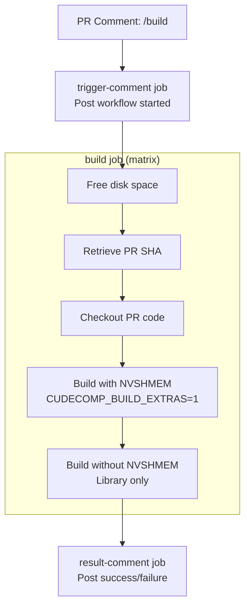

Sources: [.github/workflows/build.yml:7-109]()

## Troubleshooting Common Build Issues

### Compiler Not Found

If NVHPC compilers are not in PATH:
```bash
# Set PATH to include NVHPC bin directory
export PATH=/opt/nvidia/hpc_sdk/Linux_x86_64/2025/compilers/bin:$PATH
cmake ..
```

### Custom NCCL/NVSHMEM Paths

If using non-standard installations:
```bash
cmake \
  -DCUDECOMP_NCCL_HOME=/path/to/nccl \
  -DCUDECOMP_NVSHMEM_HOME=/path/to/nvshmem \
  -DCUDECOMP_ENABLE_NVSHMEM=ON \
  ..
```

### CUDA Compute Capability Mismatch

To target specific GPU architectures:
```bash
cmake -DCUDECOMP_CUDA_CC_LIST="80;90" ..
```

### MPI Library Issues

Ensure MPI is in the CMake search path:
```bash
export CMAKE_PREFIX_PATH=/path/to/mpi:$CMAKE_PREFIX_PATH
cmake ..
```

Sources: [CMakeLists.txt:20-21](), [CMakeLists.txt:52-64](), [CMakeLists.txt:75]()

---

# Page: Quick Start Tutorial

# Quick Start Tutorial

<details>
<summary>Relevant source files</summary>

The following files were used as context for generating this wiki page:

- [README.md](README.md)
- [docs/autotuning.rst](docs/autotuning.rst)
- [docs/env_vars.rst](docs/env_vars.rst)
- [docs/overview.rst](docs/overview.rst)
- [examples/fortran/basic_usage/basic_usage_autotune.f90](examples/fortran/basic_usage/basic_usage_autotune.f90)
- [include/cudecomp.h](include/cudecomp.h)

</details>


## Purpose and Scope

This tutorial walks through a minimal working example demonstrating the core cuDecomp operations: library initialization, grid descriptor creation, data transposition, and halo communication. The example uses a simple configuration without autotuning to illustrate the basic API usage patterns.

For detailed information on building and installing cuDecomp, see [Building and Installation](#2.1). For performance optimization through autotuning, see [Performance Autotuning](#7). For comprehensive API documentation, see [API Reference](#4).

---

## Basic Workflow Overview

The typical cuDecomp workflow follows these stages:

**Workflow: Basic cuDecomp Application**
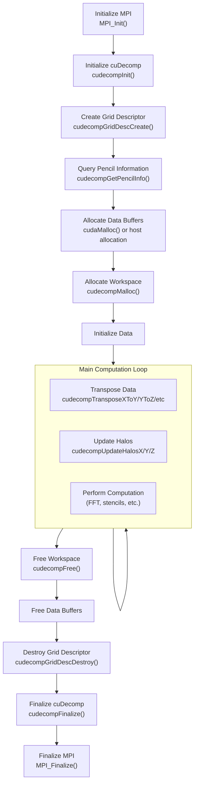

Sources: [examples/fortran/basic_usage/basic_usage_autotune.f90:58-288](), [docs/overview.rst:1-66]()

---

## Step 1: Initialize MPI and cuDecomp

**Initialization Sequence**
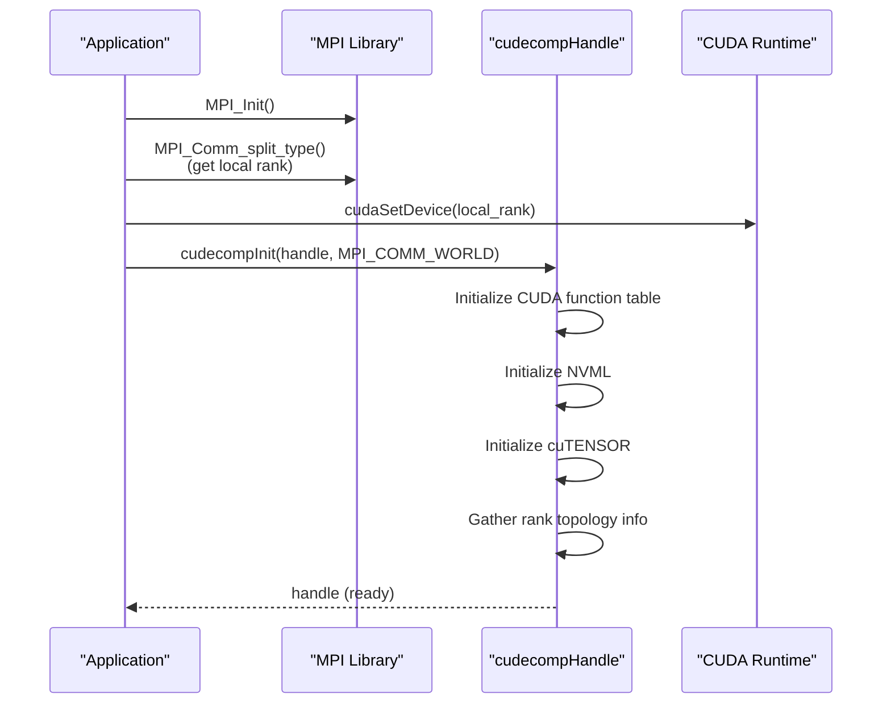

The first step is to initialize MPI and the cuDecomp library. Each MPI rank should set its CUDA device to match its local rank within the node.

**C++ Example:**
```cpp
MPI_Init(&argc, &argv);
int rank, nranks, local_rank;
MPI_Comm_rank(MPI_COMM_WORLD, &rank);
MPI_Comm_size(MPI_COMM_WORLD, &nranks);

// Set CUDA device to match local rank
MPI_Comm local_comm;
MPI_Comm_split_type(MPI_COMM_WORLD, MPI_COMM_TYPE_SHARED, 0, 
                    MPI_INFO_NULL, &local_comm);
MPI_Comm_rank(local_comm, &local_rank);
cudaSetDevice(local_rank);

// Initialize cuDecomp
cudecompHandle_t handle;
cudecompInit(&handle, MPI_COMM_WORLD);
```

**Fortran Example:**
```fortran
call MPI_Init(ierr)
call MPI_Comm_rank(MPI_COMM_WORLD, rank, ierr)
call MPI_Comm_size(MPI_COMM_WORLD, nranks, ierr)

! Set CUDA device to match local rank
call MPI_Comm_split_Type(MPI_COMM_WORLD, MPI_COMM_TYPE_SHARED, 0, &
                         MPI_INFO_NULL, local_comm, ierr)
call MPI_Comm_rank(local_comm, local_rank, ierr)
ierr = cudaSetDevice(local_rank)

! Initialize cuDecomp
istat = cudecompInit(handle, MPI_COMM_WORLD)
```

The `cudecompHandle_t` (C++) or `type(cudecompHandle)` (Fortran) is an opaque handle that maintains library state including communicators, CUDA resources, and topology information. This handle must be passed to all subsequent cuDecomp function calls.

Sources: [examples/fortran/basic_usage/basic_usage_autotune.f90:58-68](), [include/cudecomp.h:205-223]()

---

## Step 2: Create Grid Descriptor Configuration

**Grid Configuration Structure**
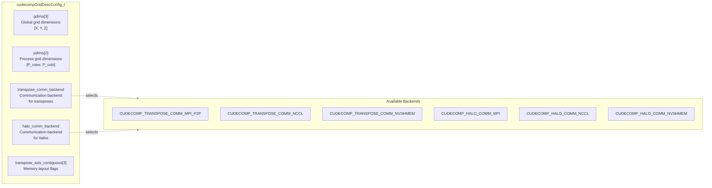

Before creating the grid descriptor, configure the decomposition parameters:

**C++ Example:**
```cpp
cudecompGridDescConfig_t config;
cudecompGridDescConfigSetDefaults(&config);

// Set global grid dimensions [X, Y, Z]
config.gdims[0] = 256;  // X
config.gdims[1] = 256;  // Y
config.gdims[2] = 256;  // Z

// Set process grid dimensions [P_rows, P_cols]
// For nranks=16, could use [4, 4] or [2, 8] or [8, 2] etc.
config.pdims[0] = 4;  // P_rows
config.pdims[1] = 4;  // P_cols

// Choose communication backends
config.transpose_comm_backend = CUDECOMP_TRANSPOSE_COMM_MPI_P2P;
config.halo_comm_backend = CUDECOMP_HALO_COMM_MPI;

// Make pencil axis contiguous in memory (recommended)
config.transpose_axis_contiguous[0] = true;  // X-pencil
config.transpose_axis_contiguous[1] = true;  // Y-pencil
config.transpose_axis_contiguous[2] = true;  // Z-pencil
```

**Fortran Example:**
```fortran
type(cudecompGridDescConfig) :: config

istat = cudecompGridDescConfigSetDefaults(config)

! Set global grid dimensions [X, Y, Z]
config%gdims = [256, 256, 256]

! Set process grid dimensions [P_rows, P_cols]
config%pdims = [4, 4]

! Choose communication backends
config%transpose_comm_backend = CUDECOMP_TRANSPOSE_COMM_MPI_P2P
config%halo_comm_backend = CUDECOMP_HALO_COMM_MPI

! Make pencil axis contiguous in memory
config%transpose_axis_contiguous = [.true., .true., .true.]
```

**Key Configuration Parameters:**

| Parameter | Description |
|-----------|-------------|
| `gdims[3]` | Global grid dimensions `[X, Y, Z]` in column-major order |
| `pdims[2]` | Process grid dimensions `[P_rows, P_cols]` where `P_rows × P_cols = nranks` |
| `transpose_comm_backend` | Backend for transpose communication (MPI, NCCL, or NVSHMEM) |
| `halo_comm_backend` | Backend for halo communication (MPI, NCCL, or NVSHMEM) |
| `transpose_axis_contiguous[3]` | Whether pencil axis should be contiguous in memory (improves FFT performance) |

Sources: [include/cudecomp.h:112-132](), [examples/fortran/basic_usage/basic_usage_autotune.f90:71-80]()

---

## Step 3: Create Grid Descriptor

**Grid Descriptor Creation**
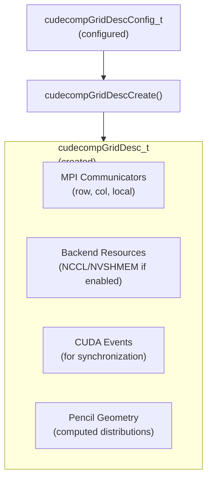

Create the grid descriptor using the configuration:

**C++ Example:**
```cpp
cudecompGridDesc_t grid_desc;
// Pass NULL for autotune options to disable autotuning
cudecompGridDescCreate(handle, &grid_desc, &config, NULL);
```

**Fortran Example:**
```fortran
type(cudecompGridDesc) :: grid_desc

! Pass null() for autotune options to disable autotuning
istat = cudecompGridDescCreate(handle, grid_desc, config, null())
```

The grid descriptor contains all internal state needed for communication operations, including MPI communicators, backend-specific resources, and computed pencil geometry. It can be reused for multiple data buffers with the same decomposition.

For autotuned grid descriptor creation, see [Autotune Configuration and Options](#7.1).

Sources: [include/cudecomp.h:235-253](), [examples/fortran/basic_usage/basic_usage_autotune.f90:120-121]()

---

## Step 4: Query Pencil Information

**Pencil Information Structure**
```mermaid
graph TB
    subgraph PencilInfo["cudecompPencilInfo_t"]
        Shape["shape[3]<br/>Local pencil dimensions<br/>(including halo/padding)"]
        Lo["lo[3]<br/>Lower bound in global grid<br/>(excluding halo/padding)"]
        Hi["hi[3]<br/>Upper bound in global grid<br/>(excluding halo/padding)"]
        Order["order[3]<br/>Memory layout order<br/>(e.g., 2,1,0 for Z,Y,X)"]
        Halo["halo_extents[3]<br/>Halo extents by dimension"]
        Pad["padding[3]<br/>Padding by dimension"]
        Size["size<br/>Total elements in pencil"]
    end
    
    Query["cudecompGetPencilInfo()"]
    Query -->|populates| PencilInfo
```

Query the geometry of pencils assigned to the local rank:

**C++ Example:**
```cpp
// Query X-pencil information (axis = 0)
cudecompPencilInfo_t pinfo_x;
int32_t halo_extents[3] = {1, 1, 1};  // 1 element halo in each direction
cudecompGetPencilInfo(handle, grid_desc, &pinfo_x, 0, halo_extents, NULL);

// Query Y-pencil information (axis = 1, no halos)
cudecompPencilInfo_t pinfo_y;
cudecompGetPencilInfo(handle, grid_desc, &pinfo_y, 1, NULL, NULL);

// Query Z-pencil information (axis = 2, no halos)
cudecompPencilInfo_t pinfo_z;
cudecompGetPencilInfo(handle, grid_desc, &pinfo_z, 2, NULL, NULL);
```

**Fortran Example:**
```fortran
type(cudecompPencilInfo) :: pinfo_x, pinfo_y, pinfo_z

! Query X-pencil information with halos
istat = cudecompGetPencilInfo(handle, grid_desc, pinfo_x, 1, [1, 1, 1])

! Query Y-pencil information (no halos)
istat = cudecompGetPencilInfo(handle, grid_desc, pinfo_y, 2)

! Query Z-pencil information (no halos)
istat = cudecompGetPencilInfo(handle, grid_desc, pinfo_z, 3)
```

**Pencil Information Fields:**

| Field | Description |
|-------|-------------|
| `shape[3]` | Local pencil dimensions in local order (includes halos and padding) |
| `lo[3]`, `hi[3]` | Lower and upper bounds in global grid coordinates (excludes halos/padding) |
| `order[3]` | Memory layout order; e.g., `[2,1,0]` means data is ordered Z,Y,X |
| `halo_extents[3]` | Halo extents by dimension in global order |
| `size` | Total number of elements in pencil buffer |

The `axis` parameter uses C indexing (0=X, 1=Y, 2=Z) in C++ and Fortran indexing (1=X, 2=Y, 3=Z) in Fortran.

Sources: [include/cudecomp.h:192-307](), [examples/fortran/basic_usage/basic_usage_autotune.f90:135-145]()

---

## Step 5: Allocate Memory

**Memory Allocation Strategy**
```mermaid
graph TD
    GetSize["Compute maximum pencil size<br/>max(pinfo_x.size, pinfo_y.size, pinfo_z.size)"]
    
    CheckBackend{"Backend requires<br/>special allocation?"}
    
    NVSHMEM["Use cudecompMalloc()<br/>→ nvshmem_malloc<br/>(symmetric allocation)"]
    NCCL["Use cudecompMalloc()<br/>→ cudaMalloc + ncclCommRegister<br/>(if UBR enabled)"]
    Standard["Use cudecompMalloc()<br/>→ cudaMalloc or cuMemCreate<br/>(standard allocation)"]
    
    AllocData["Allocate data buffer<br/>(user's choice)"]
    AllocWork["Allocate workspace<br/>(must use cudecompMalloc)"]
    
    GetSize --> AllocData
    GetSize --> AllocWork
    AllocWork --> CheckBackend
    CheckBackend -->|NVSHMEM| NVSHMEM
    CheckBackend -->|NCCL w/ UBR| NCCL
    CheckBackend -->|Other| Standard
```

Allocate memory for data buffers and cuDecomp workspaces:

**C++ Example:**
```cpp
// Determine maximum pencil size
int64_t data_num_elements = std::max({pinfo_x.size, pinfo_y.size, pinfo_z.size});

// Allocate data buffer (can use cudaMalloc or host allocation)
double* data_d;
cudaMalloc(&data_d, data_num_elements * sizeof(double));

// Query workspace sizes
int64_t transpose_work_num_elements;
cudecompGetTransposeWorkspaceSize(handle, grid_desc, &transpose_work_num_elements);

int64_t halo_work_num_elements;
cudecompGetHaloWorkspaceSize(handle, grid_desc, 0, halo_extents, &halo_work_num_elements);

// Allocate workspaces using cudecompMalloc (required for backend compatibility)
double* transpose_work_d;
cudecompMalloc(handle, grid_desc, (void**)&transpose_work_d, 
               transpose_work_num_elements * sizeof(double));

double* halo_work_d;
cudecompMalloc(handle, grid_desc, (void**)&halo_work_d,
               halo_work_num_elements * sizeof(double));
```

**Fortran Example:**
```fortran
! Determine maximum pencil size
data_num_elements = max(pinfo_x%size, pinfo_y%size, pinfo_z%size)

! Allocate data buffer
real(real64), allocatable, device, target :: data_d(:)
allocate(data_d(data_num_elements))

! Query workspace sizes
integer(8) :: transpose_work_num_elements, halo_work_num_elements
istat = cudecompGetTransposeWorkspaceSize(handle, grid_desc, transpose_work_num_elements)
istat = cudecompGetHaloWorkspaceSize(handle, grid_desc, 1, [1,1,1], halo_work_num_elements)

! Allocate workspaces using cudecompMalloc
real(real64), pointer, device :: transpose_work_d(:), halo_work_d(:)
istat = cudecompMalloc(handle, grid_desc, transpose_work_d, transpose_work_num_elements)
istat = cudecompMalloc(handle, grid_desc, halo_work_d, halo_work_num_elements)
```

**Important Notes:**
- Data buffers can be allocated using standard methods (`cudaMalloc`, host allocation)
- Workspace buffers **must** be allocated using `cudecompMalloc()` for backend compatibility
- `cudecompMalloc()` automatically selects the appropriate allocator based on the communication backend:
  - NVSHMEM backends require symmetric memory (`nvshmem_malloc`)
  - NCCL backends may use User Buffer Registration for performance
  - Standard backends use `cudaMalloc` or CUDA VMM

Sources: [include/cudecomp.h:309-381](), [examples/fortran/basic_usage/basic_usage_autotune.f90:148-237]()

---

## Step 6: Perform Transpose Operations

**Transpose Data Flow**
```mermaid
graph LR
    subgraph "Global Grid"
        XPencil["X-Pencils<br/>contiguous in X"]
        YPencil["Y-Pencils<br/>contiguous in Y"]
        ZPencil["Z-Pencils<br/>contiguous in Z"]
    end
    
    XPencil -->|"cudecompTransposeXToY()"| YPencil
    YPencil -->|"cudecompTransposeYToZ()"| ZPencil
    ZPencil -->|"cudecompTransposeZToY()"| YPencil
    YPencil -->|"cudecompTransposeYToX()"| XPencil
```

Transpose operations redistribute data between different pencil orientations:

**C++ Example:**
```cpp
// Transpose from X-pencils to Y-pencils
cudecompTransposeXToY(handle, grid_desc, 
                      data_d, data_d,  // in-place
                      transpose_work_d,
                      CUDECOMP_DOUBLE,
                      halo_extents, NULL,  // input has halos, output does not
                      NULL, NULL,          // no padding
                      0);                  // default stream

// Transpose from Y-pencils to Z-pencils
cudecompTransposeYToZ(handle, grid_desc,
                      data_d, data_d,
                      transpose_work_d,
                      CUDECOMP_DOUBLE,
                      NULL, NULL,  // no halos
                      NULL, NULL,  // no padding
                      0);

// Transpose from Z-pencils to Y-pencils
cudecompTransposeZToY(handle, grid_desc,
                      data_d, data_d,
                      transpose_work_d,
                      CUDECOMP_DOUBLE,
                      NULL, NULL,
                      NULL, NULL,
                      0);

// Transpose from Y-pencils back to X-pencils
cudecompTransposeYToX(handle, grid_desc,
                      data_d, data_d,
                      transpose_work_d,
                      CUDECOMP_DOUBLE,
                      NULL, halo_extents,  // output has halos
                      NULL, NULL,
                      0);
```

**Fortran Example:**
```fortran
! Transpose from X-pencils to Y-pencils
istat = cudecompTransposeXToY(handle, grid_desc, data_d, data_d, &
                              transpose_work_d, CUDECOMP_DOUBLE, &
                              pinfo_x%halo_extents, [0,0,0])

! Transpose from Y-pencils to Z-pencils
istat = cudecompTransposeYToZ(handle, grid_desc, data_d, data_d, &
                              transpose_work_d, CUDECOMP_DOUBLE)

! Transpose from Z-pencils to Y-pencils
istat = cudecompTransposeZToY(handle, grid_desc, data_d, data_d, &
                              transpose_work_d, CUDECOMP_DOUBLE)

! Transpose from Y-pencils to X-pencils
istat = cudecompTransposeYToX(handle, grid_desc, data_d, data_d, &
                              transpose_work_d, CUDECOMP_DOUBLE, &
                              [0,0,0], pinfo_x%halo_extents)
```

**Transpose Function Parameters:**

| Parameter | Description |
|-----------|-------------|
| `input`, `output` | Input and output buffers; can be same pointer for in-place operation |
| `work` | Workspace buffer allocated with `cudecompMalloc()` |
| `dtype` | Data type: `CUDECOMP_DOUBLE`, `CUDECOMP_FLOAT`, `CUDECOMP_DOUBLE_COMPLEX`, etc. |
| `input_halo_extents` | Halo extents of input data (3-element array or NULL) |
| `output_halo_extents` | Halo extents of output data (3-element array or NULL) |
| `input_padding`, `output_padding` | Padding amounts (3-element arrays or NULL) |
| `stream` | CUDA stream for GPU operations |

Sources: [include/cudecomp.h:430-545](), [examples/fortran/basic_usage/basic_usage_autotune.f90:242-255]()

---

## Step 7: Perform Halo Updates

**Halo Communication Pattern**
```mermaid
graph TB
    subgraph Pencil["X-Pencil (Local Data)"]
        Core["Core Data<br/>(owned by rank)"]
        HaloLeft["Left Halo<br/>(received)"]
        HaloRight["Right Halo<br/>(received)"]
    end
    
    RankMinus["Rank-1<br/>(neighbor)"]
    RankPlus["Rank+1<br/>(neighbor)"]
    
    RankMinus -->|"Send boundary"| HaloLeft
    HaloRight <--|"Send boundary"| RankPlus
    
    Core -->|"Send to Rank+1"| RankPlus
    Core -->|"Send to Rank-1"| RankMinus
```

Halo updates exchange boundary data with neighboring ranks:

**C++ Example:**
```cpp
bool halo_periods[3] = {true, true, true};  // periodic in all directions

// Update X-pencil halos in X direction (dim=0)
cudecompUpdateHalosX(handle, grid_desc,
                     data_d,
                     halo_work_d,
                     CUDECOMP_DOUBLE,
                     halo_extents,
                     halo_periods,
                     0,     // dim: X direction
                     NULL,  // no padding
                     0);    // default stream

// Update X-pencil halos in Y direction (dim=1)
cudecompUpdateHalosX(handle, grid_desc,
                     data_d,
                     halo_work_d,
                     CUDECOMP_DOUBLE,
                     halo_extents,
                     halo_periods,
                     1,     // dim: Y direction
                     NULL,
                     0);

// Update X-pencil halos in Z direction (dim=2)
cudecompUpdateHalosX(handle, grid_desc,
                     data_d,
                     halo_work_d,
                     CUDECOMP_DOUBLE,
                     halo_extents,
                     halo_periods,
                     2,     // dim: Z direction
                     NULL,
                     0);
```

**Fortran Example:**
```fortran
logical :: halo_periods(3) = [.true., .true., .true.]

! Update X-pencil halos in X direction (dim=1 in Fortran)
istat = cudecompUpdateHalosX(handle, grid_desc, data_d, halo_work_d, &
                             CUDECOMP_DOUBLE, pinfo_x%halo_extents, &
                             halo_periods, 1)

! Update X-pencil halos in Y direction (dim=2)
istat = cudecompUpdateHalosX(handle, grid_desc, data_d, halo_work_d, &
                             CUDECOMP_DOUBLE, pinfo_x%halo_extents, &
                             halo_periods, 2)

! Update X-pencil halos in Z direction (dim=3)
istat = cudecompUpdateHalosX(handle, grid_desc, data_d, halo_work_d, &
                             CUDECOMP_DOUBLE, pinfo_x%halo_extents, &
                             halo_periods, 3)
```

**Halo Update Function Parameters:**

| Parameter | Description |
|-----------|-------------|
| `input` | Data buffer (modified in-place with updated halos) |
| `work` | Workspace buffer allocated with `cudecompMalloc()` |
| `dtype` | Data type |
| `halo_extents` | Number of halo elements per direction (3-element array) |
| `halo_periods` | Periodicity flags by dimension (3-element boolean array or NULL) |
| `dim` | Which dimension to perform the halo update (C: 0/1/2, Fortran: 1/2/3) |
| `padding` | Padding amounts (3-element array or NULL) |
| `stream` | CUDA stream for GPU operations |

Similar functions exist for Y-pencils (`cudecompUpdateHalosY()`) and Z-pencils (`cudecompUpdateHalosZ()`).

Sources: [include/cudecomp.h:547-620](), [examples/fortran/basic_usage/basic_usage_autotune.f90:261-273]()

---

## Step 8: Cleanup

**Cleanup Sequence**
```mermaid
sequenceDiagram
    participant App as "Application"
    participant Data as "Data Buffers"
    participant Work as "Workspaces"
    participant GridDesc as "Grid Descriptor"
    participant Handle as "cuDecomp Handle"
    participant MPI as "MPI"
    
    App->>Data: cudaFree(data_d)
    App->>Work: cudecompFree(transpose_work_d)
    App->>Work: cudecompFree(halo_work_d)
    App->>GridDesc: cudecompGridDescDestroy()
    GridDesc->>GridDesc: Destroy communicators
    GridDesc->>GridDesc: Free backend resources
    App->>Handle: cudecompFinalize()
    Handle->>Handle: Cleanup CUDA/cuTENSOR
    App->>MPI: MPI_Finalize()
```

Properly clean up resources in reverse order of creation:

**C++ Example:**
```cpp
// Free data buffers
cudaFree(data_d);

// Free workspaces (must use cudecompFree)
cudecompFree(handle, grid_desc, transpose_work_d);
cudecompFree(handle, grid_desc, halo_work_d);

// Destroy grid descriptor
cudecompGridDescDestroy(handle, grid_desc);

// Finalize cuDecomp
cudecompFinalize(handle);

// Finalize MPI
MPI_Finalize();
```

**Fortran Example:**
```fortran
! Free data buffers
deallocate(data_d)

! Free workspaces
istat = cudecompFree(handle, grid_desc, transpose_work_d)
istat = cudecompFree(handle, grid_desc, halo_work_d)

! Destroy grid descriptor
istat = cudecompGridDescDestroy(handle, grid_desc)

! Finalize cuDecomp
istat = cudecompFinalize(handle)

! Finalize MPI
call MPI_Finalize(ierr)
```

**Cleanup Order (Critical):**
1. Free user-allocated data buffers
2. Free cuDecomp workspaces using `cudecompFree()`
3. Destroy grid descriptors with `cudecompGridDescDestroy()`
4. Finalize cuDecomp handle with `cudecompFinalize()`
5. Finalize MPI

Workspaces must be freed before destroying the grid descriptor since the grid descriptor tracks allocation types (NVSHMEM, NCCL-registered, standard) needed for proper deallocation.

Sources: [examples/fortran/basic_usage/basic_usage_autotune.f90:276-287](), [include/cudecomp.h:255-261]()

---

## Complete Example Reference

The complete working examples demonstrating this basic workflow are available in the cuDecomp repository:

**Without Autotuning:**
- C++: [examples/cc/basic_usage/basic_usage.cu]()
- Fortran: [examples/fortran/basic_usage/basic_usage.f90]()

**With Autotuning:**
- C++: [examples/cc/basic_usage/basic_usage_autotune.cu]()
- Fortran: [examples/fortran/basic_usage/basic_usage_autotune.f90]()

**Real-World Application:**
- Taylor-Green Vortex Solver (3D Navier-Stokes): [examples/cc/taylor_green/tg.cu]()

For building and running these examples, see [Building and Installation](#2.1). For more complex use cases including FFT-based applications, see [Examples and Use Cases](#11).

Sources: [examples/fortran/basic_usage/basic_usage_autotune.f90:1-290](), [README.md:1-43]()

---

## Next Steps

After completing this tutorial, you may want to explore:

- **[Performance Autotuning](#7)**: Automatically find optimal process grid and communication backends
- **[Pipelined Transposes](#5.2)**: Enable computation-communication overlap for improved performance
- **[Communication Backend Details](#8)**: Understand when to use MPI, NCCL, or NVSHMEM backends
- **[FFT-Based Applications](#11.3)**: Integrate cuDecomp with cuFFT for spectral solvers
- **[API Reference](#4)**: Complete documentation of all available functions and options

Sources: [docs/autotuning.rst:1-498](), [docs/overview.rst:1-66]()

---

# Page: Core Concepts

# Core Concepts

<details>
<summary>Relevant source files</summary>

The following files were used as context for generating this wiki page:

- [include/cudecomp.h](include/cudecomp.h)
- [include/internal/common.h](include/internal/common.h)
- [src/cudecomp.cc](src/cudecomp.cc)

</details>


This page introduces the fundamental concepts and abstractions that form the foundation of cuDecomp. Understanding these concepts is essential for effectively using the library to perform distributed 3D data decomposition on GPU systems.

This document covers the high-level architecture, data structures, and communication patterns. For detailed information about initialization procedures and resource management, see [Library Architecture and Initialization](#3.1). For in-depth discussion of decomposition strategies and memory layouts, see [Data Decomposition and Pencil Orientations](#3.2). For details about selecting and configuring communication methods, see [Communication Backends](#3.3).

## Library Abstractions

cuDecomp provides two primary abstractions that users interact with: the **handle** and the **grid descriptor**.

### cudecompHandle_t: Library Context

The `cudecompHandle_t` is an opaque pointer to a `cudecompHandle` structure that maintains global library state and resources shared across all decompositions. A handle must be created via `cudecompInit()` before any other library operations and manages:

- **MPI communicators**: Global, local (node-level), and clique (MNNVL) communicators
- **NCCL communicators**: Global and local NCCL communicators for GPU-direct communication
- **CUDA resources**: Internal streams for concurrent operations, cuTENSOR handle
- **Topology information**: Rank-to-hostname mappings, MNNVL clique information
- **NVSHMEM state**: Symmetric heap tracking and allocation management
- **Configuration flags**: User buffer registration, CUDA graphs, performance reporting

The library currently supports only a single handle per process. Multiple grid descriptors can be created from one handle to support different decomposition configurations.

**Diagram: Handle Structure and Managed Resources**

```mermaid
graph TB
    subgraph "User Space"
        User["Application Code"]
    end
    
    subgraph "cudecompHandle (cudecomp.cc:409-511)"
        Handle["cudecompHandle_t<br/>Opaque Pointer"]
        
        subgraph "Communicators"
            MPI_COMM["mpi_comm<br/>MPI_Comm"]
            MPI_LOCAL["mpi_local_comm<br/>Node-local"]
            MPI_CLIQUE["mpi_clique_comm<br/>MNNVL clique"]
            NCCL_GLOBAL["nccl_comm<br/>ncclComm (global)"]
            NCCL_LOCAL["nccl_local_comm<br/>ncclComm (local)"]
        end
        
        subgraph "CUDA Resources"
            STREAMS["streams<br/>vector<cudaStream_t>"]
            CUTENSOR["cutensor_handle<br/>cutensorHandle_t"]
        end
        
        subgraph "Topology Info"
            HOSTNAMES["hostnames<br/>vector<array<char>>"]
            RANK_LOCAL["rank_to_local_rank<br/>vector<int32_t>"]
            RANK_CLIQUE["rank_to_clique<br/>vector<unsigned int>"]
            MNNVL_INFO["rank_to_mnnvl_info<br/>vector<mnnvl_info>"]
        end
        
        subgraph "Feature Flags"
            NCCL_UBR["nccl_enable_ubr<br/>bool"]
            CUMEM["cuda_cumem_enable<br/>bool"]
            GRAPHS["cuda_graphs_enable<br/>bool"]
            PERF["performance_report_enable<br/>bool"]
        end
    end
    
    User -->|"cudecompInit()"| Handle
    Handle --> MPI_COMM
    Handle --> MPI_LOCAL
    Handle --> MPI_CLIQUE
    Handle --> NCCL_GLOBAL
    Handle --> NCCL_LOCAL
    Handle --> STREAMS
    Handle --> CUTENSOR
    Handle --> HOSTNAMES
    Handle --> RANK_LOCAL
    Handle --> RANK_CLIQUE
    Handle --> MNNVL_INFO
    Handle --> NCCL_UBR
    Handle --> CUMEM
    Handle --> GRAPHS
    Handle --> PERF
```

Sources: [include/internal/common.h:54-117](), [src/cudecomp.cc:409-511]()

### cudecompGridDesc_t: Decomposition Configuration

The `cudecompGridDesc_t` is an opaque pointer to a `cudecompGridDesc` structure that defines a specific decomposition configuration for a 3D data grid. Grid descriptors are created via `cudecompGridDescCreate()` and encapsulate:

- **Grid dimensions**: Global data dimensions (`gdims`), distribution dimensions (`gdims_dist`), process grid dimensions (`pdims`)
- **Communication backends**: Selected backends for transpose and halo operations
- **Memory layout**: Axis contiguity and memory ordering specifications
- **Communicator references**: Row and column MPI/NCCL/NVSHMEM communicators
- **Scheduling resources**: CUDA events for pipeline synchronization
- **Performance tracking**: Event collections for performance monitoring

Multiple grid descriptors can coexist under a single handle, each representing different decomposition strategies (e.g., different process grid dimensions or memory layouts).

**Diagram: Grid Descriptor Configuration Pipeline**

```mermaid
graph LR
    subgraph "Configuration"
        CONFIG["cudecompGridDescConfig_t<br/>User-provided"]
        GDIMS["gdims[3]<br/>Global dimensions"]
        PDIMS["pdims[2]<br/>Process grid"]
        T_BACKEND["transpose_comm_backend<br/>cudecompTransposeCommBackend_t"]
        H_BACKEND["halo_comm_backend<br/>cudecompHaloCommBackend_t"]
        MEM_ORDER["transpose_mem_order[3][3]<br/>Memory layout"]
    end
    
    subgraph "Optional Autotuning"
        AUTO_OPT["cudecompGridDescAutotuneOptions_t"]
        AUTO_PDIMS["Autotune pdims"]
        AUTO_T_BACKEND["Autotune transpose backend"]
        AUTO_H_BACKEND["Autotune halo backend"]
    end
    
    subgraph "Grid Descriptor (common.h:169-206)"
        GRID_DESC["cudecompGridDesc_t"]
        FINAL_CONFIG["config<br/>Final configuration"]
        PIDX["pidx[2]<br/>Process index"]
        ROW_COMM["row_comm_info<br/>cudecompCommInfo"]
        COL_COMM["col_comm_info<br/>cudecompCommInfo"]
        EVENTS["events<br/>vector<cudaEvent_t>"]
        NCCL_REFS["nccl_comm, nccl_local_comm<br/>References to handle comms"]
    end
    
    CONFIG --> GDIMS
    CONFIG --> PDIMS
    CONFIG --> T_BACKEND
    CONFIG --> H_BACKEND
    CONFIG --> MEM_ORDER
    
    AUTO_OPT --> AUTO_PDIMS
    AUTO_OPT --> AUTO_T_BACKEND
    AUTO_OPT --> AUTO_H_BACKEND
    
    CONFIG --> GRID_DESC
    AUTO_OPT -.->|"Optional"| GRID_DESC
    AUTO_PDIMS -.->|"Updates"| PDIMS
    AUTO_T_BACKEND -.->|"Updates"| T_BACKEND
    AUTO_H_BACKEND -.->|"Updates"| H_BACKEND
    
    GRID_DESC --> FINAL_CONFIG
    GRID_DESC --> PIDX
    GRID_DESC --> ROW_COMM
    GRID_DESC --> COL_COMM
    GRID_DESC --> EVENTS
    GRID_DESC --> NCCL_REFS
```

Sources: [include/cudecomp.h:113-132](), [include/internal/common.h:169-206](), [src/cudecomp.cc:565-822]()

## Pencil Decomposition Strategy

cuDecomp uses a **pencil decomposition** strategy where the 3D global data grid is distributed across a 2D process grid. Each process owns a "pencil" - a contiguous slice of data that extends fully along one axis while being partitioned along the other two axes.

### Process Grid and Pencil Orientations

The process grid is defined by `pdims[2]` where `pdims[0] × pdims[1]` must equal the total number of MPI ranks. Data can exist in three orientations:

- **X-pencils**: Data is contiguous along the X-axis, partitioned in Y and Z
- **Y-pencils**: Data is contiguous along the Y-axis, partitioned in X and Z  
- **Z-pencils**: Data is contiguous along the Z-axis, partitioned in X and Y

Each orientation is optimized for algorithms requiring contiguous access along a specific axis (e.g., 1D FFTs, finite differences).

**Diagram: Pencil Decomposition and Process Grid Mapping**

```mermaid
graph TB
    subgraph "Global 3D Grid"
        GLOBAL["Global Grid<br/>gdims[3] = {Nx, Ny, Nz}"]
    end
    
    subgraph "Process Grid (common.h:214-226)"
        PGRID["2D Process Grid<br/>pdims[2] = {P0, P1}<br/>P0 × P1 = nranks"]
        PIDX["Process Index<br/>pidx[2] = {i, j}<br/>0 ≤ i < P0, 0 ≤ j < P1"]
    end
    
    subgraph "Pencil Orientations (cudecomp.h:194-202)"
        XPENCIL["X-Pencils (axis=0)<br/>shape: {Nx, Ny/P0, Nz/P1}<br/>order: {0,1,2} (default)<br/>Contiguous in X"]
        YPENCIL["Y-Pencils (axis=1)<br/>shape: {Nx/P1, Ny, Nz/P0}<br/>order: {1,0,2} (default)<br/>Contiguous in Y"]
        ZPENCIL["Z-Pencils (axis=2)<br/>shape: {Nx/P1, Ny/P0, Nz}<br/>order: {2,0,1} (default)<br/>Contiguous in Z"]
    end
    
    subgraph "Pencil Info Query (cudecomp.cc:994-1054)"
        GET_PENCIL["cudecompGetPencilInfo()<br/>Returns cudecompPencilInfo_t"]
        SHAPE["shape[3]<br/>Local dimensions"]
        ORDER["order[3]<br/>Memory layout"]
        LO_HI["lo[3], hi[3]<br/>Global coordinates"]
        HALOS["halo_extents[3]<br/>Halo regions"]
    end
    
    GLOBAL --> PGRID
    PGRID --> PIDX
    
    GLOBAL --> XPENCIL
    GLOBAL --> YPENCIL
    GLOBAL --> ZPENCIL
    
    XPENCIL --> GET_PENCIL
    YPENCIL --> GET_PENCIL
    ZPENCIL --> GET_PENCIL
    
    GET_PENCIL --> SHAPE
    GET_PENCIL --> ORDER
    GET_PENCIL --> LO_HI
    GET_PENCIL --> HALOS
```

Sources: [include/cudecomp.h:194-202](), [include/internal/common.h:214-226](), [src/cudecomp.cc:994-1054]()

### Memory Layout Control

The memory layout of pencils is controlled by the `transpose_mem_order` field in `cudecompGridDescConfig_t`. Each pencil orientation can have a custom memory ordering specified as a permutation of `{0, 1, 2}`:

- `order[i]` indicates which global dimension occupies the i-th position in memory
- For X-pencils with `order = {0,1,2}`: memory is ordered `x + y*Nx + z*Nx*Ny`
- For Y-pencils with `order = {1,0,2}`: memory is ordered `y + x*Ny + z*Nx*Ny` (Y is contiguous)

The `cudecompPencilInfo_t` structure returned by `cudecompGetPencilInfo()` contains the shape, order, and bounds information needed to access pencil data.

**Table: Pencil Information Fields**

| Field | Type | Description |
|-------|------|-------------|
| `shape[3]` | `int32_t[3]` | Pencil dimensions in local memory order (includes halo and padding) |
| `lo[3]`, `hi[3]` | `int32_t[3]` | Lower and upper bound coordinates in global order |
| `order[3]` | `int32_t[3]` | Memory layout permutation (maps global to local dimension order) |
| `halo_extents[3]` | `int32_t[3]` | Halo region extents in global order |
| `padding[3]` | `int32_t[3]` | Padding elements in global order |
| `size` | `int64_t` | Total number of elements (including halos and padding) |

Sources: [include/cudecomp.h:194-202](), [src/cudecomp.cc:994-1054]()

## Communication Patterns

cuDecomp provides two fundamental communication operations: **transpose** and **halo update**.

### Transpose Operations

Transpose operations redistribute data between different pencil orientations. The library provides four transpose functions:

- `cudecompTransposeXToY()`: X-pencils → Y-pencils (uses column communicator)
- `cudecompTransposeYToZ()`: Y-pencils → Z-pencils (uses row communicator)
- `cudecompTransposeZToY()`: Z-pencils → Y-pencils (uses row communicator)
- `cudecompTransposeYToX()`: Y-pencils → X-pencils (uses column communicator)

Each transpose involves three phases executed on GPUs:

1. **Pack**: Reorganize local data for efficient communication (may use cuTENSOR for local permutation)
2. **Communicate**: All-to-all exchange with peers in row or column communicator
3. **Unpack**: Reorganize received data into target memory layout

**Diagram: Transpose Communication Flow**

```mermaid
graph TB
    subgraph "Row/Column Communicators (common.h:120-131)"
        ROW_INFO["row_comm_info<br/>Same pidx[0]<br/>nranks = pdims[1]"]
        COL_INFO["col_comm_info<br/>Same pidx[1]<br/>nranks = pdims[0]"]
    end
    
    subgraph "Transpose Operations (cudecomp.cc:1376-1543)"
        X_TO_Y["cudecompTransposeXToY()<br/>Column communicator"]
        Y_TO_Z["cudecompTransposeYToZ()<br/>Row communicator"]
        Z_TO_Y["cudecompTransposeZToY()<br/>Row communicator"]
        Y_TO_X["cudecompTransposeYToX()<br/>Column communicator"]
    end
    
    subgraph "Transpose Pipeline"
        INPUT["Input Pencil<br/>input buffer"]
        PACK["Pack Phase<br/>Local permute + reorganize<br/>cuTENSOR (if needed)"]
        ALLTOALL["All-to-All Communication<br/>Backend-specific<br/>(MPI/NCCL/NVSHMEM)"]
        UNPACK["Unpack Phase<br/>Reorganize + local permute<br/>cuTENSOR (if needed)"]
        OUTPUT["Output Pencil<br/>output buffer"]
    end
    
    subgraph "Work Buffer (cudecomp.cc:1088-1105)"
        WORKSPACE["Transpose Workspace<br/>cudecompGetTransposeWorkspaceSize()"]
    end
    
    X_TO_Y --> COL_INFO
    Y_TO_Z --> ROW_INFO
    Z_TO_Y --> ROW_INFO
    Y_TO_X --> COL_INFO
    
    INPUT --> PACK
    PACK --> ALLTOALL
    ALLTOALL --> UNPACK
    UNPACK --> OUTPUT
    
    WORKSPACE -.->|"Used by"| PACK
    WORKSPACE -.->|"Used by"| ALLTOALL
    WORKSPACE -.->|"Used by"| UNPACK
```

Sources: [include/cudecomp.h:431-545](), [include/internal/common.h:120-131](), [src/cudecomp.cc:1376-1543](), [src/cudecomp.cc:1088-1105]()

### Halo Update Operations

Halo operations exchange boundary data between neighboring processes along a specified dimension. The library provides three halo functions:

- `cudecompUpdateHalosX()`: Update halos for X-pencils
- `cudecompUpdateHalosY()`: Update halos for Y-pencils
- `cudecompUpdateHalosZ()`: Update halos for Z-pencils

Each halo operation:

1. Identifies neighbor ranks using `cudecompGetShiftedRank()` for specified dimension and periodicity
2. Packs boundary data from source regions into communication buffers (if not contiguous)
3. Performs pair-wise send/receive with ±1 neighbors along the specified dimension
4. Unpacks received data into halo regions

**Diagram: Halo Communication Pattern**

```mermaid
graph LR
    subgraph "Pencil with Halos (cudecomp.h:194-202)"
        PENCIL["Pencil Data Buffer<br/>shape includes halo_extents"]
        INTERIOR["Interior Region<br/>lo[dim] to hi[dim]"]
        HALO_LO["Lower Halo<br/>halo_extents[dim] elements"]
        HALO_HI["Upper Halo<br/>halo_extents[dim] elements"]
    end
    
    subgraph "Neighbor Detection (cudecomp.cc:1331-1374)"
        GET_SHIFTED["cudecompGetShiftedRank()<br/>axis, dim, displacement, periodic"]
        NEIGHBOR_M1["Neighbor at -1<br/>Lower neighbor rank"]
        NEIGHBOR_P1["Neighbor at +1<br/>Upper neighbor rank"]
    end
    
    subgraph "Halo Operations (cudecomp.cc:1545-1672)"
        UPDATE_X["cudecompUpdateHalosX()"]
        UPDATE_Y["cudecompUpdateHalosY()"]
        UPDATE_Z["cudecompUpdateHalosZ()"]
    end
    
    subgraph "Communication Steps"
        PACK_BOUNDARY["Pack Boundaries<br/>Extract lo/hi boundary data"]
        SENDRECV["Send/Recv Pairs<br/>Exchange with neighbors<br/>(MPI/NCCL/NVSHMEM)"]
        UNPACK_HALO["Unpack into Halos<br/>Write to halo regions"]
    end
    
    PENCIL --> INTERIOR
    PENCIL --> HALO_LO
    PENCIL --> HALO_HI
    
    GET_SHIFTED --> NEIGHBOR_M1
    GET_SHIFTED --> NEIGHBOR_P1
    
    UPDATE_X --> PACK_BOUNDARY
    UPDATE_Y --> PACK_BOUNDARY
    UPDATE_Z --> PACK_BOUNDARY
    
    PACK_BOUNDARY --> SENDRECV
    SENDRECV --> UNPACK_HALO
    
    NEIGHBOR_M1 -.->|"Send hi boundary"| SENDRECV
    NEIGHBOR_P1 -.->|"Send lo boundary"| SENDRECV
    SENDRECV -.->|"Recv from -1"| HALO_LO
    SENDRECV -.->|"Recv from +1"| HALO_HI
```

Sources: [include/cudecomp.h:548-625](), [src/cudecomp.cc:1331-1374](), [src/cudecomp.cc:1545-1672]()

## Communication Backend Selection

cuDecomp supports three communication backends, each with specific characteristics and requirements:

### Backend Types

**Table: Communication Backend Options**

| Backend | Enum Values | Requirements | Characteristics |
|---------|-------------|--------------|-----------------|
| **MPI** | `CUDECOMP_TRANSPOSE_COMM_MPI_P2P`<br/>`CUDECOMP_TRANSPOSE_COMM_MPI_P2P_PL`<br/>`CUDECOMP_TRANSPOSE_COMM_MPI_A2A`<br/>`CUDECOMP_HALO_COMM_MPI`<br/>`CUDECOMP_HALO_COMM_MPI_BLOCKING` | Standard MPI library | CPU-mediated transfers, widest compatibility |
| **NCCL** | `CUDECOMP_TRANSPOSE_COMM_NCCL`<br/>`CUDECOMP_TRANSPOSE_COMM_NCCL_PL`<br/>`CUDECOMP_HALO_COMM_NCCL` | NCCL library | GPU-direct transfers, optimized for NVLink/InfiniBand |
| **NVSHMEM** | `CUDECOMP_TRANSPOSE_COMM_NVSHMEM`<br/>`CUDECOMP_TRANSPOSE_COMM_NVSHMEM_PL`<br/>`CUDECOMP_HALO_COMM_NVSHMEM`<br/>`CUDECOMP_HALO_COMM_NVSHMEM_BLOCKING` | NVSHMEM library, compile-time `ENABLE_NVSHMEM` | One-sided GPU-direct transfers, requires symmetric heap |

Sources: [include/cudecomp.h:44-63](), [src/cudecomp.cc:89-124]()

### Pipelined Variants

Backends with `_PL` suffix support **pipelined** operation, which overlaps communication with local computation by splitting the all-to-all into multiple chunks. This can improve performance by hiding communication latency.

Pipelined transposes:
- Split pencil data into chunks along the non-contiguous dimension
- Overlap pack/communication/unpack operations across chunks
- Use CUDA events for dependency management between pipeline stages
- Optionally use CUDA graphs (when `CUDECOMP_ENABLE_CUDA_GRAPHS=1`) for reduced kernel launch overhead

**Diagram: Backend Selection and Initialization**

```mermaid
graph TB
    subgraph "Configuration (cudecomp.h:113-132)"
        CONFIG["cudecompGridDescConfig_t"]
        T_BACKEND_CFG["transpose_comm_backend"]
        H_BACKEND_CFG["halo_comm_backend"]
    end
    
    subgraph "Backend Validation (cudecomp.cc:89-124)"
        CHECK_T["checkTransposeCommBackend()"]
        CHECK_H["checkHaloCommBackend()"]
        NVSHMEM_IFDEF["#ifdef ENABLE_NVSHMEM"]
    end
    
    subgraph "Backend Initialization (cudecomp.cc:632-696)"
        INIT_NCCL["Initialize NCCL<br/>transposeBackendRequiresNccl()<br/>haloBackendRequiresNccl()"]
        CREATE_NCCL_GLOBAL["ncclCommFromMPIComm()<br/>Global communicator"]
        CREATE_NCCL_LOCAL["ncclCommFromMPIComm()<br/>Local/clique communicator"]
        
        INIT_NVSHMEM["Initialize NVSHMEM<br/>transposeBackendRequiresNvshmem()<br/>haloBackendRequiresNvshmem()"]
        INIT_NVSHMEM_CALL["initNvshmemFromMPIComm()"]
        NVSHMEM_TEAMS["nvshmem_team_split_2d()<br/>Create row/col teams"]
    end
    
    subgraph "Backend Functions (internal/common.h:273-296)"
        REQUIRES_MPI["transposeBackendRequiresMpi()<br/>haloBackendRequiresMpi()"]
        REQUIRES_NCCL["transposeBackendRequiresNccl()<br/>haloBackendRequiresNccl()"]
        REQUIRES_NVSHMEM["transposeBackendRequiresNvshmem()<br/>haloBackendRequiresNvshmem()"]
    end
    
    CONFIG --> T_BACKEND_CFG
    CONFIG --> H_BACKEND_CFG
    
    T_BACKEND_CFG --> CHECK_T
    H_BACKEND_CFG --> CHECK_H
    
    CHECK_T --> NVSHMEM_IFDEF
    CHECK_H --> NVSHMEM_IFDEF
    
    T_BACKEND_CFG --> INIT_NCCL
    H_BACKEND_CFG --> INIT_NCCL
    INIT_NCCL --> CREATE_NCCL_GLOBAL
    INIT_NCCL --> CREATE_NCCL_LOCAL
    
    T_BACKEND_CFG --> INIT_NVSHMEM
    H_BACKEND_CFG --> INIT_NVSHMEM
    INIT_NVSHMEM --> INIT_NVSHMEM_CALL
    INIT_NVSHMEM --> NVSHMEM_TEAMS
    
    T_BACKEND_CFG --> REQUIRES_MPI
    T_BACKEND_CFG --> REQUIRES_NCCL
    T_BACKEND_CFG --> REQUIRES_NVSHMEM
```

Sources: [include/cudecomp.h:44-63](), [include/cudecomp.h:113-132](), [include/internal/common.h:273-296](), [src/cudecomp.cc:89-124](), [src/cudecomp.cc:632-696]()

### Autotuning

The library provides autotuning capabilities to automatically select optimal backend and process grid configurations. The `cudecompGridDescAutotuneOptions_t` structure controls autotuning behavior:

- `autotune_transpose_backend`: Enable backend selection for transpose operations
- `autotune_halo_backend`: Enable backend selection for halo operations  
- `disable_nccl_backends`: Exclude NCCL from autotuning trials
- `disable_nvshmem_backends`: Exclude NVSHMEM from autotuning trials
- `n_trials`, `n_warmup_trials`: Control timing sample collection
- Process grid autotuning: When `pdims = {0, 0}`, autotune will search for optimal decomposition

Autotuning performs timed trials of different configurations and selects the fastest based on measured performance. For details on autotuning implementation and options, see [Performance Autotuning](#7).

Sources: [include/cudecomp.h:137-189](), [src/cudecomp.cc:724-734]()

## Memory Management

cuDecomp provides specialized allocation functions that select appropriate memory allocators based on the communication backend configuration.

### cudecompMalloc/cudecompFree

The `cudecompMalloc()` and `cudecompFree()` functions automatically select the correct allocator:

- **NVSHMEM backends**: Use `nvshmem_malloc()` / `nvshmem_free()` for symmetric heap allocation
- **NCCL/MPI with CUDA VMM enabled**: Use `cuMemCreate()` / `cuMemMap()` for fabric allocations  
- **Standard case**: Use `cudaMalloc()` / `cudaFree()`

When NCCL User Buffer Registration (UBR) is enabled via `CUDECOMP_ENABLE_NCCL_UBR=1`, buffers are automatically registered with NCCL communicators using `ncclCommRegister()` to eliminate runtime registration overhead.

**Diagram: Memory Allocation Paths**

```mermaid
graph TD
    subgraph "Allocation API (cudecomp.cc:1131-1227)"
        MALLOC["cudecompMalloc()<br/>handle, grid_desc, buffer, size"]
        FREE["cudecompFree()<br/>handle, grid_desc, buffer"]
    end
    
    subgraph "Backend Detection"
        CHECK_BACKEND{"Check backend<br/>transposeBackendRequires*()<br/>haloBackendRequires*()"}
    end
    
    subgraph "NVSHMEM Path (cudecomp.cc:1138-1161)"
        NVSHMEM_SYNC["MPI_Allreduce<br/>Synchronize buffer size"]
        NVSHMEM_MALLOC["nvshmem_malloc()"]
        NVSHMEM_TRACK["Track in<br/>nvshmem_allocations map"]
    end
    
    subgraph "CUDA Path (cudecomp.cc:1163-1202)"
        CUMEM_CHECK{"cuda_cumem_enable?"}
        CUMEM_ALLOC["cuMemCreate/Map<br/>Fabric allocation"]
        CUDA_MALLOC["cudaMalloc()<br/>Standard allocation"]
    end
    
    subgraph "NCCL Registration (cudecomp.cc:1203-1218)"
        UBR_CHECK{"nccl_enable_ubr?"}
        NCCL_REGISTER["ncclCommRegister()<br/>nccl_comm, nccl_local_comm"]
        UBR_TRACK["Track in<br/>nccl_ubr_handles map"]
    end
    
    MALLOC --> CHECK_BACKEND
    
    CHECK_BACKEND -->|"NVSHMEM"| NVSHMEM_SYNC
    NVSHMEM_SYNC --> NVSHMEM_MALLOC
    NVSHMEM_MALLOC --> NVSHMEM_TRACK
    
    CHECK_BACKEND -->|"Others"| CUMEM_CHECK
    CUMEM_CHECK -->|"Yes"| CUMEM_ALLOC
    CUMEM_CHECK -->|"No"| CUDA_MALLOC
    
    NVSHMEM_TRACK --> UBR_CHECK
    CUMEM_ALLOC --> UBR_CHECK
    CUDA_MALLOC --> UBR_CHECK
    
    UBR_CHECK -->|"Yes"| NCCL_REGISTER
    NCCL_REGISTER --> UBR_TRACK
    
    FREE --> CHECK_BACKEND
```

Sources: [include/cudecomp.h:352-381](), [src/cudecomp.cc:1131-1286]()

### Workspace Requirements

Transpose and halo operations require workspace buffers for staging and local reorganization. Query workspace size using:

- `cudecompGetTransposeWorkspaceSize()`: Returns size in elements for transpose workspace
- `cudecompGetHaloWorkspaceSize()`: Returns size in elements for halo workspace  

Workspace buffers must be allocated using `cudecompMalloc()` to ensure proper backend compatibility. The workspace size depends on the maximum pencil sizes and can be computed at grid descriptor creation time.

Sources: [include/cudecomp.h:310-340](), [src/cudecomp.cc:1088-1129]()

---

# Page: Library Architecture and Initialization

# Library Architecture and Initialization

<details>
<summary>Relevant source files</summary>

The following files were used as context for generating this wiki page:

- [include/internal/common.h](include/internal/common.h)
- [src/cudecomp.cc](src/cudecomp.cc)

</details>


## Purpose and Scope

This page describes the core architecture of cuDecomp's handle and grid descriptor system, the multi-stage initialization lifecycle, and resource management strategies. It covers how the library establishes MPI integration, initializes GPU resources, and manages the lifecycle of communicators and other resources.

For information about data decomposition concepts and pencil orientations, see [Data Decomposition and Pencil Orientations](#3.2). For communication backend selection and behavior, see [Communication Backends](#3.3). For detailed API documentation of initialization functions, see [Initialization and Finalization](#4.1).

---

## Handle System

### Core Data Structures

cuDecomp's architecture revolves around two primary structures: `cudecompHandle` and `cudecompGridDesc`. The handle contains global state shared across all operations, while grid descriptors contain configuration-specific information for a particular domain decomposition.

**Handle Structure (`cudecompHandle`)**

The `cudecompHandle` structure maintains library-wide state and resources. Key components include:

| Category | Members | Purpose |
|----------|---------|---------|
| **MPI State** | `mpi_comm`, `rank`, `nranks` | Global MPI communicator and rank information |
| **Local Topology** | `mpi_local_comm`, `local_rank`, `local_nranks` | Intra-node MPI communicator |
| **MNNVL Support** | `mpi_clique_comm`, `rank_to_clique`, `rank_to_mnnvl_info` | Multi-node NVLink clique information |
| **NCCL Resources** | `nccl_comm`, `nccl_local_comm` | Global and local NCCL communicators |
| **CUDA Resources** | `streams`, `cutensor_handle` | Internal CUDA streams and cuTENSOR handle |
| **NVSHMEM State** | `nvshmem_initialized`, `nvshmem_allocations` | NVSHMEM initialization tracking |
| **Configuration** | `nccl_enable_ubr`, `cuda_cumem_enable`, `cuda_graphs_enable` | Feature flags from environment variables |

Sources: [include/internal/common.h:54-117]()

**Grid Descriptor Structure (`cudecompGridDesc`)**

The `cudecompGridDesc` structure contains decomposition-specific configuration and resources:

| Category | Members | Purpose |
|----------|---------|---------|
| **Configuration** | `config`, `pidx` | Grid configuration and process grid index |
| **Communicators** | `row_comm_info`, `col_comm_info` | Row and column communicator information |
| **Synchronization** | `events`, `nvshmem_sync_event` | CUDA events for operation scheduling |
| **Performance** | `transpose_perf_samples_map`, `halo_perf_samples_map` | Performance monitoring data |
| **NCCL** | `nccl_comm`, `nccl_local_comm` | Shared references to NCCL communicators |
| **CUDA Graphs** | `graph_cache` | Cache for captured CUDA graphs |

Sources: [include/internal/common.h:168-206]()

### Single Handle Restriction

cuDecomp enforces a single-handle restriction using a static flag `cudecomp_initialized`. Attempting to create multiple handles results in an error:

```
"cuDecomp already initialized and multiple handles are not supported."
```

This design simplifies resource management and ensures consistent global state across the library.

Sources: [src/cudecomp.cc:50-51](), [src/cudecomp.cc:413-415]()

---

## Initialization Lifecycle

### Initialization State Machine

The following diagram shows the multi-stage initialization process when creating a handle and grid descriptor:

```mermaid
stateDiagram-v2
    [*] --> Uninitialized
    
    Uninitialized --> HandleInit: "cudecompInit(handle, mpi_comm)"
    
    state HandleInit {
        [*] --> MPI_Setup: "Store mpi_comm"
        MPI_Setup --> MPI_Split: "MPI_Comm_split_type<br/>MPI_COMM_TYPE_SHARED"
        MPI_Split --> CUDA_Init: "initCuFunctionTable()"
        CUDA_Init --> NVML_Init: "initNvmlFunctionTable()<br/>nvmlInit()"
        NVML_Init --> cuTENSOR_Init: "cutensorCreate/Init"
        cuTENSOR_Init --> Gather_Info: "gatherGlobalMPIInfo()"
        Gather_Info --> Env_Vars: "getCudecompEnvVars()"
        Env_Vars --> P2P_CE: "Determine device_p2p_ce_count"
        P2P_CE --> HandleReady: "initialized = true"
    }
    
    HandleReady --> GridDescCreate: "cudecompGridDescCreate()"
    
    state GridDescCreate {
        [*] --> ValidateConfig: "checkConfig()"
        ValidateConfig --> NCCL_Init: "Initialize NCCL if needed"
        NCCL_Init --> NVSHMEM_Init: "Initialize NVSHMEM if needed"
        NVSHMEM_Init --> CreateStreams: "Create internal CUDA streams"
        CreateStreams --> CreateEvents: "Create scheduling events"
        CreateEvents --> Autotune: "Run autotuning (optional)"
        Autotune --> CommSetup: "MPI_Comm_split for rows/cols<br/>setCommInfo()"
        CommSetup --> TeamSetup: "nvshmem_team_split_2d (if needed)"
        TeamSetup --> GridReady: "initialized = true"
    }
    
    GridReady --> Operations: "Ready for operations"
    Operations --> GridDestroy: "cudecompGridDescDestroy()"
    GridDestroy --> HandleReady: "Can create new grid desc"
    HandleReady --> Finalize: "cudecompFinalize()"
    Finalize --> [*]: "cudecomp_initialized = false"
```

Sources: [src/cudecomp.cc:409-511](), [src/cudecomp.cc:565-822]()

### Handle Initialization (`cudecompInit`)

The `cudecompInit` function establishes the foundational library state through several stages:

**Stage 1: MPI Communicator Setup**

```
mpi_comm       -> handle->mpi_comm
MPI_Comm_split_type(MPI_COMM_TYPE_SHARED) -> handle->mpi_local_comm
```

The function stores the provided global MPI communicator and creates a local communicator containing only ranks on the same physical node.

Sources: [src/cudecomp.cc:417-423]()

**Stage 2: CUDA and NVML Initialization**

The library initializes function tables for dynamic loading:

- `initCuFunctionTable()`: Loads CUDA driver API symbols
- `initNvmlFunctionTable()`: Loads NVML symbols
- `nvmlInit()`: Initializes NVML library

Sources: [src/cudecomp.cc:425-431](), [src/nvml_wrap.cc]()

**Stage 3: cuTENSOR Initialization**

Initializes cuTENSOR for local tensor permutation operations:

```
cutensorCreate(&handle->cutensor_handle)              // cuTENSOR 2.x
cutensorCreatePlanPreference(...)                      // cuTENSOR 2.x
OR
cutensorInit(&handle->cutensor_handle)                 // cuTENSOR 1.x
```

Sources: [src/cudecomp.cc:433-440]()

**Stage 4: Global Information Gathering**

The `gatherGlobalMPIInfo` function collects topology information using MPI collectives:

```mermaid
graph TD
    Start["gatherGlobalMPIInfo()"]
    
    Start --> Hostnames["Gather hostnames<br/>MPI_Get_processor_name<br/>MPI_Allgather"]
    Hostnames --> LocalRanks["Gather local ranks<br/>handle->rank_to_local_rank"]
    LocalRanks --> CheckNVML{"NVML fabric<br/>support?"}
    
    CheckNVML -->|Yes| GatherMNNVL["Gather MNNVL info<br/>nvmlDeviceGetGpuFabricInfoV<br/>clusterUuid, cliqueId"]
    CheckNVML -->|No| UseLocal["Use local rank mapping"]
    
    GatherMNNVL --> CreateClique["Create clique mapping<br/>getUniqueIds()"]
    CreateClique --> SplitComm["MPI_Comm_split<br/>handle->mpi_clique_comm"]
    SplitComm --> GatherCliqueRank["Gather clique ranks<br/>MPI_Allgather"]
    
    GatherCliqueRank --> Done["Complete"]
    UseLocal --> Done
```

Sources: [src/cudecomp.cc:179-262]()

**Stage 5: Environment Variable Processing**

The `getCudecompEnvVars` function reads configuration from environment variables:

| Environment Variable | Effect | Default |
|---------------------|--------|---------|
| `CUDECOMP_ENABLE_NCCL_UBR` | Enable NCCL User Buffer Registration | false |
| `CUDECOMP_ENABLE_CUMEM` | Use CUDA VMM for allocations | false |
| `CUDECOMP_ENABLE_CUDA_GRAPHS` | Enable CUDA graph capture | false |
| `CUDECOMP_ENABLE_PERFORMANCE_REPORT` | Enable performance tracking | false |
| `CUDECOMP_USE_COL_MAJOR_RANK_ORDER` | Column-major rank assignment | false |

The function performs runtime capability checks for CUDA VMM and CUDA graphs to ensure compatibility with the current driver and device.

Sources: [src/cudecomp.cc:264-368]()

**Stage 6: P2P Copy Engine Detection**

The function determines available copy engines for peer-to-peer communication:

```
if (has_nvswitch) {
    device_p2p_ce_count = 1
} else if (num_nvlink_peers > 0) {
    device_p2p_ce_count = num_nvlink_peers
} else {
    device_p2p_ce_count = 2  // Shared D2H/H2D CEs
}
```

This count determines the number of internal CUDA streams created for concurrent operation scheduling.

Sources: [src/cudecomp.cc:448-498]()

---

## Grid Descriptor Creation

### Configuration and Validation

Grid descriptor creation (`cudecompGridDescCreate`) takes a configuration structure and optional autotuning options. The process validates configuration parameters before allocating resources.

```mermaid
graph TD
    Start["cudecompGridDescCreate()"]
    
    Start --> CheckHandle["checkHandle(handle)"]
    CheckHandle --> CheckConfig["checkConfig(config)<br/>Validate pdims, backends"]
    
    CheckConfig --> AllocDesc["Allocate cudecompGridDesc"]
    AllocDesc --> SetMemOrder["Set transpose_mem_order<br/>(if not provided)"]
    
    SetMemOrder --> CheckNccl{"NCCL backend<br/>requested?"}
    CheckNccl -->|Yes| InitNccl["Initialize NCCL comms<br/>ncclCommFromMPIComm()"]
    CheckNccl -->|No| CheckNvshmem
    
    InitNccl --> CheckNvshmem{"NVSHMEM backend<br/>requested?"}
    CheckNvshmem -->|Yes| InitNvshmem["initNvshmemFromMPIComm()<br/>inspectNvshmemEnvVars()"]
    CheckNvshmem -->|No| CreateStreams
    
    InitNvshmem --> CreateStreams["Create CUDA streams<br/>handle->streams.resize()"]
    CreateStreams --> CreateEvents["Create scheduling events<br/>cudaEventCreateWithFlags"]
    
    CreateEvents --> CheckAutotune{"Autotuning<br/>enabled?"}
    CheckAutotune -->|Yes| Autotune["autotuneTransposeBackend()<br/>autotuneHaloBackend()"]
    CheckAutotune -->|No| SetupComms
    
    Autotune --> SetupComms["Setup row/col comms<br/>MPI_Comm_split<br/>setCommInfo()"]
    
    SetupComms --> CheckNvshmemTeam{"Using NVSHMEM<br/>backend?"}
    CheckNvshmemTeam -->|Yes| CreateTeams["nvshmem_team_split_2d<br/>row_comm_info.nvshmem_team<br/>col_comm_info.nvshmem_team"]
    CheckNvshmemTeam -->|No| CleanupUnused
    
    CreateTeams --> Done["grid_desc->initialized = true"]
    CleanupUnused --> Done
```

Sources: [src/cudecomp.cc:565-822]()

### Communicator Information Structure

The `cudecompCommInfo` structure stores details about row and column communicators:

```mermaid
classDiagram
    class cudecompCommInfo {
        +MPI_Comm mpi_comm
        +int32_t rank
        +int32_t nranks
        +int32_t ngroups
        +int32_t npergroup
        +nvshmem_team_t nvshmem_team
    }
    
    class cudecompGridDesc {
        +cudecompCommInfo row_comm_info
        +cudecompCommInfo col_comm_info
    }
    
    cudecompGridDesc --> cudecompCommInfo : contains
    
    note for cudecompCommInfo "ngroups: number of P2P groups<br/>npergroup: ranks per P2P group<br/>Used for optimized alltoall patterns"
```

The `setCommInfo` function analyzes communicator topology to detect peer-to-peer groups:

```
For non-MNNVL: Count ranks per hostname
For MNNVL: Count ranks per clique
npergroup = GCD of all group sizes
ngroups = nranks / npergroup
```

This information optimizes communication patterns by grouping ranks with fast interconnects.

Sources: [include/internal/common.h:119-131](), [src/cudecomp.cc:305-355]()

### Resource Initialization Dependencies

The following diagram shows which backends require which resources:

```mermaid
graph LR
    subgraph "Backend Requirements"
        MPI_P2P["MPI_P2P<br/>MPI_A2A<br/>MPI_P2P_PL"]
        NCCL_BE["NCCL<br/>NCCL_PL"]
        NVSHMEM_BE["NVSHMEM<br/>NVSHMEM_PL"]
    end
    
    subgraph "Resources"
        MPI_COMM["MPI Communicators<br/>row_comm, col_comm"]
        NCCL_COMM["NCCL Communicators<br/>handle->nccl_comm<br/>handle->nccl_local_comm"]
        NVSHMEM_INIT["NVSHMEM Initialization<br/>nvshmem_initialized = true"]
        NVSHMEM_TEAM["NVSHMEM Teams<br/>row_comm_info.nvshmem_team<br/>col_comm_info.nvshmem_team"]
    end
    
    MPI_P2P --> MPI_COMM
    NCCL_BE --> MPI_COMM
    NCCL_BE --> NCCL_COMM
    NVSHMEM_BE --> MPI_COMM
    NVSHMEM_BE --> NVSHMEM_INIT
    NVSHMEM_BE --> NVSHMEM_TEAM
```

NCCL communicators are created lazily when first needed and shared across all grid descriptors that require them. The handle maintains reference counts via `std::shared_ptr` to automatically destroy communicators when no longer needed.

Sources: [src/cudecomp.cc:633-683](), [src/cudecomp.cc:775-796]()

---

## NCCL Communicator Management

### Initialization Strategy

NCCL communicators are initialized conditionally based on backend requirements:

```mermaid
flowchart TD
    Start["Backend requires NCCL?"]
    
    Start -->|Yes| CheckGlobal{"handle->nccl_comm<br/>exists?"}
    Start -->|No| Skip["Skip NCCL init"]
    
    CheckGlobal -->|No| CreateGlobal["ncclCommFromMPIComm<br/>(handle->mpi_comm)"]
    CheckGlobal -->|Yes| CheckLocal
    
    CreateGlobal --> CheckLocal{"Need local<br/>communicator?"}
    
    CheckLocal -->|Yes| CheckLocalExists{"handle->nccl_local_comm<br/>exists?"}
    CheckLocal -->|No| StoreRefs
    
    CheckLocalExists -->|No| DetermineCommunity{"Determine local<br/>community"}
    CheckLocalExists -->|Yes| StoreRefs
    
    DetermineCommunity --> CreateLocal["ncclCommFromMPIComm<br/>(mpi_clique_comm or<br/>mpi_local_comm)"]
    
    CreateLocal --> StoreRefs["Store shared_ptr refs<br/>in grid_desc"]
    StoreRefs --> Done["Complete"]
    Skip --> Done
```

The local NCCL communicator (`nccl_local_comm`) is created from either:
- `mpi_clique_comm` on MNNVL systems (multi-node NVLink clique)
- `mpi_local_comm` otherwise (single-node local ranks)

A local communicator is only needed if row or column communicators form single-group (intra-node or intra-clique) configurations.

Sources: [src/cudecomp.cc:632-678]()

### Reference Counting and Cleanup

NCCL communicators use `std::shared_ptr` with custom deleters for automatic resource management:

```mermaid
graph TD
    Handle["cudecompHandle<br/>nccl_comm<br/>nccl_local_comm"]
    
    GridDesc1["cudecompGridDesc #1<br/>nccl_comm<br/>nccl_local_comm"]
    GridDesc2["cudecompGridDesc #2<br/>nccl_comm<br/>nccl_local_comm"]
    GridDesc3["cudecompGridDesc #3<br/>nccl_comm<br/>(no local comm)"]
    
    Handle -.->|"shared_ptr"| NCCL_Global["NCCL Global Comm<br/>ncclComm_t"]
    Handle -.->|"shared_ptr"| NCCL_Local["NCCL Local Comm<br/>ncclComm_t"]
    
    GridDesc1 -.->|"shared_ptr"| NCCL_Global
    GridDesc1 -.->|"shared_ptr"| NCCL_Local
    GridDesc2 -.->|"shared_ptr"| NCCL_Global
    GridDesc2 -.->|"shared_ptr"| NCCL_Local
    GridDesc3 -.->|"shared_ptr"| NCCL_Global
    
    note1["When a grid_desc is destroyed:<br/>1. Release its shared_ptr refs<br/>2. If handle has only ref,<br/>   destroy communicator"]
```

When a grid descriptor is destroyed or determines it doesn't need a communicator:

1. Releases its `shared_ptr` reference
2. If `handle->nccl_local_comm.use_count() == 1`, the handle destroys the communicator

This allows multiple grid descriptors to share NCCL resources efficiently.

Sources: [include/internal/common.h:428-441](), [src/cudecomp.cc:777-796](), [src/cudecomp.cc:875-884]()

---

## NVSHMEM Initialization

### Initialization Process

NVSHMEM initialization uses version-specific APIs:

```mermaid
flowchart TD
    Start["initNvshmemFromMPIComm(mpi_comm)"]
    
    Start --> GetRankInfo["MPI_Comm_rank/size"]
    GetRankInfo --> CheckVersion{"NVSHMEM_VENDOR<br/>_MAJOR_VERSION >= 3?"}
    
    CheckVersion -->|Yes| GetUniqueId["Rank 0: nvshmemx_get_uniqueid<br/>MPI_Bcast uniqueid"]
    CheckVersion -->|No| SetAttr["attr.mpi_comm = &mpi_comm"]
    
    GetUniqueId --> SetAttrV3["nvshmemx_set_attr_uniqueid_args<br/>(rank, nranks, &id, &attr)"]
    SetAttrV3 --> InitV3["nvshmemx_init_attr<br/>(NVSHMEMX_INIT_WITH_UNIQUEID)"]
    
    SetAttr --> InitV2["nvshmemx_init_attr<br/>(NVSHMEMX_INIT_WITH_MPI_COMM)"]
    
    InitV3 --> Done["handle->nvshmem_initialized = true"]
    InitV2 --> Done
```

Sources: [src/cudecomp.cc:68-86]()

### Environment Variable Inspection

The `inspectNvshmemEnvVars` function checks NVSHMEM configuration:

**NVSHMEM_DISABLE_CUDA_VMM**

```
if (NVSHMEM_DISABLE_CUDA_VMM unset or == 0) {
    handle->nvshmem_vmm = true
    Warning: "We recommend setting NVSHMEM_DISABLE_CUDA_VMM=1"
}
```

The warning is issued because CUDA VMM mode can have compatibility issues with some MPI libraries.

**NVSHMEM_SYMMETRIC_SIZE**

```
Parse value with suffixes: k/K, m/M, g/G, t/T
Default: 1 GiB if not set
Store in handle->nvshmem_symmetric_size
```

This size limit is used during `cudecompMalloc` to warn users when approaching the symmetric heap limit.

Sources: [src/cudecomp.cc:370-403]()

### Team Creation

For grid descriptors using NVSHMEM backends, `nvshmem_team_split_2d` creates row and column teams:

```
nvshmem_team_split_2d(
    NVSHMEM_TEAM_WORLD,
    pdims[1],                              // column dimension
    NULL, 0, &row_comm_info.nvshmem_team,  // row team output
    NULL, 0, &col_comm_info.nvshmem_team   // col team output
)
```

The function splits the world team into a 2D grid matching the process grid dimensions.

Sources: [src/cudecomp.cc:758-764]()

### Finalization Logic

NVSHMEM is finalized when no grid descriptors are using it:

```
if (handle->nvshmem_initialized && 
    handle->n_grid_descs_using_nvshmem == 0) {
    nvshmem_finalize()
    handle->nvshmem_initialized = false
    handle->nvshmem_allocations.clear()
    handle->nvshmem_allocation_size = 0
}
```

This occurs when:
1. A grid descriptor not using NVSHMEM is created after NVSHMEM initialization
2. The last grid descriptor using NVSHMEM is destroyed

This reclaims symmetric heap memory for other uses.

Sources: [src/cudecomp.cc:767-773](), [src/cudecomp.cc:897-903]()

---

## Stream and Event Allocation

### Internal CUDA Streams

cuDecomp creates internal streams for concurrent operation scheduling:

```
handle->streams.resize(device_p2p_ce_count + 1)
cudaDeviceGetStreamPriorityRange(nullptr, &greatest_priority)
for each stream:
    cudaStreamCreateWithPriority(
        &stream,
        cudaStreamNonBlocking,
        greatest_priority
    )
```

The number of streams equals the P2P copy engine count plus one, enabling maximum concurrency for pipelined operations.

Sources: [src/cudecomp.cc:698-705]()

### Grid Descriptor Events

Each grid descriptor allocates events for operation scheduling:

```
grid_desc->events.resize(nranks)
for each event:
    cudaEventCreateWithFlags(&event, cudaEventDisableTiming)
```

These events coordinate dependencies between communication operations and local computation. The `cudaEventDisableTiming` flag reduces overhead since these events are only used for synchronization, not performance measurement.

An additional NVSHMEM synchronization event is allocated if NVSHMEM is enabled:

```
cudaEventCreateWithFlags(&grid_desc->nvshmem_sync_event, cudaEventDisableTiming)
```

Sources: [src/cudecomp.cc:708-714]()

---

## Library Finalization

### Cleanup Order

The `cudecompFinalize` function destroys resources in reverse initialization order:

```mermaid
flowchart TD
    Start["cudecompFinalize(handle)"]
    
    Start --> CheckHandle["checkHandle(handle)"]
    CheckHandle --> ResetNccl["handle->nccl_comm.reset()<br/>handle->nccl_local_comm.reset()"]
    
    ResetNccl --> DestroyStreams["Destroy CUDA streams<br/>for (stream : streams)<br/>  cudaStreamDestroy(stream)"]
    
    DestroyStreams --> CheckNvshmem{"handle->nvshmem<br/>_initialized?"}
    CheckNvshmem -->|Yes| FinalizeNvshmem["nvshmem_finalize()<br/>clear nvshmem_allocations"]
    CheckNvshmem -->|No| FreeMpiLocal
    
    FinalizeNvshmem --> FreeMpiLocal["MPI_Comm_free<br/>(mpi_local_comm)"]
    
    FreeMpiLocal --> CheckCliqueComm{"mpi_clique_comm<br/>!= MPI_COMM_NULL?"}
    CheckCliqueComm -->|Yes| FreeClique["MPI_Comm_free<br/>(mpi_clique_comm)"]
    CheckCliqueComm -->|No| DestroyCutensor
    
    FreeClique --> DestroyCutensor["cutensorDestroy<br/>cutensorDestroyPlanPreference"]
    DestroyCutensor --> ShutdownNvml["nvmlShutdown()"]
    
    ShutdownNvml --> DeleteHandle["delete handle"]
    DeleteHandle --> ResetFlag["cudecomp_initialized = false"]
    ResetFlag --> Done["CUDECOMP_RESULT_SUCCESS"]
```

Key aspects:
- NCCL communicators are destroyed via `shared_ptr::reset()` (automatic via deleter)
- NVSHMEM is finalized before MPI communicators are freed
- The global MPI communicator (`mpi_comm`) is NOT freed (user-owned)
- cuTENSOR handle is destroyed
- NVML is shut down last

Sources: [src/cudecomp.cc:513-551]()

### Grid Descriptor Destruction

Grid descriptors can be destroyed independently while the handle remains active:

```
cudecompGridDescDestroy(handle, grid_desc):
    1. Free MPI row/col communicators
    2. Destroy CUDA events
    3. Print performance report (if enabled)
    4. Destroy performance sample events
    5. Release NCCL communicator references
    6. Destroy NVSHMEM teams (if used)
    7. Decrement n_grid_descs_using_nvshmem
    8. Finalize NVSHMEM if count reaches 0
```

This allows creating multiple grid descriptors sequentially for different decompositions without recreating the handle.

Sources: [src/cudecomp.cc:824-915]()

---

## Configuration Validation

### Configuration Checks

The `checkConfig` function validates grid descriptor configuration before resource allocation:

**Process Grid Validation**

```
if (pdims[0] * pdims[1] == 0):
    Both must be 0 (autotuning) or neither can be 0
else:
    pdims[0] * pdims[1] must equal nranks
```

**Backend Validation**

```
checkTransposeCommBackend(config->transpose_comm_backend)
checkHaloCommBackend(config->halo_comm_backend)
```

These functions verify:
- Backend enum is valid
- NVSHMEM backends are only used when `ENABLE_NVSHMEM` is defined

**Memory Order Validation**

```
if (transpose_mem_order partially set):
    Error: "transpose_mem_order only partially set"

if (transpose_mem_order fully set):
    For each axis:
        Verify values are permutation of {0, 1, 2}
```

Sources: [src/cudecomp.cc:144-177]()

### Empty Pencil Detection

After configuration validation, the library checks for decompositions that would create empty pencils:

```
if (pdims[0] > min(gdims_dist[0], gdims_dist[1]) ||
    pdims[1] > min(gdims_dist[1], gdims_dist[2])):
    Error: "grid descriptor settings yields distribution with empty pencils"
```

This prevents invalid decompositions where some ranks would have zero-sized local domains.

Sources: [src/cudecomp.cc:716-721]()

---

## Entity-to-Code Mapping

### Key Initialization Functions

| Function | File:Lines | Purpose |
|----------|-----------|---------|
| `cudecompInit` | [src/cudecomp.cc:409-511]() | Main handle initialization entry point |
| `cudecompFinalize` | [src/cudecomp.cc:513-551]() | Handle cleanup and resource destruction |
| `cudecompGridDescCreate` | [src/cudecomp.cc:565-822]() | Grid descriptor creation and configuration |
| `cudecompGridDescDestroy` | [src/cudecomp.cc:824-915]() | Grid descriptor cleanup |
| `gatherGlobalMPIInfo` | [src/cudecomp.cc:179-262]() | Collects topology information across ranks |
| `getCudecompEnvVars` | [src/cudecomp.cc:264-368]() | Reads environment variable configuration |
| `setCommInfo` | [include/internal/common.h:305-355]() | Analyzes communicator topology |
| `ncclCommFromMPIComm` | [src/cudecomp.cc:53-66]() | Creates NCCL communicator from MPI |
| `initNvshmemFromMPIComm` | [src/cudecomp.cc:68-86]() | Initializes NVSHMEM from MPI communicator |

### Key Data Structure Definitions

| Structure | File:Lines | Purpose |
|-----------|-----------|---------|
| `cudecompHandle` | [include/internal/common.h:54-117]() | Main library handle containing global state |
| `cudecompGridDesc` | [include/internal/common.h:168-206]() | Grid-specific configuration and resources |
| `cudecompCommInfo` | [include/internal/common.h:119-131]() | Row/column communicator information |
| `cudecompGridDescConfig_t` | [include/cudecomp.h]() | User-facing configuration structure |

### Helper Functions

| Function | File:Lines | Purpose |
|----------|-----------|---------|
| `checkHandle` | [src/cudecomp.cc:136-138]() | Validates handle is initialized |
| `checkGridDesc` | [src/cudecomp.cc:140-142]() | Validates grid descriptor is initialized |
| `checkConfig` | [src/cudecomp.cc:144-177]() | Validates grid configuration parameters |
| `checkTransposeCommBackend` | [src/cudecomp.cc:89-107]() | Validates transpose backend enum |
| `checkHaloCommBackend` | [src/cudecomp.cc:109-124]() | Validates halo backend enum |
| `getGlobalRank` | [include/internal/common.h:215-226]() | Converts row/col rank to global rank |
| `createNcclComm` | [include/internal/common.h:439-441]() | Creates shared_ptr NCCL communicator |

---

## Summary

The cuDecomp initialization system follows a carefully orchestrated multi-stage process:

1. **Handle Creation**: Establishes MPI integration, initializes GPU resources (CUDA, NVML, cuTENSOR), gathers topology information, and processes environment variables.

2. **Grid Descriptor Creation**: Validates configuration, conditionally initializes communication backends (NCCL, NVSHMEM), creates internal streams and events, runs optional autotuning, and sets up row/column communicators.

3. **Resource Sharing**: NCCL communicators are shared across grid descriptors via reference-counted pointers, enabling efficient multi-descriptor workflows.

4. **Cleanup**: Resources are destroyed in reverse initialization order, with careful handling of shared resources and conditional finalization of NVSHMEM.

This architecture provides flexibility for users to create multiple grid descriptors with different decompositions while minimizing resource overhead through intelligent sharing and lazy initialization of expensive resources.

---

# Page: Data Decomposition and Pencil Orientations

# Data Decomposition and Pencil Orientations

<details>
<summary>Relevant source files</summary>

The following files were used as context for generating this wiki page:

- [include/cudecomp.h](include/cudecomp.h)
- [include/internal/common.h](include/internal/common.h)
- [src/cudecomp.cc](src/cudecomp.cc)

</details>


This page explains how cuDecomp decomposes a 3D global data grid across multiple processes using a pencil decomposition strategy. It covers the process grid configuration, pencil orientations, memory layouts, and the data structures used to query decomposition information.

For details on transpose operations that move data between pencil orientations, see [Transpose Operations](#5). For information on halo communication within a pencil orientation, see [Halo Updates](#6).

---

## Process Grid Configuration

cuDecomp uses a 2D process grid to decompose 3D data. The process grid is defined by `pdims[2]` in the `cudecompGridDescConfig_t` structure, specifying the number of processes along two dimensions.

### Grid Dimensions

The decomposition uses three key dimension arrays:

| Array | Purpose | Notes |
|-------|---------|-------|
| `gdims[3]` | Global data grid dimensions | Total size of 3D data |
| `gdims_dist[3]` | Distribution grid dimensions | Subset of global grid used for decomposition; defaults to `gdims` if not set |
| `pdims[2]` | Process grid dimensions | 2D process arrangement; must satisfy `pdims[0] * pdims[1] == nranks` |

The distribution grid (`gdims_dist`) allows decomposing only a portion of the global data, with the remainder assigned to the last process in each dimension. This is useful for handling padding in FFT operations.

Sources: [include/cudecomp.h:113-117](), [src/cudecomp.cc:615-630]()

### Process Grid Layout and Rank Assignment

```mermaid
graph TD
    subgraph "Global Grid Configuration"
        GDIMS["gdims[3]<br/>Global 3D dimensions<br/>e.g., [128, 128, 128]"]
        GDIMS_DIST["gdims_dist[3]<br/>Distribution dimensions<br/>e.g., [128, 128, 128]"]
        PDIMS["pdims[2]<br/>Process grid<br/>e.g., [4, 3] = 12 ranks"]
    end
    
    subgraph "Rank Ordering Modes"
        ROW_MAJOR["Row-Major (default)<br/>rank = pidx[0] * pdims[1] + pidx[1]"]
        COL_MAJOR["Column-Major<br/>rank = pidx[0] + pidx[1] * pdims[0]"]
    end
    
    subgraph "Process Grid Index"
        PIDX["pidx[2]<br/>2D index of this rank<br/>in process grid"]
    end
    
    PDIMS --> ROW_MAJOR
    PDIMS --> COL_MAJOR
    ROW_MAJOR --> PIDX
    COL_MAJOR --> PIDX
    
    GDIMS --> GDIMS_DIST
    GDIMS_DIST --> PDIMS
```

**Rank Assignment**

Each process is assigned a 2D index `pidx[2]` in the process grid. By default, cuDecomp uses **row-major rank ordering**:

```
pidx[0] = rank / pdims[1]
pidx[1] = rank % pdims[1]
```

Column-major ordering can be enabled via the `CUDECOMP_USE_COL_MAJOR_RANK_ORDER` environment variable, which changes the assignment to:

```
pidx[0] = rank % pdims[0]
pidx[1] = rank / pdims[0]
```

Sources: [src/cudecomp.cc:740-746](), [src/cudecomp.cc:365-367](), [include/internal/common.h:214-226]()

---

## Pencil Decomposition Strategy

cuDecomp decomposes 3D data into **pencils**: elongated sub-domains that are contiguous along one axis and decomposed along the other two. This strategy is particularly effective for algorithms like FFTs and finite-difference stencils.

### Three Pencil Orientations

```mermaid
graph LR
    subgraph "X-Pencils (axis=0)"
        XPENCIL["Contiguous along X<br/>Decomposed in Y and Z<br/>Memory order: [0,1,2]<br/>Uses: pdims[0] for Y, pdims[1] for Z"]
    end
    
    subgraph "Y-Pencils (axis=1)"
        YPENCIL["Contiguous along Y<br/>Decomposed in X and Z<br/>Memory order: [1,0,2] (default)<br/>Uses: pdims[0] for X, pdims[1] for Z"]
    end
    
    subgraph "Z-Pencils (axis=2)"
        ZPENCIL["Contiguous along Z<br/>Decomposed in X and Y<br/>Memory order: [2,0,1] (default)<br/>Uses: pdims[0] for X, pdims[1] for Y"]
    end
    
    XPENCIL -->|"cudecompTransposeXToY"| YPENCIL
    YPENCIL -->|"cudecompTransposeYToZ"| ZPENCIL
    ZPENCIL -->|"cudecompTransposeZToY"| YPENCIL
    YPENCIL -->|"cudecompTransposeYToX"| XPENCIL
```

**Pencil Characteristics by Orientation**

| Orientation | Contiguous Axis | Decomposed Axes | Process Dimensions Used |
|-------------|----------------|-----------------|------------------------|
| X-pencils (axis=0) | X (entire dimension) | Y (pdims[0]), Z (pdims[1]) | Both pdims |
| Y-pencils (axis=1) | Y (entire dimension) | X (pdims[0]), Z (pdims[1]) | Both pdims |
| Z-pencils (axis=2) | Z (entire dimension) | X (pdims[0]), Y (pdims[1]) | Both pdims |

Sources: [src/cudecomp.cc:1004-1047](), [include/cudecomp.h:194-202]()

### Pencil Size Calculation

For a given pencil orientation (axis), each process receives a sub-pencil of the global grid. The size along decomposed dimensions is calculated as:

```
dim_size = gdims_dist[i] / pdims[j]
extra = gdims_dist[i] % pdims[j]

local_size = dim_size + (1 if pidx[j] < extra else 0)
```

If this process is the last in the distribution (i.e., `pidx[j] == min(pdims[j], gdims_dist[i]) - 1`), it also receives any difference between `gdims[i]` and `gdims_dist[i]`.

Sources: [src/cudecomp.cc:1017-1024](), [include/internal/common.h:228-246]()

---

## Memory Layout and Ordering

cuDecomp provides flexible memory ordering for pencil data to optimize different computational patterns.

### Memory Order Configuration

The memory layout for each pencil orientation is controlled by `transpose_mem_order[3][3]` in `cudecompGridDescConfig_t`:
- First index: pencil axis (0=X, 1=Y, 2=Z)
- Second index: memory order position (0=fastest, 1=middle, 2=slowest)

If `transpose_mem_order` is not explicitly set, it is derived from `transpose_axis_contiguous[3]`:

```c
// Default memory order calculation
for (int axis = 0; axis < 3; ++axis) {
  for (int i = 0; i < 3; ++i) {
    if (transpose_axis_contiguous[axis]) {
      config.transpose_mem_order[axis][i] = (axis + i) % 3;
    } else {
      config.transpose_mem_order[axis][i] = i;
    }
  }
}
```

Sources: [src/cudecomp.cc:599-611](), [include/cudecomp.h:122-126]()

### Default Memory Orderings

```mermaid
graph TD
    subgraph "X-Pencils (axis=0)"
        X_ORDER["order = [0, 1, 2]<br/>Memory: X fastest, Y middle, Z slowest<br/>Always set: transpose_axis_contiguous[0] = false"]
    end
    
    subgraph "Y-Pencils (axis=1)"
        Y_ORDER["order = [1, 0, 2] (default)<br/>Memory: Y fastest, X middle, Z slowest<br/>or [0, 1, 2] if transpose_axis_contiguous[1]=true"]
    end
    
    subgraph "Z-Pencils (axis=2)"
        Z_ORDER["order = [2, 0, 1] (default)<br/>Memory: Z fastest, X middle, Y slowest<br/>or [0, 1, 2] if transpose_axis_contiguous[2]=true"]
    end
    
    X_ORDER -.->|transpose| Y_ORDER
    Y_ORDER -.->|transpose| Z_ORDER
    Z_ORDER -.->|transpose| Y_ORDER
    Y_ORDER -.->|transpose| X_ORDER
```

**Key Points:**
- X-pencils always use order `[0, 1, 2]` (X is always fastest)
- Y and Z-pencils default to non-contiguous axis ordering for better communication patterns
- Setting `transpose_axis_contiguous[axis]=true` makes the pencil axis contiguous in memory

Sources: [src/cudecomp.cc:613](), [src/cudecomp.cc:599-611]()

### Pointer Offset Calculation

Given a pencil and a local index `lx[3]` in global order, the memory offset is:

```c
offset = lx[order[0]] + lx[order[1]] * shape[0] + lx[order[2]] * shape[0] * shape[1]
```

This calculation is provided by the helper function at [include/internal/common.h:249-252]().

Sources: [include/internal/common.h:249-252]()

---

## Pencil Information Structure

The `cudecompPencilInfo_t` structure provides complete geometry information about a pencil.

### cudecompPencilInfo_t Fields

```mermaid
graph TD
    subgraph "cudecompPencilInfo_t Structure"
        SHAPE["shape[3]<br/>Pencil dimensions in local order<br/>(includes halo and padding)"]
        LO["lo[3]<br/>Lower bound coordinates<br/>in local order<br/>(excludes halo/padding)"]
        HI["hi[3]<br/>Upper bound coordinates<br/>in local order<br/>(excludes halo/padding)"]
        ORDER["order[3]<br/>Memory layout order<br/>e.g., [2,1,0] means Z,Y,X"]
        HALO["halo_extents[3]<br/>Halo elements per side<br/>(in global order)"]
        PADDING["padding[3]<br/>Padding elements<br/>(in global order)"]
        SIZE["size<br/>Total elements<br/>(shape[0] * shape[1] * shape[2])"]
    end
    
    SHAPE --> SIZE
    ORDER --> SHAPE
    HALO --> SHAPE
    PADDING --> SHAPE
```

**Field Descriptions**

| Field | Order | Description |
|-------|-------|-------------|
| `shape[3]` | Local | Total dimensions including halos and padding |
| `lo[3]`, `hi[3]` | Local | Data bounds excluding halos and padding |
| `order[3]` | N/A | Mapping from local index to global axis (e.g., `order[0]=2` means fastest dimension is Z) |
| `halo_extents[3]` | Global | Symmetric halo extents per axis |
| `padding[3]` | Global | Padding per axis |
| `size` | N/A | Total elements: `shape[0] * shape[1] * shape[2]` |

Sources: [include/cudecomp.h:194-202]()

### Querying Pencil Information

Use `cudecompGetPencilInfo()` to retrieve pencil geometry:

```c
cudecompResult_t cudecompGetPencilInfo(
    cudecompHandle_t handle,
    cudecompGridDesc_t grid_desc,
    cudecompPencilInfo_t* pencil_info,
    int32_t axis,                    // 0=X, 1=Y, 2=Z
    const int32_t halo_extents[],    // Can be NULL
    const int32_t padding[]          // Can be NULL
);
```

**Example Usage:**

```c
// Get Y-pencil info with halos
int32_t halo_extents[3] = {1, 1, 1};  // 1 element halo on each side
cudecompPencilInfo_t pinfo;
cudecompGetPencilInfo(handle, grid_desc, &pinfo, 1, halo_extents, NULL);

// Access pencil data:
// - pinfo.shape[]: dimensions in local memory order
// - pinfo.order[]: mapping to global coordinates
// - pinfo.lo[], pinfo.hi[]: data bounds (excluding halos)
```

Sources: [include/cudecomp.h:305-307](), [src/cudecomp.cc:994-1054]()

### Converting Between Local and Global Order

```mermaid
graph LR
    subgraph "Local Memory Order"
        LOCAL["Index in memory:<br/>i_local[3]<br/>Ordered by shape[3]"]
    end
    
    subgraph "order[3] Mapping"
        ORDER_MAP["order[i] gives global axis<br/>for local position i"]
    end
    
    subgraph "Global Grid Order"
        GLOBAL["Index in global grid:<br/>i_global[3]<br/>Always [X, Y, Z]"]
    end
    
    LOCAL -->|"i_global[order[i]] = i_local[i]"| ORDER_MAP
    ORDER_MAP --> GLOBAL
    
    GLOBAL -->|"i_local[invorder[j]] = i_global[j]"| ORDER_MAP
    ORDER_MAP -->|"invorder[order[i]] = i"| LOCAL
```

Helper functions for order conversions:
- `getShapeG(pinfo)`: Converts shape from local to global order [include/internal/common.h:255-261]()
- `getPencilPtrOffset(pinfo, lx)`: Computes memory offset for global coordinates `lx[3]` [include/internal/common.h:249-252]()

Sources: [include/internal/common.h:249-261](), [src/cudecomp.cc:1004-1010]()

---

## Communicators and Data Movement

Each pencil orientation has associated MPI communicators for data movement between processes.

### Row and Column Communicators

```mermaid
graph TD
    subgraph "Process Grid (pdims = [P0, P1])"
        GRID["2D Process Grid<br/>P0 rows × P1 columns"]
    end
    
    subgraph "Row Communicator"
        ROW_COMM["row_comm_info<br/>Same pidx[0]<br/>nranks = pdims[1]<br/>Used by X→Y and Y→X transposes"]
    end
    
    subgraph "Column Communicator"
        COL_COMM["col_comm_info<br/>Same pidx[1]<br/>nranks = pdims[0]<br/>Used by Y→Z and Z→Y transposes"]
    end
    
    GRID --> ROW_COMM
    GRID --> COL_COMM
    
    subgraph "cudecompCommInfo Structure"
        MPI_COMM["mpi_comm: MPI_Comm<br/>rank, nranks: int32_t"]
        GROUPS["ngroups: int32_t<br/>npergroup: int32_t<br/>(for NCCL/NVSHMEM optimization)"]
        NVSHMEM["nvshmem_team (if enabled)"]
    end
    
    ROW_COMM --> MPI_COMM
    COL_COMM --> MPI_COMM
    MPI_COMM --> GROUPS
    GROUPS --> NVSHMEM
```

**Communicator Selection by Transpose**

| Transpose Operation | Communicator Used | Communication Pattern |
|---------------------|-------------------|-----------------------|
| `cudecompTransposeXToY` | Column (same pidx[1]) | Redistribute along Y direction |
| `cudecompTransposeYToZ` | Row (same pidx[0]) | Redistribute along Z direction |
| `cudecompTransposeZToY` | Row (same pidx[0]) | Redistribute along Z direction |
| `cudecompTransposeYToX` | Column (same pidx[1]) | Redistribute along Y direction |

Sources: [include/internal/common.h:119-131](), [src/cudecomp.cc:748-757](), [include/internal/common.h:305-355]()

### Group Structure for Communication Optimization

The `setCommInfo()` function analyzes the communicator topology to identify peer-to-peer groups (ranks connected by fast interconnects). This information is stored in `ngroups` and `npergroup`:

- **`ngroups`**: Number of peer-to-peer groups in the communicator
- **`npergroup`**: Number of ranks per group

For systems without MNNVL, groups are based on shared hostnames. For MNNVL systems, groups are based on clique membership. This grouping information is used by communication backends (especially NCCL) to optimize communication patterns.

Sources: [include/internal/common.h:305-355](), [src/cudecomp.cc:193-262]()

---

## Empty Pencil Prevention

cuDecomp validates that the decomposition does not create empty pencils, which would occur if `pdims` exceeds the smallest decomposed dimensions:

```c
// Check performed during grid descriptor creation
if (pdims[0] > min(gdims_dist[0], gdims_dist[1]) ||
    pdims[1] > min(gdims_dist[1], gdims_dist[2])) {
    // Error: decomposition yields empty pencils
}
```

This ensures each process receives at least one element along each decomposed dimension.

Sources: [src/cudecomp.cc:717-721]()

---

## Summary

The pencil decomposition strategy in cuDecomp:

1. **Decomposes 3D data** using a 2D process grid (`pdims[2]`)
2. **Supports three orientations** (X, Y, Z-pencils), each contiguous along a different axis
3. **Uses flexible memory layouts** controlled by `transpose_mem_order[3][3]`
4. **Provides pencil geometry** through `cudecompPencilInfo_t` structure
5. **Organizes processes** into row and column communicators for efficient data movement
6. **Validates decompositions** to prevent empty pencils

This design enables efficient implementation of algorithms requiring different data access patterns, with transpose operations redistributing data between pencil orientations as needed.

Sources: [src/cudecomp.cc:565-822](), [include/cudecomp.h:110-132](), [include/internal/common.h:168-206]()

---

# Page: Communication Backends

# Communication Backends

<details>
<summary>Relevant source files</summary>

The following files were used as context for generating this wiki page:

- [include/cudecomp.h](include/cudecomp.h)
- [include/internal/comm_routines.h](include/internal/comm_routines.h)
- [src/cudecomp.cc](src/cudecomp.cc)

</details>


This page provides an overview of the communication backends available in cuDecomp, including MPI, NCCL, and NVSHMEM. It covers when to use each backend, the differences between pipelined and non-pipelined modes, and configuration requirements. For detailed implementation information about each backend, see [Communication Backend Details](#8).

## Overview

cuDecomp supports multiple communication backends to enable optimal performance across different hardware configurations and network topologies. Communication occurs during two types of operations:

1. **Transpose operations** - redistribute data between different pencil orientations (X→Y, Y→Z, Z→Y, Y→X)
2. **Halo operations** - exchange boundary data between neighboring processes for stencil computations

Each operation type can use a different backend, configured independently through the grid descriptor.

**Sources:** [include/cudecomp.h:42-63]()

## Available Backend Options

cuDecomp provides three communication libraries as backend options, each with standard and pipelined variants for transpose operations:

### Transpose Communication Backends

| Backend | Enum Value | Description | Pipelined |
|---------|-----------|-------------|-----------|
| MPI P2P | `CUDECOMP_TRANSPOSE_COMM_MPI_P2P` | Point-to-point using `MPI_Isend`/`MPI_Irecv` | No |
| MPI P2P Pipelined | `CUDECOMP_TRANSPOSE_COMM_MPI_P2P_PL` | Point-to-point with computation-communication overlap | Yes |
| MPI Alltoall | `CUDECOMP_TRANSPOSE_COMM_MPI_A2A` | Collective using `MPI_Alltoall`/`MPI_Alltoallv` | No |
| NCCL | `CUDECOMP_TRANSPOSE_COMM_NCCL` | GPU-native using `ncclSend`/`ncclRecv` | No |
| NCCL Pipelined | `CUDECOMP_TRANSPOSE_COMM_NCCL_PL` | NCCL with computation-communication overlap | Yes |
| NVSHMEM | `CUDECOMP_TRANSPOSE_COMM_NVSHMEM` | Symmetric memory using `nvshmemx_putmem` | No |
| NVSHMEM Pipelined | `CUDECOMP_TRANSPOSE_COMM_NVSHMEM_PL` | NVSHMEM with computation-communication overlap | Yes |

### Halo Communication Backends

| Backend | Enum Value | Description | Blocking |
|---------|-----------|-------------|----------|
| MPI | `CUDECOMP_HALO_COMM_MPI` | Non-blocking point-to-point | No |
| MPI Blocking | `CUDECOMP_HALO_COMM_MPI_BLOCKING` | Blocking point-to-point, one peer at a time | Yes |
| NCCL | `CUDECOMP_HALO_COMM_NCCL` | GPU-native send/recv | No |
| NVSHMEM | `CUDECOMP_HALO_COMM_NVSHMEM` | Non-blocking symmetric memory puts | No |
| NVSHMEM Blocking | `CUDECOMP_HALO_COMM_NVSHMEM_BLOCKING` | Blocking with sync after each peer | Yes |

**Sources:** [include/cudecomp.h:44-63]()

## Backend Selection and Configuration

### Backend Configuration in Grid Descriptor

Communication backends are configured through the `cudecompGridDescConfig_t` structure when creating a grid descriptor:

```mermaid
graph TB
    User["User Code"]
    Config["cudecompGridDescConfig_t"]
    GridDesc["cudecompGridDesc_t"]
    
    User -->|"Set backend fields"| Config
    Config -->|"cudecompGridDescCreate"| GridDesc
    
    subgraph "Config Fields"
        TBackend["transpose_comm_backend<br/>(cudecompTransposeCommBackend_t)"]
        HBackend["halo_comm_backend<br/>(cudecompHaloCommBackend_t)"]
    end
    
    Config -.-> TBackend
    Config -.-> HBackend
    
    GridDesc -->|"Used by"| TransOps["Transpose Operations<br/>cudecompTransposeXToY<br/>cudecompTransposeYToZ<br/>etc."]
    GridDesc -->|"Used by"| HaloOps["Halo Operations<br/>cudecompUpdateHalosX<br/>cudecompUpdateHalosY<br/>cudecompUpdateHalosZ"]
```

**Sources:** [include/cudecomp.h:113-132]()

### Default Configuration

The default backends are set by `cudecompGridDescConfigSetDefaults`:

- **Transpose backend**: `CUDECOMP_TRANSPOSE_COMM_MPI_P2P` (MPI point-to-point)
- **Halo backend**: `CUDECOMP_HALO_COMM_MPI` (MPI non-blocking)

**Sources:** [src/cudecomp.cc:932-941]()

### Validation and Initialization

Backend selection is validated during grid descriptor creation:

```mermaid
graph TD
    Create["cudecompGridDescCreate"]
    CheckConfig["checkConfig<br/>[src/cudecomp.cc:144-177]"]
    CheckTrans["checkTransposeCommBackend<br/>[src/cudecomp.cc:89-107]"]
    CheckHalo["checkHaloCommBackend<br/>[src/cudecomp.cc:109-124]"]
    
    Create --> CheckConfig
    CheckConfig --> CheckTrans
    CheckConfig --> CheckHalo
    
    CheckTrans -->|"NVSHMEM backend"| InitNVSHMEM["Initialize NVSHMEM<br/>[src/cudecomp.cc:685-696]"]
    CheckTrans -->|"NCCL backend"| InitNCCL["Initialize NCCL communicators<br/>[src/cudecomp.cc:632-683]"]
    
    CheckHalo -->|"NVSHMEM backend"| InitNVSHMEM
    CheckHalo -->|"NCCL backend"| InitNCCL
    
    Error1["THROW_NOT_SUPPORTED"]
    Error2["THROW_INVALID_USAGE"]
    
    CheckTrans -.->|"NVSHMEM not enabled"| Error1
    CheckTrans -.->|"Unknown backend"| Error2
    CheckHalo -.->|"NVSHMEM not enabled"| Error1
    CheckHalo -.->|"Unknown backend"| Error2
```

**Sources:** [src/cudecomp.cc:89-124](), [src/cudecomp.cc:632-696]()

### Automatic Backend Selection (Autotuning)

cuDecomp can automatically select optimal backends through autotuning by setting flags in `cudecompGridDescAutotuneOptions_t`:

- `autotune_transpose_backend` - enable transpose backend autotuning
- `autotune_halo_backend` - enable halo backend autotuning
- `disable_nccl_backends` - exclude NCCL backends from autotuning
- `disable_nvshmem_backends` - exclude NVSHMEM backends from autotuning

When autotuning is enabled, cuDecomp benchmarks different backend configurations and selects the fastest. See [Performance Autotuning](#7) for details.

**Sources:** [include/cudecomp.h:137-189](), [src/cudecomp.cc:576-734]()

## Pipelined vs Non-Pipelined Modes

### Standard (Non-Pipelined) Mode

Standard backends perform communication in a bulk operation:

```mermaid
graph LR
    subgraph "Timeline"
        Pack["Pack<br/>Phase"]
        Comm["Communication<br/>Phase"]
        Unpack["Unpack<br/>Phase"]
        
        Pack --> Comm --> Unpack
    end
    
    style Pack fill:#f9f9f9
    style Comm fill:#f9f9f9
    style Unpack fill:#f9f9f9
```

All data is packed, then all-to-all communication occurs, then all data is unpacked. This is implemented by `cudecompAlltoall` in [include/internal/comm_routines.h:184-316]().

### Pipelined Mode

Pipelined backends overlap communication with computation by processing data in chunks:

```mermaid
graph TB
    subgraph "Timeline with Overlap"
        direction LR
        P1["Pack<br/>Chunk 1"]
        C1["Comm<br/>Chunk 1"]
        U1["Unpack<br/>Chunk 1"]
        
        P2["Pack<br/>Chunk 2"]
        C2["Comm<br/>Chunk 2"]
        U2["Unpack<br/>Chunk 2"]
        
        P3["Pack<br/>Chunk 3"]
        C3["Comm<br/>Chunk 3"]
        U3["Unpack<br/>Chunk 3"]
    end
    
    P1 --> C1
    C1 --> U1
    P1 -.->|"Overlap"| P2
    C1 -.->|"Overlap"| C2
    U1 -.->|"Overlap"| U2
    P2 --> C2
    C2 --> U2
    P2 -.->|"Overlap"| P3
    C2 -.->|"Overlap"| C3
    U2 -.->|"Overlap"| U3
    P3 --> C3
    C3 --> U3
    
    style P1 fill:#f9f9f9
    style C1 fill:#f9f9f9
    style U1 fill:#f9f9f9
    style P2 fill:#f9f9f9
    style C2 fill:#f9f9f9
    style U2 fill:#f9f9f9
    style P3 fill:#f9f9f9
    style C3 fill:#f9f9f9
    style U3 fill:#f9f9f9
```

Pipelined communication allows packing, communication, and unpacking of different chunks to occur concurrently, potentially reducing overall transpose time. This is implemented by `cudecompAlltoallPipelined` in [include/internal/comm_routines.h:318-524]().

### CUDA Event Synchronization

Pipelined modes use CUDA events to coordinate work between the main stream and internal communication streams:

```mermaid
graph TD
    MainStream["Main Stream<br/>(user-provided)"]
    CommStream["Communication Stream<br/>handle->streams[0]"]
    
    MainStream -->|"Pack operations"| Event1["cudaEventRecord<br/>grid_desc->events[dst_rank]"]
    Event1 -->|"cudaStreamWaitEvent"| CommStream
    CommStream -->|"Communication operations"| Event2["cudaEventRecord<br/>grid_desc->events[dst_rank]"]
    Event2 -->|"cudaStreamWaitEvent"| MainStream
    MainStream -->|"Unpack operations"| Done["Continue"]
```

**Sources:** [include/internal/comm_routines.h:318-524](), [src/cudecomp.cc:698-711]()

### When to Use Pipelined Mode

Pipelined modes are beneficial when:

- Communication time is significant compared to pack/unpack time
- Hardware supports concurrent computation and communication (e.g., separate copy engines)
- Multiple communicating peer groups exist (rows and columns in 2D decomposition)

Pipelined modes add complexity and may have higher overhead for small messages. Autotuning is recommended to determine the best configuration for your workload.

**Sources:** [include/internal/comm_routines.h:318-524]()

## Backend Implementation Dispatch

### Transpose Communication Dispatch

The dispatch logic in `cudecompAlltoall` selects the appropriate implementation based on `config.transpose_comm_backend`:

```mermaid
graph TD
    Entry["cudecompAlltoall<br/>[comm_routines.h:184]"]
    
    Switch["switch(transpose_comm_backend)"]
    
    Entry --> Switch
    
    Switch -->|"NVSHMEM"| NVSH["nvshmemAlltoallV<br/>[comm_routines.h:72-181]<br/>Uses nvshmemx_putmem_on_stream"]
    Switch -->|"NCCL"| NCCL["NCCL Group Operations<br/>ncclGroupStart/ncclSend/ncclRecv/ncclGroupEnd<br/>[comm_routines.h:225-244]"]
    Switch -->|"MPI_P2P"| MPIP2P["MPI Point-to-Point<br/>MPI_Isend/MPI_Irecv/MPI_Waitall<br/>[comm_routines.h:246-278]"]
    Switch -->|"MPI_A2A"| MPIA2A["MPI Collective<br/>MPI_Alltoall or MPI_Alltoallv<br/>[comm_routines.h:280-303]"]
```

**Sources:** [include/internal/comm_routines.h:184-316]()

### Halo Communication Dispatch

The dispatch logic in `cudecompSendRecvPair` selects based on `config.halo_comm_backend`:

```mermaid
graph TD
    Entry["cudecompSendRecvPair<br/>[comm_routines.h:526]"]
    
    Switch["switch(halo_comm_backend)"]
    
    Entry --> Switch
    
    Switch -->|"NVSHMEM"| NVSH["nvshmemx_putmem_nbi_on_stream<br/>with quiet and sync<br/>[comm_routines.h:553-586]"]
    Switch -->|"NCCL"| NCCL["NCCL Group Operations<br/>ncclGroupStart/ncclSend/ncclRecv/ncclGroupEnd<br/>[comm_routines.h:588-608]"]
    Switch -->|"MPI"| MPI["MPI_Irecv/MPI_Isend/MPI_Waitall<br/>[comm_routines.h:610-632]"]
    Switch -->|"MPI_BLOCKING"| MPIBLOCK["MPI_Irecv/MPI_Send/MPI_Wait<br/>per peer pair<br/>[comm_routines.h:634-655]"]
    
    NVSH -.->|"NVSHMEM_BLOCKING"| SyncLoop["Sync after each peer<br/>nvshmemx_quiet + sync"]
```

**Sources:** [include/internal/comm_routines.h:526-667]()

## Backend Comparison and Selection Guidelines

### Performance Characteristics

| Backend | Best Use Case | Requirements | Notes |
|---------|---------------|--------------|-------|
| **MPI P2P** | Default, widely compatible | Standard MPI | Works everywhere, moderate performance |
| **MPI P2P Pipelined** | Overlapping communication | Standard MPI | Better than standard for large messages |
| **MPI Alltoall** | Balanced, regular communication | Standard MPI | May leverage MPI optimizations |
| **NCCL** | GPU-direct, InfiniBand, NVLink | NCCL library | Excellent for GPU-connected systems |
| **NCCL Pipelined** | GPU-direct with overlap | NCCL library | Best for multi-stage transposes |
| **NVSHMEM** | Multi-GPU, MNNVL, symmetric memory | NVSHMEM, symmetric heap | Lowest latency for direct memory access |
| **NVSHMEM Pipelined** | MNNVL with overlap | NVSHMEM, symmetric heap | Optimal for NVLink-connected multi-node |

**Sources:** [include/cudecomp.h:42-63]()

### Backend Requirements

#### NVSHMEM Requirements

NVSHMEM backends require:

1. **Symmetric memory allocation**: All work buffers must be allocated via `cudecompMalloc`, which uses `nvshmem_malloc` internally when NVSHMEM backends are configured
2. **Symmetric heap sizing**: Set `NVSHMEM_SYMMETRIC_SIZE` environment variable appropriately (default: 1 GiB)
3. **Build-time support**: cuDecomp must be compiled with `-DENABLE_NVSHMEM=ON`

The symmetric allocation requirement is enforced at runtime:

```c++
// From comm_routines.h:214-220
if (nvshmem_ptr(send_buff, handle->rank) && nvshmem_ptr(recv_buff, handle->rank)) {
  nvshmemAlltoallV(handle, grid_desc, send_buff, ...);
} else {
  THROW_INVALID_USAGE("NVSHMEM communication backends require workspace allocated via cudecompMalloc.");
}
```

**Sources:** [include/internal/comm_routines.h:214-220](), [src/cudecomp.cc:1131-1161](), [src/cudecomp.cc:369-403]()

#### NCCL Requirements

NCCL backends require:

1. **NCCL communicator initialization**: Automatically handled during grid descriptor creation
2. **Optional User Buffer Registration (UBR)**: Enable with `CUDECOMP_ENABLE_NCCL_UBR=1` for better performance
3. **Local vs global communicators**: cuDecomp creates separate communicators for intra-node and inter-node communication

NCCL communicators are initialized lazily when needed:

```c++
// From cudecomp.cc:632-683
if (transposeBackendRequiresNccl(comm_backend) || haloBackendRequiresNccl(halo_comm_backend)) {
  if (!handle->nccl_comm) { 
    handle->nccl_comm = ncclCommFromMPIComm(handle->mpi_comm); 
  }
  if (!handle->nccl_local_comm) {
    // Create local communicator for intra-node optimization
    handle->nccl_local_comm = ncclCommFromMPIComm(handle->mpi_clique_comm);
  }
}
```

**Sources:** [src/cudecomp.cc:632-683](), [src/cudecomp.cc:1203-1219]()

#### MPI Considerations

MPI backends:

1. **Managed memory compatibility**: Some MPI implementations may have issues with CUDA managed memory
2. **GPU-awareness**: Performance varies based on MPI GPU-awareness support
3. **Stream synchronization**: MPI P2P backends call `cudaStreamSynchronize` before communication

**Warning about mixed buffer types:**

When NVSHMEM-allocated buffers are used with MPI backends, cuDecomp issues a warning:

```c++
// From comm_routines.h:199-207
if (handle->nvshmem_initialized && transposeBackendRequiresMpi(...) &&
    (nvshmem_ptr(send_buff, ...) || nvshmem_ptr(recv_buff, ...))) {
  printf("CUDECOMP:WARN: A work buffer allocated with nvshmem_malloc is being used with "
         "an MPI communication backend. This may cause issues with some MPI implementations.");
}
```

**Sources:** [include/internal/comm_routines.h:199-207](), [include/internal/comm_routines.h:248]()

## Backend Feature Matrix

The following table summarizes which features are supported by each backend:

| Feature | MPI P2P | MPI A2A | NCCL | NVSHMEM |
|---------|---------|---------|------|---------|
| Pipelining | ✓ | ✗ | ✓ | ✓ |
| Asynchronous | ✓ | ✗ | ✓ | ✓ |
| GPU-Direct | Varies | Varies | ✓ | ✓ |
| Symmetric Memory Required | ✗ | ✗ | ✗ | ✓ |
| Build Dependency | Always | Always | Always | Optional |
| Halo Blocking Mode | ✓ | N/A | ✗ | ✓ |

**Sources:** [include/cudecomp.h:44-63](), [include/internal/comm_routines.h:184-667]()

---

# Page: API Reference

# API Reference

<details>
<summary>Relevant source files</summary>

The following files were used as context for generating this wiki page:

- [include/cudecomp.h](include/cudecomp.h)
- [src/cudecomp.cc](src/cudecomp.cc)

</details>


This section provides a comprehensive reference for all public API functions, data types, and enumerations in the cuDecomp library. All declarations are defined in [include/cudecomp.h:1-632]().

For detailed documentation of specific API categories, see:
- Initialization and finalization functions: [#4.1](#4.1)
- Grid configuration and creation: [#4.2](#4.2)
- Transpose operations: [#4.3](#4.3)
- Halo update operations: [#4.4](#4.4)
- Memory management: [#4.5](#4.5)
- Fortran bindings: [#4.6](#4.6)

## API Organization

The cuDecomp public API is organized into the following functional categories:

```mermaid
graph TB
    subgraph "Lifecycle Management"
        INIT["cudecompInit<br/>cudecompInit_F<br/>cudecompFinalize"]
    end
    
    subgraph "Grid Descriptor Management"
        CONFIG["cudecompGridDescConfigSetDefaults<br/>cudecompGridDescAutotuneOptionsSetDefaults"]
        CREATE["cudecompGridDescCreate<br/>cudecompGridDescDestroy"]
    end
    
    subgraph "Query Functions"
        QUERY["cudecompGetPencilInfo<br/>cudecompGetTransposeWorkspaceSize<br/>cudecompGetHaloWorkspaceSize<br/>cudecompGetGridDescConfig<br/>cudecompGetShiftedRank<br/>cudecompGetDataTypeSize"]
    end
    
    subgraph "Memory Management"
        MEM["cudecompMalloc<br/>cudecompFree"]
    end
    
    subgraph "Data Operations"
        TRANSPOSE["cudecompTransposeXToY<br/>cudecompTransposeYToZ<br/>cudecompTransposeZToY<br/>cudecompTransposeYToX"]
        HALO["cudecompUpdateHalosX<br/>cudecompUpdateHalosY<br/>cudecompUpdateHalosZ"]
    end
    
    subgraph "Utility Functions"
        UTIL["cudecompTransposeCommBackendToString<br/>cudecompHaloCommBackendToString"]
    end
    
    INIT --> CREATE
    CONFIG --> CREATE
    CREATE --> QUERY
    CREATE --> MEM
    CREATE --> TRANSPOSE
    CREATE --> HALO
    QUERY -.provides info for.-> TRANSPOSE
    QUERY -.provides info for.-> HALO
    MEM -.allocates workspaces for.-> TRANSPOSE
    MEM -.allocates workspaces for.-> HALO
```

**Sources:** [include/cudecomp.h:204-626]()

## Core Data Types

### Opaque Handles

| Type | Description | Defined |
|------|-------------|---------|
| `cudecompHandle_t` | Pointer to internal library handle structure. Created by `cudecompInit`, destroyed by `cudecompFinalize`. Manages global library state including MPI communicators, CUDA resources, NCCL/NVSHMEM state. | [include/cudecomp.h:103]() |
| `cudecompGridDesc_t` | Pointer to internal grid descriptor structure. Created by `cudecompGridDescCreate`, destroyed by `cudecompGridDescDestroy`. Encapsulates process grid configuration, communication backends, and decomposition information. | [include/cudecomp.h:108]() |

**Sources:** [include/cudecomp.h:103-108](), [src/cudecomp.cc:416-511]()

### Configuration Structures

#### cudecompGridDescConfig_t

Configuration structure for grid descriptor creation. Contains all parameters that define how a 3D grid is decomposed.

| Field | Type | Description |
|-------|------|-------------|
| `gdims[3]` | `int32_t` | Global grid dimensions (X, Y, Z) |
| `gdims_dist[3]` | `int32_t` | Grid dimensions used for distribution. If unset (all zeros), defaults to `gdims`. Allows creating grids smaller than the full domain. |
| `pdims[2]` | `int32_t` | Process grid dimensions. If set to `[0, 0]`, autotuning selects optimal values. Product must equal MPI communicator size. |
| `transpose_comm_backend` | `cudecompTransposeCommBackend_t` | Communication backend for transpose operations |
| `transpose_axis_contiguous[3]` | `bool` | Flag per axis indicating if memory should be contiguous along pencil axis |
| `transpose_mem_order[3][3]` | `int32_t` | Explicit memory ordering per axis. Overrides `transpose_axis_contiguous`. Default: unset (all `-1`) |
| `halo_comm_backend` | `cudecompHaloCommBackend_t` | Communication backend for halo operations |

**Default initialization:** [include/cudecomp.h:264-272](), [src/cudecomp.cc:917-948]()

**Sources:** [include/cudecomp.h:113-132]()

#### cudecompGridDescAutotuneOptions_t

Configuration structure controlling autotuning behavior during grid descriptor creation.

| Field | Type | Description |
|-------|------|-------------|
| `n_warmup_trials` | `int32_t` | Number of warmup trials per configuration (default: 3) |
| `n_trials` | `int32_t` | Number of timed trials per configuration (default: 5) |
| `grid_mode` | `cudecompAutotuneGridMode_t` | Use transpose or halo communication for grid autotuning |
| `dtype` | `cudecompDataType_t` | Data type for autotuning benchmarks (default: `CUDECOMP_DOUBLE`) |
| `allow_uneven_decompositions` | `bool` | Allow process grids with uneven element distribution (default: true) |
| `disable_nccl_backends` | `bool` | Skip NCCL backends during autotuning (default: false) |
| `disable_nvshmem_backends` | `bool` | Skip NVSHMEM backends during autotuning (default: false) |
| `skip_threshold` | `double` | Skip slow configurations: skip if `skip_threshold * t > t_best` (default: 0.0, disabled) |
| `autotune_transpose_backend` | `bool` | Enable transpose backend autotuning (default: false) |
| `transpose_use_inplace_buffers[4]` | `bool` | Use in-place buffers per transpose operation during autotuning |
| `transpose_op_weights[4]` | `double` | Weight per transpose operation (X→Y, Y→Z, Z→Y, Y→X) in cost calculation |
| `transpose_input_halo_extents[4][3]` | `int32_t` | Input halo extents per transpose operation for autotuning |
| `transpose_output_halo_extents[4][3]` | `int32_t` | Output halo extents per transpose operation for autotuning |
| `transpose_input_padding[4][3]` | `int32_t` | Input padding per transpose operation for autotuning |
| `transpose_output_padding[4][3]` | `int32_t` | Output padding per transpose operation for autotuning |
| `autotune_halo_backend` | `bool` | Enable halo backend autotuning (default: false) |
| `halo_extents[3]` | `int32_t` | Halo extents for autotuning |
| `halo_periods[3]` | `bool` | Periodicity per dimension for halo autotuning |
| `halo_axis` | `int32_t` | Pencil axis for halo autotuning (default: 0, X-pencils) |
| `halo_padding[3]` | `int32_t` | Padding for halo autotuning |

**Default initialization:** [include/cudecomp.h:275-283](), [src/cudecomp.cc:950-992]()

**Sources:** [include/cudecomp.h:137-189]()

#### cudecompPencilInfo_t

Structure containing geometry and layout information for a pencil decomposition. Returned by `cudecompGetPencilInfo`.

| Field | Type | Description |
|-------|------|-------------|
| `shape[3]` | `int32_t` | Pencil shape in local memory order (includes halo and padding) |
| `lo[3]` | `int32_t` | Lower bound coordinates in local order (excludes halo and padding) |
| `hi[3]` | `int32_t` | Upper bound coordinates in local order (excludes halo and padding) |
| `order[3]` | `int32_t` | Memory layout order. Example: `[2,1,0]` means Z-fastest, then Y, then X |
| `halo_extents[3]` | `int32_t` | Halo extents per dimension in global order |
| `padding[3]` | `int32_t` | Padding per dimension in global order |
| `size` | `int64_t` | Total number of elements (includes halo and padding) |

**Populated by:** [src/cudecomp.cc:994-1054]()

**Sources:** [include/cudecomp.h:194-202]()

## Enumerations

### cudecompResult_t

Return codes indicating success or failure type for API functions.

| Value | Name | Description |
|-------|------|-------------|
| `0` | `CUDECOMP_RESULT_SUCCESS` | Operation completed successfully |
| `1` | `CUDECOMP_RESULT_INVALID_USAGE` | Invalid argument or user error |
| `2` | `CUDECOMP_RESULT_NOT_SUPPORTED` | Unsupported operation or configuration |
| `3` | `CUDECOMP_RESULT_INTERNAL_ERROR` | Internal library error (should be reported) |
| `4` | `CUDECOMP_RESULT_CUDA_ERROR` | CUDA Runtime error occurred |
| `5` | `CUDECOMP_RESULT_CUTENSOR_ERROR` | cuTENSOR library error occurred |
| `6` | `CUDECOMP_RESULT_MPI_ERROR` | MPI library error occurred |
| `7` | `CUDECOMP_RESULT_NCCL_ERROR` | NCCL library error occurred |
| `8` | `CUDECOMP_RESULT_NVSHMEM_ERROR` | NVSHMEM library error occurred |
| `9` | `CUDECOMP_RESULT_NVML_ERROR` | NVML library error occurred |

**Sources:** [include/cudecomp.h:87-98]()

### cudecompTransposeCommBackend_t

Communication backend options for transpose operations.

| Value | Name | Description | Pipelined |
|-------|------|-------------|-----------|
| `1` | `CUDECOMP_TRANSPOSE_COMM_MPI_P2P` | MPI peer-to-peer using `MPI_Isend`/`MPI_Irecv` | No |
| `2` | `CUDECOMP_TRANSPOSE_COMM_MPI_P2P_PL` | MPI peer-to-peer with pipelining | Yes |
| `3` | `CUDECOMP_TRANSPOSE_COMM_MPI_A2A` | MPI using `MPI_Alltoallv` | No |
| `4` | `CUDECOMP_TRANSPOSE_COMM_NCCL` | NCCL group send/recv | No |
| `5` | `CUDECOMP_TRANSPOSE_COMM_NCCL_PL` | NCCL with pipelining | Yes |
| `6` | `CUDECOMP_TRANSPOSE_COMM_NVSHMEM` | NVSHMEM symmetric memory operations | No |
| `7` | `CUDECOMP_TRANSPOSE_COMM_NVSHMEM_PL` | NVSHMEM with pipelining | Yes |

**String conversion:** [src/cudecomp.cc:1288-1299]()

**Backend validation:** [src/cudecomp.cc:89-107]()

**Sources:** [include/cudecomp.h:44-52]()

### cudecompHaloCommBackend_t

Communication backend options for halo update operations.

| Value | Name | Description | Blocking |
|-------|------|-------------|----------|
| `1` | `CUDECOMP_HALO_COMM_MPI` | MPI non-blocking send/recv | No |
| `2` | `CUDECOMP_HALO_COMM_MPI_BLOCKING` | MPI with blocking between peer transfers | Yes |
| `3` | `CUDECOMP_HALO_COMM_NCCL` | NCCL group send/recv | No |
| `4` | `CUDECOMP_HALO_COMM_NVSHMEM` | NVSHMEM symmetric memory operations | No |
| `5` | `CUDECOMP_HALO_COMM_NVSHMEM_BLOCKING` | NVSHMEM with blocking between peer transfers | Yes |

**String conversion:** [src/cudecomp.cc:1301-1310]()

**Backend validation:** [src/cudecomp.cc:109-124]()

**Sources:** [include/cudecomp.h:57-63]()

### cudecompDataType_t

Supported data types for transpose and halo operations.

| Value | Name | Size (bytes) | Description |
|-------|------|--------------|-------------|
| `-1` | `CUDECOMP_FLOAT` | 4 | Single-precision real |
| `-2` | `CUDECOMP_DOUBLE` | 8 | Double-precision real |
| `-3` | `CUDECOMP_FLOAT_COMPLEX` | 8 | Single-precision complex (interleaved) |
| `-4` | `CUDECOMP_DOUBLE_COMPLEX` | 16 | Double-precision complex (interleaved) |

**Size query:** [src/cudecomp.cc:1312-1329]()

**Type validation:** [src/cudecomp.cc:126-134]()

**Sources:** [include/cudecomp.h:68-73]()

### cudecompAutotuneGridMode_t

Mode selection for process grid autotuning.

| Value | Name | Description |
|-------|------|-------------|
| `0` | `CUDECOMP_AUTOTUNE_GRID_TRANSPOSE` | Use transpose communication patterns for grid autotuning |
| `1` | `CUDECOMP_AUTOTUNE_GRID_HALO` | Use halo communication patterns for grid autotuning |

**Sources:** [include/cudecomp.h:78-81]()

## Typical API Usage Flow

The following diagram illustrates the typical sequence of API calls for a cuDecomp application:

```mermaid
stateDiagram-v2
    [*] --> Init: cudecompInit(handle, mpi_comm)
    
    Init --> ConfigSetup: cudecompGridDescConfigSetDefaults(config)
    ConfigSetup --> ConfigCustomize: Set gdims, pdims,<br/>backends, etc.
    ConfigCustomize --> AutotuneSetup: cudecompGridDescAutotuneOptionsSetDefaults(options)<br/>(optional)
    
    state "Grid Descriptor Creation" as GridCreate {
        [*] --> Create: cudecompGridDescCreate(handle, grid_desc,<br/>config, options)
        Create --> QueryWorkspace: cudecompGetTransposeWorkspaceSize(handle, grid_desc)<br/>cudecompGetHaloWorkspaceSize(handle, grid_desc)
        QueryWorkspace --> AllocWorkspace: cudecompMalloc(handle, grid_desc,<br/>work_buffer)
        AllocWorkspace --> QueryPencil: cudecompGetPencilInfo(handle, grid_desc,<br/>pencil_info, axis)
        QueryPencil --> Ready: Grid descriptor ready
    }
    
    AutotuneSetup --> GridCreate
    
    state "Computation Loop" as CompLoop {
        [*] --> Transpose: cudecompTransposeXToY/YToZ/etc.<br/>(handle, grid_desc, input, output,<br/>work, dtype, ...)
        Transpose --> Halo: cudecompUpdateHalosX/Y/Z<br/>(handle, grid_desc, input, work,<br/>dtype, halo_extents, ...)
        Halo --> Compute: User computation
        Compute --> Transpose: Next iteration
    }
    
    GridCreate --> CompLoop
    
    CompLoop --> FreeWorkspace: cudecompFree(handle, grid_desc,<br/>work_buffer)
    FreeWorkspace --> DestroyGrid: cudecompGridDescDestroy(handle,<br/>grid_desc)
    DestroyGrid --> ConfigSetup: Create another grid descriptor<br/>(optional)
    DestroyGrid --> Finalize: cudecompFinalize(handle)
    Finalize --> [*]
```

**Sources:** [src/cudecomp.cc:409-511](), [src/cudecomp.cc:565-822](), [src/cudecomp.cc:1131-1286]()

## Function Categories Overview

### Initialization and Finalization

Functions for initializing and finalizing the cuDecomp library handle. These manage global library state including MPI communicators, CUDA resources, NVML, cuTENSOR, and optional NCCL/NVSHMEM initialization.

| Function | Description |
|----------|-------------|
| `cudecompInit` | Initialize library from C MPI communicator |
| `cudecompInit_F` | Initialize library from Fortran MPI communicator |
| `cudecompFinalize` | Finalize library and free all associated resources |

**Detailed documentation:** [#4.1](#4.1)

**Sources:** [include/cudecomp.h:205-232](), [src/cudecomp.cc:409-551]()

### Grid Descriptor Management

Functions for creating, configuring, and destroying grid descriptors. Grid descriptors encapsulate all decomposition information and are required for transpose and halo operations.

| Function | Description |
|----------|-------------|
| `cudecompGridDescConfigSetDefaults` | Initialize config structure with default values |
| `cudecompGridDescAutotuneOptionsSetDefaults` | Initialize autotune options structure with default values |
| `cudecompGridDescCreate` | Create grid descriptor with optional autotuning |
| `cudecompGridDescDestroy` | Destroy grid descriptor and free resources |

**Detailed documentation:** [#4.2](#4.2)

**Sources:** [include/cudecomp.h:235-283](), [src/cudecomp.cc:565-822](), [src/cudecomp.cc:824-915]()

### Query Functions

Functions for querying decomposition information, workspace requirements, and grid configuration.

| Function | Description |
|----------|-------------|
| `cudecompGetPencilInfo` | Get geometry and layout information for a pencil |
| `cudecompGetTransposeWorkspaceSize` | Query transpose workspace size in elements |
| `cudecompGetHaloWorkspaceSize` | Query halo workspace size in elements |
| `cudecompGetGridDescConfig` | Retrieve config used to create grid descriptor |
| `cudecompGetShiftedRank` | Get global rank of neighboring process |
| `cudecompGetDataTypeSize` | Get size in bytes of a data type |

**Sources:** [include/cudecomp.h:286-428](), [src/cudecomp.cc:994-1374]()

### Memory Management

Backend-aware allocation and deallocation functions for cuDecomp workspaces. These handle NVSHMEM symmetric memory requirements, CUDA VMM fabric allocations, and NCCL User Buffer Registration.

| Function | Description |
|----------|-------------|
| `cudecompMalloc` | Allocate workspace with backend-specific requirements |
| `cudecompFree` | Free workspace allocated with cudecompMalloc |

**Detailed documentation:** [#4.5](#4.5)

**Sources:** [include/cudecomp.h:342-381](), [src/cudecomp.cc:1131-1286]()

### Transpose Operations

Functions for performing transpose communication between different pencil orientations. All functions support in-place operation, halos, and padding.

| Function | Input Orientation | Output Orientation | Communicator |
|----------|-------------------|-------------------|--------------|
| `cudecompTransposeXToY` | X-pencils | Y-pencils | Column |
| `cudecompTransposeYToZ` | Y-pencils | Z-pencils | Row |
| `cudecompTransposeZToY` | Z-pencils | Y-pencils | Row |
| `cudecompTransposeYToX` | Y-pencils | X-pencils | Column |

**Detailed documentation:** [#4.3](#4.3)

**Sources:** [include/cudecomp.h:430-545](), [src/cudecomp.cc:1376-1546]()

### Halo Update Operations

Functions for exchanging halo regions between neighboring processes. Support periodic and non-periodic boundary conditions.

| Function | Pencil Orientation |
|----------|-------------------|
| `cudecompUpdateHalosX` | X-pencils |
| `cudecompUpdateHalosY` | Y-pencils |
| `cudecompUpdateHalosZ` | Z-pencils |

**Detailed documentation:** [#4.4](#4.4)

**Sources:** [include/cudecomp.h:547-625](), [src/cudecomp.cc:1548-1684]()

### Utility Functions

Convenience functions for converting enumerations to strings and other helper operations.

| Function | Description |
|----------|-------------|
| `cudecompTransposeCommBackendToString` | Convert transpose backend enum to string |
| `cudecompHaloCommBackendToString` | Convert halo backend enum to string |

**Sources:** [include/cudecomp.h:384-411](), [src/cudecomp.cc:1288-1310]()

## API Function Relationship Map

This diagram shows how API functions relate to core data structures and typical data flow:

```mermaid
graph TB
    subgraph "Opaque Handles"
        HANDLE["cudecompHandle_t<br/>(struct cudecompHandle)"]
        GRIDDESC["cudecompGridDesc_t<br/>(struct cudecompGridDesc)"]
    end
    
    subgraph "Configuration"
        CONFIG["cudecompGridDescConfig_t"]
        AUTOTUNE["cudecompGridDescAutotuneOptions_t"]
        PENCILINFO["cudecompPencilInfo_t"]
    end
    
    subgraph "Lifecycle Functions"
        INIT["cudecompInit/<br/>cudecompInit_F"]
        FINALIZE["cudecompFinalize"]
    end
    
    subgraph "Grid Functions"
        CONFIGDEFAULTS["cudecompGridDescConfigSetDefaults"]
        AUTOTUNEDEFAULTS["cudecompGridDescAutotuneOptionsSetDefaults"]
        CREATEGRIDDESC["cudecompGridDescCreate"]
        DESTROYGRIDDESC["cudecompGridDescDestroy"]
    end
    
    subgraph "Query Functions"
        GETPENCIL["cudecompGetPencilInfo"]
        GETTRANSWS["cudecompGetTransposeWorkspaceSize"]
        GETHALOWS["cudecompGetHaloWorkspaceSize"]
        GETCONFIG["cudecompGetGridDescConfig"]
        GETSHIFTED["cudecompGetShiftedRank"]
        GETDTSIZE["cudecompGetDataTypeSize"]
    end
    
    subgraph "Memory Functions"
        MALLOC["cudecompMalloc"]
        FREE["cudecompFree"]
    end
    
    subgraph "Operation Functions"
        TRANSPOSE["cudecompTransposeXToY<br/>cudecompTransposeYToZ<br/>cudecompTransposeZToY<br/>cudecompTransposeYToX"]
        HALO["cudecompUpdateHalosX<br/>cudecompUpdateHalosY<br/>cudecompUpdateHalosZ"]
    end
    
    INIT -->|creates| HANDLE
    HANDLE -->|used by| CREATEGRIDDESC
    CONFIG -->|input to| CREATEGRIDDESC
    AUTOTUNE -->|optional input to| CREATEGRIDDESC
    CONFIGDEFAULTS -->|initializes| CONFIG
    AUTOTUNEDEFAULTS -->|initializes| AUTOTUNE
    
    CREATEGRIDDESC -->|creates| GRIDDESC
    GRIDDESC -->|input to| GETPENCIL
    GRIDDESC -->|input to| GETTRANSWS
    GRIDDESC -->|input to| GETHALOWS
    GRIDDESC -->|input to| GETCONFIG
    GRIDDESC -->|input to| GETSHIFTED
    GRIDDESC -->|input to| MALLOC
    GRIDDESC -->|input to| FREE
    GRIDDESC -->|input to| TRANSPOSE
    GRIDDESC -->|input to| HALO
    GRIDDESC -->|input to| DESTROYGRIDDESC
    
    GETPENCIL -->|populates| PENCILINFO
    GETCONFIG -->|returns| CONFIG
    
    HANDLE -->|input to| FINALIZE
    HANDLE -->|input to| DESTROYGRIDDESC
    
    FINALIZE -->|destroys| HANDLE
    DESTROYGRIDDESC -->|destroys| GRIDDESC
```

**Sources:** [include/cudecomp.h:103-626](), [src/cudecomp.cc:409-1684]()

## Implementation Notes

### Error Handling

All API functions return `cudecompResult_t`. Success is indicated by `CUDECOMP_RESULT_SUCCESS`. On error, functions print diagnostic information to stderr and return an appropriate error code. Exception handling is used internally but all exceptions are caught at the API boundary and converted to result codes.

**Error handling implementation:** [src/cudecomp.cc:505-510](), [src/cudecomp.cc:816-820]()

### Thread Safety

The cuDecomp API is not thread-safe. All API functions must be called from the same thread that called `cudecompInit`. Multiple grid descriptors can exist simultaneously under a single handle, but concurrent operations on the same grid descriptor are not supported.

### MPI Collectives

Several functions are collective and must be called by all ranks in the MPI communicator:
- `cudecompInit` / `cudecompFinalize`
- `cudecompGridDescCreate` (when autotuning is enabled)
- `cudecompMalloc` / `cudecompFree` (when NVSHMEM backends are used)

**Sources:** [src/cudecomp.cc:409-511](), [src/cudecomp.cc:1131-1227]()

### Handle Lifetime

Only one `cudecompHandle_t` instance is supported per process. Multiple calls to `cudecompInit` will result in an error. Multiple grid descriptors can be created and destroyed under a single handle.

**Initialization check:** [src/cudecomp.cc:413-415](), [src/cudecomp.cc:51](), [src/cudecomp.cc:501](), [src/cudecomp.cc:544]()

**Sources:** [src/cudecomp.cc:409-551]()

---

# Page: Initialization and Finalization

# Initialization and Finalization

<details>
<summary>Relevant source files</summary>

The following files were used as context for generating this wiki page:

- [include/cudecomp.h](include/cudecomp.h)
- [src/cudecomp.cc](src/cudecomp.cc)

</details>


This page documents the functions and mechanisms for initializing and finalizing the cuDecomp library. Initialization must be performed before any other cuDecomp operations, and finalization should be called to properly clean up resources when the library is no longer needed.

For information about creating and configuring grid descriptors after initialization, see [Grid Configuration and Creation](#4.2). For details about the internal handle structure, see [Core Data Structures](#14.1).

## Overview

The cuDecomp library uses a handle-based initialization model where a single `cudecompHandle_t` instance manages the library's global state and resources. The library supports only **one active handle per process** and enforces this constraint with a static initialization flag.

The initialization and finalization functions are:
- `cudecompInit`: Initializes the library and creates a handle
- `cudecompInit_F`: Fortran wrapper for initialization
- `cudecompFinalize`: Cleans up resources and destroys the handle

## Initialization Function

### cudecompInit

```c
cudecompResult_t cudecompInit(cudecompHandle_t* handle, MPI_Comm mpi_comm);
```

**Purpose**: Initializes the cuDecomp library from an existing MPI communicator.

**Parameters**:
- `handle`: Pointer to an uninitialized `cudecompHandle_t` that will be populated
- `mpi_comm`: MPI communicator containing the ranks that will use cuDecomp

**Return Value**: `CUDECOMP_RESULT_SUCCESS` on success, error code on failure.

**Thread Safety**: Not thread-safe. Should only be called once per process.

Sources: [include/cudecomp.h:213](), [src/cudecomp.cc:409-511]()

### Initialization Sequence

The following diagram shows the complete initialization sequence performed by `cudecompInit`:

```mermaid
sequenceDiagram
    participant User
    participant cudecompInit
    participant Handle as "cudecompHandle"
    participant MPI
    participant CUDA
    participant NVML
    participant cuTENSOR
    
    User->>cudecompInit: Call with mpi_comm
    
    cudecompInit->>cudecompInit: Check cudecomp_initialized flag
    Note over cudecompInit: Enforces single handle constraint
    
    cudecompInit->>Handle: Create new cudecompHandle
    
    cudecompInit->>MPI: MPI_Comm_rank/size(mpi_comm)
    MPI-->>cudecompInit: rank, nranks
    
    cudecompInit->>MPI: MPI_Comm_split_type(MPI_COMM_TYPE_SHARED)
    MPI-->>cudecompInit: mpi_local_comm
    
    cudecompInit->>MPI: MPI_Comm_rank/size(mpi_local_comm)
    MPI-->>cudecompInit: local_rank, local_nranks
    
    cudecompInit->>CUDA: initCuFunctionTable()
    Note over CUDA: Load CUDA driver symbols
    
    cudecompInit->>NVML: initNvmlFunctionTable()
    Note over NVML: Load NVML symbols dynamically
    
    cudecompInit->>NVML: nvmlInit()
    
    cudecompInit->>cuTENSOR: cutensorCreate/cutensorCreatePlanPreference
    
    cudecompInit->>cudecompInit: gatherGlobalMPIInfo(handle)
    Note over cudecompInit: Collect rank mappings,<br/>MNNVL clique info
    
    cudecompInit->>cudecompInit: getCudecompEnvVars(handle)
    Note over cudecompInit: Read CUDECOMP_* env vars
    
    cudecompInit->>NVML: Query NVSwitch/NVLink topology
    NVML-->>cudecompInit: P2P CE count
    
    cudecompInit->>Handle: Set initialized = true
    cudecompInit->>cudecompInit: Set cudecomp_initialized = true
    
    cudecompInit-->>User: Return handle
```

Sources: [src/cudecomp.cc:409-511]()

### Initialization Stages

#### 1. Single Handle Enforcement

The library maintains a static flag `cudecomp_initialized` [src/cudecomp.cc:51]() to prevent multiple handle creation:

```c
static bool cudecomp_initialized = false;
```

If `cudecompInit` is called when this flag is already `true`, it throws an error indicating multiple handles are not supported [src/cudecomp.cc:413-415]().

Sources: [src/cudecomp.cc:50-51](), [src/cudecomp.cc:413-415]()

#### 2. MPI Communicator Setup

The initialization creates three MPI communicators stored in the handle:

| Communicator | Purpose | Creation Method |
|--------------|---------|----------------|
| `mpi_comm` | Global communicator for all ranks | Passed as argument |
| `mpi_local_comm` | Node-local ranks (shared memory domain) | `MPI_Comm_split_type` with `MPI_COMM_TYPE_SHARED` |
| `mpi_clique_comm` | MNNVL clique ranks (NVLink domain) | Created later if MNNVL support detected |

The handle stores rank and size information for both global and local communicators [src/cudecomp.cc:418-423]().

Sources: [src/cudecomp.cc:417-423]()

#### 3. CUDA and NVML Initialization

The library dynamically loads function symbols for CUDA driver API and NVML to avoid hard dependencies:

- **CUDA Driver**: `initCuFunctionTable()` [src/cudecomp.cc:426]() loads CUDA driver API functions needed for memory management
- **NVML**: `initNvmlFunctionTable()` [src/cudecomp.cc:429]() loads NVML functions for GPU topology detection
- **NVML Init**: `nvmlInit()` [src/cudecomp.cc:431]() initializes the NVML library

Sources: [src/cudecomp.cc:425-431]()

#### 4. cuTENSOR Initialization

The library initializes a `cutensorHandle_t` for use in transpose operations. The initialization differs based on cuTENSOR version:

- **cuTENSOR 2.x**: Creates handle and plan preference [src/cudecomp.cc:435-437]()
- **cuTENSOR 1.x**: Only creates handle [src/cudecomp.cc:439]()

Sources: [src/cudecomp.cc:433-440]()

#### 5. Global MPI Information Gathering

The `gatherGlobalMPIInfo` function [src/cudecomp.cc:179-262]() collects topology information across all ranks:

```mermaid
graph TD
    GatherInfo["gatherGlobalMPIInfo"]
    
    GatherInfo --> Hostnames["Gather hostnames<br/>MPI_Get_processor_name<br/>MPI_Allgather"]
    GatherInfo --> LocalRank["Gather local rank mappings<br/>rank_to_local_rank"]
    GatherInfo --> MNNVL["Check MNNVL support"]
    
    MNNVL --> CheckVersion["NVML API >= 12<br/>CUDART >= 12.4?"]
    CheckVersion -->|Yes| CheckFabric["nvmlHasFabricSupport?"]
    CheckVersion -->|No| SkipMNNVL["Skip MNNVL setup"]
    
    CheckFabric -->|Yes| GetFabric["nvmlDeviceGetGpuFabricInfoV<br/>clusterUuid, cliqueId"]
    CheckFabric -->|No| SkipMNNVL
    
    GetFabric --> GatherFabric["MPI_Allgather fabric info"]
    GatherFabric --> ValidateCluster["Validate all ranks have<br/>non-zero clusterUuid"]
    
    ValidateCluster -->|Valid| CreateCliqueComm["MPI_Comm_split by clique<br/>Create mpi_clique_comm"]
    ValidateCluster -->|Invalid| DisableMNNVL["Disable MNNVL<br/>rank_to_mnnvl_info.clear"]
    
    CreateCliqueComm --> MapCliqueRanks["Gather clique rank mappings<br/>rank_to_clique_rank"]
```

**Gathered Information**:
- `hostnames`: Hostname for each global rank [src/cudecomp.cc:180-185]()
- `rank_to_local_rank`: Local rank mapping for each global rank [src/cudecomp.cc:187-191]()
- `rank_to_mnnvl_info`: MNNVL cluster UUID and clique ID (if supported) [src/cudecomp.cc:193-232]()
- `rank_to_clique`: Modified clique ID with global uniqueness [src/cudecomp.cc:234-244]()
- `rank_to_clique_rank`: Clique-local rank mapping [src/cudecomp.cc:241-256]()

Sources: [src/cudecomp.cc:179-262]()

#### 6. Environment Variable Processing

The `getCudecompEnvVars` function [src/cudecomp.cc:264-368]() reads configuration from environment variables:

| Environment Variable | Handle Field | Default | Description |
|---------------------|--------------|---------|-------------|
| `CUDECOMP_ENABLE_NCCL_UBR` | `nccl_enable_ubr` | `false` | Enable NCCL User Buffer Registration |
| `CUDECOMP_ENABLE_CUMEM` | `cuda_cumem_enable` | `false` | Enable CUDA VMM fabric allocations |
| `CUDECOMP_ENABLE_CUDA_GRAPHS` | `cuda_graphs_enable` | `false` | Enable CUDA Graphs in pipelined backends |
| `CUDECOMP_ENABLE_PERFORMANCE_REPORT` | `performance_report_enable` | `false` | Enable performance reporting |
| `CUDECOMP_PERFORMANCE_REPORT_DETAIL` | `performance_report_detail` | `0` | Detail level (0-2) |
| `CUDECOMP_PERFORMANCE_REPORT_SAMPLES` | `performance_report_samples` | `100` | Number of samples to keep |
| `CUDECOMP_PERFORMANCE_REPORT_WARMUP_SAMPLES` | `performance_report_warmup_samples` | `10` | Initial samples to ignore |
| `CUDECOMP_PERFORMANCE_REPORT_WRITE_DIR` | `performance_report_write_dir` | (empty) | Directory for CSV reports |
| `CUDECOMP_USE_COL_MAJOR_RANK_ORDER` | `use_col_major_rank_order` | `false` | Column-major rank assignment |

The function also validates that required CUDA/driver versions support requested features (e.g., CUDA VMM requires CUDA 12.3+) [src/cudecomp.cc:272-304]().

Sources: [src/cudecomp.cc:264-368]()

#### 7. P2P Copy Engine Detection

The initialization determines the number of peer-to-peer (P2P) copy engines available based on GPU topology [src/cudecomp.cc:448-498]():

```mermaid
graph TD
    DetectP2P["Detect P2P CE Count"]
    
    DetectP2P --> CheckNVSwitch["Check for NVSwitch<br/>nvmlDeviceGetFieldValues<br/>NVSWITCH_CONNECTED_LINK_COUNT"]
    
    CheckNVSwitch -->|Has NVSwitch| SetNVSwitch["device_p2p_ce_count = 1"]
    CheckNVSwitch -->|No NVSwitch| CountNVLink["Count NVLink peers<br/>Check each NVLINK_MAX_LINKS"]
    
    CountNVLink --> IterateLinks["For each link:<br/>Check P2P_SUPPORTED<br/>Check NVLINK_STATE active"]
    IterateLinks --> GetRemoteBusId["nvmlDeviceGetNvLinkRemotePciInfo"]
    GetRemoteBusId --> CountUnique["Count unique remote bus IDs"]
    
    CountUnique -->|num_nvlink_peers > 0| SetNVLink["device_p2p_ce_count =<br/>num_nvlink_peers"]
    CountUnique -->|num_nvlink_peers == 0| SetDefault["device_p2p_ce_count = 2"]
```

**P2P CE Count Values**:
- **1**: NVSwitch present (all peers accessible via single CE)
- **N**: N NVLink-connected peers (assumes one CE per peer)
- **2**: No NVSwitch or NVLink (default for PCIe, assumes shared D2H/H2D CE)

This count is used to create an appropriate number of CUDA streams for overlapping communication [src/cudecomp.cc:699]().

Sources: [src/cudecomp.cc:448-498]()

### Fortran Initialization

The `cudecompInit_F` function [src/cudecomp.cc:553-563]() provides a Fortran-compatible wrapper:

```c
cudecompResult_t cudecompInit_F(cudecompHandle_t* handle_in, MPI_Fint mpi_comm_f) {
  MPI_Comm mpi_comm = MPI_Comm_f2c(mpi_comm_f);
  cudecompInit(handle_in, mpi_comm);
  // ...
}
```

It converts the Fortran MPI communicator (`MPI_Fint`) to a C communicator (`MPI_Comm`) using `MPI_Comm_f2c`, then calls the standard `cudecompInit`.

Sources: [include/cudecomp.h:223](), [src/cudecomp.cc:553-563]()

## Finalization Function

### cudecompFinalize

```c
cudecompResult_t cudecompFinalize(cudecompHandle_t handle);
```

**Purpose**: Finalizes the cuDecomp library and frees all associated resources.

**Parameters**:
- `handle`: The initialized cuDecomp library handle to finalize

**Return Value**: `CUDECOMP_RESULT_SUCCESS` on success, error code on failure.

**Important Notes**:
- Must be called **after** all grid descriptors are destroyed
- After calling this function, the handle is invalid and should not be used
- This is a collective operation and must be called on all ranks

Sources: [include/cudecomp.h:232](), [src/cudecomp.cc:513-551]()

### Finalization Sequence

The following diagram shows the complete finalization sequence:

```mermaid
sequenceDiagram
    participant User
    participant cudecompFinalize
    participant Handle as "cudecompHandle"
    participant NCCL
    participant CUDA
    participant NVSHMEM
    participant MPI
    participant cuTENSOR
    participant NVML
    
    User->>cudecompFinalize: Call with handle
    
    cudecompFinalize->>cudecompFinalize: checkHandle(handle)
    Note over cudecompFinalize: Validate handle is initialized
    
    cudecompFinalize->>Handle: Reset nccl_comm shared_ptr
    cudecompFinalize->>Handle: Reset nccl_local_comm shared_ptr
    Note over NCCL: Reference count determines<br/>if ncclCommDestroy is called
    
    cudecompFinalize->>CUDA: Destroy all streams<br/>cudaStreamDestroy
    
    alt NVSHMEM initialized
        cudecompFinalize->>NVSHMEM: nvshmem_finalize()
        cudecompFinalize->>Handle: Clear nvshmem_allocations map
        cudecompFinalize->>Handle: Reset nvshmem_allocation_size
    end
    
    cudecompFinalize->>MPI: MPI_Comm_free(mpi_local_comm)
    
    alt cuTENSOR 2.x
        cudecompFinalize->>cuTENSOR: cutensorDestroy(handle)
        cudecompFinalize->>cuTENSOR: cutensorDestroyPlanPreference
    end
    
    cudecompFinalize->>NVML: nvmlShutdown()
    
    cudecompFinalize->>Handle: delete handle
    
    cudecompFinalize->>cudecompFinalize: Set cudecomp_initialized = false
    
    cudecompFinalize-->>User: Return success
```

Sources: [src/cudecomp.cc:513-551]()

### Finalization Steps

#### 1. Handle Validation

The finalization begins by validating the handle using `checkHandle` [src/cudecomp.cc:516](), which ensures:
- The handle pointer is not null
- The handle's `initialized` field is true

Sources: [src/cudecomp.cc:136-138](), [src/cudecomp.cc:516]()

#### 2. NCCL Communicator Cleanup

NCCL communicators are managed via `std::shared_ptr` for reference counting. The finalization resets these shared pointers [src/cudecomp.cc:518-519]():

```c
handle->nccl_comm.reset();
handle->nccl_local_comm.reset();
```

The underlying `ncclComm_t` is destroyed only when the reference count reaches zero (i.e., no grid descriptors still reference it).

Sources: [src/cudecomp.cc:518-519]()

#### 3. CUDA Stream Cleanup

All CUDA streams created during initialization or grid descriptor creation are destroyed [src/cudecomp.cc:521-523]():

```c
for (auto& stream : handle->streams) {
  CHECK_CUDA(cudaStreamDestroy(stream));
}
```

Sources: [src/cudecomp.cc:521-523]()

#### 4. NVSHMEM Finalization

If NVSHMEM was initialized (indicated by `handle->nvshmem_initialized`), the library finalizes it and clears tracking structures [src/cudecomp.cc:524-530]():

```c
#ifdef ENABLE_NVSHMEM
if (handle->nvshmem_initialized) {
  nvshmem_finalize();
  handle->nvshmem_initialized = false;
  handle->nvshmem_allocations.clear();
  handle->nvshmem_allocation_size = 0;
}
#endif
```

Sources: [src/cudecomp.cc:524-530]()

#### 5. MPI Communicator Cleanup

The node-local MPI communicator is freed [src/cudecomp.cc:532]():

```c
CHECK_MPI(MPI_Comm_free(&handle->mpi_local_comm));
```

Note: The global `mpi_comm` is **not** freed because it was provided by the user and may still be needed.

Sources: [src/cudecomp.cc:532]()

#### 6. cuTENSOR Cleanup

For cuTENSOR 2.x, both the handle and plan preference are destroyed [src/cudecomp.cc:534-537]():

```c
#if CUTENSOR_MAJOR >= 2
CHECK_CUTENSOR(cutensorDestroy(handle->cutensor_handle));
CHECK_CUTENSOR(cutensorDestroyPlanPreference(handle->cutensor_plan_pref));
#endif
```

Sources: [src/cudecomp.cc:534-537]()

#### 7. NVML Shutdown

NVML is shut down to release its resources [src/cudecomp.cc:539]():

```c
CHECK_NVML(nvmlShutdown());
```

Sources: [src/cudecomp.cc:539]()

#### 8. Handle Deletion

Finally, the handle itself is deleted and the global initialization flag is reset [src/cudecomp.cc:541-544]():

```c
handle = nullptr;
delete handle;
cudecomp_initialized = false;
```

Sources: [src/cudecomp.cc:541-544]()

## Handle Lifecycle

The following state diagram shows the complete lifecycle of a `cudecompHandle_t`:

```mermaid
stateDiagram-v2
    [*] --> Uninitialized: Library start
    
    Uninitialized --> Initializing: cudecompInit called
    
    state Initializing {
        [*] --> CheckFlag: Check cudecomp_initialized
        CheckFlag --> CreateHandle: Flag is false
        CheckFlag --> Error: Flag is true (already initialized)
        CreateHandle --> SetupMPI: Create handle structure
        SetupMPI --> LoadSymbols: Setup communicators
        LoadSymbols --> InitLibraries: Load CUDA/NVML functions
        InitLibraries --> GatherInfo: Init cuTENSOR, NVML
        GatherInfo --> ReadEnvVars: Gather topology info
        ReadEnvVars --> DetectTopology: Read CUDECOMP_* vars
        DetectTopology --> SetFlag: Detect P2P CE count
        SetFlag --> [*]: Set initialized flags
    }
    
    Initializing --> Initialized: Success
    Initializing --> [*]: Failure (handle deleted)
    
    state Initialized {
        [*] --> Ready: Handle ready for use
        Ready --> CreatingGridDesc: cudecompGridDescCreate
        CreatingGridDesc --> Ready: Grid descriptor created
        Ready --> OperationsActive: Transpose/Halo operations
        OperationsActive --> Ready: Operations complete
    }
    
    Initialized --> Finalizing: cudecompFinalize called
    
    state Finalizing {
        [*] --> ValidateHandle: Check handle valid
        ValidateHandle --> ResetNCCL: Release NCCL comms
        ResetNCCL --> DestroyStreams: Destroy CUDA streams
        DestroyStreams --> FinalizeNVSHMEM: Finalize NVSHMEM
        FinalizeNVSHMEM --> FreeMPI: Free local MPI comm
        FreeMPI --> ShutdownLibs: Shutdown cuTENSOR, NVML
        ShutdownLibs --> DeleteHandle: Delete handle
        DeleteHandle --> ClearFlag: Clear cudecomp_initialized
        ClearFlag --> [*]
    }
    
    Finalizing --> [*]: Handle destroyed
    
    Error --> [*]: Error thrown
```

Sources: [src/cudecomp.cc:409-551]()

## Internal Handle Structure

The `cudecompHandle` structure (defined in `internal/common.h`) contains all the state managed by the initialization and finalization functions:

```mermaid
graph LR
    Handle["cudecompHandle"]
    
    Handle --> MPIState["MPI State"]
    Handle --> CUDAState["CUDA State"]
    Handle --> NCCLState["NCCL State"]
    Handle --> NVSHMEMState["NVSHMEM State"]
    Handle --> LibraryState["Library State"]
    Handle --> TopoState["Topology State"]
    Handle --> ConfigState["Configuration"]
    
    MPIState --> mpi_comm["mpi_comm<br/>mpi_local_comm<br/>mpi_clique_comm"]
    MPIState --> RankInfo["rank, nranks<br/>local_rank, local_nranks<br/>clique_rank, clique_nranks"]
    
    CUDAState --> Streams["streams (vector)<br/>device_p2p_ce_count"]
    
    NCCLState --> NCCLComms["nccl_comm<br/>nccl_local_comm<br/>(shared_ptr)"]
    NCCLState --> NCCLMaps["nccl_ubr_handles<br/>(map of buffers)"]
    
    NVSHMEMState --> NVSHMEMFlags["nvshmem_initialized<br/>nvshmem_vmm"]
    NVSHMEMState --> NVSHMEMAllocs["nvshmem_allocations<br/>nvshmem_allocation_size<br/>nvshmem_symmetric_size"]
    
    LibraryState --> LibHandles["cutensor_handle<br/>cutensor_plan_pref"]
    
    TopoState --> Mappings["hostnames<br/>rank_to_local_rank<br/>rank_to_mnnvl_info<br/>rank_to_clique<br/>rank_to_clique_rank"]
    
    ConfigState --> Flags["nccl_enable_ubr<br/>cuda_cumem_enable<br/>cuda_graphs_enable<br/>use_col_major_rank_order"]
    ConfigState --> PerfConfig["performance_report_enable<br/>performance_report_detail<br/>performance_report_samples<br/>performance_report_warmup_samples<br/>performance_report_write_dir"]
```

**Key Fields**:
- `initialized`: Boolean flag indicating if handle is valid
- `mpi_comm`, `mpi_local_comm`, `mpi_clique_comm`: MPI communicators
- `nccl_comm`, `nccl_local_comm`: NCCL communicators (shared pointers)
- `cutensor_handle`: cuTENSOR library handle
- `streams`: Vector of CUDA streams for pipelining
- `nvshmem_initialized`: Flag indicating if NVSHMEM is active
- `rank_to_*`: Topology mapping vectors

Sources: [src/cudecomp.cc:409-551]()

## Error Handling

Both initialization and finalization functions use exception-based error handling internally, catching exceptions and converting them to `cudecompResult_t` return codes:

```c
try {
  // Initialization/finalization logic
} catch (const BaseException& e) {
  if (handle) { delete handle; }  // Only in init
  std::cerr << e.what();
  return e.getResult();
}
return CUDECOMP_RESULT_SUCCESS;
```

**Common Error Cases**:
- **CUDECOMP_RESULT_INVALID_USAGE**: Multiple initialization attempts, invalid handle
- **CUDECOMP_RESULT_MPI_ERROR**: MPI operation failed
- **CUDECOMP_RESULT_CUDA_ERROR**: CUDA operation failed
- **CUDECOMP_RESULT_NVML_ERROR**: NVML operation failed
- **CUDECOMP_RESULT_CUTENSOR_ERROR**: cuTENSOR operation failed

Sources: [src/cudecomp.cc:505-510](), [src/cudecomp.cc:546-549]()

## Usage Example

The following shows typical initialization and finalization usage:

```c
// Initialize MPI
MPI_Init(&argc, &argv);

// Initialize cuDecomp
cudecompHandle_t handle;
cudecompResult_t result = cudecompInit(&handle, MPI_COMM_WORLD);
if (result != CUDECOMP_RESULT_SUCCESS) {
  // Handle error
}

// Create grid descriptors and perform operations
// ...

// Finalize cuDecomp (after all grid descriptors are destroyed)
result = cudecompFinalize(handle);
if (result != CUDECOMP_RESULT_SUCCESS) {
  // Handle error
}

// Finalize MPI
MPI_Finalize();
```

**Important**: Grid descriptors created with `cudecompGridDescCreate` must be destroyed with `cudecompGridDescDestroy` **before** calling `cudecompFinalize`. See [Grid Configuration and Creation](#4.2) for details.

Sources: [include/cudecomp.h:204-232]()

---

# Page: Grid Configuration and Creation

# Grid Configuration and Creation

<details>
<summary>Relevant source files</summary>

The following files were used as context for generating this wiki page:

- [include/cudecomp.h](include/cudecomp.h)
- [include/internal/common.h](include/internal/common.h)
- [src/cudecomp.cc](src/cudecomp.cc)

</details>


## Purpose and Scope

This page documents the API for creating and configuring grid descriptors in cuDecomp. Grid descriptors (`cudecompGridDesc_t`) define how 3D data grids are decomposed across processes and contain all the information needed for transpose and halo communication operations. This page covers the configuration structures, creation and destruction functions, and query operations for grid descriptors.

For information about library initialization before creating grid descriptors, see [Initialization and Finalization](#4.1). For details on using grid descriptors with transpose operations, see [Transpose Operations API](#4.3). For halo update operations, see [Halo Update Operations API](#4.4).

## Grid Descriptor Overview

A grid descriptor is the central configuration object in cuDecomp that describes:
- The global 3D data grid dimensions (`gdims`)
- The 2D process grid dimensions (`pdims`)
- Communication backend selections for transpose and halo operations
- Memory layout preferences for different pencil orientations
- Internal resources (communicators, events, etc.) for communication

Grid descriptors are created via `cudecompGridDescCreate()` and must be destroyed with `cudecompGridDescDestroy()` to release resources. Multiple grid descriptors can exist simultaneously under a single `cudecompHandle_t`.

**Sources:** [include/cudecomp.h:106-108](), [include/internal/common.h:168-206]()

## Configuration Structures

### cudecompGridDescConfig_t

The `cudecompGridDescConfig_t` structure defines the required configuration for a grid descriptor. Users populate this structure and pass it to `cudecompGridDescCreate()`.

| Field | Type | Description |
|-------|------|-------------|
| `gdims[3]` | `int32_t` | Dimensions of the global 3D data grid (X, Y, Z order) |
| `gdims_dist[3]` | `int32_t` | Dimensions to use for distribution. If different from `gdims`, the difference is added to the last pencil in each dimension. Default: same as `gdims` |
| `pdims[2]` | `int32_t` | Dimensions of the 2D process grid. If set to `[0, 0]`, autotuning determines these values |
| `transpose_comm_backend` | `cudecompTransposeCommBackend_t` | Communication backend for transpose operations (default: `CUDECOMP_TRANSPOSE_COMM_MPI_P2P`) |
| `transpose_axis_contiguous[3]` | `bool` | Per-axis flag indicating if memory should be contiguous along pencil axis (default: all `false`) |
| `transpose_mem_order[3][3]` | `int32_t` | Explicit memory ordering by axis, overrides `transpose_axis_contiguous`. First index: axis (X=0, Y=1, Z=2), second index: memory order position. Default: unset (all `-1`) |
| `halo_comm_backend` | `cudecompHaloCommBackend_t` | Communication backend for halo operations (default: `CUDECOMP_HALO_COMM_MPI`) |

**Memory Order Convention:** For `transpose_mem_order`, values specify which global dimension appears in each memory position. For example, `[2, 1, 0]` means Z-major ordering (Z varies slowest, X varies fastest).

**Sources:** [include/cudecomp.h:113-132](), [src/cudecomp.cc:598-614]()

### cudecompGridDescAutotuneOptions_t

The `cudecompGridDescAutotuneOptions_t` structure controls autotuning behavior when passed to `cudecompGridDescCreate()`. Pass `NULL` if autotuning is not desired.

**General Autotuning Options:**

| Field | Type | Default | Description |
|-------|------|---------|-------------|
| `n_warmup_trials` | `int32_t` | 3 | Warmup trials per configuration |
| `n_trials` | `int32_t` | 5 | Timed trials per configuration |
| `grid_mode` | `cudecompAutotuneGridMode_t` | `CUDECOMP_AUTOTUNE_GRID_TRANSPOSE` | Which operation to use for `pdims` autotuning |
| `dtype` | `cudecompDataType_t` | `CUDECOMP_DOUBLE` | Data type for autotuning |
| `allow_uneven_decompositions` | `bool` | `true` | Allow process grids with uneven element distribution |
| `disable_nccl_backends` | `bool` | `false` | Exclude NCCL backends from autotuning |
| `disable_nvshmem_backends` | `bool` | `false` | Exclude NVSHMEM backends from autotuning |
| `skip_threshold` | `double` | 0.0 | Skip slow configurations if `skip_threshold * t > t_best` |

**Transpose-Specific Options:**

| Field | Type | Description |
|-------|------|-------------|
| `autotune_transpose_backend` | `bool` | Enable transpose backend autotuning |
| `transpose_use_inplace_buffers[4]` | `bool` | Use in-place buffers during autotuning by operation (X→Y, Y→Z, Z→Y, Y→X) |
| `transpose_op_weights[4]` | `double` | Multiplicative weights for each transpose operation's contribution to cost |
| `transpose_input_halo_extents[4][3]` | `int32_t` | Input halo extents by operation |
| `transpose_output_halo_extents[4][3]` | `int32_t` | Output halo extents by operation |
| `transpose_input_padding[4][3]` | `int32_t` | Input padding by operation |
| `transpose_output_padding[4][3]` | `int32_t` | Output padding by operation |

**Halo-Specific Options:**

| Field | Type | Description |
|-------|------|-------------|
| `autotune_halo_backend` | `bool` | Enable halo backend autotuning |
| `halo_extents[3]` | `int32_t` | Halo extents for autotuning |
| `halo_periods[3]` | `bool` | Periodicity for autotuning |
| `halo_axis` | `int32_t` | Pencil axis for halo autotuning (0=X, 1=Y, 2=Z) |
| `halo_padding[3]` | `int32_t` | Padding for autotuning |

**Sources:** [include/cudecomp.h:137-189](), [src/cudecomp.cc:950-992]()

## Grid Descriptor Creation

### cudecompGridDescCreate()

```c
cudecompResult_t cudecompGridDescCreate(
    cudecompHandle_t handle,
    cudecompGridDesc_t* grid_desc,
    cudecompGridDescConfig_t* config,
    const cudecompGridDescAutotuneOptions_t* options
);
```

Creates a grid descriptor with the specified configuration. This is a collective operation that must be called by all processes in the handle's MPI communicator.

**Parameters:**
- `handle`: Initialized cuDecomp handle
- `grid_desc`: Pointer to receive the created grid descriptor
- `config`: Configuration structure (input/output). On exit, fields may be updated with autotuning results
- `options`: Autotuning options, or `NULL` to skip autotuning

**Return Value:** `CUDECOMP_RESULT_SUCCESS` on success, error code otherwise.

**Key Behaviors:**
- If `pdims` are `[0, 0]`, they must be autotuned (requires non-NULL `options`)
- If `transpose_mem_order` is not set, it is derived from `transpose_axis_contiguous`
- Communication backend validation ensures NVSHMEM backends are only accepted if enabled at compile time
- NCCL and NVSHMEM communicators are initialized only if needed by the selected backends
- CUDA events for scheduling are allocated internally
- Empty pencil decompositions (where any dimension has more processes than elements) are rejected

**Sources:** [include/cudecomp.h:234-253](), [src/cudecomp.cc:565-822]()

### Grid Descriptor Creation Flow

```mermaid
flowchart TD
    Start["cudecompGridDescCreate()"] --> ValidateInputs["Validate handle and config<br/>[cudecomp.cc:572-573]"]
    ValidateInputs --> CheckAutotune{"Autotuning enabled?<br/>[cudecomp.cc:576-591]"}
    
    CheckAutotune -->|Yes| CheckConfig["checkConfig() with<br/>autotune flags<br/>[cudecomp.cc:587]"]
    CheckAutotune -->|No| CheckConfig
    
    CheckConfig --> AllocGridDesc["Allocate cudecompGridDesc<br/>[cudecomp.cc:592-594]"]
    
    AllocGridDesc --> SetMemOrder["Set transpose_mem_order<br/>from axis_contiguous<br/>[cudecomp.cc:599-614]"]
    
    SetMemOrder --> ValidateGdimsDist["Validate gdims_dist<br/>[cudecomp.cc:615-630]"]
    
    ValidateGdimsDist --> InitComms{"Initialize NCCL/NVSHMEM?<br/>[cudecomp.cc:632-696]"}
    
    InitComms -->|NCCL needed| InitNCCL["ncclCommFromMPIComm()<br/>Create global NCCL comm<br/>[cudecomp.cc:635]"]
    InitComms -->|NVSHMEM needed| InitNVSHMEM["initNvshmemFromMPIComm()<br/>[cudecomp.cc:689-694]"]
    InitComms -->|Neither| CreateStreams
    
    InitNCCL --> CheckLocalNCCL{"Local NCCL comm needed?<br/>[cudecomp.cc:636-678]"}
    CheckLocalNCCL -->|Yes| CreateLocalNCCL["Create NCCL comm from<br/>mpi_clique_comm or<br/>mpi_local_comm<br/>[cudecomp.cc:668-677]"]
    CheckLocalNCCL -->|No| CreateStreams
    InitNVSHMEM --> CreateStreams
    CreateLocalNCCL --> CreateStreams
    
    CreateStreams["Create CUDA streams if needed<br/>[cudecomp.cc:698-705]"]
    
    CreateStreams --> CreateEvents["Allocate CUDA events<br/>for scheduling<br/>[cudecomp.cc:707-714]"]
    
    CreateEvents --> CheckEmptyPencils{"Empty pencils?<br/>[cudecomp.cc:717-721]"}
    CheckEmptyPencils -->|Yes| ErrorEmpty["THROW_NOT_SUPPORTED"]
    CheckEmptyPencils -->|No| RunAutotune
    
    RunAutotune{"Autotune requested?<br/>[cudecomp.cc:724-734]"}
    
    RunAutotune -->|Transpose| AutotuneTranspose["autotuneTransposeBackend()<br/>[autotune.h]"]
    RunAutotune -->|Halo| AutotuneHalo["autotuneHaloBackend()<br/>[autotune.h]"]
    RunAutotune -->|No| SetupComms
    
    AutotuneTranspose --> CheckAutotuneResult{"pdims found?<br/>[cudecomp.cc:736-738]"}
    AutotuneHalo --> CheckAutotuneResult
    
    CheckAutotuneResult -->|No| ErrorAutotune["THROW_NOT_SUPPORTED<br/>'No valid decomposition'"]
    CheckAutotuneResult -->|Yes| SetupComms
    
    SetupComms["Set pidx from rank<br/>[cudecomp.cc:740-746]"]
    
    SetupComms --> CreateRowCol["Create row/col communicators<br/>via MPI_Comm_split<br/>[cudecomp.cc:748-757]"]
    
    CreateRowCol --> SetCommInfo["setCommInfo() for row and col<br/>Determine ngroups, npergroup<br/>[common.h:305-355]"]
    
    SetCommInfo --> SetupNVSHMEMTeams{"NVSHMEM backends?<br/>[cudecomp.cc:758-773]"}
    
    SetupNVSHMEMTeams -->|Yes| CreateTeams["nvshmem_team_split_2d()<br/>Create row/col teams<br/>[cudecomp.cc:762-763]"]
    SetupNVSHMEMTeams -->|No| CheckNCCLUsage
    CreateTeams --> CheckNCCLUsage
    
    CheckNCCLUsage["Release unused NCCL comms<br/>[cudecomp.cc:775-796]"]
    
    CheckNCCLUsage --> ReturnConfig["Return grid_desc and<br/>updated config<br/>[cudecomp.cc:798-814]"]
    
    ReturnConfig --> Success["Return SUCCESS"]
    
    ErrorEmpty --> End["Return error"]
    ErrorAutotune --> End
    Success --> End
```

**Sources:** [src/cudecomp.cc:565-822](), [include/internal/common.h:305-355]()

### Internal Grid Descriptor Structure

The internal `cudecompGridDesc` structure (defined in [common.h:168-206]()) contains:

**Configuration and State:**
- `config`: Copy of the `cudecompGridDescConfig_t` provided at creation
- `gdims_dist_set`, `transpose_mem_order_set`: Flags tracking which fields were explicitly set
- `pidx[2]`: This process's index in the 2D process grid

**Communication Resources:**
- `row_comm_info`, `col_comm_info`: `cudecompCommInfo` structures with MPI communicators, ranks, and group information
- `nccl_comm`, `nccl_local_comm`: Shared pointers to NCCL communicators (reference counted)
- NVSHMEM teams in each `cudecompCommInfo` structure

**Scheduling Resources:**
- `events`: Vector of CUDA events for coordinating transfers
- `nvshmem_sync_event`: Event for NVSHMEM synchronization
- `graph_cache`: Cache for CUDA graph instances (pipelined backends)

**Performance Monitoring:**
- `transpose_perf_samples_map`: Performance samples for transpose operations
- `halo_perf_samples_map`: Performance samples for halo operations
- Events for timing collection

**Sources:** [include/internal/common.h:168-206]()

## Querying Grid Descriptor Information

### cudecompGetPencilInfo()

```c
cudecompResult_t cudecompGetPencilInfo(
    cudecompHandle_t handle,
    cudecompGridDesc_t grid_desc,
    cudecompPencilInfo_t* pencil_info,
    int32_t axis,
    const int32_t halo_extents[],
    const int32_t padding[]
);
```

Retrieves geometry information about the pencil assigned to the calling process for a given axis.

**Parameters:**
- `handle`: Initialized cuDecomp handle
- `grid_desc`: Created grid descriptor
- `pencil_info`: Pointer to receive pencil information
- `axis`: Pencil axis (0=X, 1=Y, 2=Z)
- `halo_extents`: Array of 3 integers for symmetric halo extents (global order), or `NULL`
- `padding`: Array of 3 integers for padding (global order), or `NULL`

**Output Structure (`cudecompPencilInfo_t`):**

| Field | Description |
|-------|-------------|
| `shape[3]` | Pencil dimensions in local order (includes halo and padding) |
| `lo[3]` | Lower bound global coordinates in local order (excludes halo/padding) |
| `hi[3]` | Upper bound global coordinates in local order (excludes halo/padding) |
| `order[3]` | Memory layout order (e.g., `[2,1,0]` for Z-major) |
| `halo_extents[3]` | Halo extents in global order |
| `padding[3]` | Padding in global order |
| `size` | Total number of elements (includes halo and padding) |

**Pencil Decomposition Logic:**

The decomposition algorithm ([cudecomp.cc:1004-1047]()):
1. Computes base pencil size: `d = gdims_dist[i] / pdims[j]`
2. Distributes remainder: first `mod` processes get `d+1` elements
3. Last process in distribution gets additional `gdims[i] - gdims_dist[i]` elements
4. Pencil axis dimension is not decomposed (full global extent)
5. Applies memory ordering transformation based on `transpose_mem_order`

**Sources:** [include/cudecomp.h:286-307](), [src/cudecomp.cc:994-1054]()

### Pencil Information Query Process

```mermaid
flowchart TD
    Start["cudecompGetPencilInfo()"] --> Validate["Validate handle, grid_desc,<br/>pencil_info, axis<br/>[cudecomp.cc:999-1002]"]
    
    Validate --> SetupOrder["Setup order and invorder arrays<br/>from transpose_mem_order[axis]<br/>[cudecomp.cc:1004-1010]"]
    
    SetupOrder --> InitSize["pencil_info->size = 1<br/>[cudecomp.cc:1013]"]
    
    InitSize --> LoopDims["For each dimension i in [0,2]<br/>[cudecomp.cc:1014]"]
    
    LoopDims --> CheckAxis{"i == axis?<br/>[cudecomp.cc:1027]"}
    
    CheckAxis -->|Yes| FullDim["shape[ord] = gdims[i]<br/>lo[ord] = 0<br/>[cudecomp.cc:1028-1029]"]
    CheckAxis -->|No| DecompDim
    
    DecompDim["Compute decomposed dimension:<br/>d = gdims_dist[i] / pdims[j]<br/>mod = gdims_dist[i] % pdims[j]<br/>[cudecomp.cc:1017-1018]"]
    
    DecompDim --> BaseShape["shape[ord] = d<br/>[cudecomp.cc:1019]"]
    
    BaseShape --> AddRemainder{"pidx[j] < mod?<br/>[cudecomp.cc:1020]"}
    
    AddRemainder -->|Yes| IncrShape["shape[ord] += 1<br/>[cudecomp.cc:1020]"]
    AddRemainder -->|No| CheckLast
    IncrShape --> CheckLast
    
    CheckLast{"pidx[j] == last in dist?<br/>[cudecomp.cc:1021]"}
    
    CheckLast -->|Yes| AddExtra["shape[ord] += gdims[i] - gdims_dist[i]<br/>[cudecomp.cc:1023]"]
    CheckLast -->|No| ComputeLo
    AddExtra --> ComputeLo
    
    ComputeLo["lo[ord] = pidx[j] * d + min(pidx[j], mod)<br/>[cudecomp.cc:1025]"]
    
    FullDim --> ComputeHi
    ComputeLo --> ComputeHi
    
    ComputeHi["hi[ord] = lo[ord] + shape[ord] - 1<br/>[cudecomp.cc:1031]"]
    
    ComputeHi --> AddHalo{"halo_extents != NULL?<br/>[cudecomp.cc:1033]"}
    
    AddHalo -->|Yes| ApplyHalo["shape[ord] += 2 * halo_extents[i]<br/>pencil_info->halo_extents[i] = ...<br/>[cudecomp.cc:1034-1035]"]
    AddHalo -->|No| AddPadding
    ApplyHalo --> AddPadding
    
    AddPadding{"padding != NULL?<br/>[cudecomp.cc:1040]"}
    
    AddPadding -->|Yes| ApplyPadding["shape[ord] += padding[i]<br/>pencil_info->padding[i] = ...<br/>[cudecomp.cc:1041-1042]"]
    AddPadding -->|No| UpdateSize
    ApplyPadding --> UpdateSize
    
    UpdateSize["pencil_info->size *= shape[ord]<br/>[cudecomp.cc:1046]"]
    
    UpdateSize --> NextDim{"More dimensions?"}
    NextDim -->|Yes| LoopDims
    NextDim -->|No| Return["Return SUCCESS"]
```

**Sources:** [src/cudecomp.cc:994-1054]()

### cudecompGetTransposeWorkspaceSize()

```c
cudecompResult_t cudecompGetTransposeWorkspaceSize(
    cudecompHandle_t handle,
    cudecompGridDesc_t grid_desc,
    int64_t* workspace_size
);
```

Queries the required workspace size in elements for transpose operations. The workspace is used for packing, unpacking, and staging during transpose communication.

**Algorithm:** Returns the maximum of:
- `max_pencil_size_x + max_pencil_size_y`
- `max_pencil_size_y + max_pencil_size_z`

Where `max_pencil_size_*` is the largest pencil size for that axis across all processes, computed by `getGlobalMaxPencilSize()` ([common.h:229-246]()).

**Sources:** [include/cudecomp.h:310-321](), [src/cudecomp.cc:1088-1105]()

### cudecompGetHaloWorkspaceSize()

```c
cudecompResult_t cudecompGetHaloWorkspaceSize(
    cudecompHandle_t handle,
    cudecompGridDesc_t grid_desc,
    int32_t axis,
    const int32_t halo_extents[],
    int64_t* workspace_size
);
```

Queries the required workspace size in elements for halo operations on a specific axis. The workspace is used for packing non-contiguous halo regions.

**Algorithm:** Computes sizes for halos in each dimension:
- `halo_size_x = 4 * shape_g[1] * shape_g[2] * halo_extents[0]`
- `halo_size_y = 4 * shape_g[0] * shape_g[2] * halo_extents[1]`
- `halo_size_z = 4 * shape_g[0] * shape_g[1] * halo_extents[2]`

Returns the maximum of these three sizes. The factor of 4 accounts for sending/receiving halos on both sides (±1 neighbors).

**Sources:** [include/cudecomp.h:324-340](), [src/cudecomp.cc:1107-1129]()

### cudecompGetGridDescConfig()

```c
cudecompResult_t cudecompGetGridDescConfig(
    cudecompHandle_t handle,
    cudecompGridDesc_t grid_desc,
    cudecompGridDescConfig_t* config
);
```

Retrieves the configuration used to create a grid descriptor. This is useful for querying the results of autotuning.

**Behavior:**
- Returns a copy of the grid descriptor's internal `config` structure
- If `gdims_dist` was not explicitly set, returns zeros (default values)
- If `transpose_mem_order` was not explicitly set, returns -1 (default values)

**Sources:** [include/cudecomp.h:403-411](), [src/cudecomp.cc:1056-1086]()

## Grid Descriptor Destruction

### cudecompGridDescDestroy()

```c
cudecompResult_t cudecompGridDescDestroy(
    cudecompHandle_t handle,
    cudecompGridDesc_t grid_desc
);
```

Destroys a grid descriptor and releases associated resources. This is a collective operation.

**Cleanup Operations:**
1. Frees row and column MPI communicators ([cudecomp.cc:829-834]())
2. Destroys CUDA events for scheduling ([cudecomp.cc:836-842]())
3. If performance reporting is enabled:
   - Prints performance report ([cudecomp.cc:846]())
   - Destroys all performance sample events ([cudecomp.cc:848-873]())
4. Releases NCCL communicator references ([cudecomp.cc:877-883]())
   - If handle has the only remaining reference, destroys the communicator
5. Destroys NVSHMEM teams if used ([cudecomp.cc:889-894]())
6. Finalizes NVSHMEM if no grid descriptors are using it ([cudecomp.cc:898-903]())
7. Deletes the grid descriptor object ([cudecomp.cc:907-908]())

**Important:** Buffers allocated with `cudecompMalloc()` using this grid descriptor should be freed with `cudecompFree()` before destroying the grid descriptor.

**Sources:** [include/cudecomp.h:254-261](), [src/cudecomp.cc:824-915]()

## Configuration Defaults

### cudecompGridDescConfigSetDefaults()

```c
cudecompResult_t cudecompGridDescConfigSetDefaults(
    cudecompGridDescConfig_t* config
);
```

Initializes a `cudecompGridDescConfig_t` structure with default values.

**Default Values:**
- `pdims`: `[0, 0]` (requires autotuning)
- `gdims`: `[0, 0, 0]` (must be set by user)
- `gdims_dist`: `[0, 0, 0]` (unset, will use `gdims`)
- `transpose_comm_backend`: `CUDECOMP_TRANSPOSE_COMM_MPI_P2P`
- `transpose_axis_contiguous`: `[false, false, false]`
- `transpose_mem_order`: all `-1` (unset)
- `halo_comm_backend`: `CUDECOMP_HALO_COMM_MPI`

**Sources:** [include/cudecomp.h:264-272](), [src/cudecomp.cc:917-948]()

### cudecompGridDescAutotuneOptionsSetDefaults()

```c
cudecompResult_t cudecompGridDescAutotuneOptionsSetDefaults(
    cudecompGridDescAutotuneOptions_t* options
);
```

Initializes a `cudecompGridDescAutotuneOptions_t` structure with default values.

**Default Values:**

General options:
- `n_warmup_trials`: 3
- `n_trials`: 5
- `grid_mode`: `CUDECOMP_AUTOTUNE_GRID_TRANSPOSE`
- `dtype`: `CUDECOMP_DOUBLE`
- `allow_uneven_decompositions`: `true`
- `disable_nccl_backends`: `false`
- `disable_nvshmem_backends`: `false`
- `skip_threshold`: 0.0

Transpose options:
- `autotune_transpose_backend`: `false`
- `transpose_use_inplace_buffers`: all `false`
- `transpose_op_weights`: all `1.0`
- All halo extents, padding: zeros

Halo options:
- `autotune_halo_backend`: `false`
- `halo_axis`: 0 (X-axis)
- `halo_extents`: `[0, 0, 0]`
- `halo_periods`: all `false`
- `halo_padding`: `[0, 0, 0]`

**Sources:** [include/cudecomp.h:274-283](), [src/cudecomp.cc:950-992]()

## Configuration Validation

### Validation Rules

The `checkConfig()` function ([cudecomp.cc:144-177]()) validates configuration before grid descriptor creation:

**Process Grid Validation:**
- If `pdims` is not `[0, 0]`, product must equal total number of ranks
- Both `pdims` values must be zero or both non-zero
- Empty pencil check: `pdims[0]` must not exceed `min(gdims_dist[0], gdims_dist[1])`
- Empty pencil check: `pdims[1]` must not exceed `min(gdims_dist[1], gdims_dist[2])`

**Memory Order Validation:**
- If any `transpose_mem_order` value is non-negative, all values must be set
- Each axis's ordering must be a permutation of `[0, 1, 2]`

**Backend Validation:**
- NVSHMEM backends are rejected if not compiled with `ENABLE_NVSHMEM`
- Backend enums are checked for valid values

### Configuration to Communicator Mapping

```mermaid
flowchart LR
    subgraph Config["cudecompGridDescConfig_t"]
        PDIMS["pdims[2]<br/>{P0, P1}"]
        GDIMS["gdims[3]"]
        TRANSPBK["transpose_comm_backend"]
        HALOBK["halo_comm_backend"]
    end
    
    subgraph GridDesc["cudecompGridDesc (internal)"]
        PIDX["pidx[2]<br/>Process index in grid"]
        ROW["row_comm_info<br/>cudecompCommInfo"]
        COL["col_comm_info<br/>cudecompCommInfo"]
        NCCLG["nccl_comm<br/>(global)"]
        NCCLL["nccl_local_comm<br/>(intra-node/clique)"]
    end
    
    subgraph CommInfo["cudecompCommInfo"]
        MPICOMM["mpi_comm"]
        RANK["rank"]
        NRANKS["nranks"]
        NGROUPS["ngroups<br/>(p2p group count)"]
        NPERGROUP["npergroup"]
        NVTEAM["nvshmem_team"]
    end
    
    PDIMS -->|"MPI_Comm_split<br/>by pidx[0]"| ROW
    PDIMS -->|"MPI_Comm_split<br/>by pidx[1]"| COL
    
    ROW --> CommInfo
    COL --> CommInfo
    
    TRANSPBK -->|"requires NCCL"| NCCLG
    HALOBK -->|"requires NCCL"| NCCLG
    
    TRANSPBK -->|"intra-node/clique<br/>if ngroups==1"| NCCLL
    HALOBK -->|"intra-node/clique<br/>if ngroups==1"| NCCLL
    
    TRANSPBK -->|"requires NVSHMEM"| NVTEAM
    HALOBK -->|"requires NVSHMEM"| NVTEAM
```

**Sources:** [src/cudecomp.cc:144-177](), [src/cudecomp.cc:748-757](), [include/internal/common.h:305-355]()

## Example Usage Patterns

### Basic Grid Descriptor Creation

```c
// Initialize configuration with defaults
cudecompGridDescConfig_t config;
cudecompGridDescConfigSetDefaults(&config);

// Set required fields
config.gdims[0] = 512;
config.gdims[1] = 512;
config.gdims[2] = 512;
config.pdims[0] = 4;
config.pdims[1] = 8;  // 32 total processes

// Create grid descriptor (no autotuning)
cudecompGridDesc_t grid_desc;
cudecompGridDescCreate(handle, &grid_desc, &config, NULL);

// Query pencil information for X-axis
cudecompPencilInfo_t pinfo;
cudecompGetPencilInfo(handle, grid_desc, &pinfo, 0, NULL, NULL);

// Use the grid descriptor for transpose/halo operations...

// Clean up
cudecompGridDescDestroy(handle, grid_desc);
```

### Grid Descriptor Creation with Autotuning

```c
// Initialize configuration and autotune options
cudecompGridDescConfig_t config;
cudecompGridDescConfigSetDefaults(&config);
config.gdims[0] = 512;
config.gdims[1] = 512;
config.gdims[2] = 512;
config.pdims[0] = 0;  // Let autotuning determine
config.pdims[1] = 0;

cudecompGridDescAutotuneOptions_t options;
cudecompGridDescAutotuneOptionsSetDefaults(&options);
options.autotune_transpose_backend = true;
options.grid_mode = CUDECOMP_AUTOTUNE_GRID_TRANSPOSE;

// Create with autotuning
cudecompGridDesc_t grid_desc;
cudecompGridDescCreate(handle, &grid_desc, &config, &options);

// config.pdims and config.transpose_comm_backend are now populated
// with autotuned values
```

**Sources:** [examples/basic_usage.cu]()

---

# Page: Transpose Operations API

# Transpose Operations API

<details>
<summary>Relevant source files</summary>

The following files were used as context for generating this wiki page:

- [include/cudecomp.h](include/cudecomp.h)
- [include/internal/transpose.h](include/internal/transpose.h)

</details>


## Purpose and Scope

This page documents the public API functions for performing transpose operations in cuDecomp. Transpose operations redistribute 3D data between different pencil orientations (X-pencils, Y-pencils, Z-pencils), enabling efficient computation patterns that require different data layouts. This page covers function signatures, parameters, workspace requirements, and usage patterns.

For implementation details of the transpose pipeline and internal data flow, see [Transpose Operations](#5). For information on pipelined transpose optimizations, see [Pipelined Transposes](#5.2). For grid configuration and pencil decomposition concepts, see [Data Decomposition and Pencil Orientations](#3.2).

**Sources:** [include/cudecomp.h:430-545]()

---

## Overview of Transpose Functions

cuDecomp provides four transpose functions that enable transitions between pencil orientations:

```mermaid
graph LR
    X["X-Pencils<br/>(X-axis contiguous)"]
    Y["Y-Pencils<br/>(Y-axis contiguous)"]
    Z["Z-Pencils<br/>(Z-axis contiguous)"]
    
    X -->|"cudecompTransposeXToY"| Y
    Y -->|"cudecompTransposeYToZ"| Z
    Z -->|"cudecompTransposeZToY"| Y
    Y -->|"cudecompTransposeYToX"| X
```

**Transpose Function Overview**

Each transpose function redistributes data between two pencil orientations using a three-phase pipeline: pack local data, perform communication via the configured backend, and unpack received data. The functions support both in-place and out-of-place operations, handle halo regions and padding, and can operate on different data types.

**Sources:** [include/cudecomp.h:430-545](), [include/internal/transpose.h:149-830]()

---

## Transpose Function Reference

### cudecompTransposeXToY

Transposes data from X-axis aligned pencils to Y-axis aligned pencils.

```c
cudecompResult_t cudecompTransposeXToY(
    cudecompHandle_t handle,
    cudecompGridDesc_t grid_desc,
    void* input,
    void* output,
    void* work,
    cudecompDataType_t dtype,
    const int32_t input_halo_extents[],
    const int32_t output_halo_extents[],
    const int32_t input_padding[],
    const int32_t output_padding[],
    cudaStream_t stream
);
```

#### Parameters

| Parameter | Direction | Description |
|-----------|-----------|-------------|
| `handle` | in | Initialized cuDecomp library handle |
| `grid_desc` | in | Grid descriptor defining the decomposition |
| `input` | in | Pointer to input X-pencil data buffer |
| `output` | out | Pointer to output Y-pencil data buffer (may equal `input` for in-place) |
| `work` | in | Pointer to transpose workspace memory |
| `dtype` | in | Data type from `cudecompDataType_t` enum |
| `input_halo_extents` | in | Array of 3 integers for input halo extents (global order), or `NULL` |
| `output_halo_extents` | in | Array of 3 integers for output halo extents (global order), or `NULL` |
| `input_padding` | in | Array of 3 integers for input padding (global order), or `NULL` |
| `output_padding` | in | Array of 3 integers for output padding (global order), or `NULL` |
| `stream` | in | CUDA stream for GPU operations |

#### Communication Pattern

X-to-Y transposes communicate along the column communicator (processes with the same `pidx[0]`).

**Sources:** [include/cudecomp.h:431-458]()

---

### cudecompTransposeYToZ

Transposes data from Y-axis aligned pencils to Z-axis aligned pencils.

```c
cudecompResult_t cudecompTransposeYToZ(
    cudecompHandle_t handle,
    cudecompGridDesc_t grid_desc,
    void* input,
    void* output,
    void* work,
    cudecompDataType_t dtype,
    const int32_t input_halo_extents[],
    const int32_t output_halo_extents[],
    const int32_t input_padding[],
    const int32_t output_padding[],
    cudaStream_t stream
);
```

#### Parameters

Parameters are identical to `cudecompTransposeXToY`, but operate on Y-pencils as input and Z-pencils as output.

#### Communication Pattern

Y-to-Z transposes communicate along the row communicator (processes with the same `pidx[1]`).

**Sources:** [include/cudecomp.h:460-487]()

---

### cudecompTransposeZToY

Transposes data from Z-axis aligned pencils to Y-axis aligned pencils.

```c
cudecompResult_t cudecompTransposeZToY(
    cudecompHandle_t handle,
    cudecompGridDesc_t grid_desc,
    void* input,
    void* output,
    void* work,
    cudecompDataType_t dtype,
    const int32_t input_halo_extents[],
    const int32_t output_halo_extents[],
    const int32_t input_padding[],
    const int32_t output_padding[],
    cudaStream_t stream
);
```

#### Parameters

Parameters are identical to `cudecompTransposeXToY`, but operate on Z-pencils as input and Y-pencils as output.

#### Communication Pattern

Z-to-Y transposes communicate along the row communicator (processes with the same `pidx[1]`).

**Sources:** [include/cudecomp.h:489-516]()

---

### cudecompTransposeYToX

Transposes data from Y-axis aligned pencils to X-axis aligned pencils.

```c
cudecompResult_t cudecompTransposeYToX(
    cudecompHandle_t handle,
    cudecompGridDesc_t grid_desc,
    void* input,
    void* output,
    void* work,
    cudecompDataType_t dtype,
    const int32_t input_halo_extents[],
    const int32_t output_halo_extents[],
    const int32_t input_padding[],
    const int32_t output_padding[],
    cudaStream_t stream
);
```

#### Parameters

Parameters are identical to `cudecompTransposeXToY`, but operate on Y-pencils as input and X-pencils as output.

#### Communication Pattern

Y-to-X transposes communicate along the column communicator (processes with the same `pidx[0]`).

**Sources:** [include/cudecomp.h:518-545]()

---

## Common Parameter Details

### Data Type Specification

The `dtype` parameter must be one of the following values from `cudecompDataType_t`:

```mermaid
graph TD
    DT["cudecompDataType_t"]
    DT --> FLOAT["CUDECOMP_FLOAT<br/>Single-precision real"]
    DT --> DOUBLE["CUDECOMP_DOUBLE<br/>Double-precision real"]
    DT --> FLOAT_COMPLEX["CUDECOMP_FLOAT_COMPLEX<br/>Single-precision complex"]
    DT --> DOUBLE_COMPLEX["CUDECOMP_DOUBLE_COMPLEX<br/>Double-precision complex"]
```

All input, output, and workspace buffers must be allocated with sufficient size for the specified data type.

**Sources:** [include/cudecomp.h:68-73]()

---

### Halo Extents

Halo extents define the number of ghost/boundary elements per direction along each axis. The arrays `input_halo_extents` and `output_halo_extents` are specified in **global order** (X, Y, Z):

- `halo_extents[0]`: Number of halo elements per side along global X-axis
- `halo_extents[1]`: Number of halo elements per side along global Y-axis  
- `halo_extents[2]`: Number of halo elements per side along global Z-axis

Halos are **symmetric**: a value of 1 means 1 element on each side (2 total halo elements along that axis).

If no halos are present, pass `NULL` for the halo extent arrays.

**Example:** For a pencil with `halo_extents = {1, 2, 0}`:
- 2 halo elements along X (1 on each side)
- 4 halo elements along Y (2 on each side)
- 0 halo elements along Z

**Sources:** [include/cudecomp.h:440-445](), [include/internal/transpose.h:156-160]()

---

### Padding

Padding defines additional elements to treat as padding (ignored during computation) along each axis. The `input_padding` and `output_padding` arrays are specified in **global order** (X, Y, Z):

- `padding[0]`: Padding elements along global X-axis
- `padding[1]`: Padding elements along global Y-axis
- `padding[2]`: Padding elements along global Z-axis

Padding is typically used for alignment requirements or to accommodate FFT transformations that require specific dimensions.

If no padding is present, pass `NULL` for the padding arrays.

**Sources:** [include/cudecomp.h:446-450](), [include/internal/transpose.h:162-165]()

---

### In-Place vs Out-of-Place Operations

Transpose operations support both in-place and out-of-place modes:

- **Out-of-place:** `input != output` - Data is read from `input` and written to `output`
- **In-place:** `input == output` - Data is transposed within the same buffer

In-place operations require that input and output halo extents and padding match. Performance characteristics may differ between modes depending on the configured transpose backend.

**Sources:** [include/cudecomp.h:436-437](), [include/internal/transpose.h:169]()

---

## Workspace Requirements

### Querying Workspace Size

Before performing transpose operations, allocate workspace memory using `cudecompGetTransposeWorkspaceSize`:

```c
cudecompResult_t cudecompGetTransposeWorkspaceSize(
    cudecompHandle_t handle,
    cudecompGridDesc_t grid_desc,
    int64_t* workspace_size
);
```

This function returns the required workspace size in **elements** (not bytes). To convert to bytes, multiply by the size of your data type.

**Example:**
```c
int64_t workspace_elements;
cudecompGetTransposeWorkspaceSize(handle, grid_desc, &workspace_elements);
size_t workspace_bytes = workspace_elements * sizeof(double);
```

### Allocating Workspace

Workspace must be allocated using `cudecompMalloc`, which selects the appropriate allocator based on the configured communication backend:

```c
void* work;
cudecompMalloc(handle, grid_desc, &work, workspace_bytes);
```

Do not use `cudaMalloc` directly, as backends like NVSHMEM require symmetric allocations. See [Memory Management API](#4.5) for details.

**Sources:** [include/cudecomp.h:310-321](), [include/cudecomp.h:352-367]()

---

## Transpose Pipeline Data Flow

```mermaid
graph TB
    INPUT["Input Buffer<br/>(Pencil Orientation A)"]
    WORK1["Workspace Buffer 1<br/>(Packed Data)"]
    WORK2["Workspace Buffer 2<br/>(Received Data)"]
    OUTPUT["Output Buffer<br/>(Pencil Orientation B)"]
    
    INPUT -->|"Phase 1: Pack<br/>Local reordering<br/>using cuTENSOR"| WORK1
    WORK1 -->|"Phase 2: Communicate<br/>Backend-specific<br/>MPI/NCCL/NVSHMEM"| WORK2
    WORK2 -->|"Phase 3: Unpack<br/>Local reordering<br/>using cuTENSOR"| OUTPUT
    
    NOTE["Special cases may skip<br/>pack or unpack phases<br/>if data is already ordered"]
    
    subgraph "Backend Selection"
        MPI["MPI Backend<br/>cudecompAlltoall<br/>MPI_Isend/Irecv or MPI_Alltoallv"]
        NCCL["NCCL Backend<br/>cudecompAlltoall<br/>ncclSend/ncclRecv"]
        NVSHMEM["NVSHMEM Backend<br/>cudecompAlltoall<br/>nvshmem_put"]
    end
```

**Transpose Operation Data Flow**

The transpose operation follows a three-phase pipeline. The pack phase uses cuTENSOR to reorder local data. The communication phase uses the configured backend (set via `cudecompGridDescConfig_t.transpose_comm_backend`). The unpack phase again uses cuTENSOR to place data in the output orientation. The implementation may optimize away pack or unpack phases if data is already in the required orientation.

**Sources:** [include/internal/transpose.h:149-830](), [include/cudecomp.h:120-126]()

---

## Function to Code Entity Mapping

```mermaid
graph TB
    subgraph "Public API Functions"
        XY["cudecompTransposeXToY<br/>include/cudecomp.h:455"]
        YZ["cudecompTransposeYToZ<br/>include/cudecomp.h:484"]
        ZY["cudecompTransposeZToY<br/>include/cudecomp.h:513"]
        YX["cudecompTransposeYToX<br/>include/cudecomp.h:542"]
        WS["cudecompGetTransposeWorkspaceSize<br/>include/cudecomp.h:320"]
    end
    
    subgraph "Internal Implementation"
        IMPL["cudecompTranspose_<br/>internal/transpose.h:150<br/>Template function"]
        LOCAL["localPermute<br/>internal/transpose.h:73<br/>Uses cuTENSOR"]
        COMM["cudecompAlltoall<br/>internal/comm_routines.h"]
        PIPELINED["cudecompAlltoallPipelined<br/>internal/comm_routines.h"]
    end
    
    subgraph "Data Structures"
        CONFIG["cudecompGridDescConfig_t<br/>transpose_comm_backend field"]
        PINFO["cudecompPencilInfo_t<br/>shape, order, halo_extents"]
        DTYPE["cudecompDataType_t<br/>FLOAT/DOUBLE/COMPLEX"]
    end
    
    XY --> IMPL
    YZ --> IMPL
    ZY --> IMPL
    YX --> IMPL
    
    IMPL --> LOCAL
    IMPL --> COMM
    IMPL --> PIPELINED
    
    IMPL --> CONFIG
    IMPL --> PINFO
    IMPL --> DTYPE
```

**Code Entity Relationships**

Public transpose functions are thin wrappers around the internal template function `cudecompTranspose_`, which implements the transpose pipeline. Local permutations use `localPermute` with cuTENSOR. Communication uses either `cudecompAlltoall` (non-pipelined) or `cudecompAlltoallPipelined` (pipelined) based on the backend configuration.

**Sources:** [include/cudecomp.h:430-545](), [include/internal/transpose.h:72-110](), [include/internal/transpose.h:149-830]()

---

## Return Values

All transpose functions return `cudecompResult_t` with the following possible values:

| Return Value | Description |
|--------------|-------------|
| `CUDECOMP_RESULT_SUCCESS` | Operation completed successfully |
| `CUDECOMP_RESULT_INVALID_USAGE` | Invalid arguments (e.g., NULL pointers, invalid axis) |
| `CUDECOMP_RESULT_CUDA_ERROR` | CUDA runtime error occurred |
| `CUDECOMP_RESULT_CUTENSOR_ERROR` | cuTENSOR error during local permutation |
| `CUDECOMP_RESULT_MPI_ERROR` | MPI communication error |
| `CUDECOMP_RESULT_NCCL_ERROR` | NCCL communication error |
| `CUDECOMP_RESULT_NVSHMEM_ERROR` | NVSHMEM communication error |

Always check return values to detect errors. Internal library state may be inconsistent after errors.

**Sources:** [include/cudecomp.h:87-98]()

---

## Usage Patterns

### Basic Out-of-Place Transpose

```c
// Query workspace size
int64_t work_elements;
cudecompGetTransposeWorkspaceSize(handle, grid_desc, &work_elements);

// Allocate workspace
void* work;
cudecompMalloc(handle, grid_desc, &work, work_elements * sizeof(double));

// Perform transpose without halos or padding
cudecompTransposeXToY(handle, grid_desc, 
                      input_x, output_y, work,
                      CUDECOMP_DOUBLE,
                      NULL, NULL,  // no halos
                      NULL, NULL,  // no padding
                      stream);

// Clean up
cudecompFree(handle, grid_desc, work);
```

### Transpose with Halos

```c
// Define halo extents (1 element per side on all axes)
int32_t input_halos[3] = {1, 1, 1};
int32_t output_halos[3] = {1, 1, 1};

// Transpose with halos (no padding)
cudecompTransposeXToY(handle, grid_desc,
                      input_x, output_y, work,
                      CUDECOMP_DOUBLE,
                      input_halos, output_halos,
                      NULL, NULL,  // no padding
                      stream);
```

### In-Place Transpose

```c
// For in-place, input and output point to same buffer
// Halos and padding must match between input and output
int32_t halos[3] = {1, 1, 1};

cudecompTransposeXToY(handle, grid_desc,
                      buffer, buffer, work,  // same buffer
                      CUDECOMP_DOUBLE,
                      halos, halos,  // matching halos
                      NULL, NULL,
                      stream);
```

### Complete Cycle Through All Orientations

```c
// Start with X-pencils, cycle through all orientations and back
cudecompTransposeXToY(handle, grid_desc, x_data, y_data, work, dtype,
                      NULL, NULL, NULL, NULL, stream);
cudecompTransposeYToZ(handle, grid_desc, y_data, z_data, work, dtype,
                      NULL, NULL, NULL, NULL, stream);
cudecompTransposeZToY(handle, grid_desc, z_data, y_data, work, dtype,
                      NULL, NULL, NULL, NULL, stream);
cudecompTransposeYToX(handle, grid_desc, y_data, x_data, work, dtype,
                      NULL, NULL, NULL, NULL, stream);
// x_data now contains result in original orientation
```

**Sources:** [include/cudecomp.h:430-545]()

---

## Performance Considerations

### Backend Selection

The transpose communication backend is configured via `cudecompGridDescConfig_t.transpose_comm_backend`:

| Backend | Description | Use Case |
|---------|-------------|----------|
| `CUDECOMP_TRANSPOSE_COMM_MPI_P2P` | MPI peer-to-peer (Isend/Irecv) | Default, good portability |
| `CUDECOMP_TRANSPOSE_COMM_MPI_P2P_PL` | MPI P2P with pipelining | Overlap communication and computation |
| `CUDECOMP_TRANSPOSE_COMM_MPI_A2A` | MPI Alltoallv collective | May be faster on some systems |
| `CUDECOMP_TRANSPOSE_COMM_NCCL` | NCCL group operations | GPU-optimized, requires NCCL |
| `CUDECOMP_TRANSPOSE_COMM_NCCL_PL` | NCCL with pipelining | Best for NCCL with overlap |
| `CUDECOMP_TRANSPOSE_COMM_NVSHMEM` | NVSHMEM put operations | NVIDIA NVLink systems |
| `CUDECOMP_TRANSPOSE_COMM_NVSHMEM_PL` | NVSHMEM with pipelining | Best for NVSHMEM with overlap |

For backend details and selection guidance, see [Communication Backends](#3.3). For autotuning backend selection, see [Performance Autotuning](#7).

**Sources:** [include/cudecomp.h:44-52](), [include/cudecomp.h:120-121]()

---

### Memory Layout Optimization

The `transpose_axis_contiguous` and `transpose_mem_order` fields in `cudecompGridDescConfig_t` control memory layout for each pencil orientation. Contiguous access along the pencil axis can improve performance but may increase transpose overhead.

For memory layout configuration, see [Grid Configuration and Creation](#4.2).

**Sources:** [include/cudecomp.h:122-126]()

---

### Stream Synchronization

Transpose operations enqueue work into the provided CUDA stream and return immediately. To ensure completion:

```c
// Option 1: Synchronize the stream
cudaStreamSynchronize(stream);

// Option 2: Use CUDA events
cudaEvent_t event;
cudaEventCreate(&event);
cudecompTransposeXToY(handle, grid_desc, input, output, work, 
                      dtype, NULL, NULL, NULL, NULL, stream);
cudaEventRecord(event, stream);
cudaEventSynchronize(event);
```

**Sources:** [include/cudecomp.h:451]()

---

## Related API Functions

The following related functions are documented on other pages:

- **Workspace allocation:** `cudecompMalloc`, `cudecompFree` - see [Memory Management API](#4.5)
- **Pencil info queries:** `cudecompGetPencilInfo` - see [Grid Configuration and Creation](#4.2)  
- **Grid descriptor creation:** `cudecompGridDescCreate` - see [Grid Configuration and Creation](#4.2)
- **Backend configuration:** `cudecompGridDescConfig_t` - see [Grid Configuration and Creation](#4.2)
- **Data type utilities:** `cudecompGetDataTypeSize` - see [Grid Configuration and Creation](#4.2)

**Sources:** [include/cudecomp.h:234-412]()

---

# Page: Halo Update Operations API

# Halo Update Operations API

<details>
<summary>Relevant source files</summary>

The following files were used as context for generating this wiki page:

- [include/cudecomp.h](include/cudecomp.h)
- [include/internal/comm_routines.h](include/internal/comm_routines.h)

</details>


## Purpose and Scope

This page documents the cuDecomp API functions for performing halo exchanges on distributed pencil data. Halo exchanges update boundary regions (ghost zones) of local pencil data with corresponding data from neighboring processes, which is essential for stencil operations and other algorithms that require access to adjacent grid points.

For implementation details about halo communication patterns and the underlying send/recv mechanisms, see [Halo Updates](#6) and [Halo Communication Patterns](#6.1). For details on communication backend implementations, see [Communication Backend Details](#8).

**Sources:** [include/cudecomp.h:547-625]()

## Overview

Halo update operations exchange boundary data between neighboring processes in the pencil decomposition. Each process maintains extra "halo" or "ghost" elements at the boundaries of its local domain that are filled with data from adjacent processes during a halo update.

**Key Concepts:**
- **Symmetric halos**: cuDecomp assumes symmetric halo regions (same number of elements on both sides of the domain)
- **Global ordering**: Halo extents, periods, and padding are always specified in global order (X, Y, Z)
- **Dimension selection**: Updates occur along one distributed dimension at a time
- **Workspace**: May be required for packing non-contiguous halo regions

**Sources:** [include/cudecomp.h:547-625]()

## Halo Update Functions

cuDecomp provides three halo update functions, one for each pencil orientation:

```mermaid
graph LR
    X["cudecompUpdateHalosX"]
    Y["cudecompUpdateHalosY"]
    Z["cudecompUpdateHalosZ"]
    
    X --> XP["Operates on<br/>X-pencils<br/>axis=0"]
    Y --> YP["Operates on<br/>Y-pencils<br/>axis=1"]
    Z --> ZP["Operates on<br/>Z-pencils<br/>axis=2"]
    
    XP --> XD["Can update<br/>dim=1 Y<br/>dim=2 Z"]
    YP --> YD["Can update<br/>dim=0 X<br/>dim=2 Z"]
    ZP --> ZD["Can update<br/>dim=0 X<br/>dim=1 Y"]
```

All three functions have identical signatures but operate on different pencil orientations. You can only update halos along **distributed dimensions** of a pencil.

**Sources:** [include/cudecomp.h:571-625]()

## Function Signature

```c
cudecompResult_t cudecompUpdateHalosX(
    cudecompHandle_t handle,
    cudecompGridDesc_t grid_desc,
    void* input,
    void* work,
    cudecompDataType_t dtype,
    const int32_t halo_extents[],
    const bool halo_periods[],
    int32_t dim,
    const int32_t padding[],
    cudaStream_t stream
);
```

The signatures for `cudecompUpdateHalosY` and `cudecompUpdateHalosZ` are identical.

**Sources:** [include/cudecomp.h:571-573](), [include/cudecomp.h:597-599](), [include/cudecomp.h:623-625]()

## Parameters

| Parameter | Direction | Type | Description |
|-----------|-----------|------|-------------|
| `handle` | in | `cudecompHandle_t` | The initialized cuDecomp library handle |
| `grid_desc` | in | `cudecompGridDesc_t` | A cuDecomp grid descriptor |
| `input` | in/out | `void*` | Pointer to pencil data buffer. On entry, contains local pencil data with uninitialized halos. On exit, halo regions are updated with neighbor data |
| `work` | in | `void*` | Pointer to halo workspace memory (allocated via `cudecompMalloc`) |
| `dtype` | in | `cudecompDataType_t` | Data type of the pencil data |
| `halo_extents` | in | `const int32_t[3]` | Array defining halo extents in global order (per direction) |
| `halo_periods` | in | `const bool[3]` | Array defining periodicity in global order. Pass `NULL` for non-periodic domain |
| `dim` | in | `int32_t` | Which pencil dimension (global indexed) to perform the halo update. Range: [0, 2] |
| `padding` | in | `const int32_t[3]` | Array defining padding in global order. Pass `NULL` if no padding |
| `stream` | in | `cudaStream_t` | CUDA stream to enqueue operations into |

**Sources:** [include/cudecomp.h:550-573]()

### Halo Extents Parameter

```mermaid
graph TB
    subgraph "halo_extents Array"
        HE0["halo_extents0<br/>X-axis extent<br/>per direction"]
        HE1["halo_extents1<br/>Y-axis extent<br/>per direction"]
        HE2["halo_extents2<br/>Z-axis extent<br/>per direction"]
    end
    
    subgraph "Memory Layout Example"
        direction LR
        HL["Left Halo<br/>extent elements"]
        CORE["Core Data<br/>owned by process"]
        HR["Right Halo<br/>extent elements"]
    end
    
    HE0 -.->|defines size of| HL
    HE0 -.->|defines size of| HR
```

The `halo_extents` parameter specifies **symmetric** halo regions. Each entry indicates the number of halo elements **per direction** (one side):

- `halo_extents = {1, 0, 0}`: 1 halo element on each side along X-axis (2 total halo elements)
- `halo_extents = {1, 1, 2}`: 1 element per side on X, 1 on Y, 2 on Z (2, 2, and 4 total halo elements respectively)

Halo extents are always specified in **global order** (X, Y, Z), regardless of the pencil orientation or memory layout.

**Sources:** [include/cudecomp.h:556-559]()

### Dimension Parameter

```mermaid
graph TB
    subgraph "Pencil Distributed Dimensions"
        XP["X-pencils<br/>axis=0"]
        YP["Y-pencils<br/>axis=1"]
        ZP["Z-pencils<br/>axis=2"]
    end
    
    subgraph "Valid dim Values"
        XD["dim ∈ {1, 2}<br/>Y and Z distributed"]
        YD["dim ∈ {0, 2}<br/>X and Z distributed"]
        ZD["dim ∈ {0, 1}<br/>X and Y distributed"]
    end
    
    XP --> XD
    YP --> YD
    ZP --> ZD
```

The `dim` parameter selects which dimension to exchange halos along, using **global indexing**:
- `dim = 0`: Exchange along global X-axis
- `dim = 1`: Exchange along global Y-axis
- `dim = 2`: Exchange along global Z-axis

**Important:** You can only exchange along distributed dimensions:
- X-pencils: `dim` can be 1 (Y) or 2 (Z)
- Y-pencils: `dim` can be 0 (X) or 2 (Z)
- Z-pencils: `dim` can be 0 (X) or 1 (Y)

Attempting to update halos along the pencil's contiguous axis will result in `CUDECOMP_RESULT_INVALID_USAGE`.

**Sources:** [include/cudecomp.h:563]()

### Periodicity Parameter

The `halo_periods` array controls boundary wrapping behavior:

| Value | Behavior |
|-------|----------|
| `halo_periods[i] = true` | Domain is periodic along axis `i`; boundaries wrap around |
| `halo_periods[i] = false` | Domain is non-periodic along axis `i`; no exchange at domain edges |
| `halo_periods = NULL` | All axes are non-periodic |

For **non-periodic boundaries**, processes at the domain edges will not exchange data in that direction. Their halo regions on the boundary side remain unmodified.

**Example:**
```c
// Periodic in X and Y, open boundaries in Z
bool halo_periods[3] = {true, true, false};
cudecompUpdateHalosX(handle, grid_desc, data, work, dtype, 
                     halo_extents, halo_periods, 1, NULL, stream);
```

**Sources:** [include/cudecomp.h:560-562]()

## Return Values

Returns `CUDECOMP_RESULT_SUCCESS` on success, or an error code on failure:

| Error Code | Description |
|------------|-------------|
| `CUDECOMP_RESULT_INVALID_USAGE` | Invalid parameters (e.g., wrong `dim` for pencil orientation, NULL required pointer) |
| `CUDECOMP_RESULT_NOT_SUPPORTED` | Unsupported configuration |
| `CUDECOMP_RESULT_CUDA_ERROR` | CUDA operation failed |
| `CUDECOMP_RESULT_MPI_ERROR` | MPI communication failed |
| `CUDECOMP_RESULT_NCCL_ERROR` | NCCL communication failed |
| `CUDECOMP_RESULT_NVSHMEM_ERROR` | NVSHMEM operation failed |

**Sources:** [include/cudecomp.h:87-98]()

## Communication Backends

Halo updates support multiple communication backends, configured via the `halo_comm_backend` field in `cudecompGridDescConfig_t`:

```mermaid
graph TB
    subgraph "Backend Types"
        MPI["CUDECOMP_HALO_COMM_MPI<br/>MPI_Isend/MPI_Irecv<br/>Non-blocking"]
        MPIB["CUDECOMP_HALO_COMM_MPI_BLOCKING<br/>MPI_Send/MPI_Irecv<br/>Blocking per peer"]
        NCCL["CUDECOMP_HALO_COMM_NCCL<br/>ncclSend/ncclRecv<br/>GPU-direct"]
        NVSH["CUDECOMP_HALO_COMM_NVSHMEM<br/>nvshmemx_putmem_nbi<br/>Non-blocking"]
        NVSHB["CUDECOMP_HALO_COMM_NVSHMEM_BLOCKING<br/>nvshmemx_putmem_nbi<br/>Blocking per peer"]
    end
    
    subgraph "Requirements"
        REQM["Standard MPI<br/>Stream sync required"]
        REQN["NCCL library<br/>Asynchronous"]
        REQV["NVSHMEM library<br/>cudecompMalloc required<br/>Symmetric heap"]
    end
    
    MPI --> REQM
    MPIB --> REQM
    NCCL --> REQN
    NVSH --> REQV
    NVSHB --> REQV
```

**Backend Selection Guide:**

| Backend | Value | Best For | Synchronization |
|---------|-------|----------|-----------------|
| MPI | `1` | General purpose, broadest compatibility | Stream sync before MPI calls |
| MPI_BLOCKING | `2` | Debugging, reducing memory pressure | Stream sync, blocking per peer |
| NCCL | `3` | GPU-direct communication, high bandwidth | Asynchronous |
| NVSHMEM | `4` | Lowest latency, one-sided communication | Quiet + barrier |
| NVSHMEM_BLOCKING | `5` | Debugging NVSHMEM, controlled synchronization | Quiet + barrier per peer |

**Sources:** [include/cudecomp.h:57-63](), [include/internal/comm_routines.h:552-667]()

## Workspace Requirements

### Querying Workspace Size

Halo operations may require workspace memory for packing/unpacking non-contiguous halo regions. Query the required size using:

```c
cudecompResult_t cudecompGetHaloWorkspaceSize(
    cudecompHandle_t handle,
    cudecompGridDesc_t grid_desc,
    int32_t axis,
    const int32_t halo_extents[],
    int64_t* workspace_size
);
```

| Parameter | Description |
|-----------|-------------|
| `axis` | Pencil axis: 0 (X-pencils), 1 (Y-pencils), or 2 (Z-pencils) |
| `halo_extents` | Array of 3 integers defining halo extents in global order |
| `workspace_size` | Output: workspace size in **elements** (not bytes) |

**Sources:** [include/cudecomp.h:339-340]()

### Allocating Workspace

```mermaid
graph TB
    A["cudecompGetHaloWorkspaceSize<br/>Query size in elements"]
    B["Multiply by dtype size<br/>Convert to bytes"]
    C["cudecompMalloc<br/>Allocate workspace"]
    D["cudecompUpdateHalos*<br/>Pass workspace pointer"]
    E["cudecompFree<br/>Deallocate when done"]
    
    A --> B
    B --> C
    C --> D
    D --> E
```

**Always use `cudecompMalloc` for workspace allocation:**

```c
int64_t workspace_size_elements;
cudecompGetHaloWorkspaceSize(handle, grid_desc, 0, halo_extents, 
                              &workspace_size_elements);

int64_t dtype_size;
cudecompGetDataTypeSize(CUDECOMP_DOUBLE, &dtype_size);

void* work;
size_t work_bytes = workspace_size_elements * dtype_size;
cudecompMalloc(handle, grid_desc, &work, work_bytes);
```

Using `cudecompMalloc` ensures:
- Correct allocation type for NVSHMEM backends (symmetric heap via `nvshmem_malloc`)
- NCCL User Buffer Registration (UBR) when enabled
- Proper memory fabric awareness (CUDA VMM when applicable)

**Sources:** [include/cudecomp.h:324-340](), [include/cudecomp.h:352-367]()

## Helper Functions

### Getting Neighbor Ranks

The `cudecompGetShiftedRank` function retrieves the global rank of neighboring processes:

```c
cudecompResult_t cudecompGetShiftedRank(
    cudecompHandle_t handle,
    cudecompGridDesc_t grid_desc,
    int32_t axis,
    int32_t dim,
    int32_t displacement,
    bool periodic,
    int32_t* shifted_rank
);
```

| Parameter | Description |
|-----------|-------------|
| `axis` | Pencil axis: 0 (X), 1 (Y), 2 (Z) |
| `dim` | Global dimension to shift along: 0 (X), 1 (Y), 2 (Z) |
| `displacement` | Shift amount: +1 for next neighbor, -1 for previous, etc. |
| `periodic` | Whether to wrap around at domain boundaries |
| `shifted_rank` | Output: global rank of neighbor, or **-1** if outside domain (non-periodic case) |

**Example:**
```c
// For X-pencils, get the rank of the process one position higher in Y
int neighbor_rank;
cudecompGetShiftedRank(handle, grid_desc, 0, 1, 1, false, &neighbor_rank);

if (neighbor_rank == -1) {
    // We're at the domain edge (non-periodic)
}
```

**Sources:** [include/cudecomp.h:414-428]()

## Data Layout with Halos

Understanding how halos affect the pencil memory layout:

```mermaid
graph TB
    subgraph "Pencil Buffer Memory Layout"
        direction LR
        H1["Halo Region<br/>Left Side<br/>extent elements"]
        CORE["Core Data<br/>Owned Elements<br/>lo to hi"]
        H2["Halo Region<br/>Right Side<br/>extent elements"]
    end
    
    subgraph "cudecompPencilInfo_t Fields"
        SHAPE["shape3<br/>Total size including halos"]
        LO["lo3<br/>Start of owned data"]
        HI["hi3<br/>End of owned data"]
        SIZE["size<br/>Total elements"]
    end
    
    SHAPE -.->|includes all| H1
    SHAPE -.->|includes all| CORE
    SHAPE -.->|includes all| H2
    LO -.->|excludes| H1
    HI -.->|excludes| H2
    SIZE -.->|counts all| H1
```

**Key Points:**

- `pinfo.shape[3]`: Includes halo and padding elements in local order
- `pinfo.lo[3]` and `pinfo.hi[3]`: Specify **core data bounds** (excluding halos) in local order
- `pinfo.size`: Total number of elements (including halos and padding)
- `pinfo.halo_extents[3]`: Halo extents in **global order**

**Example:** For a 1D pencil with 6 core elements and `halo_extents[dim] = 1`:

| Index | Content | Description |
|-------|---------|-------------|
| 0 | Halo | Left halo element |
| 1-6 | Core | Owned data (lo=1, hi=6 in local indexing) |
| 7 | Halo | Right halo element |

Total `pinfo.size = 8`, `pinfo.shape[dim] = 8`.

**Sources:** [include/cudecomp.h:194-202]()

## Usage Pattern

### Typical Workflow

```mermaid
graph TB
    A["1. Create Grid Descriptor<br/>Set config.halo_comm_backend"]
    B["2. Query Workspace Size<br/>cudecompGetHaloWorkspaceSize"]
    C["3. Allocate Workspace<br/>cudecompMalloc"]
    D["4. Get Pencil Info<br/>Include halo_extents"]
    E["5. Allocate Pencil Buffer<br/>Size from pinfo.size"]
    F["6. Compute Interior<br/>Update owned elements"]
    G["7. Update Halos<br/>cudecompUpdateHalos*"]
    H["8. Use Halo Data<br/>Stencil operations"]
    I["9. Iterate or Finalize"]
    
    A --> B
    B --> C
    A --> D
    D --> E
    E --> F
    F --> G
    G --> H
    H --> F
    H --> I
```

**Sources:** [include/cudecomp.h:235-261](), [include/cudecomp.h:571-625]()

### Complete Example

```c
// 1. Configure grid descriptor
cudecompGridDescConfig_t config;
cudecompGridDescConfigSetDefaults(&config);
config.gdims[0] = 512; 
config.gdims[1] = 512; 
config.gdims[2] = 512;
config.pdims[0] = 4; 
config.pdims[1] = 4;
config.halo_comm_backend = CUDECOMP_HALO_COMM_NCCL;

cudecompGridDesc_t grid_desc;
cudecompGridDescCreate(handle, &grid_desc, &config, NULL);

// 2. Define halo requirements
int32_t halo_extents[3] = {1, 1, 1}; // 1 element per side
bool halo_periods[3] = {true, true, false}; // Periodic in X,Y

// 3. Get pencil info
cudecompPencilInfo_t pinfo;
cudecompGetPencilInfo(handle, grid_desc, &pinfo, 0, halo_extents, NULL);

// 4. Allocate pencil buffer
int64_t dtype_size;
cudecompGetDataTypeSize(CUDECOMP_DOUBLE, &dtype_size);
void* data;
cudaMalloc(&data, pinfo.size * dtype_size);

// 5. Allocate workspace
int64_t work_size;
cudecompGetHaloWorkspaceSize(handle, grid_desc, 0, halo_extents, &work_size);
void* work;
cudecompMalloc(handle, grid_desc, &work, work_size * dtype_size);

// 6. Perform computation with halo updates
cudaStream_t stream;
cudaStreamCreate(&stream);

for (int iter = 0; iter < num_iterations; ++iter) {
    // Compute interior elements
    // ... computation kernel ...
    
    // Update halos in Y-dimension
    cudecompUpdateHalosX(handle, grid_desc, data, work, 
                         CUDECOMP_DOUBLE, halo_extents, halo_periods, 
                         1, NULL, stream);
    
    // Update halos in Z-dimension
    cudecompUpdateHalosX(handle, grid_desc, data, work,
                         CUDECOMP_DOUBLE, halo_extents, halo_periods,
                         2, NULL, stream);
    
    // Apply stencil using halo data
    // ... stencil kernel ...
}

// 7. Cleanup
cudecompFree(handle, grid_desc, work);
cudaFree(data);
cudecompGridDescDestroy(handle, grid_desc);
```

**Sources:** [include/cudecomp.h:571-625]()

## Backend Implementation Details

### MPI Backend Flow

```mermaid
graph TB
    A["cudecompUpdateHalos*<br/>User call"]
    B["cudecompSendRecvPair<br/>Internal dispatch"]
    C["cudaStreamSynchronize<br/>Wait for GPU work"]
    D["Self-copy<br/>cudaMemcpyAsync"]
    E["MPI_Irecv<br/>Post receives"]
    F["MPI_Isend/MPI_Send<br/>Post sends"]
    G["MPI_Waitall/MPI_Wait<br/>Complete transfers"]
    
    A --> B
    B --> C
    C --> D
    C --> E
    E --> F
    F --> G
```

- Uses `MPI_Isend`/`MPI_Irecv` for non-blocking variant
- Uses `MPI_Send`/`MPI_Irecv` for blocking variant (blocks between peer pairs)
- Stream synchronization required before MPI calls
- Self-copy uses `cudaMemcpyAsync` for intra-process exchanges

**Sources:** [include/internal/comm_routines.h:610-656]()

### NCCL Backend Flow

```mermaid
graph TB
    A["cudecompUpdateHalos*<br/>User call"]
    B["cudecompSendRecvPair<br/>Internal dispatch"]
    C["ncclGroupStart"]
    D["Self-copy<br/>cudaMemcpyAsync"]
    E["ncclSend<br/>To each peer"]
    F["ncclRecv<br/>From each peer"]
    G["ncclGroupEnd<br/>Complete on stream"]
    
    A --> B
    B --> C
    C --> D
    C --> E
    C --> F
    E --> G
    F --> G
```

- Uses `ncclSend`/`ncclRecv` within `ncclGroupStart`/`ncclGroupEnd`
- Fully asynchronous GPU-to-GPU communication
- No stream synchronization required
- Self-copy uses `cudaMemcpyAsync`
- Supports NCCL User Buffer Registration (UBR) for optimized performance

**Sources:** [include/internal/comm_routines.h:588-608]()

### NVSHMEM Backend Flow

```mermaid
graph TB
    A["cudecompUpdateHalos*<br/>User call"]
    B["cudecompSendRecvPair<br/>Internal dispatch"]
    C["nvshmemx_quiet_on_stream<br/>Complete prior ops"]
    D["nvshmemx_sync_all_on_stream<br/>Global barrier"]
    E["Self-copy<br/>cudaMemcpyAsync"]
    F["nvshmemx_putmem_nbi_on_stream<br/>One-sided puts"]
    G["nvshmemx_quiet_on_stream<br/>Ensure completion"]
    H["nvshmemx_sync_all_on_stream<br/>Final barrier"]
    
    A --> B
    B --> C
    C --> D
    D --> E
    D --> F
    F --> G
    G --> H
```

- Uses `nvshmemx_putmem_nbi_on_stream` for non-blocking one-sided puts
- Requires symmetric heap allocation via `cudecompMalloc`
- `nvshmemx_quiet_on_stream` ensures local completion
- `nvshmemx_sync_all_on_stream` provides global synchronization
- Blocking variant adds quiet+sync between each peer pair
- Self-copy uses `cudaMemcpyAsync`

**Sources:** [include/internal/comm_routines.h:553-586]()

## Performance Considerations

### Backend Selection via Autotuning

```c
cudecompGridDescAutotuneOptions_t options;
cudecompGridDescAutotuneOptionsSetDefaults(&options);

// Enable halo backend autotuning
options.autotune_halo_backend = true;

// Configure autotuning parameters
options.halo_extents[0] = 1;
options.halo_extents[1] = 1;
options.halo_extents[2] = 1;
options.halo_periods[0] = true;
options.halo_periods[1] = true;
options.halo_periods[2] = false;
options.halo_axis = 0; // Autotune using X-pencils
options.halo_padding[0] = 0;
options.halo_padding[1] = 0;
options.halo_padding[2] = 0;

cudecompGridDescCreate(handle, &grid_desc, &config, &options);
// config.halo_comm_backend is updated with best backend
```

For details on autotuning, see [Performance Autotuning](#7) and [Autotune Configuration and Options](#7.1).

**Sources:** [include/cudecomp.h:183-189]()

### Memory Bandwidth Optimization

Halo updates involve:
1. **Local packing** (if halo region is non-contiguous in memory)
2. **Communication** (network or GPU-direct transfer)
3. **Local unpacking** (if needed)

**Best practices:**
- Choose memory layouts that align halo regions with contiguous memory when possible
- Use `transpose_axis_contiguous` or `transpose_mem_order` in grid configuration
- For higher-order stencils, larger halo extents increase both workspace and communication volume

**Sources:** [include/cudecomp.h:122-126]()

### Common Patterns

#### Stencil Operations

```c
// Typical iterative stencil with halo updates
int32_t halo_extents[3] = {1, 1, 1};
bool periods[3] = {true, true, false};

for (int iter = 0; iter < num_iterations; ++iter) {
    // Update all distributed dimensions
    cudecompUpdateHalosX(handle, grid_desc, data, work,
                         dtype, halo_extents, periods, 1, NULL, stream);
    cudecompUpdateHalosX(handle, grid_desc, data, work,
                         dtype, halo_extents, periods, 2, NULL, stream);
    
    // Launch stencil kernel that accesses halo data
    apply_stencil_kernel<<<...>>>(data, pinfo, ...);
}
```

#### Higher-Order Stencils

```c
// 3-point stencil: halo_extent = 1
// 5-point stencil: halo_extent = 2
// 7-point stencil: halo_extent = 3
int32_t halo_extents[3] = {2, 2, 2}; // 5-point stencil

// Workspace size scales with halo extent
cudecompGetHaloWorkspaceSize(handle, grid_desc, 0, halo_extents, &work_size);
```

#### Selective Dimension Updates

```c
// Only update specific dimensions as needed
int32_t halo_extents[3] = {1, 1, 0}; // No halos in Z

// Only update Y-dimension
cudecompUpdateHalosX(handle, grid_desc, data, work,
                     dtype, halo_extents, NULL, 1, NULL, stream);

// Z-dimension has no halos, skip update
```

**Sources:** [include/cudecomp.h:571-625]()

## Error Handling

Always check return codes from halo update functions:

```c
cudecompResult_t result = cudecompUpdateHalosX(
    handle, grid_desc, data, work, dtype, 
    halo_extents, periods, dim, padding, stream);

if (result != CUDECOMP_RESULT_SUCCESS) {
    fprintf(stderr, "Halo update failed: error code %d\n", result);
    // Handle error appropriately
    return result;
}
```

### Common Error Scenarios

| Scenario | Error | Solution |
|----------|-------|----------|
| Invalid dimension for pencil | `INVALID_USAGE` | Check that `dim` is a distributed dimension for the pencil axis |
| NULL workspace pointer | `INVALID_USAGE` | Allocate workspace via `cudecompMalloc` |
| NVSHMEM without `cudecompMalloc` | `INVALID_USAGE` | Use `cudecompMalloc` for buffers with NVSHMEM backends |
| Negative halo extents | `INVALID_USAGE` | Ensure `halo_extents[i] >= 0` |
| Halo extent too large | `INVALID_USAGE` | Halo extent must be smaller than local pencil size |
| Backend not available | `NOT_SUPPORTED` | Check build configuration (NCCL, NVSHMEM enabled) |

**Sources:** [include/cudecomp.h:87-98]()

## Summary

The cuDecomp halo update API provides:

- **Three orientation-specific functions**: `cudecompUpdateHalosX`, `cudecompUpdateHalosY`, `cudecompUpdateHalosZ`
- **Flexible halo configuration**: Arbitrary symmetric halo extents, periodic/non-periodic boundaries
- **Multiple communication backends**: MPI (blocking/non-blocking), NCCL, NVSHMEM (blocking/non-blocking)
- **Workspace management**: Query and allocation utilities
- **Helper functions**: Neighbor rank queries via `cudecompGetShiftedRank`

### API Function Summary

| Function | Purpose |
|----------|---------|
| `cudecompUpdateHalosX/Y/Z` | Perform halo exchange for X/Y/Z-pencils |
| `cudecompGetHaloWorkspaceSize` | Query workspace requirements |
| `cudecompGetShiftedRank` | Get neighbor process ranks |
| `cudecompMalloc`/`cudecompFree` | Allocate/free workspace memory |

### Related Pages

- [Halo Updates](#6) - Implementation details and communication patterns
- [Halo Communication Patterns](#6.1) - Send/recv mechanisms and rank shifting
- [Communication Backend Details](#8) - MPI, NCCL, NVSHMEM implementations
- [Performance Autotuning](#7) - Selecting optimal backends and configurations
- [Memory Management API](#4.5) - `cudecompMalloc` and backend-specific allocations

**Sources:** [include/cudecomp.h:547-625](), [include/internal/comm_routines.h:526-667]()

---

# Page: Memory Management API

# Memory Management API

<details>
<summary>Relevant source files</summary>

The following files were used as context for generating this wiki page:

- [include/cudecomp.h](include/cudecomp.h)
- [src/cudecomp.cc](src/cudecomp.cc)

</details>


This page documents the memory allocation and deallocation functions provided by cuDecomp. These functions handle backend-specific memory requirements and optimizations to ensure proper operation with different communication backends (MPI, NCCL, NVSHMEM).

For information about workspace size calculation, see [Transpose Operations API](#4.3) and [Halo Update Operations API](#4.4). For details about the memory allocation implementation and backend selection logic, see [Memory Management](#9).

## Purpose and Scope

cuDecomp provides specialized memory allocation functions (`cudecompMalloc` and `cudecompFree`) that automatically select the appropriate allocator based on the communication backend configuration in the grid descriptor. These functions are required for allocating transpose and halo workspaces, as different backends have specific memory requirements:

- **NVSHMEM backends** require symmetric heap allocations across all ranks
- **NCCL backends** benefit from User Buffer Registration (UBR) to reduce latency
- **CUDA VMM allocations** enable fabric-aware memory for multi-GPU systems

Users should always use these functions to allocate cuDecomp workspaces rather than calling `cudaMalloc` directly.

## API Functions

### cudecompMalloc

Allocates memory suitable for use with cuDecomp operations based on the communication backend configuration.

**Function Signature:**
```c
cudecompResult_t cudecompMalloc(cudecompHandle_t handle,
                                cudecompGridDesc_t grid_desc,
                                void** buffer,
                                size_t buffer_size_bytes);
```

**Parameters:**

| Parameter | Type | Direction | Description |
|-----------|------|-----------|-------------|
| `handle` | `cudecompHandle_t` | in | The initialized cuDecomp library handle |
| `grid_desc` | `cudecompGridDesc_t` | in | A cuDecomp grid descriptor containing backend configuration |
| `buffer` | `void**` | out | Pointer to receive the address of allocated memory |
| `buffer_size_bytes` | `size_t` | in | Size of requested allocation in bytes |

**Return Value:** `CUDECOMP_RESULT_SUCCESS` on success or error code on failure.

**Collective Behavior:** This function is collective and must be called by all ranks in the communicator to avoid deadlocks, particularly when using NVSHMEM backends which require synchronized symmetric allocations.

Sources: [include/cudecomp.h:352-367](), [src/cudecomp.cc:1131-1227]()

### cudecompFree

Deallocates memory previously allocated with `cudecompMalloc`.

**Function Signature:**
```c
cudecompResult_t cudecompFree(cudecompHandle_t handle,
                              cudecompGridDesc_t grid_desc,
                              void* buffer);
```

**Parameters:**

| Parameter | Type | Direction | Description |
|-----------|------|-----------|-------------|
| `handle` | `cudecompHandle_t` | in | The initialized cuDecomp library handle |
| `grid_desc` | `cudecompGridDesc_t` | in | A cuDecomp grid descriptor (must be same as used for allocation) |
| `buffer` | `void*` | in | Pointer to memory to be deallocated |

**Return Value:** `CUDECOMP_RESULT_SUCCESS` on success or error code on failure.

**Collective Behavior:** This function is collective and must be called by all ranks to avoid deadlocks.

Sources: [include/cudecomp.h:370-381](), [src/cudecomp.cc:1229-1286]()

## Allocation Decision Flow

The following diagram illustrates how `cudecompMalloc` selects the appropriate allocation method based on the backend configuration:

```mermaid
flowchart TD
    Start["cudecompMalloc called"]
    CheckBackend{"NVSHMEM backend<br/>required?"}
    
    SyncSize["MPI_Allreduce to synchronize<br/>buffer_size_bytes across ranks"]
    NvshmemAlloc["nvshmem_malloc(buffer_size_bytes)"]
    TrackNvshmem["Store in handle->nvshmem_allocations<br/>Update handle->nvshmem_allocation_size"]
    
    CheckCuMem{"handle->cuda_cumem_enable<br/>== true?"}
    CuMemAlloc["Fabric-aware allocation:<br/>cuMemCreate, cuMemMap,<br/>cuMemSetAccess"]
    CudaMalloc["cudaMalloc(buffer, buffer_size_bytes)"]
    
    CheckNCCLUBR{"NCCL backend used<br/>AND handle->nccl_enable_ubr<br/>== true?"}
    RegisterNCCL["ncclCommRegister for<br/>nccl_comm and nccl_local_comm"]
    TrackUBR["Store in handle->nccl_ubr_handles"]
    
    Return["Return buffer pointer"]
    
    Start --> CheckBackend
    CheckBackend -->|Yes| SyncSize
    SyncSize --> NvshmemAlloc
    NvshmemAlloc --> TrackNvshmem
    
    CheckBackend -->|No| CheckCuMem
    CheckCuMem -->|Yes| CuMemAlloc
    CheckCuMem -->|No| CudaMalloc
    
    TrackNvshmem --> CheckNCCLUBR
    CuMemAlloc --> CheckNCCLUBR
    CudaMalloc --> CheckNCCLUBR
    
    CheckNCCLUBR -->|Yes| RegisterNCCL
    RegisterNCCL --> TrackUBR
    CheckNCCLUBR -->|No| Return
    TrackUBR --> Return
```

**Backend Detection Logic**

The allocation path is determined by checking the `transpose_comm_backend` and `halo_comm_backend` fields in the grid descriptor's configuration:

- **NVSHMEM path:** Triggered by `CUDECOMP_TRANSPOSE_COMM_NVSHMEM`, `CUDECOMP_TRANSPOSE_COMM_NVSHMEM_PL`, `CUDECOMP_HALO_COMM_NVSHMEM`, or `CUDECOMP_HALO_COMM_NVSHMEM_BLOCKING`
- **NCCL UBR path:** Triggered by `CUDECOMP_TRANSPOSE_COMM_NCCL`, `CUDECOMP_TRANSPOSE_COMM_NCCL_PL`, or `CUDECOMP_HALO_COMM_NCCL`

Sources: [src/cudecomp.cc:1138-1220]()

## Deallocation Decision Flow

The following diagram shows how `cudecompFree` determines the appropriate deallocation method:

```mermaid
flowchart TD
    Start["cudecompFree called"]
    
    CheckNCCLUBR{"buffer in<br/>handle->nccl_ubr_handles?"}
    DeregisterNCCL["ncclCommDeregister for<br/>each registered communicator"]
    EraseUBR["handle->nccl_ubr_handles.erase(buffer)"]
    
    CheckBackend{"NVSHMEM backend<br/>required?"}
    
    NvshmemFree["nvshmem_free(buffer)"]
    UpdateNvshmem["Update handle->nvshmem_allocation_size<br/>Erase from handle->nvshmem_allocations"]
    
    CheckCuMem{"handle->cuda_cumem_enable<br/>== true?"}
    CuMemFree["cuMemUnmap, cuMemRelease,<br/>cuMemAddressFree"]
    CudaFree["cudaFree(buffer)"]
    
    Done["Return CUDECOMP_RESULT_SUCCESS"]
    
    Start --> CheckNCCLUBR
    CheckNCCLUBR -->|Yes| DeregisterNCCL
    DeregisterNCCL --> EraseUBR
    CheckNCCLUBR -->|No| CheckBackend
    EraseUBR --> CheckBackend
    
    CheckBackend -->|Yes| NvshmemFree
    NvshmemFree --> UpdateNvshmem
    
    CheckBackend -->|No| CheckCuMem
    CheckCuMem -->|Yes| CuMemFree
    CheckCuMem -->|No| CudaFree
    
    UpdateNvshmem --> Done
    CuMemFree --> Done
    CudaFree --> Done
```

Sources: [src/cudecomp.cc:1235-1280]()

## Backend-Specific Behavior

### NVSHMEM Symmetric Allocation

When NVSHMEM backends are used, `cudecompMalloc` performs the following steps:

1. **Size Synchronization:** Uses `MPI_Allreduce` with `MPI_MAX` to ensure all ranks allocate the same buffer size, as required by NVSHMEM's symmetric heap [src/cudecomp.cc:1142]()
2. **Allocation:** Calls `nvshmem_malloc(buffer_size_bytes)` [src/cudecomp.cc:1154]()
3. **Tracking:** Records allocation in `handle->nvshmem_allocations` map and updates `handle->nvshmem_allocation_size` [src/cudecomp.cc:1157-1158]()
4. **Size Warning:** If sufficient symmetric heap space may not be available, prints a warning suggesting to increase `NVSHMEM_SYMMETRIC_SIZE` [src/cudecomp.cc:1145-1151]()

**Important:** The available symmetric heap size is controlled by the `NVSHMEM_SYMMETRIC_SIZE` environment variable (default: 1 GiB). The library tracks allocations to warn when approaching the limit.

Sources: [src/cudecomp.cc:1140-1158]()

### CUDA Virtual Memory Management (VMM)

When `CUDECOMP_ENABLE_CUMEM` environment variable is set to 1, `cudecompMalloc` uses CUDA VMM APIs for fabric-aware allocations:

1. **Property Setup:** Configures `CUmemAllocationProp` with `CU_MEM_HANDLE_TYPE_FABRIC` and checks for RDMA support [src/cudecomp.cc:1170-1180]()
2. **Granularity Alignment:** Aligns buffer size to required allocation granularity [src/cudecomp.cc:1183-1185]()
3. **Allocation:** Calls `cuMemCreate`, `cuMemAddressReserve`, and `cuMemMap` [src/cudecomp.cc:1188-1191]()
4. **Access Control:** Sets read/write access permissions using `cuMemSetAccess` [src/cudecomp.cc:1193-1198]()

This allocation method is only available with CUDA 12.3+ and compatible drivers. The library automatically disables this feature if not supported.

Sources: [src/cudecomp.cc:1164-1199](), [src/cudecomp.cc:270-305]()

### NCCL User Buffer Registration (UBR)

When NCCL backends are used and `CUDECOMP_ENABLE_NCCL_UBR` is enabled, buffers are pre-registered with NCCL communicators:

1. **Registration:** Calls `ncclCommRegister` for both global and local communicators if present [src/cudecomp.cc:1210-1215]()
2. **Handle Tracking:** Stores registration handles in `handle->nccl_ubr_handles` map [src/cudecomp.cc:1211-1215]()
3. **Deregistration:** On free, calls `ncclCommDeregister` for each registered communicator [src/cudecomp.cc:1241]()

UBR reduces communication latency by avoiding runtime buffer registration overhead. This feature requires NCCL 2.19.0 or later.

Sources: [src/cudecomp.cc:1203-1219](), [src/cudecomp.cc:1235-1244]()

## Memory Allocation Tracking

The following data structures in `cudecompHandle` track allocated memory:

```mermaid
graph LR
    subgraph "cudecompHandle"
        nvshmem_allocations["nvshmem_allocations<br/>(std::unordered_map)"]
        nvshmem_allocation_size["nvshmem_allocation_size<br/>(size_t)"]
        nccl_ubr_handles["nccl_ubr_handles<br/>(std::unordered_map)"]
    end
    
    subgraph "NVSHMEM Tracking"
        nvshmem_allocations -->|"void* -> size_t"| AllocSize["Buffer pointer to size mapping"]
        nvshmem_allocation_size --> TotalSize["Total bytes allocated"]
    end
    
    subgraph "NCCL UBR Tracking"
        nccl_ubr_handles -->|"void* -> vector"| HandleList["Buffer pointer to<br/>list of (comm, handle) pairs"]
    end
```

**NVSHMEM Tracking:**
- `nvshmem_allocations`: Maps buffer pointers to their sizes in bytes
- `nvshmem_allocation_size`: Running total of allocated symmetric heap memory
- Used to provide warnings about symmetric heap exhaustion

**NCCL UBR Tracking:**
- `nccl_ubr_handles`: Maps buffer pointers to vectors of (communicator, registration handle) pairs
- Each buffer may be registered with multiple communicators (global and local)
- Required for proper deregistration during `cudecompFree`

Sources: [src/cudecomp.cc:1157-1158](), [src/cudecomp.cc:1211-1215]()

## Environment Variables

The following environment variables control memory allocation behavior:

| Variable | Type | Default | Description |
|----------|------|---------|-------------|
| `CUDECOMP_ENABLE_NCCL_UBR` | int | 0 (disabled) | Enable NCCL User Buffer Registration for reduced latency |
| `CUDECOMP_ENABLE_CUMEM` | int | 0 (disabled) | Enable CUDA VMM fabric-aware allocations (requires CUDA 12.3+) |
| `NVSHMEM_SYMMETRIC_SIZE` | size | 1G | Size of NVSHMEM symmetric heap (e.g., "2G", "512M") |

These variables are read during `cudecompInit` and stored in the handle.

Sources: [src/cudecomp.cc:264-305](), [src/cudecomp.cc:383-403]()

## Usage Notes

### Memory Lifetime

Memory allocated with `cudecompMalloc` remains valid as long as:
1. The `cudecompHandle_t` used for allocation has not been finalized
2. The `cudecompGridDesc_t` used for allocation has not been destroyed

Users must call `cudecompFree` before destroying the grid descriptor to avoid resource leaks.

### Collective Operations

Both `cudecompMalloc` and `cudecompFree` are **collective operations** that must be called by all ranks in the communicator. This is required because:
- NVSHMEM allocations use `MPI_Allreduce` to synchronize sizes
- Some backends may perform implicit synchronization

Failure to call these functions on all ranks will result in deadlocks.

### Standard vs. Workspace Allocations

While `cudecompMalloc` should be used for all transpose and halo workspaces, users may use standard allocation functions (e.g., `cudaMalloc`) for their own data arrays (input/output pencils). The special allocation is only required for the internal workspace buffers passed to transpose and halo operations.

Sources: [include/cudecomp.h:352-381]()

## Example Usage

```c
// Query required workspace size
int64_t workspace_size;
cudecompGetTransposeWorkspaceSize(handle, grid_desc, &workspace_size);

// Allocate workspace using cudecompMalloc
void* work;
int64_t dtype_size;
cudecompGetDataTypeSize(CUDECOMP_DOUBLE, &dtype_size);
cudecompMalloc(handle, grid_desc, &work, workspace_size * dtype_size);

// Use workspace in transpose operations
cudecompTransposeXToY(handle, grid_desc, input, output, work,
                      CUDECOMP_DOUBLE, NULL, NULL, NULL, NULL, stream);

// Free workspace before destroying grid descriptor
cudecompFree(handle, grid_desc, work);
cudecompGridDescDestroy(handle, grid_desc);
```

This example demonstrates the typical lifecycle: query workspace size, allocate with `cudecompMalloc`, use in operations, and free before destroying the grid descriptor.

Sources: [include/cudecomp.h:309-381](), [examples/C/basic_usage.cu]()

---

# Page: Fortran Interface

# Fortran Interface

<details>
<summary>Relevant source files</summary>

The following files were used as context for generating this wiki page:

- [docs/autotuning.rst](docs/autotuning.rst)
- [examples/fortran/basic_usage/basic_usage_autotune.f90](examples/fortran/basic_usage/basic_usage_autotune.f90)
- [src/cudecomp_m.cuf](src/cudecomp_m.cuf)
- [tests/cc/halo_test.cc](tests/cc/halo_test.cc)
- [tests/fortran/halo_test.f90](tests/fortran/halo_test.f90)

</details>


## Purpose and Scope

This document describes the Fortran bindings for cuDecomp, provided through the `cudecomp` module. The Fortran interface wraps the C API, providing idiomatic Fortran usage with type-safe generic interfaces, proper index conventions, and support for multiple MPI implementations. For the underlying C API documentation, see [Initialization and Finalization](#4.1), [Grid Configuration and Creation](#4.2), [Transpose Operations API](#4.3), [Halo Update Operations API](#4.4), and [Memory Management API](#4.5).

Sources: [src/cudecomp_m.cuf:1-1130]()

---

## Module Organization

The Fortran interface is provided through a single module `cudecomp` defined in [src/cudecomp_m.cuf](). The module uses CUDA Fortran extensions (`.cuf` file extension) and integrates with the `cudafor` module for device memory management.

**Module Structure**

```mermaid
graph TB
    subgraph "cudecomp Module"
        IMPORTS["Module Imports<br/>iso_c_binding<br/>iso_fortran_env<br/>cudafor"]
        
        ENUMS["Enumerations<br/>cudecompTransposeCommBackend<br/>cudecompHaloCommBackend<br/>cudecompAutotuneGridMode<br/>cudecompDataType<br/>cudecompResult"]
        
        TYPES["Type Definitions<br/>cudecompHandle<br/>cudecompGridDesc<br/>cudecompGridDescConfig<br/>cudecompGridDescAutotuneOptions<br/>cudecompPencilInfo"]
        
        INTERFACES["Generic Interfaces<br/>cudecompInit<br/>cudecompMalloc<br/>cudecompFree"]
        
        BINDINGS["C Bindings<br/>cudecompInit_FC<br/>cudecompFinalize<br/>cudecompGridDescCreate<br/>cudecompTranspose*<br/>cudecompUpdateHalos*"]
        
        WRAPPERS["Fortran Wrappers<br/>Index conversion<br/>Optional arguments<br/>Type-specific allocation"]
    end
    
    IMPORTS --> TYPES
    TYPES --> INTERFACES
    INTERFACES --> BINDINGS
    BINDINGS --> WRAPPERS
    
    ENUMS -.defines.-> TYPES
    ENUMS -.used_by.-> WRAPPERS
```

Sources: [src/cudecomp_m.cuf:16-21]()

---

## Type System

### Opaque Handle Types

The Fortran interface uses opaque types to wrap C pointers, providing type safety while hiding implementation details.

| Fortran Type | C Equivalent | Purpose |
|--------------|--------------|---------|
| `cudecompHandle` | `cudecompHandle_t` | Library instance handle |
| `cudecompGridDesc` | `cudecompGridDesc_t` | Grid descriptor handle |

Both types contain a single `type(c_ptr) :: member` field and are defined with `bind(c)` for C interoperability.

Sources: [src/cudecomp_m.cuf:74-82]()

### Configuration and Information Structures

**cudecompGridDescConfig**

This structure configures grid decomposition and communication settings. All fields use C-compatible types with `bind(c)`.

```fortran
type, bind(c) :: cudecompGridDescConfig
    integer(c_int32_t) :: gdims(3)                      ! Global grid dimensions
    integer(c_int32_t) :: gdims_dist(3)                 ! Distribution grid dimensions
    integer(c_int32_t) :: pdims(2)                      ! Process grid dimensions
    integer(c_int32_t) :: transpose_comm_backend        ! Transpose communication backend
    logical(c_bool) :: transpose_axis_contiguous(3)     ! Axis contiguity flags
    integer(c_int32_t) :: transpose_mem_order(3,3)      ! Memory ordering per axis
    integer(c_int32_t) :: halo_comm_backend             ! Halo communication backend
end type
```

**Important:** The `transpose_mem_order` array is adjusted for zero-based indexing in the wrapper functions.

Sources: [src/cudecomp_m.cuf:84-99]()

**cudecompGridDescAutotuneOptions**

This structure controls autotuning behavior with separate options for general, transpose, and halo autotuning.

| Field Group | Key Fields | Purpose |
|-------------|-----------|---------|
| General | `n_warmup_trials`, `n_trials`, `dtype`, `grid_mode` | Controls trial count and data type |
| Grid Selection | `allow_uneven_decompositions`, `disable_nccl_backends`, `disable_nvshmem_backends` | Filters tested configurations |
| Transpose | `autotune_transpose_backend`, `transpose_use_inplace_buffers(4)`, `transpose_op_weights(4)` | Transpose-specific settings |
| Halo | `autotune_halo_backend`, `halo_extents(3)`, `halo_periods(3)`, `halo_axis` | Halo-specific settings |

**Important:** The `halo_axis` field uses one-based indexing in Fortran (1/2/3 for X/Y/Z) and is automatically converted to zero-based indexing (0/1/2) when passed to C functions.

Sources: [src/cudecomp_m.cuf:101-128]()

**cudecompPencilInfo**

This structure provides information about a pencil decomposition.

```fortran
type, bind(c) :: cudecompPencilInfo
    integer(c_int32_t) :: shape(3)        ! Pencil shape (local order, including halos)
    integer(c_int32_t) :: lo(3)           ! Lower bound (local order, excluding halos)
    integer(c_int32_t) :: hi(3)           ! Upper bound (local order, excluding halos)
    integer(c_int32_t) :: order(3)        ! Memory layout order
    integer(c_int32_t) :: halo_extents(3) ! Halo extents (x,y,z order)
    integer(c_int32_t) :: padding(3)      ! Padding (x,y,z order)
    integer(c_int64_t) :: size            ! Total elements including halos
end type
```

**Important:** The `order`, `lo`, and `hi` fields use one-based indexing in the Fortran interface and are converted from the zero-based C values.

Sources: [src/cudecomp_m.cuf:130-139]()

---

## Enumerations

The Fortran interface mirrors all C enumerations using Fortran `enum, bind(c)` constructs.

**Communication Backend Enumerations**

| Transpose Backend | Value | Fortran Constant |
|-------------------|-------|------------------|
| MPI Point-to-Point | 1 | `CUDECOMP_TRANSPOSE_COMM_MPI_P2P` |
| MPI P2P Pipelined | 2 | `CUDECOMP_TRANSPOSE_COMM_MPI_P2P_PL` |
| MPI Alltoall | 3 | `CUDECOMP_TRANSPOSE_COMM_MPI_A2A` |
| NCCL | 4 | `CUDECOMP_TRANSPOSE_COMM_NCCL` |
| NCCL Pipelined | 5 | `CUDECOMP_TRANSPOSE_COMM_NCCL_PL` |
| NVSHMEM | 6 | `CUDECOMP_TRANSPOSE_COMM_NVSHMEM` |
| NVSHMEM Pipelined | 7 | `CUDECOMP_TRANSPOSE_COMM_NVSHMEM_PL` |

| Halo Backend | Value | Fortran Constant |
|--------------|-------|------------------|
| MPI Non-blocking | 1 | `CUDECOMP_HALO_COMM_MPI` |
| MPI Blocking | 2 | `CUDECOMP_HALO_COMM_MPI_BLOCKING` |
| NCCL | 3 | `CUDECOMP_HALO_COMM_NCCL` |
| NVSHMEM | 4 | `CUDECOMP_HALO_COMM_NVSHMEM` |
| NVSHMEM Blocking | 5 | `CUDECOMP_HALO_COMM_NVSHMEM_BLOCKING` |

Sources: [src/cudecomp_m.cuf:24-42]()

**Data Type Enumeration**

| Data Type | Value | Fortran Constant |
|-----------|-------|------------------|
| Single precision real | -1 | `CUDECOMP_FLOAT` |
| Double precision real | -2 | `CUDECOMP_DOUBLE` |
| Single precision complex | -3 | `CUDECOMP_FLOAT_COMPLEX` |
| Double precision complex | -4 | `CUDECOMP_DOUBLE_COMPLEX` |

Sources: [src/cudecomp_m.cuf:50-56]()

**Result Enumeration**

```fortran
enum, bind(c) ! cudecompResult
    enumerator :: CUDECOMP_RESULT_SUCCESS = 0
    enumerator :: CUDECOMP_RESULT_INVALID_USAGE = 1
    enumerator :: CUDECOMP_RESULT_NOT_SUPPORTED = 2
    enumerator :: CUDECOMP_RESULT_INTERNAL_ERROR = 3
    enumerator :: CUDECOMP_RESULT_CUDA_ERROR = 4
    enumerator :: CUDECOMP_RESULT_CUTENSOR_ERROR = 5
    enumerator :: CUDECOMP_RESULT_MPI_ERROR = 6
    enumerator :: CUDECOMP_RESULT_NCCL_ERROR = 7
    enumerator :: CUDECOMP_RESULT_NVSHMEM_ERROR = 8
    enumerator :: CUDECOMP_RESULT_NVML_ERROR = 9
end enum
```

Sources: [src/cudecomp_m.cuf:58-70]()

---

## Generic Interfaces and MPI Interoperability

### MPI Communicator Support

The `cudecompInit` function uses a generic interface to support both legacy MPI (integer communicators) and MPI F08 (derived type communicators).

**Generic Interface Pattern**

```mermaid
graph LR
    USER["User Code<br/>cudecompInit(handle, comm)"]
    GENERIC["Generic Interface<br/>cudecompInit"]
    
    MPI_F["cudecompInit_MPI_F<br/>integer comm"]
    MPI_F08["cudecompInit_MPI_F08<br/>type(MPI_Comm) comm"]
    
    C_BIND["cudecompInit_FC<br/>C binding<br/>integer comm"]
    
    USER --> GENERIC
    GENERIC -->|"integer"| MPI_F
    GENERIC -->|"type(MPI_Comm)"| MPI_F08
    MPI_F --> C_BIND
    MPI_F08 -->|"comm%MPI_VAL"| C_BIND
```

**Implementation Details:**

1. **Legacy MPI (mpif.h)**: Communicators are integers, passed directly
2. **MPI F08**: Communicators are derived types with `MPI_VAL` component, extracted before C call

```fortran
! Generic interface
interface cudecompInit
    module procedure cudecompInit_MPI_F, cudecompInit_MPI_F08
end interface cudecompInit

! MPI F08 wrapper extracts integer value
function cudecompInit_MPI_F08(handle, comm) result(res)
    type, bind(c) :: MPI_Comm
        integer :: MPI_VAL
    end type MPI_Comm
    type(cudecompHandle) :: handle
    type(MPI_Comm) :: comm
    integer(c_int) :: res
    
    res = cudecompInit_FC(handle, comm%MPI_VAL)
end function
```

Sources: [src/cudecomp_m.cuf:146-507]()

### Type-Safe Memory Allocation

The `cudecompMalloc` and `cudecompFree` functions use generic interfaces to provide type-safe allocation for different data types, automatically handling size calculations and pointer conversions.

**Memory Management Interface Pattern**

```mermaid
graph TB
    subgraph "Generic Interface"
        MALLOC["cudecompMalloc<br/>(handle, grid_desc, buffer, buffer_size)"]
        FREE["cudecompFree<br/>(handle, grid_desc, buffer)"]
    end
    
    subgraph "Type-Specific Implementations"
        MALLOC_R4["cudecompMallocR4<br/>real(real32)"]
        MALLOC_R8["cudecompMallocR8<br/>real(real64)"]
        MALLOC_C4["cudecompMallocC4<br/>complex(real32)"]
        MALLOC_C8["cudecompMallocC8<br/>complex(real64)"]
        
        FREE_R4["cudecompFreeR4<br/>real(real32)"]
        FREE_R8["cudecompFreeR8<br/>real(real64)"]
        FREE_C4["cudecompFreeC4<br/>complex(real32)"]
        FREE_C8["cudecompFreeC8<br/>complex(real64)"]
    end
    
    subgraph "C Bindings"
        MALLOC_C["cudecompMallocC<br/>void** buffer, size_t bytes"]
        FREE_C["cudecompFreeC<br/>void* buffer"]
    end
    
    MALLOC --> MALLOC_R4
    MALLOC --> MALLOC_R8
    MALLOC --> MALLOC_C4
    MALLOC --> MALLOC_C8
    
    FREE --> FREE_R4
    FREE --> FREE_R8
    FREE --> FREE_C4
    FREE --> FREE_C8
    
    MALLOC_R4 -->|"size * 4"| MALLOC_C
    MALLOC_R8 -->|"size * 8"| MALLOC_C
    MALLOC_C4 -->|"size * 8"| MALLOC_C
    MALLOC_C8 -->|"size * 16"| MALLOC_C
    
    FREE_R4 --> FREE_C
    FREE_R8 --> FREE_C
    FREE_C4 --> FREE_C
    FREE_C8 --> FREE_C
```

**Implementation Example:**

```fortran
! Generic interface
interface cudecompMalloc
    module procedure cudecompMallocR4, cudecompMallocR8, &
                     cudecompMallocC4, cudecompMallocC8
end interface cudecompMalloc

! Type-specific implementation for real64
function cudecompMallocR8(handle, grid_desc, buffer, buffer_size) result(res)
    type(cudecompHandle) :: handle
    type(cudecompGridDesc) :: grid_desc
    real(real64), pointer, device, contiguous :: buffer(:)
    integer(int64) :: buffer_size
    integer(c_int) :: res
    
    type(c_devptr) :: buffer_c
    
    ! Allocate with byte size = buffer_size * 8
    res = cudecompMallocC(handle, grid_desc, buffer_c, buffer_size * 8)
    ! Convert C device pointer to Fortran device pointer
    call c_f_pointer(buffer_c, buffer, [buffer_size])
end function
```

This pattern provides several benefits:
- **Automatic size calculation**: Users specify element count, not bytes
- **Type safety**: Compiler ensures buffer type matches allocation type
- **Pointer conversion**: Transparent conversion between C and Fortran device pointers

Sources: [src/cudecomp_m.cuf:282-702]()

---

## Index Convention Translation

A critical aspect of the Fortran interface is automatic translation between Fortran's one-based indexing and C's zero-based indexing. The library handles this transparently in wrapper functions.

**Index Translation Patterns**

```mermaid
graph TB
    subgraph "Fortran Application Layer"
        FUSER["Fortran User Code<br/>One-based indices<br/>axis = 1 (X-pencil)<br/>order = [1,2,3]"]
    end
    
    subgraph "Fortran Wrapper Layer"
        FWRAP["Fortran Wrapper Functions<br/>Index Translation<br/>axis - 1 → 0<br/>order - 1 → [0,1,2]"]
    end
    
    subgraph "C Binding Layer"
        CBIND["C Bindings<br/>Zero-based indices<br/>axis = 0<br/>order = [0,1,2]"]
    end
    
    subgraph "C Implementation Layer"
        CIMPL["C Implementation<br/>Zero-based indexing"]
    end
    
    FUSER -->|"One-based"| FWRAP
    FWRAP -->|"Zero-based"| CBIND
    CBIND --> CIMPL
    CIMPL -.->|"Return values"| CBIND
    CBIND -.->|"Translated to one-based"| FWRAP
    FWRAP -.->|"One-based"| FUSER
```

### Functions Performing Index Translation

| Function | Fields Translated | Direction |
|----------|------------------|-----------|
| `cudecompGridDescCreate` | `config%transpose_mem_order` | Fortran→C (subtract 1)<br/>C→Fortran (add 1) |
| `cudecompGridDescAutotuneOptionsSetDefaults` | `options%halo_axis` | C→Fortran (add 1) |
| `cudecompGetPencilInfo` | Input: `axis`<br/>Output: `pinfo%order`, `pinfo%lo`, `pinfo%hi` | Input: subtract 1<br/>Output: add 1 |
| `cudecompGetHaloWorkspaceSize` | `axis` | Fortran→C (subtract 1) |
| `cudecompGetShiftedRank` | `axis`, `dim` | Fortran→C (subtract 1) |
| `cudecompUpdateHalos*` | `dim` | Fortran→C (subtract 1) |

**Example: cudecompGetPencilInfo Translation**

```fortran
function cudecompGetPencilInfo(handle, grid_desc, pencil_info, axis, &
                               halo_extents, padding) result(res)
    ! ... declarations ...
    integer :: axis  ! ONE-BASED: 1=X, 2=Y, 3=Z
    
    ! Call C function with zero-based axis
    res = cudecompGetPencilInfoC(handle, grid_desc, pencil_info, &
                                 axis - 1, halo_extents_, padding_)
    
    ! Convert returned indices to one-based
    pencil_info%order = pencil_info%order + 1  ! [0,1,2] → [1,2,3]
    pencil_info%lo = pencil_info%lo + 1        ! Convert to one-based
    pencil_info%hi = pencil_info%hi + 1        ! Convert to one-based
end function
```

Sources: [src/cudecomp_m.cuf:509-738]()

---

## Transpose and Halo Operations

### Transpose Function Interface

All transpose functions (`cudecompTransposeXToY`, `cudecompTransposeYToZ`, etc.) share a common pattern with optional arguments and automatic default value handling.

**Common Transpose Function Signature**

```fortran
function cudecompTransposeXToY(handle, grid_desc, input, output, work, dtype, &
                               input_halo_extents, output_halo_extents, &
                               input_padding, output_padding, stream) result(res)
    type(cudecompHandle) :: handle
    type(cudecompGridDesc) :: grid_desc
    real(c_float), device :: input(*), output(*), work(*)  ! !dir$ ignore_tkr
    integer :: dtype
    integer, optional :: input_halo_extents(3)
    integer, optional :: output_halo_extents(3)
    integer, optional :: input_padding(3)
    integer, optional :: output_padding(3)
    integer(cuda_stream_kind), optional :: stream
    integer(c_int) :: res
```

**Key Features:**
- **Type-agnostic buffers**: The `!dir$ ignore_tkr` directive allows any data type for buffer arguments
- **Optional arguments**: Halo extents, padding, and stream are optional with zero/null defaults
- **Automatic defaults**: Wrapper functions initialize missing optional arguments before C call

Sources: [src/cudecomp_m.cuf:742-888]()

### Halo Update Function Interface

Halo functions include additional logic for boolean array conversion (Fortran `logical` to C `logical(c_bool)`).

**Halo Function Pattern**

```fortran
function cudecompUpdateHalosX(handle, grid_desc, input, work, dtype, &
                              halo_extents, halo_periods, dim, padding, stream) result(res)
    ! ... declarations ...
    logical :: halo_periods(3)              ! Fortran logical
    logical(c_bool) :: halo_periods_c(3)    ! C-compatible bool
    integer :: dim                           ! ONE-BASED dimension (1/2/3)
    
    ! Convert Fortran logical to C bool
    halo_periods_c(:) = halo_periods
    
    ! Call C function with zero-based dim
    res = cudecompUpdateHalosX_C(handle, grid_desc, input, work, dtype, &
                                 halo_extents, halo_periods_c, &
                                 dim - 1, padding_, stream_)
end function
```

**Index Translation for Dimension Parameter:**
- **Fortran**: `dim = 1, 2, 3` corresponds to X, Y, Z directions
- **C**: `dim = 0, 1, 2` corresponds to X, Y, Z directions
- **Translation**: `dim - 1` in wrapper function

Sources: [src/cudecomp_m.cuf:890-978]()

---

## Usage Patterns and Best Practices

### Basic Initialization Pattern

```fortran
use mpi
use cudafor
use cudecomp

! MPI setup
call MPI_Init(ierr)
call MPI_Comm_rank(MPI_COMM_WORLD, rank, ierr)

! Initialize cuDecomp
type(cudecompHandle) :: handle
integer :: istat

istat = cudecompInit(handle, MPI_COMM_WORLD)
if (istat /= CUDECOMP_RESULT_SUCCESS) then
    ! Handle error
endif
```

Sources: [examples/fortran/basic_usage/basic_usage_autotune.f90:58-68]()

### Grid Descriptor Creation with Index Conventions

```fortran
! Configure grid (using one-based indexing where appropriate)
type(cudecompGridDescConfig) :: config
type(cudecompGridDesc) :: grid_desc

istat = cudecompGridDescConfigSetDefaults(config)

config%gdims = [64, 64, 64]    ! X, Y, Z dimensions
config%pdims = [2, 2]          ! Process grid

! If specifying memory order, use ONE-BASED indices
! For example: [1, 2, 3] means X, Y, Z order in memory
! The wrapper function will convert to [0, 1, 2] for C
config%transpose_mem_order(:, 1) = [1, 2, 3]  ! X-pencil order

istat = cudecompGridDescCreate(handle, grid_desc, config)
```

Sources: [examples/fortran/basic_usage/basic_usage_autotune.f90:70-121]()

### Querying Pencil Information

```fortran
! Get pencil information for X-pencils (axis=1) with halos
type(cudecompPencilInfo) :: pinfo
integer :: halo_extents(3)

halo_extents = [1, 1, 1]
istat = cudecompGetPencilInfo(handle, grid_desc, pinfo, 1, halo_extents)

! pinfo%order contains ONE-BASED indices [1, 2, 3]
! pinfo%lo, pinfo%hi are ONE-BASED coordinates
! Use these directly in Fortran array indexing
do k = pinfo%lo(3), pinfo%hi(3)
    do j = pinfo%lo(2), pinfo%hi(2)
        do i = pinfo%lo(1), pinfo%hi(1)
            ! Compute global coordinates using order array
            gx(pinfo%order(1)) = i
            gx(pinfo%order(2)) = j
            gx(pinfo%order(3)) = k
        enddo
    enddo
enddo
```

Sources: [examples/fortran/basic_usage/basic_usage_autotune.f90:135-191]()

### Type-Safe Memory Allocation

```fortran
! Allocate workspace with automatic type handling
real(real64), pointer, device, contiguous :: work_d(:)
integer(int64) :: work_size

! Get required size in elements
istat = cudecompGetTransposeWorkspaceSize(handle, grid_desc, work_size)

! Allocate - size is in elements, wrapper calculates bytes
istat = cudecompMalloc(handle, grid_desc, work_d, work_size)

! Use work_d as real(real64) device array
! ...

! Free when done
istat = cudecompFree(handle, grid_desc, work_d)
```

Sources: [examples/fortran/basic_usage/basic_usage_autotune.f90:224-237]()

### Halo Updates with Dimension Indexing

```fortran
! Update halos in all directions using ONE-BASED dimension indices
logical :: halo_periods(3)
halo_periods = [.true., .true., .true.]  ! Periodic in all directions

! Update in X direction (dim=1)
istat = cudecompUpdateHalosX(handle, grid_desc, data_d, work_d, &
                             CUDECOMP_DOUBLE, pinfo%halo_extents, &
                             halo_periods, 1)

! Update in Y direction (dim=2)
istat = cudecompUpdateHalosX(handle, grid_desc, data_d, work_d, &
                             CUDECOMP_DOUBLE, pinfo%halo_extents, &
                             halo_periods, 2)

! Update in Z direction (dim=3)
istat = cudecompUpdateHalosX(handle, grid_desc, data_d, work_d, &
                             CUDECOMP_DOUBLE, pinfo%halo_extents, &
                             halo_periods, 3)
```

Sources: [examples/fortran/basic_usage/basic_usage_autotune.f90:258-273]()

---

## Key Differences from C API

### Summary Table

| Aspect | C API | Fortran API |
|--------|-------|-------------|
| **Array Indexing** | Zero-based (0, 1, 2) | One-based (1, 2, 3) |
| **Axis Constants** | `0` = X, `1` = Y, `2` = Z | `1` = X, `2` = Y, `3` = Z |
| **Pointer Types** | `void*` with explicit casting | Type-safe pointers via generics |
| **Optional Arguments** | Null pointers for defaults | Fortran `optional` keyword |
| **MPI Communicators** | `MPI_Comm` (int or opaque) | Generic interface for both MPI versions |
| **Memory Allocation** | Size in bytes | Size in elements, type-inferred |
| **Boolean Types** | `bool` | `logical`, converted to `logical(c_bool)` |
| **Result Checking** | Return `cudecompResult_t` | Return `integer(c_int)`, compare to enums |

### Index Convention Examples

**Pencil Axis Selection:**
```fortran
! C: axis = 0 for X-pencils
! Fortran: axis = 1 for X-pencils
istat = cudecompGetPencilInfo(handle, grid_desc, pinfo, 1)  ! X-pencils
```

**Memory Order Specification:**
```fortran
! C: config.transpose_mem_order[axis][i] = {0, 1, 2}  // X, Y, Z
! Fortran: config%transpose_mem_order(:, axis) = [1, 2, 3]  ! X, Y, Z
```

**Pencil Info Interpretation:**
```fortran
! C: pinfo.order = {0, 1, 2} means X, Y, Z order
! Fortran: pinfo%order = [1, 2, 3] means X, Y, Z order

! Both map local indices to global coordinates identically
! C: global[pinfo.order[i]] = local[i] + pinfo.lo[i]
! Fortran: global(pinfo%order(i)) = local(i) + pinfo%lo(i) - 1
```

Sources: [src/cudecomp_m.cuf:488-888](), [tests/fortran/halo_test.f90:68-152]()

---

## Testing and Validation Example

The Fortran halo test demonstrates proper use of the interface including index conventions, optional arguments, and type-safe allocation.

**Key Test Patterns:**

```mermaid
graph TB
    subgraph "Test Setup"
        INIT["Initialize MPI & cuDecomp<br/>cudecompInit(handle, MPI_COMM_WORLD)"]
        CONFIG["Configure Grid<br/>Parse arguments<br/>Set pdims, gdims"]
        CREATE["Create Grid Descriptor<br/>cudecompGridDescCreate(...)"]
    end
    
    subgraph "Data Initialization"
        GET_INFO["Get Pencil Info<br/>cudecompGetPencilInfo(handle, grid_desc, pinfo, axis)"]
        ALLOC["Allocate Buffers<br/>allocate(ref, init, data_d)"]
        FILL["Initialize Reference<br/>initialize_pencil()<br/>initialize_reference()"]
    end
    
    subgraph "Halo Operations"
        LOOP["Loop dim = 1 to 3"]
        UPDATE["cudecompUpdateHalosX/Y/Z<br/>(handle, grid_desc, input, work, dtype,<br/>halo_extents, halo_periods, dim)"]
    end
    
    subgraph "Validation"
        COMPARE["Compare Results<br/>compare_pencils(ref, data, pinfo)"]
        REPORT["Report Pass/Fail"]
    end
    
    INIT --> CONFIG
    CONFIG --> CREATE
    CREATE --> GET_INFO
    GET_INFO --> ALLOC
    ALLOC --> FILL
    FILL --> LOOP
    LOOP --> UPDATE
    UPDATE --> COMPARE
    COMPARE --> REPORT
```

**Index Convention in Tests:**

The test correctly uses one-based indexing throughout:
```fortran
! ONE-BASED axis selection (1, 2, 3 for X, Y, Z)
istat = cudecompGetPencilInfo(handle, grid_desc, pinfo, axis, halo_extents)

! ONE-BASED dimension loop
do i = 1, 3
    select case(axis)
        case(1)
            ! ONE-BASED dim passed to halo function
            istat = cudecompUpdateHalosX(handle, grid_desc, input, work, &
                                         dtype, halo_extents, halo_periods, i)
    end select
end do

! ONE-BASED array indexing using pinfo
do k = pinfo%lo(3), pinfo%hi(3)
    do j = pinfo%lo(2), pinfo%hi(2)
        do i = pinfo%lo(1), pinfo%hi(1)
            gx(pinfo%order(1)) = i
            gx(pinfo%order(2)) = j  
            gx(pinfo%order(3)) = k
        enddo
    enddo
enddo
```

Sources: [tests/fortran/halo_test.f90:202-500]()

---

## Module Import and Compilation

### Required Modules

```fortran
program my_program
    use mpi                                      ! MPI functionality
    use cudafor                                  ! CUDA Fortran extensions
    use cudecomp                                 ! cuDecomp library
    use, intrinsic :: iso_fortran_env, only: real32, real64  ! Standard types
    
    implicit none
    ! Your code here
end program
```

### Compiler Requirements

The Fortran interface requires:
- **NVHPC compiler** with CUDA Fortran support
- **MPI implementation** (OpenMPI, MPICH, etc.)
- The library must be compiled with `BUILD_FORTRAN=ON` in CMake

Sources: [src/cudecomp_m.cuf:16-20](), [tests/fortran/halo_test.f90:27-47]()

---

# Page: Transpose Operations

# Transpose Operations

<details>
<summary>Relevant source files</summary>

The following files were used as context for generating this wiki page:

- [include/internal/comm_routines.h](include/internal/comm_routines.h)
- [include/internal/transpose.h](include/internal/transpose.h)
- [src/cudecomp.cc](src/cudecomp.cc)

</details>


This page provides a detailed explanation of transpose operation implementation in cuDecomp, covering the pack-communicate-unpack pipeline, local data reorganization, and communication patterns used to redistribute data between different pencil orientations. For information about the public API for transpose operations, see [4.3](#4.3). For details about communication backend selection and configuration, see [3.3](#3.3). For pipelined transpose implementation specifics, see [5.2](#5.2).

## Overview

Transpose operations in cuDecomp redistribute 3D data arrays between different pencil orientations (X-pencils, Y-pencils, and Z-pencils), enabling algorithms that require different data access patterns. The library provides four transpose functions:

- **`cudecompTransposeXToY`**: Redistributes X-pencil data to Y-pencil orientation
- **`cudecompTransposeYToZ`**: Redistributes Y-pencil data to Z-pencil orientation  
- **`cudecompTransposeZToY`**: Redistributes Z-pencil data back to Y-pencil orientation
- **`cudecompTransposeYToX`**: Redistributes Y-pencil data back to X-pencil orientation

Each transpose operation transforms data between pencil orientations along two of the three spatial dimensions, using a three-phase pipeline: local packing, inter-process communication, and local unpacking.

Sources: [src/cudecomp.cc:1376-1561](), [include/internal/transpose.h:832-878]()

## Transpose Pipeline Architecture

The transpose implementation consists of three main phases executed sequentially. The implementation dynamically optimizes the pipeline based on data layout, communication backend, and whether the operation is in-place or out-of-place.

**Transpose Pipeline Data Flow**

```mermaid
graph TD
    Input["Input Buffer<br/>(source pencil orientation)"]
    Pack["Phase 1: Pack<br/>localPermute or batched memcpy"]
    Comm["Phase 2: Communicate<br/>cudecompAlltoall/Pipelined"]
    Unpack["Phase 3: Unpack<br/>localPermute or batched memcpy"]
    Output["Output Buffer<br/>(target pencil orientation)"]
    Work1["Work Buffer 1<br/>(packed data)"]
    Work2["Work Buffer 2<br/>(received data)"]
    
    Input --> Pack
    Pack --> Work1
    Work1 --> Comm
    Comm --> Work2
    Work2 --> Unpack
    Unpack --> Output
    
    SpecialCase["Special Case Optimizations"]
    SpecialCase -.-> Pack
    SpecialCase -.-> Unpack
    
    Note["Workspace allocated via<br/>cudecompGetTransposeWorkspaceSize"]
    Note -.-> Work1
    Note -.-> Work2
```

**Phase 1: Pack** reorganizes the local portion of the input pencil into a layout suitable for all-to-all communication, grouping data by destination rank. If the input memory order does not match the required communication order, `localPermute` is called to transpose the local data using cuTENSOR. Otherwise, batched 3D memcpy operations copy data slices into the work buffer.

**Phase 2: Communicate** exchanges data between all processes using `cudecompAlltoall` (non-pipelined) or `cudecompAlltoallPipelined` (pipelined). The specific communication implementation depends on the configured backend (MPI, NCCL, or NVSHMEM).

**Phase 3: Unpack** reorganizes received data from the work buffer into the output pencil format. Similar to packing, this may use `localPermute` for transpose operations or batched memcpy for data copying.

Sources: [include/internal/transpose.h:149-830](), [src/cudecomp.cc:1088-1105]()

## Core Transpose Implementation

The main transpose logic is implemented in the templated function `cudecompTranspose_`, which handles all four transpose directions through parameterization.

**Key Parameters and Data Flow**

| Parameter | Purpose |
|-----------|---------|
| `ax` | Source axis (0=X, 1=Y, 2=Z) |
| `dir` | Direction: +1 for forward (e.g., X→Y), -1 for backward (e.g., Y→X) |
| `input` | Input buffer pointer |
| `output` | Output buffer pointer |
| `work` | Workspace buffer pointer |
| `input_halo_extents` | Optional halo regions around input data |
| `output_halo_extents` | Optional halo regions around output data |
| `input_padding` | Optional padding in input data |
| `output_padding` | Optional padding in output data |
| `stream` | CUDA stream for asynchronous execution |

The function uses `ax` and `dir` to compute three axis indices:
- `ax_a`: Source axis
- `ax_b`: Target axis (forward: `(ax_a + 1) % 3`, backward: `(ax_a + 2) % 3`)
- `ax_c`: Remaining axis

These determine which communicator to use (`CUDECOMP_COMM_ROW` or `CUDECOMP_COMM_COL`) and how to split the data across processes.

Sources: [include/internal/transpose.h:149-178]()

**Pencil Information and Data Splits**

```mermaid
graph TB
    subgraph "Pencil Configuration"
        GetPencilInfo["cudecompGetPencilInfo<br/>Get pinfo_a (source)<br/>Get pinfo_b (target)"]
        GetSplits["getSplits<br/>Compute data distribution<br/>across process dimensions"]
    end
    
    subgraph "Computed Metadata"
        Splits["splits_a[], splits_b[]<br/>Size of each rank's portion"]
        Offsets["offsets_a[], offsets_b[]<br/>Starting position for each rank"]
        CommCounts["send_counts[], recv_counts[]<br/>Communication buffer sizes"]
        CommOffsets["send_offsets[], recv_offsets[]<br/>Buffer offsets for alltoall"]
    end
    
    GetPencilInfo --> Splits
    GetSplits --> Splits
    GetSplits --> Offsets
    Splits --> CommCounts
    Offsets --> CommOffsets
    
    CommCounts --> AlltoAll["cudecompAlltoall"]
    CommOffsets --> AlltoAll
```

The implementation queries pencil information for both source and target orientations, accounting for any halo extents and padding. It then computes how data is distributed across processes using `getSplits`, which divides each dimension according to the process grid topology. These splits determine the communication pattern for the all-to-all exchange.

Sources: [include/internal/transpose.h:184-198](), [include/internal/transpose.h:332-346]()

## Local Permutation with cuTENSOR

Local permutation operations use the cuTENSOR library to perform efficient tensor transpose operations on GPU. The `localPermute` function provides a unified interface for both cuTENSOR v1 and v2 APIs.

**cuTENSOR Integration**

```mermaid
graph LR
    subgraph "Input Parameters"
        ExtentIn["extent_in<br/>Input tensor dimensions"]
        OrderOut["order_out<br/>Output dimension ordering"]
        StridesIn["strides_in<br/>Input memory layout"]
        StridesOut["strides_out<br/>Output memory layout"]
        InputPtr["input<br/>Source data pointer"]
        OutputPtr["output<br/>Destination pointer"]
    end
    
    subgraph "cuTENSOR v2 API"
        CreateDesc["cutensorCreateTensorDescriptor<br/>Create input/output descriptors"]
        CreatePerm["cutensorCreatePermutation<br/>Define permutation operation"]
        CreatePlan["cutensorCreatePlan<br/>Build execution plan"]
        Permute["cutensorPermute<br/>Execute transpose"]
    end
    
    subgraph "cuTENSOR v1 API"
        InitDesc["cutensorInitTensorDescriptor<br/>Initialize descriptors"]
        PermuteV1["cutensorPermutation<br/>Execute transpose"]
    end
    
    ExtentIn --> CreateDesc
    OrderOut --> CreatePerm
    StridesIn --> CreateDesc
    StridesOut --> CreateDesc
    CreateDesc --> CreatePerm
    CreatePerm --> CreatePlan
    CreatePlan --> Permute
    InputPtr --> Permute
    OutputPtr --> Permute
    
    ExtentIn --> InitDesc
    InitDesc --> PermuteV1
```

The function handles data type conversion, alignment computation, and proper stride setup for both contiguous and non-contiguous memory layouts. It supports all cuDecomp data types: `CUDECOMP_FLOAT`, `CUDECOMP_DOUBLE`, `CUDECOMP_FLOAT_COMPLEX`, and `CUDECOMP_DOUBLE_COMPLEX`.

**Key Implementation Details:**

- **Alignment Detection**: Uses `getAlignment` to determine optimal memory alignment [include/internal/transpose.h:64-70]()
- **Stride Handling**: Accepts custom strides for both input and output, defaulting to contiguous layout when strides are zero
- **Zero-Size Handling**: Returns early if any dimension is zero to avoid unnecessary cuTENSOR calls
- **Compute Type Selection**: Automatically selects appropriate compute precision based on data type

Sources: [include/internal/transpose.h:47-147]()

## Communication Backends

Transpose operations support multiple communication backends, each with different performance characteristics and requirements.

**Backend Selection and Requirements**

| Backend | Enum Value | Description | Special Requirements |
|---------|-----------|-------------|---------------------|
| NCCL | `CUDECOMP_TRANSPOSE_COMM_NCCL` | GPU-direct communication via NCCL | Requires NCCL communicators |
| NCCL Pipelined | `CUDECOMP_TRANSPOSE_COMM_NCCL_PL` | Overlaps communication and computation | Requires NCCL communicators |
| MPI Point-to-Point | `CUDECOMP_TRANSPOSE_COMM_MPI_P2P` | Non-blocking MPI Isend/Irecv | Standard MPI |
| MPI P2P Pipelined | `CUDECOMP_TRANSPOSE_COMM_MPI_P2P_PL` | Pipelined MPI point-to-point | Standard MPI |
| MPI Alltoall | `CUDECOMP_TRANSPOSE_COMM_MPI_A2A` | MPI collective operations | Standard MPI |
| NVSHMEM | `CUDECOMP_TRANSPOSE_COMM_NVSHMEM` | Symmetric memory operations | NVSHMEM initialization, symmetric buffers |
| NVSHMEM Pipelined | `CUDECOMP_TRANSPOSE_COMM_NVSHMEM_PL` | Pipelined NVSHMEM | NVSHMEM initialization, symmetric buffers |

**Communication Backend Dispatch**

```mermaid
graph TD
    TransposeCall["cudecompTranspose_"]
    
    CheckPipelined{"isTransposeCommPipelined<br/>Check backend type"}
    
    NonPipelined["Non-Pipelined Path"]
    Pipelined["Pipelined Path"]
    
    AlltoAll["cudecompAlltoall<br/>Single communication phase"]
    AlltoAllPL["cudecompAlltoallPipelined<br/>Incremental communication"]
    
    TransposeCall --> CheckPipelined
    CheckPipelined -->|"NCCL, MPI_P2P,<br/>MPI_A2A, NVSHMEM"| NonPipelined
    CheckPipelined -->|"NCCL_PL, MPI_P2P_PL,<br/>NVSHMEM_PL"| Pipelined
    
    NonPipelined --> AlltoAll
    Pipelined --> AlltoAllPL
    
    subgraph "Backend Implementations"
        NCCLImpl["NCCL: ncclSend/ncclRecv"]
        MPIImpl["MPI: MPI_Isend/Irecv/Alltoall"]
        NVSHMEMImpl["NVSHMEM: nvshmemx_putmem"]
    end
    
    AlltoAll --> NCCLImpl
    AlltoAll --> MPIImpl
    AlltoAll --> NVSHMEMImpl
    
    AlltoAllPL --> NCCLImpl
    AlltoAllPL --> MPIImpl
    AlltoAllPL --> NVSHMEMImpl
```

The backend is selected during grid descriptor creation and validated by `checkTransposeCommBackend`. NVSHMEM backends require special handling: workspace buffers must be allocated via `cudecompMalloc` to ensure symmetric allocation across all ranks.

Sources: [src/cudecomp.cc:89-107](), [include/internal/transpose.h:39-45](), [include/internal/comm_routines.h:184-316]()

## Special Case Optimizations

The transpose implementation includes numerous optimizations for common scenarios that can skip or simplify phases of the pipeline.

**Optimization Decision Tree**

```mermaid
graph TD
    Start["Transpose Request"]
    
    CheckSplits{"splits_a.size() == 1?<br/>Single rank communicator"}
    
    SingleRank["Single Rank Optimizations"]
    MultiRank["Multi-Rank Path"]
    
    CheckOrders{"orders_equal?<br/>Same memory order"}
    CheckInplace{"inplace?<br/>input == output"}
    CheckHalos{"halos_padding_equal?"}
    
    NoOp["No-op: return immediately"]
    DirectPack["Pack directly to output"]
    DirectTranspose["Transpose directly to output"]
    StandardPath["Standard three-phase pipeline"]
    
    Start --> CheckSplits
    CheckSplits -->|Yes| SingleRank
    CheckSplits -->|No| MultiRank
    
    SingleRank --> CheckOrders
    CheckOrders -->|Yes| CheckInplace
    CheckOrders -->|No| DirectTranspose
    
    CheckInplace -->|Yes| CheckHalos
    CheckInplace -->|No| DirectPack
    
    CheckHalos -->|Yes| NoOp
    CheckHalos -->|No| StandardPath
    
    MultiRank --> SkipPack{"Input already packed?<br/>pinfo_a.order[2] == ax_a"}
    SkipUnpack{"Output already correct?<br/>pinfo_a.order[2] == ax_b"}
    
    SkipPack -->|Yes| SkipAlltoAllDirect["Skip pack, communicate from input"]
    SkipUnpack -->|Yes| SkipAlltoAllDirect["Skip unpack, communicate to output"]
    SkipPack -->|No| StandardPath
    SkipUnpack -->|No| StandardPath
```

**Key Optimizations:**

1. **Single Rank, In-place, No Layout Change**: If the communicator has only one rank, the operation is in-place, and memory layouts are identical, the function returns immediately without any data movement [include/internal/transpose.h:264-276]().

2. **Skip Pack Phase**: If the input data is already in packed order (fastest-varying dimension matches the source axis), the all-to-all can read directly from the input buffer [include/internal/transpose.h:320-324]().

3. **Skip Unpack Phase**: If the output of the all-to-all is already in the correct orientation, data is written directly to the output buffer [include/internal/transpose.h:324-327]().

4. **Direct Transpose**: For single-rank operations requiring a transpose, the function applies `localPermute` directly from input to output, skipping workspace allocation entirely [include/internal/transpose.h:283-296]().

5. **Managed Memory Handling**: Special cases are disabled if input or output use CUDA managed memory with MPI backends, as MPI performance from managed memory is suboptimal [include/internal/transpose.h:312-317]().

6. **NVSHMEM Staging**: For NVSHMEM backends, communication is always staged through workspace buffers allocated via `nvshmem_malloc` to ensure proper symmetric memory semantics [include/internal/transpose.h:307-311]().

Sources: [include/internal/transpose.h:259-329]()

## Workspace Management

Transpose operations require temporary workspace buffers to stage data during the pack-communicate-unpack pipeline. The workspace size depends on the maximum pencil sizes across all orientations involved in the transpose.

**Workspace Size Calculation**

The function `cudecompGetTransposeWorkspaceSize` computes the required workspace as:

```
workspace_size = max(max_pencil_size_x + max_pencil_size_y, 
                     max_pencil_size_y + max_pencil_size_z)
```

This ensures sufficient space for both buffer regions needed during the transpose operation. The maximum pencil sizes are computed using `getGlobalMaxPencilSize`, which accounts for the largest pencil across all ranks in the decomposition.

**Buffer Allocation Requirements:**

- Workspace must be allocated on GPU (device memory)
- For NVSHMEM backends, workspace must be allocated via `cudecompMalloc` to ensure symmetric allocation
- For MPI backends, avoid CUDA managed memory for optimal performance
- The same workspace can be reused across multiple transpose operations with the same grid descriptor

**Workspace Layout for NVSHMEM:**

For NVSHMEM backends, the workspace layout is modified to accommodate symmetric memory requirements:

```
work buffer:
  [0 ... max_pencil_size_a) : packed data (send buffer)
  [max_pencil_size_a ... max_pencil_size_a + max_pencil_size_b) : received data
```

This is different from other backends, which use:

```
work buffer:
  [0 ... pinfo_a.size) : packed data
  [pinfo_a.size ... pinfo_a.size + pinfo_b.size) : received data
```

Sources: [src/cudecomp.cc:1088-1105](), [include/internal/transpose.h:229-240]()

## Pack Phase Implementation

The pack phase reorganizes local data to prepare it for all-to-all communication. The implementation chooses between two strategies based on whether a local transpose is required.

**Pack Phase Strategy Selection**

```mermaid
graph TD
    StartPack["Begin Pack Phase"]
    
    CheckOrder{"pinfo_b.order[2] == ax_a?<br/>Target fastest dim matches source axis"}
    
    TransposePack["Transpose/Pack Branch"]
    MemcpyPack["Memcpy Pack Branch"]
    
    StartPack --> CheckOrder
    CheckOrder -->|Yes| TransposePack
    CheckOrder -->|No| MemcpyPack
    
    subgraph "Transpose/Pack"
        ComputeOrder["Compute permutation order<br/>mapping source to target layout"]
        SetupExtents["Setup extents and strides<br/>for each rank's data slice"]
        CallPermute["Call localPermute with cuTENSOR<br/>for each destination rank"]
        RecordEvent["Record CUDA event per rank<br/>for pipelined synchronization"]
    end
    
    subgraph "Memcpy Pack"
        SetupParams["Setup cudecompBatchedD2DMemcpy3DParams<br/>source/dest pointers and strides"]
        BatchCopy["cudecomp_batched_d2d_memcpy_3d<br/>Copy data slices to packed layout"]
        BatchEvent["Record CUDA events<br/>if pipelined"]
    end
    
    TransposePack --> ComputeOrder
    ComputeOrder --> SetupExtents
    SetupExtents --> CallPermute
    CallPermute --> RecordEvent
    
    MemcpyPack --> SetupParams
    SetupParams --> BatchCopy
    BatchCopy --> BatchEvent
```

**Transpose/Pack Branch:**

When the target orientation requires a different memory order than the source, the pack phase performs local transpose operations using cuTENSOR. For pipelined backends, this is done incrementally for each destination rank to enable overlapping with communication. The implementation:

1. Computes the permutation order by matching source dimensions to target dimensions
2. Sets up input extents based on the source pencil with halo regions
3. Sets up output extents based on the portion of data destined for each rank
4. Calls `localPermute` for each data slice
5. Records CUDA events after each transpose for pipelined coordination

Sources: [include/internal/transpose.h:351-453]()

**Memcpy Pack Branch:**

When no transpose is needed (memory orders are compatible), the pack phase uses batched 3D memcpy operations to copy contiguous slices from the input buffer to the packed work buffer. This is more efficient than transpose when applicable. The implementation:

1. Computes source and destination pointers accounting for halo regions
2. Sets up stride information for 3D copy operations
3. Batches multiple copy operations to amortize kernel launch overhead
4. Uses `CUDECOMP_BATCHED_D2D_3D_PARAM_CAPACITY` (typically 32) as the batch limit

Sources: [include/internal/transpose.h:456-536]()

**CUDA Graph Capture for Pipelined Operations:**

For pipelined transposes with CUDA graphs enabled (`handle->cuda_graphs_enable`), the pack phase can be captured into a CUDA graph for repeated execution with lower overhead. The captured graph is keyed by:

- Input and output buffer pointers
- Transpose axis and direction
- Pencil information with halo extents
- Data type

This allows the entire pack sequence to be replayed efficiently on subsequent calls with the same configuration.

Sources: [include/internal/transpose.h:385-441](), [include/internal/transpose.h:464-534]()

## Unpack Phase Implementation

The unpack phase reorganizes received data from the communication phase into the final output format. Like the pack phase, it chooses between transpose and memcpy strategies based on the required data layout transformation.

**Unpack Phase Strategy Selection**

```mermaid
graph TD
    StartUnpack["Begin Unpack Phase"]
    
    CheckTransposed{"data_transposed?<br/>Was data transposed during pack?"}
    
    SkipBranch["Skip: data already in output"]
    CheckUnpackOrder{"orders_equal?<br/>Source and target have same memory order"}
    
    StartUnpack --> CheckTransposed
    CheckTransposed -->|Yes| SkipBranch
    CheckTransposed -->|No| CheckUnpackOrder
    
    CheckUnpackOrder -->|No| DecideTranspose{"pinfo_a.order[2] == ax_b?"}
    CheckUnpackOrder -->|Yes| MemcpyUnpack["Memcpy Unpack Branch"]
    
    DecideTranspose -->|Yes| TransposeUnpack["Transpose/Unpack Branch"]
    DecideTranspose -->|No| SplitTranspose["Split Transpose/Unpack Branch"]
    
    subgraph "Transpose/Unpack"
        TU_ComputeOrder["Compute inverse permutation<br/>from source to target order"]
        TU_LoopRanks["For each source rank<br/>in pipelined order"]
        TU_Permute["localPermute received slice<br/>to output position"]
    end
    
    subgraph "Split Transpose/Unpack"
        ST_LoopRanks["For each source rank"]
        ST_UpdateExtent["Update extent for rank's slice"]
        ST_Permute["localPermute with rank-specific extents"]
    end
    
    subgraph "Memcpy Unpack"
        MU_LoopRanks["For each source rank"]
        MU_BatchSetup["Setup batched memcpy parameters"]
        MU_BatchCopy["cudecomp_batched_d2d_memcpy_3d"]
    end
    
    TransposeUnpack --> TU_ComputeOrder
    TU_ComputeOrder --> TU_LoopRanks
    TU_LoopRanks --> TU_Permute
    
    SplitTranspose --> ST_LoopRanks
    ST_LoopRanks --> ST_UpdateExtent
    ST_UpdateExtent --> ST_Permute
    
    MemcpyUnpack --> MU_LoopRanks
    MU_LoopRanks --> MU_BatchSetup
    MU_BatchSetup --> MU_BatchCopy
```

**Transpose/Unpack Branch:**

Used when the received data needs to be transposed to match the output memory order and the fastest-varying dimension in the received data matches the target axis (`ax_b`). This branch:

1. Computes the permutation order mapping received data layout to output layout
2. For pipelined backends, processes each rank's data incrementally as it arrives
3. Applies `localPermute` to each slice, placing it at the correct position in the output buffer
4. Accounts for halo extents in both source and destination pointers

Sources: [include/internal/transpose.h:570-677]()

**Split Transpose/Unpack Branch:**

Used when a transpose is required but the data layout doesn't match the simple transpose case. This occurs when the received data is not contiguous along the target axis. The implementation:

1. Iterates through received data slices from each source rank
2. Updates the extent for the specific rank's data portion
3. Recomputes strides for each rank to handle non-contiguous layouts
4. Applies `localPermute` with rank-specific parameters

Sources: [include/internal/transpose.h:679-751]()

**Memcpy Unpack Branch:**

Used when source and target memory orders are identical, requiring only data copying without transposition. This is the most efficient path. The implementation:

1. Computes source and destination pointers for each rank's data
2. Sets up batched 3D memcpy parameters with appropriate strides
3. Batches multiple ranks' data into a single kernel call when possible
4. Handles halo extents and padding in pointer calculations

Sources: [include/internal/transpose.h:753-820]()

**Pipelined Unpack Coordination:**

For pipelined transposes, the unpack phase coordinates with the communication phase via CUDA events. The function `cudecompAlltoallPipelined` is called incrementally for each rank or pair of ranks, allowing the unpack operation to begin as soon as data from a rank is available, even while communication with other ranks is still in progress.

Sources: [include/internal/transpose.h:602-665](), [include/internal/transpose.h:707-731]()

## Performance Monitoring

When performance reporting is enabled (`handle->performance_report_enable`), the transpose implementation collects detailed timing information about each operation.

**Performance Sample Collection**

```mermaid
graph LR
    TransposeStart["Transpose Start"]
    
    CreateSample["Create/Retrieve<br/>cudecompTransposePerformanceSample"]
    RecordStart["Record transpose_start_event"]
    
    PackPhase["Pack Phase"]
    
    CommStart["Record alltoall_start_events"]
    CommPhase["Communication Phase"]
    CommEnd["Record alltoall_end_events"]
    
    UnpackPhase["Unpack Phase"]
    
    RecordEnd["Record transpose_end_event"]
    AdvanceSample["advanceTransposePerformanceSample"]
    
    TransposeStart --> CreateSample
    CreateSample --> RecordStart
    RecordStart --> PackPhase
    PackPhase --> CommStart
    CommStart --> CommPhase
    CommPhase --> CommEnd
    CommEnd --> UnpackPhase
    UnpackPhase --> RecordEnd
    RecordEnd --> AdvanceSample
```

**Collected Metrics:**

- **Overall Transpose Time**: From `transpose_start_event` to `transpose_end_event`
- **Communication Time**: Multiple `alltoall_start_events` and `alltoall_end_events` for each communication phase
- **Communication Volume**: `alltoall_bytes` tracks the total data volume transferred
- **Sample Validity**: `valid` flag indicates whether the sample completed successfully

The performance data is keyed by a transpose configuration tuple including:
- Transpose axis and direction
- Input and output buffer pointers
- Halo extents and padding
- Data type

This allows the system to separately track performance for different transpose configurations and report statistics aggregated across multiple invocations.

Sources: [include/internal/transpose.h:242-256](), [include/internal/transpose.h:822-829]()

---

# Page: Transpose Pipeline and Data Flow

# Transpose Pipeline and Data Flow

<details>
<summary>Relevant source files</summary>

The following files were used as context for generating this wiki page:

- [include/internal/common.h](include/internal/common.h)
- [include/internal/transpose.h](include/internal/transpose.h)

</details>


## Purpose and Scope

This document describes the internal implementation of transpose operations in cuDecomp, focusing on the three-phase pipeline that redistributes data between pencil orientations. It explains how data flows through the pack-communicate-unpack stages, how cuTENSOR is used for local tensor permutations, and the optimization strategies employed to minimize data movement.

For API usage of transpose operations, see [Transpose Operations API](#4.3). For pipelined transpose variants that enable computation-communication overlap, see [Pipelined Transposes](#5.2). For communication backend selection, see [Communication Backends](#3.3).

---

## Three-Phase Transpose Pipeline

All transpose operations in cuDecomp follow a three-phase pipeline implemented in the `cudecompTranspose_` template function. This pipeline redistributes data from one pencil orientation to another through a combination of local permutations and inter-process communication.

```mermaid
graph LR
    subgraph "Input Pencil Orientation"
        INPUT["Input Buffer<br/>(input pointer)<br/>Pencil A orientation"]
    end
    
    subgraph "Phase 1: Pack"
        PACK_CHECK{"Need local<br/>reorganization?"}
        PACK_OP["Pack/Transpose<br/>localPermute() or<br/>batched memcpy"]
        WORK1["Work Buffer 1<br/>(o1 pointer)<br/>Packed for alltoall"]
    end
    
    subgraph "Phase 2: Communicate"
        COMM_CHECK{"Single rank<br/>communicator?"}
        ALLTOALL["cudecompAlltoall() or<br/>cudecompAlltoallPipelined()"]
        WORK2["Work Buffer 2<br/>(o2 pointer)<br/>Received data"]
    end
    
    subgraph "Phase 3: Unpack"
        UNPACK_CHECK{"Need local<br/>reorganization?"}
        UNPACK_OP["Unpack/Transpose<br/>localPermute() or<br/>batched memcpy"]
        OUTPUT["Output Buffer<br/>(output pointer)<br/>Pencil B orientation"]
    end
    
    INPUT --> PACK_CHECK
    PACK_CHECK -->|Yes| PACK_OP
    PACK_CHECK -->|No| WORK1
    PACK_OP --> WORK1
    
    WORK1 --> COMM_CHECK
    COMM_CHECK -->|No| ALLTOALL
    COMM_CHECK -->|Yes| WORK2
    ALLTOALL --> WORK2
    
    WORK2 --> UNPACK_CHECK
    UNPACK_CHECK -->|Yes| UNPACK_OP
    UNPACK_CHECK -->|No| OUTPUT
    UNPACK_OP --> OUTPUT
```

**Pipeline Phases Overview**

The pipeline operates on data distributed across processes in a 2D process grid. Each phase can be conditionally skipped based on data layout requirements:

| Phase | Purpose | Skip Condition | Implementation |
|-------|---------|----------------|----------------|
| **Pack** | Reorganize local data into contiguous blocks for each destination rank | Input already in correct layout | `localPermute()` or batched 3D memcpy |
| **Communicate** | Exchange data blocks between all ranks in communicator | Single-rank communicator | `cudecompAlltoall()` or `cudecompAlltoallPipelined()` |
| **Unpack** | Reorganize received data into final output orientation | Output already in correct layout | `localPermute()` or batched 3D memcpy |

**Sources:** [include/internal/transpose.h:150-330](), [include/internal/transpose.h:348-557](), [include/internal/transpose.h:559-568](), [include/internal/transpose.h:570-820]()

---

## Phase 1: Pack

The pack phase reorganizes the input pencil data into a format suitable for all-to-all communication. The input data is split along the decomposed dimension and rearranged so that data destined for each peer rank is stored contiguously.

### Pack Logic and Data Layout

```mermaid
graph TD
    subgraph "Pack Phase Decision Tree"
        START["cudecompTranspose_<br/>Phase 1 Entry"]
        CHECK_SKIP{"o1 != i1?"}
        CHECK_ORDER{"pinfo_b.order[2]<br/>== ax_a?"}
        CHECK_TRANSPOSE{"orders_equal?"}
        
        TRANSPOSE_PACK["Transpose/Pack<br/>localPermute()<br/>lines 350-453"]
        STANDARD_PACK["Standard Pack<br/>batched memcpy<br/>lines 455-536"]
        SKIP_PACK["Skip Pack<br/>o1 = input"]
        
        START --> CHECK_SKIP
        CHECK_SKIP -->|"No (special case)"| SKIP_PACK
        CHECK_SKIP -->|Yes| CHECK_ORDER
        CHECK_ORDER -->|Yes| CHECK_TRANSPOSE
        CHECK_TRANSPOSE -->|No| TRANSPOSE_PACK
        CHECK_ORDER -->|No| STANDARD_PACK
        CHECK_TRANSPOSE -->|Yes| STANDARD_PACK
    end
    
    subgraph "Output Layouts"
        LAYOUT1["Data transposed<br/>and packed"]
        LAYOUT2["Data packed<br/>not transposed"]
        LAYOUT3["Input used directly"]
    end
    
    TRANSPOSE_PACK --> LAYOUT1
    STANDARD_PACK --> LAYOUT2
    SKIP_PACK --> LAYOUT3
```

### Pack Implementation Details

The pack phase uses two different strategies depending on whether a transpose operation is required:

**Transpose/Pack Path** [include/internal/transpose.h:350-453]():
- Used when `pinfo_b.order[2] == ax_a` and orders differ
- Calls `localPermute()` to simultaneously transpose and pack data
- Computes permutation order mapping from input to output orientation
- Sets up strides for both input and output tensors
- In pipelined mode, packs data for each destination rank iteratively

**Standard Pack Path** [include/internal/transpose.h:455-536]():
- Used when no transpose is needed, only data splitting
- Uses `cudecompBatchedD2DMemcpy3DParams` for efficient 3D copies
- Splits input data along the decomposed axis (`ax_a`)
- Copies each split into contiguous blocks in work buffer
- Batches multiple copies together up to `CUDECOMP_BATCHED_D2D_3D_PARAM_CAPACITY`

**Pack Optimization: Skip Cases** [include/internal/transpose.h:319-329]():
The pack phase can be skipped when:
- `pinfo_a.order[2] == ax_a` and no halo extents/padding: Input already packed
- Single-rank communicator with matching in/out halos: No redistribution needed

**Sources:** [include/internal/transpose.h:348-557]()

---

## Phase 2: Communication

The communication phase performs an all-to-all exchange of data blocks between all ranks in the row or column communicator. The choice of communicator depends on which axes are being transposed.

### Communication Axis Selection

```mermaid
graph TD
    TRANSPOSE_CALL["cudecompTranspose_<br/>(ax, dir, ...)"]
    
    subgraph "Axis Computation"
        COMPUTE_AX["ax_a = ax<br/>ax_b = (dir>0) ? ax+1 : ax+2<br/>ax_c = (dir>0) ? ax+2 : ax+1"]
    end
    
    subgraph "Communicator Selection"
        CHECK_COMM{"ax_a==2 or<br/>ax_b==2?"}
        ROW_COMM["comm_axis = ROW<br/>grid_desc->row_comm_info"]
        COL_COMM["comm_axis = COL<br/>grid_desc->col_comm_info"]
    end
    
    subgraph "Communication Operations"
        CHECK_PIPELINED{"isTransposeComm<br/>Pipelined()?"}
        CHECK_SINGLE{"splits_a.size()<br/>> 1?"}
        ALLTOALL_STD["cudecompAlltoall()<br/>Non-pipelined"]
        ALLTOALL_PL["cudecompAlltoallPipelined()<br/>Pipelined"]
        SKIP_COMM["Skip: o2 = o1"]
    end
    
    TRANSPOSE_CALL --> COMPUTE_AX
    COMPUTE_AX --> CHECK_COMM
    CHECK_COMM -->|Yes| ROW_COMM
    CHECK_COMM -->|No| COL_COMM
    
    ROW_COMM --> CHECK_SINGLE
    COL_COMM --> CHECK_SINGLE
    
    CHECK_SINGLE -->|Yes| CHECK_PIPELINED
    CHECK_SINGLE -->|No| SKIP_COMM
    
    CHECK_PIPELINED -->|No| ALLTOALL_STD
    CHECK_PIPELINED -->|Yes| ALLTOALL_PL
```

### Communication Parameters

The communication phase uses several arrays to specify data distribution:

| Parameter | Purpose | Computation |
|-----------|---------|-------------|
| `send_offsets` | Starting offset in packed buffer for each destination rank | `offsets_a[i] * shape_g_a[ax_b] * shape_g_a[ax_c]` |
| `recv_offsets` | Starting offset in receive buffer for each source rank | `offsets_b[i] * shape_g_b[ax_a] * shape_g_b[ax_c]` |
| `send_counts` | Number of elements to send to each rank | `splits_a[i] * shape_g_a[ax_b] * shape_g_a[ax_c]` |
| `recv_counts` | Number of elements to receive from each rank | `splits_b[i] * shape_g_b[ax_a] * shape_g_b[ax_c]` |

The `splits_a` and `splits_b` arrays are computed by `getSplits()` [include/internal/common.h:403-413](), which divides the decomposed dimension as evenly as possible across ranks, with padding added to the last populated pencil if needed.

**Communicator Axis Logic** [include/internal/transpose.h:180-181]():
- Column communicator (`CUDECOMP_COMM_COL`): Used when transposing between X↔Y orientations
- Row communicator (`CUDECOMP_COMM_ROW`): Used when transposing between Y↔Z orientations

**Communication Backend** [include/internal/transpose.h:559-567]():
The actual communication is dispatched through `cudecompAlltoall()` or `cudecompAlltoallPipelined()` based on the `transpose_comm_backend` configuration. These functions select between MPI, NCCL, or NVSHMEM backends. See [Communication Backend Details](#8) for implementation details.

**Sources:** [include/internal/transpose.h:176-181](), [include/internal/transpose.h:185-198](), [include/internal/transpose.h:332-346](), [include/internal/transpose.h:559-567]()

---

## Phase 3: Unpack

The unpack phase reorganizes the received data from the all-to-all communication into the final output pencil orientation. Like the pack phase, it can perform both data movement and transposition.

### Unpack Logic Decision Tree

```mermaid
graph TD
    START["Phase 3 Entry<br/>Data in o2 buffer"]
    
    CHECK_TRANSPOSED{"data_transposed<br/>flag set?"}
    CHECK_ORDERS{"orders_equal?"}
    
    subgraph "Transpose/Unpack Paths"
        CHECK_LAYOUT{"pinfo_a.order[2]<br/>== ax_b?"}
        TRANSPOSE_UNPACK["Transpose/Unpack<br/>localPermute()<br/>lines 571-677"]
        SPLIT_TRANSPOSE["Split Transpose/Unpack<br/>localPermute() per rank<br/>lines 678-751"]
    end
    
    STANDARD_UNPACK["Standard Unpack<br/>batched memcpy<br/>lines 752-820"]
    
    SKIP_UNPACK["Skip: o2 = o3<br/>Already in output"]
    
    START --> CHECK_TRANSPOSED
    CHECK_TRANSPOSED -->|Yes| CHECK_ORDERS
    CHECK_TRANSPOSED -->|No| CHECK_ORDERS
    
    CHECK_ORDERS -->|Yes| STANDARD_UNPACK
    CHECK_ORDERS -->|No| CHECK_LAYOUT
    
    CHECK_LAYOUT -->|Yes or single rank| TRANSPOSE_UNPACK
    CHECK_LAYOUT -->|No| SPLIT_TRANSPOSE
```

### Unpack Implementation Variants

**Transpose/Unpack Path** [include/internal/transpose.h:571-677]():
- Used when data needs transposition after communication
- Single `localPermute()` call for entire received buffer (non-pipelined)
- Or per-rank `localPermute()` calls interleaved with communication (pipelined)
- Permutes from received orientation to final output orientation
- Handles halo extents and padding in output buffer

**Split Transpose/Unpack Path** [include/internal/transpose.h:678-751]():
- Used when `pinfo_a.order[2] != ax_b` (data needs multi-step reorganization)
- Performs separate transpose for each source rank's data block
- Computes extents and strides dynamically for each rank's split
- Interleaves with pipelined communication when enabled

**Standard Unpack Path** [include/internal/transpose.h:752-820]():
- Used when no transpose is needed, only data rearrangement
- Uses batched 3D memcpy operations
- Extracts data from contiguous receive blocks
- Places data into proper locations in output buffer with correct strides

**Pipelined Unpack** [include/internal/transpose.h:602-665](), [include/internal/transpose.h:698-750](), [include/internal/transpose.h:754-819]():
When pipelined communication is enabled, the unpack operations are interleaved with `cudecompAlltoallPipelined()` calls. This allows unpacking of received data to overlap with communication of remaining data blocks.

**Sources:** [include/internal/transpose.h:570-820]()

---

## cuTENSOR Integration for Local Permutations

Local tensor permutations are performed using the NVIDIA cuTENSOR library, which provides optimized routines for arbitrary tensor transpositions and memory layouts.

### localPermute Function Architecture

```mermaid
graph TB
    subgraph "cuTENSOR 2.x API (CUTENSOR_MAJOR >= 2)"
        CALL_V2["localPermute()<br/>lines 73-110"]
        
        CREATE_DESC_IN["cutensorCreateTensorDescriptor()<br/>desc_in with extent_in, strides_in"]
        CREATE_DESC_OUT["cutensorCreateTensorDescriptor()<br/>desc_out with extent_out, strides_out"]
        CREATE_OP["cutensorCreatePermutation()<br/>desc_op with order mapping"]
        CREATE_PLAN["cutensorCreatePlan()<br/>plan with preference"]
        EXECUTE["cutensorPermute()<br/>Execute on stream"]
        
        CALL_V2 --> CREATE_DESC_IN
        CALL_V2 --> CREATE_DESC_OUT
        CREATE_DESC_IN --> CREATE_OP
        CREATE_DESC_OUT --> CREATE_OP
        CREATE_OP --> CREATE_PLAN
        CREATE_PLAN --> EXECUTE
    end
    
    subgraph "cuTENSOR 1.x API (Legacy)"
        CALL_V1["localPermute()<br/>lines 120-146"]
        
        INIT_DESC_IN["cutensorInitTensorDescriptor()<br/>desc_in"]
        INIT_DESC_OUT["cutensorInitTensorDescriptor()<br/>desc_out"]
        EXECUTE_V1["cutensorPermutation()<br/>Execute directly"]
        
        CALL_V1 --> INIT_DESC_IN
        CALL_V1 --> INIT_DESC_OUT
        INIT_DESC_IN --> EXECUTE_V1
        INIT_DESC_OUT --> EXECUTE_V1
    end
```

### cuTENSOR Integration Details

**Tensor Descriptor Creation** [include/internal/transpose.h:88-93]():
- Describes input tensor with `extent_in` (3D shape) and `strides_in` (memory layout)
- Describes output tensor with `extent_out` (permuted shape) and `strides_out`
- Uses `getAlignment()` [include/internal/transpose.h:64-70]() to specify pointer alignment for optimization
- Supports custom strides for handling halo regions and padding

**Data Type Support** [include/internal/transpose.h:48-52]():
The library supports four data types via template specialization:
- `float` → `CUTENSOR_R_32F`
- `double` → `CUTENSOR_R_64F`
- `cuda::std::complex<float>` → `CUTENSOR_C_32F`
- `cuda::std::complex<double>` → `CUTENSOR_C_64F`

**Permutation Operation** [include/internal/transpose.h:95-98]():
- Creates permutation operation descriptor with `order_in = {0, 1, 2}` and variable `order_out`
- The `order_out` array specifies how input dimensions map to output dimensions
- Example: `order_out = {1, 0, 2}` swaps first two dimensions

**Compute Type Selection** [include/internal/transpose.h:54-62]():
- Real and complex 32-bit types use `CUTENSOR_COMPUTE_DESC_32F`
- Real and complex 64-bit types use `CUTENSOR_COMPUTE_DESC_64F`

**Asynchronous Execution** [include/internal/transpose.h:104]():
All cuTENSOR permutations execute asynchronously on the specified CUDA stream, enabling overlap with other operations.

**Sources:** [include/internal/transpose.h:47-147]()

---

## Work Buffer Management

The transpose pipeline uses a carefully managed set of work buffers to stage data through the three phases. Buffer pointer management is critical for avoiding unnecessary copies and enabling in-place optimizations.

### Buffer Pointer Assignment

```mermaid
graph TD
    subgraph "Default Buffer Layout"
        I1["i1 = input<br/>Input pencil data"]
        O1["o1 = work<br/>Packed data"]
        O2["o2 = work + pinfo_a.size<br/>Received data"]
        O3["o3 = output<br/>Output pencil data"]
    end
    
    subgraph "Special Cases: Single Rank"
        SINGLE_INPLACE["In-place + orders_equal<br/>+ halos_equal<br/>→ Return early"]
        SINGLE_PACK_DIRECT["Out-of-place + orders_equal<br/>→ o1 = output (direct pack)"]
        SINGLE_TRANS_DIRECT["Out-of-place + transpose<br/>→ o1 = output (direct transpose)"]
        SINGLE_SKIP_PACK["Out-of-place + specific layout<br/>→ o1=input, o2=input"]
    end
    
    subgraph "Special Cases: Multi-Rank"
        SKIP_PACK_INPUT["pinfo_a.order[2]==ax_a<br/>+ no halos<br/>→ o1 = input"]
        SKIP_UNPACK_OUTPUT["pinfo_a.order[2]==ax_b<br/>+ orders_equal + no halos<br/>→ o2 = output"]
    end
    
    subgraph "NVSHMEM Adjustment"
        NVSHMEM_O2["NVSHMEM backend<br/>→ o2 = work + max_pencil_size_a"]
    end
```

### Buffer Management Logic

**Default Pointer Setup** [include/internal/transpose.h:229-234]():
```
i1 = input;           // Source data
o1 = work;            // Pack destination
o2 = work + pinfo_a.size;  // Communication receive buffer
o3 = output;          // Final output
```

**NVSHMEM Buffer Adjustment** [include/internal/transpose.h:235-240]():
For NVSHMEM backends, `o2` must be placed at the global maximum pencil size offset to ensure symmetric memory layout across all ranks. This is required because NVSHMEM operations assume symmetric heap allocation.

**Single-Rank Optimizations** [include/internal/transpose.h:261-297]():
When the communicator has only one rank (no actual communication needed):
- **Case 1**: In-place with matching halos → Return immediately, no operation needed
- **Case 2**: Out-of-place, same orientation → Direct pack to output
- **Case 3**: Out-of-place, different orientation, specific layout → Direct transpose to output
- **Case 4**: Out-of-place, different orientation, other layout → Skip pack, use input directly

**Multi-Rank Skip Optimizations** [include/internal/transpose.h:319-329]():
- Skip pack if input is already in the correct layout for all-to-all
- Skip unpack if all-to-all output is already in the final output orientation
- Disabled for pipelined in-place operations to avoid data dependencies
- Disabled for NVSHMEM (to ensure staging through workspace)
- Disabled for MPI with managed memory (performance consideration)

**In-Place Detection** [include/internal/transpose.h:169]():
The `inplace` flag is set when `input == output`, which affects buffer reuse decisions and optimization eligibility.

**Sources:** [include/internal/transpose.h:169-329]()

---

## Pipelined Mode Data Dependencies

When pipelined communication is enabled (`isTransposeCommPipelined()` returns true), the transpose pipeline interleaves pack/unpack operations with communication using CUDA events to manage data dependencies.

### CUDA Event Synchronization

```mermaid
graph LR
    subgraph "Iteration j (Pack Phase)"
        PACK_J["Pack data for rank j<br/>localPermute() or memcpy"]
        EVENT_J["cudaEventRecord<br/>grid_desc->events[j]"]
    end
    
    subgraph "Iteration j (Communication)"
        WAIT_J["cudaStreamWaitEvent<br/>wait on events[j]"]
        COMM_J["cudecompAlltoallPipelined<br/>Send to rank j"]
        RECV_J["Receive from peer rank"]
    end
    
    subgraph "Iteration j (Unpack Phase)"
        WAIT_RECV["Wait for receive<br/>completion"]
        UNPACK_J["Unpack data from peer<br/>localPermute() or memcpy"]
    end
    
    PACK_J --> EVENT_J
    EVENT_J --> WAIT_J
    WAIT_J --> COMM_J
    COMM_J --> RECV_J
    RECV_J --> WAIT_RECV
    WAIT_RECV --> UNPACK_J
```

### Event Recording in Pack Phase

**Transpose/Pack Path** [include/internal/transpose.h:425-434]():
After each `localPermute()` call for destination rank, an event is recorded:
```
cudaEventRecord(grid_desc->events[dst_rank], stream)
```
This event signals that the packed data for this rank is ready to be communicated.

**Standard Pack Path** [include/internal/transpose.h:518-529]():
Events are recorded after batched memcpy operations complete for each destination rank.

### Event Usage in Communication

The `cudecompAlltoallPipelined()` function (defined in `comm_routines.h`) waits on the appropriate pack events before initiating send operations. This ensures that:
1. Pack operations for rank N complete before sending to rank N
2. Multiple pack operations can execute in parallel
3. Communication can begin as soon as first pack completes

### CUDA Graph Capture Support

**Graph Capture for Pack Phase** [include/internal/transpose.h:387-440](), [include/internal/transpose.h:464-534]():
When `handle->cuda_graphs_enable` is true and multiple ranks exist:
1. `grid_desc->graph_cache.startCapture()` begins capturing operations
2. All pack operations for all destination ranks are recorded into graph
3. `grid_desc->graph_cache.endCapture()` finalizes the graph
4. Subsequent calls replay the cached graph with `grid_cache.replay()`

The graph key includes input/output pointers, axis, direction, and pencil info to ensure correct graph reuse.

**Graph Cache Keys** [include/internal/transpose.h:385](), [include/internal/transpose.h:461]():
```cpp
auto key = std::tie(i1, o1, ax, dir, pinfo_a_h, pinfo_b_h, dtype);
```
This tuple uniquely identifies a specific transpose configuration for graph caching.

**Sources:** [include/internal/transpose.h:383-440](), [include/internal/transpose.h:461-534](), [include/internal/transpose.h:518-529]()

---

## Pencil Splitting and Data Distribution

The transpose operation divides the decomposed dimension across ranks in the communicator. The `getSplits()` function computes how data is distributed.

### Split Computation Algorithm

```mermaid
graph TD
    START["getSplits(N, nchunks, pad)"]
    
    EQUAL_SPLIT["Base split:<br/>splits[i] = N / nchunks"]
    REMAINDER["Remainder:<br/>N % nchunks"]
    
    ADD_ONE["Add 1 to first<br/>'remainder' splits"]
    
    ADD_PAD["Add 'pad' to last<br/>populated split"]
    
    RETURN["Return splits vector"]
    
    START --> EQUAL_SPLIT
    EQUAL_SPLIT --> REMAINDER
    REMAINDER --> ADD_ONE
    ADD_ONE --> ADD_PAD
    ADD_PAD --> RETURN
```

**getSplits Implementation** [include/internal/common.h:403-413]():
1. Base split: Divide dimension `N` evenly across `nchunks` ranks
2. Distribute remainder: First `N % nchunks` ranks get one extra element
3. Add padding: The last populated pencil gets additional `pad` elements

This ensures:
- Load balance: Ranks differ by at most 1 element
- Padding support: Extra space for FFT padding or alignment requirements
- Efficient packing: Minimal communication overhead

### Offset Computation

**Offset Calculation** [include/internal/transpose.h:193-198]():
```cpp
for (int i = 0; i < splits.size() - 1; ++i) {
    offsets[i + 1] = offsets[i] + splits[i];
}
```
Each rank's data begins at the cumulative sum of previous splits, enabling direct addressing into split data.

**Send/Receive Offset Calculation** [include/internal/transpose.h:339-346]():
- `send_offsets[i]`: Position in packed buffer for rank `i`'s data
- `recv_offsets[i]`: Position in receive buffer for data from rank `i`
- Both scaled by the product of non-decomposed dimensions

**Sources:** [include/internal/common.h:403-413](), [include/internal/transpose.h:185-198](), [include/internal/transpose.h:332-346]()

---

## Halo and Padding Support

Transpose operations support halo regions and padding in both input and output pencils. These are commonly needed for stencil operations and FFT transforms.

### Halo and Padding Pointer Offsets

```mermaid
graph TB
    subgraph "Input Pencil with Halos"
        INPUT_START["Input buffer start"]
        INPUT_HALO["Halo region<br/>(input_halo_extents)"]
        INPUT_CORE["Core data region"]
        INPUT_PAD["Padding region<br/>(input_padding)"]
    end
    
    subgraph "Output Pencil with Halos"
        OUTPUT_START["Output buffer start"]
        OUTPUT_HALO["Halo region<br/>(output_halo_extents)"]
        OUTPUT_CORE["Core data region"]
        OUTPUT_PAD["Padding region<br/>(output_padding)"]
    end
    
    subgraph "Pointer Adjustments"
        GET_OFFSET["getPencilPtrOffset()<br/>Computes offset to core data"]
        SHAPE_G_H["getShapeG(pinfo_h)<br/>Shape including halos/padding"]
    end
```

**Pencil Info with Halos** [include/internal/transpose.h:201-208]():
Two `cudecompPencilInfo_t` structures are obtained for each pencil:
- `pinfo_a`: Shape without halos or padding
- `pinfo_a_h`: Shape including halos and padding

**Pointer Offset Helper** [include/internal/common.h:249-252]():
```cpp
size_t getPencilPtrOffset(const cudecompPencilInfo_t& pinfo, 
                          const std::array<int32_t, 3>& lx)
```
Computes the linear offset to position `lx` in global order, accounting for pencil shape and memory layout order.

**Halo/Padding Usage in Pack** [include/internal/transpose.h:405-406](), [include/internal/transpose.h:482]():
When packing, the source pointer is adjusted to skip input halos:
```cpp
T* src = i1 + shift + getPencilPtrOffset(pinfo_a_h, input_halo_extents);
```

**Halo/Padding Usage in Unpack** [include/internal/transpose.h:417](), [include/internal/transpose.h:492](), [include/internal/transpose.h:655]():
When unpacking, the destination pointer is adjusted to write into the core region:
```cpp
T* dst = o3 + shift + getPencilPtrOffset(pinfo_b_h, output_halo_extents);
```

**Stride Calculation with Halos** [include/internal/transpose.h:369-381](), [include/internal/transpose.h:497-508]():
Strides must account for the full shape including halos when computing memory offsets.

**Sources:** [include/internal/transpose.h:156-165](), [include/internal/transpose.h:201-208](), [include/internal/common.h:249-252]()

---

## Performance Monitoring Integration

The transpose pipeline integrates with cuDecomp's performance monitoring system to collect timing data for optimization and analysis.

### Performance Sample Collection

```mermaid
graph TD
    subgraph "Sample Setup"
        CHECK_ENABLE{"performance_report<br/>_enable?"}
        GET_SAMPLES["getOrCreate<br/>TransposePerformance<br/>Samples()"]
        CREATE_CONFIG["createTransposeConfig()<br/>with parameters"]
        SET_SAMPLE["current_sample =<br/>samples[sample_idx]"]
    end
    
    subgraph "Timing Events"
        START_EVENT["cudaEventRecord<br/>transpose_start_event"]
        ALLTOALL_EVENTS["Record alltoall<br/>start/end events"]
        END_EVENT["cudaEventRecord<br/>transpose_end_event"]
    end
    
    subgraph "Sample Advancement"
        ADVANCE["advanceTranspose<br/>PerformanceSample()"]
        INCREMENT["Increment sample_idx"]
    end
    
    CHECK_ENABLE -->|Yes| GET_SAMPLES
    GET_SAMPLES --> CREATE_CONFIG
    CREATE_CONFIG --> SET_SAMPLE
    SET_SAMPLE --> START_EVENT
    START_EVENT --> ALLTOALL_EVENTS
    ALLTOALL_EVENTS --> END_EVENT
    END_EVENT --> ADVANCE
    ADVANCE --> INCREMENT
```

**Performance Sample Initialization** [include/internal/transpose.h:243-256]():
When performance reporting is enabled:
1. Retrieve or create sample collection for current transpose configuration
2. Get pointer to current sample in circular buffer
3. Record total data size for bandwidth calculation
4. Record start event before pack phase

**Configuration Key Creation** [include/internal/transpose.h:246-248]():
The transpose configuration includes:
- Axis and direction parameters
- Input/output pointers
- Halo extents and padding arrays
- Data type

This uniquely identifies each transpose variant for separate performance tracking.

**All-to-All Timing** [include/internal/transpose.h:250-252]():
The `current_sample->alltoall_timing_count` is incremented each time communication occurs, enabling separate measurement of communication vs. computation.

**Sample Advancement** [include/internal/transpose.h:270-274](), [include/internal/transpose.h:541-546](), [include/internal/transpose.h:823-829]():
After recording the end event, `advanceTransposePerformanceSample()` moves to the next sample slot in the circular buffer.

**Sources:** [include/internal/transpose.h:243-256](), [include/internal/transpose.h:270-274](), [include/internal/transpose.h:541-546](), [include/internal/transpose.h:822-829](), [include/internal/common.h:134-149]()

---

## Public API Entry Points

The transpose pipeline is accessed through four main public API functions that map to specific axis transformations.

### API Function Mapping

| Function | Axis (`ax`) | Direction (`dir`) | Source | Destination | Communicator |
|----------|-------------|-------------------|--------|-------------|--------------|
| `cudecompTransposeXToY` | 0 | +1 | X-pencil | Y-pencil | Column |
| `cudecompTransposeYToZ` | 1 | +1 | Y-pencil | Z-pencil | Row |
| `cudecompTransposeZToY` | 2 | -1 | Z-pencil | Y-pencil | Row |
| `cudecompTransposeYToX` | 1 | -1 | Y-pencil | X-pencil | Column |

**Entry Point Implementation** [include/internal/transpose.h:833-878]():
Each public function:
1. Pushes an NVTX range for profiling
2. Calls `cudecompTranspose_` with appropriate axis and direction
3. Pops the NVTX range
4. Returns control to caller

**Template Instantiation**:
All four functions are template functions accepting type `T` for:
- `float`, `double` (real types)
- `cuda::std::complex<float>`, `cuda::std::complex<double>` (complex types)

**Optional Parameters** [include/internal/transpose.h:834-836]():
All functions accept optional arrays for:
- `input_halo_extents_ptr`: Halo regions in input pencil
- `output_halo_extents_ptr`: Halo regions in output pencil
- `input_padding_ptr`: Padding in input pencil
- `output_padding_ptr`: Padding in output pencil
- `stream`: CUDA stream for asynchronous execution (default: stream 0)

**Sources:** [include/internal/transpose.h:833-878]()

---

# Page: Pipelined Transposes

# Pipelined Transposes

<details>
<summary>Relevant source files</summary>

The following files were used as context for generating this wiki page:

- [include/internal/comm_routines.h](include/internal/comm_routines.h)
- [include/internal/transpose.h](include/internal/transpose.h)

</details>


## Purpose and Scope

This document describes the pipelined transpose implementation in cuDecomp, which enables overlap of computation and communication operations for improved performance. Pipelined transposes break the transpose operation into smaller stages that execute concurrently, allowing local data packing, unpacking, and permutation operations to be overlapped with inter-process communication.

For general transpose operation concepts and the standard (non-pipelined) implementation, see [5.1](#5.1). This page focuses specifically on the pipelined variants and their optimization strategies.

## Overview of Pipelining Strategy

In standard (non-pipelined) transposes, the operation proceeds in three sequential phases:
1. **Pack**: Reorganize local input data for communication
2. **Communicate**: Perform all-to-all exchange with all peers
3. **Unpack**: Reorganize received data into the output layout

Pipelined transposes break these phases into smaller chunks that can execute concurrently. Instead of packing all data before starting communication, the implementation processes data in peer-by-peer increments, allowing:
- Packing for peer N+1 to overlap with communication to peer N
- Unpacking from peer N to overlap with communication from peer N+1
- Local transpose operations to be interleaved with communication

The pipelining strategy is determined by the `isTransposeCommPipelined()` function ([include/internal/transpose.h:39-45]()), which identifies three pipelined backends:
- `CUDECOMP_TRANSPOSE_COMM_NCCL_PL`: Pipelined NCCL communication
- `CUDECOMP_TRANSPOSE_COMM_NVSHMEM_PL`: Pipelined NVSHMEM communication  
- `CUDECOMP_TRANSPOSE_COMM_MPI_P2P_PL`: Pipelined MPI point-to-point communication

**Sources:** [include/internal/transpose.h:39-45](), [include/internal/transpose.h:172-173]()

### Execution Timeline Comparison

```mermaid
gantt
    title Non-Pipelined vs Pipelined Transpose Execution
    dateFormat X
    axisFormat %L
    
    section Non-Pipelined
    Pack All Data       :0, 100
    Communicate (All)   :100, 300
    Unpack All Data     :300, 400
    
    section Pipelined
    Pack Peer 0         :0, 25
    Pack Peer 1         :25, 50
    Pack Peer 2         :50, 75
    Pack Peer 3         :75, 100
    Communicate Peer 0  :25, 125
    Communicate Peer 1  :50, 150
    Communicate Peer 2  :75, 175
    Communicate Peer 3  :100, 200
    Unpack Peer 0       :125, 150
    Unpack Peer 1       :150, 175
    Unpack Peer 2       :175, 200
    Unpack Peer 3       :200, 225
```

This diagram illustrates how pipelined execution reduces total execution time by overlapping operations. Note that actual overlap depends on computation-to-communication ratios and backend capabilities.

**Sources:** [include/internal/transpose.h:149-830](), [include/internal/comm_routines.h:318-524]()

## Pipelined Communication Backends

Three communication backends support pipelined execution, each with distinct implementation characteristics:

| Backend | Description | Use Case | Key Features |
|---------|-------------|----------|--------------|
| `NCCL_PL` | NCCL group operations on dedicated stream | GPU-direct communication, especially multi-GPU nodes | Uses `handle->streams[0]` for async communication, CUDA events for sync |
| `NVSHMEM_PL` | NVSHMEM non-blocking puts | Systems with NVSHMEM support, symmetric memory | Requires symmetric heap allocation, uses `nvshmemx_putmem_nbi_on_stream` |
| `MPI_P2P_PL` | MPI Isend/Irecv | Fallback for systems without GPU-direct support | Synchronizes stream before MPI calls, uses event sync between peers |

### Backend Selection Logic

The pipelined backend is selected during grid descriptor creation and can be influenced by autotuning ([7](#7)). The `cudecompAlltoallPipelined()` function ([include/internal/comm_routines.h:318-524]()) dispatches to the appropriate implementation based on `grid_desc->config.transpose_comm_backend`.

**Sources:** [include/internal/comm_routines.h:318-524](), [include/internal/transpose.h:39-45]()

## Implementation Architecture

The pipelined transpose implementation consists of two main components that work together:

1. **Local Operation Pipelining** in `cudecompTranspose_()` ([include/internal/transpose.h:149-830]())
2. **Communication Pipelining** in `cudecompAlltoallPipelined()` ([include/internal/comm_routines.h:318-524]())

### Pipelined Local Operations

The `cudecompTranspose_()` function contains multiple code paths that execute local operations (packing, unpacking, or local permutations) in a pipelined manner:

```mermaid
graph TD
    Start["cudecompTranspose_<br/>(transpose.h:149)"]
    CheckPipelined{"isTransposeCommPipelined?<br/>(transpose.h:172)"}
    SetMemcpyLimit["Set memcpy_limit = 1<br/>(transpose.h:173)"]
    LoopPeers["Loop over peers<br/>j = 1..splits_a.size()+1"]
    
    subgraph "Pack Phase (pipelined=true)"
        GetPeerRanks["getAlltoallPeerRanks<br/>(transpose.h:396)"]
        RecordEvent["cudaEventRecord<br/>grid_desc->events[dst_rank]<br/>(transpose.h:428)"]
        LocalOp["localPermute or<br/>batched_d2d_memcpy_3d<br/>(transpose.h:424 or 515)"]
    end
    
    subgraph "Communication"
        CallPipelined["cudecompAlltoallPipelined<br/>(transpose.h:632)"]
    end
    
    subgraph "Unpack Phase"
        WaitEvent["Stream waits on<br/>event[dst_rank]"]
        UnpackLocal["localPermute or<br/>batched_d2d_memcpy_3d<br/>(transpose.h:663 or 815)"]
    end
    
    Start --> CheckPipelined
    CheckPipelined -->|Yes| SetMemcpyLimit
    SetMemcpyLimit --> LoopPeers
    LoopPeers --> GetPeerRanks
    GetPeerRanks --> LocalOp
    LocalOp --> RecordEvent
    RecordEvent --> CallPipelined
    CallPipelined --> UnpackLocal
    UnpackLocal --> LoopPeers
```

**Sources:** [include/internal/transpose.h:149-830](), [include/internal/transpose.h:172-173](), [include/internal/transpose.h:383-441](), [include/internal/transpose.h:602-665]()

### Key Implementation Details

#### 1. Single Operation Per Peer
When pipelined mode is active, `memcpy_limit` is set to 1 ([include/internal/transpose.h:173]()), forcing the batched memory copy operations to process only one peer at a time:

```cpp
int memcpy_limit = pipelined ? 1 : CUDECOMP_BATCHED_D2D_3D_PARAM_CAPACITY;
```

This ensures fine-grained control over the execution order and enables proper event-based synchronization.

#### 2. Peer Ordering
The loop iterates from `j = 1` to `splits_a.size() + 1`, with the last iteration handling the self-rank ([include/internal/transpose.h:395-398]() for transpose/pack, [include/internal/transpose.h:604-610]() for unpack). The `getAlltoallPeerRanks()` function computes source and destination ranks for each iteration.

#### 3. Multi-Group Optimization
For systems with multiple communication groups (`comm_info.ngroups != 1`), pipelined operations pair transfers to hide intra-group communication latency behind inter-group transfers ([include/internal/transpose.h:615-629]()):

```cpp
if (j != 0 && comm_info.ngroups != 1) {
    // Perform pipelining in pairs to hide intra-group comms behind inter-group transfers
    if (j % 2 == 1) {
        if (j + 1 < splits_b.size()) {
            // Process two peers in one communication call
        }
    } else {
        // Skip alltoall, this transfer was paired with previous one
    }
}
```

**Sources:** [include/internal/transpose.h:615-629](), [include/internal/transpose.h:711-725]()

## CUDA Event Synchronization

CUDA events are the primary mechanism for coordinating dependencies between local operations on the main stream and pipelined communication on auxiliary streams.

### Event Array Structure

Each `cudecompGridDesc` contains an array of CUDA events (`grid_desc->events`) allocated to track per-peer dependencies. The number of events equals the maximum number of ranks in the communicator ([include/internal/transpose.h:428-431]()):

```cpp
CHECK_CUDA(cudaEventRecordWithFlags(grid_desc->events[dst_rank], graph_stream,
                                    capture_status == cudaStreamCaptureStatusActive
                                        ? cudaEventRecordExternal
                                        : cudaEventRecordDefault));
```

### Event Flow in Pipelined Execution

```mermaid
graph LR
    subgraph "Main Stream"
        PackData["Pack data for peer N"]
        RecordEvent["Record event[N]"]
        UnpackData["Unpack data from peer N"]
    end
    
    subgraph "Communication Stream (streams[0])"
        WaitEvent["Wait on event[N]"]
        SendRecv["Send to peer N<br/>Recv from peer N"]
        SignalDone["Record completion event"]
    end
    
    PackData --> RecordEvent
    RecordEvent --> WaitEvent
    WaitEvent --> SendRecv
    SendRecv --> SignalDone
    SignalDone --> UnpackData
```

**Sources:** [include/internal/transpose.h:428-431](), [include/internal/comm_routines.h:342-344](), [include/internal/comm_routines.h:476-478]()

### Backend-Specific Event Usage

#### NCCL_PL Implementation
The NCCL pipelined backend uses events to synchronize between the main stream and `handle->streams[0]`:

1. **Before communication**: Wait for pack operation to complete ([include/internal/comm_routines.h:447]()):
   ```cpp
   CHECK_CUDA(cudaStreamWaitEvent(pl_stream, grid_desc->events[dst_rank], 0));
   ```

2. **After communication**: Signal completion for unpack operations ([include/internal/comm_routines.h:476-478]()):
   ```cpp
   CHECK_CUDA(cudaEventRecord(grid_desc->events[dst_rank], pl_stream));
   CHECK_CUDA(cudaStreamWaitEvent(stream, grid_desc->events[dst_rank], 0));
   ```

#### NVSHMEM_PL Implementation  
NVSHMEM uses a special synchronization event for team barriers ([include/internal/transpose.h:238-239]()):
```cpp
CHECK_CUDA(cudaEventRecord(grid_desc->nvshmem_sync_event, stream));
```

This event is synchronized at the start of each communication batch ([include/internal/comm_routines.h:383-387]()):
```cpp
if (!synced) {
    CHECK_CUDA(cudaEventSynchronize(grid_desc->nvshmem_sync_event));
    CHECK_MPI(MPI_Barrier(comm));
    synced = true;
}
```

#### MPI_P2P_PL Implementation
MPI requires explicit stream synchronization before each communication ([include/internal/comm_routines.h:496]()):
```cpp
CHECK_CUDA(cudaEventSynchronize(grid_desc->events[dst_rank]));
```

**Sources:** [include/internal/comm_routines.h:430-481](), [include/internal/comm_routines.h:360-428](), [include/internal/comm_routines.h:482-512]()

## CUDA Graph Capture

For improved performance, the pipelined local operations can be captured into CUDA graphs, which reduces kernel launch overhead for repeated transpose operations with the same configuration.

### Graph Cache System

The `graph_cache` member of `cudecompGridDesc` maintains a cache of captured graphs keyed by operation parameters ([include/internal/transpose.h:385-441]()):

```cpp
auto dtype = getCudecompDataType<T>();
auto key = std::tie(i1, o1, ax, dir, pinfo_a_h, pinfo_b_h, dtype);

if (handle->cuda_graphs_enable && grid_desc->graph_cache.cached(key)) {
    grid_desc->graph_cache.replay(key, stream);
} else {
    // Capture new graph or execute directly
}
```

The cache key uniquely identifies the transpose configuration, ensuring graphs are only reused for identical operations.

### Graph Capture Flow

```mermaid
stateDiagram-v2
    [*] --> CheckCache: cuda_graphs_enable?
    
    CheckCache --> Replay: Graph cached for key
    CheckCache --> StartCapture: Not cached & splits > 1
    CheckCache --> DirectExec: Not cached & splits == 1
    
    StartCapture --> CaptureOps: startCapture(key)
    CaptureOps --> EndCapture: Loop complete
    EndCapture --> Replay: endCapture(key)
    
    Replay --> [*]
    DirectExec --> [*]
```

**Sources:** [include/internal/transpose.h:387-441](), [include/internal/transpose.h:464-534]()

### Capture Implementation Details

#### 1. Conditional Capture
Graph capture only occurs when beneficial ([include/internal/transpose.h:391-393]()):
```cpp
if (handle->cuda_graphs_enable && splits_a.size() > 1) {
    graph_stream = grid_desc->graph_cache.startCapture(key, stream);
}
```

Single-rank cases execute directly without capture overhead.

#### 2. External Event Recording
During capture, events must be recorded with the `cudaEventRecordExternal` flag ([include/internal/transpose.h:426-431]()):

```cpp
cudaStreamCaptureStatus capture_status;
CHECK_CUDA(cudaStreamIsCapturing(graph_stream, &capture_status));
CHECK_CUDA(cudaEventRecordWithFlags(grid_desc->events[dst_rank], graph_stream,
                                    capture_status == cudaStreamCaptureStatusActive
                                        ? cudaEventRecordExternal
                                        : cudaEventRecordDefault));
```

This allows the captured graph to properly synchronize with external streams during replay.

#### 3. Multiple Capture Sites
Graph capture occurs at three locations in the code:
- **Pack with transpose**: [include/internal/transpose.h:387-441]()
- **Pack without transpose**: [include/internal/transpose.h:464-534]()
- Both sites handle the loop over peers, capturing local permute or memory copy operations

**Sources:** [include/internal/transpose.h:387-441](), [include/internal/transpose.h:464-534](), [include/internal/transpose.h:426-431]()

## Communication Implementation Details

The `cudecompAlltoallPipelined()` function ([include/internal/comm_routines.h:318-524]()) implements the communication portion of pipelined transposes, with backend-specific optimizations.

### Function Signature

```cpp
template <typename T>
static void cudecompAlltoallPipelined(
    const cudecompHandle_t& handle,
    const cudecompGridDesc_t& grid_desc,
    T* send_buff,
    const std::vector<comm_count_t>& send_counts,
    const std::vector<comm_count_t>& send_offsets,
    T* recv_buff,
    const std::vector<comm_count_t>& recv_counts,
    const std::vector<comm_count_t>& recv_offsets,
    const std::vector<comm_count_t>& recv_offsets_nvshmem,
    cudecompCommAxis comm_axis,
    const std::vector<int>& src_ranks,
    const std::vector<int>& dst_ranks,
    cudaStream_t stream,
    bool& synced,
    cudecompTransposePerformanceSample* current_sample = nullptr)
```

The `src_ranks` and `dst_ranks` vectors specify which peer(s) to communicate with in this call, enabling the pipelined approach of processing one or two peers at a time.

**Sources:** [include/internal/comm_routines.h:318-326]()

### NCCL Pipelined Implementation

```mermaid
graph TD
    Start["cudecompAlltoallPipelined<br/>NCCL_PL backend"]
    
    LoopPeers["Loop over src_ranks, dst_ranks"]
    
    CheckSelf{"src_rank == self_rank?"}
    SelfCopy["cudaMemcpyAsync<br/>self-copy on main stream<br/>(comm_routines.h:444)"]
    
    WaitEvent["cudaStreamWaitEvent<br/>wait for pack complete<br/>(comm_routines.h:447)"]
    
    StartGroup["ncclGroupStart<br/>(comm_routines.h:450)"]
    NCCLOps["ncclSend + ncclRecv<br/>on streams[0]<br/>(comm_routines.h:460-465)"]
    EndGroup["ncclGroupEnd<br/>(comm_routines.h:470)"]
    
    RecordComplete["cudaEventRecord<br/>signal complete<br/>(comm_routines.h:476)"]
    SyncMain["cudaStreamWaitEvent<br/>main stream waits<br/>(comm_routines.h:477)"]
    
    Start --> LoopPeers
    LoopPeers --> CheckSelf
    CheckSelf -->|Yes| SelfCopy
    CheckSelf -->|No| WaitEvent
    WaitEvent --> StartGroup
    StartGroup --> NCCLOps
    NCCLOps --> EndGroup
    EndGroup --> RecordComplete
    RecordComplete --> SyncMain
    SelfCopy --> LoopPeers
    SyncMain --> LoopPeers
```

**Key features:**
- Uses dedicated pipeline stream `handle->streams[0]` for communication ([include/internal/comm_routines.h:434]())
- Groups NCCL operations for all peers in current batch ([include/internal/comm_routines.h:449-470]())
- For single-group scenarios, uses `nccl_local_comm` for better performance ([include/internal/comm_routines.h:432-433]())
- Self-copies execute on main stream and bypass NCCL ([include/internal/comm_routines.h:442-445]())

**Sources:** [include/internal/comm_routines.h:430-481]()

### NVSHMEM Pipelined Implementation

The NVSHMEM pipelined implementation uses non-blocking put operations with careful synchronization:

```cpp
if (!synced) {
    // Only need to sync on the first remote operation
    CHECK_CUDA(cudaEventSynchronize(grid_desc->nvshmem_sync_event));
    CHECK_MPI(MPI_Barrier(comm));
    synced = true;
}

int dst_rank_global = getGlobalRank(handle, grid_desc, comm_axis, dst_rank);
size_t send_bytes = send_counts[dst_rank] * sizeof(T);
int nchunks = (send_bytes + CUDECOMP_NVSHMEM_CHUNK_SZ - 1) / CUDECOMP_NVSHMEM_CHUNK_SZ;

for (int j = 0; j < nchunks; ++j) {
    nvshmemx_putmem_nbi_on_stream(
        recv_buff + recv_offsets_nvshmem[dst_rank] + j * (CUDECOMP_NVSHMEM_CHUNK_SZ / sizeof(T)),
        send_buff + send_offsets[dst_rank] + j * (CUDECOMP_NVSHMEM_CHUNK_SZ / sizeof(T)),
        std::min(static_cast<size_t>(CUDECOMP_NVSHMEM_CHUNK_SZ), send_bytes - j * CUDECOMP_NVSHMEM_CHUNK_SZ),
        dst_rank_global, pl_stream);
}
```

**Key features:**
- Chunks large transfers into 1 GiB pieces to work around NVSHMEM API limitations ([include/internal/comm_routines.h:391-400]())
- Uses team synchronization only on first remote operation ([include/internal/comm_routines.h:381-388]())
- Completes with `nvshmemx_quiet_on_stream` and barrier ([include/internal/comm_routines.h:407-410]())

**Sources:** [include/internal/comm_routines.h:360-428](), [include/internal/comm_routines.h:381-400]()

### MPI Pipelined Implementation

MPI pipelining uses non-blocking sends and receives with event synchronization:

```cpp
for (int i = 0; i < src_ranks.size(); ++i) {
    int src_rank = src_ranks[i];
    int dst_rank = dst_ranks[i];
    
    if (src_rank != self_rank) {
        CHECK_CUDA(cudaEventSynchronize(grid_desc->events[dst_rank]));
        
        if (send_counts[dst_rank] != 0) {
            CHECK_MPI(MPI_Isend(send_buff + send_offsets[dst_rank],
                               send_counts[dst_rank], getMpiDataType<T>(),
                               dst_rank, 0, comm, &reqs[i]));
        }
        if (recv_counts[src_rank] != 0) {
            CHECK_MPI(MPI_Irecv(recv_buff + recv_offsets[src_rank],
                               recv_counts[src_rank], getMpiDataType<T>(),
                               src_rank, 0, comm, &reqs[i + src_ranks.size()]));
        }
    }
}

CHECK_MPI(MPI_Waitall(reqs.size(), reqs.data(), MPI_STATUSES_IGNORE));
```

**Key features:**
- Explicit event synchronization before each MPI operation ([include/internal/comm_routines.h:496]())
- Uses non-blocking MPI_Isend/Irecv ([include/internal/comm_routines.h:499-505]())
- Waits for all operations to complete before returning ([include/internal/comm_routines.h:509]())

**Sources:** [include/internal/comm_routines.h:482-512]()

## Performance Considerations

### When to Use Pipelined Transposes

Pipelined transposes provide the most benefit when:

1. **Large Data Volumes**: The increased complexity is amortized over substantial data transfers
2. **Balanced Computation/Communication Ratio**: Sufficient local operation time to overlap with communication
3. **Multi-Rank Scenarios**: Single-rank transposes gain minimal benefit from pipelining
4. **GPU-Direct Communication**: NCCL and NVSHMEM backends show the strongest pipelining benefits

### Special Case Handling

The implementation includes several optimizations that disable pipelining in specific scenarios ([include/internal/transpose.h:301-318]()):

```cpp
bool enable = true;

if (pipelined && inplace) {
    // Disabling for in-place pipelined to avoid complex dependencies
    enable = false;
} else if (transposeBackendRequiresNvshmem(...)) {
    // Ensure communication staged through workspace (nvshmem allocated)
    enable = false;
} else if (transposeBackendRequiresMpi(...) && 
           (isManagedPointer(input) || isManagedPointer(output))) {
    // MPI performance from managed memory is poor
    enable = false;
}
```

These conditions prevent pipelined execution when it would be inefficient or create complex data dependencies.

**Sources:** [include/internal/transpose.h:301-318]()

### Performance Monitoring

When performance reporting is enabled (`handle->performance_report_enable`), the implementation tracks timing for each pipelined communication operation:

```cpp
if (handle->performance_report_enable && src_ranks[0] != self_rank) {
    CHECK_CUDA(cudaStreamWaitEvent(handle->streams[0], grid_desc->events[dst_ranks[0]], 0));
    CHECK_CUDA(cudaEventRecord(current_sample->alltoall_start_events[current_sample->alltoall_timing_count],
                               handle->streams[0]));
}
// ... communication ...
if (handle->performance_report_enable && src_ranks[0] != self_rank) {
    CHECK_CUDA(cudaEventRecord(current_sample->alltoall_end_events[current_sample->alltoall_timing_count],
                               handle->streams[0]));
    current_sample->alltoall_timing_count++;
}
```

Self-copies are excluded from timing as they should be overlapped with communication ([include/internal/comm_routines.h:340-345](), [include/internal/comm_routines.h:518-522]()).

**Sources:** [include/internal/comm_routines.h:340-345](), [include/internal/comm_routines.h:518-522]()

### Multi-Group Optimization

For systems with multiple communication groups (e.g., nodes with intra-node NVLink and inter-node networking), the pipelined implementation pairs consecutive transfers to maximize overlap ([include/internal/transpose.h:615-629]()):

```cpp
if (j != 0 && comm_info.ngroups != 1) {
    // Perform pipelining in pairs to hide intra-group comms behind inter-group transfers
    if (j % 2 == 1) {
        if (j + 1 < splits_b.size()) {
            // Add next peer to current batch
            dst_ranks.push_back(dst_rank_next);
            src_ranks.push_back(src_rank_next);
        }
    } else {
        // Skip alltoall, paired with previous
        dst_ranks.resize(0);
        src_ranks.resize(0);
    }
}
```

This strategy ensures fast intra-group transfers can hide behind slower inter-group communication.

**Sources:** [include/internal/transpose.h:615-629](), [include/internal/transpose.h:711-725](), [include/internal/transpose.h:769-783]()

---

**Document Sources:** [include/internal/transpose.h:39-830](), [include/internal/comm_routines.h:318-524]()

---

# Page: Halo Updates

# Halo Updates

<details>
<summary>Relevant source files</summary>

The following files were used as context for generating this wiki page:

- [include/internal/comm_routines.h](include/internal/comm_routines.h)
- [src/cudecomp.cc](src/cudecomp.cc)
- [tests/cc/halo_test.cc](tests/cc/halo_test.cc)
- [tests/fortran/halo_test.f90](tests/fortran/halo_test.f90)

</details>


Halo updates exchange boundary data between neighboring processes in a decomposed domain. This operation is essential for implementing stencil-based numerical methods (finite differences, convolutions, etc.) where each process needs access to data elements owned by adjacent processes.

For information about transpose operations (data redistribution between pencil orientations), see [Transpose Operations](#5). For details on communication backend implementations, see [Communication Backend Details](#8).

## Purpose and Scope

This page describes:
- The halo update API functions (`cudecompUpdateHalosX/Y/Z`)
- Memory layout of pencil data with halo regions
- Communication patterns for exchanging boundary data
- Periodic and non-periodic boundary conditions
- Backend selection and workspace requirements

**Sources:** [include/internal/comm_routines.h:526-667](), [tests/cc/halo_test.cc:1-596]()

## API Functions

cuDecomp provides three halo update functions, one for each pencil orientation:

```c
cudecompResult_t cudecompUpdateHalosX(cudecompHandle_t handle, cudecompGridDesc_t grid_desc,
                                      void* input, void* work, cudecompDataType_t dtype,
                                      const int32_t halo_extents[], const bool halo_periods[],
                                      int32_t dim, const int32_t padding[], cudaStream_t stream);

cudecompResult_t cudecompUpdateHalosY(...);  // Similar signature
cudecompResult_t cudecompUpdateHalosZ(...);  // Similar signature
```

| Parameter | Description |
|-----------|-------------|
| `handle` | cuDecomp library handle |
| `grid_desc` | Grid descriptor defining the decomposition |
| `input` | Pointer to pencil data (device memory) |
| `work` | Pointer to workspace buffer (device memory) |
| `dtype` | Data type enum (FLOAT, DOUBLE, FLOAT_COMPLEX, DOUBLE_COMPLEX) |
| `halo_extents` | Array[3] of halo widths in each global dimension |
| `halo_periods` | Array[3] of boolean flags for periodic boundaries |
| `dim` | Dimension index (0, 1, or 2) to update |
| `padding` | Array[3] of padding elements in each dimension |
| `stream` | CUDA stream for asynchronous execution |

The `dim` parameter controls which dimension's halos are updated. Typically, all three dimensions are updated in sequence:

```c
for (int dim = 0; dim < 3; dim++) {
    cudecompUpdateHalosX(handle, grid_desc, data, work, dtype, 
                        halo_extents, halo_periods, dim, padding, stream);
}
```

**Sources:** [tests/cc/halo_test.cc:469-484](), [tests/fortran/halo_test.f90:476-485]()

## Halo Region Memory Layout

**Diagram: Pencil Data Layout with Halo Regions**

```mermaid
graph TB
    subgraph "Pencil Memory Layout (3D Array)"
        FULL["Full Pencil Array<br/>shape[0] x shape[1] x shape[2]"]
        
        subgraph "Dimension 0"
            H0L["Halo<br/>halo_extents[order[0]]"]
            INT0["Internal Region"]
            H0R["Halo<br/>halo_extents[order[0]]"]
            PAD0["Padding<br/>padding[order[0]]"]
        end
        
        subgraph "Dimension 1"
            H1L["Halo<br/>halo_extents[order[1]]"]
            INT1["Internal Region"]
            H1R["Halo<br/>halo_extents[order[1]]"]
            PAD1["Padding<br/>padding[order[1]]"]
        end
        
        subgraph "Dimension 2"
            H2L["Halo<br/>halo_extents[order[2]]"]
            INT2["Internal Region"]
            H2R["Halo<br/>halo_extents[order[2]]"]
            PAD2["Padding<br/>padding[order[2]]"]
        end
    end
    
    subgraph "Memory Allocation"
        SHAPE["shape[i] = internal[i] + 2*halo_extents[i] + padding[i]"]
        SIZE["Total size = shape[0] * shape[1] * shape[2]"]
    end
    
    FULL --> SHAPE
    SHAPE --> SIZE
```

The pencil shape returned by `cudecompGetPencilInfo` includes space for:
1. **Internal region**: The actual data owned by this process
2. **Halo regions**: Boundary data received from neighbors (before and after internal region)
3. **Padding regions**: Extra space for alignment or FFT operations

For example, with `halo_extents = {1, 1, 1}` and `padding = {0, 0, 0}`:
- Internal region of 64x64x64
- Becomes 66x66x66 allocated array (2 extra elements per dimension for halos)

**Sources:** [tests/cc/halo_test.cc:109-137](), [tests/fortran/halo_test.f90:68-100]()

## Halo Update Process

**Diagram: Halo Update Communication Pattern**

```mermaid
graph LR
    subgraph "Process i-1"
        P1_INT["Internal<br/>Region"]
        P1_HALO_R["Right<br/>Halo"]
    end
    
    subgraph "Process i (Current)"
        P2_HALO_L["Left<br/>Halo"]
        P2_INT["Internal<br/>Region"]
        P2_HALO_R["Right<br/>Halo"]
    end
    
    subgraph "Process i+1"
        P3_HALO_L["Left<br/>Halo"]
        P3_INT["Internal<br/>Region"]
    end
    
    P1_INT -->|"Send boundary<br/>to i's left halo"| P2_HALO_L
    P2_INT -->|"Send boundary<br/>to (i-1)'s right halo"| P1_HALO_R
    P2_INT -->|"Send boundary<br/>to (i+1)'s left halo"| P3_HALO_L
    P3_INT -->|"Send boundary<br/>to i's right halo"| P2_HALO_R
    
    style P2_INT fill:#f9f,stroke:#333,stroke-width:2px
    style P2_HALO_L fill:#bbf,stroke:#333,stroke-width:2px
    style P2_HALO_R fill:#bbf,stroke:#333,stroke-width:2px
```

The halo update performs simultaneous bidirectional exchanges:
1. **Pack**: Extract boundary data from internal region
2. **Send/Recv**: Exchange with two neighbors using `cudecompSendRecvPair`
3. **Unpack**: Place received data into halo regions

Each update handles one dimension at a time. For a given dimension `dim`:
- Left neighbor rank: calculated by shifting process coordinates
- Right neighbor rank: calculated by shifting in opposite direction
- Self-copy: when a process is its own neighbor (single process in that dimension)

**Sources:** [include/internal/comm_routines.h:526-667]()

## Communication Backend Implementation

**Diagram: cudecompSendRecvPair Backend Dispatch**

```mermaid
graph TD
    CALL["cudecompSendRecvPair<T>"]
    CHECK_BACKEND{"grid_desc->config<br/>.halo_comm_backend"}
    
    NVSHMEM["CUDECOMP_HALO_COMM_NVSHMEM<br/>lines 553-586"]
    NVSHMEM_BLOCKING["CUDECOMP_HALO_COMM_NVSHMEM_BLOCKING<br/>lines 554-586"]
    NCCL["CUDECOMP_HALO_COMM_NCCL<br/>lines 588-608"]
    MPI["CUDECOMP_HALO_COMM_MPI<br/>lines 610-632"]
    MPI_BLOCKING["CUDECOMP_HALO_COMM_MPI_BLOCKING<br/>lines 634-655"]
    
    NVSHMEM_IMPL["nvshmemx_putmem_nbi_on_stream<br/>nvshmemx_quiet_on_stream<br/>nvshmemx_sync_all_on_stream"]
    NCCL_IMPL["ncclGroupStart<br/>ncclSend/ncclRecv<br/>ncclGroupEnd"]
    MPI_IMPL["MPI_Irecv<br/>MPI_Isend<br/>MPI_Waitall"]
    MPI_BLOCKING_IMPL["MPI_Irecv<br/>MPI_Send<br/>MPI_Wait"]
    
    CALL --> CHECK_BACKEND
    CHECK_BACKEND -->|NVSHMEM| NVSHMEM
    CHECK_BACKEND -->|NVSHMEM_BLOCKING| NVSHMEM_BLOCKING
    CHECK_BACKEND -->|NCCL| NCCL
    CHECK_BACKEND -->|MPI| MPI
    CHECK_BACKEND -->|MPI_BLOCKING| MPI_BLOCKING
    
    NVSHMEM --> NVSHMEM_IMPL
    NVSHMEM_BLOCKING --> NVSHMEM_IMPL
    NCCL --> NCCL_IMPL
    MPI --> MPI_IMPL
    MPI_BLOCKING --> MPI_BLOCKING_IMPL
```

The `cudecompSendRecvPair` function is a template that dispatches to different communication backends based on the grid descriptor configuration. Each backend has specific characteristics:

| Backend | Characteristics | Synchronization |
|---------|----------------|-----------------|
| `CUDECOMP_HALO_COMM_MPI` | Non-blocking MPI point-to-point | Stream sync + MPI_Waitall |
| `CUDECOMP_HALO_COMM_MPI_BLOCKING` | Blocking MPI | MPI_Wait per pair |
| `CUDECOMP_HALO_COMM_NCCL` | NCCL send/recv groups | Stream-ordered |
| `CUDECOMP_HALO_COMM_NVSHMEM` | NVSHMEM non-blocking puts | quiet + sync_all |
| `CUDECOMP_HALO_COMM_NVSHMEM_BLOCKING` | NVSHMEM with intermediate sync | quiet + sync_all per pair |

**Self-Copy Optimization**: All backends handle self-communication (when a process is its own neighbor) using `cudaMemcpyAsync` for better performance.

**Sources:** [include/internal/comm_routines.h:526-667]()

## Periodic Boundary Conditions

**Diagram: Periodic vs Non-Periodic Boundaries**

```mermaid
graph TB
    subgraph "Non-Periodic Boundary"
        NP_PROC1["Process 0<br/>First in dimension"]
        NP_HALO["Left Halo<br/>No neighbor<br/>Remains unset (-1)"]
        NP_INT["Internal Region<br/>Valid data"]
        
        NP_PROC1 --> NP_HALO
        NP_PROC1 --> NP_INT
    end
    
    subgraph "Periodic Boundary"
        P_FIRST["Process 0<br/>First in dimension"]
        P_LAST["Process N-1<br/>Last in dimension"]
        P_HALO_L["Left Halo"]
        P_INT_F["Internal Region"]
        P_INT_L["Internal Region"]
        P_HALO_R["Right Halo"]
        
        P_INT_L -->|"Wraps around<br/>to first process"| P_HALO_L
        P_INT_F -->|"Wraps around<br/>to last process"| P_HALO_R
    end
```

The `halo_periods` array controls boundary behavior for each dimension:

- **`halo_periods[i] = true`**: Periodic boundary
  - First process receives from last process
  - Last process receives from first process
  - All halo regions receive valid data

- **`halo_periods[i] = false`**: Non-periodic boundary
  - Processes at domain boundaries have no neighbors in that direction
  - Those halo regions are not updated (remain at initialization value)

Typical usage patterns:
```c
// Fully periodic domain (e.g., periodic box)
bool halo_periods[3] = {true, true, true};

// Wall boundaries in Z, periodic in X and Y
bool halo_periods[3] = {true, true, false};

// No periodic boundaries
bool halo_periods[3] = {false, false, false};
```

**Sources:** [tests/cc/halo_test.cc:154-166](), [tests/fortran/halo_test.f90:130-142]()

## Neighbor Rank Calculation

For a given dimension `dim` being updated, neighbor ranks are determined by shifting the process coordinates in the decomposition:

**For X-pencils** (axis=0, contiguous in X):
- Dimension 0 (X): Self (not decomposed, owned entirely)
- Dimension 1 (Y): Neighbors in column communicator (P1 dimension)
- Dimension 2 (Z): Neighbors in row communicator (P0 dimension)

**For Y-pencils** (axis=1, contiguous in Y):
- Dimension 0 (X): Neighbors in column communicator (P0 dimension)
- Dimension 1 (Y): Self (not decomposed, owned entirely)
- Dimension 2 (Z): Neighbors in row communicator (P1 dimension)

**For Z-pencils** (axis=2, contiguous in Z):
- Dimension 0 (X): Neighbors in row communicator (P0 dimension)
- Dimension 1 (Y): Neighbors in column communicator (P1 dimension)  
- Dimension 2 (Z): Self (not decomposed, owned entirely)

The `peer_ranks` array passed to `cudecompSendRecvPair` contains:
- `peer_ranks[0]`: Rank to receive from (and send to for bidirectional exchange)
- `peer_ranks[1]`: Rank to send to (and receive from)
- Special value `-1`: Indicates no neighbor in that direction (boundary)

**Sources:** [include/internal/comm_routines.h:528-531]()

## Workspace Requirements

Halo updates require temporary workspace for packing and unpacking boundary data. The workspace size depends on the halo extents and pencil dimensions.

```c
int64_t workspace_size;
cudecompGetHaloWorkspaceSize(handle, grid_desc, axis, halo_extents, &workspace_size);

void* work;
cudecompMalloc(handle, grid_desc, &work, workspace_size * dtype_size);
```

The workspace calculation for a given axis accounts for the maximum buffer size needed across all three dimensions:

```
halo_size_x = 4 * shape[1] * shape[2] * halo_extents[0]
halo_size_y = 4 * shape[0] * shape[2] * halo_extents[1]  
halo_size_z = 4 * shape[0] * shape[1] * halo_extents[2]

workspace_size = max(halo_size_x, halo_size_y, halo_size_z)
```

The factor of 4 accounts for send/receive buffers in both directions (left/right or forward/backward).

**Workspace Reuse**: The same workspace buffer can be reused for all three dimension updates in a single halo update cycle.

**Sources:** [src/cudecomp.cc:1107-1128](), [tests/cc/halo_test.cc:410-413]()

## Backend Selection and Autotuning

The halo communication backend is configured in `cudecompGridDescConfig`:

```c
cudecompGridDescConfig_t config;
cudecompGridDescConfigSetDefaults(&config);

// Manual selection
config.halo_comm_backend = CUDECOMP_HALO_COMM_NCCL;

// Or enable autotuning
cudecompGridDescAutotuneOptions_t options;
cudecompGridDescAutotuneOptionsSetDefaults(&options);
options.autotune_halo_backend = true;
options.halo_axis = 0;  // Axis to benchmark
options.halo_extents[0] = 1;
options.halo_extents[1] = 1;
options.halo_extents[2] = 1;
options.halo_periods[0] = true;
options.halo_periods[1] = true;
options.halo_periods[2] = true;

cudecompGridDescCreate(handle, &grid_desc, &config, &options);
```

The autotuning system benchmarks available backends and selects the fastest one for the specified halo configuration. For more details, see [Performance Autotuning](#7).

Available backends (controlled by compile-time flags):

| Backend | Requires | Description |
|---------|----------|-------------|
| `CUDECOMP_HALO_COMM_MPI` | MPI | Non-blocking point-to-point |
| `CUDECOMP_HALO_COMM_MPI_BLOCKING` | MPI | Blocking point-to-point |
| `CUDECOMP_HALO_COMM_NCCL` | NCCL | GPU-initiated collective |
| `CUDECOMP_HALO_COMM_NVSHMEM` | NVSHMEM | One-sided RDMA |
| `CUDECOMP_HALO_COMM_NVSHMEM_BLOCKING` | NVSHMEM | One-sided with blocking sync |

**Sources:** [src/cudecomp.cc:109-124](), [tests/cc/halo_test.cc:379-396]()

## Validation and Testing

The test suite validates halo updates by comparing against a reference implementation that explicitly handles boundary conditions and periodicity.

**Diagram: Test Validation Flow**

```mermaid
graph TD
    INIT_PENCIL["initialize_pencil<br/>Set internal region only<br/>Lines 109-137 (CC)<br/>Lines 68-100 (Fortran)"]
    
    INIT_REF["initialize_reference<br/>Set internal + halo regions<br/>with boundary handling<br/>Lines 139-177 (CC)<br/>Lines 102-152 (Fortran)"]
    
    COPY_GPU["Copy initial data<br/>to GPU"]
    
    UPDATE["cudecompUpdateHalos X/Y/Z<br/>for all 3 dimensions"]
    
    COPY_CPU["Copy result back<br/>to CPU"]
    
    COMPARE["compare_pencils<br/>ref vs result<br/>Lines 102-108 (CC)<br/>Lines 57-66 (Fortran)"]
    
    PASS["PASS"]
    FAIL["FAIL"]
    
    INIT_PENCIL --> COPY_GPU
    INIT_REF --> COMPARE
    COPY_GPU --> UPDATE
    UPDATE --> COPY_CPU
    COPY_CPU --> COMPARE
    COMPARE -->|"All elements match"| PASS
    COMPARE -->|"Mismatch found"| FAIL
```

**Key Validation Features**:

1. **Reference Implementation**: Explicitly computes expected values including:
   - Periodic wrapping: `gx[i] = (gx[i] + gdims[i]) % gdims[i]`
   - Non-periodic boundaries: Set to sentinel value `-1`
   - Padding regions: Set to sentinel value `-1`

2. **Test Coverage**: The test files support parameterized testing with:
   - Different grid sizes and process grids
   - All communication backends
   - Various halo extents (0-4 typically)
   - Periodic and non-periodic combinations
   - Padding configurations
   - Memory order variations
   - Both device and managed memory

3. **Test File Format**: Tests can be run individually or from a test file containing multiple test cases:
   ```
   # Example test cases (one per line)
   --gx 256 --gy 256 --gz 256 --hex 1 --hey 1 --hez 1 --backend 1
   --gx 128 --gy 128 --gz 256 --hex 2 --hey 2 --hez 2 --hpz 0 --backend 2
   ```

**Sources:** [tests/cc/halo_test.cc:102-177](), [tests/fortran/halo_test.f90:57-152](), [tests/cc/halo_test.cc:347-496]()

## Performance Considerations

1. **Backend Selection**: Different backends perform better in different scenarios:
   - NCCL excels for intra-node communication with NVLink
   - NVSHMEM can be faster for small messages on NVLink systems
   - MPI may be better for inter-node communication or heterogeneous networks

2. **Halo Extent Impact**: Larger halo extents increase communication volume but reduce frequency of updates needed. Balance depends on the stencil order.

3. **Dimension Update Order**: The order of updating dimensions (x, y, z) can affect cache behavior but typically has minimal impact.

4. **Stream Overlap**: Halo updates accept a CUDA stream parameter, allowing overlap with computation on other streams.

5. **Workspace Allocation**: Use `cudecompMalloc` for workspace to enable NCCL UBR optimization and ensure compatibility with NVSHMEM backends. See [Memory Management](#9) for details.

**Sources:** [include/internal/comm_routines.h:526-667](), [src/cudecomp.cc:1131-1176]()

---

# Page: Halo Communication Patterns

# Halo Communication Patterns

<details>
<summary>Relevant source files</summary>

The following files were used as context for generating this wiki page:

- [include/internal/comm_routines.h](include/internal/comm_routines.h)
- [include/internal/common.h](include/internal/common.h)

</details>


## Purpose and Scope

This page describes the communication patterns used by cuDecomp to exchange halo (ghost cell) data between neighboring processes in a pencil decomposition. Halo updates enable stencil computations by providing access to boundary data from adjacent processes. This document covers neighbor rank determination, the send/recv pair pattern, periodic boundary conditions, and backend-specific implementation details.

For information about the halo API and usage, see [Halo Update Operations API](#4.4). For details on individual communication backends, see [Communication Backend Details](#8).

---

## Halo Exchange Communication Model

Halo updates in cuDecomp use a **bidirectional send/recv pair pattern** where each process exchanges boundary data with up to two neighbors along a single axis. This is implemented through the `cudecompSendRecvPair` function, which handles communication in both directions simultaneously.

### Key Characteristics

- **Simultaneous bidirectional exchange**: Each call exchanges data with neighbors in both the positive and negative directions along one axis
- **Two peer ranks**: A pair of ranks representing neighbors in opposite directions (e.g., left/right or top/bottom)
- **Backend-agnostic interface**: The same function signature works across MPI, NCCL, and NVSHMEM backends
- **Self-copy handling**: Special handling for periodic boundary conditions where a process is its own neighbor
- **Blocking and non-blocking modes**: Different backends support different synchronization behaviors

**Halo Exchange Data Flow**
```mermaid
graph LR
    subgraph "Rank N-1"
        SB1["send_buff<br/>(boundary data)"]
        RB1["recv_buff<br/>(halo region)"]
    end
    
    subgraph "Rank N"
        SB2["send_buff<br/>(boundary data)"]
        RB2["recv_buff<br/>(halo region)"]
        SB3["send_buff<br/>(boundary data)"]
        RB3["recv_buff<br/>(halo region)"]
    end
    
    subgraph "Rank N+1"
        SB4["send_buff<br/>(boundary data)"]
        RB4["recv_buff<br/>(halo region)"]
    end
    
    SB1 -->|"Send"| RB2
    RB1 <--|"Recv"| SB2
    
    SB3 -->|"Send"| RB4
    RB3 <--|"Recv"| SB4
    
    style SB2 fill:#f9f9f9
    style RB2 fill:#f9f9f9
    style SB3 fill:#f9f9f9
    style RB3 fill:#f9f9f9
```

Sources: [include/internal/comm_routines.h:526-667]()

---

## Neighbor Rank Determination

The determination of neighbor ranks depends on the pencil orientation and process grid configuration. Neighbors are computed differently for X-, Y-, and Z-pencil orientations based on the 2D process grid layout (`pdims`).

### Rank Calculation

Neighbor ranks are calculated by shifting the current process's position in the process grid. The specific logic depends on whether column-major or row-major rank ordering is used.

**Process Grid and Neighbor Relationships**
```mermaid
graph TD
    subgraph "2D Process Grid pdims[P0 x P1]"
        direction LR
        subgraph "Row 0"
            R00["Rank 0<br/>pidx[0,0]"]
            R01["Rank 1<br/>pidx[0,1]"]
            R02["Rank 2<br/>pidx[0,2]"]
        end
        subgraph "Row 1"
            R10["Rank 3<br/>pidx[1,0]"]
            R11["Rank 4<br/>pidx[1,1]"]
            R12["Rank 5<br/>pidx[1,2]"]
        end
        subgraph "Row 2"
            R20["Rank 6<br/>pidx[2,0]"]
            R21["Rank 7<br/>pidx[2,1]"]
            R22["Rank 8<br/>pidx[2,2]"]
        end
    end
    
    subgraph "X-Pencil Neighbors (Column Communication)"
        XN["Rank 4 neighbors:<br/>Left: Rank 1<br/>Right: Rank 7"]
    end
    
    subgraph "Y-Pencil Neighbors (Row Communication)"
        YN["Rank 4 neighbors:<br/>Left: Rank 3<br/>Right: Rank 5"]
    end
    
    R01 -.->|"column"| R11
    R11 -.->|"column"| R21
    
    R10 -.->|"row"| R11
    R11 -.->|"row"| R12
```

The `getGlobalRank` helper function converts between local communicator ranks and global ranks:

```cpp
// From common.h:215-226
static inline int getGlobalRank(const cudecompHandle_t handle, 
                                const cudecompGridDesc_t grid_desc,
                                cudecompCommAxis axis, int axis_rank)
```

This function handles both column-major and row-major rank ordering based on the `use_col_major_rank_order` flag.

Sources: [include/internal/common.h:215-226]()

---

## Send/Recv Pair Communication Pattern

The core halo communication pattern is implemented in the `cudecompSendRecvPair` function, which exchanges data with two peer ranks simultaneously. This function is templated on data type and dispatches to the appropriate backend implementation.

### Function Signature

```cpp
template <typename T>
static void cudecompSendRecvPair(
    const cudecompHandle_t& handle,
    const cudecompGridDesc_t& grid_desc,
    const std::array<int32_t, 2>& peer_ranks,    // neighbor ranks [left, right]
    T* send_buff,
    const std::array<comm_count_t, 2>& send_counts,  // counts per neighbor
    const std::array<size_t, 2>& send_offsets,       // offsets in send_buff
    T* recv_buff,
    const std::array<comm_count_t, 2>& recv_counts,  // counts per neighbor
    const std::array<size_t, 2>& recv_offsets,       // offsets in recv_buff
    cudaStream_t stream = 0,
    cudecompHaloPerformanceSample* current_sample = nullptr
)
```

### Peer Rank Array Convention

The `peer_ranks` array contains exactly two elements:
- **`peer_ranks[0]`**: Neighbor in the negative direction (left/bottom/back)
- **`peer_ranks[1]`**: Neighbor in the positive direction (right/top/front)

Special values:
- **`-1`**: No neighbor in this direction (non-periodic boundary)
- **`handle->rank`**: Self-neighbor (periodic boundary where domain wraps to itself)

**Send/Recv Pair Communication Flow**
```mermaid
sequenceDiagram
    participant R0 as "Rank N<br/>(current)"
    participant R1 as "peer_ranks[0]<br/>(negative neighbor)"
    participant R2 as "peer_ranks[1]<br/>(positive neighbor)"
    
    Note over R0: cudecompSendRecvPair called
    
    alt Backend supports async
        R0->>R1: Isend(send_buff[offset[0]], send_counts[0])
        R0->>R2: Isend(send_buff[offset[1]], send_counts[1])
        R0->>R1: Irecv(recv_buff[offset[0]], recv_counts[0])
        R0->>R2: Irecv(recv_buff[offset[1]], recv_counts[1])
        Note over R0: Waitall on all requests
    else Backend requires sync
        Note over R0: cudaStreamSynchronize
        R0->>R1: Send/Recv pair
        R0->>R2: Send/Recv pair
    end
    
    Note over R0: Return to caller
```

Sources: [include/internal/comm_routines.h:526-667]()

---

## Periodic Boundary Conditions

Periodic boundary conditions are handled by setting a process's neighbor rank to itself when the domain wraps around. This requires a special self-copy operation instead of inter-process communication.

### Self-Copy Handling

When `peer_ranks[i] == handle->rank`, the function performs a local `cudaMemcpyAsync` instead of network communication:

```cpp
if (peer_ranks[i] == handle->rank) {
    // Self-copy with cudaMemcpy
    CHECK_CUDA(cudaMemcpyAsync(recv_buff + recv_offsets[i], 
                               send_buff + send_offsets[i],
                               send_counts[i] * sizeof(T), 
                               cudaMemcpyDeviceToDevice, stream));
}
```

This pattern appears in all backend implementations to handle the periodic self-copy case efficiently.

**Periodic Boundary Self-Copy**
```mermaid
graph LR
    subgraph "Single Process Domain (Periodic in X)"
        SB["send_buff<br/>(right boundary)"]
        RB["recv_buff<br/>(left halo)"]
        KERNEL["Computation Kernel"]
    end
    
    SB -->|"cudaMemcpyAsync<br/>(self-copy)"| RB
    RB --> KERNEL
    
    style SB fill:#f9f9f9
    style RB fill:#f9f9f9
```

Sources: [include/internal/comm_routines.h:560-563, 592-595, 615-618, 638-641]()

---

## Backend-Specific Communication Implementations

The `cudecompSendRecvPair` function uses a switch statement to dispatch to different backend implementations based on `grid_desc->config.halo_comm_backend`.

### Backend Comparison Table

| Backend | Enum Value | Sync Behavior | Memory Requirements | Use Case |
|---------|-----------|---------------|---------------------|----------|
| MPI | `CUDECOMP_HALO_COMM_MPI` | Non-blocking (Isend/Irecv + Waitall) | Standard GPU memory | General purpose, high portability |
| MPI Blocking | `CUDECOMP_HALO_COMM_MPI_BLOCKING` | Blocking per direction (Irecv + Send + Wait) | Standard GPU memory | Simplified synchronization |
| NCCL | `CUDECOMP_HALO_COMM_NCCL` | Non-blocking (ncclGroupStart/End) | Standard GPU memory or UBR | GPU-optimized, low latency |
| NVSHMEM | `CUDECOMP_HALO_COMM_NVSHMEM` | Non-blocking (putmem_nbi + quiet + sync) | NVSHMEM symmetric heap | Direct RDMA, lowest latency |
| NVSHMEM Blocking | `CUDECOMP_HALO_COMM_NVSHMEM_BLOCKING` | Blocking per direction (putmem_nbi + quiet + sync) | NVSHMEM symmetric heap | Simplified NVSHMEM usage |

**Backend Dispatch Logic**
```mermaid
graph TD
    START["cudecompSendRecvPair<br/>called"]
    
    SWITCH{"grid_desc->config.<br/>halo_comm_backend"}
    
    MPI["CUDECOMP_HALO_COMM_MPI"]
    MPI_BLOCK["CUDECOMP_HALO_COMM_MPI_BLOCKING"]
    NCCL["CUDECOMP_HALO_COMM_NCCL"]
    NVSHMEM["CUDECOMP_HALO_COMM_NVSHMEM"]
    NVSHMEM_BLOCK["CUDECOMP_HALO_COMM_NVSHMEM_BLOCKING"]
    
    MPI_IMPL["MPI_Isend/Irecv pairs<br/>MPI_Waitall"]
    MPI_BLOCK_IMPL["Per-direction:<br/>MPI_Irecv + MPI_Send + MPI_Wait"]
    NCCL_IMPL["ncclGroupStart<br/>ncclSend/ncclRecv<br/>ncclGroupEnd"]
    NVSHMEM_IMPL["nvshmemx_quiet_on_stream<br/>nvshmemx_sync_all_on_stream<br/>nvshmemx_putmem_nbi_on_stream<br/>quiet + sync"]
    NVSHMEM_BLOCK_IMPL["Per-direction:<br/>nvshmemx_putmem_nbi_on_stream<br/>quiet + sync"]
    
    DONE["Return"]
    
    START --> SWITCH
    SWITCH -->|"MPI"| MPI
    SWITCH -->|"MPI_BLOCKING"| MPI_BLOCK
    SWITCH -->|"NCCL"| NCCL
    SWITCH -->|"NVSHMEM"| NVSHMEM
    SWITCH -->|"NVSHMEM_BLOCKING"| NVSHMEM_BLOCK
    
    MPI --> MPI_IMPL
    MPI_BLOCK --> MPI_BLOCK_IMPL
    NCCL --> NCCL_IMPL
    NVSHMEM --> NVSHMEM_IMPL
    NVSHMEM_BLOCK --> NVSHMEM_BLOCK_IMPL
    
    MPI_IMPL --> DONE
    MPI_BLOCK_IMPL --> DONE
    NCCL_IMPL --> DONE
    NVSHMEM_IMPL --> DONE
    NVSHMEM_BLOCK_IMPL --> DONE
```

Sources: [include/internal/comm_routines.h:552-660]()

---

## MPI Backend Implementation

The MPI backend provides two modes: standard non-blocking and blocking.

### Non-Blocking MPI (CUDECOMP_HALO_COMM_MPI)

The non-blocking implementation posts all receives first, then all sends, then waits for all operations to complete:

1. **Synchronize stream**: `cudaStreamSynchronize(stream)` ensures GPU data is ready
2. **Post receives**: `MPI_Irecv` for both directions
3. **Post sends**: `MPI_Isend` for both directions  
4. **Wait for completion**: `MPI_Waitall` on all requests

**MPI Non-Blocking Communication Pattern**
```mermaid
graph TD
    SYNC["cudaStreamSynchronize(stream)"]
    
    SELFCOPY["Self-copy handling<br/>(if peer_ranks[i] == handle->rank)"]
    
    RECV0["MPI_Irecv(recv_buff[offset[0+1 mod 2]], peer_ranks[0+1 mod 2])"]
    RECV1["MPI_Irecv(recv_buff[offset[1+1 mod 2]], peer_ranks[1+1 mod 2])"]
    
    SEND0["MPI_Isend(send_buff[offset[0]], peer_ranks[0])"]
    SEND1["MPI_Isend(send_buff[offset[1]], peer_ranks[1])"]
    
    WAIT["MPI_Waitall(reqs)"]
    
    SYNC --> SELFCOPY
    SELFCOPY --> RECV0
    RECV0 --> RECV1
    RECV1 --> SEND0
    SEND0 --> SEND1
    SEND1 --> WAIT
```

Note the index shifting in receive operations: `recv_offsets[(i + 1) % 2]` ensures that data received from `peer_ranks[i]` goes into the opposite buffer position.

Sources: [include/internal/comm_routines.h:610-632]()

### Blocking MPI (CUDECOMP_HALO_COMM_MPI_BLOCKING)

The blocking implementation processes each direction sequentially with `MPI_Send` instead of `MPI_Isend`:

1. **Post receive**: `MPI_Irecv` for direction i
2. **Blocking send**: `MPI_Send` for direction i
3. **Wait for receive**: `MPI_Wait` on the receive request
4. **Repeat** for the other direction

This mode is simpler but may have higher latency as it doesn't overlap communication in both directions.

Sources: [include/internal/comm_routines.h:634-655]()

---

## NCCL Backend Implementation

The NCCL backend uses GPU-initiated communication with group operations for efficiency.

### NCCL Group Communication

NCCL operations are grouped to enable kernel fusion and reduce synchronization overhead:

```cpp
auto comm = *grid_desc->nccl_comm;
CHECK_NCCL(ncclGroupStart());
for (int i = 0; i < send_counts.size(); ++i) {
    if (peer_ranks[i] == handle->rank) {
        // Self-copy with cudaMemcpy
        CHECK_CUDA(cudaMemcpyAsync(...));
    } else {
        if (send_counts[(i + 1) % 2] != 0 && peer_ranks[(i + 1) % 2] != -1) {
            CHECK_NCCL(ncclSend(..., peer_ranks[(i + 1) % 2], comm, stream));
        }
        if (recv_counts[i] != 0 && peer_ranks[i] != -1) {
            CHECK_NCCL(ncclRecv(..., peer_ranks[i], comm, stream));
        }
    }
}
CHECK_NCCL(ncclGroupEnd());
```

**NCCL Communication Flow**
```mermaid
sequenceDiagram
    participant K as "Kernel/Stream"
    participant NCCL as "NCCL Runtime"
    participant GPU as "GPU Memory"
    participant NET as "Network"
    
    K->>NCCL: ncclGroupStart()
    K->>NCCL: ncclSend(peer_ranks[1])
    K->>NCCL: ncclRecv(peer_ranks[0])
    K->>NCCL: ncclSend(peer_ranks[0])
    K->>NCCL: ncclRecv(peer_ranks[1])
    K->>NCCL: ncclGroupEnd()
    
    Note over NCCL: Fuse operations
    NCCL->>GPU: Read send buffers
    NCCL->>NET: Transfer data
    NET->>NCCL: Receive data
    NCCL->>GPU: Write recv buffers
    
    Note over K: Stream continues
```

### Key Features

- **Stream-based**: All operations enqueued on the provided CUDA stream
- **No CPU synchronization**: Communication overlaps with computation
- **Global communicator**: Uses `grid_desc->nccl_comm` which spans all ranks
- **Index shifting**: Same pattern as MPI to ensure correct buffer mapping

Sources: [include/internal/comm_routines.h:588-608]()

---

## NVSHMEM Backend Implementation

NVSHMEM backends use one-sided PUT operations instead of paired send/recv.

### Non-Blocking NVSHMEM (CUDECOMP_HALO_COMM_NVSHMEM)

The non-blocking NVSHMEM implementation:

1. **Quiet previous operations**: `nvshmemx_quiet_on_stream(stream)`
2. **Global sync**: `nvshmemx_sync_all_on_stream(stream)`
3. **Issue PUTs**: `nvshmemx_putmem_nbi_on_stream` for each peer
4. **Quiet and sync**: Final quiet and sync to ensure completion

**NVSHMEM One-Sided Communication**
```mermaid
graph LR
    subgraph "Rank N (initiator)"
        SB["send_buff<br/>(local GPU memory)"]
        PUT["nvshmemx_putmem_nbi_on_stream"]
    end
    
    subgraph "Rank N+1 (target)"
        RB["recv_buff<br/>(symmetric heap)"]
    end
    
    subgraph "Synchronization"
        QUIET["nvshmemx_quiet_on_stream"]
        SYNC["nvshmemx_sync_all_on_stream"]
    end
    
    SB --> PUT
    PUT -->|"Direct RDMA write"| RB
    PUT --> QUIET
    QUIET --> SYNC
```

### Important Index Handling

NVSHMEM uses the opposite direction for PUT operations to achieve the same result as send/recv:

```cpp
if (peer_ranks[(i + 1) % 2] != -1) {
    nvshmemx_putmem_nbi_on_stream(
        recv_buff + recv_offsets[i],           // remote destination
        send_buff + send_offsets[(i + 1) % 2], // local source
        send_counts[(i + 1) % 2] * sizeof(T),  // size
        peer_ranks[(i + 1) % 2],               // target PE
        stream
    );
}
```

The logic is: to fill my recv buffer at position `i` (from peer `i`), I PUT my send buffer at position `(i+1)%2` to peer `(i+1)%2`, which writes to their recv buffer at position `i`.

Sources: [include/internal/comm_routines.h:553-586]()

### Blocking NVSHMEM (CUDECOMP_HALO_COMM_NVSHMEM_BLOCKING)

The blocking variant synchronizes after each direction's PUT operation, providing stricter ordering guarantees at the cost of potentially higher latency.

Sources: [include/internal/comm_routines.h:570-574]()

---

## Performance Monitoring

When performance reporting is enabled, the `cudecompSendRecvPair` function records timing events:

```cpp
if (handle->performance_report_enable && current_sample) {
    CHECK_CUDA(cudaEventRecord(current_sample->sendrecv_start_event, stream));
}
// ... communication operations ...
if (handle->performance_report_enable && current_sample) {
    CHECK_CUDA(cudaEventRecord(current_sample->sendrecv_end_event, stream));
}
```

The `cudecompHaloPerformanceSample` structure tracks:
- **`halo_start_event`/`halo_end_event`**: Total halo update time
- **`sendrecv_start_event`/`sendrecv_end_event`**: Communication-only time
- **`sendrecv_bytes`**: Amount of data transferred

This enables detailed performance analysis and comparison of different backends. See [Performance Monitoring](#14.3) for more details on the performance tracking system.

Sources: [include/internal/comm_routines.h:536-538, 662-664](), [include/internal/common.h:151-166]()

---

## Error Handling and Edge Cases

### Invalid Rank Handling

The code checks for invalid peer ranks (`-1`) before attempting communication:

```cpp
if (peer_ranks[i] != -1) {
    // Perform communication
}
```

This allows halo updates to work correctly with non-periodic boundaries where no neighbor exists.

### Zero-Count Transfers

Backend implementations check for zero counts before initiating transfers:

```cpp
if (send_counts[i] != 0 && peer_ranks[i] != -1) {
    // Perform send
}
```

This avoids unnecessary communication calls and potential errors with some MPI implementations.

### NVSHMEM Buffer Validation

NVSHMEM backends verify that buffers are allocated in symmetric memory:

```cpp
if (nvshmem_ptr(send_buff, handle->rank) && nvshmem_ptr(recv_buff, handle->rank)) {
    // Proceed with NVSHMEM operations
} else {
    THROW_INVALID_USAGE("NVSHMEM communication backends require workspace allocated via cudecompMalloc.");
}
```

This check ensures correctness since NVSHMEM operations require symmetric heap allocation.

### Mixed Buffer Warning

A warning is issued if NVSHMEM-allocated buffers are used with MPI backends, as this can cause issues with some MPI implementations:

```cpp
if (handle->rank == 0 && handle->nvshmem_initialized && 
    !handle->nvshmem_mixed_buffer_warning_issued &&
    haloBackendRequiresMpi(grid_desc->config.halo_comm_backend) &&
    (nvshmem_ptr(send_buff, handle->rank) || nvshmem_ptr(recv_buff, handle->rank))) {
    printf("CUDECOMP:WARN: A work buffer allocated with nvshmem_malloc...");
    handle->nvshmem_mixed_buffer_warning_issued = true;
}
```

Sources: [include/internal/comm_routines.h:540-549, 556-583, 598-604, 620-628, 644-650]()

---

# Page: Testing Halo Operations

# Testing Halo Operations

<details>
<summary>Relevant source files</summary>

The following files were used as context for generating this wiki page:

- [include/cudecomp.h](include/cudecomp.h)
- [tests/cc/halo_test.cc](tests/cc/halo_test.cc)
- [tests/fortran/halo_test.f90](tests/fortran/halo_test.f90)

</details>


This page describes the test infrastructure and methodology used to validate halo communication operations in cuDecomp. It covers the reference implementation used for correctness checking, test execution modes, and the validation process. For information about the halo communication implementation itself, see [Halo Communication Patterns](#6.1).

## Purpose and Scope

The cuDecomp library includes comprehensive test suites in both C++ and Fortran that validate halo exchange operations across different communication backends, data types, grid configurations, and boundary conditions. These tests ensure that:

- Halo data is correctly exchanged between neighboring processes
- Periodic and non-periodic boundary conditions work correctly
- Different communication backends produce identical results
- Padding regions are handled appropriately
- Various pencil orientations (X, Y, Z) are supported

## Test Infrastructure Overview

The halo test infrastructure consists of parallel implementations in C++ ([tests/cc/halo_test.cc]()) and Fortran ([tests/fortran/halo_test.f90]()). Both implementations follow the same validation methodology and support identical command-line arguments.

### Test Workflow

```mermaid
graph TD
    Start["Test Execution Start"]
    ParseArgs["Parse Arguments<br/>parse_arguments()<br/>haloTestArgs"]
    InitGrid["Initialize Grid Descriptor<br/>cudecompGridDescCreate()"]
    GetPencil["Get Pencil Info<br/>cudecompGetPencilInfo()"]
    GenInit["Generate Initial Data<br/>initialize_pencil()"]
    GenRef["Generate Reference Data<br/>initialize_reference()"]
    AllocMem["Allocate Device Memory<br/>cudaMalloc() or cudaMallocManaged()"]
    AllocWork["Allocate Workspace<br/>cudecompMalloc()"]
    CopyToGPU["Copy Initial Data to GPU<br/>cudaMemcpy()"]
    
    subgraph "Halo Update Loop"
        HaloX["cudecompUpdateHalos{X,Y,Z}<br/>dim=0"]
        HaloY["cudecompUpdateHalos{X,Y,Z}<br/>dim=1"]
        HaloZ["cudecompUpdateHalos{X,Y,Z}<br/>dim=2"]
    end
    
    CopyFromGPU["Copy Result from GPU<br/>cudaMemcpy()"]
    Compare["Compare with Reference<br/>compare_pencils()"]
    Report["Report Result<br/>PASSED/FAILED"]
    
    Start --> ParseArgs
    ParseArgs --> InitGrid
    InitGrid --> GetPencil
    GetPencil --> GenInit
    GenInit --> GenRef
    GenRef --> AllocMem
    AllocMem --> AllocWork
    AllocWork --> CopyToGPU
    CopyToGPU --> HaloX
    HaloX --> HaloY
    HaloY --> HaloZ
    HaloZ --> CopyFromGPU
    CopyFromGPU --> Compare
    Compare --> Report
```

**Sources:** [tests/cc/halo_test.cc:347-495](), [tests/fortran/halo_test.f90:202-500]()

### Key Data Structures

| Structure | Description | File Location |
|-----------|-------------|---------------|
| `haloTestArgs` | C++ struct holding parsed command-line arguments | [tests/cc/halo_test.cc:229-244]() |
| `cudecompPencilInfo_t` | Pencil geometry information including shape, bounds, halos | [include/cudecomp.h:194-202]() |
| `grid_desc_cache` | Map caching grid descriptors by backend type | [tests/cc/halo_test.cc:335]() |
| `workspace` | Tuple storing workspace backend, pointer, and size | [tests/cc/halo_test.cc:336]() |

**Sources:** [tests/cc/halo_test.cc:229-336](), [tests/fortran/halo_test.f90:49-55]()

## Reference Data Generation

The test validation relies on two key data initialization functions that establish known patterns for comparison.

### Initial Pencil Data

The `initialize_pencil` function sets up the input data before halo exchanges. It initializes only the internal (non-halo) region of each pencil with values equal to the global linear index.

```mermaid
graph LR
    subgraph "Pencil Memory Layout"
        HaloLo["Halo<br/>(lower)<br/>value = -1"]
        Internal["Internal Region<br/>value = gx[0] + gdims[0] * (gx[1] + gx[2] * gdims[1])"]
        HaloHi["Halo<br/>(upper)<br/>value = -1"]
        Padding["Padding<br/>value = -1"]
    end
    
    HaloLo --> Internal
    Internal --> HaloHi
    HaloHi --> Padding
```

The global coordinate `gx[]` is computed from the local pencil coordinate and the pencil bounds:

```
gx[pinfo.order[i]] = lx[i] + pinfo.lo[i] - pinfo.halo_extents[pinfo.order[i]]
```

**Key implementation details:**
- Iterates over entire pencil shape including halos and padding
- Sets halo and padding regions to -1 (uninitialized marker)
- Sets internal region to global linear index for uniqueness
- Respects pencil memory ordering specified by `pinfo.order[]`

**Sources:** [tests/cc/halo_test.cc:109-137](), [tests/fortran/halo_test.f90:68-100]()

### Reference Data with Halos

The `initialize_reference` function generates the expected result after halo exchanges. It fills the entire pencil including halo regions with correct values based on periodicity settings.

```mermaid
graph TD
    Start["For each element in pencil"]
    CalcLocal["Calculate local coordinates<br/>lx[0,1,2]"]
    CalcGlobal["Calculate global coordinates<br/>gx = lx + lo - halo_extents"]
    
    CheckBoundary{"gx outside<br/>domain boundary?"}
    CheckPeriodic{"Is dimension<br/>periodic?"}
    WrapIndex["Wrap global index<br/>gx = (gx + gdims) % gdims"]
    MarkUnset["Mark for unset value<br/>unset = true"]
    
    CheckPadding{"In padding<br/>region?"}
    SetUnset["Set value = -1"]
    SetValue["Set value = global linear index"]
    
    Start --> CalcLocal
    CalcLocal --> CalcGlobal
    CalcGlobal --> CheckBoundary
    
    CheckBoundary -->|Yes| CheckPeriodic
    CheckBoundary -->|No| CheckPadding
    
    CheckPeriodic -->|Yes| WrapIndex
    CheckPeriodic -->|No| MarkUnset
    
    WrapIndex --> CheckPadding
    MarkUnset --> CheckPadding
    
    CheckPadding -->|Yes| SetUnset
    CheckPadding -->|No| SetValue
```

**Periodicity handling:**
- If `halo_periods[dim] == true`: wrap around using modulo arithmetic
- If `halo_periods[dim] == false`: leave halo value as -1 (no neighbor exists)

**Sources:** [tests/cc/halo_test.cc:139-177](), [tests/fortran/halo_test.f90:102-152]()

## Test Execution Modes

The test suite supports two execution modes to accommodate different testing scenarios.

### Single Test Mode

Execute a single test case with command-line arguments:

```bash
mpirun -np 4 ./halo_test --gx 128 --gy 128 --gz 128 --backend 1 --hex 2 --hey 2 --hez 2
```

This mode is useful for:
- Interactive testing and debugging
- Quick validation of specific configurations
- Manual exploration of parameter space

**Sources:** [tests/cc/halo_test.cc:524-530](), [tests/fortran/halo_test.f90:558-566]()

### Test File Mode

Execute multiple test cases from a file:

```bash
mpirun -np 4 ./halo_test --testfile halo_tests.txt
```

Each line in the test file contains command-line arguments for one test case:

```
--gx 64 --gy 64 --gz 64 --backend 1 --hex 1
--gx 128 --gy 128 --gz 128 --backend 3 --hex 2 --hey 2 --hez 2 --hpx 0
--gx 256 --gy 256 --gz 256 --backend 4 --ax 2 --mem_order 2 0 1
```

**Test file features:**
- Progress reporting every 10 tests
- Summary statistics (passed/failed counts)
- List of failing test cases for easy reproduction
- Total execution time tracking

**Sources:** [tests/cc/halo_test.cc:84-100,510-574](), [tests/fortran/halo_test.f90:164-187,545-618]()

## Command-Line Arguments

The test suite accepts extensive command-line arguments to configure test parameters:

### Grid Configuration

| Argument | Description | Default |
|----------|-------------|---------|
| `--gx`, `--gy`, `--gz` | Global grid dimensions | 256 |
| `--pr`, `--pc` | Process grid dimensions (0 = autotune) | 0 |
| `--gd X Y Z` | Distribution grid dimensions (`gdims_dist = gdims - gd`) | 0 0 0 |

### Halo Configuration

| Argument | Description | Default |
|----------|-------------|---------|
| `--hex`, `--hey`, `--hez` | Halo extents per dimension | 1 |
| `--hpx`, `--hpy`, `--hpz` | Periodicity flags (0=false, 1=true) | 1 |
| `--ax` | Pencil axis to test (0=X, 1=Y, 2=Z) | 0 |

### Communication Backend

| Argument | Description | Default |
|----------|-------------|---------|
| `--backend N` | Halo communication backend | 0 (autotune) |

Backend values:
- 1: `CUDECOMP_HALO_COMM_MPI`
- 2: `CUDECOMP_HALO_COMM_MPI_BLOCKING`
- 3: `CUDECOMP_HALO_COMM_NCCL`
- 4: `CUDECOMP_HALO_COMM_NVSHMEM`
- 5: `CUDECOMP_HALO_COMM_NVSHMEM_BLOCKING`

### Memory and Layout

| Argument | Description | Default |
|----------|-------------|---------|
| `--pdx`, `--pdy`, `--pdz` | Padding per dimension | 0 |
| `--mem_order X Y Z` | Memory order for pencil | unset |
| `--ac 0/1` | Axis-contiguous flag | 0 |
| `-m` | Use managed memory | false |

**Sources:** [tests/cc/halo_test.cc:179-227,246-331](), [tests/fortran/halo_test.f90:258-377]()

## Test Validation Process

The validation process compares the result of halo operations against the reference data.

### Comparison Logic

```mermaid
graph LR
    Input["Pencil Data After<br/>Halo Updates"]
    Reference["Reference Data<br/>from initialize_reference()"]
    Compare["compare_pencils()"]
    CheckEq["Element-wise<br/>Comparison"]
    Result["PASS or FAIL"]
    
    Input --> Compare
    Reference --> Compare
    Compare --> CheckEq
    CheckEq -->|All Equal| Result
    CheckEq -->|Any Different| Result
```

The comparison is straightforward element-wise equality:

**C++ implementation:**
```cpp
static bool compare_pencils(const std::vector<real_t>& ref, 
                           const std::vector<real_t>& res,
                           const cudecompPencilInfo_t& pinfo) {
  for (int64_t i = 0; i < ref.size(); ++i) {
    if (ref[i] != res[i]) return false;
  }
  return true;
}
```

**Fortran implementation:**
```fortran
function compare_pencils(ref, res, pinfo) result(mismatch)
  ARRTYPE :: ref(pinfo%shape(1), pinfo%shape(2), pinfo%shape(3))
  ARRTYPE :: res(pinfo%shape(1), pinfo%shape(2), pinfo%shape(3))
  logical :: mismatch
  mismatch = any(ref /= res)
end function compare_pencils
```

**Sources:** [tests/cc/halo_test.cc:102-108](), [tests/fortran/halo_test.f90:57-66]()

### Multi-Dimensional Halo Updates

The test performs halo updates in all three dimensions sequentially:

```cpp
for (int i = 0; i < 3; ++i) {
  switch (args.axis) {
  case 0:
    cudecompUpdateHalosX(handle, grid_desc, input, work_d, 
                        dtype, pinfo.halo_extents, 
                        args.halo_periods.data(), i, pinfo.padding, 0);
    break;
  case 1:
    cudecompUpdateHalosY(handle, grid_desc, input, work_d, 
                        dtype, pinfo.halo_extents,
                        args.halo_periods.data(), i, pinfo.padding, 0);
    break;
  case 2:
    cudecompUpdateHalosZ(handle, grid_desc, input, work_d, 
                        dtype, pinfo.halo_extents,
                        args.halo_periods.data(), i, pinfo.padding, 0);
    break;
  }
}
```

This ensures all halo regions (lower/upper in all dimensions) are updated before validation.

**Sources:** [tests/cc/halo_test.cc:469-484](), [tests/fortran/halo_test.f90:476-485]()

## Advanced Testing Features

### Grid Descriptor and Workspace Caching

To improve test throughput when running many test cases, the infrastructure caches grid descriptors and workspaces between tests.

```mermaid
graph TD
    NewTest["New Test Case"]
    CheckCache{"Grid descriptor<br/>for backend<br/>exists?"}
    DestroyOld["Destroy old<br/>grid descriptor"]
    CreateNew["Create new<br/>grid descriptor"]
    StoreCache["Store in cache"]
    
    CheckWork{"Workspace<br/>backend matches?"}
    CheckSize{"Workspace<br/>size sufficient?"}
    ReuseWork["Reuse workspace"]
    FreeWork["Free old workspace"]
    AllocWork["Allocate new workspace"]
    
    NewTest --> CheckCache
    CheckCache -->|Yes| DestroyOld
    CheckCache -->|No| CreateNew
    DestroyOld --> CreateNew
    CreateNew --> StoreCache
    
    StoreCache --> CheckWork
    CheckWork -->|Yes| CheckSize
    CheckWork -->|No| FreeWork
    CheckSize -->|Yes| ReuseWork
    CheckSize -->|No| FreeWork
    FreeWork --> AllocWork
```

**Grid descriptor caching:**
- Maintains one grid descriptor per communication backend type
- Avoids repeated NCCL/NVSHMEM initialization overhead
- Implemented in `cache_grid_desc()` function

**Workspace caching:**
- Tracks current workspace backend and size
- Reuses workspace if backend matches and size is sufficient
- Frees and reallocates if backend changes or size increases

**Sources:** [tests/cc/halo_test.cc:335-345,436-461](), [tests/fortran/halo_test.f90:189-200,444-457]()

### Multi-Datatype Support

The test suite is compiled separately for each data type using preprocessor macros:

```cpp
#if defined(R32)
using real_t = float;
static cudecompDataType_t get_cudecomp_datatype(float) { 
  return CUDECOMP_FLOAT; 
}
#elif defined(R64)
using real_t = double;
static cudecompDataType_t get_cudecomp_datatype(double) { 
  return CUDECOMP_DOUBLE; 
}
#elif defined(C32)
using real_t = std::complex<float>;
static cudecompDataType_t get_cudecomp_datatype(std::complex<float>) { 
  return CUDECOMP_FLOAT_COMPLEX; 
}
#elif defined(C64)
using real_t = std::complex<double>;
static cudecompDataType_t get_cudecomp_datatype(std::complex<double>) { 
  return CUDECOMP_DOUBLE_COMPLEX; 
}
#endif
```

This generates separate test binaries:
- `halo_test_r32` (single-precision real)
- `halo_test_r64` (double-precision real)
- `halo_test_c32` (single-precision complex)
- `halo_test_c64` (double-precision complex)

**Sources:** [tests/cc/halo_test.cc:38-53](), [tests/fortran/halo_test.f90:20-42]()

### Managed Memory Testing

The `-m` flag enables testing with CUDA managed memory instead of device-only memory:

```cpp
real_t *data_d, *work_d;
if (args.use_managed_memory) {
  CHECK_CUDA(cudaMallocManaged(&data_d, data.size() * sizeof(*data_d)));
} else {
  CHECK_CUDA(cudaMalloc(&data_d, data.size() * sizeof(*data_d)));
}
```

This validates that halo operations work correctly with unified memory, which is important for some MPI implementations and backend combinations.

**Sources:** [tests/cc/halo_test.cc:428-432](), [tests/fortran/halo_test.f90:438-474]()

### Test Result Aggregation

When running in test file mode, results are aggregated across all MPI ranks using `MPI_Reduce`:

```cpp
int res = run_test(testcases[i], using_testfile);
CHECK_MPI_EXIT(MPI_Reduce((rank == 0) ? MPI_IN_PLACE : &res, &res, 1, 
                         MPI_INT, MPI_MAX, 0, MPI_COMM_WORLD));
```

This ensures that if any rank fails validation, the test is marked as failed. The test infrastructure tracks failing cases and reports them at the end:

```
Failed 2/150 tests. Failing cases:
 ./halo_test --gx 64 --gy 64 --gz 64 --backend 1 --hex 3
 ./halo_test --gx 128 --gy 128 --gz 128 --backend 4 --ax 2
```

**Sources:** [tests/cc/halo_test.cc:541,560-573](), [tests/fortran/halo_test.f90:582-617]()

---

# Page: Performance Autotuning

# Performance Autotuning

<details>
<summary>Relevant source files</summary>

The following files were used as context for generating this wiki page:

- [include/cudecomp.h](include/cudecomp.h)
- [src/autotune.cc](src/autotune.cc)
- [src/cudecomp.cc](src/cudecomp.cc)

</details>


This document describes the autotuning system in cuDecomp that automatically benchmarks and selects optimal configurations for process grid dimensions and communication backends. For details on how these configurations are used during actual transpose and halo operations, see [Transpose Operations](#5) and [Halo Updates](#6). For information on the specific communication backend implementations, see [Communication Backend Details](#8).

## Purpose and Scope

The autotuning system in cuDecomp automatically determines optimal settings for two key configuration parameters:

1. **Process grid dimensions** (`pdims[0]` × `pdims[1]`) - how the 2D process grid is sized
2. **Communication backends** - which backend to use (MPI, NCCL, or NVSHMEM) for transpose and halo operations

Autotuning runs during grid descriptor creation when `cudecompGridDescAutotuneOptions_t` is provided to `cudecompGridDescCreate()`. It performs systematic benchmarking across different configurations and selects the fastest option based on measured performance.

## Autotuning Workflow

The autotuning process is orchestrated during grid descriptor creation and involves systematic benchmarking of different configurations.

**Autotuning Invocation and Control Flow**

```mermaid
graph TD
    User["User calls cudecompGridDescCreate()"]
    Config["cudecompGridDescConfig_t<br/>config structure"]
    Options["cudecompGridDescAutotuneOptions_t<br/>options structure"]
    
    User --> CheckOptions{"options != NULL?"}
    CheckOptions -->|No| NoAutotune["Use config as-is<br/>No autotuning"]
    CheckOptions -->|Yes| CheckFlags{"Check autotuning flags"}
    
    CheckFlags --> GridMode{"grid_mode?"}
    
    GridMode -->|TRANSPOSE| TransFirst["autotuneTransposeBackend()<br/>[src/autotune.cc:78-520]"]
    GridMode -->|HALO| HaloFirst["autotuneHaloBackend()<br/>[src/autotune.cc:522-842]"]
    
    TransFirst --> CheckHalo{"autotune_halo_backend?"}
    CheckHalo -->|Yes| RunHalo["autotuneHaloBackend()"]
    CheckHalo -->|No| UpdateConfig
    
    HaloFirst --> CheckTrans{"autotune_transpose_backend?"}
    CheckTrans -->|Yes| RunTrans["autotuneTransposeBackend()"]
    CheckTrans -->|No| UpdateConfig
    
    RunHalo --> UpdateConfig["Update config with results<br/>[src/cudecomp.cc:798-814]"]
    RunTrans --> UpdateConfig
    
    UpdateConfig --> CreateComms["Create final communicators<br/>[src/cudecomp.cc:748-773]"]
    NoAutotune --> CreateComms
    
    CreateComms --> Return["Return grid descriptor"]
```

Sources: [src/cudecomp.cc:565-822](), [src/autotune.cc:78-842]()

## Autotune Configuration Options

The `cudecompGridDescAutotuneOptions_t` structure controls all aspects of the autotuning process. This structure must be initialized before use.

**Configuration Structure Fields and Usage**

| Field | Type | Default | Purpose |
|-------|------|---------|---------|
| `n_warmup_trials` | `int32_t` | 3 | Number of warmup iterations before timing |
| `n_trials` | `int32_t` | 5 | Number of timed trials per configuration |
| `grid_mode` | `cudecompAutotuneGridMode_t` | `TRANSPOSE` | Whether to optimize for transpose or halo operations |
| `dtype` | `cudecompDataType_t` | `DOUBLE` | Data type to use during benchmarking |
| `allow_uneven_decompositions` | `bool` | `true` | Whether to test grids with uneven element distribution |
| `disable_nccl_backends` | `bool` | `false` | Skip NCCL backend options |
| `disable_nvshmem_backends` | `bool` | `false` | Skip NVSHMEM backend options |
| `skip_threshold` | `double` | `0.0` | Early skip factor: skip if `threshold * t > t_best` |
| `autotune_transpose_backend` | `bool` | `false` | Enable transpose backend autotuning |
| `autotune_halo_backend` | `bool` | `false` | Enable halo backend autotuning |
| `transpose_op_weights[4]` | `double` | `[1.0, 1.0, 1.0, 1.0]` | Weights for X→Y, Y→Z, Z→Y, Y→X operations |

To initialize with defaults:

```c
cudecompGridDescAutotuneOptions_t options;
cudecompGridDescAutotuneOptionsSetDefaults(&options);
```

Sources: [include/cudecomp.h:137-189](), [src/cudecomp.cc:950-992]()

## Process Grid Autotuning

When `pdims[0]` and `pdims[1]` are both set to `0` in the `cudecompGridDescConfig_t`, the autotuning system automatically tests all valid factorizations of the total process count.

**Process Grid Factorization Logic**

```mermaid
graph TD
    Start["getFactors(handle->nranks)<br/>[src/autotune.cc:41-51]"]
    Start --> Loop["For each factor f"]
    
    Loop --> SetDims["pdims[0] = nranks / f<br/>pdims[1] = f<br/>[src/autotune.cc:143-144]"]
    
    SetDims --> CheckEmpty{"Empty pencils?<br/>pdims > gdims_dist"}
    CheckEmpty -->|Yes| Skip["Skip this configuration<br/>[src/autotune.cc:176-179]"]
    CheckEmpty -->|No| CheckUneven
    
    CheckUneven{"allow_uneven?<br/>gdims_dist % pdims != 0"}
    CheckUneven -->|No, uneven| Skip
    CheckUneven -->|Yes| TestBackends["Test backends for this grid"]
    
    TestBackends --> BenchLoop["Run benchmark trials<br/>[src/autotune.cc:288-386]"]
    BenchLoop --> Compare["Compare with best time<br/>[src/autotune.cc:435-440]"]
    
    Compare --> Loop
    Skip --> Loop
    Loop -->|Done| SelectBest["Broadcast best pdims<br/>from rank 0<br/>[src/autotune.cc:489-494]"]
```

The `getFactors()` function finds all integer factorizations of the process count:

```
getFactors(12) → [1, 2, 3, 4, 6, 12]
```

For each factor `f`, the process grid is tested as `(nranks/f) × f`.

Sources: [src/autotune.cc:41-51](), [src/autotune.cc:125-454](), [src/autotune.cc:558-797]()

## Backend Autotuning

When backend autotuning is enabled, the system tests all available communication backends for the selected operation type.

**Backend Selection and Testing**

```mermaid
graph TD
    subgraph "Backend List Construction"
    CheckFlag{"autotune_transpose_backend<br/>or autotune_halo_backend"}
    CheckFlag -->|Yes| AddMPI["Add MPI backends<br/>MPI_P2P, MPI_P2P_PL, MPI_A2A"]
    CheckFlag -->|No| UseCurrent["Use config backend only"]
    
    AddMPI --> CheckNCCL{"disable_nccl_backends?"}
    CheckNCCL -->|No| AddNCCL["Add NCCL, NCCL_PL<br/>[src/autotune.cc:99-103]"]
    CheckNCCL -->|Yes| CheckNVSHMEM
    
    AddNCCL --> CheckNVSHMEM{"disable_nvshmem_backends?"}
    CheckNVSHMEM -->|No| AddNVSHMEM["Add NVSHMEM, NVSHMEM_PL<br/>[src/autotune.cc:105-109]"]
    CheckNVSHMEM -->|Yes| BackendList
    AddNVSHMEM --> BackendList["comm_backend_list"]
    UseCurrent --> BackendList
    end
    
    subgraph "Per-Backend Testing"
    BackendList --> AllocWork["Allocate workspace<br/>cudecompMalloc()<br/>[src/autotune.cc:210-257]"]
    AllocWork --> SetupComms["Create test communicators<br/>MPI_Comm_split()<br/>[src/autotune.cc:260-275]"]
    
    SetupComms --> Warmup["Warmup trials<br/>n_warmup_trials iterations<br/>[src/autotune.cc:288-313]"]
    Warmup --> TimedTrials["Timed trials<br/>n_trials iterations<br/>[src/autotune.cc:316-386]"]
    
    TimedTrials --> ProcessStats["processTimings()<br/>Compute min/max/avg/std<br/>[src/autotune.cc:53-74]"]
    ProcessStats --> UpdateBest["Update best if faster<br/>[src/autotune.cc:435-440]"]
    end
```

The backend list for transpose autotuning includes:
- **MPI backends**: `MPI_P2P`, `MPI_P2P_PL` (pipelined), `MPI_A2A` (alltoall)
- **NCCL backends**: `NCCL`, `NCCL_PL` (pipelined) 
- **NVSHMEM backends**: `NVSHMEM`, `NVSHMEM_PL` (pipelined)

Sources: [src/autotune.cc:93-117](), [src/autotune.cc:277-441](), [src/autotune.cc:537-556]()

## Transpose Autotuning Implementation

The `autotuneTransposeBackend()` function benchmarks transpose operations across all four transpose directions with configurable weights.

**Transpose Autotuning Flow**

```mermaid
graph LR
    subgraph "Trial Execution [src/autotune.cc:326-386]"
    Start["cudaEventRecord(events[0])"]
    Start --> XY["cudecompTransposeXToY()<br/>weight[0]"]
    XY --> E1["cudaEventRecord(events[1])"]
    E1 --> YZ["cudecompTransposeYToZ()<br/>weight[1]"]
    YZ --> E2["cudaEventRecord(events[2])"]
    E2 --> ZY["cudecompTransposeZToY()<br/>weight[2]"]
    ZY --> E3["cudaEventRecord(events[3])"]
    E3 --> YX["cudecompTransposeYToX()<br/>weight[3]"]
    YX --> E4["cudaEventRecord(events[4])"]
    E4 --> Sync["cudaDeviceSynchronize()"]
    end
    
    subgraph "Timing Calculation"
    Sync --> Compute["Compute weighted time:<br/>t = w[0]*t_xy + w[1]*t_yz<br/>+ w[2]*t_zy + w[3]*t_yx<br/>[src/autotune.cc:370-373]"]
    Compute --> FirstTrial{"i == 0?"}
    FirstTrial -->|Yes| SkipCheck["Check skip_threshold<br/>[src/autotune.cc:375-385]"]
    FirstTrial -->|No| Continue["Continue trials"]
    SkipCheck -->|threshold * t > t_best| Skip["Skip remaining trials"]
    SkipCheck -->|Otherwise| Continue
    end
```

The weighting system allows users to optimize for specific transpose patterns. For example, if an application primarily uses X→Y and Y→Z transposes:

```c
options.transpose_op_weights[0] = 1.0;  // X→Y
options.transpose_op_weights[1] = 1.0;  // Y→Z
options.transpose_op_weights[2] = 0.0;  // Z→Y (skip)
options.transpose_op_weights[3] = 0.0;  // Y→X (skip)
```

Sources: [src/autotune.cc:78-520](), [src/autotune.cc:326-386]()

## Halo Autotuning Implementation

The `autotuneHaloBackend()` function benchmarks halo communication for a specified pencil axis across all three dimensions.

**Halo Autotuning Trial Structure**

```mermaid
graph TD
    Start["Trial loop i = 0 to n_trials"]
    Start --> DimLoop["For dim = 0 to 2"]
    
    DimLoop --> CheckAxis{"halo_axis"}
    CheckAxis -->|0| UpdateX["cudecompUpdateHalosX()<br/>[src/autotune.cc:700-702]"]
    CheckAxis -->|1| UpdateY["cudecompUpdateHalosY()<br/>[src/autotune.cc:704-706]"]
    CheckAxis -->|2| UpdateZ["cudecompUpdateHalosZ()<br/>[src/autotune.cc:708-710]"]
    
    UpdateX --> NextDim["Next dim"]
    UpdateY --> NextDim
    UpdateZ --> NextDim
    
    NextDim --> DimLoop
    DimLoop -->|Done| Sync["cudaDeviceSynchronize()<br/>MPI_Barrier()<br/>[src/autotune.cc:737-738]"]
    
    Sync --> Time["Record elapsed time<br/>[src/autotune.cc:739-741]"]
    Time --> CheckFirst{"i == 0?"}
    CheckFirst -->|Yes| Skip["Check skip_threshold<br/>[src/autotune.cc:743-753]"]
    CheckFirst -->|No| NextTrial
    Skip --> NextTrial["Next trial"]
    NextTrial --> Start
```

Unlike transpose autotuning which uses CUDA events for timing, halo autotuning uses MPI wall-clock time (`MPI_Wtime()`) to measure the complete halo update sequence including all three dimensions.

Sources: [src/autotune.cc:522-842](), [src/autotune.cc:696-754]()

## Memory Management During Autotuning

Autotuning requires careful workspace allocation to handle different backend requirements, particularly for NVSHMEM which requires symmetric allocations across all ranks.

**Workspace Allocation Strategy**

```mermaid
graph TD
    CalcSize["Calculate workspace size<br/>cudecompGetTransposeWorkspaceSize()<br/>[src/autotune.cc:191-198]"]
    CalcSize --> AlltoallSync["MPI_Allreduce(MPI_MAX)<br/>Ensure same size on all ranks<br/>[src/autotune.cc:210]"]
    
    AlltoallSync --> CheckNVSHMEM{"need_nvshmem?"}
    CheckNVSHMEM -->|Yes| AllocNVSHMEM["cudecompMalloc() with<br/>NVSHMEM backend<br/>→ nvshmem_malloc()<br/>[src/autotune.cc:225-228]"]
    CheckNVSHMEM -->|No| AllocStandard["cudecompMalloc() with<br/>NCCL/MPI backend<br/>[src/autotune.cc:250-256]"]
    
    AllocNVSHMEM --> TryDual["Try allocating<br/>separate non-NVSHMEM buffer"]
    TryDual --> CheckResult{"cudaMalloc success?"}
    CheckResult -->|No| UseShared["work = work_nvshmem<br/>Warn about shared buffer<br/>[src/autotune.cc:232-240]"]
    CheckResult -->|Yes| FreeTrial["cudaFree trial buffer"]
    FreeTrial --> AllocSeparate["cudecompMalloc() for<br/>non-NVSHMEM backends<br/>[src/autotune.cc:242-246]"]
    
    AllocStandard --> Ready["Workspaces ready"]
    UseShared --> Ready
    AllocSeparate --> Ready
```

The dual-workspace strategy ensures:
1. **NVSHMEM backends** use symmetric heap allocations required by NVSHMEM
2. **MPI/NCCL backends** can use standard CUDA memory or NCCL UBR-registered memory
3. If memory is constrained, a single NVSHMEM-allocated workspace is shared (with warning)

Sources: [src/autotune.cc:190-257](), [src/autotune.cc:604-663]()

## Timing Collection and Statistics

The autotuning system collects precise timing data and computes statistical measures across all ranks.

**Timing Statistics Pipeline**

```mermaid
graph LR
    subgraph "Local Timing"
    Events["CUDA events (transpose)<br/>or MPI_Wtime (halo)"]
    Events --> Trials["Store n_trials times<br/>in vector"]
    end
    
    subgraph "processTimings() [src/autotune.cc:53-74]"
    Trials --> Sort["std::sort(times)"]
    Sort --> LocalMin["t_min = times[0]"]
    Sort --> LocalMax["t_max = times[n-1]"]
    Sort --> LocalAvg["t_avg = sum(times)/n"]
    
    LocalMin --> GlobalMin["MPI_Allreduce(MIN)<br/>Global minimum"]
    LocalMax --> GlobalMax["MPI_Allreduce(MAX)<br/>Global maximum"]
    LocalAvg --> GlobalAvg["MPI_Allreduce(SUM)<br/>Global average"]
    
    GlobalAvg --> Variance["Compute variance:<br/>sum((t - t_avg)²)"]
    Variance --> GlobalVar["MPI_Allreduce(SUM)<br/>Global variance"]
    GlobalVar --> StdDev["t_std = sqrt(variance)"]
    end
    
    subgraph "Results"
    GlobalMin --> Stats["Return min, max, avg, std"]
    GlobalMax --> Stats
    GlobalAvg --> Stats
    StdDev --> Stats
    end
```

The returned statistics provide insight into:
- **Minimum time**: Best-case performance across all ranks
- **Maximum time**: Worst-case performance (often limited by slowest rank)
- **Average time**: Typical performance for the configuration
- **Standard deviation**: Performance consistency across ranks

Sources: [src/autotune.cc:53-74](), [src/autotune.cc:391-396](), [src/autotune.cc:756]()

## Skip Threshold Optimization

The `skip_threshold` option enables early termination of slow configurations to reduce autotuning time.

**Skip Logic Implementation**

```mermaid
graph TD
    FirstTrial["First timed trial<br/>for configuration"]
    FirstTrial --> ProcessFirst["processTimings([t0])<br/>Get global average"]
    
    ProcessFirst --> Compare{"skip_threshold * t_avg<br/>> t_best?"}
    Compare -->|Yes| Skip["skip_case = true<br/>Break trial loop<br/>[src/autotune.cc:380-384]"]
    Compare -->|No| Continue["Continue remaining trials"]
    
    Skip --> Print["Print '(skipped)'<br/>[src/autotune.cc:408-412]"]
    Continue --> Complete["Complete all n_trials"]
    
    Print --> NextConfig["Next configuration"]
    Complete --> UpdateBest["Update best if faster"]
    UpdateBest --> NextConfig
```

Example: With `skip_threshold = 1.5` and `t_best = 10 ms`:
- If first trial takes 16 ms → `1.5 * 16 = 24 > 10` → Continue testing
- If first trial takes 8 ms → `1.5 * 8 = 12 > 10` → Continue testing  
- If first trial takes 7 ms → Skip (would be new best)

The threshold prevents wasting time on obviously slow configurations while still testing potentially competitive ones.

Sources: [src/autotune.cc:375-385](), [src/autotune.cc:743-753]()

## Autotune Output and Reporting

During autotuning, detailed timing information is printed to stdout by rank 0.

**Output Format for Transpose Autotuning:**

```
CUDECOMP: Running transpose autotuning...
CUDECOMP:	grid: 2 x 4, backend: MPI_P2P 
CUDECOMP:	Total time min/max/avg/std [ms]: 5.2/5.8/5.5/0.2
CUDECOMP:	           min/max/avg/std [ms]: 5.2/5.8/5.5/0.2 (weighted)
CUDECOMP:	TransposeXY time min/max/avg/std [ms]: 1.2/1.4/1.3/0.1
CUDECOMP:	TransposeYZ time min/max/avg/std [ms]: 1.3/1.5/1.4/0.1
CUDECOMP:	TransposeZY time min/max/avg/std [ms]: 1.4/1.6/1.5/0.1
CUDECOMP:	TransposeYX time min/max/avg/std [ms]: 1.3/1.3/1.3/0.0
...
CUDECOMP: SELECTED: grid: 2 x 4, backend: NCCL, Avg. time (weighted) [ms]: 4.8
CUDECOMP: transpose autotuning time [s]: 12.3
```

**Output Format for Halo Autotuning:**

```
CUDECOMP: Running halo autotuning...
CUDECOMP: Autotune halo axis: x
CUDECOMP:	grid: 2 x 4, halo backend: MPI 
CUDECOMP:	Total time min/max/avg/std [ms]: 2.1/2.3/2.2/0.1
...
CUDECOMP: SELECTED: grid: 2 x 4, halo backend: NCCL, Avg. time [ms]: 1.8
CUDECOMP: halo autotuning time [s]: 8.5
```

Sources: [src/autotune.cc:407-428](), [src/autotune.cc:496-504](), [src/autotune.cc:758-771](), [src/autotune.cc:831-838]()

## Best Practices and Recommendations

### When to Use Autotuning

Autotuning is recommended when:
- Problem size or system configuration is not known in advance
- Optimal process grid decomposition is unclear
- Multiple communication backends are available
- Performance is critical and worth the upfront cost

### Configuration Guidelines

1. **Set appropriate trial counts**: 
   - Default `n_warmup_trials=3` and `n_trials=5` work well for most cases
   - Increase for more stable results or when performance is highly variable
   - Decrease to reduce autotuning time for quick tests

2. **Use operation weights for transpose autotuning**:
   - Set weights to match your application's transpose pattern
   - Set unused operations to `0.0` to skip them entirely
   - Weighted average time is used for selection

3. **Enable skip threshold for faster autotuning**:
   - Values like `skip_threshold=1.5` or `2.0` can significantly reduce time
   - Too low values may skip potentially good configurations
   - Set to `0.0` to disable (test all configurations fully)

4. **Select appropriate grid mode**:
   - Use `CUDECOMP_AUTOTUNE_GRID_TRANSPOSE` if transposes dominate
   - Use `CUDECOMP_AUTOTUNE_GRID_HALO` if halo updates dominate
   - The grid mode determines which operation is tested first for pdims

5. **Consider backend restrictions**:
   - Set `disable_nccl_backends=true` if NCCL causes issues
   - Set `disable_nvshmem_backends=true` to avoid NVSHMEM symmetric heap requirements
   - Both can be disabled to test only MPI backends

### Memory Considerations

- Autotuning allocates temporary test buffers that can be large for big problem sizes
- NVSHMEM backends require symmetric allocations synchronized via `MPI_Allreduce`
- If memory is limited, the system may share workspaces with a warning
- Consider setting `NVSHMEM_SYMMETRIC_SIZE` appropriately when using NVSHMEM backends

### Post-Autotuning

After autotuning completes:
- The selected configuration is stored in `grid_desc->config`
- The original `config` parameter is updated with the results
- Communicators are created for the final selected process grid
- Temporary test resources are freed
- A final `MPI_Alltoall` is performed to release stale MPI registration handles

Sources: [src/autotune.cc:78-520](), [src/autotune.cc:522-842](), [src/cudecomp.cc:724-734](), [src/cudecomp.cc:506-517]()

---

# Page: Autotune Configuration and Options

# Autotune Configuration and Options

<details>
<summary>Relevant source files</summary>

The following files were used as context for generating this wiki page:

- [include/cudecomp.h](include/cudecomp.h)
- [src/autotune.cc](src/autotune.cc)

</details>


## Purpose and Scope

This page documents the configuration options available for autotuning in cuDecomp. Autotuning allows the library to automatically select optimal process grid dimensions and communication backends by benchmarking different configurations. This page covers the structure and meaning of all autotuning options. For details on the autotuning implementation and benchmark methodology, see [Autotune Implementation Details](#7.2).

The autotuning system is invoked during grid descriptor creation by passing a `cudecompGridDescAutotuneOptions_t` structure to `cudecompGridDescCreate()`. Users can control process grid selection, communication backend selection, trial counts, and operation-specific parameters.

## Autotuning in Grid Descriptor Creation

Autotuning is triggered when creating a grid descriptor by providing a non-NULL pointer to `cudecompGridDescAutotuneOptions_t` in the `options` parameter of `cudecompGridDescCreate()`.

```mermaid
graph LR
    USER["User Application"]
    CONFIG["cudecompGridDescConfig_t<br/>(gdims, pdims, backends)"]
    OPTIONS["cudecompGridDescAutotuneOptions_t<br/>(n_trials, flags, weights)"]
    CREATE["cudecompGridDescCreate()"]
    AUTOTUNE["autotuneTransposeBackend()<br/>autotuneHaloBackend()"]
    UPDATED["Updated CONFIG<br/>(optimal pdims, backend)"]
    
    USER --> CONFIG
    USER --> OPTIONS
    CONFIG --> CREATE
    OPTIONS --> CREATE
    CREATE --> AUTOTUNE
    AUTOTUNE --> UPDATED
    UPDATED --> USER
```

**Autotuning Trigger Conditions**

| Configuration | Process Grid Autotuning | Backend Autotuning |
|--------------|-------------------------|-------------------|
| `pdims = [0, 0]` | Enabled (tries all factorizations) | Only if flag set |
| `pdims != [0, 0]` | Disabled (uses specified values) | Only if flag set |
| `autotune_transpose_backend = true` | As above | Enabled for transpose |
| `autotune_halo_backend = true` | As above | Enabled for halo |

Sources: [include/cudecomp.h:136-189](), [include/cudecomp.h:235-253]()

## Configuration Structure Overview

The `cudecompGridDescAutotuneOptions_t` structure contains all autotuning configuration options. Users must initialize it with default values before use.

```mermaid
graph TB
    subgraph "cudecompGridDescAutotuneOptions_t Structure"
        GENERAL["General Options<br/>n_warmup_trials<br/>n_trials<br/>grid_mode<br/>dtype"]
        CONSTRAINTS["Constraint Options<br/>allow_uneven_decompositions<br/>disable_nccl_backends<br/>disable_nvshmem_backends<br/>skip_threshold"]
        TRANSPOSE["Transpose Options<br/>autotune_transpose_backend<br/>transpose_use_inplace_buffers<br/>transpose_op_weights<br/>halo_extents, padding"]
        HALO["Halo Options<br/>autotune_halo_backend<br/>halo_extents<br/>halo_periods<br/>halo_axis<br/>halo_padding"]
    end
    
    GENERAL --> TRANSPOSE
    GENERAL --> HALO
    CONSTRAINTS --> TRANSPOSE
    CONSTRAINTS --> HALO
```

**Initialization**

```c
cudecompGridDescAutotuneOptions_t options;
cudecompGridDescAutotuneOptionsSetDefaults(&options);
// Modify options as needed
options.n_trials = 10;
options.autotune_transpose_backend = true;
```

Sources: [include/cudecomp.h:136-189](), [include/cudecomp.h:275-283]()

## General Autotuning Options

These options control the overall autotuning process behavior.

### Trial Count Options

| Option | Type | Default | Description |
|--------|------|---------|-------------|
| `n_warmup_trials` | `int32_t` | 3 | Number of warmup iterations before timed trials |
| `n_trials` | `int32_t` | 5 | Number of timed trials for each configuration |

Warmup trials allow GPU kernels and communication libraries to initialize and reach steady-state performance. Timed trials are averaged across all ranks to determine the best configuration.

**Timing Methodology**: Each trial measures the complete operation (all transpose directions or all halo dimensions). Statistics (min/max/avg/std) are computed across all ranks using MPI collective operations.

Sources: [include/cudecomp.h:139-142](), [src/autotune.cc:53-74]()

### Grid Mode Option

| Option | Type | Values | Default | Description |
|--------|------|--------|---------|-------------|
| `grid_mode` | `cudecompAutotuneGridMode_t` | `CUDECOMP_AUTOTUNE_GRID_TRANSPOSE` or `CUDECOMP_AUTOTUNE_GRID_HALO` | `CUDECOMP_AUTOTUNE_GRID_TRANSPOSE` | Which operation to use for process grid autotuning |

```mermaid
graph LR
    GRID_MODE{"grid_mode"}
    TRANSPOSE["CUDECOMP_AUTOTUNE_GRID_TRANSPOSE<br/>Uses transpose operations<br/>to benchmark process grids"]
    HALO["CUDECOMP_AUTOTUNE_GRID_HALO<br/>Uses halo operations<br/>to benchmark process grids"]
    
    GRID_MODE -->|"Default"| TRANSPOSE
    GRID_MODE --> HALO
    
    TRANSPOSE --> RESULT["Selected pdims optimized<br/>for transpose performance"]
    HALO --> RESULT2["Selected pdims optimized<br/>for halo performance"]
```

**Selection Guidance**:
- Use `TRANSPOSE` for applications dominated by transpose operations (e.g., FFT-based solvers)
- Use `HALO` for applications dominated by stencil operations with halo exchanges

Sources: [include/cudecomp.h:76-81](), [include/cudecomp.h:143-144]()

### Data Type Option

| Option | Type | Values | Default | Description |
|--------|------|--------|---------|-------------|
| `dtype` | `cudecompDataType_t` | `CUDECOMP_FLOAT`, `CUDECOMP_DOUBLE`, `CUDECOMP_FLOAT_COMPLEX`, `CUDECOMP_DOUBLE_COMPLEX` | `CUDECOMP_DOUBLE` | Data type to use during autotuning |

The data type affects buffer sizes and communication volume. Use the same data type that your application will use during actual operations.

Sources: [include/cudecomp.h:145](), [include/cudecomp.h:68-73]()

## Constraint and Optimization Options

These options control which configurations are tested and how to skip slow configurations.

### Decomposition Constraints

| Option | Type | Default | Description |
|--------|------|---------|-------------|
| `allow_uneven_decompositions` | `bool` | `true` | Allow process grids where dimensions don't evenly divide grid dimensions |

When `false`, only process grid configurations where `gdims_dist[i] % pdims[j] == 0` are tested. This ensures all ranks have equal workload but reduces the search space.

```mermaid
graph TD
    ALLOW{"allow_uneven_decompositions"}
    
    ALLOW -->|"true"| ALL["Test all factorizations<br/>of nranks"]
    ALLOW -->|"false"| EVEN["Test only factorizations<br/>that evenly divide gdims_dist"]
    
    ALL --> EXAMPLE1["Example: 12 ranks, gdims=[100,100,100]<br/>Tests: 1×12, 2×6, 3×4, 4×3, 6×2, 12×1"]
    EVEN --> EXAMPLE2["Example: 12 ranks, gdims=[100,100,100]<br/>Tests: 1×12, 2×6, 3×4, 4×3, 6×2, 12×1<br/>(filters out uneven splits)"]
```

Sources: [include/cudecomp.h:146-147](), [src/autotune.cc:182-187](), [src/autotune.cc:596-602]()

### Backend Disable Flags

| Option | Type | Default | Description |
|--------|------|---------|-------------|
| `disable_nccl_backends` | `bool` | `false` | Exclude NCCL backends from autotuning |
| `disable_nvshmem_backends` | `bool` | `false` | Exclude NVSHMEM backends from autotuning |

Use these flags to restrict autotuning to specific backend types. Useful when:
- NCCL/NVSHMEM are unavailable or problematic in your environment
- You want to compare MPI-only performance
- You want to reduce autotuning time by testing fewer backends

**Backend Lists by Configuration**:

| Configuration | Backends Tested (Transpose) |
|--------------|------------------------------|
| Default (all enabled) | `MPI_P2P`, `MPI_P2P_PL`, `MPI_A2A`, `NCCL`, `NCCL_PL`, `NVSHMEM`, `NVSHMEM_PL` |
| `disable_nccl_backends=true` | `MPI_P2P`, `MPI_P2P_PL`, `MPI_A2A`, `NVSHMEM`, `NVSHMEM_PL` |
| `disable_nvshmem_backends=true` | `MPI_P2P`, `MPI_P2P_PL`, `MPI_A2A`, `NCCL`, `NCCL_PL` |
| Both disabled | `MPI_P2P`, `MPI_P2P_PL`, `MPI_A2A` |

Sources: [include/cudecomp.h:148-149](), [src/autotune.cc:96-110](), [src/autotune.cc:537-549]()

### Skip Threshold

| Option | Type | Default | Description |
|--------|------|---------|-------------|
| `skip_threshold` | `double` | `0.0` | Threshold to skip slow configurations early |

When `skip_threshold > 0`, autotuning skips a configuration if the first trial is significantly slower than the current best:

**Skip Condition**: `skip_threshold * t_first > t_best_avg`

Where:
- `t_first`: Average time of first trial for current configuration
- `t_best_avg`: Average time of best configuration found so far
- If condition is met, remaining trials for this configuration are skipped

**Example Values**:
- `0.0`: Disabled (test all trials for all configurations)
- `1.5`: Skip if first trial is >50% slower than best
- `2.0`: Skip if first trial is >100% slower (twice as slow) than best

This significantly reduces autotuning time when many process grid configurations are tested, as poor configurations are identified early.

Sources: [include/cudecomp.h:150-153](), [src/autotune.cc:375-385](), [src/autotune.cc:743-753]()

## Transpose-Specific Options

These options control autotuning behavior for transpose operations specifically.

### Backend Autotuning Flag

| Option | Type | Default | Description |
|--------|------|---------|-------------|
| `autotune_transpose_backend` | `bool` | `false` | Enable transpose communication backend autotuning |

When `true`, autotuning tests all available transpose backends (subject to disable flags). When `false`, only the backend specified in `config.transpose_comm_backend` is used, and only process grid dimensions are tuned (if `pdims = [0,0]`).

Sources: [include/cudecomp.h:156](), [src/autotune.cc:90-117]()

### In-Place vs Out-of-Place Buffers

| Option | Type | Default | Description |
|--------|------|---------|-------------|
| `transpose_use_inplace_buffers` | `bool[4]` | `[false, false, false, false]` | Control buffer usage per transpose operation |

Array indexed by operation: `[X-to-Y, Y-to-Z, Z-to-Y, Y-to-X]`

```mermaid
graph TD
    subgraph "transpose_use_inplace_buffers Array"
        IDX0["[0]: X-to-Y operation"]
        IDX1["[1]: Y-to-Z operation"]
        IDX2["[2]: Z-to-Y operation"]
        IDX3["[3]: Y-to-X operation"]
    end
    
    FALSE["false = Out-of-place<br/>input != output<br/>(requires 2 data buffers)"]
    TRUE["true = In-place<br/>input == output<br/>(requires 1 data buffer)"]
    
    IDX0 --> |"Per-operation choice"| FALSE
    IDX0 --> |"Per-operation choice"| TRUE
```

**Performance Implications**:
- In-place: Lower memory usage, potentially different performance characteristics
- Out-of-place: Higher memory usage, potentially better performance for some backends

Match your application's actual usage pattern during autotuning for accurate results.

Sources: [include/cudecomp.h:157-160](), [src/autotune.cc:119-122](), [src/autotune.cc:289-312]()

### Operation Weights

| Option | Type | Default | Description |
|--------|------|---------|-------------|
| `transpose_op_weights` | `double[4]` | `[1.0, 1.0, 1.0, 1.0]` | Multiplicative weights per transpose operation |

Array indexed by operation: `[X-to-Y, Y-to-Z, Z-to-Y, Y-to-X]`

**Weighted Average Time**: `t_weighted = w[0]*t_xy + w[1]*t_yz + w[2]*t_zy + w[3]*t_yx`

**Use Cases**:
- **Unidirectional FFT**: Weight forward transforms (e.g., `[1.0, 1.0, 0.0, 0.0]`) if reverse transforms aren't used
- **Asymmetric Usage**: Weight operations proportional to their frequency in your application
- **Skip Operations**: Set weight to `0.0` to skip an operation entirely during autotuning

**Example - Forward-only FFT**:
```c
options.transpose_op_weights[0] = 1.0; // X-to-Y: needed
options.transpose_op_weights[1] = 1.0; // Y-to-Z: needed
options.transpose_op_weights[2] = 0.0; // Z-to-Y: skip
options.transpose_op_weights[3] = 0.0; // Y-to-X: skip
```

Sources: [include/cudecomp.h:161-163](), [src/autotune.cc:370-373](), [src/autotune.cc:398-405]()

### Halo and Padding Configuration

These options specify halo extents and padding to match your application's usage patterns during autotuning.

| Option | Type | Description |
|--------|------|-------------|
| `transpose_input_halo_extents` | `int32_t[4][3]` | Input halo extents per operation (global order) |
| `transpose_output_halo_extents` | `int32_t[4][3]` | Output halo extents per operation (global order) |
| `transpose_input_padding` | `int32_t[4][3]` | Input padding per operation (global order) |
| `transpose_output_padding` | `int32_t[4][3]` | Output padding per operation (global order) |

**Array Indexing**:
- First index `[0-3]`: Operation (`X-to-Y`, `Y-to-Z`, `Z-to-Y`, `Y-to-X`)
- Second index `[0-2]`: Dimension in global order (X, Y, Z axes)

**Default**: All zeros (no halos, no padding)

```mermaid
graph TB
    subgraph "Per-Operation Configuration"
        OP["transpose_*_halo_extents[op][dim]<br/>transpose_*_padding[op][dim]"]
    end
    
    subgraph "Example: FFT with R2C padding"
        XY["X-to-Y: input_padding=[2,0,0]<br/>output_padding=[0,0,0]"]
        YZ["Y-to-Z: input_padding=[0,0,0]<br/>output_padding=[0,0,0]"]
        ZY["Z-to-Y: output_padding=[0,0,0]<br/>input_padding=[0,0,0]"]
        YX["Y-to-X: output_padding=[2,0,0]<br/>input_padding=[0,0,0]"]
    end
    
    OP --> XY
    OP --> YZ
    OP --> ZY
    OP --> YX
```

**Important**: Configure these to match your actual application usage. Halo extents and padding affect buffer sizes and communication patterns, which impact backend performance.

Sources: [include/cudecomp.h:165-181](), [src/autotune.cc:156-173]()

## Halo-Specific Options

These options control autotuning behavior for halo update operations.

### Backend Autotuning Flag

| Option | Type | Default | Description |
|--------|------|---------|-------------|
| `autotune_halo_backend` | `bool` | `false` | Enable halo communication backend autotuning |

When `true`, autotuning tests all available halo backends (subject to disable flags). When `false`, only the backend specified in `config.halo_comm_backend` is used.

Sources: [include/cudecomp.h:184](), [src/autotune.cc:531-556]()

### Halo Configuration

| Option | Type | Default | Description |
|--------|------|---------|-------------|
| `halo_extents` | `int32_t[3]` | `[0, 0, 0]` | Halo region extents for autotuning (global order) |
| `halo_periods` | `bool[3]` | `[false, false, false]` | Periodicity flags for autotuning (global order) |
| `halo_axis` | `int32_t` | `0` | Which axis pencils to use (0=X, 1=Y, 2=Z) |
| `halo_padding` | `int32_t[3]` | `[0, 0, 0]` | Padding for autotuning (global order) |

```mermaid
graph TB
    subgraph "Halo Autotuning Configuration"
        AXIS["halo_axis<br/>(0=X, 1=Y, 2=Z)<br/>Pencil orientation"]
        EXTENTS["halo_extents[3]<br/>(X, Y, Z dims)<br/>Symmetric halo sizes"]
        PERIODS["halo_periods[3]<br/>(X, Y, Z dims)<br/>Periodic boundaries"]
        PADDING["halo_padding[3]<br/>(X, Y, Z dims)<br/>Extra padding"]
    end
    
    EXAMPLE["Example: X-pencils, 1-element halos, periodic in Y<br/>halo_axis = 0<br/>halo_extents = [1, 1, 1]<br/>halo_periods = [false, true, false]<br/>halo_padding = [0, 0, 0]"]
    
    AXIS --> EXAMPLE
    EXTENTS --> EXAMPLE
    PERIODS --> EXAMPLE
    PADDING --> EXAMPLE
    
    TEST["Autotuning tests halo updates<br/>in all 3 dimensions for<br/>the specified pencil orientation"]
    
    EXAMPLE --> TEST
```

**Halo Extent Interpretation**: Value of `N` means `N` elements per side, so `2*N` total halo elements per dimension (symmetric halos).

**Axis Selection**: Choose the axis that matches your application's primary halo update pattern. X-pencils are default.

Sources: [include/cudecomp.h:185-188](), [src/autotune.cc:524-527](), [src/autotune.cc:696-712]()

## Complete Options Reference Table

| Category | Option | Type | Default | Effect on Autotuning |
|----------|--------|------|---------|----------------------|
| **Trial Control** | `n_warmup_trials` | `int32_t` | 3 | Number of unmeasured warmup iterations |
| | `n_trials` | `int32_t` | 5 | Number of timed measurement iterations |
| **Grid Selection** | `grid_mode` | `enum` | `TRANSPOSE` | Use transpose or halo ops to select process grid |
| | `dtype` | `enum` | `DOUBLE` | Data type for sizing buffers during autotuning |
| **Constraints** | `allow_uneven_decompositions` | `bool` | `true` | Allow process grids with uneven distributions |
| | `disable_nccl_backends` | `bool` | `false` | Exclude NCCL backends from testing |
| | `disable_nvshmem_backends` | `bool` | `false` | Exclude NVSHMEM backends from testing |
| | `skip_threshold` | `double` | `0.0` | Skip configurations if first trial exceeds threshold |
| **Transpose** | `autotune_transpose_backend` | `bool` | `false` | Test multiple transpose backends vs. just process grids |
| | `transpose_use_inplace_buffers[4]` | `bool[]` | `[false×4]` | Use in-place buffers per operation |
| | `transpose_op_weights[4]` | `double[]` | `[1.0×4]` | Weight contribution per operation to total score |
| | `transpose_input_halo_extents[4][3]` | `int32_t[][]` | zeros | Input halo sizes per operation and dimension |
| | `transpose_output_halo_extents[4][3]` | `int32_t[][]` | zeros | Output halo sizes per operation and dimension |
| | `transpose_input_padding[4][3]` | `int32_t[][]` | zeros | Input padding per operation and dimension |
| | `transpose_output_padding[4][3]` | `int32_t[][]` | zeros | Output padding per operation and dimension |
| **Halo** | `autotune_halo_backend` | `bool` | `false` | Test multiple halo backends vs. just process grids |
| | `halo_extents[3]` | `int32_t[]` | `[0,0,0]` | Halo region sizes for testing |
| | `halo_periods[3]` | `bool[]` | `[false×3]` | Periodic boundary conditions for testing |
| | `halo_axis` | `int32_t` | `0` | Pencil orientation for halo testing (0/1/2) |
| | `halo_padding[3]` | `int32_t[]` | `[0,0,0]` | Padding for halo testing |

## Autotuning Decision Flow

```mermaid
graph TD
    START["cudecompGridDescCreate()<br/>with options != NULL"]
    
    CHECK_PDIMS{"config.pdims<br/>= [0, 0]?"}
    CHECK_TBACK{"options.autotune_<br/>transpose_backend?"}
    CHECK_HBACK{"options.autotune_<br/>halo_backend?"}
    CHECK_MODE{"options.grid_mode"}
    
    START --> CHECK_PDIMS
    
    CHECK_PDIMS -->|"Yes"| GRID_AUTO["Process Grid<br/>Autotuning Enabled"]
    CHECK_PDIMS -->|"No"| GRID_FIXED["Process Grid<br/>Fixed to config.pdims"]
    
    GRID_AUTO --> CHECK_MODE
    GRID_FIXED --> CHECK_TBACK
    
    CHECK_MODE -->|"TRANSPOSE"| TGRID["Use autotuneTransposeBackend()<br/>to select pdims"]
    CHECK_MODE -->|"HALO"| HGRID["Use autotuneHaloBackend()<br/>to select pdims"]
    
    TGRID --> CHECK_TBACK
    HGRID --> CHECK_HBACK
    
    CHECK_TBACK -->|"true"| TAUTO["Test all enabled transpose<br/>backends for selection"]
    CHECK_TBACK -->|"false"| TFIX["Use config.transpose_comm_backend<br/>for all tests"]
    
    CHECK_HBACK -->|"true"| HAUTO["Test all enabled halo<br/>backends for selection"]
    CHECK_HBACK -->|"false"| HFIX["Use config.halo_comm_backend<br/>for all tests"]
    
    TAUTO --> RESULT["Optimal Configuration<br/>Selected"]
    TFIX --> RESULT
    HAUTO --> RESULT
    HFIX --> RESULT
```

Sources: [src/autotune.cc:78-120](), [src/autotune.cc:522-556]()

## Usage Examples

### Example 1: Autotune Process Grid Only

```c
cudecompGridDescConfig_t config;
cudecompGridDescConfigSetDefaults(&config);
config.gdims[0] = 512;
config.gdims[1] = 512;
config.gdims[2] = 512;
config.pdims[0] = 0;  // Autotune
config.pdims[1] = 0;  // Autotune
config.transpose_comm_backend = CUDECOMP_TRANSPOSE_COMM_NCCL;  // Fixed backend

cudecompGridDescAutotuneOptions_t options;
cudecompGridDescAutotuneOptionsSetDefaults(&options);
options.n_trials = 10;  // More trials for better accuracy
options.dtype = CUDECOMP_DOUBLE;
// autotune_transpose_backend defaults to false

cudecompGridDesc_t grid_desc;
cudecompGridDescCreate(handle, &grid_desc, &config, &options);
// config.pdims now contains optimal values for NCCL backend
```

### Example 2: Autotune Backend and Process Grid

```c
cudecompGridDescConfig_t config;
cudecompGridDescConfigSetDefaults(&config);
config.gdims[0] = 1024;
config.gdims[1] = 1024;
config.gdims[2] = 1024;
config.pdims[0] = 0;  // Autotune
config.pdims[1] = 0;  // Autotune

cudecompGridDescAutotuneOptions_t options;
cudecompGridDescAutotuneOptionsSetDefaults(&options);
options.autotune_transpose_backend = true;  // Test all backends
options.n_trials = 5;
options.skip_threshold = 1.5;  // Skip slow configs early
options.disable_nvshmem_backends = true;  // Only test MPI and NCCL

cudecompGridDesc_t grid_desc;
cudecompGridDescCreate(handle, &grid_desc, &config, &options);
// config.pdims and config.transpose_comm_backend now contain optimal values
```

### Example 3: Forward-Only FFT Optimization

```c
cudecompGridDescAutotuneOptions_t options;
cudecompGridDescAutotuneOptionsSetDefaults(&options);
options.autotune_transpose_backend = true;
options.n_trials = 10;

// Only weight forward transforms (X→Y→Z)
options.transpose_op_weights[0] = 1.0;  // X-to-Y
options.transpose_op_weights[1] = 1.0;  // Y-to-Z
options.transpose_op_weights[2] = 0.0;  // Z-to-Y (skip)
options.transpose_op_weights[3] = 0.0;  // Y-to-X (skip)

// Configure R2C padding on X-axis
options.transpose_input_padding[0][0] = 2;  // X-to-Y input
options.transpose_output_padding[3][0] = 2; // Y-to-X output

cudecompGridDesc_t grid_desc;
cudecompGridDescCreate(handle, &grid_desc, &config, &options);
```

### Example 4: Halo-Dominated Application

```c
cudecompGridDescAutotuneOptions_t options;
cudecompGridDescAutotuneOptionsSetDefaults(&options);
options.grid_mode = CUDECOMP_AUTOTUNE_GRID_HALO;  // Use halo ops for grid selection
options.autotune_halo_backend = true;

// Configure for stencil with 2-element halos
options.halo_extents[0] = 2;
options.halo_extents[1] = 2;
options.halo_extents[2] = 2;

// Periodic in X and Y, not in Z
options.halo_periods[0] = true;
options.halo_periods[1] = true;
options.halo_periods[2] = false;

options.halo_axis = 0;  // Test with X-pencils
options.n_trials = 8;

cudecompGridDesc_t grid_desc;
cudecompGridDescCreate(handle, &grid_desc, &config, &options);
// Optimized for halo communication pattern
```

Sources: [include/cudecomp.h:235-253](), [include/cudecomp.h:275-283]()

---

# Page: Autotune Implementation Details

# Autotune Implementation Details

<details>
<summary>Relevant source files</summary>

The following files were used as context for generating this wiki page:

- [include/internal/common.h](include/internal/common.h)
- [src/autotune.cc](src/autotune.cc)

</details>


This page explains the internal implementation of cuDecomp's autotuning system, including the benchmark loop structure, timing methodology, workspace management, and configuration selection algorithms. For information about configuring autotuning options, see [Autotune Configuration and Options](#7.1).

The autotuning implementation consists of two main functions in [src/autotune.cc](): `autotuneTransposeBackend` for transpose operations and `autotuneHaloBackend` for halo exchanges. Both follow similar patterns but differ in timing methodology and tested operations.

## Benchmark Loop Structure

The autotuning system uses nested loops to systematically evaluate different configurations. The outer loop iterates over process grid decompositions (pdims), while the inner loop tests different communication backends for each decomposition.

### Transpose Benchmark Flow

```mermaid
graph TD
    Start["autotuneTransposeBackend"]
    Init["Initialize CUDA events<br/>Determine backends to test<br/>Determine pdims to test"]
    
    LoopPdims{"For each<br/>pdims[1]"}
    CalcPdims["Calculate pdims[0] = nranks / pdims[1]<br/>Calculate pidx based on rank order"]
    ValidatePdims{"Valid<br/>decomposition?"}
    
    AllocData["Allocate/reuse data buffers<br/>Allocate/reuse workspace<br/>Handle NVSHMEM workspace separately"]
    CreateComms["Create row/col communicators<br/>Create NVSHMEM teams if needed"]
    
    LoopBackends{"For each<br/>backend"}
    SetBackend["Set transpose_comm_backend"]
    ResetPerfSamples["Reset performance samples"]
    
    Warmup["Warmup: n_warmup_trials<br/>Run XtoY, YtoZ, ZtoY, YtoX<br/>based on op_weights"]
    
    Trials["Benchmark: n_trials<br/>Record CUDA events<br/>Run operations<br/>Sync and collect timings"]
    
    SkipCheck{"First trial<br/>meets skip<br/>threshold?"}
    Skip["Skip remaining trials"]
    
    ProcessTimes["Process timings:<br/>Sort, compute min/max/avg/std<br/>MPI_Allreduce across ranks"]
    PrintResults["Print results for this config"]
    ClearCache["Clear CUDA graph cache"]
    
    UpdateBest{"Best time<br/>so far?"}
    RecordBest["Record pdims and backend"]
    
    DestroyComms["Destroy communicators"]
    
    FreeWorkspace["Free workspaces<br/>Handle NVSHMEM separately"]
    
    BroadcastBest["MPI_Bcast best config from rank 0"]
    SetBest["Set grid_desc to best config"]
    
    End["Return"]
    
    Start --> Init
    Init --> LoopPdims
    LoopPdims -->|More| CalcPdims
    CalcPdims --> ValidatePdims
    ValidatePdims -->|Invalid| LoopPdims
    ValidatePdims -->|Valid| AllocData
    AllocData --> CreateComms
    CreateComms --> LoopBackends
    
    LoopBackends -->|More| SetBackend
    SetBackend --> ResetPerfSamples
    ResetPerfSamples --> Warmup
    Warmup --> Trials
    Trials --> SkipCheck
    SkipCheck -->|Yes| Skip
    SkipCheck -->|No| ProcessTimes
    Skip --> ProcessTimes
    ProcessTimes --> PrintResults
    PrintResults --> ClearCache
    ClearCache --> UpdateBest
    UpdateBest -->|Yes| RecordBest
    UpdateBest -->|No| LoopBackends
    RecordBest --> LoopBackends
    
    LoopBackends -->|Done| DestroyComms
    DestroyComms --> LoopPdims
    
    LoopPdims -->|Done| FreeWorkspace
    FreeWorkspace --> BroadcastBest
    BroadcastBest --> SetBest
    SetBest --> End
```

**Sources:** [src/autotune.cc:78-520]()

The transpose autotuning flow includes several optimization mechanisms:

| Optimization | Description | Code Location |
|-------------|-------------|---------------|
| Skip Threshold | After first trial, skip remaining trials if config is clearly worse than best | [src/autotune.cc:375-385]() |
| Empty Pencil Detection | Skip decompositions that would create empty pencils | [src/autotune.cc:176-179]() |
| Uneven Decomposition Filter | Optionally skip decompositions with uneven distribution | [src/autotune.cc:182-187]() |
| Workspace Reuse | Reuse allocated buffers across configurations when possible | [src/autotune.cc:199-257]() |
| Graph Cache Clearing | Clear CUDA graph cache between configurations | [src/autotune.cc:389]() |

### Halo Benchmark Flow

The halo autotuning follows a similar structure but with key differences:

```mermaid
graph TD
    Start["autotuneHaloBackend"]
    Init["Determine backends to test<br/>Determine pdims to test"]
    
    LoopPdims{"For each<br/>pdims[1]"}
    SetupComms["Calculate pidx<br/>Allocate data/workspace<br/>Create communicators"]
    
    LoopBackends{"For each<br/>backend"}
    Warmup["Warmup: n_warmup_trials<br/>Run halo updates<br/>for all 3 dims"]
    
    Trials["Benchmark: n_trials<br/>Use MPI_Wtime<br/>Run halo updates<br/>for all 3 dims"]
    
    SkipCheck{"Skip<br/>threshold<br/>met?"}
    
    ProcessTimes["Process timings<br/>MPI_Allreduce"]
    
    UpdateBest{"Best<br/>time?"}
    
    NextBackend["Next backend"]
    
    DestroyComms["Destroy communicators"]
    
    SelectBest["MPI_Bcast best config<br/>Set grid_desc"]
    
    End["Return"]
    
    Start --> Init --> LoopPdims
    LoopPdims --> SetupComms --> LoopBackends
    LoopBackends --> Warmup --> Trials --> SkipCheck
    SkipCheck -->|Skip| ProcessTimes
    SkipCheck -->|Continue| ProcessTimes
    ProcessTimes --> UpdateBest
    UpdateBest --> NextBackend
    NextBackend --> LoopBackends
    LoopBackends -->|Done| DestroyComms
    DestroyComms --> LoopPdims
    LoopPdims -->|Done| SelectBest --> End
```

**Sources:** [src/autotune.cc:522-842]()

## Timing Methodology

### Transpose Timing with CUDA Events

The transpose autotuning uses CUDA events to measure GPU operation performance accurately:

```mermaid
graph LR
    subgraph "Single Trial Measurement"
        E0["events[0]<br/>cudaEventRecord"]
        XtoY["cudecompTransposeXToY"]
        E1["events[1]<br/>cudaEventRecord"]
        YtoZ["cudecompTransposeYToZ"]
        E2["events[2]<br/>cudaEventRecord"]
        ZtoY["cudecompTransposeZToY"]
        E3["events[3]<br/>cudaEventRecord"]
        YtoX["cudecompTransposeYToX"]
        E4["events[4]<br/>cudaEventRecord"]
        Sync["cudaDeviceSynchronize<br/>MPI_Barrier"]
        Elapsed["cudaEventElapsedTime<br/>Compute trial_xy_times[i]<br/>trial_yz_times[i]<br/>trial_zy_times[i]<br/>trial_yx_times[i]"]
    end
    
    E0 --> XtoY --> E1 --> YtoZ --> E2 --> ZtoY --> E3 --> YtoX --> E4 --> Sync --> Elapsed
```

**Sources:** [src/autotune.cc:84-88](), [src/autotune.cc:326-368]()

The timing methodology uses the following approach:

1. **Event Creation**: Five CUDA events are created at the start of autotuning [src/autotune.cc:86-88]()
2. **Event Recording**: Events are recorded before/after each transpose operation [src/autotune.cc:327-355]()
3. **Synchronization**: Both CUDA device and MPI barrier synchronization before computing elapsed time [src/autotune.cc:356-357]()
4. **Time Computation**: `cudaEventElapsedTime` computes milliseconds between event pairs [src/autotune.cc:359-366]()
5. **Weighted Timing**: Operation times are weighted according to user-specified weights [src/autotune.cc:370-373]()

### Timing Statistics Processing

The `processTimings` helper function [src/autotune.cc:53-74]() computes comprehensive statistics across all ranks:

```mermaid
graph TD
    Input["Input: vector of times<br/>from n_trials"]
    
    Sort["Sort times locally"]
    
    MinCalc["Local min = times[0]"]
    MinReduce["MPI_Allreduce MPI_MIN<br/>Get global minimum"]
    
    MaxCalc["Local max = times[size-1]"]
    MaxReduce["MPI_Allreduce MPI_MAX<br/>Get global maximum"]
    
    AvgCalc["Local avg = sum / count"]
    AvgReduce["MPI_Allreduce MPI_SUM<br/>Divide by nranks"]
    
    VarCalc["Compute (t - avg)²<br/>for each sample"]
    VarSum["Local variance sum"]
    VarReduce["MPI_Allreduce MPI_SUM<br/>Divide by nranks"]
    
    StdCalc["std = sqrt(variance)"]
    
    Output["Return: min, max, avg, std"]
    
    Input --> Sort
    Sort --> MinCalc --> MinReduce
    Sort --> MaxCalc --> MaxReduce
    Sort --> AvgCalc --> AvgReduce
    AvgReduce --> VarCalc --> VarSum --> VarReduce --> StdCalc
    MinReduce --> Output
    MaxReduce --> Output
    StdCalc --> Output
```

**Sources:** [src/autotune.cc:53-74]()

### Halo Timing with Wall-Clock Time

Halo autotuning uses MPI wall-clock timing instead of CUDA events [src/autotune.cc:717-741](). This approach:

1. Synchronizes with `cudaDeviceSynchronize()` and `MPI_Barrier()` [src/autotune.cc:717-718]()
2. Records start time with `MPI_Wtime()` [src/autotune.cc:719]()
3. Executes halo updates for all three dimensions [src/autotune.cc:721-736]()
4. Records end time and computes elapsed time in seconds [src/autotune.cc:737-741]()
5. Converts to milliseconds when processing timings [src/autotune.cc:756]()

## Workspace Management

The autotuning system must carefully manage memory allocation to support testing multiple backends with different memory requirements.

### Allocation Strategy

```mermaid
graph TD
    CheckNewSize{"work_sz_new ><br/>current work_sz?"}
    
    NeedNvshmem{"Need NVSHMEM<br/>backend?"}
    
    FreeOldNonNvshmem["Free old non-NVSHMEM workspace<br/>if separate from NVSHMEM"]
    FreeOldNvshmem["Free old NVSHMEM workspace"]
    
    AllocNvshmem["Temporarily set backend to NVSHMEM<br/>cudecompMalloc work_nvshmem<br/>Restore backend"]
    
    TryAllocSeparate["Try cudaMalloc for<br/>separate workspace"]
    
    AllocFailed{"cudaMalloc<br/>failed?"}
    
    WarnReuse["Print warning<br/>Reuse NVSHMEM workspace<br/>for all backends"]
    
    AllocSuccess["Temporarily set backend<br/>cudecompMalloc separate work<br/>Restore backend"]
    
    AllocStandard["Temporarily set backend<br/>cudecompMalloc work<br/>Restore backend"]
    
    UpdateSize["work_sz = work_sz_new"]
    Continue["Continue with trials"]
    
    CheckNewSize -->|No| Continue
    CheckNewSize -->|Yes| NeedNvshmem
    
    NeedNvshmem -->|Yes| FreeOldNonNvshmem
    FreeOldNonNvshmem --> FreeOldNvshmem
    FreeOldNvshmem --> AllocNvshmem
    AllocNvshmem --> TryAllocSeparate
    TryAllocSeparate --> AllocFailed
    AllocFailed -->|Yes| WarnReuse
    AllocFailed -->|No| AllocSuccess
    WarnReuse --> UpdateSize
    AllocSuccess --> UpdateSize
    
    NeedNvshmem -->|No| AllocStandard
    AllocStandard --> UpdateSize
    UpdateSize --> Continue
```

**Sources:** [src/autotune.cc:212-257]() for transpose, [src/autotune.cc:621-663]() for halo

### NVSHMEM Workspace Handling

NVSHMEM backends require special handling due to symmetric memory requirements:

| Requirement | Implementation | Code Location |
|------------|----------------|---------------|
| Symmetric Size | `MPI_Allreduce` with `MPI_MAX` to find global maximum workspace size | [src/autotune.cc:210]() |
| Separate Allocation | Attempt to allocate separate workspace for non-NVSHMEM backends | [src/autotune.cc:231-247]() |
| Fallback to Shared | If allocation fails, reuse NVSHMEM workspace with warning | [src/autotune.cc:232-238]() |
| Backend Switching | Temporarily set backend to force allocation path in `cudecompMalloc` | [src/autotune.cc:224-228]() |
| Selection at Runtime | Choose workspace pointer based on backend being tested | [src/autotune.cc:279-282]() |

The warning message [src/autotune.cc:234-237]() alerts users that NVSHMEM-allocated memory will be used with MPI backends, which may cause issues with certain MPI implementations.

### Workspace Reuse Optimization

The autotuning system reuses workspace allocations across configurations when possible:

```mermaid
graph LR
    subgraph "Configuration 1: pdims 1x4"
        WS1["Calculate workspace size:<br/>100 MB"]
        Alloc1["Allocate 100 MB"]
    end
    
    subgraph "Configuration 2: pdims 2x2"
        WS2["Calculate workspace size:<br/>80 MB"]
        Reuse["Reuse existing 100 MB<br/>No reallocation"]
    end
    
    subgraph "Configuration 3: pdims 4x1"
        WS3["Calculate workspace size:<br/>120 MB"]
        Realloc["Free old 100 MB<br/>Allocate new 120 MB"]
    end
    
    Alloc1 --> WS2
    Reuse --> WS3
```

**Sources:** [src/autotune.cc:199-207](), [src/autotune.cc:212-257]()

This optimization significantly reduces autotuning time by avoiding repeated allocations when workspace requirements decrease or remain constant across configurations.

## Configuration Selection

### Skip Threshold Optimization

The skip threshold mechanism [src/autotune.cc:375-385]() provides early termination for clearly inferior configurations:

```mermaid
graph TD
    FirstTrial["Complete first trial<br/>of current config"]
    
    ComputeAvg["Compute average time<br/>across all ranks"]
    
    CheckThreshold{"skip_threshold * avg ><br/>current best time?"}
    
    SkipTrials["Skip remaining trials<br/>Set skip_case = true"]
    
    ContinueTrials["Continue with<br/>remaining trials"]
    
    ProcessResults["Process timing results<br/>Print statistics"]
    
    FirstTrial --> ComputeAvg --> CheckThreshold
    CheckThreshold -->|Yes| SkipTrials
    CheckThreshold -->|No| ContinueTrials
    SkipTrials --> ProcessResults
    ContinueTrials --> ProcessResults
```

**Sources:** [src/autotune.cc:375-385]() for transpose, [src/autotune.cc:743-753]() for halo

Default skip threshold is 1.0, meaning if the first trial's average time equals or exceeds the current best, remaining trials are skipped. Setting a higher threshold (e.g., 1.5) makes skipping more conservative.

### Best Configuration Selection

The autotuning system selects the configuration with the lowest weighted average time:

```mermaid
graph TD
    Init["Initialize:<br/>t_best = 1e12<br/>pdims_best = current<br/>backend_best = current"]
    
    LoopConfigs["For each tested config"]
    
    SkipCheck{"Configuration<br/>skipped?"}
    
    CompareTime{"times_w[2] <<br/>t_best?"}
    
    UpdateBest["t_best = times_w[2]<br/>pdims_best = current pdims<br/>backend_best = current backend"]
    
    NextConfig["Next configuration"]
    
    BroadcastBest["Rank 0 broadcasts:<br/>comm_backend_best<br/>pdims_best"]
    
    AllRanksSet["All ranks set:<br/>grid_desc->config.transpose_comm_backend<br/>grid_desc->config.pdims"]
    
    PrintSelection["Rank 0 prints selected config<br/>with best average time"]
    
    Init --> LoopConfigs --> SkipCheck
    SkipCheck -->|Yes| NextConfig
    SkipCheck -->|No| CompareTime
    CompareTime -->|Yes| UpdateBest
    CompareTime -->|No| NextConfig
    UpdateBest --> NextConfig
    NextConfig --> LoopConfigs
    LoopConfigs -->|Done| BroadcastBest
    BroadcastBest --> AllRanksSet
    AllRanksSet --> PrintSelection
```

**Sources:** [src/autotune.cc:435-500]() for transpose, [src/autotune.cc:778-834]() for halo

The weighted average time (`times_w[2]`) is used for transpose autotuning, which accounts for user-specified operation weights [src/autotune.cc:370-373](). For halo autotuning, the unweighted average time is used [src/autotune.cc:778-783]().

### Broadcasting Best Configuration

To ensure all ranks use the same configuration, the best settings are broadcast from rank 0:

```c++
// Transpose backend and pdims
CHECK_MPI(MPI_Bcast(&comm_backend_best, sizeof(cudecompTransposeCommBackend_t), MPI_CHAR, 0, handle->mpi_comm));
CHECK_MPI(MPI_Bcast(pdims_best, 2 * sizeof(int), MPI_INT, 0, handle->mpi_comm));

// Halo backend and pdims  
CHECK_MPI(MPI_Bcast(&comm_backend_best, sizeof(cudecompHaloCommBackend_t), MPI_CHAR, 0, handle->mpi_comm));
CHECK_MPI(MPI_Bcast(pdims_best, 2 * sizeof(int), MPI_INT, 0, handle->mpi_comm));
```

**Sources:** [src/autotune.cc:489-490](), [src/autotune.cc:824-825]()

## Implementation Details

### Communicator Lifecycle

For each process grid decomposition, temporary MPI communicators are created and destroyed:

```mermaid
sequenceDiagram
    participant Main as Autotune Loop
    participant MPI as MPI
    participant Grid as grid_desc
    participant NVSHMEM as NVSHMEM

    Main->>MPI: MPI_Comm_split(color_row)
    MPI-->>Main: row_comm
    Main->>Grid: setCommInfo(row_comm, ROW)
    
    Main->>MPI: MPI_Comm_split(color_col)
    MPI-->>Main: col_comm
    Main->>Grid: setCommInfo(col_comm, COL)
    
    alt NVSHMEM needed
        Main->>NVSHMEM: nvshmem_team_split_2d
        NVSHMEM-->>Grid: row_team, col_team
    end
    
    Note over Main: Test all backends<br/>for this decomposition
    
    Main->>MPI: MPI_Comm_free(row_comm)
    Main->>MPI: MPI_Comm_free(col_comm)
    
    alt NVSHMEM needed
        Main->>NVSHMEM: nvshmem_team_destroy(row_team)
        Main->>NVSHMEM: nvshmem_team_destroy(col_team)
    end
```

**Sources:** [src/autotune.cc:260-275](), [src/autotune.cc:444-453]() for transpose; [src/autotune.cc:666-681](), [src/autotune.cc:787-796]() for halo

The `setCommInfo` function [include/internal/common.h:305-355]() initializes communicator information including rank, size, and p2p group detection.

### Graph Cache Management

CUDA graph cache must be cleared between configurations to prevent incorrect reuse:

```mermaid
graph LR
    Backend1["Test backend 1<br/>with pdims P1"]
    Build1["Build CUDA graphs<br/>for operations"]
    
    Backend2["Test backend 2<br/>with pdims P1"]
    Clear1["Clear graph cache"]
    Build2["Build new CUDA graphs"]
    
    NextPdims["Test pdims P2"]
    Clear2["Clear graph cache"]
    
    Backend1 --> Build1 --> Backend2
    Backend2 --> Clear1 --> Build2
    Build2 --> NextPdims --> Clear2
```

**Sources:** [src/autotune.cc:389]()

The graph cache is stored in `grid_desc->graph_cache` [include/internal/common.h:182]() and cleared via `grid_cache.clear()`.

### Memory Cleanup Strategy

At the end of autotuning, a special MPI_Alltoall is performed to force memory registration cleanup:

```c++
// Perform MPI_Alltoall on small (~1 MiB) buffers to force some MPI backends (e.g. UCX)
// to release stale registration handles on larger test data buffers
char *tmp1, *tmp2;
size_t per_rank_size = (1024 * 1024 + handle->nranks - 1) / handle->nranks;
CHECK_CUDA(cudaMalloc(&tmp1, per_rank_size * handle->nranks * sizeof(*tmp1)));
CHECK_CUDA(cudaMalloc(&tmp2, per_rank_size * handle->nranks * sizeof(*tmp2)));
CHECK_MPI(MPI_Alltoall(tmp1, per_rank_size, MPI_CHAR, tmp2, per_rank_size, MPI_CHAR, handle->mpi_comm));
CHECK_MPI(MPI_Barrier(handle->mpi_comm));
CHECK_CUDA(cudaFree(tmp1));
CHECK_CUDA(cudaFree(tmp2));
```

**Sources:** [src/autotune.cc:506-516]()

This workaround forces MPI implementations like UCX to release stale registration handles, allowing prompt freeing of test buffer GPU memory. Without this, the memory might remain registered and unavailable for reuse.

### Performance Sample Reset

After autotuning completes, performance samples are reset to ensure clean data collection:

```c++
// Reset performance samples after autotuning
resetPerformanceSamples(handle, grid_desc);
```

**Sources:** [src/autotune.cc:519](), [src/autotune.cc:841]()

This clears the performance sample collections used during autotuning so that subsequent performance monitoring starts fresh.

## Process Grid Factor Generation

The `getFactors` helper function [src/autotune.cc:41-51]() generates all valid process grid decompositions:

```mermaid
graph TD
    Input["Input: N total ranks"]
    
    Loop["For i = 1 to sqrt(N)"]
    
    CheckDiv{"N % i == 0?"}
    
    AddFactor["Add i to factors"]
    
    CheckDup{"N / i != i?"}
    
    AddComplement["Add N/i to factors"]
    
    Sort["Sort factors"]
    
    Output["Return sorted factor list"]
    
    Input --> Loop --> CheckDiv
    CheckDiv -->|Yes| AddFactor --> CheckDup
    CheckDiv -->|No| Loop
    CheckDup -->|Yes| AddComplement
    CheckDup -->|No| Loop
    AddComplement --> Loop
    Loop -->|Done| Sort --> Output
```

**Sources:** [src/autotune.cc:41-51]()

For example, with 12 ranks, this returns `[1, 2, 3, 4, 6, 12]`, which are all valid values for `pdims[1]`. The corresponding `pdims[0]` values are `[12, 6, 4, 3, 2, 1]`.

---

# Page: Communication Backend Details

# Communication Backend Details

<details>
<summary>Relevant source files</summary>

The following files were used as context for generating this wiki page:

- [include/internal/comm_routines.h](include/internal/comm_routines.h)
- [src/cudecomp.cc](src/cudecomp.cc)

</details>


This page provides an in-depth technical overview of the three communication backend implementations in cuDecomp: MPI, NCCL, and NVSHMEM. It covers backend selection, communication patterns (all-to-all and send/recv), and the differences between standard and pipelined execution modes. For backend-specific implementation details, see [MPI Backend](#8.1), [NCCL Backend](#8.2), and [NVSHMEM Backend](#8.3). For higher-level conceptual information about backends, see [Communication Backends](#3.3).

## Backend Architecture Overview

cuDecomp implements a unified communication interface that dispatches to different backend implementations based on the grid configuration. The backend determines how data is transferred between processes during transpose and halo operations.

**Backend Dispatch Architecture**

```mermaid
graph TB
    subgraph "Configuration Layer"
        TCONFIG["cudecompGridDescConfig<br/>transpose_comm_backend"]
        HCONFIG["cudecompGridDescConfig<br/>halo_comm_backend"]
    end
    
    subgraph "Dispatch Functions"
        ALLTOALL["cudecompAlltoall<br/>(comm_routines.h:184-316)"]
        ALLTOALL_PL["cudecompAlltoallPipelined<br/>(comm_routines.h:318-524)"]
        SENDRECV["cudecompSendRecvPair<br/>(comm_routines.h:526-667)"]
    end
    
    subgraph "MPI Implementation"
        MPI_P2P["MPI_Isend/Irecv<br/>Point-to-Point"]
        MPI_A2A["MPI_Alltoall/Alltoallv<br/>Collective"]
    end
    
    subgraph "NCCL Implementation"
        NCCL_GROUP["ncclGroupStart/End<br/>ncclSend/ncclRecv"]
        NCCL_COMM["nccl_comm<br/>nccl_local_comm"]
    end
    
    subgraph "NVSHMEM Implementation"
        NVSHMEM_PUT["nvshmemx_putmem_on_stream<br/>nvshmemx_putmem_nbi_on_stream"]
        NVSHMEM_TEAM["nvshmem_team<br/>row/col teams"]
    end
    
    TCONFIG --> ALLTOALL
    TCONFIG --> ALLTOALL_PL
    HCONFIG --> SENDRECV
    
    ALLTOALL --> MPI_P2P
    ALLTOALL --> MPI_A2A
    ALLTOALL --> NCCL_GROUP
    ALLTOALL --> NVSHMEM_PUT
    
    ALLTOALL_PL --> MPI_P2P
    ALLTOALL_PL --> NCCL_GROUP
    ALLTOALL_PL --> NVSHMEM_PUT
    
    SENDRECV --> MPI_P2P
    SENDRECV --> NCCL_GROUP
    SENDRECV --> NVSHMEM_PUT
    
    NCCL_GROUP --> NCCL_COMM
    NVSHMEM_PUT --> NVSHMEM_TEAM
```

Sources: [include/internal/comm_routines.h:1-671](), [src/cudecomp.cc:89-124]()

## Backend Enumeration Types

cuDecomp defines separate backend types for transpose and halo operations, as they have different communication patterns and requirements.

### Transpose Communication Backends

| Backend Constant | Description | Pipelined | Build Requirement |
|-----------------|-------------|-----------|-------------------|
| `CUDECOMP_TRANSPOSE_COMM_MPI_P2P` | MPI point-to-point (Isend/Irecv) | No | None |
| `CUDECOMP_TRANSPOSE_COMM_MPI_P2P_PL` | MPI point-to-point (pipelined) | Yes | None |
| `CUDECOMP_TRANSPOSE_COMM_MPI_A2A` | MPI collective (Alltoall/Alltoallv) | No | None |
| `CUDECOMP_TRANSPOSE_COMM_NCCL` | NCCL group Send/Recv | No | None |
| `CUDECOMP_TRANSPOSE_COMM_NCCL_PL` | NCCL group Send/Recv (pipelined) | Yes | None |
| `CUDECOMP_TRANSPOSE_COMM_NVSHMEM` | NVSHMEM put operations | No | `ENABLE_NVSHMEM` |
| `CUDECOMP_TRANSPOSE_COMM_NVSHMEM_PL` | NVSHMEM put operations (pipelined) | Yes | `ENABLE_NVSHMEM` |

### Halo Communication Backends

| Backend Constant | Description | Blocking | Build Requirement |
|-----------------|-------------|----------|-------------------|
| `CUDECOMP_HALO_COMM_MPI` | MPI point-to-point (non-blocking) | No | None |
| `CUDECOMP_HALO_COMM_MPI_BLOCKING` | MPI point-to-point (blocking) | Yes | None |
| `CUDECOMP_HALO_COMM_NCCL` | NCCL group Send/Recv | No | None |
| `CUDECOMP_HALO_COMM_NVSHMEM` | NVSHMEM put operations (non-blocking) | No | `ENABLE_NVSHMEM` |
| `CUDECOMP_HALO_COMM_NVSHMEM_BLOCKING` | NVSHMEM put operations (blocking) | Yes | `ENABLE_NVSHMEM` |

Sources: [src/cudecomp.cc:89-124](), [src/cudecomp.cc:1288-1310]()

## Backend Selection and Initialization

Backend selection occurs during grid descriptor creation through the `cudecompGridDescConfig_t` structure. The system automatically initializes required communication libraries based on the selected backends.

**Backend Initialization Flow**

```mermaid
graph TD
    START["cudecompGridDescCreate<br/>(cudecomp.cc:565-822)"]
    CHECK_TRANSPOSE{"Requires NCCL?<br/>transposeBackendRequiresNccl"}
    CHECK_NVSHMEM{"Requires NVSHMEM?<br/>transposeBackendRequiresNvshmem"}
    
    INIT_NCCL["Initialize NCCL Communicators<br/>(cudecomp.cc:632-683)"]
    CREATE_NCCL_GLOBAL["ncclCommFromMPIComm<br/>handle->nccl_comm"]
    CREATE_NCCL_LOCAL["ncclCommFromMPIComm<br/>handle->nccl_local_comm"]
    
    INIT_NVSHMEM["Initialize NVSHMEM<br/>(cudecomp.cc:685-696)"]
    NVSHMEM_INIT["initNvshmemFromMPIComm<br/>(cudecomp.cc:69-86)"]
    
    CREATE_TEAMS["Create NVSHMEM Teams<br/>(cudecomp.cc:758-774)"]
    TEAM_SPLIT["nvshmem_team_split_2d<br/>row_comm_info.nvshmem_team<br/>col_comm_info.nvshmem_team"]
    
    START --> CHECK_TRANSPOSE
    START --> CHECK_NVSHMEM
    
    CHECK_TRANSPOSE -->|Yes| INIT_NCCL
    INIT_NCCL --> CREATE_NCCL_GLOBAL
    INIT_NCCL --> CREATE_NCCL_LOCAL
    
    CHECK_NVSHMEM -->|Yes| INIT_NVSHMEM
    INIT_NVSHMEM --> NVSHMEM_INIT
    NVSHMEM_INIT --> CREATE_TEAMS
    CREATE_TEAMS --> TEAM_SPLIT
```

Sources: [src/cudecomp.cc:565-822](), [src/cudecomp.cc:632-696](), [src/cudecomp.cc:758-774]()

### Backend Validation

The library validates backend selection at configuration time, checking both backend support and build configuration:

```c++
// From cudecomp.cc:89-107
static void checkTransposeCommBackend(cudecompTransposeCommBackend_t comm_backend) {
  switch (comm_backend) {
  case CUDECOMP_TRANSPOSE_COMM_NCCL:
  case CUDECOMP_TRANSPOSE_COMM_NCCL_PL:
  case CUDECOMP_TRANSPOSE_COMM_MPI_P2P:
  case CUDECOMP_TRANSPOSE_COMM_MPI_P2P_PL:
  case CUDECOMP_TRANSPOSE_COMM_MPI_A2A:
#ifdef ENABLE_NVSHMEM
  case CUDECOMP_TRANSPOSE_COMM_NVSHMEM:
  case CUDECOMP_TRANSPOSE_COMM_NVSHMEM_PL: return;
#else
    return;
  case CUDECOMP_TRANSPOSE_COMM_NVSHMEM:
  case CUDECOMP_TRANSPOSE_COMM_NVSHMEM_PL: THROW_NOT_SUPPORTED("...");
#endif
  default: THROW_INVALID_USAGE("unknown transpose communication type");
  }
}
```

Sources: [src/cudecomp.cc:89-124]()

## Communication Patterns

cuDecomp uses two primary communication patterns depending on the operation type:

### All-to-All Pattern (Transpose Operations)

The all-to-all pattern exchanges data between all processes in a row or column communicator during transpose operations. Each process sends and receives a different amount of data to/from every other process.

**All-to-All Communication Structure**

```mermaid
graph LR
    subgraph "cudecompAlltoall Function"
        FUNC_SIG["Function Signature<br/>send_buff, send_counts, send_offsets<br/>recv_buff, recv_counts, recv_offsets"]
        SWITCH["Switch on<br/>grid_desc->config.transpose_comm_backend"]
    end
    
    subgraph "NVSHMEM Path"
        NVSHMEM_CHECK["Check symmetric buffers<br/>nvshmem_ptr()"]
        NVSHMEM_CALL["nvshmemAlltoallV<br/>(comm_routines.h:68-182)"]
        INTERGROUP["Inter-group transfers<br/>cudecomp_nvshmem_alltoallv kernel"]
        INTRAGROUP["Intra-group transfers<br/>nvshmemx_putmem_on_stream"]
    end
    
    subgraph "NCCL Path"
        NCCL_SELECT["Select communicator<br/>nccl_comm or nccl_local_comm"]
        NCCL_GROUP["ncclGroupStart<br/>Loop: ncclSend + ncclRecv<br/>ncclGroupEnd"]
    end
    
    subgraph "MPI Path"
        MPI_TYPE{"Can use MPI_Alltoall?<br/>canUseMpiAlltoall()"}
        MPI_COLLECTIVE["MPI_Alltoall"]
        MPI_P2P["MPI_Isend/Irecv<br/>MPI_Waitall"]
    end
    
    FUNC_SIG --> SWITCH
    SWITCH -->|NVSHMEM| NVSHMEM_CHECK
    SWITCH -->|NCCL| NCCL_SELECT
    SWITCH -->|MPI_A2A| MPI_TYPE
    SWITCH -->|MPI_P2P| MPI_P2P
    
    NVSHMEM_CHECK --> NVSHMEM_CALL
    NVSHMEM_CALL --> INTERGROUP
    NVSHMEM_CALL --> INTRAGROUP
    
    NCCL_SELECT --> NCCL_GROUP
    
    MPI_TYPE -->|Uniform| MPI_COLLECTIVE
    MPI_TYPE -->|Variable| MPI_P2P
```

Sources: [include/internal/comm_routines.h:184-316](), [include/internal/comm_routines.h:68-182]()

### Send/Recv Pair Pattern (Halo Operations)

The send/recv pair pattern exchanges boundary data with immediate neighbors in a specific dimension. Each process communicates with at most two neighbors (forward and backward in the dimension).

**Send/Recv Pair Communication Structure**

```mermaid
graph TB
    subgraph "cudecompSendRecvPair Function"
        FUNC_SIG["Function Signature<br/>peer_ranks[2], send_buff, send_counts[2]<br/>recv_buff, recv_counts[2]"]
        SWITCH["Switch on<br/>grid_desc->config.halo_comm_backend"]
    end
    
    subgraph "Communication Loop"
        LOOP["For i in 0..1:<br/>Process forward and backward neighbors"]
        SELF_CHECK{"peer_ranks[i] == self?"}
        SELF_COPY["cudaMemcpyAsync<br/>Self-copy"]
        REMOTE["Remote Communication"]
    end
    
    subgraph "Backend Operations"
        NVSHMEM_OP["nvshmemx_putmem_nbi_on_stream<br/>to peer_ranks[(i+1)%2]"]
        NCCL_OP["ncclGroupStart<br/>ncclSend + ncclRecv<br/>ncclGroupEnd"]
        MPI_OP["MPI_Isend + MPI_Irecv<br/>or MPI_Send + blocking"]
    end
    
    FUNC_SIG --> SWITCH
    SWITCH --> LOOP
    LOOP --> SELF_CHECK
    SELF_CHECK -->|Yes| SELF_COPY
    SELF_CHECK -->|No| REMOTE
    
    REMOTE -->|NVSHMEM| NVSHMEM_OP
    REMOTE -->|NCCL| NCCL_OP
    REMOTE -->|MPI| MPI_OP
```

Sources: [include/internal/comm_routines.h:526-667]()

## Standard vs Pipelined Execution Modes

Pipelined backends enable overlap between computation (packing/unpacking) and communication by scheduling transfers in smaller chunks and using CUDA events for synchronization.

### Standard Mode Characteristics

- **Single communication phase**: All data transferred in one batch
- **Synchronization**: Single stream synchronization before/after communication
- **Simplicity**: Easier to debug, more predictable performance
- **Use case**: Small problem sizes, backends without overlap benefit

**Standard Mode Execution Timeline**

```mermaid
gantt
    title Standard Mode Transpose Execution
    dateFormat X
    axisFormat %s
    
    section Rank 0
    Pack data          :p0, 0, 1
    Stream sync        :s0, after p0, 0
    Communication      :c0, after s0, 2
    Unpack data        :u0, after c0, 1
    
    section Rank 1
    Pack data          :p1, 0, 1
    Stream sync        :s1, after p1, 0
    Communication      :c1, after s1, 2
    Unpack data        :u1, after c1, 1
```

### Pipelined Mode Characteristics

- **Multi-phase communication**: Data split into chunks, transferred incrementally
- **Event-based synchronization**: CUDA events coordinate between phases
- **Dedicated stream**: Uses `handle->streams[0]` for communication
- **Overlap opportunity**: Unpacking of early chunks overlaps with later communication
- **Complexity**: More synchronization points, backend-specific optimizations

**Pipelined Mode Execution Timeline**

```mermaid
gantt
    title Pipelined Mode Transpose Execution
    dateFormat X
    axisFormat %s
    
    section Rank 0
    Pack chunk 0       :p00, 0, 1
    Comm chunk 0       :c00, after p00, 1
    Pack chunk 1       :p01, after p00, 1
    Comm chunk 1       :c01, after p01, 1
    Unpack chunk 0     :u00, after c00, 1
    Unpack chunk 1     :u01, after c01, 1
    
    section Rank 1
    Pack chunk 0       :p10, 0, 1
    Comm chunk 0       :c10, after p10, 1
    Pack chunk 1       :p11, after p10, 1
    Comm chunk 1       :c11, after p11, 1
    Unpack chunk 0     :u10, after c10, 1
    Unpack chunk 1     :u11, after c11, 1
```

### Pipelined Implementation

The `cudecompAlltoallPipelined` function accepts `src_ranks` and `dst_ranks` vectors that specify which peer communications to execute in the current pipeline stage:

```c++
// From comm_routines.h:318-524
template <typename T>
static void cudecompAlltoallPipelined(
    const cudecompHandle_t& handle, 
    const cudecompGridDesc_t& grid_desc,
    T* send_buff,
    const std::vector<comm_count_t>& send_counts,
    const std::vector<comm_count_t>& send_offsets,
    T* recv_buff,
    const std::vector<comm_count_t>& recv_counts,
    const std::vector<comm_count_t>& recv_offsets,
    const std::vector<comm_count_t>& recv_offsets_nvshmem,
    cudecompCommAxis comm_axis,
    const std::vector<int>& src_ranks,      // Ranks to receive from
    const std::vector<int>& dst_ranks,      // Ranks to send to
    cudaStream_t stream,
    bool& synced,
    cudecompTransposePerformanceSample* current_sample = nullptr)
```

Each backend implements pipelined communication differently:
- **NCCL**: Uses `ncclGroupStart/End` to batch operations, events coordinate stream dependencies
- **MPI**: Synchronizes events before issuing `MPI_Isend/Irecv`, then waits for completion
- **NVSHMEM**: Uses non-blocking put operations (`nvshmemx_putmem_nbi_on_stream`), with team sync only once per sequence

Sources: [include/internal/comm_routines.h:318-524]()

## Backend-Specific Requirements

### Memory Requirements

| Backend | Allocation Method | Requirement |
|---------|------------------|-------------|
| MPI | `cudaMalloc` or `cudecompMalloc` | GPU-accessible memory |
| NCCL | `cudaMalloc` or `cudecompMalloc` | GPU-accessible memory, UBR optional |
| NVSHMEM | `cudecompMalloc` only | Symmetric heap allocation via `nvshmem_malloc` |

The library tracks NVSHMEM allocations and enforces symmetric allocation by synchronizing buffer sizes across all ranks:

```c++
// From cudecomp.cc:1131-1162
if (transposeBackendRequiresNvshmem(...) || haloBackendRequiresNvshmem(...)) {
  #ifdef ENABLE_NVSHMEM
    // NVSHMEM requires allocations to be the same size for all ranks
    CHECK_MPI(MPI_Allreduce(MPI_IN_PLACE, &buffer_size_bytes, 1, 
                            MPI_LONG_LONG_INT, MPI_MAX, handle->mpi_comm));
    
    *buffer = nvshmem_malloc(buffer_size_bytes);
    // Record allocation details
    handle->nvshmem_allocations[*buffer] = buffer_size_bytes;
    handle->nvshmem_allocation_size += buffer_size_bytes;
  #endif
}
```

Sources: [src/cudecomp.cc:1131-1227]()

### Communicator Requirements

Each backend uses different communication objects:

**NCCL Communicators**
- `handle->nccl_comm`: Global NCCL communicator for all ranks
- `handle->nccl_local_comm`: Local NCCL communicator for intra-node communication
- Created lazily during grid descriptor creation
- Reference-counted to support multiple grid descriptors

**NVSHMEM Teams**
- `grid_desc->row_comm_info.nvshmem_team`: Team for row communicator
- `grid_desc->col_comm_info.nvshmem_team`: Team for column communicator
- Created via `nvshmem_team_split_2d` to partition global team
- Destroyed with grid descriptor

**MPI Communicators**
- `grid_desc->row_comm_info.mpi_comm`: MPI communicator for row
- `grid_desc->col_comm_info.mpi_comm`: MPI communicator for column
- Created via `MPI_Comm_split` during grid descriptor setup

Sources: [src/cudecomp.cc:748-774](), [src/cudecomp.cc:632-683]()

## Backend Performance Considerations

### MPI Backend
- **Advantages**: Universal availability, no special memory requirements, mature implementations
- **Disadvantages**: CPU involvement, potential synchronization overhead, limited GPU-direct support
- **Best for**: Systems without NCCL/NVSHMEM, debugging, small-scale runs

### NCCL Backend
- **Advantages**: GPU-direct communication, efficient group operations, automatic topology awareness
- **Disadvantages**: Requires NCCL library, communicator setup overhead
- **Best for**: Multi-GPU nodes with NVLink, GPU-direct RDMA networks, medium-to-large scale
- **Optimization**: Use `nccl_local_comm` for intra-node communication (automatically selected)

### NVSHMEM Backend
- **Advantages**: Lowest latency for small transfers, efficient put operations, good for irregular patterns
- **Disadvantages**: Symmetric memory requirement, complex setup, limited symmetric heap size
- **Best for**: Systems with NVLink/NVSwitch, applications with fine-grained communication
- **Optimization**: Set `NVSHMEM_SYMMETRIC_SIZE` appropriately to avoid allocation failures

Sources: [include/internal/comm_routines.h:184-316](), [include/internal/comm_routines.h:68-182]()

## Mixed Buffer Warning

When using MPI backends with buffers allocated via NVSHMEM (through `cudecompMalloc` with NVSHMEM-enabled grid), the library issues a warning about potential compatibility issues:

```c++
// From comm_routines.h:199-208
#ifdef ENABLE_NVSHMEM
  if (handle->rank == 0 && handle->nvshmem_initialized && 
      !handle->nvshmem_mixed_buffer_warning_issued &&
      transposeBackendRequiresMpi(grid_desc->config.transpose_comm_backend) &&
      (nvshmem_ptr(send_buff, handle->rank) || nvshmem_ptr(recv_buff, handle->rank))) {
    printf("CUDECOMP:WARN: A work buffer allocated with nvshmem_malloc (via cudecompMalloc) is "
           "being used with an MPI communication backend. This may cause issues with some MPI "
           "implementations. See the documentation for additional details and possible workarounds "
           "if you encounter issues.\n");
  }
#endif
```

This occurs because some MPI implementations may not properly handle NVSHMEM symmetric memory. Workarounds include:
1. Use NVSHMEM backend if symmetric memory is allocated
2. Use separate `cudecompMalloc` calls for MPI and NVSHMEM grids
3. Set `NVSHMEM_DISABLE_CUDA_VMM=1` for better MPI compatibility

Sources: [include/internal/comm_routines.h:199-208](), [include/internal/comm_routines.h:348-357](), [include/internal/comm_routines.h:541-550]()

---

# Page: MPI Backend

# MPI Backend

<details>
<summary>Relevant source files</summary>

The following files were used as context for generating this wiki page:

- [include/internal/comm_routines.h](include/internal/comm_routines.h)
- [include/internal/common.h](include/internal/common.h)

</details>


## Purpose and Scope

This page documents the MPI (Message Passing Interface) communication backend implementation in cuDecomp, which provides CPU-based inter-process communication for transpose and halo exchange operations. The MPI backend offers multiple variants optimized for different communication patterns and performance characteristics.

For information about other communication backends, see [NCCL Backend](#8.2) and [NVSHMEM Backend](#8.3). For an overview of backend selection and configuration, see [Communication Backends](#3.3).

## MPI Backend Variants

cuDecomp supports five distinct MPI backend configurations, each with different characteristics:

| Backend Constant | Operation Type | Communication Pattern | Pipelined | Use Case |
|------------------|----------------|----------------------|-----------|----------|
| `CUDECOMP_TRANSPOSE_COMM_MPI_P2P` | Transpose | Point-to-point (Isend/Irecv) | No | General-purpose, good for irregular data sizes |
| `CUDECOMP_TRANSPOSE_COMM_MPI_A2A` | Transpose | Alltoall/Alltoallv | No | Optimized MPI collective, best for uniform data |
| `CUDECOMP_TRANSPOSE_COMM_MPI_P2P_PL` | Transpose | Point-to-point (Isend/Irecv) | Yes | Enables computation-communication overlap |
| `CUDECOMP_HALO_COMM_MPI` | Halo | Point-to-point (Isend/Irecv) | N/A | Non-blocking halo exchange |
| `CUDECOMP_HALO_COMM_MPI_BLOCKING` | Halo | Point-to-point (Isend/Irecv) | N/A | Blocking halo exchange with lower latency |

**Sources:** [include/internal/comm_routines.h:211-308](), [include/internal/comm_routines.h:552-660]()

## Backend Detection and Routing

The following diagram shows how the communication dispatch layer routes operations to the appropriate MPI backend implementation:

```mermaid
graph TD
    subgraph "Communication Entry Points"
        A1["cudecompAlltoall()"]
        A2["cudecompAlltoallPipelined()"]
        A3["cudecompSendRecvPair()"]
    end
    
    subgraph "Backend Configuration Check"
        B1["grid_desc->config.transpose_comm_backend"]
        B2["grid_desc->config.halo_comm_backend"]
    end
    
    subgraph "MPI Backend Implementations"
        C1["CUDECOMP_TRANSPOSE_COMM_MPI_P2P<br/>MPI_Isend/MPI_Irecv"]
        C2["CUDECOMP_TRANSPOSE_COMM_MPI_A2A<br/>MPI_Alltoall/MPI_Alltoallv"]
        C3["CUDECOMP_TRANSPOSE_COMM_MPI_P2P_PL<br/>MPI_Isend/MPI_Irecv + Events"]
        C4["CUDECOMP_HALO_COMM_MPI<br/>MPI_Isend/MPI_Irecv"]
        C5["CUDECOMP_HALO_COMM_MPI_BLOCKING<br/>MPI_Send + MPI_Irecv"]
    end
    
    subgraph "MPI Operations"
        D1["MPI_Waitall()"]
        D2["MPI_Wait()"]
    end
    
    A1 --> B1
    A2 --> B1
    A3 --> B2
    
    B1 --> C1
    B1 --> C2
    B1 --> C3
    B2 --> C4
    B2 --> C5
    
    C1 --> D1
    C2 --> D1
    C3 --> D1
    C4 --> D1
    C5 --> D2
```

**Sources:** [include/internal/comm_routines.h:184-316](), [include/internal/comm_routines.h:526-667]()

## Transpose Operations with MPI

### Point-to-Point (MPI_P2P)

The standard point-to-point backend uses non-blocking MPI send/receive operations with a carefully designed communication pattern to maximize throughput and minimize contention.

#### Communication Pattern

The `getAlltoallPeerRanks()` function determines the order of peer-to-peer transfers:

```mermaid
graph LR
    subgraph "Communication Ordering"
        A["iter 0: self-copy"]
        B["iter 1,3,5...: intra-group"]
        C["iter 2,4,6...: inter-group"]
        D["getAlltoallPeerRanks()<br/>XOR pattern (power-of-2)<br/>Ring pattern (non-power-of-2)"]
    end
    
    A --> D
    B --> D
    C --> D
    
    D --> E["Computed src_rank, dst_rank"]
```

The pattern alternates between intra-group and inter-group transfers to distribute traffic across the network topology.

**Sources:** [include/internal/common.h:357-401](), [include/internal/comm_routines.h:246-278]()

#### Implementation Flow

```mermaid
sequenceDiagram
    participant User as "User Stream"
    participant Sync as "cudaStreamSynchronize()"
    participant Self as "Self-copy (cudaMemcpy)"
    participant Recv as "MPI_Irecv (all peers)"
    participant Send as "MPI_Isend (all peers)"
    participant Wait as "MPI_Waitall()"
    
    User->>Sync: Synchronize stream
    Note over Sync: Ensure GPU data ready
    Sync->>Self: Copy local data
    Self->>Recv: Post receives (iter 1..N)
    Recv->>Send: Post sends (iter 1..N)
    Send->>Wait: Wait for all operations
    Wait->>User: Return control
```

The implementation follows this sequence at [include/internal/comm_routines.h:246-278]():

1. **Stream synchronization**: `cudaStreamSynchronize(stream)` ensures GPU data is ready for MPI
2. **Self-copy**: Local data transfer using `cudaMemcpyAsync()` with `cudaMemcpyDeviceToDevice`
3. **Post receives**: `MPI_Irecv()` for all peer ranks determined by communication pattern
4. **Post sends**: `MPI_Isend()` for all peer ranks
5. **Wait completion**: `MPI_Waitall()` blocks until all transfers complete

**Sources:** [include/internal/comm_routines.h:246-278]()

### Alltoall (MPI_A2A)

The alltoall backend uses MPI collective operations, which can be more efficient for uniform data distributions:

```mermaid
graph TD
    A["Check data uniformity<br/>canUseMpiAlltoall()"]
    B["Uniform data?"]
    C["MPI_Alltoall()<br/>Fixed counts"]
    D["MPI_Alltoallv()<br/>Variable counts"]
    E["Self-copy excluded<br/>from MPI call"]
    
    A --> B
    B -->|Yes| C
    B -->|No| D
    D --> E
```

The implementation optimizes for two cases at [include/internal/comm_routines.h:280-303]():

1. **Uniform case**: When all send/recv counts are identical and offsets are contiguous, use `MPI_Alltoall()` for maximum efficiency
2. **Non-uniform case**: Use `MPI_Alltoallv()` with variable counts and offsets, excluding self-rank from the MPI call

**Key implementation details:**

- **Self-copy handling**: Self-copy is performed separately with `cudaMemcpyAsync()` and excluded from MPI operations by setting counts to zero
- **Uniformity check**: `canUseMpiAlltoall()` validates that counts are constant and offsets are contiguous at [include/internal/comm_routines.h:43-66]()

**Sources:** [include/internal/comm_routines.h:280-303](), [include/internal/comm_routines.h:43-66]()

### Pipelined Point-to-Point (MPI_P2P_PL)

The pipelined variant enables overlap between computation and communication by breaking the alltoall into smaller chunks that can be scheduled incrementally.

```mermaid
graph TD
    subgraph "Pipelined Communication Flow"
        A["For each peer pair (src_rank, dst_rank)"]
        B["Self-copy?"]
        C["cudaMemcpyAsync()<br/>on main stream"]
        D["cudaEventSynchronize()<br/>grid_desc->events[dst_rank]"]
        E["MPI_Isend to dst_rank"]
        F["MPI_Irecv from src_rank"]
        G["MPI_Waitall()"]
    end
    
    A --> B
    B -->|Yes| C
    B -->|No| D
    D --> E
    E --> F
    F --> G
```

**Key differences from non-pipelined:**

- **Event-based scheduling**: Each transfer waits on a CUDA event (`grid_desc->events[dst_rank]`) to ensure upstream data is ready
- **Incremental execution**: Processes pairs of (src_rank, dst_rank) computed by `getAlltoallPeerRanks()` one at a time
- **Overlapping**: Allows packing and unpacking kernels to overlap with communication

The implementation at [include/internal/comm_routines.h:482-511]() creates MPI requests incrementally rather than all at once, enabling finer-grained control over communication scheduling.

**Sources:** [include/internal/comm_routines.h:482-511](), [include/internal/comm_routines.h:318-524]()

## Halo Operations with MPI

Halo exchange operations communicate boundary data with neighboring processes along each axis. The MPI backend provides both non-blocking and blocking variants.

### Halo Communication Pattern

```mermaid
graph LR
    subgraph "Halo Update Operation"
        A["cudecompSendRecvPair()"]
        B["peer_ranks[2] array<br/>Forward and backward neighbors"]
        C["send_counts[2]<br/>recv_counts[2]"]
    end
    
    subgraph "Peer Determination"
        D["Neighbor along axis<br/>(periodic or non-periodic)"]
        E["peer_ranks[0]: backward<br/>peer_ranks[1]: forward"]
        F["May be -1 if no neighbor"]
    end
    
    A --> B
    B --> C
    B --> D
    D --> E
    D --> F
```

Each halo update involves simultaneous communication with two neighbors (forward and backward) along a specific axis. The `peer_ranks` array contains the global ranks of these neighbors, or -1 if a boundary is non-periodic.

**Sources:** [include/internal/comm_routines.h:526-533]()

### Non-blocking Halo Exchange (HALO_COMM_MPI)

The non-blocking variant posts all receives and sends together, allowing MPI to optimize the communication schedule:

```mermaid
sequenceDiagram
    participant Stream as "CUDA Stream"
    participant Sync as "cudaStreamSynchronize()"
    participant Self as "Self-copy"
    participant Recv as "MPI_Irecv"
    participant Send as "MPI_Isend"
    participant Wait as "MPI_Waitall()"
    
    Stream->>Sync: Synchronize
    Sync->>Self: Copy if peer is self
    Self->>Recv: Post recv[0] and recv[1]
    Recv->>Send: Post send[0] and send[1]
    Send->>Wait: Wait for all 4 operations
    Wait->>Stream: Return
```

Implementation at [include/internal/comm_routines.h:610-632]():

1. Synchronize CUDA stream to ensure data is ready
2. Handle self-copy case (when process sends to itself)
3. Post `MPI_Irecv()` for both neighbors
4. Post `MPI_Isend()` for both neighbors
5. `MPI_Waitall()` blocks until all operations complete

The ordering ensures receives are posted before sends to minimize the chance of messages arriving before the receive buffer is ready.

**Sources:** [include/internal/comm_routines.h:610-632]()

### Blocking Halo Exchange (HALO_COMM_MPI_BLOCKING)

The blocking variant completes each direction sequentially, which can reduce latency for small messages:

```mermaid
sequenceDiagram
    participant Stream as "CUDA Stream"
    participant Loop as "For each direction"
    participant Recv as "MPI_Irecv"
    participant Send as "MPI_Send (blocking)"
    participant Wait as "MPI_Wait"
    
    Stream->>Loop: Synchronize once
    Loop->>Recv: Post non-blocking receive
    Recv->>Send: Blocking send
    Send->>Wait: Wait for receive
    Wait->>Loop: Next direction
```

Implementation at [include/internal/comm_routines.h:634-655]():

1. Synchronize CUDA stream once at the beginning
2. For each direction:
   - Post `MPI_Irecv()` for incoming data
   - Perform `MPI_Send()` (blocking) for outgoing data
   - `MPI_Wait()` on the receive

This approach trades potential parallelism for reduced latency, as `MPI_Send()` can complete faster than `MPI_Isend()` for small messages.

**Sources:** [include/internal/comm_routines.h:634-655]()

## Stream Synchronization Requirements

All MPI backends require explicit CUDA stream synchronization before initiating MPI operations, as MPI is not stream-aware:

```mermaid
graph TD
    A["GPU kernels on stream"]
    B["cudaStreamSynchronize(stream)"]
    C["MPI_Isend/MPI_Irecv"]
    D["MPI operations complete"]
    E["cudaMemcpyAsync() for self-copy"]
    
    A -->|"Required"| B
    B --> C
    B --> E
    C --> D
    E --> D
```

**Critical synchronization points:**

- **Before MPI operations**: `cudaStreamSynchronize(stream)` at [include/internal/comm_routines.h:248](), [include/internal/comm_routines.h:281](), [include/internal/comm_routines.h:613]()
- **Self-copy exception**: Local copies use `cudaMemcpyAsync()` which respects stream ordering without explicit synchronization
- **After MPI completion**: No synchronization needed; MPI guarantees data availability

The synchronization overhead is a key limitation of MPI backends compared to NCCL and NVSHMEM, which can operate asynchronously with CUDA streams.

**Sources:** [include/internal/comm_routines.h:248](), [include/internal/comm_routines.h:281](), [include/internal/comm_routines.h:496](), [include/internal/comm_routines.h:613]()

## MPI Data Type Mapping

cuDecomp provides type-safe wrappers that map C++ types to MPI data types:

```mermaid
graph LR
    subgraph "C++ Types"
        A["float"]
        B["double"]
        C["cuda::std::complex<float>"]
        D["cuda::std::complex<double>"]
    end
    
    subgraph "MPI Data Types"
        E["MPI_FLOAT"]
        F["MPI_DOUBLE"]
        G["MPI_C_FLOAT_COMPLEX"]
        H["MPI_C_DOUBLE_COMPLEX"]
    end
    
    A -->|"getMpiDataType()"| E
    B -->|"getMpiDataType()"| F
    C -->|"getMpiDataType()"| G
    D -->|"getMpiDataType()"| H
```

The template function `getMpiDataType<T>()` provides compile-time type resolution at [include/internal/comm_routines.h:37-41]():

| C++ Type | MPI Type | Usage |
|----------|----------|-------|
| `float` | `MPI_FLOAT` | Single-precision real |
| `double` | `MPI_DOUBLE` | Double-precision real |
| `cuda::std::complex<float>` | `MPI_C_FLOAT_COMPLEX` | Single-precision complex |
| `cuda::std::complex<double>` | `MPI_C_DOUBLE_COMPLEX` | Double-precision complex |

This ensures type safety and correct byte counts in all MPI operations.

**Sources:** [include/internal/comm_routines.h:37-41]()

## Managed Memory Considerations

When using CUDA managed memory with MPI backends, special handling may be required depending on the MPI implementation:

```mermaid
graph TD
    A["cudecompMalloc() or user buffer"]
    B["isManagedPointer()?"]
    C["MPI backend selected"]
    D["Warning issued (once)"]
    E["Standard MPI operations"]
    F["May require MPI_CUDA_AWARE<br/>or similar configuration"]
    
    A --> B
    B -->|Yes| C
    C --> D
    D --> E
    E --> F
    B -->|No| E
```

For buffers allocated via `cudecompMalloc()` with NVSHMEM backends that are then used with MPI communication, a warning is issued at [include/internal/comm_routines.h:199-207]():

> "CUDECOMP:WARN: A work buffer allocated with nvshmem_malloc (via cudecompMalloc) is being used with an MPI communication backend. This may cause issues with some MPI implementations."

**Workarounds:**
- Use CUDA-aware MPI implementations that support device pointers
- Ensure proper MPI environment configuration (e.g., `MPICH_GPU_SUPPORT_ENABLED=1`)
- Avoid mixing NVSHMEM allocations with MPI backends

**Sources:** [include/internal/comm_routines.h:199-207](), [include/internal/comm_routines.h:348-356](), [include/internal/comm_routines.h:540-549]()

## Helper Functions and Utilities

Several utility functions support MPI backend operations:

| Function | Purpose | Location |
|----------|---------|----------|
| `transposeBackendRequiresMpi()` | Check if transpose backend uses MPI | [include/internal/common.h:273-276]() |
| `haloBackendRequiresMpi()` | Check if halo backend uses MPI | [include/internal/common.h:278-280]() |
| `getAlltoallPeerRanks()` | Compute communication pattern peer ranks | [include/internal/common.h:357-401]() |
| `canUseMpiAlltoall()` | Check if MPI_Alltoall can be used | [include/internal/comm_routines.h:43-66]() |
| `getMpiDataType<T>()` | Map C++ type to MPI data type | [include/internal/comm_routines.h:37-41]() |

These functions encapsulate backend-specific logic and enable clean separation between the dispatch layer and backend implementations.

**Sources:** [include/internal/common.h:273-280](), [include/internal/common.h:357-401](), [include/internal/comm_routines.h:37-66]()

## Performance Characteristics

The MPI backends have distinct performance profiles:

| Backend | Latency | Throughput | Best For |
|---------|---------|------------|----------|
| `MPI_P2P` | Moderate | Good for irregular | Non-uniform decompositions |
| `MPI_A2A` | Low (collective) | Excellent for uniform | Uniform decompositions |
| `MPI_P2P_PL` | Higher | Good with overlap | Workloads with computation-communication overlap |
| `HALO_COMM_MPI` | Moderate | Good | General halo updates |
| `HALO_COMM_MPI_BLOCKING` | Lower | Lower | Small messages, low latency priority |

The primary limitation of all MPI backends is the required stream synchronization, which introduces serialization between GPU operations and communication. For applications that can exploit asynchronous communication, NCCL or NVSHMEM backends typically provide better performance.

**Sources:** [include/internal/comm_routines.h:184-667]()

---

# Page: NCCL Backend

# NCCL Backend

<details>
<summary>Relevant source files</summary>

The following files were used as context for generating this wiki page:

- [include/internal/comm_routines.h](include/internal/comm_routines.h)
- [src/cudecomp.cc](src/cudecomp.cc)

</details>


## Purpose and Scope

This page describes the NCCL (NVIDIA Collective Communications Library) backend implementation in cuDecomp. It covers NCCL communicator setup, group operations, and how NCCL is used for both transpose and halo communication patterns. For information about other communication backends, see [MPI Backend](#8.1) and [NVSHMEM Backend](#8.3). For general communication backend concepts, see [Communication Backends](#3.3).

---

## NCCL Communicator Initialization

cuDecomp creates NCCL communicators on-demand when grid descriptors require them. The library maintains two types of NCCL communicators: a global communicator spanning all ranks, and an optional local communicator for intra-node or intra-clique communication.

### Global Communicator Creation

The global NCCL communicator is created from the MPI communicator during grid descriptor creation if the selected backend requires NCCL.

```mermaid
sequenceDiagram
    participant User
    participant cudecompGridDescCreate
    participant ncclCommFromMPIComm
    participant handle
    participant MPI
    participant NCCL

    User->>cudecompGridDescCreate: Create grid descriptor
    cudecompGridDescCreate->>cudecompGridDescCreate: Check if NCCL required
    cudecompGridDescCreate->>ncclCommFromMPIComm: Create global comm
    ncclCommFromMPIComm->>MPI: MPI_Comm_rank/size
    ncclCommFromMPIComm->>NCCL: ncclGetUniqueId (rank 0)
    ncclCommFromMPIComm->>MPI: MPI_Bcast unique id
    ncclCommFromMPIComm->>NCCL: ncclCommInitRank
    ncclCommFromMPIComm-->>handle: Store in handle->nccl_comm
    cudecompGridDescCreate-->>User: Grid descriptor ready
```

**Sources:** [src/cudecomp.cc:53-66](), [src/cudecomp.cc:632-636]()

### Local Communicator Creation

The local NCCL communicator is created for intra-node or intra-clique (MNNVL) communication when row or column communicators are fully contained within a single node or clique. This optimization reduces communication latency.

```mermaid
graph TB
    subgraph "Communicator Decision Logic"
        A["cudecompGridDescCreate"]
        B{"NCCL required?"}
        C["Create global comm<br/>(handle->nccl_comm)"]
        D{"Row/col comm<br/>fully local?"}
        E["Create local comm<br/>(handle->nccl_local_comm)"]
        F["Use mpi_clique_comm<br/>if MNNVL available"]
        G["Use mpi_local_comm<br/>otherwise"]
    end
    
    A --> B
    B -->|Yes| C
    C --> D
    D -->|Yes| F
    D -->|No| E
    F --> E
    G --> E
```

**Sources:** [src/cudecomp.cc:636-678]()

The local communicator selection prioritizes MNNVL clique communicators when available, falling back to node-local communicators otherwise. The logic performs a collective check across all ranks in the potential local communicator to determine if any rank needs it:

| Condition | Communicator Used | Rationale |
|-----------|------------------|-----------|
| Row comm has ngroups=1, nranks>1 | Local NCCL comm | Row-wise alltoall is fully intra-node/clique |
| Col comm has ngroups=1, nranks>1 | Local NCCL comm | Column-wise alltoall is fully intra-node/clique |
| Both have ngroups>1 or nranks=1 | No local comm | All communication crosses nodes/cliques |

**Sources:** [src/cudecomp.cc:657-677]()

### Communicator Lifecycle and Reference Counting

cuDecomp uses shared pointers (`std::shared_ptr<ncclComm>`) to manage NCCL communicator lifetimes. Multiple grid descriptors can reference the same communicators, and communicators are destroyed only when no longer referenced.

```mermaid
stateDiagram-v2
    [*] --> NoComm: Initial state
    NoComm --> GlobalCommCreated: First grid desc needs NCCL
    GlobalCommCreated --> BothCommsCreated: Grid desc needs local comm
    BothCommsCreated --> GlobalCommOnly: Local comm no longer needed
    GlobalCommCreated --> GlobalCommOnly: Grid desc doesn't need local
    BothCommsCreated --> BothCommsCreated: Additional grid desc created
    GlobalCommOnly --> GlobalCommCreated: Local comm needed again
    GlobalCommCreated --> NoComm: Last grid desc destroyed
    BothCommsCreated --> NoComm: Last grid desc destroyed
    GlobalCommOnly --> NoComm: Last grid desc destroyed
```

**Sources:** [src/cudecomp.cc:680-683](), [src/cudecomp.cc:775-796](), [src/cudecomp.cc:875-884]()

---

## NCCL Group Operations

NCCL group operations allow bundling multiple point-to-point operations into a single collective call, enabling efficient kernel fusion and overlap. cuDecomp uses `ncclGroupStart()` and `ncclGroupEnd()` to bracket collections of send/recv operations.

### Group Operation Structure

```mermaid
graph LR
    A["ncclGroupStart()"] --> B["ncclSend() to peer 0"]
    B --> C["ncclRecv() from peer 0"]
    C --> D["ncclSend() to peer 1"]
    D --> E["ncclRecv() from peer 1"]
    E --> F["..."]
    F --> G["ncclSend() to peer N"]
    G --> H["ncclRecv() from peer N"]
    H --> I["ncclGroupEnd()"]
    I --> J["NCCL schedules/fuses<br/>all operations"]
```

All NCCL communication in cuDecomp follows this pattern: operations are issued within a group, and NCCL schedules them for optimal execution.

**Sources:** [include/internal/comm_routines.h:230-243](), [include/internal/comm_routines.h:449-470]()

---

## Transpose Communication with NCCL

The NCCL backend supports both non-pipelined and pipelined variants for transpose operations. Both use all-to-all patterns implemented via grouped point-to-point operations.

### Non-Pipelined NCCL Alltoall

```mermaid
sequenceDiagram
    participant Stream as User Stream
    participant Comm as cudecompAlltoall
    participant NCCL
    
    Stream->>Comm: Execute transpose
    Comm->>NCCL: ncclGroupStart()
    loop For each peer rank
        Comm->>NCCL: ncclSend(send_buff, peer, stream)
        Comm->>NCCL: ncclRecv(recv_buff, peer, stream)
    end
    Comm->>NCCL: ncclGroupEnd()
    NCCL-->>Stream: Operations scheduled
```

**Non-Pipelined Implementation Details:**
- Backend type: `CUDECOMP_TRANSPOSE_COMM_NCCL`
- All sends and recvs issued in a single group
- Uses `ncclChar` datatype with byte count = element_count × sizeof(T)
- Selects between global and local communicator based on `comm_info.ngroups`
- For fully intra-group communication (ngroups=1), uses local comm for lower latency

**Sources:** [include/internal/comm_routines.h:225-244]()

### Pipelined NCCL Alltoall

The pipelined variant overlaps communication with computation by scheduling transfers incrementally across multiple pipeline stages.

```mermaid
graph TB
    subgraph "Pipelined Communication Flow"
        A["Wait for pack<br/>completion event"] --> B["ncclGroupStart()"]
        B --> C["ncclSend/Recv<br/>for current stage"]
        C --> D["ncclGroupEnd()"]
        D --> E["Record completion<br/>event"]
        E --> F["Wait event on<br/>main stream"]
        F --> G{"More stages?"}
        G -->|Yes| A
        G -->|No| H["All transfers<br/>complete"]
    end
```

**Pipelined Implementation Details:**
- Backend type: `CUDECOMP_TRANSPOSE_COMM_NCCL_PL`
- Uses dedicated pipeline stream (`handle->streams[0]`)
- CUDA events synchronize between pack/unpack and communication
- Self-copies use `cudaMemcpyAsync` on main stream
- Each stage processes a subset of ranks determined by the pipelining schedule

**Sources:** [include/internal/comm_routines.h:430-481]()

### Communicator Selection Logic

The NCCL backend dynamically selects between global and local communicators based on the communication pattern:

```c++
// Pseudo-code from comm_routines.h:226-228, 431-433
auto comm_info = (comm_axis == CUDECOMP_COMM_ROW) ? 
                  grid_desc->row_comm_info : grid_desc->col_comm_info;
auto comm = (comm_info.ngroups == 1) ? 
            *grid_desc->nccl_local_comm : *grid_desc->nccl_comm;
```

When using the local communicator, ranks are remapped to clique-local ranks:

```c++
// From comm_routines.h:233, 455-458
int peer_rank_global = getGlobalRank(handle, grid_desc, comm_axis, i);
if (comm_info.ngroups == 1) { 
    peer_rank_global = handle->rank_to_clique_rank[peer_rank_global];
}
```

**Sources:** [include/internal/comm_routines.h:226-233](), [include/internal/comm_routines.h:431-458]()

---

## Halo Communication with NCCL

Halo updates use NCCL send/recv pairs to exchange boundary data between neighboring ranks. Unlike transpose operations which use alltoall patterns, halo updates typically involve only 2-6 neighbors depending on dimensionality and periodicity.

### NCCL Halo Send/Recv Pattern

```mermaid
sequenceDiagram
    participant Stream as CUDA Stream
    participant SR as cudecompSendRecvPair
    participant NCCL
    
    Stream->>SR: Update halos
    SR->>NCCL: ncclGroupStart()
    loop For each face (2 per dimension)
        alt Periodic boundary
            SR->>NCCL: ncclSend(to neighbor)
            SR->>NCCL: ncclRecv(from neighbor)
        else Non-periodic edge
            Note over SR,NCCL: Skip if neighbor is -1
        end
    end
    SR->>NCCL: ncclGroupEnd()
    NCCL-->>Stream: Operations scheduled
```

**Halo Communication Details:**
- Backend type: `CUDECOMP_HALO_COMM_NCCL`
- Uses global communicator (`*grid_desc->nccl_comm`)
- Peer ranks determined by `cudecompGetShiftedRank()` API
- Self-copies handled via `cudaMemcpyAsync` outside NCCL group
- Null ranks (-1) are skipped for non-periodic boundaries

**Sources:** [include/internal/comm_routines.h:588-608]()

### Peer Rank Handling

Halo updates may involve up to 2 peers per dimension (forward and backward neighbors). The communication handles three cases:

| Case | Peer Rank Value | Handling |
|------|----------------|----------|
| Self | `handle->rank` | `cudaMemcpyAsync` (device-to-device) |
| Valid neighbor | 0 to nranks-1 | `ncclSend`/`ncclRecv` within group |
| Non-periodic boundary | -1 | Skipped (no operation) |

```c++
// From comm_routines.h:592-606
for (int i = 0; i < send_counts.size(); ++i) {
    if (peer_ranks[i] == handle->rank) {
        // Self-copy
    } else {
        if (send_counts[(i+1)%2] != 0 && peer_ranks[(i+1)%2] != -1) {
            ncclSend(...);  // Only if valid peer
        }
        if (recv_counts[i] != 0 && peer_ranks[i] != -1) {
            ncclRecv(...);  // Only if valid peer
        }
    }
}
```

**Sources:** [include/internal/comm_routines.h:591-606]()

---

## NCCL User Buffer Registration (UBR)

NCCL User Buffer Registration (UBR) is an optimization that pre-registers buffers with NCCL communicators, eliminating runtime registration overhead during communication operations.

### UBR Overview and Benefits

**What is UBR?**
- Available in NCCL 2.19.0+
- Allows applications to register buffers ahead of time
- NCCL maintains internal metadata for registered buffers
- Eliminates per-operation registration/deregistration overhead

**Performance Benefits:**
- Reduces communication latency, especially for smaller messages
- Particularly beneficial for transpose operations with many ranks
- Minimal overhead for registration/deregistration during allocation/deallocation

**Sources:** [src/cudecomp.cc:1203-1218]()

### UBR Implementation in cuDecomp

UBR is controlled by the `CUDECOMP_ENABLE_NCCL_UBR` environment variable and requires NCCL 2.19.0+.

```mermaid
graph TD
    A["cudecompMalloc"] --> B{"NCCL backend<br/>required?"}
    B -->|Yes| C{"NCCL UBR<br/>enabled?"}
    B -->|No| D["Allocate without<br/>registration"]
    C -->|Yes| E["ncclCommRegister<br/>(global comm)"]
    C -->|No| D
    E --> F{"Local comm<br/>exists?"}
    F -->|Yes| G["ncclCommRegister<br/>(local comm)"]
    F -->|No| H["Store UBR handles<br/>in map"]
    G --> H
    
    I["cudecompFree"] --> J{"UBR handles<br/>exist?"}
    J -->|Yes| K["ncclCommDeregister<br/>(all comms)"]
    J -->|No| L["Free without<br/>deregistration"]
    K --> M["cudaFree or<br/>cuMemFree"]
    L --> M
```

**Sources:** [src/cudecomp.cc:1203-1219](), [src/cudecomp.cc:1235-1245]()

### UBR Handle Tracking

cuDecomp maintains a map of UBR handles to support multiple communicator registrations per buffer:

```c++
// Data structure (conceptual, from cudecomp.cc:1210-1216)
std::unordered_map<void*, std::vector<std::pair<ncclComm_t, void*>>> nccl_ubr_handles;
// Maps buffer pointer -> [(comm, ubr_handle), ...]
```

Each buffer may be registered with:
1. Global NCCL communicator (`grid_desc->nccl_comm`)
2. Local NCCL communicator (`grid_desc->nccl_local_comm`), if present

**Registration Process:**
```c++
// From cudecomp.cc:1209-1216
if (grid_desc->nccl_comm) {
    ncclCommRegister(*grid_desc->nccl_comm, buffer, size, &ubr_handle);
    handle->nccl_ubr_handles[*buffer].push_back({*grid_desc->nccl_comm, ubr_handle});
}
if (grid_desc->nccl_local_comm) {
    ncclCommRegister(*grid_desc->nccl_local_comm, buffer, size, &ubr_handle);
    handle->nccl_ubr_handles[*buffer].push_back({*grid_desc->nccl_local_comm, ubr_handle});
}
```

**Deregistration Process:**
```c++
// From cudecomp.cc:1239-1244
if (handle->nccl_ubr_handles.count(buffer) != 0) {
    for (const auto& entry : handle->nccl_ubr_handles[buffer]) {
        ncclCommDeregister(entry.first, entry.second);
    }
    handle->nccl_ubr_handles.erase(buffer);
}
```

**Sources:** [src/cudecomp.cc:1209-1216](), [src/cudecomp.cc:1239-1244]()

---

## NCCL Backend Selection and Requirements

### When NCCL Backend is Required

The NCCL communicators are initialized when any of the following conditions are met:

```mermaid
graph TD
    A["cudecompGridDescCreate"] --> B{"Transpose backend<br/>requires NCCL?"}
    B -->|CUDECOMP_TRANSPOSE_COMM_NCCL| C["Initialize NCCL"]
    B -->|CUDECOMP_TRANSPOSE_COMM_NCCL_PL| C
    B -->|No| D{"Halo backend<br/>requires NCCL?"}
    D -->|CUDECOMP_HALO_COMM_NCCL| C
    D -->|No| E{"Autotuning with<br/>NCCL enabled?"}
    E -->|Yes| C
    E -->|No| F["Skip NCCL init"]
    C --> G["Create global comm<br/>Create local comm if needed"]
```

**Backend Types Requiring NCCL:**
- `CUDECOMP_TRANSPOSE_COMM_NCCL` - Non-pipelined transpose
- `CUDECOMP_TRANSPOSE_COMM_NCCL_PL` - Pipelined transpose
- `CUDECOMP_HALO_COMM_NCCL` - Halo updates

**Sources:** [src/cudecomp.cc:632-683]()

### NCCL Availability Checking

cuDecomp validates backend selections during configuration:

```c++
// From cudecomp.cc:89-107
static void checkTransposeCommBackend(cudecompTransposeCommBackend_t comm_backend) {
    switch (comm_backend) {
    case CUDECOMP_TRANSPOSE_COMM_NCCL:
    case CUDECOMP_TRANSPOSE_COMM_NCCL_PL:
        // Always available (NCCL is a required dependency)
        return;
    // ...
    }
}
```

Unlike NVSHMEM, NCCL support is always enabled in cuDecomp (NCCL is a required build dependency).

**Sources:** [src/cudecomp.cc:89-107](), [src/cudecomp.cc:109-124]()

---

## Performance Considerations

### Global vs Local Communicator Performance

| Scenario | Communicator Used | Performance Impact |
|----------|------------------|-------------------|
| All peers in same node/clique | Local comm | Lower latency due to optimized intra-node path |
| Mixed intra/inter-node peers | Global comm | Standard latency, handles cross-node communication |
| Single-node job | Local comm | Best performance for all operations |
| Multi-node job with even decomposition | Depends on process grid | Row or column may be fully local |

**Key Insight:** The local communicator optimization is most beneficial when the process grid is configured such that entire rows or columns fit within a single node or MNNVL clique.

**Sources:** [include/internal/comm_routines.h:226-233](), [include/internal/comm_routines.h:431-433]()

### Pipelined vs Non-Pipelined Trade-offs

| Aspect | Non-Pipelined | Pipelined |
|--------|--------------|-----------|
| Latency | Single bulk transfer | Multiple smaller transfers |
| Overlap | Limited | Communication overlaps with pack/unpack |
| Complexity | Simple, single group | Multiple stages with event synchronization |
| Best For | Small problem sizes, low rank counts | Large problems, high rank counts |

Pipelined communication amortizes latency by overlapping data movement with computation, but introduces overhead from event management and multiple group operations.

**Sources:** [include/internal/comm_routines.h:318-524]()

### CUDA Stream Usage

The NCCL backend uses multiple CUDA streams to enable concurrency:

- **Main stream:** User-provided stream for pack/unpack operations
- **Pipeline stream (`handle->streams[0]`):** Dedicated stream for pipelined communication
- **P2P streams (`handle->streams[1..n]`):** Used by NVSHMEM but not NCCL

CUDA events coordinate between streams:
```c++
// From comm_routines.h:447, 476-478
cudaStreamWaitEvent(pl_stream, grid_desc->events[dst_rank], 0);  // Wait for pack
// ... NCCL operations ...
cudaEventRecord(grid_desc->events[dst_rank], pl_stream);          // Signal completion
cudaStreamWaitEvent(stream, grid_desc->events[dst_rank], 0);      // Wait for unpack
```

**Sources:** [include/internal/comm_routines.h:430-481]()

---

# Page: NVSHMEM Backend

# NVSHMEM Backend

<details>
<summary>Relevant source files</summary>

The following files were used as context for generating this wiki page:

- [include/internal/comm_routines.h](include/internal/comm_routines.h)
- [src/cudecomp.cc](src/cudecomp.cc)

</details>


## Purpose and Scope

This page describes the NVSHMEM communication backend implementation in cuDecomp. NVSHMEM is NVIDIA's implementation of the OpenSHMEM standard, providing a Partitioned Global Address Space (PGAS) programming model for GPUs. The NVSHMEM backend enables direct GPU-to-GPU communication using one-sided `put` operations, potentially offering lower latency than MPI or NCCL for certain communication patterns.

For general information about communication backend selection, see [Communication Backends](#3.3). For MPI backend details, see [MPI Backend](#8.1). For NCCL backend details, see [NCCL Backend](#8.2).

This page covers:
- NVSHMEM initialization and team configuration
- Symmetric memory allocation requirements
- Communication patterns for transpose and halo operations
- Synchronization mechanisms
- Performance considerations and optimizations

## Backend Identifiers

The NVSHMEM backend is available through the following enum values:

**Transpose Operations:**
- `CUDECOMP_TRANSPOSE_COMM_NVSHMEM`: Standard NVSHMEM all-to-all
- `CUDECOMP_TRANSPOSE_COMM_NVSHMEM_PL`: Pipelined variant for computation-communication overlap

**Halo Operations:**
- `CUDECOMP_HALO_COMM_NVSHMEM`: Non-blocking send/recv pairs
- `CUDECOMP_HALO_COMM_NVSHMEM_BLOCKING`: Blocking send/recv pairs

Sources: [src/cudecomp.cc:96-103](), [src/cudecomp.cc:114-121]()

## Initialization and Configuration

### NVSHMEM Library Initialization

NVSHMEM is initialized lazily when a grid descriptor requires it. The initialization occurs in `cudecompGridDescCreate` and uses the MPI communicator to bootstrap NVSHMEM's global communication.

**Initialization Flow**

```mermaid
flowchart TD
    Start["cudecompGridDescCreate called"]
    CheckBackend{"Backend requires<br/>NVSHMEM?"}
    CheckInit{"handle->nvshmem_initialized?"}
    InspectEnv["inspectNvshmemEnvVars()<br/>Parse NVSHMEM_DISABLE_CUDA_VMM<br/>Parse NVSHMEM_SYMMETRIC_SIZE"]
    InitNvshmem["initNvshmemFromMPIComm()<br/>Call nvshmemx_init_attr()"]
    SetFlag["handle->nvshmem_initialized = true<br/>handle->nvshmem_allocation_size = 0"]
    CreateTeams["nvshmem_team_split_2d()<br/>Create row_comm_info.nvshmem_team<br/>Create col_comm_info.nvshmem_team"]
    IncrementCounter["handle->n_grid_descs_using_nvshmem++"]
    End["Grid descriptor ready"]
    
    Start --> CheckBackend
    CheckBackend -->|"Yes"| CheckInit
    CheckBackend -->|"No"| End
    CheckInit -->|"No"| InspectEnv
    CheckInit -->|"Yes"| CreateTeams
    InspectEnv --> InitNvshmem
    InitNvshmem --> SetFlag
    SetFlag --> CreateTeams
    CreateTeams --> IncrementCounter
    IncrementCounter --> End
```

Sources: [src/cudecomp.cc:685-696](), [src/cudecomp.cc:758-774]()

### Two-Phase Initialization Process

The initialization uses different methods based on NVSHMEM version:

**NVSHMEM 3.x+ (Unique ID Method):**
```
Rank 0: nvshmemx_get_uniqueid(&id)
All ranks: MPI_Bcast(id)
All ranks: nvshmemx_set_attr_uniqueid_args(rank, nranks, &id, &attr)
All ranks: nvshmemx_init_attr(NVSHMEMX_INIT_WITH_UNIQUEID, &attr)
```

**NVSHMEM 2.x (MPI Communicator Method):**
```
All ranks: attr.mpi_comm = &mpi_comm
All ranks: nvshmemx_init_attr(NVSHMEMX_INIT_WITH_MPI_COMM, &attr)
```

Sources: [src/cudecomp.cc:68-86]()

### Environment Variable Configuration

The handle stores NVSHMEM configuration parsed from environment variables:

| Variable | Purpose | Default | Stored In |
|----------|---------|---------|-----------|
| `NVSHMEM_DISABLE_CUDA_VMM` | Controls CUDA VMM usage | `0` (enabled) | `handle->nvshmem_vmm` |
| `NVSHMEM_SYMMETRIC_SIZE` | Symmetric heap size | `1 GiB` | `handle->nvshmem_symmetric_size` |

The implementation issues a warning if CUDA VMM is enabled (`NVSHMEM_DISABLE_CUDA_VMM` is unset), as disabling it is recommended for better compatibility with MPI libraries.

Sources: [src/cudecomp.cc:370-403]()

## NVSHMEM Teams

### Team Structure

NVSHMEM teams partition the global communication space. cuDecomp uses `nvshmem_team_split_2d` to create row and column teams corresponding to the process grid dimensions.

**Team Creation for Process Grid**

```mermaid
graph TB
    subgraph "NVSHMEM Global Space"
        World["NVSHMEM_TEAM_WORLD<br/>(all ranks)"]
    end
    
    subgraph "2D Split"
        Split["nvshmem_team_split_2d()<br/>pdims[1] = number of rows"]
    end
    
    subgraph "Row Teams"
        R0["row_comm_info.nvshmem_team<br/>(ranks with same pidx[0])"]
    end
    
    subgraph "Column Teams"
        C0["col_comm_info.nvshmem_team<br/>(ranks with same pidx[1])"]
    end
    
    World --> Split
    Split --> R0
    Split --> C0
```

**Code Implementation:**
```c
nvshmem_team_config_t tmp;
nvshmem_team_split_2d(NVSHMEM_TEAM_WORLD, grid_desc->config.pdims[1], &tmp, 0,
                      &grid_desc->row_comm_info.nvshmem_team, &tmp, 0, 
                      &grid_desc->col_comm_info.nvshmem_team);
```

The teams are destroyed when the grid descriptor is destroyed, and if no other grid descriptors are using NVSHMEM, the library is finalized to reclaim the symmetric heap.

Sources: [src/cudecomp.cc:758-774](), [src/cudecomp.cc:886-905]()

### Team Lifecycle Management

```mermaid
stateDiagram-v2
    [*] --> Uninitialized
    
    Uninitialized --> Initialized: First grid descriptor<br/>needs NVSHMEM
    
    state Initialized {
        [*] --> TeamsCreated: nvshmem_team_split_2d<br/>n_grid_descs_using_nvshmem++
        TeamsCreated --> TeamsCreated: Additional grid descriptors<br/>n_grid_descs_using_nvshmem++
        TeamsCreated --> [*]: Grid descriptor destroyed<br/>nvshmem_team_destroy<br/>n_grid_descs_using_nvshmem--
    }
    
    Initialized --> Finalized: n_grid_descs_using_nvshmem == 0
    
    state Finalized {
        [*] --> Cleanup: nvshmem_finalize()<br/>Clear allocations map<br/>Reset allocation size
    }
    
    Finalized --> [*]
```

Sources: [src/cudecomp.cc:758-774](), [src/cudecomp.cc:886-905]()

## Symmetric Memory Allocation

### Allocation Requirements

NVSHMEM requires all allocations to be **symmetric** across all ranks, meaning every rank must allocate the same amount of memory at the same symmetric heap offset. This is enforced in `cudecompMalloc`:

**Symmetric Size Enforcement**

```mermaid
flowchart LR
    Input["Input: buffer_size_bytes<br/>(different per rank)"]
    AllReduce["MPI_Allreduce<br/>operation: MPI_MAX<br/>across handle->mpi_comm"]
    Uniform["buffer_size_bytes<br/>(same on all ranks)"]
    Allocate["nvshmem_malloc<br/>(buffer_size_bytes)"]
    Track["Record in<br/>nvshmem_allocations map<br/>Update nvshmem_allocation_size"]
    
    Input --> AllReduce
    AllReduce --> Uniform
    Uniform --> Allocate
    Allocate --> Track
```

Sources: [src/cudecomp.cc:1138-1161]()

### Allocation Tracking

The handle maintains metadata for NVSHMEM allocations:

| Field | Type | Purpose |
|-------|------|---------|
| `nvshmem_allocations` | `std::map<void*, size_t>` | Maps buffer pointer to allocation size |
| `nvshmem_allocation_size` | `size_t` | Total bytes allocated from symmetric heap |
| `nvshmem_symmetric_size` | `size_t` | Total symmetric heap size available |

**Allocation Size Warning:**

When CUDA VMM is disabled (`!handle->nvshmem_vmm`), cuDecomp issues a warning if the requested allocation exceeds available symmetric heap space:

```
CUDECOMP:WARN: Attempting an NVSHMEM allocation of X bytes but *approximately* 
Y free bytes of Z total bytes of symmetric heap space available. If the allocation 
fails, set NVSHMEM_SYMMETRIC_SIZE >= W and try again.
```

Sources: [src/cudecomp.cc:1144-1152]()

### Deallocation

NVSHMEM buffers are freed using `nvshmem_free` and their metadata is removed from tracking structures:

```c
nvshmem_free(buffer);
size_t buffer_size_bytes = handle->nvshmem_allocations[buffer];
handle->nvshmem_allocation_size -= buffer_size_bytes;
handle->nvshmem_allocations.erase(buffer);
```

Sources: [src/cudecomp.cc:1248-1261]()

## Communication Patterns

### All-to-All for Transpose Operations

The NVSHMEM all-to-all implementation (`nvshmemAlltoallV`) distinguishes between intra-group (direct P2P accessible) and inter-group (remote) transfers.

**Transfer Classification and Execution Flow**

```mermaid
flowchart TD
    Start["nvshmemAlltoallV called"]
    EventDep["Record event on external stream<br/>Wait on internal streams"]
    Sync1["cudaEventSynchronize + MPI_Barrier<br/>(instead of nvshmemx_team_sync)"]
    
    LoopInter["Loop: Inter-group transfers"]
    CheckPtr{"nvshmem_ptr(recv_buff, dst_rank_global)<br/>returns NULL?"}
    PrepInter["Prepare cudecompNvshmemA2AParams<br/>send_offsets, recv_offsets<br/>send_counts, peer_ranks"]
    LaunchInter["cudecomp_nvshmem_alltoallv<br/>(kernel launch)"]
    NeedQuiet["need_quiet = true"]
    
    LoopIntra["Loop: Intra-group transfers"]
    CheckPtrIntra{"nvshmem_ptr(recv_buff, dst_rank_global)<br/>returns non-NULL?"}
    ChunkLoop["Loop over 1GB chunks"]
    PutIntra["nvshmemx_putmem_on_stream<br/>(multiple P2P CE streams)"]
    SyncFreq{"count % SYNC_FREQ == 0<br/>and single group?"}
    TeamSync["nvshmemx_team_sync_on_stream"]
    
    SelfCopy["cudaMemcpyAsync<br/>(self-rank copy)"]
    WaitInternal["Wait for internal stream events"]
    Quiet{"need_quiet?"}
    QuietCall["nvshmemx_quiet_on_stream"]
    Sync2["cudaStreamSynchronize + MPI_Barrier"]
    
    Start --> EventDep
    EventDep --> Sync1
    Sync1 --> LoopInter
    LoopInter --> CheckPtr
    CheckPtr -->|"Yes<br/>(remote)"| PrepInter
    CheckPtr -->|"No"| LoopInter
    PrepInter --> LaunchInter
    LaunchInter --> NeedQuiet
    NeedQuiet --> LoopInter
    LoopInter -->|"Done"| LoopIntra
    
    LoopIntra --> CheckPtrIntra
    CheckPtrIntra -->|"Yes<br/>(P2P accessible)"| SyncFreq
    CheckPtrIntra -->|"No"| LoopIntra
    SyncFreq -->|"Yes"| TeamSync
    SyncFreq -->|"No"| ChunkLoop
    TeamSync --> ChunkLoop
    ChunkLoop --> PutIntra
    PutIntra --> ChunkLoop
    ChunkLoop -->|"All chunks done"| LoopIntra
    LoopIntra -->|"Done"| SelfCopy
    
    SelfCopy --> WaitInternal
    WaitInternal --> Quiet
    Quiet -->|"Yes"| QuietCall
    Quiet -->|"No"| Sync2
    QuietCall --> Sync2
    Sync2 --> End["Return"]
```

Sources: [include/internal/comm_routines.h:68-182]()

### Transfer Chunking

Due to a 2 GiB limitation in the NVSHMEM API, large transfers are chunked:

| Constant | Value | Purpose |
|----------|-------|---------|
| `CUDECOMP_NVSHMEM_CHUNK_SZ` | `1024 * 1024 * 1024` (1 GiB) | Maximum size per API call |
| `CUDECOMP_NVSHMEM_INTRAGROUP_SYNC_FREQ` | `8` | Team sync frequency for intra-group |

**Chunking Implementation:**
```c
size_t send_bytes = send_counts[dst_rank] * sizeof(T);
size_t nchunks = (send_bytes + CUDECOMP_NVSHMEM_CHUNK_SZ - 1) / CUDECOMP_NVSHMEM_CHUNK_SZ;
for (size_t j = 0; j < nchunks; ++j) {
    nvshmemx_putmem_on_stream(
        recv_buff + recv_offsets[dst_rank] + j * (CUDECOMP_NVSHMEM_CHUNK_SZ / sizeof(T)),
        send_buff + send_offsets[dst_rank] + j * (CUDECOMP_NVSHMEM_CHUNK_SZ / sizeof(T)),
        std::min(CUDECOMP_NVSHMEM_CHUNK_SZ, send_bytes - j * CUDECOMP_NVSHMEM_CHUNK_SZ),
        dst_rank_global, handle->streams[count % handle->device_p2p_ce_count]);
}
```

Sources: [include/internal/comm_routines.h:153-160]()

### Pipelined Variant

The pipelined NVSHMEM backend (`CUDECOMP_TRANSPOSE_COMM_NVSHMEM_PL`) enables computation-communication overlap by scheduling transfers for specific peer pairs rather than all-to-all:

**Pipelined Execution**

```mermaid
sequenceDiagram
    participant Main as Main Stream
    participant PL as Pipeline Stream 0
    participant Comp as Computation
    
    Note over Main: Pack data for peer 0
    Main->>Main: Record event[0]
    PL->>Main: Wait event[0]
    PL->>PL: cudaEventSynchronize + MPI_Barrier<br/>(first remote transfer only)
    PL->>PL: nvshmemx_putmem_nbi_on_stream<br/>(to peer 0)
    
    Note over Main: Pack data for peer 1
    Main->>Main: Record event[1]
    PL->>Main: Wait event[1]
    PL->>PL: nvshmemx_putmem_nbi_on_stream<br/>(to peer 1)
    
    PL->>PL: nvshmemx_quiet_on_stream
    PL->>PL: cudaStreamSynchronize + MPI_Barrier
    
    Note over Comp: Unpack can begin after barrier
```

Sources: [include/internal/comm_routines.h:360-428]()

### Send/Recv Pairs for Halo Operations

Halo exchanges use bidirectional communication with two peer ranks (typically neighbors in the process grid). The NVSHMEM implementation issues puts in both directions:

**NVSHMEM Halo Communication**

```mermaid
flowchart LR
    Start["cudecompSendRecvPair"]
    PreSync["nvshmemx_quiet_on_stream<br/>nvshmemx_sync_all_on_stream"]
    
    Loop["Loop i = 0,1"]
    IsSelf{"peer_ranks[i]<br/>== handle->rank?"}
    SelfCopy["cudaMemcpyAsync<br/>(self-copy)"]
    Put["nvshmemx_putmem_nbi_on_stream<br/>(send_buff to peer recv_buff)"]
    
    IsBlocking{"NVSHMEM_BLOCKING?"}
    BlockSync["nvshmemx_quiet_on_stream<br/>nvshmemx_sync_all_on_stream"]
    
    PostSync["nvshmemx_quiet_on_stream<br/>nvshmemx_sync_all_on_stream"]
    
    Start --> PreSync
    PreSync --> Loop
    Loop --> IsSelf
    IsSelf -->|"Yes"| SelfCopy
    IsSelf -->|"No"| Put
    SelfCopy --> IsBlocking
    Put --> IsBlocking
    IsBlocking -->|"Yes"| BlockSync
    BlockSync --> Loop
    IsBlocking -->|"No"| Loop
    Loop -->|"Next i"| IsSelf
    Loop -->|"Done"| PostSync
    PostSync --> End["Return"]
```

**Non-Blocking vs Blocking Modes:**

| Backend | Behavior |
|---------|----------|
| `CUDECOMP_HALO_COMM_NVSHMEM` | Synchronizes once before and once after all transfers |
| `CUDECOMP_HALO_COMM_NVSHMEM_BLOCKING` | Synchronizes after each peer pair transfer |

Sources: [include/internal/comm_routines.h:553-586]()

## Synchronization Mechanisms

### Quiet and Sync Operations

NVSHMEM provides two primary synchronization primitives used in cuDecomp:

**Synchronization Primitives**

| Function | Purpose | Usage in cuDecomp |
|----------|---------|-------------------|
| `nvshmemx_quiet_on_stream` | Ensures all outstanding put operations have completed | Called before and after communication phases |
| `nvshmemx_sync_all_on_stream` | Barrier across all ranks | Ensures remote ranks have completed their operations |
| `nvshmemx_team_sync_on_stream` | Barrier within a team | Alternative to MPI_Barrier (commented out for lower latency) |

### Hybrid Synchronization Strategy

cuDecomp uses a hybrid approach for lower latency, combining CUDA events with MPI barriers instead of NVSHMEM team synchronization:

```c
// Lower latency approach (used):
CHECK_CUDA(cudaEventSynchronize(grid_desc->nvshmem_sync_event));
CHECK_MPI(MPI_Barrier(comm));

// Alternative (commented out):
// nvshmemx_team_sync_on_stream(team, stream);
```

This hybrid approach is used because it has been observed to have lower latency than pure NVSHMEM synchronization in practice.

Sources: [include/internal/comm_routines.h:88-91](), [include/internal/comm_routines.h:177-180](), [include/internal/comm_routines.h:382-384](), [include/internal/comm_routines.h:408-410]()

### Event Dependencies

The implementation uses CUDA events to manage dependencies between the external stream and internal P2P CE streams:

```c
// Event dependency on external stream for intra-group transfers
CHECK_CUDA(cudaEventRecord(grid_desc->events[0], stream));
for (int i = 0; i < handle->device_p2p_ce_count; ++i) {
    CHECK_CUDA(cudaStreamWaitEvent(handle->streams[i], grid_desc->events[0], 0));
}

// ... perform transfers on internal streams ...

// Event dependency on internal streams for completion
for (int i = 0; i < handle->device_p2p_ce_count; ++i) {
    CHECK_CUDA(cudaEventRecord(grid_desc->events[0], handle->streams[i]));
    CHECK_CUDA(cudaStreamWaitEvent(stream, grid_desc->events[0], 0));
}
```

Sources: [include/internal/comm_routines.h:83-86](), [include/internal/comm_routines.h:170-173]()

## Performance Considerations

### Intra-Group Optimization

Transfers within a node group (where `nvshmem_ptr` returns a valid local pointer) are handled specially:

1. **Multiple P2P CE Streams**: Intra-group transfers are distributed across `handle->device_p2p_ce_count` streams to maximize copy engine utilization
2. **Blocking API**: Uses `nvshmemx_putmem_on_stream` (blocking) instead of `nvshmemx_putmem_nbi_on_stream` (non-blocking) for lower overhead
3. **Periodic Synchronization**: For single-group, single-CE configurations (e.g., NVSwitch), synchronizes every `CUDECOMP_NVSHMEM_INTRAGROUP_SYNC_FREQ` (8) transfers to reduce CE contention from jitter

```c
if (comm_info.ngroups == 1 && handle->device_p2p_ce_count == 1 &&
    count % CUDECOMP_NVSHMEM_INTRAGROUP_SYNC_FREQ == 0) {
    // Synchronize to reduce CE contention
    nvshmemx_team_sync_on_stream(team, handle->streams[handle->device_p2p_ce_count]);
}
```

Sources: [include/internal/comm_routines.h:133-148]()

### Inter-Group Optimization

Transfers between node groups use:

1. **Kernel-Based Transfers**: Custom kernel `cudecomp_nvshmem_alltoallv` launched on the main stream
2. **Batched Parameters**: Up to `CUDECOMP_NVSHMEM_A2A_PARAM_CAPACITY` transfers per kernel launch
3. **Non-Blocking Operations**: Scheduled early to overlap with intra-group transfers
4. **Single Quiet**: Only one `nvshmemx_quiet_on_stream` call needed for all inter-group transfers

Sources: [include/internal/comm_routines.h:95-123]()

### MPI Compatibility Warning

When NVSHMEM-allocated buffers are used with MPI backends, a warning is issued:

```
CUDECOMP:WARN: A work buffer allocated with nvshmem_malloc (via cudecompMalloc) is 
being used with an MPI communication backend. This may cause issues with some MPI 
implementations. See the documentation for additional details and possible workarounds 
if you encounter issues.
```

This warning is issued once per handle to avoid spam.

Sources: [include/internal/comm_routines.h:199-207](), [include/internal/comm_routines.h:348-356](), [include/internal/comm_routines.h:540-549]()

## Data Structure Integration

### Handle-Level State

```mermaid
classDiagram
    class cudecompHandle {
        +bool nvshmem_initialized
        +bool nvshmem_vmm
        +size_t nvshmem_symmetric_size
        +size_t nvshmem_allocation_size
        +map~void*, size_t~ nvshmem_allocations
        +int n_grid_descs_using_nvshmem
        +bool nvshmem_mixed_buffer_warning_issued
    }
    
    class cudecompGridDesc {
        +cudaEvent_t nvshmem_sync_event
    }
    
    class cudecompCommInfo {
        +nvshmem_team_t nvshmem_team
    }
    
    cudecompHandle "1" --> "*" cudecompGridDesc : manages
    cudecompGridDesc "1" --> "2" cudecompCommInfo : row_comm_info, col_comm_info
```

| Field | Location | Purpose |
|-------|----------|---------|
| `nvshmem_initialized` | `cudecompHandle` | Whether NVSHMEM has been initialized |
| `nvshmem_vmm` | `cudecompHandle` | Whether CUDA VMM is enabled in NVSHMEM |
| `nvshmem_symmetric_size` | `cudecompHandle` | Total symmetric heap size |
| `nvshmem_allocation_size` | `cudecompHandle` | Currently allocated bytes from symmetric heap |
| `nvshmem_allocations` | `cudecompHandle` | Map of buffer pointers to sizes |
| `n_grid_descs_using_nvshmem` | `cudecompHandle` | Count of grid descriptors using NVSHMEM (for finalization) |
| `nvshmem_mixed_buffer_warning_issued` | `cudecompHandle` | Whether warning has been issued |
| `nvshmem_sync_event` | `cudecompGridDesc` | Event for synchronization with NVSHMEM operations |
| `nvshmem_team` | `cudecompCommInfo` | NVSHMEM team for row or column communicator |

Sources: [src/cudecomp.cc:31-34](), [src/cudecomp.cc:712-714](), [src/cudecomp.cc:758-774]()

## Backend Selection Matrix

### When to Use NVSHMEM

**Advantages:**
- Lower latency for small messages compared to MPI
- Direct GPU-to-GPU transfers without host involvement
- Efficient for systems with NVLink/NVSwitch

**Disadvantages:**
- Requires symmetric memory allocations (less flexible)
- Limited by symmetric heap size
- May have compatibility issues with certain MPI implementations when VMM is enabled
- Requires NVSHMEM library installation and configuration

### Comparison with Other Backends

| Feature | NVSHMEM | NCCL | MPI |
|---------|---------|------|-----|
| Memory allocation | Symmetric (restrictive) | Flexible | Flexible |
| Small message latency | Low | Medium | High |
| Large message throughput | High | High | Medium-High |
| Setup complexity | Medium | Low | Low |
| Compatibility | May conflict with MPI | High | Universal |
| Pipelined mode | Yes | Yes | Yes |

Sources: [src/cudecomp.cc:96-103](), [src/cudecomp.cc:114-121]()

---

# Page: Memory Management

# Memory Management

<details>
<summary>Relevant source files</summary>

The following files were used as context for generating this wiki page:

- [include/internal/common.h](include/internal/common.h)
- [src/cudecomp.cc](src/cudecomp.cc)

</details>


This document describes cuDecomp's memory management system, specifically the `cudecompMalloc` and `cudecompFree` functions that handle backend-specific allocation requirements. Memory allocated through cuDecomp may require special handling depending on the configured communication backends (NVSHMEM, NCCL, or MPI).

For information about communication backends themselves, see [Communication Backend Details](#8). For information about the autotuning system that selects backends, see [Performance Autotuning](#7).

## Overview

cuDecomp provides specialized memory allocation functions that abstract away the complexity of backend-specific requirements. The allocation path depends on which communication backends are configured in the grid descriptor:

- **NVSHMEM backends** require symmetric heap allocations of identical size across all ranks
- **NCCL backends** benefit from User Buffer Registration (UBR) to reduce runtime overhead
- **CUDA VMM** (Virtual Memory Management) enables fabric-aware allocations for optimal multi-GPU performance
- **Standard CUDA** allocations serve as the fallback path

All allocations are tracked internally to ensure proper cleanup using the correct deallocation method.

**Sources:** [src/cudecomp.cc:1131-1286](), [include/internal/common.h:71-94]()

## Allocation Decision Flow

The `cudecompMalloc` function in [src/cudecomp.cc:1131-1227]() follows a decision tree to determine the appropriate allocation method:

```mermaid
graph TD
    Start["cudecompMalloc(handle, grid_desc, buffer, size)"]
    CheckBackend{"NVSHMEM backend<br/>required?"}
    
    subgraph "NVSHMEM Path"
        SyncSize["MPI_Allreduce<br/>max(size) across ranks"]
        CheckSpace{"size > free<br/>symmetric heap?"}
        WarnSize["fprintf: WARN about<br/>NVSHMEM_SYMMETRIC_SIZE"]
        NvshmemAlloc["nvshmem_malloc(size)"]
        TrackNvshmem["nvshmem_allocations[buffer] = size<br/>nvshmem_allocation_size += size"]
    end
    
    subgraph "CUDA Path"
        CheckVMM{"cuda_cumem_enable<br/>flag set?"}
        
        subgraph "VMM Allocation"
            GetDevice["cudaGetDevice, cuDeviceGet"]
            SetupProp["CUmemAllocationProp:<br/>type=PINNED<br/>handleTypes=FABRIC<br/>gpuDirectRDMACapable=1"]
            Granularity["cuMemGetAllocationGranularity<br/>align size to granularity"]
            CreateMem["cuMemCreate(handle, size, prop)"]
            Reserve["cuMemAddressReserve(buffer, size)"]
            MapMem["cuMemMap(buffer, size, handle)"]
            SetAccess["cuMemSetAccess<br/>READWRITE permission"]
        end
        
        StdAlloc["cudaMalloc(buffer, size)"]
    end
    
    subgraph "NCCL UBR Registration"
        CheckUBR{"nccl_enable_ubr<br/>flag set?"}
        RegGlobal["ncclCommRegister<br/>nccl_comm"]
        RegLocal["ncclCommRegister<br/>nccl_local_comm"]
        TrackUBR["nccl_ubr_handles[buffer]<br/>store handle pairs"]
    end
    
    Return["Return buffer pointer"]
    
    Start --> CheckBackend
    CheckBackend -->|Yes| SyncSize
    SyncSize --> CheckSpace
    CheckSpace -->|Yes| WarnSize
    CheckSpace -->|No| NvshmemAlloc
    WarnSize --> NvshmemAlloc
    NvshmemAlloc --> TrackNvshmem
    
    CheckBackend -->|No| CheckVMM
    CheckVMM -->|Yes| GetDevice
    GetDevice --> SetupProp
    SetupProp --> Granularity
    Granularity --> CreateMem
    CreateMem --> Reserve
    Reserve --> MapMem
    MapMem --> SetAccess
    
    CheckVMM -->|No| StdAlloc
    
    TrackNvshmem --> CheckUBR
    SetAccess --> CheckUBR
    StdAlloc --> CheckUBR
    
    CheckUBR -->|Yes| RegGlobal
    RegGlobal --> RegLocal
    RegLocal --> TrackUBR
    TrackUBR --> Return
    
    CheckUBR -->|No| Return
```

**Sources:** [src/cudecomp.cc:1131-1227](), [include/internal/common.h:71-94]()

## Memory Allocation Function

### Function Signature

```c
cudecompResult_t cudecompMalloc(cudecompHandle_t handle,
                                cudecompGridDesc_t grid_desc,
                                void** buffer,
                                size_t buffer_size_bytes);
```

### Backend Detection

The allocation path is determined by checking the `transpose_comm_backend` and `halo_comm_backend` fields in the grid descriptor configuration [src/cudecomp.cc:1138-1139]():

| Backend Type | Detection Helper Function | Line Reference |
|--------------|---------------------------|----------------|
| NVSHMEM | `transposeBackendRequiresNvshmem()` | [include/internal/common.h:290-292]() |
| NVSHMEM | `haloBackendRequiresNvshmem()` | [include/internal/common.h:294-296]() |
| NCCL | `transposeBackendRequiresNccl()` | [include/internal/common.h:282-284]() |
| NCCL | `haloBackendRequiresNccl()` | [include/internal/common.h:286-288]() |

**Sources:** [src/cudecomp.cc:1138-1162](), [include/internal/common.h:282-296]()

## NVSHMEM Allocation Path

### Symmetric Size Synchronization

NVSHMEM requires all ranks to allocate buffers of identical size from the symmetric heap. The implementation enforces this by finding the maximum requested size across all ranks [src/cudecomp.cc:1141-1142]():

```c
CHECK_MPI(MPI_Allreduce(MPI_IN_PLACE, &buffer_size_bytes, 1, 
                        MPI_LONG_LONG_INT, MPI_MAX, handle->mpi_comm));
```

### Symmetric Heap Management

The handle tracks total NVSHMEM allocations in `nvshmem_allocation_size` and compares against `nvshmem_symmetric_size` (parsed from the `NVSHMEM_SYMMETRIC_SIZE` environment variable). If space is insufficient, a warning is issued on rank 0 [src/cudecomp.cc:1144-1152]().

The symmetric size parsing occurs during initialization in [src/cudecomp.cc:371-403](), supporting suffixes: `k/K` (KiB), `m/M` (MiB), `g/G` (GiB), `t/T` (TiB). The default is 1 GiB.

### Allocation Tracking

Each NVSHMEM allocation is recorded in the `nvshmem_allocations` map [include/internal/common.h:93]():

```c
std::unordered_map<void*, size_t> nvshmem_allocations;
```

The map stores the buffer pointer as the key and allocation size as the value, enabling proper deallocation tracking [src/cudecomp.cc:1157-1158]().

**Sources:** [src/cudecomp.cc:1140-1161](), [src/cudecomp.cc:371-403](), [include/internal/common.h:88-94]()

## CUDA Allocation Path

### CUDA VMM (Virtual Memory Management)

When `cuda_cumem_enable` is true [include/internal/common.h:97](), cuDecomp uses CUDA's fabric-aware Virtual Memory Management APIs. This path is only available with CUDA 12.3 or later and requires driver support [src/cudecomp.cc:1163-1199]().

#### VMM Allocation Steps

The VMM allocation process in [src/cudecomp.cc:1165-1199]():

1. **Setup allocation properties** with `CU_MEM_HANDLE_TYPE_FABRIC` handle type
2. **Check RDMA support** via `CU_DEVICE_ATTRIBUTE_GPU_DIRECT_RDMA_WITH_CUDA_VMM_SUPPORTED`
3. **Align size** to minimum granularity from `cuMemGetAllocationGranularity`
4. **Create memory handle** with `cuMemCreate`
5. **Reserve virtual address** with `cuMemAddressReserve`
6. **Map memory** with `cuMemMap`
7. **Set access permissions** to read/write with `cuMemSetAccess`

#### VMM Enablement

The `cuda_cumem_enable` flag is controlled by the `CUDECOMP_ENABLE_CUMEM` environment variable [src/cudecomp.cc:269-305](). The initialization code performs runtime checks for:
- CUDA version >= 12.3
- Driver version >= 12.3
- Device fabric handle support

If any check fails, the flag is disabled and a warning is printed on rank 0.

### Standard CUDA Allocation

When VMM is not enabled, the standard `cudaMalloc` path is used [src/cudecomp.cc:1201]().

**Sources:** [src/cudecomp.cc:1163-1202](), [src/cudecomp.cc:269-305](), [include/internal/common.h:97]()

## NCCL User Buffer Registration (UBR)

### Purpose and Benefits

NCCL User Buffer Registration (UBR) is an optimization available in NCCL 2.19+ that pre-registers buffers with NCCL communicators. This eliminates the need for NCCL to perform registration on every communication call, reducing latency.

### Registration Process

When both conditions are met:
1. The backend requires NCCL (transpose or halo)
2. `handle->nccl_enable_ubr` is true

The buffer is registered with all relevant communicators [src/cudecomp.cc:1203-1218]():

```mermaid
graph LR
    Buffer["Allocated buffer"]
    CheckGlobal{"grid_desc->nccl_comm<br/>exists?"}
    RegGlobal["ncclCommRegister<br/>(nccl_comm, buffer, size)"]
    
    CheckLocal{"grid_desc->nccl_local_comm<br/>exists?"}
    RegLocal["ncclCommRegister<br/>(nccl_local_comm, buffer, size)"]
    
    Track["nccl_ubr_handles[buffer]<br/>push_back(comm, handle) pairs"]
    
    Buffer --> CheckGlobal
    CheckGlobal -->|Yes| RegGlobal
    RegGlobal --> CheckLocal
    CheckGlobal -->|No| CheckLocal
    CheckLocal -->|Yes| RegLocal
    RegLocal --> Track
    CheckLocal -->|No| Track
```

### UBR Handle Tracking

Registrations are tracked in the `nccl_ubr_handles` map [include/internal/common.h:72-73]():

```c
std::unordered_map<void*, std::vector<std::pair<ncclComm_t, void*>>> nccl_ubr_handles;
```

Each buffer maps to a vector of (communicator, registration_handle) pairs, since a buffer may be registered with both the global and local NCCL communicators.

### Enabling UBR

UBR is controlled by the `CUDECOMP_ENABLE_NCCL_UBR` environment variable, parsed during initialization [src/cudecomp.cc:265-267]():

```c
const char* nccl_enable_ubr_str = std::getenv("CUDECOMP_ENABLE_NCCL_UBR");
if (nccl_enable_ubr_str) { 
    handle->nccl_enable_ubr = std::strtol(nccl_enable_ubr_str, nullptr, 10) == 1; 
}
```

**Sources:** [src/cudecomp.cc:1203-1219](), [src/cudecomp.cc:265-267](), [include/internal/common.h:71-73]()

## Memory Deallocation

### Function Signature

```c
cudecompResult_t cudecompFree(cudecompHandle_t handle,
                              cudecompGridDesc_t grid_desc,
                              void* buffer);
```

### Deallocation Flow

The `cudecompFree` function in [src/cudecomp.cc:1229-1286]() reverses the allocation process:

```mermaid
graph TD
    Start["cudecompFree(handle, grid_desc, buffer)"]
    
    subgraph "NCCL UBR Deregistration"
        CheckUBRMap{"buffer in<br/>nccl_ubr_handles?"}
        DeregLoop["for each (comm, handle) pair:<br/>ncclCommDeregister(comm, handle)"]
        EraseUBR["nccl_ubr_handles.erase(buffer)"]
    end
    
    CheckBackend{"NVSHMEM backend<br/>required?"}
    
    subgraph "NVSHMEM Free"
        NvshmemFree["nvshmem_free(buffer)"]
        GetSize["size = nvshmem_allocations[buffer]"]
        UpdateSize["nvshmem_allocation_size -= size"]
        EraseMap["nvshmem_allocations.erase(buffer)"]
    end
    
    subgraph "CUDA Free"
        CheckVMMFree{"cuda_cumem_enable<br/>flag set?"}
        
        subgraph "VMM Deallocation"
            Retain["cuMemRetainAllocationHandle<br/>get handle from buffer"]
            Release1["cuMemRelease(handle)"]
            GetRange["cuMemGetAddressRange<br/>get size"]
            Unmap["cuMemUnmap(buffer, size)"]
            Release2["cuMemRelease(handle)"]
            AddrFree["cuMemAddressFree(buffer, size)"]
        end
        
        StdFree["cudaFree(buffer)"]
    end
    
    Done["Return SUCCESS"]
    
    Start --> CheckUBRMap
    CheckUBRMap -->|Yes| DeregLoop
    DeregLoop --> EraseUBR
    EraseUBR --> CheckBackend
    CheckUBRMap -->|No| CheckBackend
    
    CheckBackend -->|Yes| NvshmemFree
    NvshmemFree --> GetSize
    GetSize --> UpdateSize
    UpdateSize --> EraseMap
    EraseMap --> Done
    
    CheckBackend -->|No| CheckVMMFree
    CheckVMMFree -->|Yes| Retain
    Retain --> Release1
    Release1 --> GetRange
    GetRange --> Unmap
    Unmap --> Release2
    Release2 --> AddrFree
    AddrFree --> Done
    
    CheckVMMFree -->|No| StdFree
    StdFree --> Done
```

### NCCL UBR Deregistration

If UBR was used, all registration handles are deregistered before freeing the buffer [src/cudecomp.cc:1235-1246]():

```c
if (handle->nccl_ubr_handles.count(buffer) != 0) {
    for (const auto& entry : handle->nccl_ubr_handles[buffer]) {
        CHECK_NCCL(ncclCommDeregister(entry.first, entry.second));
    }
    handle->nccl_ubr_handles.erase(buffer);
}
```

### NVSHMEM Deallocation

For NVSHMEM buffers, the deallocation updates tracking structures [src/cudecomp.cc:1248-1258]():

```c
nvshmem_free(buffer);
size_t buffer_size_bytes = handle->nvshmem_allocations[buffer];
handle->nvshmem_allocation_size -= buffer_size_bytes;
handle->nvshmem_allocations.erase(buffer);
```

### VMM Deallocation

VMM deallocations follow a multi-step process [src/cudecomp.cc:1264-1275]():
1. Retain the allocation handle from the buffer address
2. Release the handle (first time)
3. Get the allocation size
4. Unmap the virtual address
5. Release the handle (second time)
6. Free the virtual address range

**Sources:** [src/cudecomp.cc:1229-1286]()

## Memory Tracking Structures

The `cudecompHandle` structure maintains several maps for memory tracking [include/internal/common.h:54-117]():

```mermaid
graph TB
    subgraph "cudecompHandle"
        NCCL_UBR["nccl_ubr_handles<br/>std::unordered_map<<br/>void*, vector<pair<ncclComm_t, void*>>>"]
        NVSHMEM_ALLOC["nvshmem_allocations<br/>std::unordered_map<void*, size_t>"]
        NVSHMEM_SIZE["nvshmem_allocation_size<br/>size_t"]
        NVSHMEM_LIMIT["nvshmem_symmetric_size<br/>size_t"]
        FLAGS["cuda_cumem_enable: bool<br/>nccl_enable_ubr: bool"]
    end
    
    Buffer1["Buffer A<br/>(NVSHMEM)"]
    Buffer2["Buffer B<br/>(CUDA+UBR)"]
    
    CommGlobal["ncclComm_t<br/>nccl_comm"]
    CommLocal["ncclComm_t<br/>nccl_local_comm"]
    
    Buffer1 -->|"maps to size"| NVSHMEM_ALLOC
    Buffer1 -->|"contributes to"| NVSHMEM_SIZE
    NVSHMEM_SIZE -->|"constrained by"| NVSHMEM_LIMIT
    
    Buffer2 -->|"maps to vector of pairs"| NCCL_UBR
    NCCL_UBR -->|"contains"| CommGlobal
    NCCL_UBR -->|"contains"| CommLocal
    
    FLAGS -->|"control allocation path"| Buffer1
    FLAGS -->|"control allocation path"| Buffer2
```

### Tracking Map Usage

| Map | Key | Value | Purpose |
|-----|-----|-------|---------|
| `nccl_ubr_handles` | `void*` (buffer) | `vector<pair<ncclComm_t, void*>>` | Tracks NCCL UBR registration handles for deregistration |
| `nvshmem_allocations` | `void*` (buffer) | `size_t` (allocation size) | Tracks NVSHMEM buffer sizes for deallocation accounting |

**Sources:** [include/internal/common.h:71-94]()

## Environment Variables

The following environment variables control memory management behavior:

| Variable | Type | Default | Description | Line Reference |
|----------|------|---------|-------------|----------------|
| `CUDECOMP_ENABLE_NCCL_UBR` | int | 0 | Enable NCCL User Buffer Registration | [src/cudecomp.cc:265-267]() |
| `CUDECOMP_ENABLE_CUMEM` | int | 0 | Enable CUDA VMM fabric allocations | [src/cudecomp.cc:269-305]() |
| `NVSHMEM_SYMMETRIC_SIZE` | size | 1G | NVSHMEM symmetric heap size (k/M/G/T suffixes) | [src/cudecomp.cc:383-402]() |
| `NVSHMEM_DISABLE_CUDA_VMM` | int | 0 | Disable NVSHMEM VMM (recommended: set to 1) | [src/cudecomp.cc:372-381]() |

### NVSHMEM VMM Recommendation

During initialization, cuDecomp warns if `NVSHMEM_DISABLE_CUDA_VMM` is not set [src/cudecomp.cc:377-381]():

```c
if (handle->rank == 0 && handle->nvshmem_vmm) {
    printf("CUDECOMP:WARN: NVSHMEM_DISABLE_CUDA_VMM is unset. We currently recommend "
           "setting it (i.e. NVSHMEM_DISABLE_CUDA_VMM=1) for best compatibility with "
           "MPI libraries. See the documentation for more details.\n");
}
```

This recommendation exists because NVSHMEM VMM allocations can cause compatibility issues with certain MPI implementations.

**Sources:** [src/cudecomp.cc:264-403]()

## Usage Example

The typical usage pattern for cuDecomp memory management:

```c
// Allocate work buffers
void *work_transpose, *work_halo;
int64_t transpose_size, halo_size;

cudecompGetTransposeWorkspaceSize(handle, grid_desc, &transpose_size);
cudecompGetHaloWorkspaceSize(handle, grid_desc, axis, halo_extents, &halo_size);

cudecompMalloc(handle, grid_desc, &work_transpose, transpose_size * dtype_size);
cudecompMalloc(handle, grid_desc, &work_halo, halo_size * dtype_size);

// Perform operations...

// Free work buffers
cudecompFree(handle, grid_desc, work_transpose);
cudecompFree(handle, grid_desc, work_halo);
```

## Best Practices

### Allocation Size Considerations

1. **NVSHMEM**: Always allocate sufficient symmetric heap space using `NVSHMEM_SYMMETRIC_SIZE`. Monitor warnings on rank 0 for insufficient space.

2. **VMM**: VMM allocations are aligned to device granularity, which may be larger than requested. Expect some memory overhead.

3. **Workspace Sizing**: Use `cudecompGetTransposeWorkspaceSize` and `cudecompGetHaloWorkspaceSize` to query required buffer sizes before allocation.

### Backend-Specific Buffers

Buffers allocated with `cudecompMalloc` are tied to a specific grid descriptor. Do not:
- Use an NVSHMEM-allocated buffer with a non-NVSHMEM grid descriptor
- Use a UBR-registered buffer after the grid descriptor is destroyed
- Mix buffers allocated through `cudecompMalloc` with buffers allocated directly via `cudaMalloc` in cuDecomp API calls

### Performance Recommendations

1. **Enable UBR**: Set `CUDECOMP_ENABLE_NCCL_UBR=1` when using NCCL backends for 2.19+ to reduce communication latency.

2. **Enable VMM**: Set `CUDECOMP_ENABLE_CUMEM=1` on systems with fabric support (multi-GPU NVLink or MNNVL) for optimal performance.

3. **Reuse Buffers**: Allocate work buffers once and reuse them across multiple transpose/halo operations to avoid allocation overhead.

**Sources:** [src/cudecomp.cc:1131-1286](), [include/internal/common.h:54-117]()

---

# Page: NVSHMEM Memory Allocation

# NVSHMEM Memory Allocation

<details>
<summary>Relevant source files</summary>

The following files were used as context for generating this wiki page:

- [include/internal/common.h](include/internal/common.h)
- [src/cudecomp.cc](src/cudecomp.cc)

</details>


## Purpose and Scope

This page documents the NVSHMEM-specific memory allocation strategy used by cuDecomp when NVSHMEM communication backends are enabled. It covers symmetric heap requirements, allocation size synchronization, tracking mechanisms, and environment variable configuration.

For general memory management concepts and backend selection, see [Memory Management](#9). For NCCL-specific optimizations including User Buffer Registration, see [NCCL User Buffer Registration](#9.2). For NVSHMEM communication backend details, see [NVSHMEM Backend](#8.3).

**Sources:** [src/cudecomp.cc:1131-1286](), [include/internal/common.h:88-94]()

## Symmetric Heap Requirements

NVSHMEM operates on a **symmetric heap**, meaning all participating processes must allocate memory from a shared address space with identical layouts. This fundamental requirement has critical implications:

- **Identical Sizes**: All ranks must allocate the same buffer size, even if local requirements differ
- **Address Space Reservation**: Memory is reserved from a pre-allocated symmetric heap pool
- **Heap Exhaustion**: The symmetric heap has a fixed size (default 1 GiB), which can be exhausted

When a grid descriptor requires NVSHMEM backends (either `CUDECOMP_TRANSPOSE_COMM_NVSHMEM*` or `CUDECOMP_HALO_COMM_NVSHMEM*`), all allocations via `cudecompMalloc` must use NVSHMEM's symmetric allocation primitives.

**Sources:** [src/cudecomp.cc:1138-1161]()

## Allocation Workflow

The following diagram shows how cuDecomp handles NVSHMEM allocations, including the critical size synchronization step:

```mermaid
graph TD
    Start["cudecompMalloc(handle, grid_desc, buffer, buffer_size_bytes)"]
    CheckBackend{"Backend requires<br/>NVSHMEM?"}
    SyncSize["MPI_Allreduce<br/>(MPI_MAX, buffer_size_bytes)<br/>Synchronize size across all ranks"]
    CheckFreeSpace{"buffer_size_bytes ><br/>nvshmem_free_size?"}
    WarnUser["fprintf: CUDECOMP:WARN<br/>Allocation may fail,<br/>increase NVSHMEM_SYMMETRIC_SIZE"]
    Allocate["buffer = nvshmem_malloc(buffer_size_bytes)"]
    CheckNull{"buffer == nullptr<br/>&& size != 0?"}
    ThrowError["THROW_NVSHMEM_ERROR"]
    TrackAllocation["nvshmem_allocations[buffer] = buffer_size_bytes<br/>nvshmem_allocation_size += buffer_size_bytes"]
    ReturnPtr["Return buffer pointer"]
    OtherPath["Use CUDA VMM or<br/>cudaMalloc path"]
    
    Start --> CheckBackend
    CheckBackend -->|Yes| SyncSize
    CheckBackend -->|No| OtherPath
    SyncSize --> CheckFreeSpace
    CheckFreeSpace -->|Yes, !nvshmem_vmm| WarnUser
    CheckFreeSpace -->|No| Allocate
    WarnUser --> Allocate
    Allocate --> CheckNull
    CheckNull -->|Yes| ThrowError
    CheckNull -->|No| TrackAllocation
    TrackAllocation --> ReturnPtr
```

**Key Points:**
- **Size Synchronization**: `MPI_Allreduce` with `MPI_MAX` ensures all ranks allocate the maximum requested size
- **Warning System**: If `!nvshmem_vmm` and the allocation exceeds available space, rank 0 emits a warning
- **Allocation Tracking**: Successful allocations are recorded in the `nvshmem_allocations` map
- **Error Handling**: Null pointer returns trigger an NVSHMEM-specific error

**Sources:** [src/cudecomp.cc:1138-1161]()

## Size Tracking and Limits

cuDecomp maintains detailed tracking of NVSHMEM allocations to monitor symmetric heap usage:

| Field | Type | Purpose |
|-------|------|---------|
| `nvshmem_allocations` | `std::unordered_map<void*, size_t>` | Maps allocated buffer pointers to their sizes |
| `nvshmem_allocation_size` | `size_t` | Running total of all NVSHMEM allocations |
| `nvshmem_symmetric_size` | `size_t` | Total symmetric heap size (from environment variable) |

### Size Limit Warning

When not using VMM allocations (`nvshmem_vmm == false`), cuDecomp checks available space before allocation:

```cpp
size_t nvshmem_free_size = handle->nvshmem_symmetric_size - handle->nvshmem_allocation_size;
if (!handle->nvshmem_vmm && handle->rank == 0 && buffer_size_bytes > nvshmem_free_size) {
  fprintf(stderr,
          "CUDECOMP:WARN: Attempting an NVSHMEM allocation of %lld bytes but *approximately* "
          "%zu free bytes of %zu total bytes of symmetric heap space available. If the allocation fails, "
          "set NVSHMEM_SYMMETRIC_SIZE >= %zu and try again.\n",
          buffer_size_bytes, nvshmem_free_size, handle->nvshmem_symmetric_size,
          handle->nvshmem_symmetric_size + (buffer_size_bytes - nvshmem_free_size));
}
```

This warning includes a recommendation for the minimum `NVSHMEM_SYMMETRIC_SIZE` value needed.

**Sources:** [src/cudecomp.cc:1144-1152](), [include/internal/common.h:91-94]()

## Deallocation and Cleanup

The following diagram shows the NVSHMEM deallocation path:

```mermaid
graph TD
    Start["cudecompFree(handle, grid_desc, buffer)"]
    CheckBackend{"Backend requires<br/>NVSHMEM?"}
    CheckBuffer{"buffer != nullptr?"}
    Free["nvshmem_free(buffer)"]
    UpdateSize["buffer_size_bytes = nvshmem_allocations[buffer]<br/>nvshmem_allocation_size -= buffer_size_bytes"]
    EraseEntry["nvshmem_allocations.erase(buffer)"]
    CheckNCCL["Check for NCCL UBR<br/>deregistration"]
    Done["Return SUCCESS"]
    OtherPath["Use CUDA VMM or<br/>cudaFree path"]
    
    Start --> CheckBackend
    CheckBackend -->|Yes| CheckBuffer
    CheckBackend -->|No| OtherPath
    CheckBuffer -->|Yes| Free
    CheckBuffer -->|No| CheckNCCL
    Free --> UpdateSize
    UpdateSize --> EraseEntry
    EraseEntry --> CheckNCCL
    CheckNCCL --> Done
```

**Key Points:**
- Deallocation updates both the map and the running total
- The buffer pointer is used as the key to look up the original allocation size
- NCCL UBR deregistration (if enabled) happens after NVSHMEM cleanup

**Sources:** [src/cudecomp.cc:1248-1261]()

## Environment Variables

### NVSHMEM_SYMMETRIC_SIZE

This environment variable controls the total symmetric heap size. cuDecomp parses it during initialization:

```cpp
char* symmetric_size_str = std::getenv("NVSHMEM_SYMMETRIC_SIZE");
if (symmetric_size_str) {
  int scale;
  if (std::strchr(symmetric_size_str, 'k') || std::strchr(symmetric_size_str, 'K')) {
    scale = 10;  // KiB
  } else if (std::strchr(symmetric_size_str, 'm') || std::strchr(symmetric_size_str, 'M')) {
    scale = 20;  // MiB
  } else if (std::strchr(symmetric_size_str, 'g') || std::strchr(symmetric_size_str, 'G')) {
    scale = 30;  // GiB
  } else if (std::strchr(symmetric_size_str, 't') || std::strchr(symmetric_size_str, 'T')) {
    scale = 40;  // TiB
  } else {
    scale = 0;   // bytes
  }
  handle->nvshmem_symmetric_size = std::ceil(std::strtod(symmetric_size_str, nullptr) * (1ull << scale));
} else {
  // NVSHMEM symmetric size defaults to 1 GiB
  handle->nvshmem_symmetric_size = 1ull << 30;
}
```

**Default**: 1 GiB (if not set)

**Supported Units**: `K`, `M`, `G`, `T` (case-insensitive)

**Example**: `export NVSHMEM_SYMMETRIC_SIZE=4G`

### NVSHMEM_DISABLE_CUDA_VMM

Controls whether NVSHMEM uses CUDA Virtual Memory Management (VMM) for allocations:

```cpp
handle->nvshmem_vmm = true;
char* vmm_str = std::getenv("NVSHMEM_DISABLE_CUDA_VMM");
if (vmm_str) { 
  handle->nvshmem_vmm = std::strtol(vmm_str, nullptr, 10) == 0; 
}

if (handle->rank == 0 && handle->nvshmem_vmm) {
  printf("CUDECOMP:WARN: NVSHMEM_DISABLE_CUDA_VMM is unset. We currently recommend setting it "
         "(i.e. NVSHMEM_DISABLE_CUDA_VMM=1) for best compatibility with MPI libraries. See the documentation "
         "for more details.\n");
}
```

**Default**: VMM enabled (not recommended)

**Recommendation**: Set `NVSHMEM_DISABLE_CUDA_VMM=1` for compatibility with MPI libraries

**Effect**: When VMM is disabled, size checking and warnings are more accurate

**Sources:** [src/cudecomp.cc:370-403]()

## NVSHMEM Lifecycle Management

NVSHMEM initialization and finalization are managed carefully to avoid unnecessary symmetric heap consumption:

```mermaid
stateDiagram-v2
    [*] --> Uninitialized
    
    Uninitialized --> Initialized: cudecompGridDescCreate<br/>with NVSHMEM backend<br/>(inspectNvshmemEnvVars +<br/>initNvshmemFromMPIComm)
    
    state Initialized {
        [*] --> Active: n_grid_descs_using_nvshmem++
        Active --> Active: Additional grid descriptors<br/>using NVSHMEM
        Active --> CheckCount: cudecompGridDescDestroy<br/>n_grid_descs_using_nvshmem--
        CheckCount --> Active: n_grid_descs_using_nvshmem > 0
        CheckCount --> Finalize: n_grid_descs_using_nvshmem == 0
        
        Finalize --> [*]: nvshmem_finalize()<br/>nvshmem_allocations.clear()<br/>nvshmem_allocation_size = 0
    }
    
    Initialized --> [*]: All grid descriptors destroyed
    
    note right of Initialized
        handle->nvshmem_initialized = true
        handle->nvshmem_allocation_size = 0
    end note
```

**Key Lifecycle Points:**

1. **Lazy Initialization**: NVSHMEM is only initialized when a grid descriptor requires it
2. **Reference Counting**: `n_grid_descs_using_nvshmem` tracks active usage
3. **Automatic Cleanup**: When the count reaches zero, NVSHMEM is finalized to reclaim memory
4. **Multiple Grid Descriptors**: Multiple grid descriptors can share one NVSHMEM instance

**Sources:** [src/cudecomp.cc:686-695](), [src/cudecomp.cc:758-774](), [src/cudecomp.cc:886-905]()

## Data Structure Reference

The `cudecompHandle` structure contains these NVSHMEM-related fields:

```cpp
struct cudecompHandle {
  // ... other fields ...
  
  // NVSHMEM management and warning generation
  bool nvshmem_initialized = false;                      // Tracks NVSHMEM initialization state
  int n_grid_descs_using_nvshmem = 0;                    // Count of grid descriptors using NVSHMEM
  bool nvshmem_mixed_buffer_warning_issued = false;      // Warn once if NVSHMEM buffer used with MPI
  size_t nvshmem_symmetric_size;                         // Total symmetric heap size (from env var)
  bool nvshmem_vmm;                                      // Whether NVSHMEM uses VMM allocations
  std::unordered_map<void*, size_t> nvshmem_allocations; // Maps buffer pointer to allocation size
  size_t nvshmem_allocation_size = 0;                    // Running total of NVSHMEM allocations
};
```

**Field Details:**

| Field | Purpose | Updated By |
|-------|---------|------------|
| `nvshmem_initialized` | Tracks whether `nvshmemx_init_attr` has been called | `cudecompGridDescCreate`, `cudecompGridDescDestroy`, `cudecompFinalize` |
| `n_grid_descs_using_nvshmem` | Reference count for NVSHMEM usage | `cudecompGridDescCreate`, `cudecompGridDescDestroy` |
| `nvshmem_mixed_buffer_warning_issued` | Prevents duplicate warnings about mixing NVSHMEM/MPI buffers | Communication routines |
| `nvshmem_symmetric_size` | Parsed from `NVSHMEM_SYMMETRIC_SIZE` or defaults to 1 GiB | `inspectNvshmemEnvVars` |
| `nvshmem_vmm` | Parsed from `NVSHMEM_DISABLE_CUDA_VMM` | `inspectNvshmemEnvVars` |
| `nvshmem_allocations` | Tracks individual allocations for proper cleanup | `cudecompMalloc`, `cudecompFree` |
| `nvshmem_allocation_size` | Monitors heap usage for warnings | `cudecompMalloc`, `cudecompFree` |

**Sources:** [include/internal/common.h:88-94]()

## Best Practices

1. **Set NVSHMEM_SYMMETRIC_SIZE appropriately**: Calculate total buffer requirements and add margin
2. **Disable VMM**: Use `NVSHMEM_DISABLE_CUDA_VMM=1` for better MPI compatibility
3. **Monitor warnings**: Pay attention to symmetric heap exhaustion warnings from rank 0
4. **Plan buffer sizes**: Remember that `MPI_Allreduce` synchronizes to the maximum across all ranks
5. **Reuse grid descriptors**: Multiple grid descriptors sharing NVSHMEM increase memory pressure

**Sources:** [src/cudecomp.cc:370-403](), [src/cudecomp.cc:1138-1161]()

---

# Page: NCCL User Buffer Registration

# NCCL User Buffer Registration

<details>
<summary>Relevant source files</summary>

The following files were used as context for generating this wiki page:

- [include/internal/common.h](include/internal/common.h)
- [src/cudecomp.cc](src/cudecomp.cc)

</details>


## Purpose and Scope

This page documents the NCCL User Buffer Registration (UBR) optimization feature in cuDecomp, which pre-registers GPU memory buffers with NCCL communicators to eliminate runtime registration overhead during communication operations. This feature applies specifically to memory allocated through `cudecompMalloc` when using NCCL-based communication backends.

For general memory allocation strategies, see [Memory Management](#9). For NCCL backend communication patterns, see [NCCL Backend](#8.2). For the public memory management API, see [Memory Management API](#4.5).

## Overview

NCCL User Buffer Registration is a performance optimization that registers GPU memory buffers with NCCL communicators at allocation time rather than during each communication operation. When enabled, cuDecomp automatically:

1. Registers buffers with all relevant NCCL communicators during `cudecompMalloc`
2. Tracks registration handles in the library handle
3. Uses registered buffers for zero-overhead NCCL communication
4. Deregisters buffers during `cudecompFree`

This optimization is only available when using NCCL-based transpose or halo communication backends and requires NCCL version 2.19.0 or later.

**Sources:** [src/cudecomp.cc:1203-1219](), [src/cudecomp.cc:1235-1245]()

## Configuration

### Environment Variable Control

NCCL User Buffer Registration is controlled by the `CUDECOMP_ENABLE_NCCL_UBR` environment variable:

```bash
export CUDECOMP_ENABLE_NCCL_UBR=1  # Enable UBR
export CUDECOMP_ENABLE_NCCL_UBR=0  # Disable UBR (default)
```

The environment variable is read during handle initialization and stored in the handle's `nccl_enable_ubr` flag:

| Setting | Value | Behavior |
|---------|-------|----------|
| Unset or `0` | `false` | Standard NCCL communication (runtime registration) |
| `1` | `true` | Pre-register buffers at allocation time |

**Sources:** [src/cudecomp.cc:264-267](), [include/internal/common.h:71]()

### Applicability Conditions

NCCL User Buffer Registration is only applied when:

1. **NCCL version requirement met:** NCCL version >= 2.19.0
2. **NCCL backend configured:** Grid descriptor uses NCCL for transpose or halo operations
3. **Environment variable set:** `CUDECOMP_ENABLE_NCCL_UBR=1`
4. **NCCL communicators initialized:** Global or local NCCL communicators exist

The feature is silently bypassed if these conditions are not met.

**Sources:** [src/cudecomp.cc:1203-1219]()

## Registration Lifecycle

### Registration Flow Diagram

```mermaid
graph TD
    subgraph "cudecompMalloc"
        A["User calls cudecompMalloc()"]
        B{"NCCL backend<br/>required?"}
        C{"UBR enabled?<br/>(nccl_enable_ubr)"}
        D["Allocate buffer<br/>(cudaMalloc or cuMem*)"]
        E{"grid_desc->nccl_comm<br/>exists?"}
        F["ncclCommRegister(nccl_comm,<br/>buffer, size, &handle)"]
        G["Store in nccl_ubr_handles map:<br/>nccl_ubr_handles[buffer].push_back(<br/>(nccl_comm, handle))"]
        H{"grid_desc->nccl_local_comm<br/>exists?"}
        I["ncclCommRegister(nccl_local_comm,<br/>buffer, size, &handle)"]
        J["Store in nccl_ubr_handles map:<br/>nccl_ubr_handles[buffer].push_back(<br/>(nccl_local_comm, handle))"]
        K["Return buffer pointer"]
    end
    
    A --> B
    B -->|"No"| D
    B -->|"Yes"| C
    C -->|"No"| D
    C -->|"Yes"| D
    D --> E
    E -->|"Yes"| F
    E -->|"No"| H
    F --> G
    G --> H
    H -->|"Yes"| I
    H -->|"No"| K
    I --> J
    J --> K
```

**Sources:** [src/cudecomp.cc:1203-1219]()

### Deregistration Flow Diagram

```mermaid
graph TD
    subgraph "cudecompFree"
        A["User calls cudecompFree()"]
        B{"Buffer in<br/>nccl_ubr_handles?"}
        C["For each (comm, handle) pair<br/>in nccl_ubr_handles[buffer]:"]
        D["ncclCommDeregister(comm, handle)"]
        E["Erase buffer from map:<br/>nccl_ubr_handles.erase(buffer)"]
        F["Free buffer<br/>(cudaFree or cuMem*)"]
    end
    
    A --> B
    B -->|"Yes"| C
    B -->|"No"| F
    C --> D
    D --> E
    E --> F
```

**Sources:** [src/cudecomp.cc:1235-1245]()

## Implementation Details

### Data Structure for Tracking Registrations

The `cudecompHandle` structure maintains a map to track NCCL registrations:

```
std::unordered_map<void*, std::vector<std::pair<ncclComm_t, void*>>> nccl_ubr_handles;
```

**Map Structure:**
- **Key:** Buffer pointer (allocated by `cudecompMalloc`)
- **Value:** Vector of `(ncclComm_t, void*)` pairs
  - `ncclComm_t`: The NCCL communicator with which the buffer is registered
  - `void*`: The NCCL-provided registration handle

A single buffer may be registered with multiple NCCL communicators (global and local), hence the vector of pairs.

**Sources:** [include/internal/common.h:72-73]()

### Registration with Multiple Communicators

During allocation, a buffer may be registered with up to two NCCL communicators:

1. **Global NCCL Communicator (`grid_desc->nccl_comm`):**
   - Used for inter-node communication in row/column communicators spanning multiple nodes
   - Corresponds to the full MPI communicator scope

2. **Local NCCL Communicator (`grid_desc->nccl_local_comm`):**
   - Used for intra-node or intra-clique (MNNVL) communication
   - Corresponds to node-local or clique-local MPI communicator scope

The registration code checks for the existence of each communicator and registers accordingly:

**Registration Pattern:**
```
if (grid_desc->nccl_comm) {
    ncclCommRegister(*grid_desc->nccl_comm, buffer, size, &handle);
    nccl_ubr_handles[buffer].push_back((nccl_comm, handle));
}
if (grid_desc->nccl_local_comm) {
    ncclCommRegister(*grid_desc->nccl_local_comm, buffer, size, &handle);
    nccl_ubr_handles[buffer].push_back((nccl_local_comm, handle));
}
```

**Sources:** [src/cudecomp.cc:1209-1217]()

### Memory Allocation Backend Compatibility

NCCL User Buffer Registration works with different memory allocation backends:

| Allocation Backend | UBR Compatible | Notes |
|-------------------|----------------|-------|
| Standard `cudaMalloc` | ✓ | Default allocation method |
| CUDA VMM (`cuMem*`) | ✓ | Fabric-aware allocations, enabled via `CUDECOMP_ENABLE_CUMEM` |
| NVSHMEM symmetric heap | ✗ | Uses separate NVSHMEM allocation path |

When NVSHMEM backends are used, the NVSHMEM allocation path is taken, and NCCL UBR is not applied since NVSHMEM manages its own symmetric allocations.

**Sources:** [src/cudecomp.cc:1138-1162](), [src/cudecomp.cc:1163-1203]()

### Allocation Flow with UBR

```mermaid
flowchart TD
    A["cudecompMalloc called"]
    B{"NVSHMEM backend?"}
    C["nvshmem_malloc"]
    D{"CUDA VMM enabled?"}
    E["cuMemCreate + Map"]
    F["cudaMalloc"]
    G{"NCCL backend<br/>and UBR enabled?"}
    H["ncclCommRegister<br/>(global comm)"]
    I["ncclCommRegister<br/>(local comm if exists)"]
    J["Track in nccl_ubr_handles"]
    K["Return buffer"]
    
    A --> B
    B -->|"Yes"| C
    B -->|"No"| D
    D -->|"Yes"| E
    D -->|"No"| F
    C --> K
    E --> G
    F --> G
    G -->|"Yes"| H
    G -->|"No"| K
    H --> I
    I --> J
    J --> K
```

**Sources:** [src/cudecomp.cc:1131-1227]()

## Performance Benefits

### Elimination of Runtime Registration Overhead

Without UBR, NCCL must register user buffers internally during each communication call. This registration involves:
- CUDA API calls to query buffer properties
- Internal NCCL data structure updates
- Potential synchronization overhead

By pre-registering buffers at allocation time, cuDecomp eliminates this overhead for every subsequent NCCL communication operation using those buffers.

### Impact on Communication Performance

The performance benefit of UBR is most significant for:

1. **Small message communications:** Registration overhead becomes a larger fraction of total communication time
2. **Pipelined operations:** Multiple communication stages benefit from avoiding repeated registration
3. **High-frequency operations:** Transpose and halo operations called repeatedly in iterative solvers

**Typical Performance Improvement:** 5-15% reduction in communication time for small to medium message sizes, depending on system configuration and communication pattern.

### Trade-offs

| Aspect | With UBR | Without UBR |
|--------|----------|-------------|
| Allocation time | Slightly slower (registration overhead) | Faster |
| Communication time | Faster (no registration) | Slower (runtime registration) |
| Memory overhead | Minimal (tracking map) | None |
| Total performance | Better for typical usage patterns | Worse |

**Sources:** NCCL documentation and performance characteristics (not directly in provided code)

## Version Requirements and Compatibility

### NCCL Version Check

The implementation uses a compile-time check to ensure NCCL UBR APIs are available:

```c
#if NCCL_VERSION_CODE >= NCCL_VERSION(2, 19, 0)
    // UBR code enabled
#endif
```

If compiled with NCCL version < 2.19.0, the UBR code blocks are excluded, and the feature is unavailable regardless of environment variable settings.

**Sources:** [src/cudecomp.cc:1203]()

### Runtime Behavior by Version

| NCCL Version | UBR Availability | Behavior when `CUDECOMP_ENABLE_NCCL_UBR=1` |
|--------------|------------------|-------------------------------------------|
| < 2.19.0 | Not available | Environment variable ignored, no registration |
| >= 2.19.0 | Available | Buffers registered if NCCL backend used |

### Interaction with Other Features

NCCL User Buffer Registration interacts with:

1. **Communication Backend Selection:**
   - Only active when transpose or halo backends use NCCL
   - Backends: `CUDECOMP_TRANSPOSE_COMM_NCCL`, `CUDECOMP_TRANSPOSE_COMM_NCCL_PL`, `CUDECOMP_HALO_COMM_NCCL`

2. **CUDA VMM Allocations:**
   - Compatible with fabric-aware CUDA VMM allocations (`CUDECOMP_ENABLE_CUMEM`)
   - Registration applies to buffers allocated via `cuMemCreate`/`cuMemMap`

3. **MNNVL Systems:**
   - Buffers registered with both global and local (clique) NCCL communicators
   - Optimizes both inter-clique and intra-clique communication

**Sources:** [src/cudecomp.cc:1204-1206](), [src/cudecomp.cc:1163-1203]()

## Usage Example

### Enabling UBR in Application

```bash
# Enable NCCL User Buffer Registration
export CUDECOMP_ENABLE_NCCL_UBR=1

# Run application using NCCL backend
mpirun -np 4 ./my_application
```

### Verification

Applications can verify UBR is being used by:
1. Setting `NCCL_DEBUG=INFO` to see NCCL registration messages
2. Observing timing improvements in communication operations
3. Checking that NCCL version >= 2.19.0 at runtime

### Best Practices

1. **Enable for production workloads:** The allocation overhead is amortized over many communication operations
2. **Use with NCCL backends:** Only provides benefit when NCCL is the communication backend
3. **Pair with workspace buffers:** Pre-allocate and reuse workspace buffers to maximize benefit
4. **Monitor memory usage:** Registration has minimal overhead, but track if memory is constrained

**Sources:** Implementation patterns from [src/cudecomp.cc:1131-1286]()

## Summary Table

| Component | Description | Code Reference |
|-----------|-------------|----------------|
| Environment variable | `CUDECOMP_ENABLE_NCCL_UBR` | [src/cudecomp.cc:266-267]() |
| Handle flag | `nccl_enable_ubr` | [include/internal/common.h:71]() |
| Tracking map | `nccl_ubr_handles` | [include/internal/common.h:72-73]() |
| Registration call | `ncclCommRegister()` | [src/cudecomp.cc:1210](), [src/cudecomp.cc:1214]() |
| Deregistration call | `ncclCommDeregister()` | [src/cudecomp.cc:1241]() |
| Version requirement | NCCL >= 2.19.0 | [src/cudecomp.cc:1203]() |
| Allocation function | `cudecompMalloc()` | [src/cudecomp.cc:1131-1227]() |
| Deallocation function | `cudecompFree()` | [src/cudecomp.cc:1229-1286]() |

**Sources:** [src/cudecomp.cc:1131-1286](), [include/internal/common.h:71-73]()

---

# Page: Hardware-Specific Features

# Hardware-Specific Features

<details>
<summary>Relevant source files</summary>

The following files were used as context for generating this wiki page:

- [include/internal/checks.h](include/internal/checks.h)
- [include/internal/nvml_wrap.h](include/internal/nvml_wrap.h)
- [src/cudecomp.cc](src/cudecomp.cc)
- [src/nvml_wrap.cc](src/nvml_wrap.cc)

</details>


## Purpose and Scope

This document describes hardware-specific features in cuDecomp that enable optimized performance on NVIDIA GPU systems. These features include dynamic NVML integration for GPU topology detection, MNNVL (Multi-Node NVLink) support for creating optimized communicators across NVLink-connected systems, and P2P copy engine determination for efficient multi-stream communication.

For details on how these features affect memory allocation strategies, see [Memory Management](#9). For information on how hardware topology influences communicator creation, see [Communication Backend Details](#8).

## Overview

cuDecomp leverages hardware-specific information to optimize communication patterns and resource allocation. The library dynamically loads NVML (NVIDIA Management Library) at runtime to query GPU topology information without creating hard dependencies. This information is used to:

- Detect NVSwitch and direct NVLink connections between GPUs
- Identify MNNVL cliques (groups of GPUs connected via multi-node NVLink)
- Determine the number of available P2P copy engines for stream management
- Create optimized NCCL communicators for local and clique-based communication

**Hardware Detection and Initialization Flow**

```mermaid
graph TB
    Init["cudecompInit()"]
    LoadNVML["Load NVML Function Table<br/>initNvmlFunctionTable()"]
    InitNVML["nvmlInit()"]
    GetDevice["Get CUDA Device<br/>cudaGetDevice()"]
    GetBusId["Get PCI Bus ID<br/>cudaDeviceGetPCIBusId()"]
    GetHandle["Get NVML Device Handle<br/>nvmlDeviceGetHandleByPciBusId()"]
    
    DetectNVSwitch["Check for NVSwitch<br/>NVML_FI_DEV_NVSWITCH_CONNECTED_LINK_COUNT"]
    CountNVLink["Count NVLink Peers<br/>nvmlDeviceGetNvLinkCapability()<br/>nvmlDeviceGetNvLinkState()"]
    SetP2PCE["Set device_p2p_ce_count"]
    
    GatherMNNVL["Gather MNNVL Info<br/>gatherGlobalMPIInfo()"]
    CheckFabric["nvmlHasFabricSupport()?"]
    GetFabricInfo["nvmlDeviceGetGpuFabricInfoV()<br/>clusterUuid, cliqueId"]
    AllgatherInfo["MPI_Allgather<br/>clusterUuids, cliqueIds"]
    CreateCliqueMaps["Create rank_to_clique mappings"]
    CreateCliqueComm["MPI_Comm_split<br/>mpi_clique_comm"]
    
    Complete["Handle Initialized"]
    
    Init --> LoadNVML
    LoadNVML --> InitNVML
    InitNVML --> GetDevice
    GetDevice --> GetBusId
    GetBusId --> GetHandle
    
    GetHandle --> GatherMNNVL
    GatherMNNVL --> CheckFabric
    CheckFabric -->|"Yes<br/>(NVML_API_VERSION >= 12)"| GetFabricInfo
    CheckFabric -->|No| DetectNVSwitch
    GetFabricInfo --> AllgatherInfo
    AllgatherInfo --> CreateCliqueMaps
    CreateCliqueMaps --> CreateCliqueComm
    CreateCliqueComm --> DetectNVSwitch
    
    DetectNVSwitch -->|"has_nvswitch=true"| SetP2PCE
    DetectNVSwitch -->|"has_nvswitch=false"| CountNVLink
    CountNVLink --> SetP2PCE
    
    SetP2PCE --> Complete
```

Sources: [src/cudecomp.cc:409-511](), [src/nvml_wrap.cc:36-60]()

## NVML Dynamic Loading

cuDecomp uses dynamic loading to access NVML functions, avoiding hard dependencies on specific NVML versions or installations. This approach ensures the library can function even if NVML is unavailable, though some optimization features will be disabled.

### NVML Function Table Architecture

```mermaid
graph LR
    subgraph "Initialization"
        dlopen["dlopen('libnvidia-ml.so.1')"]
        LoadSym["LOAD_SYM macro<br/>dlsym() for each function"]
    end
    
    subgraph "nvmlFunctionTable"
        FnTable["nvmlFnTable (global)"]
        Init["pfn_nvmlInit"]
        Shutdown["pfn_nvmlShutdown"]
        ErrorStr["pfn_nvmlErrorString"]
        GetFields["pfn_nvmlDeviceGetFieldValues"]
        GetHandle["pfn_nvmlDeviceGetHandleByPciBusId"]
        GetFabric["pfn_nvmlDeviceGetGpuFabricInfoV"]
        GetNvLinkCap["pfn_nvmlDeviceGetNvLinkCapability"]
        GetNvLinkState["pfn_nvmlDeviceGetNvLinkState"]
        GetRemotePci["pfn_nvmlDeviceGetNvLinkRemotePciInfo"]
    end
    
    subgraph "Usage"
        CheckMacro["CHECK_NVML(call)<br/>Uses nvmlFnTable.pfn_*"]
        FabricCheck["nvmlHasFabricSupport()"]
    end
    
    dlopen --> LoadSym
    LoadSym --> FnTable
    FnTable --> Init
    FnTable --> Shutdown
    FnTable --> ErrorStr
    FnTable --> GetFields
    FnTable --> GetHandle
    FnTable --> GetFabric
    FnTable --> GetNvLinkCap
    FnTable --> GetNvLinkState
    FnTable --> GetRemotePci
    
    FnTable --> CheckMacro
    GetFabric --> FabricCheck
```

Sources: [src/nvml_wrap.cc:25-62](), [include/internal/nvml_wrap.h:26-50]()

The `nvmlFunctionTable` struct holds function pointers for all required NVML operations. During initialization, `initNvmlFunctionTable()` uses `dlopen()` to load the NVML shared library and `dlsym()` to populate the function table.

| NVML Function | Purpose |
|---------------|---------|
| `nvmlInit` | Initialize NVML library |
| `nvmlShutdown` | Cleanup NVML library |
| `nvmlErrorString` | Convert error codes to strings |
| `nvmlDeviceGetFieldValues` | Query device field values (e.g., NVSwitch link count) |
| `nvmlDeviceGetHandleByPciBusId` | Get device handle from PCI bus ID |
| `nvmlDeviceGetGpuFabricInfoV` | Get GPU fabric information (clusterUuid, cliqueId) |
| `nvmlDeviceGetNvLinkCapability` | Check NVLink capabilities |
| `nvmlDeviceGetNvLinkState` | Check if NVLink is active |
| `nvmlDeviceGetNvLinkRemotePciInfo` | Get remote peer PCI information |

Sources: [include/internal/nvml_wrap.h:26-42]()

### CHECK_NVML Macro

The `CHECK_NVML` macro provides consistent error handling for NVML calls:

```cpp
#define CHECK_NVML(call)                                                                                               \
  do {                                                                                                                 \
    nvmlReturn_t err = nvmlFnTable.pfn_##call;                                                                         \
    if (NVML_SUCCESS != err) { throw cudecomp::NvmlError(__FILE__, __LINE__, nvmlFnTable.pfn_nvmlErrorString(err)); }  \
  } while (false)
```

This macro automatically calls the function through the function table and throws an exception with a descriptive error message on failure.

Sources: [include/internal/checks.h:104-108]()

## GPU Topology Detection

cuDecomp detects the GPU interconnect topology to optimize P2P copy engine allocation and stream management. The library distinguishes between three topology types:

1. **NVSwitch Systems**: GPUs connected through NVSwitch fabric
2. **Direct NVLink Systems**: GPUs connected via direct NVLink connections (without NVSwitch)
3. **PCIe Systems**: GPUs connected only through PCIe

### NVSwitch Detection

```mermaid
graph TD
    Start["Get NVML Device Handle"]
    GetField["nvmlDeviceGetFieldValues()<br/>fieldId=NVML_FI_DEV_NVSWITCH_CONNECTED_LINK_COUNT"]
    CheckReturn["fv.nvmlReturn == NVML_SUCCESS?"]
    CheckCount["fv.value.uiVal > 0?"]
    SetSwitch["has_nvswitch = true<br/>device_p2p_ce_count = 1"]
    CountPeers["Count NVLink Peers"]
    
    Start --> GetField
    GetField --> CheckReturn
    CheckReturn -->|Yes| CheckCount
    CheckReturn -->|No| CountPeers
    CheckCount -->|Yes| SetSwitch
    CheckCount -->|No| CountPeers
```

Sources: [src/cudecomp.cc:458-498]()

NVSwitch detection uses the `NVML_FI_DEV_NVSWITCH_CONNECTED_LINK_COUNT` field. If the query succeeds and returns a non-zero value, the GPU is connected to NVSwitch. In NVSwitch systems, cuDecomp sets `device_p2p_ce_count = 1` because all GPUs are fully connected and only one P2P copy engine is needed.

### NVLink Peer Detection

For systems without NVSwitch, cuDecomp counts the number of direct NVLink connections:

```mermaid
graph TD
    Init["remote_bus_ids (set)"]
    Loop["For each link i in NVML_NVLINK_MAX_LINKS"]
    CheckCap["nvmlDeviceGetNvLinkCapability()<br/>NVML_NVLINK_CAP_P2P_SUPPORTED"]
    CheckState["nvmlDeviceGetNvLinkState()"]
    GetPci["nvmlDeviceGetNvLinkRemotePciInfo()"]
    InsertBus["remote_bus_ids.insert(busId)"]
    SetCount["device_p2p_ce_count = remote_bus_ids.size()"]
    
    Init --> Loop
    Loop --> CheckCap
    CheckCap -->|"Supported"| CheckState
    CheckCap -->|"Not Supported"| Loop
    CheckState -->|"NVML_FEATURE_ENABLED"| GetPci
    CheckState -->|"Disabled"| Loop
    GetPci --> InsertBus
    InsertBus --> Loop
    Loop -->|"Complete"| SetCount
```

Sources: [src/cudecomp.cc:466-499]()

The algorithm iterates through all possible NVLink connections (up to `NVML_NVLINK_MAX_LINKS`), checking if each link:
1. Supports P2P operations (`NVML_NVLINK_CAP_P2P_SUPPORTED`)
2. Is active (`NVML_FEATURE_ENABLED`)
3. Has a valid remote peer

The number of unique remote PCI bus IDs determines the P2P copy engine count, as each NVLink peer typically has a dedicated P2P copy engine.

### P2P Copy Engine Count

The `device_p2p_ce_count` field in the handle determines how many CUDA streams are created for pipelined communication:

| Topology | P2P CE Count | Rationale |
|----------|--------------|-----------|
| NVSwitch | 1 | All GPUs fully connected through fabric |
| Direct NVLink | Number of NVLink peers | Each peer typically has dedicated CE |
| PCIe only | 2 | Shared D2H/H2D copy engines |

This count directly affects stream allocation in [src/cudecomp.cc:698-705](), where `handle->streams.resize(handle->device_p2p_ce_count + 1)` creates streams for concurrent communication operations.

Sources: [src/cudecomp.cc:492-498]()

## MNNVL (Multi-Node NVLink) Support

MNNVL enables direct GPU-to-GPU communication across nodes connected via NVLink, providing lower latency than traditional network fabrics. cuDecomp detects MNNVL cliques and creates optimized NCCL communicators for intra-clique communication.

### MNNVL Clique Detection Flow

```mermaid
graph TB
    CheckAPI["NVML_API_VERSION >= 12<br/>CUDART_VERSION >= 12040?"]
    CheckSupport["nvmlHasFabricSupport()?"]
    GetFabric["nvmlDeviceGetGpuFabricInfoV()<br/>Get clusterUuid and cliqueId"]
    CheckUuid["clusterUuid != zeros?"]
    
    LocalStore["Store local rank's<br/>clusterUuid and cliqueId"]
    Allgather["MPI_Allgather<br/>Gather from all ranks"]
    CheckAllZeros["Any rank has zero clusterUuid?"]
    Disable["Disable MNNVL<br/>rank_to_mnnvl_info.resize(0)"]
    
    CreateMap["Create mnnvl_info -> unique_id map<br/>getUniqueIds()"]
    PopulateRankToClique["Populate rank_to_clique vector"]
    SplitComm["MPI_Comm_split<br/>Create mpi_clique_comm"]
    GatherCliqueRank["MPI_Allgather<br/>rank_to_clique_rank"]
    
    Complete["MNNVL Info Available"]
    NoMNNVL["Use rank_to_local_rank<br/>for rank_to_clique_rank"]
    
    CheckAPI -->|No| NoMNNVL
    CheckAPI -->|Yes| CheckSupport
    CheckSupport -->|No| NoMNNVL
    CheckSupport -->|Yes| GetFabric
    GetFabric --> CheckUuid
    CheckUuid -->|No| NoMNNVL
    CheckUuid -->|Yes| LocalStore
    
    LocalStore --> Allgather
    Allgather --> CheckAllZeros
    CheckAllZeros -->|Yes| Disable
    CheckAllZeros -->|No| CreateMap
    Disable --> NoMNNVL
    
    CreateMap --> PopulateRankToClique
    PopulateRankToClique --> SplitComm
    SplitComm --> GatherCliqueRank
    GatherCliqueRank --> Complete
    NoMNNVL --> Complete
```

Sources: [src/cudecomp.cc:193-262]()

### MNNVL Data Structures

The handle maintains several vectors for MNNVL information:

```cpp
// In cudecompHandle
std::vector<mnnvl_info> rank_to_mnnvl_info;  // (clusterUuid, cliqueId) per rank
std::vector<unsigned int> rank_to_clique;    // Unique clique ID per rank
std::vector<int> rank_to_clique_rank;        // Rank within clique
MPI_Comm mpi_clique_comm;                     // Clique-local communicator
int clique_rank, clique_nranks;              // Clique rank and size
```

Sources: [include/internal/common.h]() (referenced from [src/cudecomp.cc:203-257]())

### Unique Clique ID Assignment

NVML's `cliqueId` values are not unique across different MNNVL clusters. cuDecomp creates globally unique clique IDs by mapping each `(clusterUuid, cliqueId)` pair to a unique index using the `getUniqueIds()` function:

```mermaid
graph LR
    Input["rank_to_mnnvl_info<br/>vector of (clusterUuid, cliqueId)"]
    Map["std::unordered_map<br/>mnnvl_info -> unique_id"]
    Iterate["Iterate ranks"]
    Check["Key exists in map?"]
    AddNew["Insert new unique_id"]
    GetExisting["Use existing unique_id"]
    Output["rank_to_clique<br/>vector of unique clique IDs"]
    
    Input --> Iterate
    Iterate --> Check
    Check -->|No| AddNew
    Check -->|Yes| GetExisting
    AddNew --> Output
    GetExisting --> Output
```

Sources: [src/cudecomp.cc:234-244]()

This ensures that ranks in different MNNVL clusters with the same raw `cliqueId` get different unique clique IDs.

## MNNVL Communicator Creation

cuDecomp uses MNNVL information to create specialized communicators optimized for intra-clique communication. This affects both NCCL and MPI communicator creation.

### NCCL Local Communicator Selection

```mermaid
graph TD
    CreateNCCL["Need NCCL communicator?"]
    CheckClique["mpi_clique_comm != MPI_COMM_NULL?"]
    UseClique["ncclCommFromMPIComm<br/>(mpi_clique_comm)"]
    UseLocal["ncclCommFromMPIComm<br/>(mpi_local_comm)"]
    StoreRef["nccl_local_comm"]
    
    CreateNCCL -->|Yes| CheckClique
    CreateNCCL -->|No| Skip["Skip"]
    CheckClique -->|Yes<br/>"MNNVL clique available"| UseClique
    CheckClique -->|No<br/>"Use node-local only"| UseLocal
    UseClique --> StoreRef
    UseLocal --> StoreRef
```

Sources: [src/cudecomp.cc:664-670](), [src/cudecomp.cc:674-677]()

When MNNVL is available, cuDecomp creates NCCL communicators spanning the entire clique (potentially multiple nodes) rather than just node-local GPUs. This enables NCCL to leverage MNNVL for optimized inter-node communication.

### Grid Descriptor Communicator Logic

During grid descriptor creation, cuDecomp determines which communicator to use based on whether row/column communicators span multiple cliques:

```mermaid
graph TD
    CheckRow["row_comm_info.ngroups == 1<br/>AND row_comm_info.nranks > 1?"]
    CheckCol["col_comm_info.ngroups == 1<br/>AND col_comm_info.nranks > 1?"]
    NeedLocal["need_local_nccl_comm = true"]
    AllreduceCheck["MPI_Allreduce on clique/local comm<br/>Ensure all clique members agree"]
    CreateComm["Create nccl_local_comm"]
    
    CheckRow -->|Yes| NeedLocal
    CheckCol -->|Yes| NeedLocal
    NeedLocal --> AllreduceCheck
    AllreduceCheck --> CreateComm
```

Sources: [src/cudecomp.cc:658-670]()

The `ngroups` field indicates how many separate MNNVL cliques (or node-local groups) are involved in the communicator. If `ngroups == 1`, all ranks are within the same clique and can use the local NCCL communicator for optimized communication.

## Environment Variables

cuDecomp provides several environment variables related to hardware features:

| Variable | Default | Purpose |
|----------|---------|---------|
| `CUDECOMP_ENABLE_NCCL_UBR` | 0 | Enable NCCL User Buffer Registration for pre-registered communication buffers |
| `CUDECOMP_ENABLE_CUMEM` | 0 | Enable CUDA VMM fabric allocations for multi-GPU systems |
| `CUDECOMP_ENABLE_CUDA_GRAPHS` | 0 | Enable CUDA Graph capture in pipelined backends |

Sources: [src/cudecomp.cc:264-368]()

### CUDA VMM Fabric Allocations

When `CUDECOMP_ENABLE_CUMEM=1`, cuDecomp uses CUDA Virtual Memory Management to create fabric-aware allocations. This requires:
- CUDA 12.3 or later (compilation and runtime)
- GPU with `CU_DEVICE_ATTRIBUTE_HANDLE_TYPE_FABRIC_SUPPORTED`

The enable check in [src/cudecomp.cc:272-304]() validates these requirements and automatically disables the feature if unsupported.

## Hardware Information Impact on Performance

The hardware detection and MNNVL support directly affect communication performance:

1. **Stream Count**: `device_p2p_ce_count` determines how many concurrent streams are used for pipelined communication, affecting overlap potential
2. **NCCL Communicator Scope**: MNNVL enables NCCL to span multiple nodes directly, reducing latency for intra-clique communication
3. **Memory Allocation**: Fabric allocations (when enabled) optimize GPU-to-GPU transfers across NVLink and MNNVL
4. **Autotuning**: Hardware topology affects which backends perform best, influencing autotune results

See [Performance Autotuning](#7) for how hardware information affects backend selection, and [Communication Backend Details](#8) for how communicators are configured based on hardware topology.

Sources: [src/cudecomp.cc:179-262](), [src/cudecomp.cc:448-499]()

---

# Page: NVML Wrapper and GPU Topology

# NVML Wrapper and GPU Topology

<details>
<summary>Relevant source files</summary>

The following files were used as context for generating this wiki page:

- [include/internal/checks.h](include/internal/checks.h)
- [include/internal/common.h](include/internal/common.h)
- [include/internal/nvml_wrap.h](include/internal/nvml_wrap.h)
- [src/nvml_wrap.cc](src/nvml_wrap.cc)

</details>


## Purpose and Scope

This page documents the NVML (NVIDIA Management Library) wrapper system in cuDecomp, which provides dynamic loading of NVML functionality for GPU topology detection and multi-node NVLink (MNNVL) support. The wrapper enables cuDecomp to query GPU hardware capabilities, detect fabric connectivity, and identify MNNVL cliques without requiring a hard dependency on the NVML library at compile time.

For information about how MNNVL topology information is used to create optimized communicators, see [MNNVL and Multi-Node NVLink](#10.2). For details on how clique information affects memory allocation strategies, see [Memory Management](#9).

---

## Dynamic Loading Architecture

cuDecomp dynamically loads the NVML library at runtime using `dlopen()` rather than linking against it directly. This approach avoids requiring NVML as a build-time dependency while still enabling advanced GPU topology features when the library is available.

### Why Dynamic Loading

The dynamic loading strategy provides several benefits:
- **Optional dependency**: Systems without NVML installed can still build and run cuDecomp
- **Graceful degradation**: If NVML is unavailable, cuDecomp falls back to hostname-based topology detection
- **Version flexibility**: Different NVML API versions can be supported through compile-time conditionals

### Function Table Structure

NVML functions are accessed through a global function table that stores function pointers loaded via `dlsym()`. The `nvmlFunctionTable` structure is defined in [include/internal/nvml_wrap.h:26-42]():

```cpp
struct nvmlFunctionTable {
  nvmlReturn_t (*pfn_nvmlInit)(void) = nullptr;
  nvmlReturn_t (*pfn_nvmlShutdown)(void) = nullptr;
  const char* (*pfn_nvmlErrorString)(nvmlReturn_t result) = nullptr;
  nvmlReturn_t (*pfn_nvmlDeviceGetFieldValues)(...) = nullptr;
  nvmlReturn_t (*pfn_nvmlDeviceGetHandleByPciBusId)(...) = nullptr;
  nvmlReturn_t (*pfn_nvmlDeviceGetGpuFabricInfoV)(...) = nullptr;  // CUDA 12.4+
  nvmlReturn_t (*pfn_nvmlDeviceGetNvLinkCapability)(...) = nullptr;
  nvmlReturn_t (*pfn_nvmlDeviceGetNvLinkState)(...) = nullptr;
  nvmlReturn_t (*pfn_nvmlDeviceGetNvLinkRemotePciInfo)(...) = nullptr;
};
```

All NVML calls in cuDecomp are made through this function table using the `CHECK_NVML` macro, which accesses `nvmlFnTable.pfn_<function_name>`.

**Sources**: [include/internal/nvml_wrap.h:26-42](), [include/internal/checks.h:104-108]()

### Initialization Process

The NVML function table is populated during library initialization through the following sequence:

```mermaid
flowchart TD
    Init["cudecompInit called"]
    DLOpen["dlopen('libnvidia-ml.so.1', RTLD_NOW)"]
    CheckHandle{"Handle valid?"}
    LoadSyms["Load each function symbol via dlsym"]
    InitNVML["Call nvmlInit() through function table"]
    QueryDevice["Query device topology information"]
    Success["NVML wrapper ready"]
    Fallback["THROW_INVALID_USAGE exception"]
    
    Init --> DLOpen
    DLOpen --> CheckHandle
    CheckHandle -->|Yes| LoadSyms
    CheckHandle -->|No| Fallback
    LoadSyms --> InitNVML
    InitNVML --> QueryDevice
    QueryDevice --> Success
```

The `initNvmlFunctionTable()` function in [src/nvml_wrap.cc:36-50]() performs this initialization using a macro-based approach:

| Step | Action | File Location |
|------|--------|---------------|
| 1. Open library | `dlopen("libnvidia-ml.so.1", RTLD_NOW)` | [src/nvml_wrap.cc:37]() |
| 2. Validate handle | Check if `nvml_handle` is not null | [src/nvml_wrap.cc:38]() |
| 3. Load symbols | Use `LOAD_SYM` macro for each function | [src/nvml_wrap.cc:39-49]() |
| 4. Conditional loading | Load fabric functions only for CUDA 12.4+ | [src/nvml_wrap.cc:44-46]() |

The `LOAD_SYM` macro at [src/nvml_wrap.cc:25-30]() performs the dynamic symbol resolution:

```cpp
#define LOAD_SYM(symbol)                                      \
  do {                                                        \
    void** fptr = (void**)(&nvmlFnTable.pfn_##symbol);       \
    void* sym = dlsym(nvml_handle, #symbol);                 \
    *fptr = sym;                                             \
  } while (false)
```

**Sources**: [src/nvml_wrap.cc:25-50]()

---

## NVML Function Table Contents

### Core Management Functions

The function table includes essential NVML lifecycle and query functions:

| Function Pointer | Purpose | Used For |
|-----------------|---------|----------|
| `pfn_nvmlInit` | Initialize NVML library | First call during handle creation |
| `pfn_nvmlShutdown` | Clean up NVML resources | Called during `cudecompFinalize` |
| `pfn_nvmlErrorString` | Get error message text | Error reporting in `CHECK_NVML` macro |
| `pfn_nvmlDeviceGetHandleByPciBusId` | Get device handle from PCI bus ID | Convert CUDA device to NVML device |

**Sources**: [include/internal/nvml_wrap.h:27-32]()

### Topology Query Functions

Functions for querying GPU interconnect topology:

| Function Pointer | Purpose | Detects |
|-----------------|---------|---------|
| `pfn_nvmlDeviceGetFieldValues` | Query multiple device fields | General device properties |
| `pfn_nvmlDeviceGetNvLinkCapability` | Check NVLink capabilities | P2P support levels |
| `pfn_nvmlDeviceGetNvLinkState` | Check NVLink link state | Active connections |
| `pfn_nvmlDeviceGetNvLinkRemotePciInfo` | Get remote device PCI info | Direct peer connections |

These functions enable cuDecomp to build a map of GPU interconnect topology, identifying which GPUs have direct NVLink connections and their characteristics.

**Sources**: [include/internal/nvml_wrap.h:30-41]()

### Fabric Support Detection

The `nvmlDeviceGetGpuFabricInfoV` function pointer is conditionally included only when both NVML API version 12+ and CUDA 12.4+ are available:

```cpp
#if NVML_API_VERSION >= 12 && CUDART_VERSION >= 12040
  nvmlReturn_t (*pfn_nvmlDeviceGetGpuFabricInfoV)(...) = nullptr;
#endif
```

The helper function `nvmlHasFabricSupport()` at [src/nvml_wrap.cc:52-58]() checks whether fabric support is available:

```cpp
bool nvmlHasFabricSupport() {
#if NVML_API_VERSION >= 12 && CUDART_VERSION >= 12040
  return (nvmlFnTable.pfn_nvmlDeviceGetGpuFabricInfoV != nullptr);
#else
  return false;
#endif
}
```

This function is used to determine if MNNVL detection should be attempted.

**Sources**: [include/internal/nvml_wrap.h:33-35](), [src/nvml_wrap.cc:52-58]()

---

## GPU Topology Data Structures

### MNNVL Information Storage

GPU topology information is stored in the `cudecompHandle` structure. The `mnnvl_info` type is defined conditionally based on NVML and CUDA versions at [include/internal/common.h:45-49]():

```cpp
#if NVML_API_VERSION >= 12 && CUDART_VERSION >= 12040
typedef std::pair<std::array<unsigned char, NVML_GPU_FABRIC_UUID_LEN>, 
                  unsigned int> mnnvl_info;
#else
typedef std::pair<std::array<unsigned char, 1>, unsigned int> mnnvl_info;
#endif
```

When fabric support is available, `mnnvl_info` stores:
- **Fabric UUID**: 16-byte cluster UUID identifying the fabric domain
- **Clique ID**: Unsigned integer identifying the clique within the fabric

### Handle Topology Fields

The `cudecompHandle` structure maintains several vectors for rank-to-topology mappings at [include/internal/common.h:96-100]():

| Field | Type | Purpose |
|-------|------|---------|
| `cuda_cumem_enable` | `bool` | Enable CUDA VMM allocations for fabric-aware memory |
| `rank_to_mnnvl_info` | `std::vector<mnnvl_info>` | Full fabric info per rank |
| `rank_to_clique` | `std::vector<unsigned int>` | Clique ID per rank |
| `rank_to_clique_rank` | `std::vector<int>` | Rank within clique per rank |

These mappings are populated during `cudecompInit` by gathering topology information from all ranks via MPI collective operations.

**Sources**: [include/internal/common.h:45-100]()

---

## Topology Detection Workflow

The following diagram shows how NVML functions are used to detect and map GPU topology during initialization:

```mermaid
flowchart TD
    Start["cudecompInit called"]
    LoadNVML["initNvmlFunctionTable()"]
    CheckFabric{"nvmlHasFabricSupport()?"}
    
    GetDevice["cudaGetDevice(&device)"]
    GetBusId["cudaDeviceGetPCIBusId(busId, device)"]
    GetNvmlDevice["nvmlDeviceGetHandleByPciBusId(busId, &nvmlDevice)"]
    
    GetFabricInfo["nvmlDeviceGetGpuFabricInfoV(nvmlDevice, &fabricInfo)"]
    ExtractUUID["Extract clusterUuid[16]"]
    ExtractClique["Extract cliqueId"]
    StoreMNNVL["Store mnnvl_info for local rank"]
    
    QueryNVLink["nvmlDeviceGetNvLinkState/Capability"]
    GetRemote["nvmlDeviceGetNvLinkRemotePciInfo"]
    BuildTopology["Build NVLink topology map"]
    
    GatherAll["MPI_Allgather topology info"]
    CreateMappings["Create rank_to_clique mappings"]
    CreateCliqueComm["Create mpi_clique_comm"]
    Complete["Topology detection complete"]
    
    Start --> LoadNVML
    LoadNVML --> CheckFabric
    CheckFabric -->|Yes - MNNVL| GetDevice
    CheckFabric -->|No - Single Node| QueryNVLink
    
    GetDevice --> GetBusId
    GetBusId --> GetNvmlDevice
    GetNvmlDevice --> GetFabricInfo
    GetFabricInfo --> ExtractUUID
    ExtractUUID --> ExtractClique
    ExtractClique --> StoreMNNVL
    
    StoreMNNVL --> GatherAll
    QueryNVLink --> GetRemote
    GetRemote --> BuildTopology
    BuildTopology --> GatherAll
    
    GatherAll --> CreateMappings
    CreateMappings --> CreateCliqueComm
    CreateCliqueComm --> Complete
```

**Sources**: [src/nvml_wrap.cc:36-58](), [include/internal/common.h:96-100]()

---

## Integration with Communicator Creation

### Clique-Based Communicator Setup

The topology information gathered via NVML is used to create specialized MPI and NCCL communicators that are aware of GPU fabric boundaries. The `setCommInfo` function at [include/internal/common.h:305-355]() uses this data:

```mermaid
flowchart LR
    CheckClique{"rank_to_clique.size() > 0?"}
    UseHostname["Count by hostname<br/>Group by node"]
    UseClique["Count by clique ID<br/>Group by fabric clique"]
    ComputeGCD["Compute GCD of group sizes<br/>Find npergroup"]
    SetInfo["Set ngroups = nranks / npergroup"]
    
    CheckClique -->|No - Standard| UseHostname
    CheckClique -->|Yes - MNNVL| UseClique
    UseHostname --> ComputeGCD
    UseClique --> ComputeGCD
    ComputeGCD --> SetInfo
```

The code distinguishes between two topology modes:

**Standard Mode (lines 316-332)**:
- Groups ranks by hostname (stored in `handle->hostnames`)
- Finds homogeneous peer-to-peer group size using GCD
- Creates `npergroup` and `ngroups` based on node boundaries

**MNNVL Mode (lines 334-350)**:
- Groups ranks by clique ID (stored in `handle->rank_to_clique`)
- Finds homogeneous peer-to-peer group size across cliques
- Enables cross-node NVLink-aware communication patterns

### Communication Pattern Optimization

The `npergroup` and `ngroups` values computed from topology information affect the all-to-all communication pattern. The `getAlltoallPeerRanks` function at [include/internal/common.h:357-401]() uses these values to optimize transfer ordering:

```cpp
// Multi-level ring communication pattern
int groupid = info.rank / info.npergroup;
if (iter < info.npergroup) {
  // Intra-group transfers (within clique or node)
  dst_rank = (info.rank + iter) % info.npergroup + groupid * info.npergroup;
  src_rank = (info.rank + info.npergroup - iter) % info.npergroup + 
             groupid * info.npergroup;
} else {
  // Inter-group transfers (across cliques or nodes)
  dst_rank = (info.rank + iter) % info.nranks;
  // Skip same-group ranks
  if (dst_rank in same group) { dst_rank += info.npergroup; }
}
```

This creates a communication pattern where:
1. Ranks within the same MNNVL clique (or node) communicate first using fast interconnect
2. Inter-clique transfers occur after intra-clique transfers complete
3. Transfer ordering distributes load across multiple communication paths

**Sources**: [include/internal/common.h:305-401]()

---

## Conditional Compilation and Fallback Behavior

### Version-Gated Features

The NVML wrapper uses preprocessor conditionals to handle different API versions:

| Condition | Feature | Behavior if False |
|-----------|---------|-------------------|
| `NVML_API_VERSION >= 12` | Fabric info API | `mnnvl_info` type uses placeholder |
| `CUDART_VERSION >= 12040` | CUDA VMM support | No fabric-aware memory allocation |
| Both conditions | `nvmlDeviceGetGpuFabricInfoV` | Function pointer remains `nullptr` |

The type definition at [include/internal/common.h:45-49]() shows this pattern:

```cpp
#if NVML_API_VERSION >= 12 && CUDART_VERSION >= 12040
typedef std::pair<std::array<unsigned char, NVML_GPU_FABRIC_UUID_LEN>, 
                  unsigned int> mnnvl_info;
#else
typedef std::pair<std::array<unsigned char, 1>, unsigned int> mnnvl_info;
#endif
```

When compiled without MNNVL support, the code compiles but all MNNVL-specific logic paths are disabled.

### Error Handling

The NVML wrapper uses the custom `CHECK_NVML` macro at [include/internal/checks.h:104-108]():

```cpp
#define CHECK_NVML(call)                                      \
  do {                                                        \
    nvmlReturn_t err = nvmlFnTable.pfn_##call;               \
    if (NVML_SUCCESS != err) {                               \
      throw cudecomp::NvmlError(__FILE__, __LINE__,          \
                                nvmlFnTable.pfn_nvmlErrorString(err)); \
    }                                                         \
  } while (false)
```

This macro:
1. Calls the function through the function table
2. Checks the return status
3. Uses the dynamically loaded `nvmlErrorString` function to get error details
4. Throws a `cudecomp::NvmlError` exception with file/line information

If NVML initialization fails completely (library not found), cuDecomp throws an `InvalidUsageException` but continues initialization without topology information, falling back to hostname-based grouping.

**Sources**: [include/internal/common.h:45-49](), [include/internal/checks.h:104-108](), [src/nvml_wrap.cc:38]()

---

## Usage in cuDecomp Initialization

The NVML wrapper is invoked early in the `cudecompInit` sequence as shown in the library initialization lifecycle (Diagram 3 from overview). The key integration points are:

```mermaid
sequenceDiagram
    participant User
    participant cudecompInit
    participant NVML as NVML Wrapper
    participant MPI
    participant Handle as cudecompHandle
    
    User->>cudecompInit: cudecompInit(handle, mpi_comm)
    cudecompInit->>MPI: Setup communicators
    cudecompInit->>NVML: initNvmlFunctionTable()
    NVML-->>NVML: dlopen, load symbols
    
    cudecompInit->>NVML: nvmlInit()
    
    alt MNNVL Available
        cudecompInit->>NVML: nvmlHasFabricSupport()
        NVML-->>cudecompInit: true
        cudecompInit->>NVML: nvmlDeviceGetGpuFabricInfoV()
        NVML-->>cudecompInit: fabricInfo
        cudecompInit->>Handle: Store mnnvl_info
    else No MNNVL
        cudecompInit->>NVML: nvmlHasFabricSupport()
        NVML-->>cudecompInit: false
        cudecompInit->>Handle: Use hostname-based topology
    end
    
    cudecompInit->>MPI: MPI_Allgather(topology info)
    cudecompInit->>Handle: Populate rank_to_clique mappings
    cudecompInit->>MPI: Create mpi_clique_comm
    cudecompInit-->>User: CUDECOMP_RESULT_SUCCESS
```

After initialization, the topology information stored in the handle is used throughout the library's lifetime for:
- Creating row and column communicators with topology awareness ([include/internal/common.h:305-355]())
- Enabling CUDA VMM allocations for fabric-aware memory (see [Memory Management](#9))
- Selecting appropriate NCCL communicators (global vs. local/clique)
- Optimizing communication patterns in transpose and halo operations

**Sources**: [include/internal/common.h:54-117](), [include/internal/common.h:305-355]()

---

# Page: MNNVL and Multi-Node NVLink

# MNNVL and Multi-Node NVLink

<details>
<summary>Relevant source files</summary>

The following files were used as context for generating this wiki page:

- [include/internal/common.h](include/internal/common.h)
- [src/cudecomp.cc](src/cudecomp.cc)

</details>


## Purpose and Scope

This page describes cuDecomp's support for Multi-Node NVLink (MNNVL) systems, which enable direct GPU-to-GPU communication across network nodes. This document covers MNNVL detection, clique identification, and how cuDecomp adapts its communication patterns and resource allocation for MNNVL topologies.

For general GPU topology detection and NVML integration, see [NVML Wrapper and GPU Topology](#10.1). For details on NCCL communicator setup in general, see [NCCL Backend](#8.2).

## Overview of MNNVL

Multi-Node NVLink (MNNVL) is a hardware feature that extends NVLink connectivity beyond a single node, allowing GPUs on different physical servers to communicate directly via NVLink. This creates "cliques" of GPUs with high-bandwidth, low-latency interconnects that span multiple nodes.

In MNNVL systems:
- A **clique** is a group of GPUs connected via NVLink, potentially spanning multiple nodes
- Each GPU belongs to exactly one clique, identified by a `(clusterUuid, cliqueId)` pair
- Communication within a clique can achieve much higher bandwidth than traditional network communication
- cuDecomp optimizes its communication strategies to leverage intra-clique connectivity

**Key Requirements:**
- NVML API version 12 or higher
- CUDA runtime version 12.4.0 or higher
- Hardware with MNNVL support (e.g., NVIDIA DGX SuperPOD architectures)

Sources: [src/cudecomp.cc:193-262](), [include/internal/common.h:45-49](), [include/internal/common.h:96-100]()

## MNNVL Detection and Initialization

### Detection Flow

```mermaid
flowchart TD
    Init["cudecompInit()"]
    Init --> GatherInfo["gatherGlobalMPIInfo()"]
    
    GatherInfo --> CheckAPI{"NVML API >= 12<br/>CUDA >= 12.4.0?"}
    CheckAPI -->|No| NoMNNVL["Use node-based<br/>local communicators"]
    CheckAPI -->|Yes| GetDevice["Get CUDA device<br/>cudaGetDevice()"]
    
    GetDevice --> GetPCI["Get PCI Bus ID<br/>cudaDeviceGetPCIBusId()"]
    GetPCI --> GetHandle["Get NVML device handle<br/>nvmlDeviceGetHandleByPciBusId()"]
    GetHandle --> CheckFabric{"nvmlHasFabricSupport()?"}
    
    CheckFabric -->|No| NoMNNVL
    CheckFabric -->|Yes| GetFabric["Get GPU fabric info<br/>nvmlDeviceGetGpuFabricInfoV()"]
    
    GetFabric --> AllocVectors["Allocate rank_to_mnnvl_info<br/>vector (size = nranks)"]
    AllocVectors --> GatherUUID["MPI_Allgather<br/>clusterUuid by rank"]
    GatherUUID --> GatherClique["MPI_Allgather<br/>cliqueId by rank"]
    
    GatherClique --> CheckZero{"Any rank has<br/>zero clusterUuid?"}
    CheckZero -->|Yes| DisableMNNVL["Disable MNNVL<br/>rank_to_mnnvl_info.resize(0)"]
    CheckZero -->|No| CreateMap["Create unique clique IDs<br/>getUniqueIds()"]
    
    CreateMap --> PopulateClique["Populate rank_to_clique<br/>mappings"]
    PopulateClique --> SplitComm["MPI_Comm_split by clique<br/>create mpi_clique_comm"]
    
    SplitComm --> GatherRank["MPI_Allgather<br/>rank_to_clique_rank"]
    GatherRank --> MNNVLReady["MNNVL enabled"]
    
    DisableMNNVL --> NoMNNVL
    NoMNNVL --> FallbackCopy["rank_to_clique_rank =<br/>rank_to_local_rank"]
    FallbackCopy --> Done["Initialization complete"]
    MNNVLReady --> Done
```

**MNNVL Detection Process**

The detection process occurs during `cudecompInit()` within the `gatherGlobalMPIInfo()` function:

1. **API Version Check**: First checks if NVML API version 12+ and CUDA 12.4+ are available via compile-time macros
2. **Fabric Support Detection**: Calls `nvmlHasFabricSupport()` to verify the GPU supports fabric operations
3. **Fabric Information Retrieval**: Uses `nvmlDeviceGetGpuFabricInfoV()` to obtain `clusterUuid` and `cliqueId`
4. **Global Information Gathering**: All ranks exchange their fabric information via `MPI_Allgather`
5. **Validation**: If any rank has a zero `clusterUuid`, MNNVL is disabled globally for consistency
6. **Clique ID Assignment**: Creates unique global clique IDs from `(clusterUuid, cliqueId)` pairs using `getUniqueIds()`

Sources: [src/cudecomp.cc:193-262]()

### Fabric Information Structure

```mermaid
classDiagram
    class mnnvl_info {
        +pair~array, uint~ fabric_data
        +array~unsigned char, 16~ clusterUuid
        +unsigned int cliqueId
    }
    
    class cudecompHandle {
        +vector~mnnvl_info~ rank_to_mnnvl_info
        +vector~unsigned int~ rank_to_clique
        +vector~int~ rank_to_clique_rank
        +MPI_Comm mpi_clique_comm
        +int clique_rank
        +int clique_nranks
    }
    
    cudecompHandle --> mnnvl_info : stores per-rank
```

**Key Data Structures**

| Structure | Type | Purpose |
|-----------|------|---------|
| `mnnvl_info` | `std::pair<std::array<unsigned char, 16>, unsigned int>` | Stores `(clusterUuid, cliqueId)` pair from NVML |
| `rank_to_mnnvl_info` | `std::vector<mnnvl_info>` | Maps global rank → MNNVL info for all ranks |
| `rank_to_clique` | `std::vector<unsigned int>` | Maps global rank → unique clique ID |
| `rank_to_clique_rank` | `std::vector<int>` | Maps global rank → rank within its clique |
| `mpi_clique_comm` | `MPI_Comm` | MPI communicator containing only ranks in the same clique |

Sources: [include/internal/common.h:45-49](), [include/internal/common.h:96-100]()

## Clique Communicator Creation

When MNNVL is detected, cuDecomp creates specialized MPI communicators for intra-clique communication:

```mermaid
flowchart LR
    Global["MPI_COMM_WORLD<br/>(all ranks)"]
    
    Global -->|"MPI_Comm_split<br/>by clique ID"| Clique1["mpi_clique_comm<br/>(clique 0)"]
    Global --> Clique2["mpi_clique_comm<br/>(clique 1)"]
    Global --> Clique3["mpi_clique_comm<br/>(clique N)"]
    
    Clique1 -->|"MPI_Comm_rank/size"| Info1["clique_rank<br/>clique_nranks"]
    Clique2 --> Info2["clique_rank<br/>clique_nranks"]
    Clique3 --> Info3["clique_rank<br/>clique_nranks"]
```

**Clique Communicator Creation Steps**

The clique communicator is created using `MPI_Comm_split()`:

```
MPI_Comm_split(handle->mpi_comm, 
               static_cast<int>(handle->rank_to_clique[handle->rank]), 
               handle->rank, 
               &handle->mpi_clique_comm);
```

This splits the global communicator into separate communicators for each clique, where:
- **Split key**: The clique ID for each rank
- **Rank ordering**: Preserved from the original global rank
- **Result**: Each rank's `mpi_clique_comm` contains only ranks in the same clique

Sources: [src/cudecomp.cc:247-256]()

## Impact on Peer-to-Peer Group Detection

MNNVL affects how cuDecomp identifies peer-to-peer groups for communication optimization:

```mermaid
flowchart TD
    SetCommInfo["setCommInfo()<br/>for row/col communicator"]
    
    SetCommInfo --> CheckMNNVL{"rank_to_clique<br/>vector populated?"}
    
    CheckMNNVL -->|"No (standard)"| CountHosts["Count ranks per hostname<br/>in communicator"]
    CountHosts --> GCDHosts["Compute GCD of host counts<br/>→ npergroup"]
    
    CheckMNNVL -->|"Yes (MNNVL)"| CountCliques["Count ranks per clique<br/>in communicator"]
    CountCliques --> GCDCliques["Compute GCD of clique counts<br/>→ npergroup"]
    
    GCDHosts --> Compute["ngroups = nranks / npergroup"]
    GCDCliques --> Compute
    
    Compute --> Store["Store in cudecompCommInfo:<br/>- ngroups<br/>- npergroup"]
```

**Clique-Based vs. Host-Based Grouping**

The `setCommInfo()` function determines peer-to-peer groups differently based on MNNVL availability:

**Standard (Non-MNNVL) Systems:**
- Groups ranks by hostname (node boundary)
- Assumes ranks on the same node have fast interconnect
- Code path: [include/internal/common.h:315-332]()

**MNNVL Systems:**
- Groups ranks by clique ID (MNNVL domain boundary)
- Allows P2P groups to span multiple nodes within a clique
- Code path: [include/internal/common.h:334-351]()

Both paths use GCD (Greatest Common Divisor) to handle heterogeneous configurations where not all groups have the same size.

| Configuration | Grouping Boundary | Example |
|---------------|-------------------|---------|
| Standard | Node (hostname) | 8 GPUs/node → `npergroup=8` |
| MNNVL | Clique | 16 GPUs/clique across 2 nodes → `npergroup=16` |
| Mixed MNNVL | GCD of clique sizes | Cliques of 16 and 12 → `npergroup=4` |

Sources: [include/internal/common.h:305-355]()

## NCCL Local Communicator with MNNVL

MNNVL changes which ranks participate in the "local" NCCL communicator:

### Standard System (No MNNVL)

```mermaid
graph TB
    subgraph "Node 0"
        R0["Rank 0"]
        R1["Rank 1"]
        R2["Rank 2"]
        R3["Rank 3"]
    end
    
    subgraph "Node 1"
        R4["Rank 4"]
        R5["Rank 5"]
        R6["Rank 6"]
        R7["Rank 7"]
    end
    
    subgraph "NCCL Communicators"
        Local0["nccl_local_comm<br/>(node 0)<br/>ranks: 0,1,2,3"]
        Local1["nccl_local_comm<br/>(node 1)<br/>ranks: 4,5,6,7"]
    end
    
    R0 -.-> Local0
    R1 -.-> Local0
    R2 -.-> Local0
    R3 -.-> Local0
    
    R4 -.-> Local1
    R5 -.-> Local1
    R6 -.-> Local1
    R7 -.-> Local1
```

### MNNVL System

```mermaid
graph TB
    subgraph "Clique 0 (spans Node 0 and Node 1)"
        subgraph "Node 0"
            R0["Rank 0"]
            R1["Rank 1"]
        end
        subgraph "Node 1"
            R2["Rank 2"]
            R3["Rank 3"]
        end
    end
    
    subgraph "Clique 1 (spans Node 2 and Node 3)"
        subgraph "Node 2"
            R4["Rank 4"]
            R5["Rank 5"]
        end
        subgraph "Node 3"
            R6["Rank 6"]
            R7["Rank 7"]
        end
    end
    
    subgraph "NCCL Communicators"
        Local0["nccl_local_comm<br/>(clique 0)<br/>ranks: 0,1,2,3"]
        Local1["nccl_local_comm<br/>(clique 1)<br/>ranks: 4,5,6,7"]
    end
    
    R0 -.-> Local0
    R1 -.-> Local0
    R2 -.-> Local0
    R3 -.-> Local0
    
    R4 -.-> Local1
    R5 -.-> Local1
    R6 -.-> Local1
    R7 -.-> Local1
```

**Local Communicator Selection**

The code selects which MPI communicator to use when creating the local NCCL communicator:

```cpp
handle->nccl_local_comm = ncclCommFromMPIComm(
    handle->mpi_clique_comm != MPI_COMM_NULL ? handle->mpi_clique_comm 
                                             : handle->mpi_local_comm);
```

This pattern appears in multiple locations:
- During grid descriptor creation when NCCL is required: [src/cudecomp.cc:664-677]()
- When setting up autotuning if pdims not provided: [src/cudecomp.cc:674-677]()

The local NCCL communicator is used for:
- Communication within a row or column communicator when all ranks are in the same clique
- Pipelined communication operations that benefit from low-latency intra-clique transfers
- Reducing global communicator overhead for localized operations

Sources: [src/cudecomp.cc:636-679]()

## Communication Pattern Optimization

### Determining Communication Groups

```mermaid
flowchart TD
    GridCreate["cudecompGridDescCreate()"]
    GridCreate --> SetupRow["Setup row communicator<br/>MPI_Comm_split by pidx[0]"]
    GridCreate --> SetupCol["Setup column communicator<br/>MPI_Comm_split by pidx[1]"]
    
    SetupRow --> SetInfoRow["setCommInfo(CUDECOMP_COMM_ROW)"]
    SetupCol --> SetInfoCol["setCommInfo(CUDECOMP_COMM_COL)"]
    
    SetInfoRow --> CountRow["Count P2P groups in row"]
    SetInfoCol --> CountCol["Count P2P groups in column"]
    
    CountRow --> CheckRowLocal{"Row: ngroups == 1<br/>and nranks > 1?"}
    CountCol --> CheckColLocal{"Col: ngroups == 1<br/>and nranks > 1?"}
    
    CheckRowLocal -->|Yes| NeedLocal["Need NCCL<br/>local communicator"]
    CheckColLocal -->|Yes| NeedLocal
    
    CheckRowLocal -->|No| CheckNext1
    CheckColLocal -->|No| CheckNext2
    
    CheckNext1 --> Allreduce
    CheckNext2 --> Allreduce
    
    NeedLocal --> Allreduce["MPI_Allreduce on<br/>mpi_clique_comm<br/>or mpi_local_comm"]
    
    Allreduce --> CreateNCCL{"Any rank needs<br/>local NCCL comm?"}
    CreateNCCL -->|Yes| InitNCCL["ncclCommFromMPIComm<br/>using clique/local comm"]
    CreateNCCL -->|No| Skip["Skip local NCCL creation"]
```

**When Local NCCL Communicator is Created**

The system determines whether to create a local NCCL communicator based on the communication pattern:

1. **Row/Column Analysis**: For each communicator (row and column), calculate `ngroups` and `npergroup`
2. **Single-Group Check**: If `ngroups == 1` and `nranks > 1`, all ranks in that communicator are in the same P2P group
3. **Global Coordination**: Use `MPI_Allreduce` to check if any rank needs a local communicator (handles cases where ranks span multiple rows/columns)
4. **Communicator Selection**: Create NCCL communicator from `mpi_clique_comm` if MNNVL is available, otherwise use `mpi_local_comm`

**Example Scenarios:**

| Process Grid | Row ngroups | Col ngroups | Uses Local NCCL? | Reason |
|--------------|-------------|-------------|------------------|---------|
| 4×4 on 2 cliques (8 GPUs each) | 2 | 2 | No | All comms span groups |
| 8×2 on 2 cliques (8 GPUs each) | 1 | 2 | Yes | Row comm within clique |
| 2×8 on 2 cliques (8 GPUs each) | 2 | 1 | Yes | Col comm within clique |
| 4×4 on 1 clique (16 GPUs) | 1 | 1 | Yes | All comms within clique |

Sources: [src/cudecomp.cc:636-683]()

## Memory Allocation Considerations

MNNVL does not directly affect `cudecompMalloc()` behavior, but the related CUDA VMM (Virtual Memory Management) feature can optimize memory for multi-node communication:

**Fabric-Aware Allocations (CUDA VMM)**
- Controlled by `CUDECOMP_ENABLE_CUMEM` environment variable
- Uses `CU_MEM_HANDLE_TYPE_FABRIC` handle type
- Enables efficient memory sharing across fabric-connected GPUs
- Automatically detected if driver supports fabric allocations
- See [Memory Management](#9) for details

**Relationship to MNNVL:**
- CUDA VMM fabric allocations are beneficial on MNNVL systems
- Both features require similar hardware capabilities
- cuDecomp detects and enables them independently
- Combining MNNVL topology awareness with fabric allocations provides optimal performance

Sources: [src/cudecomp.cc:264-305](), [src/cudecomp.cc:1163-1199]()

## Fallback Behavior

When MNNVL detection fails or is unavailable, cuDecomp gracefully falls back to node-based communication:

```mermaid
flowchart TD
    Check1{"NVML API < 12 or<br/>CUDA < 12.4.0?"}
    Check1 -->|Yes| Fallback
    
    Check1 -->|No| Check2{"nvmlHasFabricSupport()<br/>returns false?"}
    Check2 -->|Yes| Fallback
    
    Check2 -->|No| Check3{"Any rank has<br/>zero clusterUuid?"}
    Check3 -->|Yes| Fallback
    
    Check3 -->|No| MNNVL["Use MNNVL"]
    
    Fallback["Fallback Mode:<br/>- rank_to_mnnvl_info.resize(0)<br/>- rank_to_clique_rank = rank_to_local_rank<br/>- Use mpi_local_comm instead of mpi_clique_comm"]
```

**Fallback Conditions:**
1. **API Version**: Compile-time check fails for NVML 12+ or CUDA 12.4+
2. **Fabric Support**: Runtime detection indicates GPU lacks fabric support
3. **Incomplete Information**: Any rank fails to retrieve valid fabric information

**Fallback Operation:**
- `rank_to_mnnvl_info` is resized to zero, disabling MNNVL code paths
- `rank_to_clique_rank` is set equal to `rank_to_local_rank` (node-local ranks)
- All MNNVL-aware functions use hostname-based grouping instead of clique-based
- NCCL local communicator uses `mpi_local_comm` (node-local) instead of `mpi_clique_comm`

This design ensures cuDecomp functions correctly on all hardware configurations without requiring MNNVL support.

Sources: [src/cudecomp.cc:193-262](), [include/internal/common.h:315-355]()

## Configuration Summary

**Environment Variables** (None specific to MNNVL, but related features):
- `CUDECOMP_ENABLE_CUMEM=1`: Enable fabric-aware memory allocations (complements MNNVL)
- `CUDECOMP_ENABLE_NCCL_UBR=1`: Enable NCCL user buffer registration (see [NCCL User Buffer Registration](#9.2))

**Handle Fields Modified by MNNVL Detection:**

| Field | Type | Purpose |
|-------|------|---------|
| `mpi_clique_comm` | `MPI_Comm` | MPI communicator for clique-local operations |
| `clique_rank` | `int32_t` | Rank within clique communicator |
| `clique_nranks` | `int32_t` | Size of clique communicator |
| `rank_to_mnnvl_info` | `std::vector<mnnvl_info>` | Per-rank fabric information |
| `rank_to_clique` | `std::vector<unsigned int>` | Global rank to clique ID mapping |
| `rank_to_clique_rank` | `std::vector<int>` | Global rank to clique-local rank mapping |

**Grid Descriptor Fields Affected:**

| Field | Impact |
|-------|--------|
| `row_comm_info.ngroups` | Computed using clique boundaries instead of node boundaries |
| `row_comm_info.npergroup` | Reflects clique size rather than node size |
| `col_comm_info.ngroups` | Computed using clique boundaries instead of node boundaries |
| `col_comm_info.npergroup` | Reflects clique size rather than node size |
| `nccl_local_comm` | References clique-based NCCL communicator |

Sources: [include/internal/common.h:54-117](), [include/internal/common.h:119-131]()

---

# Page: Examples and Use Cases

# Examples and Use Cases

<details>
<summary>Relevant source files</summary>

The following files were used as context for generating this wiki page:

- [LICENSE](LICENSE)
- [docs/autotuning.rst](docs/autotuning.rst)
- [examples/cc/basic_usage/basic_usage.cu](examples/cc/basic_usage/basic_usage.cu)
- [examples/cc/taylor_green/tg.cu](examples/cc/taylor_green/tg.cu)
- [examples/fortran/basic_usage/basic_usage.f90](examples/fortran/basic_usage/basic_usage.f90)
- [examples/fortran/basic_usage/basic_usage_autotune.f90](examples/fortran/basic_usage/basic_usage_autotune.f90)
- [examples/fortran/poisson/poisson.f90](examples/fortran/poisson/poisson.f90)
- [include/internal/autotune.h](include/internal/autotune.h)
- [include/internal/exceptions.h](include/internal/exceptions.h)

</details>


This page provides an overview of the examples and real-world applications included in the cuDecomp repository. These examples demonstrate how to integrate cuDecomp into various computational workflows, from basic transpose and halo operations to complete FFT-based solvers for scientific computing applications.

For detailed API usage, see [API Reference](#4). For specific autotuning configuration, see [Performance Autotuning](#7). For building FFT applications specifically, see [FFT-Based Applications](#11.3).

## Purpose and Scope

The cuDecomp repository includes examples in both C++ and Fortran that demonstrate:
- Basic library operations (transposes, halo exchanges)
- Autotuning configuration and usage
- Integration with cuFFT for spectral methods
- Complete solver implementations (Navier-Stokes, Poisson)

These examples serve as starting points for building distributed GPU applications using pencil decomposition.

## Example Repository Structure

The examples are organized by language and complexity:

```mermaid
graph TB
    subgraph "examples/"
        subgraph "examples/cc/"
            BASIC_CC["basic_usage/<br/>basic_usage.cu<br/>basic_usage_autotune.cu"]
            TG["taylor_green/<br/>tg.cu"]
        end
        
        subgraph "examples/fortran/"
            BASIC_F["basic_usage/<br/>basic_usage.f90<br/>basic_usage_autotune.f90"]
            POISSON["poisson/<br/>poisson.f90"]
        end
    end
    
    BASIC_CC -->|"Demonstrates"| TRANSPOSE["Transpose Operations"]
    BASIC_CC -->|"Demonstrates"| HALO["Halo Updates"]
    BASIC_CC -->|"Demonstrates"| AUTOTUNE["Autotuning"]
    
    BASIC_F -->|"Same operations"| TRANSPOSE
    BASIC_F -->|"Same operations"| HALO
    BASIC_F -->|"Same operations"| AUTOTUNE
    
    TG -->|"Uses"| FFT_INT["cuFFT Integration"]
    TG -->|"Implements"| NS["Navier-Stokes Solver"]
    
    POISSON -->|"Uses"| FFT_INT
    POISSON -->|"Implements"| POISSON_SOLVE["Poisson Equation Solver"]
```

**Sources:** [examples/cc/basic_usage/basic_usage.cu](), [examples/cc/taylor_green/tg.cu](), [examples/fortran/basic_usage/basic_usage.f90](), [examples/fortran/poisson/poisson.f90]()

## Example Categories

### Basic Usage Examples

Location: [examples/cc/basic_usage/](), [examples/fortran/basic_usage/]()

These examples demonstrate fundamental cuDecomp operations in minimal, self-contained programs:

| Example | Language | Key Operations | Grid Size |
|---------|----------|----------------|-----------|
| `basic_usage.cu` | C++ | Transpose X↔Y↔Z, Halo updates | 64³, 2×2 process grid |
| `basic_usage.f90` | Fortran | Transpose X↔Y↔Z, Halo updates | 64³, 2×2 process grid |
| `basic_usage_autotune.cu` | C++ | Same + Autotuning | 64³, autotuned grid |
| `basic_usage_autotune.f90` | Fortran | Same + Autotuning | 64³, autotuned grid |

These examples are covered in detail in [Basic Usage Examples](#11.1).

**Sources:** [examples/cc/basic_usage/basic_usage.cu](), [examples/fortran/basic_usage/basic_usage.f90](), [examples/fortran/basic_usage/basic_usage_autotune.f90]()

### FFT-Based Solver Examples

Location: [examples/cc/taylor_green/](), [examples/fortran/poisson/]()

These examples demonstrate complete solver implementations using cuDecomp for data distribution and cuFFT for spectral transforms:

| Example | Language | Algorithm | Equations Solved | Grid Operations |
|---------|----------|-----------|------------------|-----------------|
| `tg.cu` | C++ | Spectral Navier-Stokes | 3D incompressible flow | R2C/C2R + C2C FFTs, RK1/RK4 timestepping |
| `poisson.f90` | Fortran | Spectral Poisson solver | ∇²u = φ | C2C FFTs in all directions |

These examples are covered in detail in [Taylor-Green Vortex Solver](#11.2) and [FFT-Based Applications](#11.3).

**Sources:** [examples/cc/taylor_green/tg.cu](), [examples/fortran/poisson/poisson.f90]()

## Common Code Patterns Across Examples

### Initialization Pattern

All examples follow this initialization sequence:

```mermaid
graph TD
    MPI_INIT["MPI_Init()"]
    SET_DEV["cudaSetDevice(local_rank)"]
    CUDECOMP_INIT["cudecompInit(handle, MPI_COMM_WORLD)"]
    CONFIG["cudecompGridDescConfigSetDefaults(config)"]
    SET_GRID["Set config.gdims, config.pdims"]
    SET_BACKEND["Set config.transpose_comm_backend<br/>config.halo_comm_backend"]
    CREATE_DESC["cudecompGridDescCreate(handle, grid_desc, config, options)"]
    GET_INFO["cudecompGetPencilInfo(handle, grid_desc, pinfo, axis)"]
    
    MPI_INIT --> SET_DEV
    SET_DEV --> CUDECOMP_INIT
    CUDECOMP_INIT --> CONFIG
    CONFIG --> SET_GRID
    SET_GRID --> SET_BACKEND
    SET_BACKEND --> CREATE_DESC
    CREATE_DESC --> GET_INFO
    
    style MPI_INIT fill:#f9f9f9
    style CUDECOMP_INIT fill:#f9f9f9
    style CREATE_DESC fill:#f9f9f9
```

**Sources:** [examples/cc/basic_usage/basic_usage.cu:94-132](), [examples/cc/taylor_green/tg.cu:340-393](), [examples/fortran/poisson/poisson.f90:84-187]()

### Memory Allocation Pattern

Examples allocate pencil data and workspace using consistent patterns:

1. **Query pencil sizes** using `cudecompGetPencilInfo` for each orientation needed
2. **Allocate unified buffer** sized for the maximum of all pencil sizes: `max(pinfo_x.size, pinfo_y.size, pinfo_z.size)`
3. **Query workspace sizes** using `cudecompGetTransposeWorkspaceSize` and `cudecompGetHaloWorkspaceSize`
4. **Allocate workspace** using `cudecompMalloc` for backend-specific requirements

**Sources:** [examples/cc/basic_usage/basic_usage.cu:144-247](), [examples/cc/taylor_green/tg.cu:427-466]()

### Data Initialization Pattern

Examples demonstrate multiple approaches to initialize pencil data:

| Approach | Location | Key Features |
|----------|----------|--------------|
| Flattened loop (CPU) | [examples/cc/basic_usage/basic_usage.cu:170-194]() | Uses `pinfo.lo`, `pinfo.order`, `pinfo.halo_extents` |
| Triple loop (CPU) | [examples/cc/basic_usage/basic_usage.cu:197-217]() | Direct iteration with `pinfo.lo`, `pinfo.hi` bounds |
| CUDA kernel (GPU) | [examples/cc/basic_usage/basic_usage.cu:69-89]() | Device-side initialization |
| OpenACC (GPU) | [examples/fortran/basic_usage/basic_usage.f90:162-186]() | Fortran GPU parallelization |

All approaches compute global coordinates using `pinfo.order` array mapping and `pinfo.lo`/`pinfo.hi` bounds.

**Sources:** [examples/cc/basic_usage/basic_usage.cu:69-225](), [examples/fortran/basic_usage/basic_usage.f90:132-186]()

### Cleanup Pattern

All examples follow this cleanup sequence:

```mermaid
graph TD
    FREE_DATA["Free pencil data buffers"]
    FREE_WORK["cudecompFree(handle, grid_desc, workspace)"]
    DESTROY_DESC["cudecompGridDescDestroy(handle, grid_desc)"]
    FINALIZE["cudecompFinalize(handle)"]
    MPI_FIN["MPI_Finalize()"]
    
    FREE_DATA --> FREE_WORK
    FREE_WORK --> DESTROY_DESC
    DESTROY_DESC --> FINALIZE
    FINALIZE --> MPI_FIN
    
    style DESTROY_DESC fill:#f9f9f9
    style FINALIZE fill:#f9f9f9
```

**Sources:** [examples/cc/basic_usage/basic_usage.cu:284-292](), [examples/cc/taylor_green/tg.cu:323-338]()

## FFT Integration Pattern

### Real-to-Complex FFT Workflow

The Taylor-Green vortex solver demonstrates the complete R2C/C2R FFT workflow:

```mermaid
graph LR
    subgraph "Physical Space (X-pencil)"
        U_R["U_r[3]<br/>Real data<br/>shape: [(N/2+1)*2, ny, nz]"]
    end
    
    subgraph "Forward Transform"
        R2C_X["cufftExecD2Z<br/>R2C along X"]
        XY["cudecompTransposeXToY"]
        C2C_Y["cufftExecZ2Z<br/>C2C along Y"]
        YZ["cudecompTransposeYToZ"]
        C2C_Z["cufftExecZ2Z<br/>C2C along Z"]
    end
    
    subgraph "Spectral Space (Z-pencil)"
        U_C["Uh_c[3]<br/>Complex data<br/>shape: [nz, (N/2+1), ny]"]
    end
    
    subgraph "Backward Transform"
        C2C_Z_INV["cufftExecZ2Z<br/>C2C inverse Z"]
        ZY["cudecompTransposeZToY"]
        C2C_Y_INV["cufftExecZ2Z<br/>C2C inverse Y"]
        YX["cudecompTransposeYToX"]
        C2R_X["cufftExecZ2D<br/>C2R along X"]
    end
    
    U_R --> R2C_X
    R2C_X --> XY
    XY --> C2C_Y
    C2C_Y --> YZ
    YZ --> C2C_Z
    C2C_Z --> U_C
    
    U_C --> C2C_Z_INV
    C2C_Z_INV --> ZY
    ZY --> C2C_Y_INV
    C2C_Y_INV --> YX
    YX --> C2R_X
    C2R_X --> U_R
```

**Key Implementation Details:**

- **Grid descriptors**: Separate `grid_desc_r` for real data with padding and `grid_desc_c` for complex data [examples/cc/taylor_green/tg.cu:790-791]()
- **Padding for in-place R2C/C2R**: Real grid has shape `[(N/2+1)*2, N, N]` to accommodate in-place transforms [examples/cc/taylor_green/tg.cu:376-380]()
- **cuFFT plan creation**: 1D plans with batch sizes matching pencil shapes [examples/cc/taylor_green/tg.cu:400-425]()
- **Workspace sharing**: cuFFT and cuDecomp share the same workspace buffer [examples/cc/taylor_green/tg.cu:432-444]()

**Sources:** [examples/cc/taylor_green/tg.cu:645-667](), [examples/cc/taylor_green/tg.cu:370-445]()

### Complex-to-Complex FFT Workflow

The Poisson solver demonstrates C2C FFTs in all directions:

```mermaid
graph LR
    subgraph "X-pencil"
        PHI_X["phi(x,y,z)"]
    end
    
    FFT_X["cufftExecZ2Z<br/>CUFFT_FORWARD<br/>planX"]
    TRANS_XY["cudecompTransposeXToY"]
    
    subgraph "Y-pencil"
        PHI_Y["phi(kx,y,z)"]
    end
    
    FFT_Y["cufftExecZ2Z<br/>CUFFT_FORWARD<br/>planY"]
    TRANS_YZ["cudecompTransposeYToZ"]
    
    subgraph "Z-pencil"
        PHI_Z["phi(kx,ky,z)"]
    end
    
    FFT_Z["cufftExecZ2Z<br/>CUFFT_FORWARD<br/>planZ"]
    
    subgraph "Spectral Space (Z-pencil)"
        PHI_K["phi(kx,ky,kz)"]
    end
    
    PHI_X --> FFT_X
    FFT_X --> TRANS_XY
    TRANS_XY --> PHI_Y
    PHI_Y --> FFT_Y
    FFT_Y --> TRANS_YZ
    TRANS_YZ --> PHI_Z
    PHI_Z --> FFT_Z
    FFT_Z --> PHI_K
```

**Key Implementation Details:**

- **Single grid descriptor**: Only complex data, no padding needed [examples/fortran/poisson/poisson.f90:174]()
- **Wavenumber arrays**: Pre-computed on GPU for spectral operations [examples/fortran/poisson/poisson.f90:228-252]()
- **In-place transforms**: All operations use the same buffer `phi_d` [examples/fortran/poisson/poisson.f90:286-297]()
- **Normalization**: FFT results scaled by `1/(nx*ny*nz)` [examples/fortran/poisson/poisson.f90:314]()

**Sources:** [examples/fortran/poisson/poisson.f90:286-353]()

## Error Handling Pattern

All examples use consistent error checking macros:

| Macro | Purpose | Example File |
|-------|---------|--------------|
| `CHECK_CUDECOMP_EXIT` | Check cuDecomp API results | [examples/cc/basic_usage/basic_usage.cu:33-40]() |
| `CHECK_CUDA_EXIT` | Check CUDA runtime results | [examples/cc/basic_usage/basic_usage.cu:42-49]() |
| `CHECK_MPI_EXIT` | Check MPI call results | [examples/cc/basic_usage/basic_usage.cu:51-66]() |
| `CHECK_CUFFT_EXIT` | Check cuFFT results | [examples/cc/taylor_green/tg.cu:85-92]() |

These macros print file, line number, and error information before exiting on failure.

**Sources:** [examples/cc/basic_usage/basic_usage.cu:33-66](), [examples/cc/taylor_green/tg.cu:41-92](), [include/internal/exceptions.h:28-59]()

## Command-Line Interface Patterns

### Basic Examples

Basic usage examples are hardcoded for 4 ranks on a 64³ grid with a 2×2 process grid (or autotuned process grid). They have no command-line options.

**Sources:** [examples/cc/basic_usage/basic_usage.cu:99-102]()

### Taylor-Green Vortex Solver

The Taylor-Green example provides extensive command-line control:

| Option | Purpose | Default |
|--------|---------|---------|
| `-n, --N` | Grid dimension | 256 |
| `-i, --niter` | Number of iterations | 1000 |
| `-m, --max_flowtime` | Maximum flow time | unlimited |
| `-p, --printfreq` | Statistics print frequency | 100 |
| `-s, --specfreq` | Spectrum output frequency | 0 (disabled) |
| `-l, --logfile` | Time history log file | none |
| `-o, --csvfile` | Solution output prefix | none |
| `-v, --nu` | Fluid viscosity | 0.000625 |
| `-t, --dt` | Fixed timestep | 0.001 |
| `-c, --cfl` | CFL number (adaptive dt) | 0.0 (fixed) |

**Sources:** [examples/cc/taylor_green/tg.cu:832-867](), [examples/cc/taylor_green/tg.cu:869-918]()

### Poisson Solver

The Poisson example provides configuration options:

| Option | Purpose | Default |
|--------|---------|---------|
| `--nx`, `--ny`, `--nz` | Grid dimensions | 64×64×64 |
| `--backend` | Communication backend | `CUDECOMP_TRANSPOSE_COMM_MPI_P2P` |
| `--pr`, `--pc` | Process grid dimensions | 0, 0 (autotuned) |

**Sources:** [examples/fortran/poisson/poisson.f90:100-143]()

## Performance Monitoring Examples

The Taylor-Green solver demonstrates comprehensive performance monitoring:

### Statistics Tracking

- **Kinetic energy**: Global reduction of velocity magnitude squared [examples/cc/taylor_green/tg.cu:548-557]()
- **Enstrophy**: Global reduction of vorticity magnitude squared [examples/cc/taylor_green/tg.cu:530-545]()
- **Maximum velocity**: For adaptive timestepping [examples/cc/taylor_green/tg.cu:760-773]()
- **Energy spectrum**: Shell-averaged spectral energy [examples/cc/taylor_green/tg.cu:295-314]()

### Output Formats

- **Console output**: Runtime statistics [examples/cc/taylor_green/tg.cu:560-577]()
- **CSV logs**: Time history for post-processing [examples/cc/taylor_green/tg.cu:567-576]()
- **Spectrum files**: Per-timestep spectral data [examples/cc/taylor_green/tg.cu:594-607]()
- **Solution files**: Final solution in CSV format [examples/cc/taylor_green/tg.cu:611-638]()

**Sources:** [examples/cc/taylor_green/tg.cu:527-638]()

## Navigating to Detailed Documentation

- For step-by-step basic usage, see [Basic Usage Examples](#11.1)
- For the complete Taylor-Green vortex solver walkthrough, see [Taylor-Green Vortex Solver](#11.2)
- For general FFT application guidance, see [FFT-Based Applications](#11.3)
- For autotuning configuration used in examples, see [Performance Autotuning](#7)
- For API reference of functions used in examples, see [API Reference](#4)

---

# Page: Basic Usage Examples

# Basic Usage Examples

<details>
<summary>Relevant source files</summary>

The following files were used as context for generating this wiki page:

- [docs/autotuning.rst](docs/autotuning.rst)
- [examples/fortran/basic_usage/basic_usage_autotune.f90](examples/fortran/basic_usage/basic_usage_autotune.f90)
- [include/cudecomp.h](include/cudecomp.h)

</details>


## Purpose and Scope

This page documents the simple example programs included in cuDecomp that demonstrate core library operations. These examples show how to initialize the library, create grid descriptors, perform transpose operations, update halo regions, and use the autotuning feature. The examples are designed as templates for users building their own applications.

For a beginner-friendly walkthrough of library concepts, see [Quick Start Tutorial](#2.2). For complete real-world applications, see [Taylor-Green Vortex Solver](#11.2) and [FFT-Based Applications](#11.3).

## Basic Example Structure

The cuDecomp repository includes basic usage examples in both C++ and Fortran:
- C++: `examples/cc/basic_usage/basic_usage.cu`
- Fortran: `examples/fortran/basic_usage/basic_usage.f90`
- C++ with autotuning: `examples/cc/basic_usage/basic_usage_autotune.cu`
- Fortran with autotuning: `examples/fortran/basic_usage/basic_usage_autotune.f90`

These examples follow a common workflow pattern that demonstrates the essential operations needed in most cuDecomp applications.

### Example Workflow

```mermaid
graph TD
    Init["MPI_Init<br/>cudaSetDevice<br/>cudecompInit"]
    Config["cudecompGridDescConfigSetDefaults<br/>Set config.pdims<br/>Set config.gdims<br/>Set backends"]
    Create["cudecompGridDescCreate"]
    QueryInfo["cudecompGetPencilInfo<br/>for X, Y, Z pencils"]
    AllocData["Allocate data buffers<br/>cudaMalloc or allocate"]
    AllocWork["cudecompGetTransposeWorkspaceSize<br/>cudecompGetHaloWorkspaceSize<br/>cudecompMalloc"]
    InitData["Initialize pencil data<br/>using pinfo.lo, pinfo.hi, pinfo.order"]
    Transpose["cudecompTransposeXToY<br/>cudecompTransposeYToZ<br/>cudecompTransposeZToY<br/>cudecompTransposeYToX"]
    Halo["cudecompUpdateHalosX<br/>cudecompUpdateHalosY<br/>cudecompUpdateHalosZ"]
    Cleanup["cudecompFree<br/>cudaFree/deallocate<br/>cudecompGridDescDestroy<br/>cudecompFinalize<br/>MPI_Finalize"]
    
    Init --> Config
    Config --> Create
    Create --> QueryInfo
    QueryInfo --> AllocData
    AllocData --> AllocWork
    AllocWork --> InitData
    InitData --> Transpose
    Transpose --> Halo
    Halo --> Cleanup
```

Sources: [examples/fortran/basic_usage/basic_usage_autotune.f90:58-289]()

### Core API Functions Used

The basic examples demonstrate usage of the following key API functions:

| Category | Function | Purpose |
|----------|----------|---------|
| **Initialization** | `cudecompInit` | Initialize library with MPI communicator |
| **Configuration** | `cudecompGridDescConfigSetDefaults` | Set default config values |
| | `cudecompGridDescCreate` | Create grid descriptor with specified config |
| **Query** | `cudecompGetPencilInfo` | Get shape and bounds of local pencil |
| | `cudecompGetTransposeWorkspaceSize` | Query transpose workspace requirements |
| | `cudecompGetHaloWorkspaceSize` | Query halo workspace requirements |
| **Memory** | `cudecompMalloc` | Allocate backend-appropriate memory |
| | `cudecompFree` | Deallocate cuDecomp memory |
| **Transpose** | `cudecompTransposeXToY` | Transpose from X-pencils to Y-pencils |
| | `cudecompTransposeYToZ` | Transpose from Y-pencils to Z-pencils |
| | `cudecompTransposeZToY` | Transpose from Z-pencils to Y-pencils |
| | `cudecompTransposeYToX` | Transpose from Y-pencils to X-pencils |
| **Halo** | `cudecompUpdateHalosX` | Update halos for X-pencils |
| | `cudecompUpdateHalosY` | Update halos for Y-pencils |
| | `cudecompUpdateHalosZ` | Update halos for Z-pencils |
| **Cleanup** | `cudecompGridDescDestroy` | Destroy grid descriptor |
| | `cudecompFinalize` | Finalize library |

Sources: [include/cudecomp.h:205-625]()

## Data Structure Relationships

Understanding how the core data structures relate is essential for using the examples effectively:

```mermaid
graph TB
    subgraph "User Code"
        Handle["cudecompHandle_t<br/>handle"]
        Config["cudecompGridDescConfig_t<br/>config"]
        GridDesc["cudecompGridDesc_t<br/>grid_desc"]
        PencilInfo["cudecompPencilInfo_t<br/>pinfo_x, pinfo_y, pinfo_z"]
        DataBuffer["Data buffers<br/>data_x_d, data_y_d, data_z_d"]
        WorkBuffer["Workspace buffers<br/>transpose_work_d<br/>halo_work_d"]
    end
    
    Handle -->|"passed to"| GridDesc
    Config -->|"defines"| GridDesc
    GridDesc -->|"cudecompGetPencilInfo"| PencilInfo
    PencilInfo -->|"defines shape of"| DataBuffer
    GridDesc -->|"cudecompMalloc"| WorkBuffer
    
    DataBuffer -->|"input/output to"| TransposeOps["Transpose Operations"]
    DataBuffer -->|"input/output to"| HaloOps["Halo Operations"]
    WorkBuffer -->|"workspace for"| TransposeOps
    WorkBuffer -->|"workspace for"| HaloOps
    
    GridDesc -->|"required by"| TransposeOps
    GridDesc -->|"required by"| HaloOps
    Handle -->|"required by"| TransposeOps
    Handle -->|"required by"| HaloOps
```

Sources: [include/cudecomp.h:103-203](), [examples/fortran/basic_usage/basic_usage_autotune.f90:39-53]()

### Configuration Structure Fields

The `cudecompGridDescConfig_t` structure contains the key parameters for decomposition:

```mermaid
graph LR
    Config["cudecompGridDescConfig_t"]
    
    Config --> gdims["gdims[3]<br/>Global grid dimensions<br/>e.g., [64, 64, 64]"]
    Config --> gdims_dist["gdims_dist[3]<br/>Distribution dimensions<br/>defaults to gdims"]
    Config --> pdims["pdims[2]<br/>Process grid dimensions<br/>e.g., [2, 2] or [0, 0] for autotune"]
    Config --> tbackend["transpose_comm_backend<br/>MPI_P2P, NCCL, NVSHMEM, etc."]
    Config --> hbackend["halo_comm_backend<br/>MPI, NCCL, NVSHMEM"]
    Config --> taxis["transpose_axis_contiguous[3]<br/>Memory layout flags"]
    Config --> tmem["transpose_mem_order[3][3]<br/>Custom memory ordering"]
```

Sources: [include/cudecomp.h:113-132]()

### Pencil Information Structure

The `cudecompPencilInfo_t` structure describes the local portion of data:

```mermaid
graph TB
    subgraph "cudecompPencilInfo_t"
        shape["shape[3]<br/>Local dimensions<br/>including halo & padding"]
        lo["lo[3]<br/>Lower bound coordinates<br/>excluding halo & padding"]
        hi["hi[3]<br/>Upper bound coordinates<br/>excluding halo & padding"]
        order["order[3]<br/>Memory layout order<br/>e.g., [2, 1, 0] = Z,Y,X"]
        halo["halo_extents[3]<br/>Halo elements per direction<br/>in global order"]
        padding["padding[3]<br/>Padding elements<br/>in global order"]
        size["size<br/>Total elements<br/>including halo & padding"]
    end
    
    shape -.->|"defines"| ArrayAccess["data[i][j][k]<br/>Array indexing"]
    lo -.->|"used for"| GlobalCoords["Computing global<br/>coordinates"]
    hi -.->|"used for"| GlobalCoords
    order -.->|"maps"| GlobalCoords
    halo -.->|"offsets"| GlobalCoords
```

Sources: [include/cudecomp.h:194-202]()

## Basic Transpose and Halo Example

### Initialization and Configuration

The basic examples begin by initializing MPI, setting the CUDA device, and initializing cuDecomp:

**C++:**
```cpp
MPI_Init(&argc, &argv);
MPI_Comm_rank(MPI_COMM_WORLD, &rank);
MPI_Comm_size(MPI_COMM_WORLD, &nranks);

// Select GPU based on local rank
MPI_Comm local_comm;
MPI_Comm_split_type(MPI_COMM_WORLD, MPI_COMM_TYPE_SHARED, 0, MPI_INFO_NULL, &local_comm);
int local_rank;
MPI_Comm_rank(local_comm, &local_rank);
CHECK_CUDA_EXIT(cudaSetDevice(local_rank));

// Initialize cuDecomp
cudecompHandle_t handle;
CHECK_CUDECOMP_EXIT(cudecompInit(&handle, MPI_COMM_WORLD));
```

**Fortran:**
Reference [examples/fortran/basic_usage/basic_usage_autotune.f90:59-68]()

After initialization, configure the grid descriptor:

**Grid descriptor configuration pattern:**
```mermaid
graph LR
    SetDefaults["cudecompGridDescConfigSetDefaults<br/>Initialize all fields to defaults"]
    SetPdims["config.pdims = [P_rows, P_cols]<br/>Process grid dimensions"]
    SetGdims["config.gdims = [Nx, Ny, Nz]<br/>Global grid dimensions"]
    SetBackends["config.transpose_comm_backend<br/>config.halo_comm_backend<br/>Select communication backends"]
    SetLayout["config.transpose_axis_contiguous<br/>Control memory layout"]
    
    SetDefaults --> SetPdims
    SetPdims --> SetGdims
    SetGdims --> SetBackends
    SetBackends --> SetLayout
```

Sources: [include/cudecomp.h:264-272](), [examples/fortran/basic_usage/basic_usage_autotune.f90:71-80]()

### Querying Pencil Information

After creating the grid descriptor with `cudecompGridDescCreate`, query information about the local pencils:

```mermaid
graph TB
    GridDesc["cudecompGridDesc_t<br/>grid_desc"]
    
    GridDesc -->|"cudecompGetPencilInfo<br/>axis=0"| PinfoX["cudecompPencilInfo_t<br/>pinfo_x<br/>X-pencil information"]
    GridDesc -->|"cudecompGetPencilInfo<br/>axis=1"| PinfoY["cudecompPencilInfo_t<br/>pinfo_y<br/>Y-pencil information"]
    GridDesc -->|"cudecompGetPencilInfo<br/>axis=2"| PinfoZ["cudecompPencilInfo_t<br/>pinfo_z<br/>Z-pencil information"]
    
    PinfoX -->|"shape, lo, hi, order"| AllocX["Allocate X-pencil buffer<br/>max(pinfo_x.size, pinfo_y.size, pinfo_z.size)"]
    PinfoY -->|"shape, lo, hi, order"| AllocX
    PinfoZ -->|"shape, lo, hi, order"| AllocX
```

The pencil information can be queried with or without halo extents:

**Fortran example:**
```fortran
! Get X-pencil information with halo elements
integer :: halo_extents(3) = [1, 1, 1]
istat = cudecompGetPencilInfo(handle, grid_desc, pinfo_x, 1, halo_extents)

! Get Y-pencil information without halos (pass no halo argument)
istat = cudecompGetPencilInfo(handle, grid_desc, pinfo_y, 2)
```

Reference [examples/fortran/basic_usage/basic_usage_autotune.f90:135-145]()

Sources: [include/cudecomp.h:285-307]()

### Data Initialization Pattern

The examples demonstrate how to initialize pencil data using the `cudecompPencilInfo_t` structure. The key is computing global coordinates from local indices:

```mermaid
graph LR
    LocalIndices["Local indices<br/>(i, j, k)"]
    PencilInfo["cudecompPencilInfo_t<br/>lo[3], order[3], halo_extents[3]"]
    GlobalCoords["Global coordinates<br/>gx[3]"]
    DataValue["data[i][j][k]<br/>= f(gx[0], gx[1], gx[2])"]
    
    LocalIndices --> Offset["Apply lo offset:<br/>gx[order[d]] = d_idx + lo[d] - 1"]
    PencilInfo --> Offset
    Offset --> HaloOffset["Apply halo offset:<br/>gx[order[d]] -= halo_extents[order[d]]"]
    PencilInfo --> HaloOffset
    HaloOffset --> GlobalCoords
    GlobalCoords --> DataValue
```

**Fortran initialization example:**
```fortran
do k = 1, pinfo_x%shape(3)
  do j = 1, pinfo_x%shape(2)
    do i = 1, pinfo_x%shape(1)
      ! Compute global coordinates using order array to map local to global
      gx(pinfo_x%order(1)) = i + pinfo_x%lo(1) - 1
      gx(pinfo_x%order(2)) = j + pinfo_x%lo(2) - 1
      gx(pinfo_x%order(3)) = k + pinfo_x%lo(3) - 1
      
      ! Apply halo offset if pencil has halos
      gx(pinfo_x%order(1)) = gx(pinfo_x%order(1)) - pinfo_x%halo_extents(pinfo_x%order(1))
      gx(pinfo_x%order(2)) = gx(pinfo_x%order(2)) - pinfo_x%halo_extents(pinfo_x%order(2))
      gx(pinfo_x%order(3)) = gx(pinfo_x%order(3)) - pinfo_x%halo_extents(pinfo_x%order(3))
      
      ! Initialize based on global coordinates
      data_x_d(i,j,k) = gx(1) + gx(2) + gx(3)
    enddo
  enddo
enddo
```

Reference [examples/fortran/basic_usage/basic_usage_autotune.f90:168-191]()

Sources: [examples/fortran/basic_usage/basic_usage_autotune.f90:168-221]()

### Workspace Allocation

Before performing transpose or halo operations, allocate workspace memory using `cudecompMalloc`:

```mermaid
graph TB
    QueryTranspose["cudecompGetTransposeWorkspaceSize<br/>Returns: transpose_work_num_elements"]
    QueryHalo["cudecompGetHaloWorkspaceSize<br/>axis, halo_extents<br/>Returns: halo_work_num_elements"]
    
    AllocTranspose["cudecompMalloc<br/>handle, grid_desc<br/>transpose_work_d<br/>transpose_work_num_elements"]
    AllocHalo["cudecompMalloc<br/>handle, grid_desc<br/>halo_work_d<br/>halo_work_num_elements"]
    
    QueryTranspose --> AllocTranspose
    QueryHalo --> AllocHalo
    
    Note["Note: cudecompMalloc selects<br/>appropriate allocator based on<br/>configured backends<br/>(nvshmem_malloc vs cudaMalloc)"]
    
    AllocTranspose -.-> Note
    AllocHalo -.-> Note
```

**Fortran example:**
```fortran
! Get workspace sizes
istat = cudecompGetTransposeWorkspaceSize(handle, grid_desc, transpose_work_num_elements)
istat = cudecompGetHaloWorkspaceSize(handle, grid_desc, 1, [1,1,1], halo_work_num_elements)

! Allocate using cudecompMalloc
istat = cudecompMalloc(handle, grid_desc, transpose_work_d, transpose_work_num_elements)
istat = cudecompMalloc(handle, grid_desc, halo_work_d, halo_work_num_elements)
```

Reference [examples/fortran/basic_usage/basic_usage_autotune.f90:226-237]()

**Important:** The workspace arrays must have element type matching the `cudecompDataType_t` used in operations. If using a different type, adjust the workspace size accordingly.

Sources: [include/cudecomp.h:309-381](), [examples/fortran/basic_usage/basic_usage_autotune.f90:223-237]()

### Executing Transpose Operations

The transpose operations redistribute data between different pencil orientations:

```mermaid
graph LR
    X["X-Pencils<br/>data in X-Y-Z order<br/>contiguous in X"]
    Y["Y-Pencils<br/>data in Y-X-Z order<br/>contiguous in Y"]
    Z["Z-Pencils<br/>data in Z-X-Y order<br/>contiguous in Z"]
    
    X -->|"cudecompTransposeXToY"| Y
    Y -->|"cudecompTransposeYToZ"| Z
    Z -->|"cudecompTransposeZToY"| Y
    Y -->|"cudecompTransposeYToX"| X
```

**Key parameters for transpose functions:**

| Parameter | Description |
|-----------|-------------|
| `handle` | cuDecomp handle |
| `grid_desc` | Grid descriptor |
| `input` | Input data buffer (pencil-aligned) |
| `output` | Output data buffer (can be same as input for in-place) |
| `work` | Workspace buffer |
| `dtype` | Data type (CUDECOMP_DOUBLE, CUDECOMP_FLOAT, etc.) |
| `input_halo_extents` | Halo extents of input (NULL if none) |
| `output_halo_extents` | Halo extents of output (NULL if none) |
| `input_padding` | Padding of input (NULL if none) |
| `output_padding` | Padding of output (NULL if none) |
| `stream` | CUDA stream for GPU operations |

**Fortran example with halos:**
```fortran
! Transpose X to Y (input has halos, output does not)
istat = cudecompTransposeXToY(handle, grid_desc, data_d, data_d, &
                              transpose_work_d, CUDECOMP_DOUBLE, &
                              pinfo_x%halo_extents, [0,0,0])

! Transpose Y to Z (no halos on either)
istat = cudecompTransposeYToZ(handle, grid_desc, data_d, data_d, &
                              transpose_work_d, CUDECOMP_DOUBLE)

! Transpose Z to Y
istat = cudecompTransposeZToY(handle, grid_desc, data_d, data_d, &
                              transpose_work_d, CUDECOMP_DOUBLE)

! Transpose Y to X (output has halos)
istat = cudecompTransposeYToX(handle, grid_desc, data_d, data_d, &
                              transpose_work_d, CUDECOMP_DOUBLE, &
                              [0,0,0], pinfo_x%halo_extents)
```

Reference [examples/fortran/basic_usage/basic_usage_autotune.f90:242-255]()

Sources: [include/cudecomp.h:430-545](), [examples/fortran/basic_usage/basic_usage_autotune.f90:239-255]()

### Executing Halo Updates

Halo updates exchange boundary data between neighboring processes for stencil operations:

```mermaid
graph TB
    subgraph "Halo Update per Dimension"
        Data["Pencil data<br/>with halo regions"]
        Dim["Specify dimension<br/>dim = 0, 1, or 2<br/>(global X, Y, Z)"]
        Periods["Periodicity flags<br/>halo_periods[3]<br/>per dimension"]
        
        Data --> UpdateFunc["cudecompUpdateHalosX/Y/Z"]
        Dim --> UpdateFunc
        Periods --> UpdateFunc
        
        UpdateFunc --> Result["Updated halo regions<br/>boundary data from neighbors"]
    end
    
    Note["Note: Call once per dimension<br/>that requires halo exchange<br/>Specify axis via function<br/>(X, Y, or Z pencils)"]
    
    UpdateFunc -.-> Note
```

**Key parameters for halo functions:**

| Parameter | Description |
|-----------|-------------|
| `handle` | cuDecomp handle |
| `grid_desc` | Grid descriptor |
| `input` | In/out data buffer (updated in-place) |
| `work` | Workspace buffer |
| `dtype` | Data type |
| `halo_extents` | Halo extents (3 integers, global order) |
| `halo_periods` | Periodicity flags (3 booleans, NULL for no periodicity) |
| `dim` | Which dimension to update (0=X, 1=Y, 2=Z in global coordinates) |
| `padding` | Padding (NULL if none) |
| `stream` | CUDA stream |

**Fortran example:**
```fortran
! Set periodic boundaries in all directions
logical :: halo_periods(3) = [.true., .true., .true.]

! Update X-pencil halos in all three dimensions
istat = cudecompUpdateHalosX(handle, grid_desc, data_d, halo_work_d, &
                             CUDECOMP_DOUBLE, pinfo_x%halo_extents, &
                             halo_periods, 1)  ! Update X dimension

istat = cudecompUpdateHalosX(handle, grid_desc, data_d, halo_work_d, &
                             CUDECOMP_DOUBLE, pinfo_x%halo_extents, &
                             halo_periods, 2)  ! Update Y dimension

istat = cudecompUpdateHalosX(handle, grid_desc, data_d, halo_work_d, &
                             CUDECOMP_DOUBLE, pinfo_x%halo_extents, &
                             halo_periods, 3)  ! Update Z dimension
```

Reference [examples/fortran/basic_usage/basic_usage_autotune.f90:258-273]()

**Important:** The `dim` parameter is in global coordinates (1-indexed in Fortran, 0-indexed in C++), not local pencil coordinates.

Sources: [include/cudecomp.h:547-625](), [examples/fortran/basic_usage/basic_usage_autotune.f90:258-273]()

### Cleanup

Proper resource cleanup is essential:

```mermaid
graph TD
    FreeData["deallocate(data)<br/>deallocate(data_d)"]
    FreeWork["cudecompFree<br/>transpose_work_d, halo_work_d"]
    DestroyGrid["cudecompGridDescDestroy<br/>grid_desc"]
    FinalizeLib["cudecompFinalize<br/>handle"]
    FinalizeMPI["MPI_Finalize"]
    
    FreeData --> FreeWork
    FreeWork --> DestroyGrid
    DestroyGrid --> FinalizeLib
    FinalizeLib --> FinalizeMPI
    
    Note["Note: Cleanup order matters<br/>Free cuDecomp allocations before<br/>destroying grid descriptor"]
    
    FreeWork -.-> Note
```

**Fortran example:**
```fortran
deallocate(data)
deallocate(data_d)
istat = cudecompFree(handle, grid_desc, transpose_work_d)
istat = cudecompFree(handle, grid_desc, halo_work_d)
istat = cudecompGridDescDestroy(handle, grid_desc)
istat = cudecompFinalize(handle)
call MPI_Finalize(ierr)
```

Reference [examples/fortran/basic_usage/basic_usage_autotune.f90:275-287]()

Sources: [include/cudecomp.h:226-261](), [include/cudecomp.h:369-381](), [examples/fortran/basic_usage/basic_usage_autotune.f90:275-287]()

## Autotuning Example

The autotuning examples demonstrate how to let cuDecomp automatically select optimal process grid dimensions and communication backends. For detailed autotuning documentation, see [Performance Autotuning](#7).

### Enabling Autotuning

To enable autotuning, modify the grid descriptor creation process:

```mermaid
graph TB
    SetPdimsZero["config.pdims = [0, 0]<br/>Zero indicates autotune<br/>process grid"]
    CreateOptions["cudecompGridDescAutotuneOptions_t<br/>options"]
    SetDefaults["cudecompGridDescAutotuneOptionsSetDefaults<br/>Initialize options"]
    ConfigureOptions["Configure options:<br/>n_warmup_trials, n_trials<br/>dtype, grid_mode<br/>autotune_transpose_backend<br/>autotune_halo_backend<br/>etc."]
    CreateWithOptions["cudecompGridDescCreate<br/>handle, grid_desc, config, &options"]
    UpdatedConfig["config.pdims updated<br/>config.transpose_comm_backend updated<br/>config.halo_comm_backend updated"]
    
    SetPdimsZero --> CreateOptions
    CreateOptions --> SetDefaults
    SetDefaults --> ConfigureOptions
    ConfigureOptions --> CreateWithOptions
    CreateWithOptions --> UpdatedConfig
```

Sources: [include/cudecomp.h:136-189](), [examples/fortran/basic_usage/basic_usage_autotune.f90:71-121]()

### Autotune Options Categories

The `cudecompGridDescAutotuneOptions_t` structure organizes options into categories:

```mermaid
graph TB
    Options["cudecompGridDescAutotuneOptions_t"]
    
    subgraph "General Options"
        nwarmup["n_warmup_trials<br/>default: 3"]
        ntrials["n_trials<br/>default: 5"]
        dtype["dtype<br/>default: CUDECOMP_DOUBLE"]
        skip["skip_threshold<br/>default: 0.0"]
        disable_nccl["disable_nccl_backends<br/>default: false"]
        disable_nvshmem["disable_nvshmem_backends<br/>default: false"]
    end
    
    subgraph "Process Grid Options"
        grid_mode["grid_mode<br/>TRANSPOSE or HALO<br/>default: TRANSPOSE"]
        allow_uneven["allow_uneven_decompositions<br/>default: true"]
    end
    
    subgraph "Transpose Backend Options"
        autotune_trans["autotune_transpose_backend<br/>default: false"]
        use_inplace["transpose_use_inplace_buffers[4]<br/>per operation"]
        op_weights["transpose_op_weights[4]<br/>per operation"]
        input_halo["transpose_input_halo_extents[4][3]<br/>per operation"]
        output_halo["transpose_output_halo_extents[4][3]<br/>per operation"]
    end
    
    subgraph "Halo Backend Options"
        autotune_halo["autotune_halo_backend<br/>default: false"]
        halo_extents["halo_extents[3]"]
        halo_periods["halo_periods[3]"]
        halo_axis["halo_axis<br/>which pencil axis"]
    end
    
    Options --> nwarmup
    Options --> ntrials
    Options --> dtype
    Options --> skip
    Options --> disable_nccl
    Options --> disable_nvshmem
    Options --> grid_mode
    Options --> allow_uneven
    Options --> autotune_trans
    Options --> use_inplace
    Options --> op_weights
    Options --> input_halo
    Options --> output_halo
    Options --> autotune_halo
    Options --> halo_extents
    Options --> halo_periods
    Options --> halo_axis
```

Sources: [include/cudecomp.h:136-189]()

### General Autotune Options

**Fortran example:**
```fortran
! Set defaults first (required)
istat = cudecompGridDescAutotuneOptionsSetDefaults(options)

! General options
options%n_warmup_trials = 3              ! warmup runs per config
options%n_trials = 5                     ! timed runs per config
options%dtype = CUDECOMP_DOUBLE          ! data type for testing
options%disable_nccl_backends = .false.  ! enable NCCL backends
options%disable_nvshmem_backends = .false. ! enable NVSHMEM backends
options%skip_threshold = 0.0             ! no early skipping (0.0 = disabled)
```

Reference [examples/fortran/basic_usage/basic_usage_autotune.f90:83-92]()

The `skip_threshold` enables rapid elimination of slow configurations. If `skip_threshold * t_first > t_best`, the configuration is skipped without running all trials.

Sources: [include/cudecomp.h:138-153](), [docs/autotuning.rst:99-150]()

### Process Grid Autotune Options

**Fortran example:**
```fortran
! Process grid autotuning
options%grid_mode = CUDECOMP_AUTOTUNE_GRID_TRANSPOSE ! use transpose for grid selection
options%allow_uneven_decompositions = .true.         ! allow non-uniform distributions
```

Reference [examples/fortran/basic_usage/basic_usage_autotune.f90:95-96]()

The `grid_mode` determines which communication type (transpose or halo) is used in the first autotuning phase to select the process grid. The `allow_uneven_decompositions` flag controls whether to test process grids that result in different pencil shapes across ranks.

Sources: [include/cudecomp.h:143-147](), [docs/autotuning.rst:152-180]()

### Transpose Backend Autotune Options

**Fortran example:**
```fortran
! Transpose backend autotuning
options%autotune_transpose_backend = .true.

! Specify in-place vs out-of-place testing per operation
options%transpose_use_inplace_buffers(1) = .true. ! X-to-Y in-place
options%transpose_use_inplace_buffers(2) = .true. ! Y-to-Z in-place
options%transpose_use_inplace_buffers(3) = .true. ! Z-to-Y in-place
options%transpose_use_inplace_buffers(4) = .true. ! Y-to-X in-place

! Weight each operation's contribution to total timing
options%transpose_op_weights(1) = 1.0 ! X-to-Y weight
options%transpose_op_weights(2) = 1.0 ! Y-to-Z weight
options%transpose_op_weights(3) = 1.0 ! Z-to-Y weight
options%transpose_op_weights(4) = 1.0 ! Y-to-X weight

! Specify halo configurations for each operation
options%transpose_input_halo_extents(:, 1) = [1, 1, 1]  ! X-to-Y input halos
options%transpose_output_halo_extents(:, 4) = [1, 1, 1] ! Y-to-X output halos
```

Reference [examples/fortran/basic_usage/basic_usage_autotune.f90:99-109]()

The `transpose_op_weights` array allows emphasizing operations that are called more frequently. Setting a weight to 0.0 skips that operation entirely during autotuning.

Sources: [include/cudecomp.h:156-181](), [docs/autotuning.rst:183-288]()

### Halo Backend Autotune Options

**Fortran example:**
```fortran
! Halo backend autotuning
options%autotune_halo_backend = .true.

options%halo_axis = 1                        ! autotune on X-pencils
options%halo_extents = [1, 1, 1]            ! 1 halo element per direction
options%halo_periods = [.true., .true., .true.] ! periodic boundaries
```

Reference [examples/fortran/basic_usage/basic_usage_autotune.f90:112-118]()

The halo autotuning tests all three dimensions (specified by `dim` in the halo functions) for the specified pencil axis and configuration.

Sources: [include/cudecomp.h:184-188](), [docs/autotuning.rst:290-336]()

### Two-Phase Autotuning Process

When full autotuning is enabled (both process grid and one or both backends), the autotuner runs in two phases:

```mermaid
graph TB
    Start["Start Autotuning"]
    
    Phase1Start["Phase 1:<br/>Process Grid + Primary Backend"]
    Primary{{"grid_mode setting"}}
    TestTranspose["Test all pdims × transpose_backends<br/>Measure XToY + YToZ + ZToY + YToX"]
    TestHalo["Test all pdims × halo_backends<br/>Measure halo updates in 3 dimensions"]
    SelectBest1["Select best pdims + backend pair<br/>Lowest average trial time"]
    
    Phase2Start["Phase 2:<br/>Secondary Backend (fixed pdims)"]
    Secondary{{"Secondary backend to autotune"}}
    TestTranspose2["Test transpose_backends<br/>on selected pdims"]
    TestHalo2["Test halo_backends<br/>on selected pdims"]
    SelectBest2["Select best backend<br/>Lowest average trial time"]
    
    UpdateConfig["Update config structure:<br/>config.pdims<br/>config.transpose_comm_backend<br/>config.halo_comm_backend"]
    
    Start --> Phase1Start
    Phase1Start --> Primary
    Primary -->|"TRANSPOSE"| TestTranspose
    Primary -->|"HALO"| TestHalo
    TestTranspose --> SelectBest1
    TestHalo --> SelectBest1
    
    SelectBest1 --> Phase2Start
    Phase2Start --> Secondary
    Secondary -->|"Halo"| TestHalo2
    Secondary -->|"Transpose"| TestTranspose2
    TestHalo2 --> SelectBest2
    TestTranspose2 --> SelectBest2
    
    SelectBest2 --> UpdateConfig
```

Sources: [docs/autotuning.rst:14-40](), [docs/autotuning.rst:439-467]()

### Interpreting Autotune Output

The autotuner prints detailed timing information to stdout (rank 0 only):

**Example Phase 1 output (process grid + transpose backend):**
```
CUDECOMP: Running transpose autotuning...
CUDECOMP:       grid: 1 x 4, backend: MPI_P2P
CUDECOMP:       Total time min/max/avg/std [ms]: 0.266102/0.276084/0.270158/0.003797
CUDECOMP:       TransposeXY time min/max/avg/std [ms]: 0.018432/0.026624/0.020941/0.002208
CUDECOMP:       TransposeYZ time min/max/avg/std [ms]: 0.101376/0.110592/0.104806/0.002341
CUDECOMP:       TransposeZY time min/max/avg/std [ms]: 0.095232/0.101376/0.097229/0.001602
CUDECOMP:       TransposeYX time min/max/avg/std [ms]: 0.015360/0.020480/0.017459/0.001354
...
CUDECOMP: SELECTED: grid: 4 x 1, backend: NCCL, Avg. time 0.138808
CUDECOMP: transpose autotuning time [s]: 1.589209
```

Reference [docs/autotuning.rst:363-425]()

**Example Phase 2 output (halo backend with fixed grid):**
```
CUDECOMP: Running halo autotuning...
CUDECOMP: Autotune halo axis: x
CUDECOMP:       grid: 4 x 1, halo backend: MPI
CUDECOMP:       Total time min/max/avg/std [ms]: 0.068239/0.074815/0.070960/0.002477
...
CUDECOMP: SELECTED: grid: 4 x 1, halo backend: NVSHMEM, Avg. time [s] 0.051291
CUDECOMP: halo autotuning time [s]: 0.227950
```

Reference [docs/autotuning.rst:445-461]()

Sources: [docs/autotuning.rst:353-467]()

### Querying Autotune Results

After autotuning, the `config` structure passed to `cudecompGridDescCreate` is updated with the selected values:

**Fortran example:**
```fortran
! Create grid descriptor with autotuning
istat = cudecompGridDescCreate(handle, grid_desc, config, options)

! Query and print results (config structure is updated)
if (rank == 0) then
  write(*,"('running on ', i0, ' x ', i0, ' process grid ...')") &
        config%pdims(1), config%pdims(2)
  write(*,"('running using ', a, ' transpose backend ...')") &
        cudecompTransposeCommBackendToString(config%transpose_comm_backend)
  write(*,"('running using ', a, ' halo backend ...')") &
        cudecompHaloCommBackendToString(config%halo_comm_backend)
endif
```

Reference [examples/fortran/basic_usage/basic_usage_autotune.f90:120-130]()

The updated configuration can also be retrieved later using `cudecompGetGridDescConfig`:

Sources: [include/cudecomp.h:403-411](), [docs/autotuning.rst:469-494]()

## Common Patterns and Best Practices

### Error Checking

All cuDecomp functions return `cudecompResult_t` status codes. The examples demonstrate consistent error checking:

**C++ helper macro pattern:**
```cpp
#define CHECK_CUDECOMP_EXIT(f) \
  { \
    cudecompResult_t res = (f); \
    if (res != CUDECOMP_RESULT_SUCCESS) { \
      fprintf(stderr, "cuDecomp error at %s:%d\n", __FILE__, __LINE__); \
      exit(1); \
    } \
  }
```

**Fortran helper subroutine pattern:**
```fortran
subroutine CHECK_CUDECOMP_EXIT(istat)
  use cudecomp
  integer :: istat
  if (istat /= CUDECOMP_RESULT_SUCCESS) then
    print*, "CUDECOMP Error. Exiting."
    call exit(1)
  endif
end subroutine
```

Reference [examples/fortran/basic_usage/basic_usage_autotune.f90:17-24]()

**Error codes:**
- `CUDECOMP_RESULT_SUCCESS`: Operation succeeded
- `CUDECOMP_RESULT_INVALID_USAGE`: User error (invalid argument)
- `CUDECOMP_RESULT_NOT_SUPPORTED`: Unsupported configuration
- `CUDECOMP_RESULT_INTERNAL_ERROR`: Library bug (should be reported)
- `CUDECOMP_RESULT_CUDA_ERROR`: CUDA runtime error
- `CUDECOMP_RESULT_CUTENSOR_ERROR`: cuTENSOR error
- `CUDECOMP_RESULT_MPI_ERROR`: MPI error
- `CUDECOMP_RESULT_NCCL_ERROR`: NCCL error
- `CUDECOMP_RESULT_NVSHMEM_ERROR`: NVSHMEM error
- `CUDECOMP_RESULT_NVML_ERROR`: NVML error

Sources: [include/cudecomp.h:84-98]()

### Device Selection

The examples demonstrate proper GPU device selection based on local MPI rank:

```mermaid
graph LR
    MPISplit["MPI_Comm_split_type<br/>MPI_COMM_TYPE_SHARED<br/>Split by node"]
    LocalRank["MPI_Comm_rank<br/>Get local_rank<br/>on shared memory communicator"]
    SetDevice["cudaSetDevice(local_rank)<br/>Assign GPU to rank"]
    
    MPISplit --> LocalRank
    LocalRank --> SetDevice
```

**Why this matters:** Multiple MPI ranks on the same node must use different GPUs. The `MPI_COMM_TYPE_SHARED` split creates a communicator of ranks sharing memory (same node), and the local rank within this communicator corresponds to the GPU index.

Reference [examples/fortran/basic_usage/basic_usage_autotune.f90:63-65]()

Sources: [examples/fortran/basic_usage/basic_usage_autotune.f90:59-68]()

### Memory Management

The examples demonstrate the proper pattern for allocating cuDecomp data and workspace:

```mermaid
graph TB
    DataAlloc["Regular allocation<br/>cudaMalloc or allocate<br/>for pencil data"]
    
    QueryWork["Query workspace sizes<br/>cudecompGetTransposeWorkspaceSize<br/>cudecompGetHaloWorkspaceSize"]
    
    SpecialAlloc["cudecompMalloc<br/>Backend-aware allocation<br/>for workspace"]
    
    Ops["Perform operations"]
    
    SpecialFree["cudecompFree<br/>Backend-aware deallocation<br/>for workspace"]
    
    DataFree["Regular deallocation<br/>cudaFree or deallocate<br/>for pencil data"]
    
    DataAlloc --> QueryWork
    QueryWork --> SpecialAlloc
    SpecialAlloc --> Ops
    Ops --> SpecialFree
    SpecialFree --> DataFree
    
    Note["Note: cudecompMalloc/Free required<br/>for workspace when using NVSHMEM<br/>(requires symmetric allocation)<br/>Regular allocations okay for data buffers"]
    
    SpecialAlloc -.-> Note
```

**Key points:**
- User data buffers can use regular CUDA allocation (`cudaMalloc`, `cudaFree`)
- Workspace buffers must use `cudecompMalloc`/`cudecompFree`
- `cudecompMalloc` selects the appropriate allocator based on backend (NVSHMEM requires `nvshmem_malloc`)
- Free workspaces before destroying the grid descriptor

Sources: [include/cudecomp.h:351-381](), [examples/fortran/basic_usage/basic_usage_autotune.f90:148-154](), [examples/fortran/basic_usage/basic_usage_autotune.f90:223-237](), [examples/fortran/basic_usage/basic_usage_autotune.f90:276-281]()

### Handling NULL/Optional Arguments

Many cuDecomp functions accept optional arguments for halos and padding:

**Fortran conventions:**
- Optional arguments can be omitted entirely
- Zero arrays can be passed explicitly: `[0,0,0]`

**C++ conventions:**
- Pass `NULL` or `nullptr` for optional pointer arguments
- Example: `cudecompTransposeYToZ(handle, grid_desc, in, out, work, dtype, NULL, NULL, NULL, NULL, stream)`

**When to pass halos/padding:**
- If pencil data includes halo elements: pass `halo_extents` to `cudecompGetPencilInfo`, transposes, and halo updates
- If pencil data includes padding: pass `padding` to relevant functions
- If no halos/padding: omit the arguments (Fortran) or pass `NULL` (C++)

Reference [examples/fortran/basic_usage/basic_usage_autotune.f90:242-255]()

Sources: [include/cudecomp.h:285-625]()

### Configuration Best Practices

**For basic usage:**
1. Always call `cudecompGridDescConfigSetDefaults` first
2. Set `pdims` to factorization of MPI ranks: `pdims[0] * pdims[1] == nranks`
3. Set `gdims` to your global domain size
4. For simple cases, use default backends (`MPI_P2P` for transpose, `MPI` for halo)
5. Set `transpose_axis_contiguous` to `true` for better cache performance in local operations

**For production use:**
1. Enable autotuning for initial runs to find optimal configuration
2. Save the autotuned `pdims` and backends
3. Use fixed configuration in subsequent runs to avoid autotuning overhead
4. Consider different configurations for different problem sizes

**Backend selection guidelines:**
- `MPI_P2P`: Good default, widely compatible
- `MPI_A2A`: Can be faster on some interconnects
- `NCCL`: Often fastest on systems with GPU-aware MPI and GPUDirect
- `NVSHMEM`: Best for multi-node NVLink systems, requires symmetric memory
- Pipelined variants: Enable computation-communication overlap at the cost of more memory

Sources: [include/cudecomp.h:113-132](), [docs/autotuning.rst:43-497]()

---

# Page: Taylor-Green Vortex Solver

# Taylor-Green Vortex Solver

<details>
<summary>Relevant source files</summary>

The following files were used as context for generating this wiki page:

- [examples/cc/basic_usage/basic_usage.cu](examples/cc/basic_usage/basic_usage.cu)
- [examples/cc/taylor_green/tg.cu](examples/cc/taylor_green/tg.cu)
- [include/internal/exceptions.h](include/internal/exceptions.h)
- [include/internal/transpose.h](include/internal/transpose.h)

</details>


## Purpose and Scope

This page documents the Taylor-Green vortex solver example, a complete implementation of a 3D incompressible Navier-Stokes solver using spectral methods. The solver demonstrates how to integrate cuDecomp domain decomposition with cuFFT for real-world computational fluid dynamics applications. This example showcases transpose operations between pencil orientations, FFT-based spatial transforms, and time integration schemes.

For basic cuDecomp usage patterns, see [Basic Usage Examples](#11.1). For general guidance on FFT-based applications, see [FFT-Based Applications](#11.3).

**Sources:** [examples/cc/taylor_green/tg.cu:1-986]()

## Problem Description

The Taylor-Green vortex is a canonical test case for incompressible flow solvers. It features an analytical initial condition that evolves into turbulent flow at low viscosity, making it ideal for validating numerical methods. The solver solves the incompressible Navier-Stokes equations in a triply-periodic cube using a pseudo-spectral method.

The governing equations are solved in spectral (Fourier) space where spatial derivatives become algebraic operations, while nonlinear terms are computed in physical space to maintain accuracy. The 2/3 dealiasing rule is applied to prevent aliasing errors from quadratic nonlinearities.

**Sources:** [examples/cc/taylor_green/tg.cu:157-165](), [examples/cc/taylor_green/tg.cu:202-237]()

## Solver Architecture

```mermaid
graph TB
    subgraph "TGSolver Class Structure"
        SOLVER["TGSolver<br/>(examples/cc/taylor_green/tg.cu:316-830)"]
        
        subgraph "Public Interface"
            INIT["initialize(MPI_Comm)<br/>:340-514"]
            STEP["step()<br/>:516-525"]
            STATS["print_stats(logfile)<br/>:527-578"]
            WRITE_SPEC["write_spectrum_sample(idx)<br/>:581-608"]
            WRITE_SOL["write_solution(prefix)<br/>:611-638"]
            FIN["finalize()<br/>:323-338"]
        end
        
        subgraph "Core Algorithms"
            FORWARD["forward(U_r, U_c)<br/>Physical→Spectral<br/>:645-655"]
            BACKWARD["backward(U_c, U_r)<br/>Spectral→Physical<br/>:657-667"]
            COMPUTE_RHS["compute_rhs(Uh_c)<br/>:669-688"]
            UPDATE_RK1["update_rk1()<br/>:691-703"]
            UPDATE_RK4["update_rk4()<br/>:706-757"]
            GET_DT["get_dt(cfl)<br/>:759-773"]
        end
        
        subgraph "cuDecomp Components"
            HANDLE["cudecompHandle_t handle<br/>:789"]
            GRID_R["cudecompGridDesc_t grid_desc_r<br/>Real grid (N/2+1)*2 × N × N<br/>:790"]
            GRID_C["cudecompGridDesc_t grid_desc_c<br/>Complex grid N/2+1 × N × N<br/>:791"]
            PINFO_X_R["cudecompPencilInfo_t pinfo_x_r<br/>:792"]
            PINFO_X_C["cudecompPencilInfo_t pinfo_x_c<br/>:793"]
            PINFO_Y_C["cudecompPencilInfo_t pinfo_y_c<br/>:794"]
            PINFO_Z_C["cudecompPencilInfo_t pinfo_z_c<br/>:795"]
        end
        
        subgraph "cuFFT Plans"
            FFT_R2C["cufftHandle cufft_plan_r2c_x<br/>:798"]
            FFT_C2R["cufftHandle cufft_plan_c2r_x<br/>:799"]
            FFT_C2C_Y["cufftHandle cufft_plan_c2c_y<br/>:800"]
            FFT_C2C_Z["cufftHandle cufft_plan_c2c_z<br/>:801"]
        end
        
        subgraph "Data Buffers"
            U_ARRAYS["U[3], dU[3]<br/>Velocity and RHS<br/>:814"]
            UH_ARRAYS["Uh[rk_stages][3]<br/>RK intermediate states<br/>:819-821"]
            WORK["work, work_r, work_c<br/>Workspace for transposes/FFT<br/>:809-811"]
        end
    end
    
    SOLVER --> INIT
    SOLVER --> STEP
    SOLVER --> STATS
    
    INIT --> HANDLE
    INIT --> GRID_R
    INIT --> GRID_C
    INIT --> FFT_R2C
    INIT --> FFT_C2R
    INIT --> FFT_C2C_Y
    INIT --> FFT_C2C_Z
    INIT --> U_ARRAYS
    INIT --> WORK
    
    STEP --> UPDATE_RK1
    STEP --> UPDATE_RK4
    STEP --> GET_DT
    
    UPDATE_RK1 --> COMPUTE_RHS
    UPDATE_RK4 --> COMPUTE_RHS
    COMPUTE_RHS --> FORWARD
    COMPUTE_RHS --> BACKWARD
    
    FORWARD --> FFT_R2C
    FORWARD --> FFT_C2C_Y
    FORWARD --> FFT_C2C_Z
    FORWARD --> GRID_C
    
    BACKWARD --> FFT_C2C_Z
    BACKWARD --> FFT_C2C_Y
    BACKWARD --> FFT_C2R
    BACKWARD --> GRID_C
```

**Diagram: TGSolver Class Architecture**

The `TGSolver` class encapsulates the entire solver with distinct initialization, execution, and output phases. It manages two grid descriptors (real and complex), four cuFFT plans for different transform directions, and multiple data buffers for velocity fields and workspace.

**Sources:** [examples/cc/taylor_green/tg.cu:316-830]()

## Initialization and Setup

The initialization process establishes MPI communication, configures cuDecomp grids, creates cuFFT plans, and allocates memory:

```mermaid
sequenceDiagram
    participant Main
    participant TGSolver
    participant MPI
    participant cuDecomp
    participant cuFFT
    participant CUDA
    
    Main->>MPI: MPI_Init()
    Main->>TGSolver: initialize(MPI_COMM_WORLD)
    
    TGSolver->>MPI: MPI_Comm_rank/size
    TGSolver->>MPI: MPI_Comm_split_type<br/>(local comm)
    TGSolver->>CUDA: cudaSetDevice(local_rank)
    
    TGSolver->>cuDecomp: cudecompInit(&handle, mpi_comm)<br/>:354
    
    Note over TGSolver,cuDecomp: Configure grid descriptors
    TGSolver->>cuDecomp: cudecompGridDescConfigSetDefaults(&config)<br/>:358
    TGSolver->>TGSolver: Set pdims=[0,0] for autotuning<br/>:359-360
    TGSolver->>TGSolver: Set transpose_axis_contiguous=true<br/>:361-363
    
    Note over TGSolver,cuDecomp: Complex grid with autotuning
    TGSolver->>cuDecomp: cudecompGridDescCreate(grid_desc_c)<br/>gdims=[N/2+1, N, N]<br/>:370-374
    
    Note over TGSolver,cuDecomp: Real grid with padding
    TGSolver->>cuDecomp: cudecompGridDescCreate(grid_desc_r)<br/>gdims=[(N/2+1)*2, N, N]<br/>:376-380
    
    Note over TGSolver,cuDecomp: Query pencil info
    TGSolver->>cuDecomp: cudecompGetPencilInfo(pinfo_x_r)<br/>:383
    TGSolver->>cuDecomp: cudecompGetPencilInfo(pinfo_x_c)<br/>:386
    TGSolver->>cuDecomp: cudecompGetPencilInfo(pinfo_y_c)<br/>:389
    TGSolver->>cuDecomp: cudecompGetPencilInfo(pinfo_z_c)<br/>:392
    
    Note over TGSolver,cuFFT: Create FFT plans
    TGSolver->>cuFFT: cufftCreate(&cufft_plan_r2c_x)<br/>:400-404
    TGSolver->>cuFFT: cufftCreate(&cufft_plan_c2r_x)<br/>:407-411
    TGSolver->>cuFFT: cufftCreate(&cufft_plan_c2c_y)<br/>:414-418
    TGSolver->>cuFFT: cufftCreate(&cufft_plan_c2c_z)<br/>:421-425
    
    Note over TGSolver,CUDA: Allocate memory
    TGSolver->>cuDecomp: cudecompMalloc(work)<br/>:436
    TGSolver->>cuFFT: cufftSetWorkArea(plans, work)<br/>:441-444
    TGSolver->>CUDA: cudaMalloc(U[i], dU[i])<br/>:448-449
    TGSolver->>CUDA: cudaMalloc(Uh[n][i])<br/>:486
    
    Note over TGSolver,CUDA: Initialize velocity field
    TGSolver->>CUDA: initialize_U<<<...>>><br/>(kernel)<br/>:500
    TGSolver->>TGSolver: forward(Uh_r[0], Uh_c[0])<br/>Initial transform<br/>:507
```

**Diagram: Initialization Sequence**

The initialization follows a specific order: MPI setup, cuDecomp handle creation, grid descriptor configuration with autotuning, cuFFT plan creation, memory allocation, and initial condition setup.

**Sources:** [examples/cc/taylor_green/tg.cu:340-514]()

### Grid Configuration

The solver uses two grid descriptors to handle real and complex data layouts:

| Grid | Dimensions | Purpose | Lines |
|------|-----------|---------|-------|
| `grid_desc_c` | `(N/2+1) × N × N` | Complex Fourier coefficients | [370-374]() |
| `grid_desc_r` | `((N/2+1)*2) × N × N` | Real data with padding for in-place R2C/C2R transforms | [376-380]() |

The real grid has extra padding in the first dimension to accommodate the in-place cuFFT R2C transform, which outputs `N/2+1` complex values requiring `2*(N/2+1)` real elements.

**Key configuration options:**
- `pdims[0] = 0, pdims[1] = 0`: Enables automatic process grid tuning
- `transpose_axis_contiguous = true`: Requests contiguous data layout for transpose axes
- `autotune_transpose_backend = true`: Enables backend selection for optimal performance

**Sources:** [examples/cc/taylor_green/tg.cu:356-380]()

## Data Layout and Pencil Management

```mermaid
graph LR
    subgraph "Real Grid Pencils"
        X_R["X-Pencil (Real)<br/>pinfo_x_r<br/>Shape: [local_x, N, N]<br/>Order: [0,1,2]"]
    end
    
    subgraph "Complex Grid Pencils"
        X_C["X-Pencil (Complex)<br/>pinfo_x_c<br/>Shape: [local_x, N, N]<br/>Order: [0,1,2]"]
        Y_C["Y-Pencil (Complex)<br/>pinfo_y_c<br/>Shape: [N, local_y, N]<br/>Order: [1,0,2]"]
        Z_C["Z-Pencil (Complex)<br/>pinfo_z_c<br/>Shape: [N, N, local_z]<br/>Order: [2,0,1]"]
    end
    
    X_R -->|"R2C FFT in X<br/>(cufft_plan_r2c_x)"| X_C
    X_C -->|"cudecompTransposeXToY<br/>(grid_desc_c, work_c)"| Y_C
    Y_C -->|"C2C FFT in Y<br/>(cufft_plan_c2c_y)"| Y_C
    Y_C -->|"cudecompTransposeYToZ<br/>(grid_desc_c, work_c)"| Z_C
    Z_C -->|"C2C FFT in Z<br/>(cufft_plan_c2c_z)"| Z_C
    
    Z_C -->|"Inverse FFT in Z"| Z_C
    Z_C -->|"cudecompTransposeZToY"| Y_C
    Y_C -->|"Inverse FFT in Y"| Y_C
    Y_C -->|"cudecompTransposeYToX"| X_C
    X_C -->|"C2R FFT in X<br/>(cufft_plan_c2r_x)"| X_R
```

**Diagram: Transform Pipeline and Pencil Transitions**

The solver performs 1D FFTs along contiguous dimensions of each pencil orientation, using transposes to cycle through all three spatial directions. This minimizes the number of transposes (6 total per forward-backward cycle) while keeping FFT operations on contiguous data.

**Sources:** [examples/cc/taylor_green/tg.cu:645-667](), [examples/cc/taylor_green/tg.cu:792-795]()

### Memory Buffer Organization

The solver maintains multiple aliased pointers to the same underlying memory:

```mermaid
graph TB
    subgraph "Raw Buffers (void*)"
        U0["U[0]"]
        U1["U[1]"]
        U2["U[2]"]
        DU0["dU[0]"]
        DU1["dU[1]"]
        DU2["dU[2]"]
    end
    
    subgraph "Real Pointers (real_t*)"
        U_R0["U_r[0]"]
        U_R1["U_r[1]"]
        U_R2["U_r[2]"]
        DU_R0["dU_r[0]"]
        DU_R1["dU_r[1]"]
        DU_R2["dU_r[2]"]
    end
    
    subgraph "Complex Pointers (complex_t*)"
        U_C0["U_c[0]"]
        U_C1["U_c[1]"]
        U_C2["U_c[2]"]
        DU_C0["dU_c[0]"]
        DU_C1["dU_c[1]"]
        DU_C2["dU_c[2]"]
    end
    
    U0 --> U_R0
    U0 --> U_C0
    U1 --> U_R1
    U1 --> U_C1
    U2 --> U_R2
    U2 --> U_C2
    
    DU0 --> DU_R0
    DU0 --> DU_C0
    DU1 --> DU_R1
    DU1 --> DU_C1
    DU2 --> DU_R2
    DU2 --> DU_C2
    
    note1["Each buffer is sized to hold:<br/>max(2*pinfo_x_c.size,<br/>    2*pinfo_y_c.size,<br/>    2*pinfo_z_c.size,<br/>    pinfo_x_r.size)"]
```

**Diagram: Memory Buffer Aliasing**

Each velocity component buffer can be interpreted as either real or complex data, enabling in-place R2C/C2R transforms without extra copies. The factor of 2 accounts for complex data requiring twice the storage of real data.

**Sources:** [examples/cc/taylor_green/tg.cu:428-456](), [examples/cc/taylor_green/tg.cu:814-816]()

## Transform Pipeline

### Forward Transform (Physical → Spectral)

The `forward()` method transforms velocity fields from physical space (X-pencil, real) to spectral space (Z-pencil, complex):

```mermaid
flowchart TD
    START["Input: U_r[0:2]<br/>X-pencil, Real<br/>Shape: pinfo_x_r"]
    
    R2C["R2C FFT in X direction<br/>cufftXtExec(cufft_plan_r2c_x)<br/>:647"]
    XPENCIL["U_c[i]<br/>X-pencil, Complex<br/>Shape: pinfo_x_c"]
    
    X2Y["cudecompTransposeXToY<br/>(grid_desc_c, work_c)<br/>:648-649"]
    YPENCIL["U_c[i]<br/>Y-pencil, Complex<br/>Shape: pinfo_y_c"]
    
    FFT_Y["C2C FFT in Y direction<br/>cufftXtExec(cufft_plan_c2c_y)<br/>:650"]
    
    Y2Z["cudecompTransposeYToZ<br/>(grid_desc_c, work_c)<br/>:651-652"]
    ZPENCIL["U_c[i]<br/>Z-pencil, Complex<br/>Shape: pinfo_z_c"]
    
    FFT_Z["C2C FFT in Z direction<br/>cufftXtExec(cufft_plan_c2c_z)<br/>:653"]
    
    END["Output: U_c[0:2]<br/>Z-pencil, Complex<br/>Fourier coefficients"]
    
    START --> R2C
    R2C --> XPENCIL
    XPENCIL --> X2Y
    X2Y --> YPENCIL
    YPENCIL --> FFT_Y
    FFT_Y --> Y2Z
    Y2Z --> ZPENCIL
    ZPENCIL --> FFT_Z
    FFT_Z --> END
    
    note1["Loop over i=0,1,2<br/>for three velocity<br/>components"]
```

**Diagram: Forward Transform Data Flow**

Each velocity component undergoes the same sequence: R2C FFT, transpose to Y, C2C FFT, transpose to Z, C2C FFT. The result is a fully transformed field in spectral space.

**Sources:** [examples/cc/taylor_green/tg.cu:645-655]()

### Backward Transform (Spectral → Physical)

The `backward()` method reverses the forward transform:

```mermaid
flowchart TD
    START["Input: U_c[0:2]<br/>Z-pencil, Complex<br/>Fourier coefficients"]
    
    FFT_Z["Inverse C2C FFT in Z<br/>cufftXtExec(CUFFT_INVERSE)<br/>:659"]
    ZPENCIL["U_c[i]<br/>Z-pencil, Complex"]
    
    Z2Y["cudecompTransposeZToY<br/>(grid_desc_c, work_c)<br/>:660-661"]
    YPENCIL["U_c[i]<br/>Y-pencil, Complex"]
    
    FFT_Y["Inverse C2C FFT in Y<br/>cufftXtExec(CUFFT_INVERSE)<br/>:662"]
    
    Y2X["cudecompTransposeYToX<br/>(grid_desc_c, work_c)<br/>:663-664"]
    XPENCIL["U_c[i]<br/>X-pencil, Complex"]
    
    C2R["C2R FFT in X direction<br/>cufftXtExec(cufft_plan_c2r_x)<br/>:665"]
    
    END["Output: U_r[0:2]<br/>X-pencil, Real<br/>Physical space"]
    
    START --> FFT_Z
    FFT_Z --> ZPENCIL
    ZPENCIL --> Z2Y
    Z2Y --> YPENCIL
    YPENCIL --> FFT_Y
    FFT_Y --> Y2X
    Y2X --> XPENCIL
    XPENCIL --> C2R
    C2R --> END
    
    note1["cuFFT inverse transforms<br/>do not normalize.<br/>Results scaled by N³<br/>in physical space<br/>operations"]
```

**Diagram: Backward Transform Data Flow**

The backward transform mirrors the forward transform in reverse order, returning data to physical space. Note that cuFFT inverse transforms are unnormalized, requiring manual scaling by `N³` in subsequent computations.

**Sources:** [examples/cc/taylor_green/tg.cu:657-667]()

## Time Integration

### Right-Hand Side Computation

The `compute_rhs()` method evaluates the Navier-Stokes right-hand side in spectral space:

```mermaid
flowchart TD
    INPUT["Input: Uh_c[0:2]<br/>Velocity in spectral space<br/>Z-pencil"]
    
    CURL["curl<<<...>>><br/>Compute ∇×U in spectral space<br/>dU_c = i·k×Uh_c<br/>:672"]
    CURL_OUT["dU_c[0:2] = ω_c<br/>Vorticity (spectral)<br/>Z-pencil"]
    
    BACKWARD["backward(dU_c, dU_r)<br/>Transform vorticity to physical<br/>:675"]
    VORT_PHYS["dU_r[0:2] = ω<br/>Vorticity (physical)<br/>X-pencil"]
    
    CROSS["cross<<<...>>><br/>Compute U×ω in physical space<br/>dU_r = U_r × dU_r<br/>:678"]
    CROSS_OUT["dU_r[0:2] = U×ω<br/>Nonlinear term (physical)<br/>X-pencil"]
    
    FORWARD["forward(dU_r, dU_c)<br/>Transform back to spectral<br/>:681"]
    NONLIN["dU_c[0:2]<br/>Nonlinear term (spectral)<br/>Z-pencil"]
    
    COMPUTE_DU["compute_dU<<<...>>><br/>Apply pressure projection<br/>Add viscous term<br/>Apply dealiasing<br/>:685-686"]
    
    OUTPUT["Output: dU_c[0:2]<br/>dU/dt in spectral space<br/>Z-pencil"]
    
    INPUT --> CURL
    CURL --> CURL_OUT
    CURL_OUT --> BACKWARD
    BACKWARD --> VORT_PHYS
    VORT_PHYS --> CROSS
    CROSS --> CROSS_OUT
    CROSS_OUT --> FORWARD
    FORWARD --> NONLIN
    NONLIN --> COMPUTE_DU
    COMPUTE_DU --> OUTPUT
    
    note1["Physical space needed<br/>for nonlinear term<br/>to avoid aliasing"]
    note2["Dealiasing:<br/>|k| >= 2N/3 → zero"]
```

**Diagram: Right-Hand Side Computation Pipeline**

The RHS computation uses spectral space for linear terms (curl, pressure projection, viscous term) and physical space for the nonlinear advection term (U×ω), following the standard pseudo-spectral method.

**Sources:** [examples/cc/taylor_green/tg.cu:669-688]()

### Runge-Kutta Time Stepping

The solver supports RK1 (Forward Euler) and RK4 (classical 4th-order Runge-Kutta):

```mermaid
stateDiagram-v2
    [*] --> RK1_START: TimeScheme=RK1
    [*] --> RK4_START: TimeScheme=RK4
    
    state RK1_START {
        [*] --> ComputeRHS1: Uh_c[0]
        ComputeRHS1 --> UpdateUh1: dU_c
        UpdateUh1 --> ToPhysical1: Uh_c[0] += dt*dU_c
        ToPhysical1 --> [*]: backward(Uh_c[0], U_r)
    }
    
    state RK4_START {
        [*] --> CopyInitial: Uh_c[1] = Uh_c[0]
        CopyInitial --> Stage1
        
        state Stage1 {
            [*] --> RHS1: compute_rhs(Uh_c[1])
            RHS1 --> Update1a: Uh_c[1] = Uh_c[0] + 0.5*dt*dU_c
            Update1a --> Update1b: Uh_c[2] = Uh_c[0] + (1/6)*dt*dU_c
            Update1b --> Physical1: backward(Uh_c[1], U_r)
        }
        
        Stage1 --> Stage2
        
        state Stage2 {
            [*] --> RHS2: compute_rhs(Uh_c[1])
            RHS2 --> Update2a: Uh_c[1] = Uh_c[0] + 0.5*dt*dU_c
            Update2a --> Update2b: Uh_c[2] += (1/3)*dt*dU_c
            Update2b --> Physical2: backward(Uh_c[1], U_r)
        }
        
        Stage2 --> Stage3
        
        state Stage3 {
            [*] --> RHS3: compute_rhs(Uh_c[1])
            RHS3 --> Update3a: Uh_c[1] = Uh_c[0] + dt*dU_c
            Update3a --> Update3b: Uh_c[2] += (1/3)*dt*dU_c
            Update3b --> Physical3: backward(Uh_c[1], U_r)
        }
        
        Stage3 --> Stage4
        
        state Stage4 {
            [*] --> RHS4: compute_rhs(Uh_c[1])
            RHS4 --> Update4: Uh_c[0] = Uh_c[2] + (1/6)*dt*dU_c
            Update4 --> Physical4: backward(Uh_c[0], U_r)
        }
        
        Stage4 --> [*]
    }
    
    RK1_START --> [*]
    RK4_START --> [*]
```

**Diagram: Time Integration State Machines**

RK1 requires a single RHS evaluation, while RK4 uses four stages with specific weighting coefficients. Each stage includes a backward transform to update the physical space velocity field for the next RHS computation.

**Sources:** [examples/cc/taylor_green/tg.cu:691-757]()

### Adaptive Time Stepping

When CFL-based time stepping is enabled (`cfl > 0`), the time step is computed from the maximum velocity:

| Operation | Implementation | Lines |
|-----------|---------------|-------|
| Compute velocity magnitude | `velmax<<<...>>>(U_r[0:2], dU_r[0])` kernel | [760]() |
| Local reduction | `cub::DeviceReduce::Max(dU_r[0], cub_sum)` | [763]() |
| Global reduction | `MPI_Allreduce(velmax, MPI_MAX)` | [768]() |
| Compute timestep | `dt = cfl * dx / velmax` | [772]() |

The CFL condition ensures numerical stability by limiting the time step based on the characteristic advection time scale.

**Sources:** [examples/cc/taylor_green/tg.cu:759-773]()

## Computational Kernels

The solver implements several CUDA kernels for operations in physical and spectral space:

### Physical Space Kernels

```mermaid
graph TB
    subgraph "Physical Space Operations (X-pencil, Real)"
        INIT_U["initialize_U<<<...>>><br/>:144-165<br/>Set Taylor-Green IC:<br/>u = sin(x)cos(y)cos(z)<br/>v = -cos(x)sin(y)cos(z)<br/>w = 0"]
        
        CROSS["cross<<<...>>><br/>:185-200<br/>Compute U×ω:<br/>dU = U × dU<br/>Scale by 1/(N³)"]
        
        SUMSQ["sumsq<<<...>>><br/>:250-270<br/>Compute u²+v²+w²<br/>for energy calculation<br/>Scale by 1/(N³)"]
        
        VELMAX["velmax<<<...>>><br/>:272-293<br/>Compute sqrt(u²+v²+w²)<br/>for CFL condition<br/>Scale by 1/(N³)"]
        
        SCALE["scale<<<...>>><br/>:114-122<br/>Multiply by scalar:<br/>U *= scale_factor"]
    end
    
    subgraph "Spectral Space Operations (Z-pencil, Complex)"
        CURL["curl<<<...>>><br/>:167-183<br/>Compute curl in spectral:<br/>dU = i·k × Uh"]
        
        COMPUTE_DU["compute_dU<<<...>>><br/>:202-237<br/>• Add viscous term: -ν k² Uh<br/>• Pressure projection: P = k·dU/k²<br/>• Subtract pressure: dU -= k P<br/>• Apply dealiasing: |k|>=2N/3→0"]
        
        UPDATE_UH["update_Uh<<<...>>><br/>:239-248<br/>RK update:<br/>Uh = Uh0 + dt*dU"]
        
        SPECTRUM["spectrum<<<...>>><br/>:295-314<br/>Accumulate energy per shell:<br/>E(k) += |Uh(k)|²"]
    end
    
    subgraph "Common Utilities"
        GET_GX["get_gx(pinfo, i, gx)<br/>:124-133<br/>Convert linear index<br/>to global coordinates"]
        
        GET_K["get_k(N, gx, kx, ky, kz)<br/>:135-142<br/>Convert global coords<br/>to wave numbers"]
    end
    
    CROSS --> GET_GX
    SUMSQ --> GET_GX
    VELMAX --> GET_GX
    CURL --> GET_GX
    CURL --> GET_K
    COMPUTE_DU --> GET_GX
    COMPUTE_DU --> GET_K
    SPECTRUM --> GET_GX
    SPECTRUM --> GET_K
```

**Diagram: CUDA Kernel Dependency Graph**

The kernels use helper functions `get_gx()` and `get_k()` to map between linear buffer indices, global grid coordinates, and wave numbers. Physical space kernels apply cuFFT normalization (`1/N³`) while spectral kernels perform linear operations on Fourier coefficients.

**Sources:** [examples/cc/taylor_green/tg.cu:114-314]()

### Kernel Launch Patterns

All kernels follow a common launch pattern:

```cpp
// Compute grid dimensions
int threads_per_block = 256;
int nblocks = (pinfo.size + threads_per_block - 1) / threads_per_block;

// Launch kernel
kernel_name<<<nblocks, threads_per_block>>>(args, pinfo);
CHECK_CUDA_LAUNCH_EXIT();
```

The thread count is based on the pencil size (`pinfo.size`), ensuring one thread per grid point. Each thread computes its global coordinates from its linear index using the pencil metadata.

**Sources:** [examples/cc/taylor_green/tg.cu:500](), [examples/cc/taylor_green/tg.cu:672]()

## Diagnostics and Output

### Energy and Enstrophy Computation

The solver tracks kinetic energy and enstrophy to validate conservation properties:

```mermaid
flowchart LR
    subgraph "Kinetic Energy"
        KE_COMPUTE["sumsq<<<...>>><br/>u²+v²+w²<br/>X-pencil"]
        KE_REDUCE_LOCAL["cub::DeviceReduce::Sum<br/>Local sum"]
        KE_REDUCE_GLOBAL["MPI_Reduce(MPI_SUM)<br/>Global sum"]
        KE_RESULT["ke = 0.5 * sum / N³"]
    end
    
    subgraph "Enstrophy"
        ENST_CURL["curl<<<...>>><br/>Compute ω = ∇×U<br/>Z-pencil"]
        ENST_BACKWARD["backward(dU_c, dU_r)<br/>Transform to physical"]
        ENST_COMPUTE["sumsq<<<...>>><br/>ωx²+ωy²+ωz²<br/>X-pencil"]
        ENST_REDUCE_LOCAL["cub::DeviceReduce::Sum<br/>Local sum"]
        ENST_REDUCE_GLOBAL["MPI_Reduce(MPI_SUM)<br/>Global sum"]
        ENST_RESULT["enst = 0.5 * sum / N³"]
    end
    
    KE_COMPUTE --> KE_REDUCE_LOCAL
    KE_REDUCE_LOCAL --> KE_REDUCE_GLOBAL
    KE_REDUCE_GLOBAL --> KE_RESULT
    
    ENST_CURL --> ENST_BACKWARD
    ENST_BACKWARD --> ENST_COMPUTE
    ENST_COMPUTE --> ENST_REDUCE_LOCAL
    ENST_REDUCE_LOCAL --> ENST_REDUCE_GLOBAL
    ENST_REDUCE_GLOBAL --> ENST_RESULT
```

**Diagram: Diagnostic Computation Pipeline**

Diagnostics use CUB device-wide reductions for efficient local summation followed by MPI collective operations for global statistics. Only rank 0 prints results.

**Sources:** [examples/cc/taylor_green/tg.cu:527-578]()

### Energy Spectrum

The `write_spectrum_sample()` method computes the energy distribution across wave numbers:

1. Initialize spectrum array `ek[num_shells]` to zero
2. Launch `spectrum<<<...>>>()` kernel on Z-pencil data
3. For each grid point, compute `k = sqrt(kx² + ky² + kz²)` and accumulate energy into `ek[shell]` using atomic adds
4. Reduce across ranks with `MPI_Reduce(MPI_SUM)`
5. Rank 0 writes spectrum to file

The spectrum provides insight into energy cascade from large scales to small scales in turbulent flows.

**Sources:** [examples/cc/taylor_green/tg.cu:581-608](), [examples/cc/taylor_green/tg.cu:295-314]()

### Solution Output

The `write_solution()` method exports velocity fields to CSV format readable by ParaView:

```cpp
// Copy device data to host
cudaMemcpy(U_cpu_r[i], U_r[i], pinfo_x_r.size * sizeof(*U_r[i]), 
           cudaMemcpyDeviceToHost);

// Write CSV with columns: x, y, z, u, v, w
// Skip padded elements (gx[0] >= N || gx[1] >= N || gx[2] >= N)
// Scale by 1/N³ to undo cuFFT normalization
```

Each rank writes its local X-pencil data to a separate file `<prefix>_<rank>.csv`. The global grid can be reconstructed by combining files.

**Sources:** [examples/cc/taylor_green/tg.cu:611-638]()

## Running the Solver

### Command-Line Interface

The solver accepts several command-line arguments:

| Option | Default | Description | Lines |
|--------|---------|-------------|-------|
| `-n, --N` | 256 | Grid dimension (N×N×N) | [875]() |
| `-i, --niter` | 1000 | Number of iterations | [876]() |
| `-m, --max_flowtime` | -1 (unlimited) | Maximum flow time | [877]() |
| `-p, --printfreq` | 100 | Print frequency (iterations) | [878]() |
| `-s, --specfreq` | 0 (disabled) | Spectrum write frequency (flow time) | [879]() |
| `-l, --logfile` | none | Time history log file | [881]() |
| `-o, --csvfile` | none | Solution output prefix | [880]() |
| `-v, --nu` | 0.000625 | Kinematic viscosity | [884]() |
| `-t, --dt` | 0.001 | Fixed timestep | [885]() |
| `-c, --cfl` | 0.0 | CFL number (overrides fixed dt) | [886]() |

**Sources:** [examples/cc/taylor_green/tg.cu:832-922]()

### Execution Loop

```mermaid
flowchart TD
    START["MPI_Init()<br/>Parse arguments<br/>Create TGSolver<br/>solver.initialize()"]
    
    PRINT_INITIAL["solver.print_stats(logfile)<br/>Print initial conditions"]
    
    LOOP_START{"Iteration loop<br/>while (time < max_flowtime<br/>       or i < niter)"}
    
    STEP["solver.step()<br/>Advance one timestep"]
    
    CHECK_PRINT{"(i+1) % printfreq == 0?"}
    
    SYNC1["cudaDeviceSynchronize()<br/>MPI_Barrier()"]
    
    PRINT["solver.print_stats(logfile)<br/>Print ke, enstrophy, dt"]
    
    CHECK_SPEC{"time >= next specfreq?"}
    
    WRITE_SPEC["solver.write_spectrum_sample()"]
    
    LOOP_END["i++"]
    
    FINAL_SYNC["cudaDeviceSynchronize()<br/>MPI_Barrier()"]
    
    CHECK_OUTPUT{"csvfile specified?"}
    
    WRITE_SOL["solver.write_solution(csvfile)"]
    
    CLEANUP["solver.finalize()<br/>MPI_Finalize()"]
    
    END([End])
    
    START --> PRINT_INITIAL
    PRINT_INITIAL --> LOOP_START
    LOOP_START -->|continue| STEP
    STEP --> CHECK_PRINT
    CHECK_PRINT -->|yes| SYNC1
    SYNC1 --> PRINT
    PRINT --> CHECK_SPEC
    CHECK_PRINT -->|no| CHECK_SPEC
    CHECK_SPEC -->|yes| WRITE_SPEC
    WRITE_SPEC --> LOOP_END
    CHECK_SPEC -->|no| LOOP_END
    LOOP_END --> LOOP_START
    LOOP_START -->|break| FINAL_SYNC
    FINAL_SYNC --> CHECK_OUTPUT
    CHECK_OUTPUT -->|yes| WRITE_SOL
    CHECK_OUTPUT -->|no| CLEANUP
    WRITE_SOL --> CLEANUP
    CLEANUP --> END
```

**Diagram: Main Execution Flow**

The main loop advances the simulation, periodically printing statistics and optionally writing energy spectra. After completion, the solution can be exported to CSV format.

**Sources:** [examples/cc/taylor_green/tg.cu:869-985]()

### Example Invocation

```bash
# Run 512³ grid on 16 ranks for 5000 iterations
# Print stats every 100 iterations
# Write spectrum every 1.0 flow time units
# Use CFL=0.4 for adaptive timestepping
mpirun -np 16 ./tg \
    -n 512 \
    -i 5000 \
    -p 100 \
    -s 1.0 \
    -c 0.4 \
    -l history.csv \
    -o solution
```

This produces:
- Terminal output every 100 iterations with statistics
- `history.csv` with time series of kinetic energy and enstrophy  
- `spectrum_XXXXXXXX.txt` files at specified flow time intervals
- `solution_0.csv` through `solution_15.csv` with final velocity fields

**Sources:** [examples/cc/taylor_green/tg.cu:832-867]()

## Performance Considerations

The solver demonstrates several optimization strategies:

1. **In-place Transforms**: Real and complex data share the same buffers, reducing memory usage
2. **Workspace Reuse**: Single workspace serves both cuDecomp transposes and cuFFT operations
3. **Autotuned Decomposition**: Process grid and communication backend selected automatically for optimal performance
4. **Contiguous FFTs**: 1D FFTs operate on contiguous data in each pencil orientation
5. **Spectral Efficiency**: Linear operations in spectral space avoid explicit derivatives
6. **CUB Reductions**: Device-wide primitives for fast local reductions
7. **CUDA Graphs**: Can be enabled via `cudecompGridDescConfig` for kernel launch overhead reduction

The computational cost scales primarily with `N³ log N` for the FFTs and `N³` for nonlinear terms, distributed across processes via domain decomposition.

**Sources:** [examples/cc/taylor_green/tg.cu:340-514](), [examples/cc/taylor_green/tg.cu:428-445]()

---

# Page: FFT-Based Applications

# FFT-Based Applications

<details>
<summary>Relevant source files</summary>

The following files were used as context for generating this wiki page:

- [LICENSE](LICENSE)
- [benchmark/CMakeLists.txt](benchmark/CMakeLists.txt)
- [examples/cc/basic_usage/CMakeLists.txt](examples/cc/basic_usage/CMakeLists.txt)
- [examples/cc/basic_usage/basic_usage.cu](examples/cc/basic_usage/basic_usage.cu)
- [examples/cc/taylor_green/CMakeLists.txt](examples/cc/taylor_green/CMakeLists.txt)
- [examples/cc/taylor_green/tg.cu](examples/cc/taylor_green/tg.cu)
- [examples/fortran/basic_usage/CMakeLists.txt](examples/fortran/basic_usage/CMakeLists.txt)
- [examples/fortran/basic_usage/basic_usage.f90](examples/fortran/basic_usage/basic_usage.f90)
- [examples/fortran/poisson/CMakeLists.txt](examples/fortran/poisson/CMakeLists.txt)
- [examples/fortran/poisson/poisson.f90](examples/fortran/poisson/poisson.f90)
- [include/internal/autotune.h](include/internal/autotune.h)
- [include/internal/exceptions.h](include/internal/exceptions.h)

</details>


## Purpose and Scope

This page provides guidance for building FFT-based applications using cuDecomp with cuFFT. It covers real-to-complex (R2C) and complex-to-complex (C2C) transforms, grid configuration with proper padding for in-place operations, workspace management, and transform sequencing across pencil orientations.

For general examples demonstrating basic cuDecomp operations, see [Basic Usage Examples](#11.1). For a complete spectral-method Navier-Stokes solver implementation, see [Taylor-Green Vortex Solver](#11.2).

## Grid Configuration for FFT Applications

FFT-based applications typically require careful grid configuration depending on the transform type. Real-to-complex transforms have special requirements for in-place operations.

### Real-to-Complex Transform Grids

R2C transforms reduce the last dimension due to Hermitian symmetry. For a real grid of size `(Nx, Ny, Nz)`, the complex output has size `(Nx/2+1, Ny, Nz)`. For in-place transforms, the real grid must be padded.

```mermaid
graph TB
    subgraph "Real Grid Configuration"
        REAL["Real Grid Descriptor<br/>gdims = [(Nx/2+1)*2, Ny, Nz]<br/>Padded for in-place R2C"]
    end
    
    subgraph "Complex Grid Configuration"
        COMPLEX["Complex Grid Descriptor<br/>gdims = [Nx/2+1, Ny, Nz]<br/>Hermitian-reduced dimension"]
    end
    
    subgraph "Grid Creation"
        CONFIG["cudecompGridDescConfig"]
        HANDLE["cudecompHandle"]
    end
    
    HANDLE --> CONFIG
    CONFIG --> REAL
    CONFIG --> COMPLEX
    
    subgraph "Memory Layout"
        REAL_MEM["Real Buffer<br/>size = (Nx/2+1)*2 * Ny * Nz * sizeof(real)"]
        COMPLEX_MEM["Complex Buffer<br/>size = (Nx/2+1) * Ny * Nz * sizeof(complex)"]
    end
    
    REAL --> REAL_MEM
    COMPLEX --> COMPLEX_MEM
    
    note1["Same buffer used<br/>for in-place transforms"]
    REAL_MEM -.- note1
    COMPLEX_MEM -.- note1
```

**Real Grid Padding for In-Place R2C Transforms**

The real grid's first dimension must be padded to `(Nx/2+1)*2` to accommodate complex data during in-place transforms. This ensures sufficient memory for the complex result without reallocation.

| Transform Type | Real Grid Dimensions | Complex Grid Dimensions | Padding Required |
|----------------|---------------------|------------------------|------------------|
| R2C (in-place) | `[(Nx/2+1)*2, Ny, Nz]` | `[Nx/2+1, Ny, Nz]` | Yes |
| C2C | `[Nx, Ny, Nz]` | `[Nx, Ny, Nz]` | No |

Sources: [examples/cc/taylor_green/tg.cu:376-380](), [examples/cc/taylor_green/tg.cu:370-374]()

### Example Grid Descriptor Creation

```mermaid
sequenceDiagram
    participant App as Application
    participant Handle as cudecompHandle
    participant Config as cudecompGridDescConfig
    participant GridR as grid_desc_r
    participant GridC as grid_desc_c
    
    App->>Handle: cudecompInit(&handle, MPI_COMM_WORLD)
    App->>Config: cudecompGridDescConfigSetDefaults(&config)
    
    Note over App,Config: Configure for complex grid (R2C output)
    App->>Config: config.gdims = [N/2+1, N, N]
    App->>Config: config.transpose_axis_contiguous = true
    App->>GridC: cudecompGridDescCreate(handle, &grid_desc_c, &config)
    
    Note over App,Config: Configure for real grid (with padding)
    App->>Config: config.gdims = [(N/2+1)*2, N, N]
    App->>GridR: cudecompGridDescCreate(handle, &grid_desc_r, &config)
    
    App->>GridR: cudecompGetPencilInfo(..., &pinfo_x_r, 0, ...)
    App->>GridC: cudecompGetPencilInfo(..., &pinfo_x_c, 0, ...)
```

**Key Configuration Steps**

Sources: [examples/cc/taylor_green/tg.cu:356-380](), [examples/fortran/poisson/poisson.f90:160-174]()

## cuFFT Integration

cuDecomp integrates with cuFFT by providing appropriately sized pencil data for 1D transforms in each direction. Workspace can be shared between cuDecomp and cuFFT operations.

### cuFFT Plan Creation

```mermaid
graph LR
    subgraph "cuFFT Plans by Pencil Orientation"
        PLAN_R2C["cufft_plan_r2c_x<br/>cufftPlan1d(plan, Nx, CUFFT_D2Z/R2C, batch)"]
        PLAN_C2R["cufft_plan_c2r_x<br/>cufftPlan1d(plan, Nx, CUFFT_Z2D/C2R, batch)"]
        PLAN_Y["cufft_plan_c2c_y<br/>cufftPlan1d(plan, Ny, CUFFT_Z2Z/C2C, batch)"]
        PLAN_Z["cufft_plan_c2c_z<br/>cufftPlan1d(plan, Nz, CUFFT_Z2Z/C2C, batch)"]
    end
    
    subgraph "Pencil Info for Batch Size"
        PINFO_X["pinfo_x_r.shape[1] * pinfo_x_r.shape[2]"]
        PINFO_Y["pinfo_y_c.shape[1] * pinfo_y_c.shape[2]"]
        PINFO_Z["pinfo_z_c.shape[1] * pinfo_z_c.shape[2]"]
    end
    
    PINFO_X --> PLAN_R2C
    PINFO_X --> PLAN_C2R
    PINFO_Y --> PLAN_Y
    PINFO_Z --> PLAN_Z
    
    subgraph "Workspace Management"
        WORK["Shared Workspace<br/>void* work"]
    end
    
    WORK --> PLAN_R2C
    WORK --> PLAN_C2R
    WORK --> PLAN_Y
    WORK --> PLAN_Z
```

**Creating cuFFT Plans with Pencil Batch Sizes**

The batch size for each plan is determined by the pencil shape in the non-transformed dimensions. For an X-pencil transform, the batch size is `shape[1] * shape[2]` (the Y and Z dimensions of the pencil).

Sources: [examples/cc/taylor_green/tg.cu:399-425](), [examples/fortran/poisson/poisson.f90:193-204]()

### Workspace Sharing

cuDecomp and cuFFT can share workspace memory to reduce allocation overhead. The workspace size must accommodate both transpose operations and FFT scratch space.

```mermaid
graph TB
    subgraph "Workspace Size Calculation"
        DECOMP_SIZE["cudecompGetTransposeWorkspaceSize<br/>num_elements_work_c"]
        CUFFT_R2C["cufftMakePlan1d work_sz_r2c_x"]
        CUFFT_C2R["cufftMakePlan1d work_sz_c2r_x"]
        CUFFT_Y["cufftMakePlan1d work_sz_c2c_y"]
        CUFFT_Z["cufftMakePlan1d work_sz_c2c_z"]
    end
    
    MAX_SIZE["work_sz = max(<br/>work_sz_decomp,<br/>max(work_sz_r2c_x,<br/>work_sz_c2r_x,<br/>work_sz_c2c_y,<br/>work_sz_c2c_z))"]
    
    DECOMP_SIZE --> MAX_SIZE
    CUFFT_R2C --> MAX_SIZE
    CUFFT_C2R --> MAX_SIZE
    CUFFT_Y --> MAX_SIZE
    CUFFT_Z --> MAX_SIZE
    
    ALLOC["cudecompMalloc(handle, grid_desc, &work, work_sz)"]
    MAX_SIZE --> ALLOC
    
    subgraph "Assign to cuFFT Plans"
        SET_R2C["cufftSetWorkArea(cufft_plan_r2c_x, work)"]
        SET_C2R["cufftSetWorkArea(cufft_plan_c2r_x, work)"]
        SET_Y["cufftSetWorkArea(cufft_plan_c2c_y, work)"]
        SET_Z["cufftSetWorkArea(cufft_plan_c2c_z, work)"]
    end
    
    ALLOC --> SET_R2C
    ALLOC --> SET_C2R
    ALLOC --> SET_Y
    ALLOC --> SET_Z
```

**Workspace Allocation Strategy**

1. Query transpose workspace size from cuDecomp
2. Query FFT workspace sizes from cuFFT for all plans
3. Allocate using the maximum required size
4. Assign workspace to all cuFFT plans using `cufftSetWorkArea`

Sources: [examples/cc/taylor_green/tg.cu:394-444]()

## Transform Sequence Patterns

### Forward Transform (Real to Spectral)

A complete forward R2C transform requires transforming in all three dimensions. The data transitions between pencil orientations, with cuDecomp transposes between cuFFT operations.

```mermaid
graph TB
    START["Real Data in X-Pencils<br/>U_r[i] : real<br/>size = pinfo_x_r.size"]
    
    R2C_X["cufftXtExec(cufft_plan_r2c_x,<br/>U_r[i], U_c[i], CUFFT_FORWARD)<br/>Transform along X dimension"]
    
    TRANS_XY["cudecompTransposeXToY(handle, grid_desc_c,<br/>U_c[i], U_c[i], work_c, dtype, ...)"]
    
    C2C_Y["cufftXtExec(cufft_plan_c2c_y,<br/>U_c[i], U_c[i], CUFFT_FORWARD)<br/>Transform along Y dimension"]
    
    TRANS_YZ["cudecompTransposeYToZ(handle, grid_desc_c,<br/>U_c[i], U_c[i], work_c, dtype, ...)"]
    
    C2C_Z["cufftXtExec(cufft_plan_c2c_z,<br/>U_c[i], U_c[i], CUFFT_FORWARD)<br/>Transform along Z dimension"]
    
    END["Spectral Data in Z-Pencils<br/>U_c[i] : complex<br/>size = pinfo_z_c.size"]
    
    START --> R2C_X
    R2C_X --> TRANS_XY
    TRANS_XY --> C2C_Y
    C2C_Y --> TRANS_YZ
    TRANS_YZ --> C2C_Z
    C2C_Z --> END
    
    note1["Each component (i=0,1,2)<br/>processed independently"]
    START -.- note1
```

**Forward Transform Implementation Pattern**

The forward transform follows this sequence for each vector component:
1. R2C FFT on X-pencils (real → complex)
2. Transpose X → Y 
3. C2C FFT on Y-pencils
4. Transpose Y → Z
5. C2C FFT on Z-pencils (final spectral data)

Sources: [examples/cc/taylor_green/tg.cu:645-655](), [examples/fortran/poisson/poisson.f90:285-297]()

### Backward Transform (Spectral to Real)

The backward transform inverts the forward sequence, using inverse FFTs and reverse transposes.

```mermaid
graph TB
    START["Spectral Data in Z-Pencils<br/>U_c[i] : complex<br/>size = pinfo_z_c.size"]
    
    C2C_Z_INV["cufftXtExec(cufft_plan_c2c_z,<br/>U_c[i], U_c[i], CUFFT_INVERSE)<br/>Inverse transform along Z"]
    
    TRANS_ZY["cudecompTransposeZToY(handle, grid_desc_c,<br/>U_c[i], U_c[i], work_c, dtype, ...)"]
    
    C2C_Y_INV["cufftXtExec(cufft_plan_c2c_y,<br/>U_c[i], U_c[i], CUFFT_INVERSE)<br/>Inverse transform along Y"]
    
    TRANS_YX["cudecompTransposeYToX(handle, grid_desc_c,<br/>U_c[i], U_c[i], work_c, dtype, ...)"]
    
    C2R_X["cufftXtExec(cufft_plan_c2r_x,<br/>U_c[i], U_r[i], CUFFT_INVERSE)<br/>Inverse transform along X"]
    
    END["Real Data in X-Pencils<br/>U_r[i] : real<br/>size = pinfo_x_r.size"]
    
    START --> C2C_Z_INV
    C2C_Z_INV --> TRANS_ZY
    TRANS_ZY --> C2C_Y_INV
    C2C_Y_INV --> TRANS_YX
    TRANS_YX --> C2R_X
    C2R_X --> END
    
    note1["cuFFT C2R clobbers input<br/>Copy before transform if needed"]
    C2R_X -.- note1
```

**Backward Transform Implementation Pattern**

The backward transform reverses the forward sequence:
1. Inverse C2C FFT on Z-pencils
2. Transpose Z → Y
3. Inverse C2C FFT on Y-pencils
4. Transpose Y → X
5. C2R FFT on X-pencils (complex → real)

**Important**: `cufftExecC2R` and `cufftExecZ2D` destroy the input array. If the spectral data must be preserved, copy it before the C2R transform.

Sources: [examples/cc/taylor_green/tg.cu:657-667](), [examples/fortran/poisson/poisson.f90:341-353]()

### Complex-to-Complex Transform

For C2C transforms (no dimension reduction), use identical grid descriptors for all pencil orientations.

```mermaid
graph LR
    subgraph "C2C Configuration"
        CONFIG["config.gdims = [Nx, Ny, Nz]<br/>No padding required"]
        GRID["Single grid_desc for all orientations"]
    end
    
    subgraph "Transform Sequence"
        C2C_X["C2C FFT X-pencils"]
        TRANS_XY["Transpose X→Y"]
        C2C_Y["C2C FFT Y-pencils"]
        TRANS_YZ["Transpose Y→Z"]
        C2C_Z["C2C FFT Z-pencils"]
    end
    
    CONFIG --> GRID
    GRID --> C2C_X
    C2C_X --> TRANS_XY
    TRANS_XY --> C2C_Y
    C2C_Y --> TRANS_YZ
    TRANS_YZ --> C2C_Z
```

Sources: [benchmark/CMakeLists.txt:31-34]()

## Working in Spectral Space

### Accessing Wavenumbers

After a forward transform, data exists in spectral space where operations involve wavenumbers rather than spatial coordinates. Computing wavenumbers requires understanding the cuFFT output ordering.

```mermaid
graph TB
    subgraph "Wavenumber Calculation"
        GX["Global Coordinates<br/>gx[3] from pencil info"]
        
        KX["kx = gx[0]<br/>if (gx[0] == N/2) kx *= -1"]
        KY["ky = (gx[1] < N/2) ? gx[1] : gx[1] - N"]
        KZ["kz = (gx[2] < N/2) ? gx[2] : gx[2] - N"]
    end
    
    GX --> KX
    GX --> KY
    GX --> KZ
    
    subgraph "R2C Special Handling"
        NOTE["For R2C transforms:<br/>First dimension only positive frequencies<br/>gx[0] in [0, N/2]<br/>Other dimensions wrap at N/2"]
    end
    
    KX -.-> NOTE
    KY -.-> NOTE
    KZ -.-> NOTE
    
    subgraph "Common Operations"
        K2["k2 = kx*kx + ky*ky + kz*kz<br/>Laplacian in spectral space"]
        DERIV["Derivatives:<br/>d/dx → i*kx<br/>d/dy → i*ky<br/>d/dz → i*kz"]
    end
    
    KX --> K2
    KY --> K2
    KZ --> K2
    
    KX --> DERIV
    KY --> DERIV
    KZ --> DERIV
```

**Wavenumber Ordering in cuFFT Output**

For R2C transforms:
- **First dimension (X)**: Only positive frequencies `[0, Nx/2]`
- **Other dimensions (Y, Z)**: Standard FFT ordering with negative frequencies in second half

| Index Range | Interpretation |
|-------------|----------------|
| `gx[0] = 0 to Nx/2` | Positive frequencies (R2C) |
| `gx[1] = 0 to Ny/2-1` | Positive frequencies |
| `gx[1] = Ny/2 to Ny-1` | Negative frequencies (use `gx[1] - Ny`) |

Sources: [examples/cc/taylor_green/tg.cu:135-142](), [examples/fortran/poisson/poisson.f90:226-252]()

### Spectral Operations Example

```mermaid
graph TB
    subgraph "Poisson Equation in Spectral Space"
        FORWARD["Forward FFT<br/>phi(x,y,z) → phi_hat(kx,ky,kz)"]
        
        SOLVE["Solve in spectral space<br/>u_hat(kx,ky,kz) = -phi_hat(kx,ky,kz) / k²<br/>where k² = kx² + ky² + kz²"]
        
        SPECIAL["Handle k=0 mode<br/>if (kx==0 && ky==0 && kz==0)<br/>  u_hat = 0  // or specify mean"]
        
        BACKWARD["Backward FFT<br/>u_hat(kx,ky,kz) → u(x,y,z)"]
        
        NORMALIZE["Normalize by 1/(Nx*Ny*Nz)<br/>cuFFT does not normalize"]
    end
    
    FORWARD --> SOLVE
    SOLVE --> SPECIAL
    SPECIAL --> BACKWARD
    BACKWARD --> NORMALIZE
```

**Poisson Equation Example**

To solve `∇²u = φ`:
1. Transform `φ` to spectral space
2. Divide by `-k²` for each mode: `û(k) = -φ̂(k) / k²`
3. Handle the zero wavenumber specially (sets mean value)
4. Transform back to real space
5. Apply normalization factor `1/(Nx*Ny*Nz)`

Sources: [examples/fortran/poisson/poisson.f90:299-338]()

### Derivatives in Spectral Space

```mermaid
graph LR
    subgraph "Computing Curl Example"
        UH["Velocity in spectral space<br/>Uh_c[0], Uh_c[1], Uh_c[2]"]
        
        CURL["Curl computation<br/>ω_x = i(ky*uz - kz*uy)<br/>ω_y = i(kz*ux - kx*uz)<br/>ω_z = i(kx*uy - ky*ux)"]
        
        OMEGA["Vorticity in spectral space<br/>omega_c[0], omega_c[1], omega_c[2]"]
    end
    
    UH --> CURL
    CURL --> OMEGA
    
    note1["Complex multiplication by i<br/>represents differentiation"]
    CURL -.- note1
```

**Computing Derivatives**

Derivatives in spectral space become multiplications by `i*k`:
- `∂/∂x` → multiply by `i*kx`
- `∂/∂y` → multiply by `i*ky`
- `∂/∂z` → multiply by `i*kz`

For curl: `∇ × u`, the components are:
- `ωx = ∂uz/∂y - ∂uy/∂z = i(ky*ûz - kz*ûy)`
- `ωy = ∂ux/∂z - ∂uz/∂x = i(kz*ûx - kx*ûz)`
- `ωz = ∂uy/∂x - ∂ux/∂y = i(kx*ûy - ky*ûx)`

Sources: [examples/cc/taylor_green/tg.cu:167-183]()

## Dealiasing

For nonlinear terms in spectral methods, aliasing can introduce errors. The 2/3 rule removes the highest 1/3 of frequencies.

```mermaid
graph TB
    subgraph "Dealiasing Filter"
        KMAX["kmax = 2/3 * (N/2 + 1)<br/>Cutoff for highest retained mode"]
        
        CHECK["For each spectral mode:<br/>if (abs(kx) >= kmax || abs(ky) >= kmax || abs(kz) >= kmax)<br/>  set mode to zero"]
        
        APPLY["Apply during spectral operations<br/>Zero out aliased modes"]
    end
    
    KMAX --> CHECK
    CHECK --> APPLY
    
    subgraph "Typical Workflow"
        REAL1["Real space operation<br/>e.g., u × ω (nonlinear)"]
        FFT_FWD["Forward FFT"]
        DEALIAS["Apply dealiasing filter<br/>Zero aliased modes"]
        COMPUTE["Compute linear terms<br/>in spectral space"]
    end
    
    REAL1 --> FFT_FWD
    FFT_FWD --> DEALIAS
    DEALIAS --> COMPUTE
    APPLY -.-> DEALIAS
```

**Implementing Dealiasing**

1. Define cutoff: `kmax = (2.0/3.0) * (N/2 + 1)`
2. For each spectral mode, check if any wavenumber exceeds cutoff
3. Zero out modes with `|kx| >= kmax` or `|ky| >= kmax` or `|kz| >= kmax`
4. Apply during spectral computations after transforming nonlinear terms

Sources: [examples/cc/taylor_green/tg.cu:684](), [examples/cc/taylor_green/tg.cu:217]()

## Normalization

cuFFT does not normalize transforms. For forward-inverse pairs, a factor of `Nx*Ny*Nz` accumulates.

### Normalization Strategies

| Strategy | When Applied | Factor |
|----------|--------------|--------|
| After inverse transform | Most common | `1/(Nx*Ny*Nz)` |
| After forward transform | Less common | `1/(Nx*Ny*Nz)` |
| Split normalization | Rarely used | `1/sqrt(Nx*Ny*Nz)` each direction |

```mermaid
graph LR
    subgraph "Typical Normalization Pattern"
        FWD["Forward FFT<br/>u(x) → û(k)<br/>No normalization"]
        
        SPEC["Spectral operations<br/>Work with unnormalized û(k)"]
        
        INV["Inverse FFT<br/>û(k) → u(x)<br/>No normalization<br/>Result scaled by N³"]
        
        NORM["Normalize<br/>u(x) = u(x) / (Nx*Ny*Nz)"]
    end
    
    FWD --> SPEC
    SPEC --> INV
    INV --> NORM
    
    note1["Alternative: normalize<br/>immediately after forward FFT"]
    SPEC -.- note1
```

Sources: [examples/cc/taylor_green/tg.cu:190](), [examples/cc/taylor_green/tg.cu:264](), [examples/fortran/poisson/poisson.f90:314]()

## Complete Application Example Structure

```mermaid
graph TB
    subgraph "Initialization"
        MPI_INIT["MPI_Init"]
        CD_INIT["cudecompInit"]
        GRID_R["Create grid_desc_r<br/>with padding"]
        GRID_C["Create grid_desc_c<br/>Hermitian reduced"]
        CUFFT_PLANS["Create cuFFT plans<br/>R2C, C2R, C2C"]
        WORKSPACE["Allocate shared workspace<br/>cudecompMalloc"]
    end
    
    subgraph "Main Computation Loop"
        REAL_OPS["Real space operations<br/>Nonlinear terms, etc."]
        FORWARD["Forward transform<br/>Real → Spectral"]
        SPECTRAL_OPS["Spectral operations<br/>Linear terms, derivatives"]
        BACKWARD["Backward transform<br/>Spectral → Real"]
        NORMALIZE["Normalize result<br/>Scale by 1/N³"]
    end
    
    subgraph "Cleanup"
        FREE_WORK["cudecompFree workspace"]
        DESTROY_PLANS["cufftDestroy plans"]
        DESTROY_GRIDS["cudecompGridDescDestroy"]
        CD_FINAL["cudecompFinalize"]
        MPI_FINAL["MPI_Finalize"]
    end
    
    MPI_INIT --> CD_INIT
    CD_INIT --> GRID_R
    CD_INIT --> GRID_C
    GRID_R --> CUFFT_PLANS
    GRID_C --> CUFFT_PLANS
    CUFFT_PLANS --> WORKSPACE
    
    WORKSPACE --> REAL_OPS
    REAL_OPS --> FORWARD
    FORWARD --> SPECTRAL_OPS
    SPECTRAL_OPS --> BACKWARD
    BACKWARD --> NORMALIZE
    NORMALIZE -.->|iterate| REAL_OPS
    
    NORMALIZE --> FREE_WORK
    FREE_WORK --> DESTROY_PLANS
    DESTROY_PLANS --> DESTROY_GRIDS
    DESTROY_GRIDS --> CD_FINAL
    CD_FINAL --> MPI_FINAL
```

Sources: [examples/cc/taylor_green/tg.cu:340-514](), [examples/cc/taylor_green/tg.cu:323-338](), [examples/fortran/poisson/poisson.f90:158-205](), [examples/fortran/poisson/poisson.f90:381-399]()

## Example Applications

### Taylor-Green Vortex Solver

A complete 3D spectral Navier-Stokes solver demonstrating:
- Dual grid descriptors (real with padding, complex Hermitian-reduced)
- RK4 timestepping in spectral space
- Curl computation for vorticity
- Cross product in real space for nonlinear terms
- Dealiasing with 2/3 rule
- Statistics computation (kinetic energy, enstrophy)

File: [examples/cc/taylor_green/tg.cu:1-920]()

Key class: `TGSolver` [examples/cc/taylor_green/tg.cu:316-830]()

### Poisson Solver

A spectral Poisson solver demonstrating:
- Single grid descriptor (complex)
- Forward FFT of right-hand side
- Division by `-k²` in spectral space
- Zero mode handling
- Backward FFT to solution
- Error validation

File: [examples/fortran/poisson/poisson.f90:1-402]()

### FFT Benchmarks

Performance benchmarking tools for R2C and C2C transforms with cuDecomp:
- `benchmark_r2c`: Real-to-complex transforms
- `benchmark_c2c`: Complex-to-complex transforms
- Single and double precision variants (`_f` suffix for float)

Files: [benchmark/CMakeLists.txt:1-40]()

Sources: [benchmark/CMakeLists.txt:1-40](), [examples/cc/taylor_green/CMakeLists.txt:1-31](), [examples/fortran/poisson/CMakeLists.txt:1-24]()

---

# Page: Testing and Validation

# Testing and Validation

<details>
<summary>Relevant source files</summary>

The following files were used as context for generating this wiki page:

- [benchmark/CMakeLists.txt](benchmark/CMakeLists.txt)
- [examples/cc/basic_usage/CMakeLists.txt](examples/cc/basic_usage/CMakeLists.txt)
- [examples/cc/taylor_green/CMakeLists.txt](examples/cc/taylor_green/CMakeLists.txt)
- [examples/fortran/basic_usage/CMakeLists.txt](examples/fortran/basic_usage/CMakeLists.txt)
- [examples/fortran/poisson/CMakeLists.txt](examples/fortran/poisson/CMakeLists.txt)
- [tests/cc/halo_test.cc](tests/cc/halo_test.cc)
- [tests/cc/transpose_test.cc](tests/cc/transpose_test.cc)
- [tests/fortran/halo_test.f90](tests/fortran/halo_test.f90)

</details>


This document describes the testing and validation infrastructure in cuDecomp, including the test suite organization, validation methodology, test execution model, and how correctness is verified across different communication backends and configurations. For information about building and running tests, see [Running the Test Suite](#12.1). For performance measurement tools, see [Benchmarking Performance](#12.2).

## Overview

The cuDecomp library includes a comprehensive test suite that validates correctness of core operations (transpose and halo updates) across multiple dimensions:

- **Operations tested**: Transpose operations in all directions (X↔Y, Y↔Z, Z↔Y) and halo updates for all pencil orientations
- **Data types**: Real and complex data in single and double precision (R32, R64, C32, C64)
- **Communication backends**: MPI, NCCL, and NVSHMEM for both transpose and halo operations
- **Language interfaces**: Both C++ and Fortran APIs
- **Memory types**: Standard device memory and CUDA managed memory
- **Operation modes**: In-place and out-of-place transposes

The test infrastructure is built around parameterized test executables that can run individual test cases or batch process test files containing multiple configurations. Each test performs independent validation by generating reference data and comparing it against operation results.

**Sources**: [tests/cc/transpose_test.cc:1-661](), [tests/cc/halo_test.cc:1-597](), [tests/fortran/halo_test.f90:1-636]()

## Test Suite Organization

### Test Executable Structure

The test suite consists of specialized executables for different operation types and languages:

| Executable | Language | Operations Tested | Data Types |
|------------|----------|-------------------|------------|
| `transpose_test_{r32,r64,c32,c64}` | C++ | cudecompTransposeXToY/YToZ/ZToY/YToX | Real/Complex, Single/Double |
| `halo_test_{r32,r64,c32,c64}` | C++ | cudecompUpdateHalosX/Y/Z | Real/Complex, Single/Double |
| `halo_test_{r32,r64,c32,c64}_fort` | Fortran | cudecompUpdateHalosX/Y/Z | Real/Complex, Single/Double |

Each executable is compiled with preprocessor definitions (e.g., `R32`, `C64`) that specialize the test for a specific data type via template/type selection mechanisms.

```mermaid
graph TB
    subgraph "Test Compilation"
        SRC_TRANS["transpose_test.cc<br/>Generic test implementation"]
        SRC_HALO_CC["halo_test.cc<br/>Generic test implementation"]
        SRC_HALO_F["halo_test.f90<br/>Generic test implementation"]
    end
    
    subgraph "Compiled Executables"
        TRANS_R32["transpose_test_r32<br/>-DR32"]
        TRANS_R64["transpose_test_r64<br/>-DR64"]
        TRANS_C32["transpose_test_c32<br/>-DC32"]
        TRANS_C64["transpose_test_c64<br/>-DC64"]
        
        HALO_R32["halo_test_r32<br/>-DR32"]
        HALO_R64["halo_test_r64<br/>-DR64"]
        HALO_C32["halo_test_c32<br/>-DC32"]
        HALO_C64["halo_test_c64<br/>-DC64"]
        
        HALO_F_R32["halo_test_r32_fort<br/>-DR32"]
        HALO_F_R64["halo_test_r64_fort<br/>-DR64"]
        HALO_F_C32["halo_test_c32_fort<br/>-DC32"]
        HALO_F_C64["halo_test_c64_fort<br/>-DC64"]
    end
    
    SRC_TRANS --> TRANS_R32
    SRC_TRANS --> TRANS_R64
    SRC_TRANS --> TRANS_C32
    SRC_TRANS --> TRANS_C64
    
    SRC_HALO_CC --> HALO_R32
    SRC_HALO_CC --> HALO_R64
    SRC_HALO_CC --> HALO_C32
    SRC_HALO_CC --> HALO_C64
    
    SRC_HALO_F --> HALO_F_R32
    SRC_HALO_F --> HALO_F_R64
    SRC_HALO_F --> HALO_F_C32
    SRC_HALO_F --> HALO_F_C64
```

**Test Suite Organization by Data Type and Language**

**Sources**: [tests/cc/transpose_test.cc:39-54](), [tests/cc/halo_test.cc:38-53](), [tests/fortran/halo_test.f90:20-42]()

### Test Execution Model

Tests can run in two modes:

1. **Single test mode**: Execute with command-line arguments directly
2. **Batch mode**: Read test cases from a file using `--testfile` or `-f` flag

The batch mode is particularly useful for comprehensive validation, allowing hundreds of test configurations to be specified in a text file with one test case per line. Each line contains command-line arguments for that specific test configuration.

**Sources**: [tests/cc/transpose_test.cc:573-597](), [tests/cc/halo_test.cc:509-533](), [tests/fortran/halo_test.f90:546-570]()

## Validation Methodology

### Reference Data Generation

Tests validate correctness by comparing operation results against reference data generated on the host. The validation approach differs between transpose and halo operations:

#### Transpose Test Validation

Transpose tests initialize pencils with a unique global linear index at each grid point, making it easy to verify that data ends up in the correct location after redistribution:

```mermaid
graph LR
    subgraph "X-Pencil Initialization"
        INIT_X["initialize_pencil()<br/>Sets internal region to<br/>global linear index<br/>gx[0] + gdims[0] * (gx[1] + gx[2] * gdims[1])<br/>Halo/padding set to -1"]
    end
    
    subgraph "Transpose Operation"
        OP["cudecompTransposeXToY()"]
    end
    
    subgraph "Y-Pencil Reference"
        REF_Y["initialize_pencil()<br/>for Y-pencil orientation<br/>Expected values after transpose"]
    end
    
    subgraph "Validation"
        COMPARE["compare_pencils()<br/>Compare result vs reference<br/>Only in internal region"]
    end
    
    INIT_X --> OP
    REF_Y --> COMPARE
    OP --> COMPARE
```

**Transpose Validation Flow**

The `initialize_pencil()` function sets values only in the internal (non-halo, non-padding) region of each pencil. During comparison, only these internal regions are validated, as halo and padding regions are not guaranteed to contain meaningful data after a transpose.

**Sources**: [tests/cc/transpose_test.cc:127-155](), [tests/cc/transpose_test.cc:103-125]()

#### Halo Test Validation

Halo tests use a more sophisticated validation approach that accounts for periodic boundary conditions:

```mermaid
graph TB
    subgraph "Initialization Phase"
        INIT_PENCIL["initialize_pencil()<br/>Sets internal region<br/>to global linear index"]
        INIT_REF["initialize_reference()<br/>Sets entire pencil including halos<br/>Handles periodic wrapping<br/>Marks non-periodic boundaries as -1"]
    end
    
    subgraph "Halo Update"
        DATA_COPY["Copy initialized pencil<br/>to device memory"]
        HALO_OP["cudecompUpdateHalosX/Y/Z()<br/>Exchange boundary data<br/>3 communication steps"]
    end
    
    subgraph "Validation"
        COMPARE_ALL["compare_pencils()<br/>Compare entire pencil<br/>including halo regions<br/>against reference"]
    end
    
    INIT_PENCIL --> DATA_COPY
    INIT_REF --> COMPARE_ALL
    DATA_COPY --> HALO_OP
    HALO_OP --> COMPARE_ALL
```

**Halo Test Validation Flow**

The `initialize_reference()` function generates expected values for the entire pencil, including halo regions. For periodic boundaries, it wraps global indices around the grid. For non-periodic boundaries, it marks halo entries as `-1` to indicate they should remain unmodified.

**Sources**: [tests/cc/halo_test.cc:109-137](), [tests/cc/halo_test.cc:139-177](), [tests/fortran/halo_test.f90:68-100](), [tests/fortran/halo_test.f90:102-152]()

### Comparison Logic

The comparison functions verify correctness with different strategies:

**Transpose comparison** ([tests/cc/transpose_test.cc:103-125]()):
- Iterates through all pencil elements
- Computes local coordinates from linear index
- Only compares elements within the internal region (excluding halos and padding)
- Returns false if any internal element mismatches

**Halo comparison** ([tests/cc/halo_test.cc:102-108]()):
- Simple element-by-element comparison of entire arrays
- All elements including halos must match reference
- This validates that halo exchanges correctly populated boundary regions

**Sources**: [tests/cc/transpose_test.cc:103-125](), [tests/cc/halo_test.cc:102-108](), [tests/fortran/halo_test.f90:57-66]()

## Test Configuration and Parameters

### Command-Line Arguments

Tests accept extensive command-line arguments to configure the test scenario:

```mermaid
graph TB
    subgraph "Grid Configuration"
        GX["--gx, --gy, --gz<br/>Global grid dimensions<br/>default: 256³"]
        PDIMS["--pr, --pc<br/>Process grid dimensions<br/>0 = autotune"]
        GDIST["--gd<br/>gdims_dist array<br/>Controls distribution"]
    end
    
    subgraph "Operation Settings"
        BACKEND["--backend<br/>Communication backend<br/>0=autotune, 1=MPI_P2P<br/>2=MPI_A2A, 3=NCCL<br/>4=NCCL_PL, 5=NVSHMEM<br/>6=NVSHMEM_PL"]
        AC["--ac[x,y,z]<br/>axis_contiguous flags<br/>transpose only"]
        AXIS["--ax<br/>Pencil axis for halo test<br/>halo only"]
    end
    
    subgraph "Halo/Padding Settings"
        HEXT["--hex, --hey, --hez<br/>halo_extents per dimension"]
        HPER["--hpx, --hpy, --hpz<br/>halo_periods per dimension<br/>halo only"]
        PAD["--pdx, --pdy, --pdz<br/>padding per dimension"]
    end
    
    subgraph "Memory Settings"
        MANAGED["-m, --use-managed-memory<br/>Use cudaMallocManaged<br/>instead of cudaMalloc"]
        OOP["-o, --out-of-place<br/>Use separate input/output buffers<br/>transpose only"]
        MEMORDER["--mem_order<br/>transpose_mem_order setting<br/>9 integers for 3x3 array"]
    end
```

**Test Configuration Parameters**

These parameters allow testing various configurations without recompiling, enabling comprehensive validation across the parameter space.

**Sources**: [tests/cc/transpose_test.cc:211-229](), [tests/cc/halo_test.cc:229-244](), [tests/fortran/halo_test.f90:209-221]()

### Argument Parsing Implementation

Both C++ and Fortran tests implement argument parsing differently but support the same parameter set:

**C++ implementation** uses `getopt_long()` with a helper function `string_to_argcv()` that converts string arguments (from test files) into `argc/argv` format for consistent parsing in both single and batch modes.

**Fortran implementation** uses custom string parsing logic, splitting arguments by spaces and manually parsing each flag.

**Sources**: [tests/cc/transpose_test.cc:56-83](), [tests/cc/transpose_test.cc:231-350](), [tests/fortran/halo_test.f90:164-187](), [tests/fortran/halo_test.f90:249-378]()

## Resource Management and Caching

### Grid Descriptor Caching Strategy

To improve test throughput when running many test cases in batch mode, both transpose and halo tests implement grid descriptor caching. This avoids repeatedly initializing and destroying NCCL/NVSHMEM resources between tests that use the same backend:

```mermaid
graph TB
    subgraph "Test Loop"
        TEST_START["Start Test Case"]
        PARSE["Parse Arguments"]
        CHECK_CACHE{"Backend in<br/>grid_desc_cache?"}
        CREATE_NEW["cudecompGridDescCreate()<br/>Initialize backend"]
        CACHE_STORE["cache_grid_desc()<br/>Store in map<br/>grid_desc_cache[backend]"]
        DESTROY_OLD["cudecompGridDescDestroy()<br/>Previous descriptor<br/>for this backend"]
        RUN["Execute Test"]
        TEST_END["Next Test Case"]
    end
    
    TEST_START --> PARSE
    PARSE --> CHECK_CACHE
    CHECK_CACHE -->|Yes| DESTROY_OLD
    CHECK_CACHE -->|No| CREATE_NEW
    DESTROY_OLD --> CREATE_NEW
    CREATE_NEW --> CACHE_STORE
    CACHE_STORE --> RUN
    RUN --> TEST_END
    
    subgraph "Final Cleanup"
        ITER["Iterate cached descriptors"]
        FREE_WS["cudecompFree()<br/>workspace if owned"]
        FREE_GD["cudecompGridDescDestroy()"]
        ITER --> FREE_WS
        FREE_WS --> FREE_GD
    end
    
    TEST_END -.->|All tests complete| ITER
```

**Grid Descriptor and Workspace Caching Strategy**

The caching mechanism uses an `std::unordered_map` (C++) or array (Fortran) keyed by backend type to store one grid descriptor per backend. When a new test requires the same backend, the old descriptor is destroyed and replaced, keeping NCCL/NVSHMEM communicators initialized.

**Sources**: [tests/cc/transpose_test.cc:354-364](), [tests/cc/halo_test.cc:338-345](), [tests/fortran/halo_test.f90:189-200]()

### Workspace Reuse

Workspace buffers are also cached to avoid repeated allocation/deallocation:

```mermaid
graph LR
    subgraph "Workspace Management"
        CHECK_BACKEND{"workspace backend<br/>matches current?"}
        CHECK_SIZE{"workspace size<br/>sufficient?"}
        REUSE["Reuse existing workspace"]
        REALLOC["cudecompFree() + cudecompMalloc()<br/>Allocate new size"]
        ALLOC_NEW["cudecompMalloc()<br/>First allocation"]
    end
    
    CHECK_BACKEND -->|Yes| CHECK_SIZE
    CHECK_BACKEND -->|No| REALLOC
    CHECK_SIZE -->|Yes| REUSE
    CHECK_SIZE -->|No| REALLOC
    CHECK_BACKEND -->|Never allocated| ALLOC_NEW
```

**Workspace Reuse Decision Tree**

The workspace is tracked in a tuple `(backend_id, pointer, size)`. If the backend matches and size is sufficient, the workspace is reused. Otherwise, it's freed using the cached grid descriptor for its backend and reallocated with the current backend.

**Sources**: [tests/cc/transpose_test.cc:463-488](), [tests/cc/halo_test.cc:436-461](), [tests/fortran/halo_test.f90:444-457]()

## Test Execution Flow

### Single Test Execution

The `run_test()` function encapsulates the complete test lifecycle:

```mermaid
sequenceDiagram
    participant Main
    participant RunTest as "run_test()"
    participant Parser as "parse_arguments()"
    participant CuDecomp as "cuDecomp API"
    participant Validator as "Validation"
    
    Main->>RunTest: test arguments string
    RunTest->>Parser: parse configuration
    Parser-->>RunTest: test parameters
    
    RunTest->>CuDecomp: cudecompGridDescCreate()
    Note over RunTest: Cache grid descriptor
    
    RunTest->>CuDecomp: cudecompGetPencilInfo()
    RunTest->>CuDecomp: cudecompGetWorkspaceSize()
    
    Note over RunTest: Allocate/reuse workspace
    
    RunTest->>Validator: initialize_pencil()<br/>generate initial data
    RunTest->>Validator: initialize_reference()<br/>generate expected data
    
    RunTest->>CuDecomp: Copy data to device
    
    alt Transpose Test
        RunTest->>CuDecomp: cudecompTransposeXToY()
        RunTest->>CuDecomp: cudecompTransposeYToZ()
        RunTest->>CuDecomp: cudecompTransposeZToY()
        RunTest->>CuDecomp: cudecompTransposeYToX()
    else Halo Test
        loop 3 communication steps
            RunTest->>CuDecomp: cudecompUpdateHalosX/Y/Z()
        end
    end
    
    RunTest->>CuDecomp: Copy result to host
    RunTest->>Validator: compare_pencils()
    Validator-->>RunTest: pass/fail
    RunTest-->>Main: return code
```

**Test Execution Sequence**

Each test independently creates its grid descriptor, performs operations, validates results, and returns success/failure. The grid descriptor is cached for the next test.

**Sources**: [tests/cc/transpose_test.cc:366-560](), [tests/cc/halo_test.cc:347-496](), [tests/fortran/halo_test.f90:202-500]()

### Batch Test Execution

When running with a test file, the main function orchestrates multiple test executions:

```mermaid
graph TB
    subgraph "Main Function"
        INIT_MPI["MPI_Init()<br/>Set local device"]
        INIT_CD["cudecompInit()"]
        READ_FILE["read_testfile()<br/>Load test cases"]
        
        LOOP_START["Loop over test cases"]
        PRINT_CMD["Print test command"]
        RUN_TEST["run_test()"]
        REDUCE["MPI_Reduce()<br/>Aggregate results"]
        RECORD{"Test failed?"}
        ADD_FAIL["Add to failed_cases"]
        BARRIER["MPI_Barrier()"]
        PROGRESS["Print progress<br/>every 10 tests"]
        
        CLEANUP["Free cached descriptors<br/>and workspace"]
        FIN_CD["cudecompFinalize()"]
        FIN_MPI["MPI_Finalize()"]
        REPORT["Report results<br/>Print failed cases"]
    end
    
    INIT_MPI --> INIT_CD
    INIT_CD --> READ_FILE
    READ_FILE --> LOOP_START
    LOOP_START --> PRINT_CMD
    PRINT_CMD --> RUN_TEST
    RUN_TEST --> REDUCE
    REDUCE --> RECORD
    RECORD -->|Yes| ADD_FAIL
    RECORD -->|No| BARRIER
    ADD_FAIL --> BARRIER
    BARRIER --> PROGRESS
    PROGRESS --> LOOP_START
    LOOP_START -->|All tests complete| CLEANUP
    CLEANUP --> FIN_CD
    FIN_CD --> FIN_MPI
    FIN_MPI --> REPORT
```

**Batch Test Execution Flow**

Results are aggregated across all MPI ranks using `MPI_Reduce()` to ensure that failures on any rank are detected. Progress is printed periodically, and all failed test cases are reported at the end.

**Sources**: [tests/cc/transpose_test.cc:562-660](), [tests/cc/halo_test.cc:498-596](), [tests/fortran/halo_test.f90:503-635]()

## Data Type Support

### Preprocessor-Based Type Selection

Tests are compiled multiple times with different preprocessor definitions to create executables for each data type:

**C++ implementation** uses compile-time type selection:

```
#if defined(R32)
using real_t = float;
static cudecompDataType_t get_cudecomp_datatype(float) { return CUDECOMP_FLOAT; }
#elif defined(R64)
using real_t = double;
...
```

**Fortran implementation** uses module-level conditional compilation:

```
#ifdef R32
#define ARRTYPE real(real32)
#define DTYPE CUDECOMP_FLOAT
module halo_CUDECOMP_FLOAT_mod
#endif
```

This approach allows a single source file to be compiled into multiple test executables, each specialized for a different data type without runtime type checking overhead.

**Sources**: [tests/cc/transpose_test.cc:39-54](), [tests/cc/halo_test.cc:38-53](), [tests/fortran/halo_test.f90:20-42]()

### Type-Specific Testing

Each data type test validates:

- **Real types (R32, R64)**: Standard floating-point arithmetic, initialization with integer indices cast to real
- **Complex types (C32, C64)**: Implicit conversion from real values (imaginary parts remain zero), verifies complex data layout handling

The validation methodology works identically across all types since the test initializes data with integer-valued indices that can be represented exactly in all floating-point formats.

**Sources**: [tests/cc/transpose_test.cc:445-451](), [tests/cc/halo_test.cc:424-425]()

## Testing Different Communication Backends

### Backend Specification

Tests can target specific communication backends or use autotuning:

```mermaid
graph TB
    subgraph "Backend Selection"
        ARG["--backend argument"]
        CHECK{"backend != 0?"}
        MANUAL["Set config.transpose_comm_backend<br/>or config.halo_comm_backend"]
        AUTO["Set options.autotune_*_backend = true<br/>Let autotuner select"]
    end
    
    subgraph "Available Backends"
        B0["0: Autotune<br/>Let library select"]
        B1["1: MPI_P2P<br/>Point-to-point"]
        B2["2: MPI_A2A<br/>Alltoall/v"]
        B3["3: NCCL<br/>Standard"]
        B4["4: NCCL_PL<br/>Pipelined"]
        B5["5: NVSHMEM<br/>Standard"]
        B6["6: NVSHMEM_PL<br/>Pipelined"]
    end
    
    ARG --> CHECK
    CHECK -->|Yes| MANUAL
    CHECK -->|No| AUTO
    
    MANUAL --> B1
    MANUAL --> B2
    MANUAL --> B3
    MANUAL --> B4
    MANUAL --> B5
    MANUAL --> B6
```

**Backend Selection in Tests**

This allows comprehensive testing of each backend implementation to ensure correctness across all communication methods.

**Sources**: [tests/cc/transpose_test.cc:405-409](), [tests/cc/halo_test.cc:391-395](), [tests/fortran/halo_test.f90:409-413]()

### Backend-Specific Validation

The caching strategy ensures that backend-specific resources (NCCL communicators, NVSHMEM teams, etc.) are properly initialized and reused across tests with the same backend. This tests the complete lifecycle:

1. Backend initialization during grid descriptor creation
2. Resource allocation (`cudecompMalloc` with backend-specific paths)
3. Communication operations with backend-specific implementations
4. Resource deallocation and cleanup

**Sources**: [tests/cc/transpose_test.cc:642-654](), [tests/cc/halo_test.cc:578-590]()

## Coverage and Test Case Generation

The test infrastructure enables systematic coverage of the parameter space through test files. A comprehensive test file might include:

- Multiple grid sizes (powers of 2, prime numbers, composite numbers)
- Various process grid configurations (balanced, skewed)
- All communication backends (MPI, NCCL, NVSHMEM, pipelined variants)
- Different halo extents (1-4 elements per dimension)
- Periodic and non-periodic boundary conditions
- Different memory layouts (`transpose_mem_order` settings)
- Axis-contiguous and non-axis-contiguous pencils
- With and without padding
- Managed and standard device memory

Each test case is a single line in the test file, making it easy to generate comprehensive test matrices programmatically or manually.

**Sources**: [tests/cc/transpose_test.cc:85-101](), [tests/cc/halo_test.cc:84-100](), [tests/fortran/halo_test.f90:164-187]()

---

# Page: Running the Test Suite

# Running the Test Suite

<details>
<summary>Relevant source files</summary>

The following files were used as context for generating this wiki page:

- [CMakeLists.txt](CMakeLists.txt)
- [tests/cc/halo_test.cc](tests/cc/halo_test.cc)
- [tests/cc/transpose_test.cc](tests/cc/transpose_test.cc)
- [tests/fortran/halo_test.f90](tests/fortran/halo_test.f90)

</details>


This page describes how to build, execute, and interpret results from the cuDecomp test suite. The test suite validates the correctness of core operations (transposes and halo exchanges) across different data types, communication backends, and grid configurations.

For information about benchmarking performance rather than correctness, see [Benchmarking Performance](#12.2). For examples demonstrating library usage, see [Basic Usage Examples](#11.1).

## Overview

The cuDecomp test suite consists of test executables that validate transpose and halo operations. Tests can be executed with individual command-line arguments or via test files containing multiple test configurations. Each test creates reference data, performs the operation, and compares results to detect errors.

**Sources:** [tests/cc/transpose_test.cc:1-660](), [tests/cc/halo_test.cc:1-596](), [tests/fortran/halo_test.f90:1-636]()

## Building the Test Suite

Tests are built when the `CUDECOMP_BUILD_EXTRAS` CMake option is enabled:

```bash
cmake -DCUDECOMP_BUILD_EXTRAS=ON ..
make
```

This produces test executables in the build directory:

| Test Executable | Purpose | Language |
|----------------|---------|----------|
| `tests/cc/transpose_test_r32` | Transpose tests (single precision real) | C++ |
| `tests/cc/transpose_test_r64` | Transpose tests (double precision real) | C++ |
| `tests/cc/transpose_test_c32` | Transpose tests (single precision complex) | C++ |
| `tests/cc/transpose_test_c64` | Transpose tests (double precision complex) | C++ |
| `tests/cc/halo_test_r32` | Halo tests (single precision real) | C++ |
| `tests/cc/halo_test_r64` | Halo tests (double precision real) | C++ |
| `tests/cc/halo_test_c32` | Halo tests (single precision complex) | C++ |
| `tests/cc/halo_test_c64` | Halo tests (double precision complex) | C++ |
| `tests/fortran/halo_test_r32` | Halo tests (single precision real) | Fortran |
| `tests/fortran/halo_test_r64` | Halo tests (double precision real) | Fortran |
| `tests/fortran/halo_test_c32` | Halo tests (single precision complex) | Fortran |
| `tests/fortran/halo_test_c64` | Halo tests (double precision complex) | Fortran |

The tests are compiled with specific data type definitions (`R32`, `R64`, `C32`, `C64`) to specialize template types and module interfaces.

**Sources:** [CMakeLists.txt:293-306]()

## Test Execution Modes

### Single Test Mode

Execute a test with specific configuration via command-line arguments:

```bash
mpirun -np 4 tests/cc/transpose_test_r64 --gx 256 --gy 256 --gz 256 --backend 1
```

The test runs once with the specified parameters and outputs:
```
running on 256 x 256 x 256 spatial grid...
running on 2 x 2 process grid...
running using CUDECOMP_TRANSPOSE_COMM_MPI_P2P transpose backend...
running correctness tests...
```

If all checks pass, the test exits with return code 0. If any operation fails, it prints an error message (e.g., `FAILED cudecompTransposeXToY`) and exits with return code 1.

**Sources:** [tests/cc/transpose_test.cc:366-560](), [tests/cc/halo_test.cc:347-496]()

### Test File Mode

Execute multiple test configurations from a test file:

```bash
mpirun -np 4 tests/cc/transpose_test_r64 --testfile test_cases.txt
```

The test file contains one test case per line, with each line specifying command-line arguments:

```
--gx 256 --gy 256 --gz 256 --backend 1
--gx 512 --gy 512 --gz 512 --backend 2 --pr 2 --pc 2
--gx 128 --gy 128 --gz 256 --hex 1 1 1 --hey 1 1 1 --hez 1 1 1
```

Test file mode produces detailed output:

```
Running 3 tests...
command: tests/cc/transpose_test_r64 --gx 256 --gy 256 --gz 256 --backend 1
running on 256 x 256 x 256 spatial grid...
running on 2 x 2 process grid...
running using CUDECOMP_TRANSPOSE_COMM_MPI_P2P transpose backend...
running correctness tests...
 PASSED
command: tests/cc/transpose_test_r64 --gx 512 --gy 512 --gz 512 --backend 2 --pr 2 --pc 2
...
Completed 10/100 tests, running time 15.234567 s
...
Completed all tests, running time 45.123456 s
Passed all tests.
```

If any test fails, the summary lists failing cases for easy reproduction:

```
Failed 2/100 tests. Failing cases:
 tests/cc/transpose_test_r64 --gx 512 --gy 512 --gz 512 --backend 3
 tests/cc/transpose_test_r64 --gx 256 --gy 256 --gz 256 --hex 2 0 0
```

**Sources:** [tests/cc/transpose_test.cc:574-638](), [tests/cc/halo_test.cc:509-574](), [tests/fortran/halo_test.f90:164-187]()

## Test Architecture

```mermaid
graph TB
    subgraph "Test Execution Flow"
        MAIN["main()"]
        PARSE["parse_arguments()"]
        RUNTEST["run_test()"]
        INIT["initialize_pencil()<br/>initialize_reference()"]
        COMPARE["compare_pencils()"]
    end
    
    subgraph "cuDecomp Operations Under Test"
        CUDECOMP_INIT["cudecompInit()"]
        GRID_CREATE["cudecompGridDescCreate()"]
        PENCIL_INFO["cudecompGetPencilInfo()"]
        TRANSPOSE["cudecompTransposeXToY()<br/>cudecompTransposeYToZ()<br/>cudecompTransposeZToY()<br/>cudecompTransposeYToX()"]
        HALO["cudecompUpdateHalosX()<br/>cudecompUpdateHalosY()<br/>cudecompUpdateHalosZ()"]
    end
    
    subgraph "Test Resources"
        REF_DATA["Reference data<br/>(CPU vectors)"]
        TEST_DATA["Test data<br/>(GPU memory)"]
        WORKSPACE["Workspace<br/>(cudecompMalloc)"]
        CACHE["grid_desc_cache<br/>(reuse between tests)"]
    end
    
    MAIN --> CUDECOMP_INIT
    MAIN --> PARSE
    PARSE --> RUNTEST
    RUNTEST --> GRID_CREATE
    GRID_CREATE --> CACHE
    RUNTEST --> PENCIL_INFO
    RUNTEST --> INIT
    INIT --> REF_DATA
    RUNTEST --> TEST_DATA
    RUNTEST --> WORKSPACE
    RUNTEST --> TRANSPOSE
    RUNTEST --> HALO
    TRANSPOSE --> TEST_DATA
    HALO --> TEST_DATA
    TEST_DATA --> COMPARE
    REF_DATA --> COMPARE
    COMPARE --> RUNTEST
```

**Test Execution Architecture**

The test programs follow a common pattern:
1. Parse arguments to determine test configuration
2. Initialize cuDecomp handle once per program execution
3. Create grid descriptor with specified configuration
4. Cache grid descriptors by backend type to avoid repeated NCCL/NVSHMEM initialization
5. Generate reference data on CPU using known indexing pattern
6. Execute operation on GPU
7. Copy results back to CPU and compare with reference
8. Reuse workspace buffers across tests when backend matches

**Sources:** [tests/cc/transpose_test.cc:352-560](), [tests/cc/halo_test.cc:333-496](), [tests/fortran/halo_test.f90:49-55,189-200]()

## Transpose Test Configuration

```mermaid
graph LR
    subgraph "Transpose Test Arguments"
        GRID["Grid Dimensions<br/>--gx --gy --gz"]
        PROC["Process Grid<br/>--pr --pc"]
        BACKEND["Communication Backend<br/>--backend"]
        AXIS_CONT["Axis Contiguous<br/>--acx --acy --acz"]
        HALO_EXT["Halo Extents<br/>--hex --hey --hez"]
        PADDING["Padding<br/>--pdx --pdy --pdz"]
        GDIST["Grid Distribution<br/>--gd"]
        MEM_ORDER["Memory Order<br/>--mem_order"]
        FLAGS["Operation Flags<br/>-o (out-of-place)<br/>-m (managed memory)"]
    end
    
    subgraph "cudecompGridDescConfig"
        CONFIG_GDIMS["config.gdims"]
        CONFIG_PDIMS["config.pdims"]
        CONFIG_BACKEND["config.transpose_comm_backend"]
        CONFIG_AC["config.transpose_axis_contiguous"]
        CONFIG_GDIST["config.gdims_dist"]
        CONFIG_MO["config.transpose_mem_order"]
    end
    
    subgraph "cudecompGridDescAutotuneOptions"
        OPT_DTYPE["options.dtype"]
        OPT_INPLACE["options.transpose_use_inplace_buffers"]
        OPT_AUTOTUNE["options.autotune_transpose_backend"]
    end
    
    GRID --> CONFIG_GDIMS
    PROC --> CONFIG_PDIMS
    BACKEND --> CONFIG_BACKEND
    BACKEND --> OPT_AUTOTUNE
    AXIS_CONT --> CONFIG_AC
    GDIST --> CONFIG_GDIST
    MEM_ORDER --> CONFIG_MO
    FLAGS --> OPT_INPLACE
    
    CONFIG_GDIMS --> GRID_DESC["cudecompGridDescCreate()"]
    CONFIG_PDIMS --> GRID_DESC
    CONFIG_BACKEND --> GRID_DESC
    CONFIG_AC --> GRID_DESC
    CONFIG_GDIST --> GRID_DESC
    CONFIG_MO --> GRID_DESC
    OPT_DTYPE --> GRID_DESC
    OPT_INPLACE --> GRID_DESC
    OPT_AUTOTUNE --> GRID_DESC
```

**Transpose Test Argument Mapping**

### Common Transpose Test Arguments

| Argument | Description | Default | Maps To |
|----------|-------------|---------|---------|
| `--gx`, `--gy`, `--gz` | Global grid dimensions | 256 × 256 × 256 | `config.gdims` |
| `--pr`, `--pc` | Process grid dimensions | 0 (autotune) | `config.pdims` |
| `--backend` | Transpose backend (0=autotune, 1=MPI_P2P, 2=MPI_A2A, 3=NCCL, 4=NCCL_PL, 5=NVSHMEM, 6=NVSHMEM_PL) | 0 | `config.transpose_comm_backend` |
| `--acx`, `--acy`, `--acz` | Axis-contiguous flags per pencil | false | `config.transpose_axis_contiguous` |
| `--gd` | Grid distribution (3 values) | 0 0 0 | `config.gdims_dist` |
| `--hex`, `--hey`, `--hez` | Halo extents per pencil (3 values each) | 0 0 0 | `cudecompGetPencilInfo` parameter |
| `--pdx`, `--pdy`, `--pdz` | Padding per pencil (3 values each) | 0 0 0 | `cudecompGetPencilInfo` parameter |
| `--mem_order` | Memory ordering (9 values) | unset | `config.transpose_mem_order` |
| `-o`, `--out-of-place` | Use separate input/output buffers | false | `options.transpose_use_inplace_buffers` |
| `-m`, `--use-managed-memory` | Use CUDA managed memory | false | Memory allocation strategy |

**Sources:** [tests/cc/transpose_test.cc:211-350](), [tests/cc/transpose_test.cc:376-418]()

## Halo Test Configuration

```mermaid
graph LR
    subgraph "Halo Test Arguments"
        GRID["Grid Dimensions<br/>--gx --gy --gz"]
        PROC["Process Grid<br/>--pr --pc"]
        BACKEND["Communication Backend<br/>--backend"]
        AXIS_CONT["Axis Contiguous<br/>--ac"]
        HALO_EXT["Halo Extents<br/>--hex --hey --hez"]
        HALO_PER["Halo Periods<br/>--hpx --hpy --hpz"]
        PADDING["Padding<br/>--pdx --pdy --pdz"]
        AXIS["Test Axis<br/>--ax"]
        GDIST["Grid Distribution<br/>--gd"]
        MEM_ORDER["Memory Order<br/>--mem_order"]
        FLAGS["Operation Flags<br/>-m (managed memory)"]
    end
    
    subgraph "cudecompGridDescConfig"
        CONFIG_GDIMS["config.gdims"]
        CONFIG_PDIMS["config.pdims"]
        CONFIG_BACKEND["config.halo_comm_backend"]
        CONFIG_AC["config.transpose_axis_contiguous"]
        CONFIG_GDIST["config.gdims_dist"]
        CONFIG_MO["config.transpose_mem_order"]
    end
    
    subgraph "cudecompGridDescAutotuneOptions"
        OPT_HEXT["options.halo_extents"]
        OPT_HPER["options.halo_periods"]
        OPT_AXIS["options.halo_axis"]
        OPT_DTYPE["options.dtype"]
        OPT_MODE["options.grid_mode<br/>=CUDECOMP_AUTOTUNE_GRID_HALO"]
        OPT_AUTOTUNE["options.autotune_halo_backend"]
    end
    
    GRID --> CONFIG_GDIMS
    PROC --> CONFIG_PDIMS
    BACKEND --> CONFIG_BACKEND
    BACKEND --> OPT_AUTOTUNE
    AXIS_CONT --> CONFIG_AC
    GDIST --> CONFIG_GDIST
    MEM_ORDER --> CONFIG_MO
    HALO_EXT --> OPT_HEXT
    HALO_PER --> OPT_HPER
    AXIS --> OPT_AXIS
    
    CONFIG_GDIMS --> GRID_DESC["cudecompGridDescCreate()"]
    CONFIG_PDIMS --> GRID_DESC
    CONFIG_BACKEND --> GRID_DESC
    CONFIG_AC --> GRID_DESC
    CONFIG_GDIST --> GRID_DESC
    CONFIG_MO --> GRID_DESC
    OPT_HEXT --> GRID_DESC
    OPT_HPER --> GRID_DESC
    OPT_AXIS --> GRID_DESC
    OPT_DTYPE --> GRID_DESC
    OPT_MODE --> GRID_DESC
    OPT_AUTOTUNE --> GRID_DESC
```

**Halo Test Argument Mapping**

### Common Halo Test Arguments

| Argument | Description | Default | Maps To |
|----------|-------------|---------|---------|
| `--gx`, `--gy`, `--gz` | Global grid dimensions | 256 × 256 × 256 | `config.gdims` |
| `--pr`, `--pc` | Process grid dimensions | 0 (autotune) | `config.pdims` |
| `--backend` | Halo backend (0=autotune, 1=MPI_P2P, 3=NCCL, 5=NVSHMEM) | 0 | `config.halo_comm_backend` |
| `--ac` | Axis-contiguous flag | false | `config.transpose_axis_contiguous` |
| `--gd` | Grid distribution (3 values) | 0 0 0 | `config.gdims_dist` |
| `--hex`, `--hey`, `--hez` | Halo extents per dimension | 1 | `options.halo_extents` |
| `--hpx`, `--hpy`, `--hpz` | Halo periodicity per dimension | true | `options.halo_periods` |
| `--pdx`, `--pdy`, `--pdz` | Padding per dimension | 0 | `cudecompGetPencilInfo` parameter |
| `--ax` | Axis to test (0=X, 1=Y, 2=Z) | 0 | `options.halo_axis` |
| `--mem_order` | Memory ordering (3 values) | unset | `config.transpose_mem_order` |
| `-m`, `--use-managed-memory` | Use CUDA managed memory | false | Memory allocation strategy |

**Sources:** [tests/cc/halo_test.cc:229-331](), [tests/cc/halo_test.cc:357-403]()

## Test Validation Logic

### Reference Data Generation

Tests initialize reference data by computing global linear indices for each point:

```
global_index = gx + gdims[0] * (gy + gz * gdims[1])
```

where `gx`, `gy`, `gz` are the global coordinates (0-based). This pattern creates a unique value at each grid point that is independent of decomposition.

For halo tests, the reference includes boundary handling:
- **Periodic boundaries**: Wrap indices using modulo arithmetic
- **Non-periodic boundaries**: Set halo values to -1 (sentinel)
- **Interior points**: Use global linear index

For transpose tests, only interior regions are validated since halo/padding regions may contain uninitialized or undefined data.

**Sources:** [tests/cc/transpose_test.cc:127-155](), [tests/cc/halo_test.cc:109-177](), [tests/fortran/halo_test.f90:68-152]()

### Comparison Strategy

The `compare_pencils` function validates results element-by-element:

**Transpose Tests:**
- Compare only interior points (excluding halo and padding regions)
- Check exact equality (no tolerance for numerical precision)
- Return false on first mismatch

**Halo Tests:**
- Compare entire pencil including halo regions
- Validate that periodic wrapping occurred correctly
- Validate that non-periodic boundaries remain unset (-1)
- Check exact equality

The tests use exact comparison because operations are pure data movement without arithmetic, so bit-exact results are expected.

**Sources:** [tests/cc/transpose_test.cc:103-125](), [tests/cc/halo_test.cc:102-108](), [tests/fortran/halo_test.f90:57-66]()

## Resource Management and Optimization

### Grid Descriptor Caching

Tests cache one `cudecompGridDesc_t` per backend type in `grid_desc_cache`:

```cpp
std::unordered_map<cudecompTransposeCommBackend_t, cudecompGridDesc_t> grid_desc_cache;
```

When a test requires a specific backend, the cache is checked first. If a descriptor for that backend exists, it is destroyed and replaced. This strategy:
- Keeps NCCL communicators initialized between tests
- Keeps NVSHMEM symmetric heap allocated
- Avoids expensive teardown/setup overhead
- Reduces total test execution time significantly

**Sources:** [tests/cc/transpose_test.cc:354-364](), [tests/cc/halo_test.cc:335-345](), [tests/fortran/halo_test.f90:189-200]()

### Workspace Reuse

Tests reuse workspace buffers when the backend matches:

```cpp
std::tuple<int, real_t*, size_t> workspace{-1, nullptr, 0};
```

The tuple stores: `(backend_id, buffer_pointer, buffer_size)`. When executing a new test:
- If backend matches and buffer is large enough: reuse existing buffer
- If backend matches but buffer too small: free and reallocate
- If backend differs: free with old grid descriptor, allocate with new one

This avoids repeated `cudecompMalloc`/`cudecompFree` calls and associated backend-specific overhead (NCCL registration, NVSHMEM symmetric allocation).

**Sources:** [tests/cc/transpose_test.cc:462-488](), [tests/cc/halo_test.cc:436-461](), [tests/fortran/halo_test.f90:444-457]()

### Cleanup Order

Test cleanup must respect backend requirements:

1. Free workspace using correct grid descriptor (backend-specific)
2. Destroy grid descriptors
3. Finalize cuDecomp handle
4. Finalize MPI

The workspace must be freed with the grid descriptor that allocated it because NCCL UBR handles and NVSHMEM allocations are tied to specific communicators.

**Sources:** [tests/cc/transpose_test.cc:640-657](), [tests/cc/halo_test.cc:576-594](), [tests/fortran/halo_test.f90:620-632]()

## Interpreting Test Results

### Successful Test Output

Single test mode prints configuration and exits silently:
```
running on 256 x 256 x 256 spatial grid...
running on 2 x 2 process grid...
running using CUDECOMP_TRANSPOSE_COMM_MPI_P2P transpose backend...
running correctness tests...
```
Return code: 0

Test file mode shows progress and summary:
```
Running 100 tests...
...
Completed 10/100 tests, running time 15.234567 s
...
Completed all tests, running time 45.123456 s
Passed all tests.
```
Return code: 0

### Failed Test Output

Single test mode prints error and exits:
```
FAILED cudecompTransposeXToY
```
Return code: 1

Test file mode lists all failures:
```
Failed 2/100 tests. Failing cases:
 tests/cc/transpose_test_r64 --gx 512 --gy 512 --gz 512 --backend 3
 tests/cc/transpose_test_r64 --gx 256 --gy 256 --gz 256 --hex 2 0 0
```

Each failing case can be re-run individually for debugging:
```bash
mpirun -np 4 tests/cc/transpose_test_r64 --gx 512 --gy 512 --gz 512 --backend 3
```

Return code: 1

**Sources:** [tests/cc/transpose_test.cc:514-517,526-529,538-541,550-553](), [tests/cc/halo_test.cc:487-490]()

## Test File Format Specification

Test files contain one test case per line. Each line specifies command-line arguments (without executable name):

```
# Lines starting with # are ignored as comments
--gx 128 --gy 128 --gz 128
--gx 256 --gy 256 --gz 256 --backend 1
--gx 512 --gy 512 --gz 512 --pr 2 --pc 2 --backend 2
--gx 256 --gy 256 --gz 256 --hex 1 1 1 --hey 1 1 1 --hez 1 1 1
--gx 256 --gy 256 --gz 256 --backend 3 -o -m
```

Empty lines are ignored. The test runner reads all non-empty lines and executes them sequentially.

**Sources:** [tests/cc/transpose_test.cc:85-101](), [tests/cc/halo_test.cc:84-100](), [tests/fortran/halo_test.f90:164-187]()

## Running Tests with Different MPI Configurations

Tests require MPI execution with appropriate process counts. The number of ranks should match or be compatible with the process grid configuration:

### Examples with Different Process Counts

```bash
# Auto-tune process grid (recommended)
mpirun -np 4 tests/cc/transpose_test_r64 --gx 256 --gy 256 --gz 256

# Explicit 2×2 process grid (requires exactly 4 ranks)
mpirun -np 4 tests/cc/transpose_test_r64 --gx 256 --gy 256 --gz 256 --pr 2 --pc 2

# 4×2 process grid (requires exactly 8 ranks)
mpirun -np 8 tests/cc/transpose_test_r64 --gx 512 --gy 512 --gz 512 --pr 4 --pc 2

# Single process (for debugging)
mpirun -np 1 tests/cc/transpose_test_r64 --gx 128 --gy 128 --gz 128 --pr 1 --pc 1
```

If process count doesn't match requested process grid, cuDecomp initialization will fail.

**Sources:** [tests/cc/transpose_test.cc:563-571](), [tests/cc/halo_test.cc:499-507]()

---

# Page: Benchmarking Performance

# Benchmarking Performance

<details>
<summary>Relevant source files</summary>

The following files were used as context for generating this wiki page:

- [benchmark/CMakeLists.txt](benchmark/CMakeLists.txt)
- [benchmark/benchmark.cu](benchmark/benchmark.cu)
- [examples/cc/basic_usage/CMakeLists.txt](examples/cc/basic_usage/CMakeLists.txt)
- [examples/cc/basic_usage/basic_usage_autotune.cu](examples/cc/basic_usage/basic_usage_autotune.cu)
- [examples/cc/taylor_green/CMakeLists.txt](examples/cc/taylor_green/CMakeLists.txt)
- [examples/fortran/basic_usage/CMakeLists.txt](examples/fortran/basic_usage/CMakeLists.txt)
- [examples/fortran/poisson/CMakeLists.txt](examples/fortran/poisson/CMakeLists.txt)
- [src/autotune.cc](src/autotune.cc)

</details>


## Purpose and Scope

This page describes the cuDecomp benchmark suite, a collection of standalone executables for measuring transpose and FFT performance across different configurations. The benchmarks allow users to manually evaluate performance characteristics of various communication backends, process grid layouts, and problem sizes without integrating cuDecomp into their own applications.

For information about the automatic performance optimization system that selects optimal configurations at runtime, see [Performance Autotuning](#7). For information about running correctness tests, see [Running the Test Suite](#12.1).

## Overview

The benchmark suite provides four executables for measuring distributed 3D FFT performance using cuDecomp for data decomposition and cuFFT for local transforms:

| Benchmark | Transform Type | Precision | Description |
|-----------|---------------|-----------|-------------|
| `benchmark_r2c` | Real-to-Complex | Double | Measures R2C and C2R FFT performance |
| `benchmark_c2c` | Complex-to-Complex | Double | Measures forward and inverse C2C FFT performance |
| `benchmark_r2c_f` | Real-to-Complex | Single | Single-precision variant of R2C benchmark |
| `benchmark_c2c_f` | Complex-to-Complex | Single | Single-precision variant of C2C benchmark |

All benchmarks follow the same execution pattern: perform warmup iterations, execute timed trials, compute statistics across ranks, and report performance metrics including throughput in GFLOPS.

Sources: [benchmark/CMakeLists.txt:1-34](), [benchmark/benchmark.cu:1-50]()

## Benchmark Architecture

```mermaid
graph TB
    subgraph "Benchmark Executable"
        MAIN["main()"]
        CMDLINE["Command-line Argument Parsing<br/>getopt_long"]
        INIT["Initialization<br/>MPI_Init<br/>cudecompInit"]
        GRIDSETUP["Grid Setup<br/>cudecompGridDescConfig<br/>cudecompGridDescCreate"]
    end
    
    subgraph "Configuration Options"
        GRIDOPTS["Grid Dimensions<br/>-x/--gx, -y/--gy, -z/--gz"]
        PROCOCPTS["Process Grid<br/>-r/--pr, -c/--pc"]
        BACKENDOPTS["Backend Selection<br/>-b/--backend"]
        AUTOTUNING["Autotuning<br/>cudecompGridDescAutotuneOptions"]
        TRIALOPTS["Trial Configuration<br/>-w/--nwarmup, -t/--ntrials"]
    end
    
    subgraph "cuFFT Setup"
        PLAN_X["X-axis FFT Plan<br/>cufftMakePlan1d/2d/3d"]
        PLAN_Y["Y-axis FFT Plan<br/>cufftMakePlanMany"]
        PLAN_Z["Z-axis FFT Plan<br/>cufftMakePlanMany"]
        SLAB_DETECT["Slab Optimization Detection<br/>--no-slab-opt"]
    end
    
    subgraph "Execution Loop"
        WARMUP["Warmup Iterations<br/>n_warmup_trials"]
        BARRIER1["MPI_Barrier<br/>cudaDeviceSynchronize"]
        TIMING_START["ts = MPI_Wtime()"]
        FFT_SEQ["3D FFT Sequence<br/>cufftXtExec + cudecompTranspose*"]
        TIMING_END["te = MPI_Wtime()"]
        TRIALS["Trial Iterations<br/>n_trials"]
    end
    
    subgraph "Results Processing"
        STATS["process_timings()<br/>min/max/avg/std across ranks"]
        CORRECT["Correctness Check<br/>--skip-correctness-tests"]
        MEMORY["Memory Usage<br/>cudaMemGetInfo"]
        GFLOPS["Throughput Calculation<br/>5N log2(N) GFLOPS"]
    end
    
    MAIN --> CMDLINE
    CMDLINE --> GRIDOPTS
    CMDLINE --> PROCOCPTS
    CMDLINE --> BACKENDOPTS
    CMDLINE --> TRIALOPTS
    
    CMDLINE --> INIT
    INIT --> GRIDSETUP
    GRIDSETUP --> AUTOTUNING
    
    GRIDSETUP --> SLAB_DETECT
    SLAB_DETECT --> PLAN_X
    SLAB_DETECT --> PLAN_Y
    SLAB_DETECT --> PLAN_Z
    
    PLAN_X --> WARMUP
    PLAN_Y --> WARMUP
    PLAN_Z --> WARMUP
    
    WARMUP --> BARRIER1
    BARRIER1 --> TIMING_START
    TIMING_START --> FFT_SEQ
    FFT_SEQ --> TIMING_END
    TIMING_END --> TRIALS
    
    TRIALS --> STATS
    STATS --> CORRECT
    CORRECT --> MEMORY
    MEMORY --> GFLOPS
```

Sources: [benchmark/benchmark.cu:129-205](), [benchmark/benchmark.cu:499-609]()

## Command-Line Options

The benchmark executables accept various command-line options to configure the test parameters:

### Grid Configuration Options

```
-x, --gx <NX>              X-dimension of global grid (default: 256)
-y, --gy <NY>              Y-dimension of global grid (default: 256)
-z, --gz <NZ>              Z-dimension of global grid (default: 256)
-r, --pr <PROCROWS>        Row dimension of process grid (default: 0, autotune)
-c, --pc <PROCCOLS>        Column dimension of process grid (default: 0, autotune)
--acx                      Enable X-axis contiguous pencils (default: 0)
--acy                      Enable Y-axis contiguous pencils (default: 0)
--acz                      Enable Z-axis contiguous pencils (default: 0)
```

### Communication Backend Selection

```
-b, --backend <INTEGER>    Communication backend selection:
                             0: AUTOTUNE (default)
                             1: MPI_P2P
                             2: MPI_P2P_PL (pipelined)
                             3: MPI_A2A (alltoall)
                             4: NCCL
                             5: NCCL_PL (pipelined)
                             6: NVSHMEM
                             7: NVSHMEM_PL (pipelined)
```

### Execution Configuration Options

```
-w, --nwarmup <NWARMUP>    Number of warmup iterations (default: 3)
-t, --ntrials <NTRIALS>    Number of timed trials (default: 5)
-k, --skip-threshold <VAL> Autotuner skip threshold (default: 0.0)
-o, --out-of-place         Use out-of-place transforms instead of in-place
-m, --use-managed-memory   Allocate data using cudaMallocManaged
-s, --skip-correctness-tests   Skip result verification
-n, --no-slab-opt          Disable slab optimizations (2D/3D FFTs)
```

Sources: [benchmark/benchmark.cu:79-127](), [benchmark/benchmark.cu:157-205]()

## Benchmark Execution Flow

```mermaid
graph TD
    START["Benchmark Execution Start"]
    PARSE["Parse Command-line Arguments"]
    
    subgraph "Initialization Phase"
        MPI_INIT["MPI_Init<br/>MPI_Comm_split_type"]
        CUDA_SET["cudaSetDevice(local_rank)"]
        CUDECOMP_INIT["cudecompInit(handle, MPI_COMM_WORLD)"]
    end
    
    subgraph "Grid Configuration"
        CONFIG["cudecompGridDescConfigSetDefaults"]
        SET_PARAMS["Set pdims, gdims, axis_contiguous"]
        AUTOTUNE_OPT["Configure cudecompGridDescAutotuneOptions"]
        GRID_CREATE["cudecompGridDescCreate<br/>with optional autotuning"]
    end
    
    subgraph "cuFFT Plan Creation"
        PENCIL_INFO["cudecompGetPencilInfo<br/>for X, Y, Z pencils"]
        DETECT_SLAB["Detect slab configurations:<br/>slab_xyz, slab_xy, slab_yz"]
        CREATE_PLANS["cufftCreate + cufftMakePlan*<br/>1D/2D/3D based on slab"]
        WORKSPACE["Allocate FFT workspace<br/>cufftSetWorkArea"]
    end
    
    subgraph "Memory Allocation"
        ALLOC_DATA["cudaMalloc or cudaMallocManaged<br/>for data buffers"]
        ALLOC_WORK["cudecompMalloc<br/>for transpose workspace"]
        INIT_DATA["Initialize with random data<br/>(if not skipping correctness)"]
    end
    
    subgraph "Warmup Phase"
        WARMUP_LOOP["for i in 0..nwarmup"]
        WARMUP_FFT["Execute 3D FFT sequence:<br/>X FFT + XY transpose + Y FFT +<br/>YZ transpose + Z FFT (fwd+inv) +<br/>ZY transpose + Y FFT + YX transpose + X FFT"]
    end
    
    subgraph "Timed Trial Phase"
        BARRIER_PRE["MPI_Barrier + cudaDeviceSynchronize"]
        START_TIME["ts = MPI_Wtime()"]
        TRIAL_LOOP["for i in 0..ntrials"]
        TRIAL_FFT["Execute 3D FFT sequence"]
        BARRIER_POST["MPI_Barrier + cudaDeviceSynchronize"]
        END_TIME["te = MPI_Wtime()"]
        RECORD["trial_times[i] = (te - ts) / 2"]
    end
    
    subgraph "Results Processing"
        VERIFY["Optional: Verify correctness<br/>compare with reference"]
        PROCESS_STATS["process_timings():<br/>MPI_Allreduce for min/max/avg/std"]
        CALC_GFLOPS["Calculate throughput:<br/>5N log2(N) / time"]
        MEM_USAGE["cudaMemGetInfo:<br/>used_mem = total - free"]
        PRINT_RESULTS["Rank 0: Print summary"]
    end
    
    START --> PARSE
    PARSE --> MPI_INIT
    MPI_INIT --> CUDA_SET
    CUDA_SET --> CUDECOMP_INIT
    
    CUDECOMP_INIT --> CONFIG
    CONFIG --> SET_PARAMS
    SET_PARAMS --> AUTOTUNE_OPT
    AUTOTUNE_OPT --> GRID_CREATE
    
    GRID_CREATE --> PENCIL_INFO
    PENCIL_INFO --> DETECT_SLAB
    DETECT_SLAB --> CREATE_PLANS
    CREATE_PLANS --> WORKSPACE
    
    WORKSPACE --> ALLOC_DATA
    ALLOC_DATA --> ALLOC_WORK
    ALLOC_WORK --> INIT_DATA
    
    INIT_DATA --> WARMUP_LOOP
    WARMUP_LOOP --> WARMUP_FFT
    WARMUP_FFT --> WARMUP_LOOP
    WARMUP_LOOP --> BARRIER_PRE
    
    BARRIER_PRE --> START_TIME
    START_TIME --> TRIAL_LOOP
    TRIAL_LOOP --> TRIAL_FFT
    TRIAL_FFT --> BARRIER_POST
    BARRIER_POST --> END_TIME
    END_TIME --> RECORD
    RECORD --> TRIAL_LOOP
    TRIAL_LOOP --> VERIFY
    
    VERIFY --> PROCESS_STATS
    PROCESS_STATS --> CALC_GFLOPS
    CALC_GFLOPS --> MEM_USAGE
    MEM_USAGE --> PRINT_RESULTS
```

Sources: [benchmark/benchmark.cu:129-205](), [benchmark/benchmark.cu:211-260](), [benchmark/benchmark.cu:272-412](), [benchmark/benchmark.cu:414-448](), [benchmark/benchmark.cu:470-609](), [benchmark/benchmark.cu:612-693]()

## FFT Sequence and Slab Optimizations

The benchmark executes a complete 3D FFT forward-inverse cycle, which includes multiple local FFTs and cuDecomp transpose operations. The specific sequence depends on slab detection:

### Standard Decomposition

For general process grids where both `pdims[0] > 1` and `pdims[1] > 1`:

1. **X-axis FFT** (R2C or C2C) on X-pencils
2. **X-to-Y transpose** (`cudecompTransposeXToY`)
3. **Y-axis FFT** (C2C) on Y-pencils
4. **Y-to-Z transpose** (`cudecompTransposeYToZ`)
5. **Z-axis forward FFT** (C2C) on Z-pencils
6. **Z-axis inverse FFT** (C2C) on Z-pencils
7. **Z-to-Y transpose** (`cudecompTransposeZToY`)
8. **Y-axis FFT** (C2C) on Y-pencils
9. **Y-to-X transpose** (`cudecompTransposeYToX`)
10. **X-axis FFT** (C2R or C2C) on X-pencils

### Slab Optimizations

The benchmark automatically detects and optimizes for slab configurations:

| Slab Type | Condition | Optimization |
|-----------|-----------|--------------|
| **XYZ Slab** | `pdims[0] == 1 && pdims[1] == 1` | Single rank: use 3D FFT, skip all transposes |
| **XY Slab** | `pdims[0] == 1` | Use 2D FFT for X-Y plane, skip X-to-Y transpose |
| **YZ Slab** | `pdims[1] == 1` (without XYZ) | Use 2D FFT for Y-Z plane, skip Y-to-Z and Z-to-Y transposes |

Slab optimizations can be disabled with the `--no-slab-opt` flag to measure transpose-only performance.

Sources: [benchmark/benchmark.cu:296-412](), [benchmark/benchmark.cu:509-584]()

## Timing Methodology

```mermaid
graph LR
    subgraph "Timing Infrastructure"
        PROCESS_TIMINGS["process_timings()"]
        LOCAL_SORT["std::sort(times)"]
        LOCAL_STATS["Local: min, max, avg"]
        
        subgraph "MPI Reductions"
            ALLREDUCE_MIN["MPI_Allreduce(MPI_MIN)<br/>Global minimum time"]
            ALLREDUCE_MAX["MPI_Allreduce(MPI_MAX)<br/>Global maximum time"]
            ALLREDUCE_AVG["MPI_Allreduce(MPI_SUM)<br/>avg /= nranks"]
            VARIANCE["Variance calculation:<br/>(t - avg)^2"]
            ALLREDUCE_VAR["MPI_Allreduce(MPI_SUM)<br/>var /= nranks"]
            STD_DEV["std_dev = sqrt(variance)"]
        end
        
        RETURN["Return:<br/>{min, max, avg, std}"]
    end
    
    PROCESS_TIMINGS --> LOCAL_SORT
    LOCAL_SORT --> LOCAL_STATS
    LOCAL_STATS --> ALLREDUCE_MIN
    ALLREDUCE_MIN --> ALLREDUCE_MAX
    ALLREDUCE_MAX --> ALLREDUCE_AVG
    ALLREDUCE_AVG --> VARIANCE
    VARIANCE --> ALLREDUCE_VAR
    ALLREDUCE_VAR --> ALLREDUCE_AVG
    ALLREDUCE_VAR --> STD_DEV
    STD_DEV --> RETURN
```

The benchmark uses wall-clock timing with `MPI_Wtime()` to measure end-to-end performance:

1. **Warmup Phase**: Execute `n_warmup_trials` iterations without timing to prime caches and JIT-compile CUDA kernels
2. **Barrier Synchronization**: Call `MPI_Barrier()` and `cudaDeviceSynchronize()` before timing starts
3. **Trial Execution**: For each of `n_trials`:
   - Record start time with `MPI_Wtime()`
   - Execute complete FFT sequence
   - Synchronize with `MPI_Barrier()` and `cudaDeviceSynchronize()`
   - Record end time
   - Compute trial time (divided by 2 for forward or inverse only)
4. **Statistics Processing**: Use `process_timings()` to compute min/max/avg/std across all ranks via MPI reductions

This methodology ensures accurate performance measurement by:
- Eliminating cold-start effects through warmup
- Using global barriers to ensure all ranks are synchronized
- Computing statistics across all ranks to identify load imbalances
- Excluding result scaling from timed region

Sources: [benchmark/benchmark.cu:47-69](), [benchmark/benchmark.cu:499-609]()

## Performance Metrics and Output

The benchmark reports comprehensive performance statistics on rank 0:

### Result Summary Format

```
Result Summary:
    FFT size: <gx> x <gy> x <gz>
    FFT mode: <R2C|C2C>
    Precision: <single|double>
    Process grid: <pdims[0]> x <pdims[1]>
    Comm backend: <backend_name>
    Axis contiguous: <ac[0]> <ac[1]> <ac[2]>
    Out of place: <true|false>
    Managed memory: <true|false>
    Slab optimizations: <true|false>
    Time min/max/avg/std [ms]: <t_min>/<t_max>/<t_avg>/<t_std>
    Throughput min/max/avg/std [GFLOPS/s]: <f_min>/<f_max>/<f_avg>/<f_std>
    Max error: <err_max>
    Memory usage range (per GPU) [MB]: <mem_min> - <mem_max>
```

### Throughput Calculation

The benchmark computes throughput using the standard formula for 3D FFT floating-point operations:

```
flopcount = 5.0 * N * log2(N) * 1e-9  [GFLOPS]
throughput = flopcount / time_avg     [GFLOPS/s]
```

where `N = gx * gy * gz` is the total number of grid points.

### Correctness Verification

When correctness testing is enabled (default), the benchmark:
1. Initializes input data with random values using `std::uniform_real_distribution`
2. Stores a reference copy on the host
3. After the complete forward-inverse FFT cycle, copies results back to host
4. Compares each element against the reference with tolerance checking
5. Reports the maximum error via `MPI_Reduce(MPI_MAX)`

For R2C benchmarks, padding elements are excluded from verification.

Sources: [benchmark/benchmark.cu:654-693](), [benchmark/benchmark.cu:470-487](), [benchmark/benchmark.cu:612-644]()

## Building the Benchmark Suite

The benchmark executables are built as part of the cuDecomp extras. The build process creates four separate executables with different compile-time definitions:

```cmake
set(benchmark_targets
  benchmark_r2c      # R2C, double precision
  benchmark_c2c      # C2C, double precision
  benchmark_r2c_f    # R2C, single precision
  benchmark_c2c_f    # C2C, single precision
)

# Common configuration for all targets
foreach(tgt ${benchmark_targets})
  add_executable(${tgt})
  target_sources(${tgt} PRIVATE benchmark.cu)
  target_link_libraries(${tgt} PRIVATE cudecomp NVHPC::CUFFT)
  # ... CUDA architecture settings ...
endforeach()

# Target-specific compile definitions
target_compile_definitions(benchmark_r2c PRIVATE R2C)
target_compile_definitions(benchmark_c2c PRIVATE C2C)
target_compile_definitions(benchmark_r2c_f PRIVATE R2C USE_FLOAT)
target_compile_definitions(benchmark_c2c_f PRIVATE C2C USE_FLOAT)
```

### Build Requirements

- CMake 3.17 or later
- MPI implementation (for distributed execution)
- CUDA Toolkit (for GPU operations)
- cuFFT library (for local FFT transforms)
- NCCL (optional, for NCCL backend testing)
- NVSHMEM (optional, for NVSHMEM backend testing)

### Build Commands

```bash
# Configure with benchmarks enabled
cmake -DBUILD_EXTRAS=ON /path/to/cudecomp

# Build all benchmarks
cmake --build . --target benchmark_r2c benchmark_c2c benchmark_r2c_f benchmark_c2c_f

# Or build all extras at once
cmake --build .
```

The executables are installed to `${CMAKE_INSTALL_PREFIX}/bin/benchmark`.

Sources: [benchmark/CMakeLists.txt:1-39]()

## Example Usage Scenarios

### Basic Performance Test

Measure double-precision C2C FFT performance with default settings (256³ grid, autotuned configuration):

```bash
mpirun -n 16 ./benchmark_c2c
```

### Testing Specific Backend

Compare MPI point-to-point vs NCCL performance on a 512³ grid:

```bash
# MPI_P2P backend
mpirun -n 64 ./benchmark_c2c -x 512 -y 512 -z 512 -b 1

# NCCL backend
mpirun -n 64 ./benchmark_c2c -x 512 -y 512 -z 512 -b 4
```

### Process Grid Exploration

Test different process grid configurations without autotuning:

```bash
# 8x8 process grid
mpirun -n 64 ./benchmark_c2c -r 8 -c 8 -b 0

# 4x16 process grid
mpirun -n 64 ./benchmark_c2c -r 4 -c 16 -b 0

# 16x4 process grid
mpirun -n 64 ./benchmark_c2c -r 16 -c 4 -b 0
```

### Autotuning with Custom Trial Counts

Run extensive autotuning with more trials for better statistics:

```bash
mpirun -n 64 ./benchmark_c2c -x 1024 -y 1024 -z 1024 -w 5 -t 10
```

This executes 5 warmup iterations and 10 timed trials for each backend/grid combination.

### Out-of-Place Performance Testing

Compare in-place vs out-of-place performance:

```bash
# In-place (default)
mpirun -n 16 ./benchmark_c2c -x 256 -y 256 -z 256

# Out-of-place
mpirun -n 16 ./benchmark_c2c -x 256 -y 256 -z 256 -o
```

### Weak Scaling Study

Test how performance scales with problem size and processor count (constant work per rank):

```bash
# 256³ on 8 ranks (256³/8 ≈ 2M points/rank)
mpirun -n 8 ./benchmark_c2c -x 256 -y 256 -z 256

# 512³ on 64 ranks (512³/64 ≈ 2M points/rank)
mpirun -n 64 ./benchmark_c2c -x 512 -y 512 -z 512

# 1024³ on 512 ranks (1024³/512 ≈ 2M points/rank)
mpirun -n 512 ./benchmark_c2c -x 1024 -y 1024 -z 1024
```

### Single-Precision Performance

Measure single-precision performance (higher throughput, lower memory):

```bash
mpirun -n 16 ./benchmark_c2c_f -x 512 -y 512 -z 512
```

### Memory-Constrained Testing

Test with managed memory for systems with limited GPU memory:

```bash
mpirun -n 8 ./benchmark_c2c -x 1024 -y 1024 -z 1024 -m
```

### Skip Correctness for Pure Performance

For production performance testing without verification overhead:

```bash
mpirun -n 64 ./benchmark_c2c -x 2048 -y 2048 -z 2048 -s
```

Sources: [benchmark/benchmark.cu:79-127]()

## Interpreting Benchmark Results

### Understanding Timing Statistics

The benchmark reports four timing statistics for each configuration:

- **min**: Fastest trial across all ranks (best-case performance)
- **max**: Slowest trial across all ranks (worst-case performance)
- **avg**: Average time across all ranks and trials (typical performance)
- **std**: Standard deviation (measure of performance variability)

High standard deviation indicates:
- Load imbalance across ranks
- Network contention or variability
- System interference from other processes
- Need for more warmup iterations

### Performance Analysis Guidelines

1. **Compare avg values** for typical performance differences between configurations
2. **Check max - min spread** to identify load imbalances
3. **Monitor std/avg ratio** as a percentage (< 5% is good, > 10% indicates issues)
4. **Verify correctness** before trusting performance numbers (errors indicate bugs)
5. **Check memory usage** to ensure adequate GPU memory availability

### Backend Selection Recommendations

Based on benchmark results, general guidelines:

- **MPI_P2P**: Good baseline, works on all systems
- **MPI_P2P_PL**: Better overlap for high-latency networks
- **MPI_A2A**: Efficient for small messages, MPI-optimized
- **NCCL**: Best for NVLink/NVSwitch systems, GPU-native
- **NCCL_PL**: Overlap optimization for NCCL
- **NVSHMEM**: Best for multi-GPU nodes with symmetric memory
- **NVSHMEM_PL**: Overlap optimization for NVSHMEM

Always run benchmarks on target hardware to verify optimal backend.

Sources: [benchmark/benchmark.cu:47-69](), [benchmark/benchmark.cu:654-693]()

## Relationship to Autotuning System

While the benchmark suite provides manual performance measurement, cuDecomp also includes an integrated autotuning system (see [Performance Autotuning](#7)). Key differences:

| Aspect | Benchmark Suite | Autotuning System |
|--------|-----------------|-------------------|
| **Purpose** | Manual performance measurement | Automatic configuration selection |
| **Integration** | Standalone executables | Library function calls |
| **Scope** | Full FFT sequences | Transpose or halo operations |
| **Timing** | `MPI_Wtime()` wall-clock | `cudaEvent_t` GPU timing |
| **Output** | Detailed statistics | Selected configuration |
| **Use case** | Performance analysis, comparisons | Production optimization |

The autotuning system reuses similar timing methodology from the benchmark suite, as seen in [src/autotune.cc:53-74]() where the `processTimings` function follows the same pattern as the benchmark's `process_timings` function.

Users can leverage both: run benchmarks to understand performance characteristics, then use autotuning in applications for automatic optimization.

Sources: [benchmark/benchmark.cu:47-69](), [src/autotune.cc:53-74]()

---

# Page: Development Guide

# Development Guide

<details>
<summary>Relevant source files</summary>

The following files were used as context for generating this wiki page:

- [.github/workflows/build.yml](.github/workflows/build.yml)
- [CMakeLists.txt](CMakeLists.txt)
- [cmake/test_std_fs.cc](cmake/test_std_fs.cc)
- [src/cudecomp.cc](src/cudecomp.cc)

</details>


This page provides an overview for developers who want to contribute to, extend, or debug cuDecomp. It covers the development environment setup, codebase organization, build system overview, and development workflows. For detailed information about specific subsystems, see:
- Build system architecture and CMake configuration: [Build System Architecture](#13.1)
- CI/CD pipeline and testing workflows: [CI/CD Pipeline](#13.2)
- Error handling patterns and debugging: [Error Handling](#13.3)

For information about using cuDecomp in applications, see [Getting Started](#2). For internal implementation details, see [Internal Architecture](#14).

## Development Environment Requirements

cuDecomp requires the NVHPC SDK for compilation, as it depends on NVHPC-specific features and compilers.

### Required Compilers

The build system automatically locates and uses NVHPC compilers:

| Compiler | Purpose | Location Detection |
|----------|---------|-------------------|
| `nvc++` | C++ compilation with CUDA support | [CMakeLists.txt:24-25]() |
| `nvfortran` | Fortran bindings (optional) | [CMakeLists.txt:28-29]() |

The compilers are searched via `find_program`, and the build will fail if they are not found in the system PATH.

### Required Dependencies

| Dependency | Purpose | Configuration |
|-----------|---------|---------------|
| MPI | Distributed communication | Detected via `find_package(MPI REQUIRED)` [CMakeLists.txt:75]() |
| NCCL | GPU collective operations | Located via NVHPC package or override path [CMakeLists.txt:104-124]() |
| cuTENSOR | Tensor operations for transposes | Provided by NVHPC SDK [CMakeLists.txt:97]() |
| CUDA Runtime | GPU execution | Provided by NVHPC SDK [CMakeLists.txt:97]() |
| NVML | GPU topology detection | Dynamically loaded at runtime [src/cudecomp.cc:429]() |

### Optional Dependencies

| Dependency | Purpose | Enable Flag |
|-----------|---------|-------------|
| NVSHMEM | Symmetric memory communication | `-DCUDECOMP_ENABLE_NVSHMEM=1` [CMakeLists.txt:18]() |
| NVTX | Performance profiling ranges | `-DCUDECOMP_ENABLE_NVTX=ON` (default) [CMakeLists.txt:17]() |

### Special Environment Detection

The build system detects Cray programming environments automatically by searching for the `CC` wrapper [CMakeLists.txt:68-72](). When detected, it adds Cray-specific libraries for GPU-aware MPI support [CMakeLists.txt:81-94]().

**Cray Environment Detection Diagram**

```mermaid
graph TD
    START["CMake Configure"] --> SEARCH["find_program(CRAY_CC_BIN CC)"]
    SEARCH -->|Found| CRAY["Cray Environment"]
    SEARCH -->|Not Found| STANDARD["Standard Environment"]
    
    CRAY --> GTL["Link mpi_gtl_cuda"]
    CRAY --> GDRCOPY["Link gdrapi"]
    GTL --> DONE["Configuration Complete"]
    GDRCOPY --> DONE
    STANDARD --> DONE
```

Sources: [CMakeLists.txt:68-94]()

## Codebase Organization

The cuDecomp repository is organized into distinct layers with clear separation between public and internal components.

### Directory Structure

```
cudecomp/
├── include/              # Public API headers
│   └── cudecomp.h       # Main C API header
├── src/                 # Implementation files
│   ├── cudecomp.cc      # Core implementation
│   ├── autotune.cc      # Autotuning system
│   ├── cuda_wrap.cc     # CUDA driver wrapper
│   ├── nvml_wrap.cc     # NVML wrapper
│   ├── cudecomp_kernels.cu      # Device kernels
│   ├── cudecomp_kernels_rdc.cu  # RDC kernels
│   ├── cudecomp_m.cuf   # Fortran module
│   └── internal/        # Internal headers
│       ├── common.h     # Core data structures
│       ├── autotune.h   # Autotuning routines
│       ├── transpose.h  # Transpose operations
│       ├── halo.h       # Halo exchange
│       ├── comm_routines.h  # Communication layer
│       ├── checks.h     # Error checking macros
│       ├── exceptions.h # Exception hierarchy
│       └── ...
├── examples/            # Example applications
├── tests/              # Test suite
├── benchmark/          # Performance benchmarks
└── CMakeLists.txt      # Build configuration
```

### Component Layer Architecture

```mermaid
graph TB
    subgraph "Public Interface Layer"
        PUB_H["cudecomp.h<br/>C API declarations"]
        PUB_CUF["cudecomp_m.cuf<br/>Fortran module"]
    end
    
    subgraph "Core Implementation"
        CORE["cudecomp.cc<br/>cudecompInit/Finalize<br/>cudecompGridDescCreate<br/>Memory management"]
        AUTO["autotune.cc<br/>Backend selection<br/>Grid optimization"]
    end
    
    subgraph "Internal Subsystems"
        COMMON["common.h<br/>cudecompHandle<br/>cudecompGridDesc<br/>cudecompCommInfo"]
        TRANS["transpose.h<br/>Transpose pipeline"]
        HALO["halo.h<br/>Halo exchange"]
        COMM["comm_routines.h<br/>Alltoall/SendRecv"]
    end
    
    subgraph "Utility Layers"
        WRAP["cuda_wrap.cc<br/>nvml_wrap.cc<br/>Dynamic loading"]
        KERNELS["cudecomp_kernels.cu<br/>Device operations"]
        CHECKS["checks.h<br/>exceptions.h<br/>Error handling"]
    end
    
    PUB_H --> CORE
    PUB_CUF --> CORE
    CORE --> COMMON
    CORE --> AUTO
    AUTO --> TRANS
    AUTO --> HALO
    TRANS --> COMM
    HALO --> COMM
    TRANS --> KERNELS
    HALO --> KERNELS
    CORE --> WRAP
    CORE --> CHECKS
    TRANS --> CHECKS
    HALO --> CHECKS
```

Sources: [CMakeLists.txt:165-175](), [src/cudecomp.cc:1-47]()

### Public vs Internal Headers

The API is divided into public and internal components:

**Public API** (`include/cudecomp.h`):
- C function declarations: `cudecompInit`, `cudecompGridDescCreate`, `cudecompTranspose*`, etc.
- Type definitions: `cudecompHandle_t`, `cudecompGridDesc_t`, configuration structures
- Enums: `cudecompTransposeCommBackend_t`, `cudecompHaloCommBackend_t`, `cudecompDataType_t`

**Internal Headers** (`src/internal/`):
- `common.h`: Full definitions of `cudecompHandle`, `cudecompGridDesc`, and related structures
- `checks.h`: Error checking macros (`CHECK_MPI`, `CHECK_CUDA`, `CHECK_NCCL`, etc.)
- `exceptions.h`: Exception class hierarchy for error propagation
- Subsystem headers: `transpose.h`, `halo.h`, `comm_routines.h`, `autotune.h`

This separation ensures that:
1. Users only see opaque pointer types for handles
2. Internal implementation details remain encapsulated
3. ABI stability is maintained across releases

Sources: [include/cudecomp.h](), [src/cudecomp.cc:36-45]()

## Core Implementation Flow

The following diagram shows how a typical API call flows through the implementation layers:

**API Call Flow Example**

```mermaid
graph TD
    USER["User calls<br/>cudecompTransposeXToY"] --> VALIDATE["cudecomp.cc:checkHandle<br/>checkGridDesc<br/>checkDataType"]
    VALIDATE --> DISPATCH["transpose.h:transposeXToY"]
    
    DISPATCH --> PACK["Pack data<br/>cudecomp_kernels.cu"]
    DISPATCH --> COMM["comm_routines.h:cudecompAlltoall"]
    DISPATCH --> UNPACK["Unpack data<br/>cudecomp_kernels.cu"]
    
    COMM --> BACKEND{"comm_backend<br/>type?"}
    BACKEND -->|MPI| MPI_IMPL["MPI_Isend/Irecv<br/>or MPI_Alltoallv"]
    BACKEND -->|NCCL| NCCL_IMPL["ncclGroupStart<br/>ncclSend/ncclRecv<br/>ncclGroupEnd"]
    BACKEND -->|NVSHMEM| NVSHMEM_IMPL["nvshmemx_putmem_nbi<br/>nvshmem_barrier"]
    
    MPI_IMPL --> ERROR["Error check<br/>checks.h:CHECK_MPI"]
    NCCL_IMPL --> ERROR2["Error check<br/>checks.h:CHECK_NCCL"]
    NVSHMEM_IMPL --> ERROR3["Error check<br/>checks.h:CHECK_NVSHMEM"]
    
    ERROR --> RETURN["Return CUDECOMP_RESULT_SUCCESS<br/>or exception code"]
    ERROR2 --> RETURN
    ERROR3 --> RETURN
```

Sources: [src/cudecomp.cc:136-143](), [src/internal/transpose.h](), [src/internal/comm_routines.h](), [src/internal/checks.h]()

## Build System Overview

cuDecomp uses CMake with a multi-stage configuration process. Detailed information is available in [Build System Architecture](#13.1).

### Key Build Options

| Option | Default | Description |
|--------|---------|-------------|
| `CUDECOMP_BUILD_FORTRAN` | `ON` | Build Fortran bindings and module |
| `CUDECOMP_ENABLE_NVTX` | `ON` | Enable NVTX profiling ranges |
| `CUDECOMP_ENABLE_NVSHMEM` | `OFF` | Enable NVSHMEM backend support |
| `CUDECOMP_BUILD_EXTRAS` | `OFF` | Build examples, tests, benchmarks |
| `CUDECOMP_CUDA_CC_LIST` | Auto | List of CUDA compute capabilities |
| `CUDECOMP_NCCL_HOME` | (empty) | Override path for NCCL library |
| `CUDECOMP_NVSHMEM_HOME` | (empty) | Override path for NVSHMEM library |

Sources: [CMakeLists.txt:15-21](), [CMakeLists.txt:51-64]()

### CUDA Architecture Selection

The build system automatically selects appropriate CUDA compute capabilities based on the CUDA version:

| CUDA Version | Default Architectures |
|--------------|----------------------|
| ≥ 13.0 | 75, 80, 90, 100 |
| ≥ 12.8 | 70, 80, 90, 100 |
| ≥ 11.8 | 70, 80, 90 |
| < 11.8 | 70, 80 |

Users can override this by setting `-DCUDECOMP_CUDA_CC_LIST="70;80;90"`.

Sources: [CMakeLists.txt:51-64]()

### Build Targets

The CMake configuration produces the following targets:

**Library Targets:**
```mermaid
graph LR
    CMAKE["CMakeLists.txt"] --> LIBCPP["libcudecomp.so<br/>C++ library"]
    CMAKE --> LIBFORT["libcudecomp_fort.so<br/>Fortran bindings"]
    CMAKE --> HEADER["cudecomp.h<br/>Public header"]
    CMAKE --> MODULE["cudecomp.mod<br/>Fortran module"]
    
    LIBFORT --> LIBCPP
```

**Extras Targets (when `CUDECOMP_BUILD_EXTRAS=1`):**
- `tests/cc/halo_test`: C++ halo validation
- `tests/fortran/halo_test`: Fortran halo validation
- `examples/cc/basic_usage`: Basic C++ example
- `examples/cc/taylor_green`: Taylor-Green vortex solver
- `examples/fortran/basic_usage`: Basic Fortran example
- `examples/fortran/poisson`: Poisson solver with FFT
- `benchmark/benchmark_r2c`, `benchmark_c2c`: Performance benchmarks

Sources: [CMakeLists.txt:148-306]()

## Testing and CI/CD Overview

cuDecomp uses GitHub Actions for continuous integration with comment-triggered builds. Detailed information is available in [CI/CD Pipeline](#13.2).

### CI/CD Workflow Structure

```mermaid
graph TB
    COMMENT["PR comment:<br/>/build"] --> TRIGGER["Trigger workflow<br/>build.yml"]
    
    TRIGGER --> POST["Post trigger comment<br/>with workflow link"]
    
    POST --> MATRIX["Build matrix<br/>3 configurations"]
    
    MATRIX --> BUILD1["NVHPC 25.9<br/>CUDA 13.0<br/>Ubuntu 24.04"]
    MATRIX --> BUILD2["NVHPC 25.7<br/>CUDA 12.9<br/>Ubuntu 22.04"]
    MATRIX --> BUILD3["NVHPC 22.11<br/>CUDA 11.8<br/>Ubuntu 20.04"]
    
    BUILD1 --> NVSHMEM1["Build with NVSHMEM"]
    BUILD1 --> NONVSHMEM1["Build without NVSHMEM"]
    
    BUILD2 --> NVSHMEM2["Build with NVSHMEM"]
    BUILD2 --> NONVSHMEM2["Build without NVSHMEM"]
    
    BUILD3 --> NVSHMEM3["Build with NVSHMEM"]
    BUILD3 --> NONVSHMEM3["Build without NVSHMEM"]
    
    NVSHMEM1 --> RESULT["Post result comment"]
    NONVSHMEM1 --> RESULT
    NVSHMEM2 --> RESULT
    NONVSHMEM2 --> RESULT
    NVSHMEM3 --> RESULT
    NONVSHMEM3 --> RESULT
```

Sources: [.github/workflows/build.yml:1-110]()

### CI Build Matrix

The CI system tests three NVHPC SDK versions spanning approximately 3 years of releases:

| Configuration | NVHPC Version | CUDA Version | Ubuntu Version |
|--------------|---------------|--------------|----------------|
| Latest | 25.9 | 13.0 | 24.04 |
| Recent | 25.7 | 12.9 | 22.04 |
| Stable | 22.11 | 11.8 | 20.04 |

Each configuration performs two builds:
1. Full build with NVSHMEM enabled (`-DCUDECOMP_ENABLE_NVSHMEM=1 -DCUDECOMP_BUILD_EXTRAS=1`)
2. Library-only build without NVSHMEM (default options)

Sources: [.github/workflows/build.yml:30-83]()

## Error Handling Patterns

cuDecomp uses a consistent error handling approach across all API functions. Detailed information is available in [Error Handling](#13.3).

### Exception-Based Internal Error Handling

Internally, cuDecomp uses C++ exceptions derived from `BaseException`:

```mermaid
graph TB
    BASE["BaseException<br/>getResult()<br/>what()"] --> INVALID["InvalidUsageException<br/>CUDECOMP_RESULT_INVALID_USAGE"]
    BASE --> INTERNAL["InternalException<br/>CUDECOMP_RESULT_INTERNAL_ERROR"]
    BASE --> NOTSUP["NotSupportedException<br/>CUDECOMP_RESULT_NOT_SUPPORTED"]
    
    INVALID --> THROW1["THROW_INVALID_USAGE(msg)"]
    INTERNAL --> THROW2["THROW_INTERNAL_ERROR(msg)"]
    NOTSUP --> THROW3["THROW_NOT_SUPPORTED(msg)"]
```

Sources: [src/internal/exceptions.h](), [src/cudecomp.cc:505-511]()

### Error Checking Macros

The codebase uses standardized macros for error checking:

| Macro | Purpose | Exception on Failure |
|-------|---------|---------------------|
| `CHECK_MPI(call)` | Validate MPI return codes | `InternalException` |
| `CHECK_CUDA(call)` | Validate CUDA runtime calls | `InternalException` |
| `CHECK_CUDA_DRV(call)` | Validate CUDA driver calls | `InternalException` |
| `CHECK_NCCL(call)` | Validate NCCL calls | `InternalException` |
| `CHECK_CUTENSOR(call)` | Validate cuTENSOR calls | `InternalException` |
| `CHECK_NVML(call)` | Validate NVML calls | `InternalException` |
| `CHECK_NVSHMEM(call)` | Validate NVSHMEM calls | `InternalException` |
| `CHECK_CUDECOMP(call)` | Validate cuDecomp API calls | Various |

These macros are defined in [src/internal/checks.h]() and used throughout the implementation [src/cudecomp.cc:418-432]().

### API-Level Error Propagation

All public API functions follow this pattern:

```mermaid
graph TD
    ENTRY["Public API entry<br/>(e.g., cudecompInit)"] --> TRY["try block"]
    TRY --> VALIDATE["Validate inputs<br/>checkHandle/checkGridDesc"]
    VALIDATE --> IMPL["Implementation code<br/>with CHECK_* macros"]
    
    IMPL -->|Success| SUCCESS["return CUDECOMP_RESULT_SUCCESS"]
    
    IMPL -->|Exception| CATCH["catch (BaseException& e)"]
    CATCH --> LOG["std::cerr << e.what()"]
    LOG --> ERRCODE["return e.getResult()"]
    
    SUCCESS --> DONE["API returns"]
    ERRCODE --> DONE
```

Sources: [src/cudecomp.cc:409-511](), [src/cudecomp.cc:565-822]()

## Development Workflow

### Making Code Changes

When modifying cuDecomp:

1. **Understand the component layers**: Determine which layer your change affects (public API, core implementation, internal subsystem, or utilities).

2. **Follow error handling patterns**: Use appropriate `CHECK_*` macros and throw descriptive exceptions with `THROW_*` macros.

3. **Maintain API stability**: Changes to `include/cudecomp.h` must maintain backward compatibility. Internal changes to `src/internal/*.h` have more flexibility.

4. **Add validation**: Use input validation functions like `checkHandle`, `checkGridDesc`, `checkConfig` at API boundaries [src/cudecomp.cc:136-177]().

### Testing Changes

Testing should be performed at multiple levels:

**Local Development Testing:**
```bash
mkdir build && cd build
cmake -DCUDECOMP_BUILD_EXTRAS=1 -DCUDECOMP_ENABLE_NVSHMEM=1 ..
make -j
# Run tests
mpirun -n 4 tests/cc/halo_test
mpirun -n 4 examples/cc/basic_usage/basic_usage
```

**CI Testing:**
- Submit a pull request
- Comment `/build` on the PR
- GitHub Actions will run the full build matrix

**Performance Validation:**
```bash
# Run benchmarks
mpirun -n <N> benchmark/benchmark_c2c <args>
mpirun -n <N> benchmark/benchmark_r2c <args>
```

Sources: [CMakeLists.txt:293-306](), [.github/workflows/build.yml:67-83]()

### Code Style Considerations

While cuDecomp doesn't enforce a strict style guide, follow these patterns observed in the codebase:

- **Naming conventions**: 
  - Public API uses lowercase with underscores: `cudecomp_init`, `cudecompGridDescCreate`
  - Internal classes use PascalCase: `cudecompHandle`, `BaseException`
  - Internal functions use camelCase: `checkHandle`, `gatherGlobalMPIInfo`

- **Error messages**: Include context and actionable information [src/cudecomp.cc:414](), [src/cudecomp.cc:1145-1150]()

- **Memory management**: Use RAII patterns and smart pointers (`std::shared_ptr`) for NCCL communicators [src/cudecomp.cc:518-519]()

- **Namespace usage**: Wrap internal implementation in `namespace cudecomp` [src/cudecomp.cc:47-407]()

### Dynamic Library Loading Pattern

cuDecomp dynamically loads certain libraries to avoid hard dependencies:

**NVML Dynamic Loading:**
```mermaid
graph LR
    INIT["cudecompInit"] --> LOADNVML["initNvmlFunctionTable<br/>nvml_wrap.cc"]
    LOADNVML --> DLOPEN["dlopen(libnvidia-ml.so)"]
    DLOPEN --> DLSYM["dlsym for each function<br/>nvmlInit, nvmlDeviceGetHandleByPciBusId, etc."]
    DLSYM --> TABLE["nvmlFnTable struct<br/>Function pointers"]
    TABLE --> USE["Use via nvmlFnTable.pfn_nvmlInit()"]
```

**CUDA Driver Dynamic Loading:**
```mermaid
graph LR
    INIT["cudecompInit"] --> LOADCU["initCuFunctionTable<br/>cuda_wrap.cc"]
    LOADCU --> DLOPEN["dlopen(libcuda.so)"]
    DLOPEN --> DLSYM["dlsym for each function<br/>cuMemCreate, cuDeviceGet, etc."]
    DLSYM --> TABLE["cuFnTable struct<br/>Function pointers"]
    TABLE --> USE["Use via CHECK_CUDA_DRV(cuDeviceGet(...))"]
```

This pattern allows cuDecomp to:
- Avoid linking directly against driver libraries
- Gracefully handle missing features
- Support multiple CUDA/NVML versions

Sources: [src/cudecomp.cc:426](), [src/cudecomp.cc:429](), [src/nvml_wrap.cc](), [src/cuda_wrap.cc]()

### Resource Lifecycle Management

Key resources in cuDecomp follow specific lifecycle patterns:

**Handle Lifecycle:**
```mermaid
stateDiagram-v2
    [*] --> Uninitialized
    Uninitialized --> Created: cudecompInit
    Created --> Active: Setup MPI/CUDA/NVML/cuTENSOR
    Active --> Finalized: cudecompFinalize
    Finalized --> [*]
    
    note right of Active
        Can create/destroy
        multiple GridDescs
    end note
```

**GridDesc Lifecycle:**
```mermaid
stateDiagram-v2
    [*] --> Uninitialized
    Uninitialized --> Created: cudecompGridDescCreate
    Created --> Configured: Setup communicators
    Configured --> Active: Allocate events
    Active --> Destroyed: cudecompGridDescDestroy
    Destroyed --> [*]
    
    note right of Active
        Can perform
        transposes/halos
    end note
```

Important patterns:
- Single handle per process: `cudecomp_initialized` flag prevents multiple handles [src/cudecomp.cc:51](), [src/cudecomp.cc:413-415]()
- Reference counting for NCCL communicators: `std::shared_ptr` allows multiple GridDescs to share communicators [src/cudecomp.cc:518-519](), [src/cudecomp.cc:881-884]()
- Cleanup in reverse order: Resources freed in opposite order of allocation [src/cudecomp.cc:513-551]()

Sources: [src/cudecomp.cc:409-551](), [src/cudecomp.cc:565-822](), [src/cudecomp.cc:824-915]()

### Environment Variable Support

cuDecomp reads several environment variables at initialization to configure runtime behavior:

| Environment Variable | Type | Default | Effect |
|---------------------|------|---------|--------|
| `CUDECOMP_ENABLE_NCCL_UBR` | int | 0 | Enable NCCL User Buffer Registration |
| `CUDECOMP_ENABLE_CUMEM` | int | 0 | Enable CUDA VMM fabric allocations |
| `CUDECOMP_ENABLE_CUDA_GRAPHS` | int | 0 | Enable CUDA Graphs in pipelined backends |
| `CUDECOMP_ENABLE_PERFORMANCE_REPORT` | int | 0 | Enable performance reporting |
| `CUDECOMP_PERFORMANCE_REPORT_DETAIL` | int | 0 | Detail level (0-2) for performance reports |
| `CUDECOMP_PERFORMANCE_REPORT_SAMPLES` | int | 100 | Number of performance samples to collect |
| `CUDECOMP_PERFORMANCE_REPORT_WARMUP_SAMPLES` | int | 5 | Number of initial samples to ignore |
| `CUDECOMP_PERFORMANCE_REPORT_WRITE_DIR` | string | (none) | Directory to write CSV performance reports |
| `CUDECOMP_USE_COL_MAJOR_RANK_ORDER` | int | 0 | Use column-major rank assignment |
| `NVSHMEM_DISABLE_CUDA_VMM` | int | 0 | Disable NVSHMEM CUDA VMM (inspected, not set) |
| `NVSHMEM_SYMMETRIC_SIZE` | string | "1G" | NVSHMEM symmetric heap size (inspected, not set) |

Environment variables are read in `getCudecompEnvVars` [src/cudecomp.cc:264-368]() and `inspectNvshmemEnvVars` [src/cudecomp.cc:370-404]() during handle initialization.

Sources: [src/cudecomp.cc:264-404]()

## Debugging Tips

### Common Development Issues

**Issue**: Compilation fails with missing NVHPC compilers
- **Solution**: Ensure NVHPC SDK is installed and `nvc++`/`nvfortran` are in PATH
- **Check**: `which nvc++` should return a valid path

**Issue**: NCCL/NVSHMEM library not found
- **Solution**: Use `-DCUDECOMP_NCCL_HOME=/path/to/nccl` or `-DCUDECOMP_NVSHMEM_HOME=/path/to/nvshmem`
- **Check**: Look at CMake output for "Using NCCL library: ..." message

**Issue**: Runtime error about invalid handle
- **Solution**: Ensure `cudecompInit` succeeded before using the handle
- **Check**: Verify return code is `CUDECOMP_RESULT_SUCCESS`

**Issue**: Segmentation fault during initialization
- **Solution**: Check that MPI is properly initialized before calling `cudecompInit`
- **Check**: Call `MPI_Init` before `cudecompInit` in your application

### Enabling Debug Output

Performance reporting can be enabled to track operation timings:

```bash
export CUDECOMP_ENABLE_PERFORMANCE_REPORT=1
export CUDECOMP_PERFORMANCE_REPORT_DETAIL=2
export CUDECOMP_PERFORMANCE_REPORT_WRITE_DIR=./perf_data
```

This will generate CSV files with detailed timing information for transpose and halo operations.

Sources: [src/cudecomp.cc:320-364]()

### Using NVTX for Profiling

NVTX ranges are enabled by default when `CUDECOMP_ENABLE_NVTX=ON`. Use Nsight Systems to visualize:

```bash
nsys profile -o cudecomp_profile mpirun -n 4 ./my_application
```

NVTX ranges mark major operations like transposes, halos, and communication phases.

Sources: [CMakeLists.txt:210-212]()

---

# Page: Build System Architecture

# Build System Architecture

<details>
<summary>Relevant source files</summary>

The following files were used as context for generating this wiki page:

- [CMakeLists.txt](CMakeLists.txt)
- [benchmark/CMakeLists.txt](benchmark/CMakeLists.txt)
- [examples/cc/basic_usage/CMakeLists.txt](examples/cc/basic_usage/CMakeLists.txt)
- [examples/cc/taylor_green/CMakeLists.txt](examples/cc/taylor_green/CMakeLists.txt)
- [examples/fortran/basic_usage/CMakeLists.txt](examples/fortran/basic_usage/CMakeLists.txt)
- [examples/fortran/poisson/CMakeLists.txt](examples/fortran/poisson/CMakeLists.txt)

</details>


## Purpose and Scope

This document describes the CMake-based build system architecture for cuDecomp, covering compiler detection, dependency management, library compilation, and optional component builds. For information about the CI/CD pipeline that uses this build system, see [CI/CD Pipeline](#13.2). For details about individual test programs, see [Testing and Validation](#12).

The build system is designed around the NVHPC SDK and supports building both C++ and Fortran interfaces, with optional NVSHMEM support and configurable CUDA compute capabilities.

## Build System Hierarchy

The build system is organized hierarchically with the root CMakeLists.txt coordinating compiler setup, dependency detection, and library builds, then delegating to subdirectories for optional components.

```mermaid
graph TD
    ROOT["CMakeLists.txt<br/>(root)"]
    
    subgraph "Core Libraries"
        LIBCPP["cudecomp<br/>shared library"]
        LIBFORT["cudecomp_fort<br/>shared library<br/>(optional)"]
    end
    
    subgraph "Optional Components"
        BENCH["benchmark/CMakeLists.txt"]
        TEST_CC["tests/cc/CMakeLists.txt"]
        TEST_F["tests/fortran/CMakeLists.txt"]
        EX_CC_BASIC["examples/cc/basic_usage/CMakeLists.txt"]
        EX_CC_TG["examples/cc/taylor_green/CMakeLists.txt"]
        EX_F_BASIC["examples/fortran/basic_usage/CMakeLists.txt"]
        EX_F_POISSON["examples/fortran/poisson/CMakeLists.txt"]
        EX_F_TG["examples/fortran/taylor_green/CMakeLists.txt"]
    end
    
    ROOT --> LIBCPP
    ROOT --> LIBFORT
    ROOT --> BENCH
    ROOT --> TEST_CC
    ROOT --> TEST_F
    ROOT --> EX_CC_BASIC
    ROOT --> EX_CC_TG
    ROOT --> EX_F_BASIC
    ROOT --> EX_F_POISSON
    ROOT --> EX_F_TG
    
    LIBFORT -.depends on.-> LIBCPP
    
    BENCH -.uses.-> LIBCPP
    TEST_CC -.uses.-> LIBCPP
    TEST_F -.uses.-> LIBFORT
    EX_CC_BASIC -.uses.-> LIBCPP
    EX_CC_TG -.uses.-> LIBCPP
    EX_F_BASIC -.uses.-> LIBFORT
    EX_F_POISSON -.uses.-> LIBFORT
    EX_F_TG -.uses.-> LIBFORT
```

Sources: [CMakeLists.txt:1-307](), [benchmark/CMakeLists.txt:1-40](), [examples/cc/taylor_green/CMakeLists.txt:1-31]()

## Compiler Detection and Configuration

The build system requires NVHPC compilers and automatically detects them before project initialization. This ensures CUDA-aware compilation capabilities are available.

```mermaid
graph LR
    START["CMake Invocation"]
    
    FIND_NVC["find_program(NVHPC_CXX_BIN nvc++)"]
    SET_CXX["CMAKE_CXX_COMPILER = nvc++"]
    
    CHECK_FORT{"CUDECOMP_BUILD_FORTRAN?"}
    FIND_NVF["find_program(NVHPC_Fortran_BIN nvfortran)"]
    SET_FORT["CMAKE_Fortran_COMPILER = nvfortran"]
    
    DERIVE_CMAKE["Derive NVHPC_CMAKE_DIR<br/>from compiler path"]
    SET_PREFIX["CMAKE_PREFIX_PATH = NVHPC_CMAKE_DIR"]
    
    PROJECT["project(cudecomp LANGUAGES ...)"]
    
    START --> FIND_NVC
    FIND_NVC --> SET_CXX
    SET_CXX --> CHECK_FORT
    CHECK_FORT -->|Yes| FIND_NVF
    FIND_NVF --> SET_FORT
    SET_FORT --> DERIVE_CMAKE
    CHECK_FORT -->|No| DERIVE_CMAKE
    DERIVE_CMAKE --> SET_PREFIX
    SET_PREFIX --> PROJECT
```

**Compiler Setup Details:**

| Component | Detection | Configuration |
|-----------|-----------|---------------|
| C++ Compiler | `find_program(NVHPC_CXX_BIN "nvc++")` | Set as `CMAKE_CXX_COMPILER` before `project()` |
| Fortran Compiler | `find_program(NVHPC_Fortran_BIN "nvfortran")` | Set as `CMAKE_Fortran_COMPILER` if enabled |
| CMake Modules | Derived from compiler path | `CMAKE_PREFIX_PATH` set to `${NVHPC_BIN}/../cmake` |
| C++ Standard | `CMAKE_CXX_STANDARD 17` | Applied globally |

The compiler path manipulation [CMakeLists.txt:33-34]() ensures the NVHPC CMake configuration modules are found, enabling `find_package(NVHPC)` to locate SDK components.

**Optimization Level Constraints:**

CPU code optimization is intentionally limited to `-O1` [CMakeLists.txt:37-41]() to reduce compile times, as GPU kernels are the performance-critical components. Fortran RelWithDebInfo mode omits `-g` to enable mixed compilation across compute capabilities including older architectures.

Sources: [CMakeLists.txt:1-49]()

## Build Options and Configuration

The build system exposes several CMake options to control library features and optional components:

| Option | Default | Description |
|--------|---------|-------------|
| `CUDECOMP_BUILD_FORTRAN` | `ON` | Build Fortran bindings (requires nvfortran) |
| `CUDECOMP_ENABLE_NVTX` | `ON` | Enable NVTX profiling ranges |
| `CUDECOMP_ENABLE_NVSHMEM` | `OFF` | Enable NVSHMEM backend support |
| `CUDECOMP_BUILD_EXTRAS` | `OFF` | Build benchmarks, examples, and tests |
| `CUDECOMP_NCCL_HOME` | (empty) | Override NVHPC-provided NCCL installation |
| `CUDECOMP_NVSHMEM_HOME` | (empty) | Override NVHPC-provided NVSHMEM installation |
| `CUDECOMP_CUDA_CC_LIST` | (auto) | CUDA compute capabilities to build for |

These options are defined at [CMakeLists.txt:16-21]() and [CMakeLists.txt:63]().

**Conditional Language Support:**

The `project()` command language list is built dynamically based on `CUDECOMP_BUILD_FORTRAN` [CMakeLists.txt:43-49](). This ensures Fortran compiler checks only run when needed.

Sources: [CMakeLists.txt:15-21](), [CMakeLists.txt:43-49](), [CMakeLists.txt:52-64]()

## Dependency Detection and Linking

The build system locates and links against multiple external libraries with special handling for NVHPC SDK components and Cray environments.

```mermaid
graph TD
    subgraph "Required Dependencies"
        MPI["MPI<br/>find_package(MPI REQUIRED)"]
        NVHPC["NVHPC SDK<br/>find_package(NVHPC REQUIRED<br/>COMPONENTS CUDA MATH)"]
    end
    
    subgraph "NVHPC SDK Components"
        CUDA_RT["CUDART<br/>NVHPC::CUDART"]
        CUTENSOR["cuTENSOR<br/>NVHPC::CUTENSOR"]
        CUFFT["cuFFT<br/>NVHPC::CUFFT"]
    end
    
    subgraph "Communication Libraries"
        NCCL["NCCL<br/>(NVHPC or custom path)"]
        NVSHMEM["NVSHMEM<br/>(optional, NVHPC or custom)"]
    end
    
    subgraph "Cray-Specific"
        CRAY_CHECK{"Found Cray CC wrapper?"}
        GTL["mpi_gtl_cuda<br/>(GTL library)"]
        GDR["gdrapi<br/>(GDRCopy)"]
    end
    
    MPI --> |"PUBLIC link"| LIBCPP
    NVHPC --> CUDA_RT
    NVHPC --> CUTENSOR
    NVHPC --> CUFFT
    
    CUDA_RT --> |"PUBLIC link"| LIBCPP
    CUTENSOR --> |"PRIVATE link"| LIBCPP
    NCCL --> |"PRIVATE link"| LIBCPP
    
    CRAY_CHECK -->|Yes| GTL
    CRAY_CHECK -->|Yes| GDR
    GTL --> |"PRIVATE link"| LIBCPP
    GDR --> |"PRIVATE link"| LIBCPP
    
    NVSHMEM -.->|"if enabled"| LIBCPP
    
    LIBCPP["cudecomp library"]
```

**Dependency Location Strategy:**

1. **MPI**: Standard CMake `FindMPI` module [CMakeLists.txt:75]()
2. **NVHPC SDK**: Custom NVHPC CMake modules from SDK installation [CMakeLists.txt:97]()
3. **NCCL**: NVHPC-provided unless `CUDECOMP_NCCL_HOME` overrides [CMakeLists.txt:105-122]()
4. **NVSHMEM**: NVHPC-provided unless `CUDECOMP_NVSHMEM_HOME` overrides [CMakeLists.txt:127-142]()

**Include Path Derivation:**

The NVHPC CMake modules only provide library directories. Include paths are derived via regex replacement [CMakeLists.txt:100-102]():

```cmake
string(REGEX REPLACE "(.+)(\/lib64)$" "\\1/include" NVHPC_CUDA_INCLUDE_DIR ${NVHPC_CUDA_LIBRARY_DIR})
string(REGEX REPLACE "(.+)(\/lib64)$" "\\1/include" NVHPC_CUFFT_INCLUDE_DIR ${NVHPC_MATH_LIBRARY_DIR})
string(REGEX REPLACE "(.+)(\/lib64)$" "\\1/include" NVHPC_CUTENSOR_INCLUDE_DIR ${NVHPC_MATH_LIBRARY_DIR})
```

**Cray Environment Detection:**

The build system detects Cray environments by searching for the `CC` wrapper [CMakeLists.txt:68-72](). When found, it links against CUDA-aware MPI GTL libraries and GDRCopy [CMakeLists.txt:77-94](), [CMakeLists.txt:193-197]().

Sources: [CMakeLists.txt:74-146](), [CMakeLists.txt:189-197]()

## CUDA Architecture Selection

CUDA compute capabilities are automatically selected based on the CUDA compiler version, with user override capability.

**Version-Based Defaults:**

```mermaid
graph TD
    CHECK_OVERRIDE{"CUDECOMP_CUDA_CC_LIST<br/>user-specified?"}
    
    CHECK_CUDA_VER{"CUDA Compiler Version"}
    
    SET_13["Default: 75, 80, 90, 100"]
    SET_12_8["Default: 70, 80, 90, 100"]
    SET_11_8["Default: 70, 80, 90"]
    SET_OLD["Default: 70, 80"]
    
    USE_OVERRIDE["Use user-specified list"]
    
    CMAKE_3_18{"CMake >= 3.18?"}
    
    SET_ARCH_PROP["set_target_properties<br/>CUDA_ARCHITECTURES"]
    SET_GENCODE["target_compile_options<br/>-gencode flags"]
    
    CHECK_OVERRIDE -->|Yes| USE_OVERRIDE
    CHECK_OVERRIDE -->|No| CHECK_CUDA_VER
    
    CHECK_CUDA_VER -->|">= 13.0"| SET_13
    CHECK_CUDA_VER -->|">= 12.8"| SET_12_8
    CHECK_CUDA_VER -->|">= 11.8"| SET_11_8
    CHECK_CUDA_VER -->|"< 11.8"| SET_OLD
    
    SET_13 --> CMAKE_3_18
    SET_12_8 --> CMAKE_3_18
    SET_11_8 --> CMAKE_3_18
    SET_OLD --> CMAKE_3_18
    USE_OVERRIDE --> CMAKE_3_18
    
    CMAKE_3_18 -->|Yes| SET_ARCH_PROP
    CMAKE_3_18 -->|No| SET_GENCODE
```

**Implementation Details:**

The version-based logic is at [CMakeLists.txt:52-64]():

- CUDA 13.0+: Supports Hopper (90) and Blackwell (100)
- CUDA 12.8+: Adds Blackwell (100) to Volta/Ampere/Hopper
- CUDA 11.8+: Volta (70), Ampere (80), Hopper (90)
- CUDA < 11.8: Volta (70), Ampere (80)

**CMake Version Compatibility:**

For CMake < 3.18, the `CUDA_ARCHITECTURES` property is unavailable. Instead, `-gencode` flags are manually constructed [CMakeLists.txt:153-160]():

```cmake
foreach(CUDA_CC ${CUDECOMP_CUDA_CC_LIST})
  list(APPEND CUDA_CC_FLAGS -gencode=arch=compute_${CUDA_CC},code=sm_${CUDA_CC})
endforeach()
target_compile_options(cudecomp PRIVATE $<$<COMPILE_LANGUAGE:CUDA>: ${CUDA_CC_FLAGS}>)
```

This pattern is replicated in all subdirectory CMakeLists.txt files for examples and benchmarks.

Sources: [CMakeLists.txt:52-64](), [CMakeLists.txt:153-163](), [examples/cc/taylor_green/CMakeLists.txt:8-12]()

## Library Targets

### Main C++ Library (cudecomp)

The `cudecomp` target builds a shared library containing the core implementation.

**Source Files:**

| File | Purpose | Special Flags |
|------|---------|---------------|
| `autotune.cc` | Backend autotuning system | - |
| `cuda_wrap.cc` | CUDA function table initialization | - |
| `cudecomp_kernels.cu` | Pack/unpack/halo kernels | - |
| `cudecomp_kernels_rdc.cu` | RDC-enabled kernels | `-rdc=true` |
| `cudecomp.cc` | Main implementation | - |
| `graph.cc` | CUDA graph capture utilities | - |
| `nvml_wrap.cc` | Dynamic NVML loading | - |
| `performance.cc` | Performance monitoring | - |

Source list at [CMakeLists.txt:165-175]().

**Key Properties:**

- Relocatable device code enabled: `CUDA_RESOLVE_DEVICE_SYMBOLS ON` [CMakeLists.txt:178]()
- Output directory: `${CMAKE_BINARY_DIR}/lib` [CMakeLists.txt:150]()
- Public header: `include/cudecomp.h` [CMakeLists.txt:253-254]()

**Link Dependencies:**

```mermaid
graph LR
    CUDECOMP["cudecomp library"]
    
    PUBLIC_DEPS["PUBLIC dependencies"]
    PRIVATE_DEPS["PRIVATE dependencies"]
    
    CUDART["NVHPC::CUDART"]
    MPI_CXX["MPI::MPI_CXX"]
    
    CUTENSOR["NVHPC::CUTENSOR"]
    NCCL["NCCL_LIBRARY"]
    STDC_FS["stdc++fs<br/>(if needed)"]
    
    CRAY_LIBS["GTL + GDRCopy<br/>(Cray only)"]
    NVSHMEM_LIBS["NVSHMEM libraries<br/>(if enabled)"]
    
    CUDECOMP --> PUBLIC_DEPS
    CUDECOMP --> PRIVATE_DEPS
    
    PUBLIC_DEPS --> CUDART
    PUBLIC_DEPS --> MPI_CXX
    
    PRIVATE_DEPS --> CUTENSOR
    PRIVATE_DEPS --> NCCL
    PRIVATE_DEPS --> STDC_FS
    PRIVATE_DEPS --> CRAY_LIBS
    PRIVATE_DEPS --> NVSHMEM_LIBS
```

**std::filesystem Compatibility:**

A compile test checks if `std::filesystem` links without additional flags [CMakeLists.txt:199-208](). If it fails (older GCC toolchains), `-lstdc++fs` is added explicitly.

**NVTX Support:**

When `CUDECOMP_ENABLE_NVTX` is ON, `ENABLE_NVTX` is defined as a preprocessor macro [CMakeLists.txt:210-212]().

Sources: [CMakeLists.txt:149-212](), [CMakeLists.txt:253-260]()

### Fortran Bindings Library (cudecomp_fort)

The `cudecomp_fort` target builds Fortran module and library when `CUDECOMP_BUILD_FORTRAN` is enabled.

**GPU Argument Construction:**

The Fortran compiler requires a `-gpu=` argument specifying compute capabilities and CUDA version. This is built dynamically [CMakeLists.txt:264-269]():

```cmake
foreach(CUDA_CC ${CUDECOMP_CUDA_CC_LIST})
  list(APPEND CUF_GPU_ARG "cc${CUDA_CC}")
endforeach()
list(APPEND CUF_GPU_ARG "cuda${NVHPC_CUDA_VERSION}")
list(JOIN CUF_GPU_ARG "," CUF_GPU_ARG)
# Result: -gpu=cc70,cc80,cc90,cuda12.6 (example)
```

**Key Properties:**

- Source file: `src/cudecomp_m.cuf` (CUDA Fortran) [CMakeLists.txt:276-281]()
- Module output: `${CMAKE_BINARY_DIR}/include` [CMakeLists.txt:273]()
- Compile options: `-cpp -cuda -gpu=${CUF_GPU_ARG}` [CMakeLists.txt:275]()
- Linker language: Fortran [CMakeLists.txt:274]()

**Installation:**

Both the library and the compiled module (`cudecomp.mod`) are installed [CMakeLists.txt:285-290]():

```cmake
install(TARGETS cudecomp_fort LIBRARY DESTINATION ${CMAKE_INSTALL_PREFIX}/lib)
install(FILES ${CMAKE_BINARY_DIR}/include/cudecomp.mod DESTINATION ${CMAKE_INSTALL_PREFIX}/include)
```

Sources: [CMakeLists.txt:263-291]()

## NVSHMEM Conditional Configuration

When `CUDECOMP_ENABLE_NVSHMEM` is ON, additional configuration is required to handle version-specific library changes and dependencies.

**Version Detection:**

The build system reads NVSHMEM version from headers [CMakeLists.txt:221-233](), checking multiple possible locations for compatibility with different NVSHMEM versions.

**Version-Specific Linking:**

```mermaid
graph TD
    ENABLED{"CUDECOMP_ENABLE_NVSHMEM?"}
    
    DETECT_VER["Parse NVSHMEM_VENDOR_*_VERSION<br/>from header"]
    
    CHECK_2_5{"Version < 2.5?"}
    CHECK_2_7{"Version < 2.7?"}
    CHECK_2_11{"Version < 2.11?"}
    
    LINK_STATIC["Link: libnvshmem.a"]
    LINK_SPLIT["Link: libnvshmem_host.so<br/>+ libnvshmem_device.a"]
    
    DEFINE_NCCL["Define: NVSHMEM_USE_NCCL<br/>Link: libcuda stub"]
    
    LINK_NVML["Link: libnvidia-ml stub"]
    
    ENABLED -->|No| SKIP["Skip NVSHMEM configuration"]
    ENABLED -->|Yes| DETECT_VER
    
    DETECT_VER --> CHECK_2_5
    
    CHECK_2_5 -->|Yes| LINK_STATIC
    CHECK_2_5 -->|No| LINK_SPLIT
    
    LINK_STATIC --> CHECK_2_7
    LINK_SPLIT --> CHECK_2_7
    
    CHECK_2_7 -->|Yes| DEFINE_NCCL
    CHECK_2_7 -->|No| CHECK_2_11
    
    DEFINE_NCCL --> CHECK_2_11
    
    CHECK_2_11 -->|Yes| LINK_NVML
    CHECK_2_11 -->|No| DONE["Configuration complete"]
    
    LINK_NVML --> DONE
```

**Version-Specific Handling:**

| NVSHMEM Version | Library Structure | Additional Flags |
|----------------|-------------------|------------------|
| < 2.5 | Single static library (`libnvshmem.a`) | - |
| 2.5 - 2.6 | Split host/device (`libnvshmem_host.so` + `libnvshmem_device.a`) | - |
| < 2.7 | (any) | `NVSHMEM_USE_NCCL` + link `libcuda` stub |
| < 2.11 | (any) | Link `libnvidia-ml` stub |

The version logic is at [CMakeLists.txt:235-250]().

**Rationale:**

- Pre-2.5: NVSHMEM shipped as monolithic static library
- 2.5+: Split into host (dynamic) and device (static) components
- Pre-2.7: NVSHMEM incorrectly exported NCCL symbols, requiring workaround
- Pre-2.11: NVML dependency required explicit stub linking

Sources: [CMakeLists.txt:214-251]()

## Examples, Tests, and Benchmarks

When `CUDECOMP_BUILD_EXTRAS` is enabled, subdirectories are added [CMakeLists.txt:293-306]().

### Build Patterns

All subdirectory CMakeLists.txt files follow common patterns:

**Pattern 1: C++ Examples/Tests**

1. Create executable target
2. Set CUDA architectures (CMake version conditional)
3. Add deprecation warning suppression for older GPUs
4. Include directories: `${CMAKE_BINARY_DIR}/include`, MPI includes
5. Link: `cudecomp`, `MPI::MPI_CXX`
6. Set linker language to CXX

Example from [examples/cc/taylor_green/CMakeLists.txt:1-26]():

```cmake
add_executable(tg)
target_sources(tg PRIVATE tg.cu)
if (CMAKE_VERSION VERSION_LESS 3.18)
  target_compile_options(tg PRIVATE $<$<COMPILE_LANGUAGE:CUDA>: ${CUDA_CC_FLAGS}>)
else()
  set_target_properties(tg PROPERTIES CUDA_ARCHITECTURES "${CUDECOMP_CUDA_CC_LIST}")
endif()
target_link_libraries(tg PRIVATE cudecomp MPI::MPI_CXX NVHPC::CUFFT)
```

**Pattern 2: Fortran Examples/Tests**

1. Create executable target
2. Include `${CMAKE_BINARY_DIR}/include` for module files
3. Compile with `-cpp -cuda -gpu=${CUF_GPU_ARG}`
4. Link: `cudecomp`, `cudecomp_fort`, `MPI::MPI_Fortran`
5. Link options mirror compile options (Fortran linker needs GPU flags)

Example from [examples/fortran/basic_usage/CMakeLists.txt:18-31]():

```cmake
target_compile_options(${tgt} PRIVATE $<$<COMPILE_LANGUAGE:Fortran>:-cpp -cuda -gpu=${CUF_GPU_ARG}>)
target_link_options(${tgt} PRIVATE $<$<COMPILE_LANGUAGE:Fortran>:-cpp -cuda -gpu=${CUF_GPU_ARG}>)
target_link_libraries(${tgt} PRIVATE MPI::MPI_Fortran cudecomp cudecomp_fort)
```

**Pattern 3: Benchmarks with Variants**

Benchmarks create multiple targets from the same source with different preprocessor definitions [benchmark/CMakeLists.txt:1-34]():

```cmake
set(benchmark_targets benchmark_r2c benchmark_c2c benchmark_r2c_f benchmark_c2c_f)
foreach(tgt ${benchmark_targets})
  add_executable(${tgt})
  target_sources(${tgt} PRIVATE benchmark.cu)
  # ... common setup ...
endforeach()
target_compile_definitions(benchmark_r2c PRIVATE R2C)
target_compile_definitions(benchmark_c2c PRIVATE C2C)
target_compile_definitions(benchmark_r2c_f PRIVATE R2C USE_FLOAT)
target_compile_definitions(benchmark_c2c_f PRIVATE C2C USE_FLOAT)
```

This creates variants for real-to-complex vs complex-to-complex FFTs, and double vs single precision.

Sources: [examples/cc/taylor_green/CMakeLists.txt:1-31](), [examples/fortran/basic_usage/CMakeLists.txt:1-37](), [benchmark/CMakeLists.txt:1-40]()

## Installation

Installation targets are defined for the library, headers, and optionally all extras.

**Installation Structure:**

```
${CMAKE_INSTALL_PREFIX}/
├── lib/
│   ├── libcudecomp.so
│   └── libcudecomp_fort.so (if FORTRAN enabled)
├── include/
│   ├── cudecomp.h
│   └── cudecomp.mod (if FORTRAN enabled)
└── bin/
    ├── benchmark/
    │   ├── benchmark_r2c
    │   ├── benchmark_c2c
    │   ├── benchmark_r2c_f
    │   └── benchmark_c2c_f
    └── examples/
        ├── cc/
        │   ├── basic_usage/
        │   └── taylor_green/
        └── fortran/
            ├── basic_usage/
            ├── poisson/
            └── taylor_green/
```

**Install Commands:**

- Library: [CMakeLists.txt:256-260]()
- Fortran module: [CMakeLists.txt:290]()
- Benchmarks: [benchmark/CMakeLists.txt:36-39]()
- Examples: Each example has its own install target

All install commands use `${CMAKE_INSTALL_PREFIX}` for relocatability.

Sources: [CMakeLists.txt:256-260](), [CMakeLists.txt:285-290](), [benchmark/CMakeLists.txt:36-39](), [examples/cc/taylor_green/CMakeLists.txt:27-30]()

## Build System Summary

The cuDecomp build system implements a robust, hierarchical CMake configuration with the following key characteristics:

| Feature | Implementation |
|---------|----------------|
| **Compiler** | NVHPC nvc++/nvfortran required, detected before project() |
| **Dependencies** | MPI, NVHPC SDK (CUDA, cuTENSOR, cuFFT, NCCL), optional NVSHMEM |
| **CUDA Architectures** | Auto-selected by CUDA version, user-overridable |
| **Library Outputs** | cudecomp (C++) + cudecomp_fort (optional Fortran) |
| **Optional Builds** | Examples, tests, benchmarks via CUDECOMP_BUILD_EXTRAS |
| **Platform Support** | Special handling for Cray environments (GTL, GDRCopy) |
| **Version Compatibility** | CMake 3.16+, CUDA 11.8+, NVSHMEM 2.x with version detection |

The build system prioritizes correct dependency detection, proper CUDA architecture selection, and compatibility across multiple NVHPC SDK versions while maintaining a clean separation between core library and optional components.

Sources: [CMakeLists.txt:1-307]()

---

# Page: CI/CD Pipeline

# CI/CD Pipeline

<details>
<summary>Relevant source files</summary>

The following files were used as context for generating this wiki page:

- [.github/workflows/build.yml](.github/workflows/build.yml)
- [CMakeLists.txt](CMakeLists.txt)
- [cmake/test_std_fs.cc](cmake/test_std_fs.cc)

</details>


## Purpose and Scope

This document describes the Continuous Integration and Continuous Deployment (CI/CD) infrastructure for cuDecomp. The CI/CD system automates building and testing the library across multiple compiler versions, CUDA versions, and operating system configurations using GitHub Actions. The pipeline validates that changes compile successfully before merging.

For information about the build system configuration itself, see [Build System Architecture](#13.1). For running tests and benchmarks, see [Testing and Validation](#12).

## Overview

The cuDecomp CI/CD pipeline uses a **comment-triggered** GitHub Actions workflow that allows maintainers to initiate builds on pull requests by posting a `/build` command. This approach provides flexibility in when builds are executed while reducing unnecessary CI runs. The pipeline builds the library across a matrix of NVHPC SDK versions spanning three years of releases to ensure broad compatibility.

**Sources:** [.github/workflows/build.yml:1-110]()

## Workflow Trigger Mechanism

The CI/CD workflow is activated through pull request comments rather than automatic triggers on every commit. When an authorized user comments `/build` on a pull request, the workflow executes through three sequential jobs.

```mermaid
stateDiagram-v2
    [*] --> WaitingForTrigger: PR Open
    
    WaitingForTrigger --> ValidatingComment: User posts comment
    
    state ValidatingComment {
        [*] --> CheckIssueType: github.event.issue_comment
        CheckIssueType --> CheckContent: Is PR?
        CheckContent --> CheckPermissions: Contains /build?
        CheckPermissions --> AuthorizedUser: github.actor == romerojosh?
        AuthorizedUser --> [*]: Valid
    }
    
    ValidatingComment --> TriggerCommentJob: Valid
    ValidatingComment --> WaitingForTrigger: Invalid
    
    state TriggerCommentJob {
        [*] --> PostTriggerComment: github.rest.issues.createComment
        PostTriggerComment --> [*]: 🚀 Build workflow triggered
    }
    
    TriggerCommentJob --> BuildJob: needs: trigger-comment
    
    state BuildJob {
        [*] --> RetrievePRInfo: actions/github-script
        RetrievePRInfo --> CheckoutCode: actions/checkout@v4
        CheckoutCode --> BuildMatrix: Run parallel builds
        
        state BuildMatrix {
            [*] --> BuildNVSHMEM: docker run matrix.image
            BuildNVSHMEM --> BuildNoNVSHMEM: cmake -DCUDECOMP_ENABLE_NVSHMEM=1
        }
    }
    
    BuildJob --> ResultCommentJob: needs: build
    
    state ResultCommentJob {
        [*] --> CheckResult: needs.build.result
        CheckResult --> PostSuccess: success
        CheckResult --> PostFailure: failure
        PostSuccess --> [*]: ✅ Build workflow passed
        PostFailure --> [*]: ❌ Build workflow failed
    }
    
    ResultCommentJob --> [*]
```

**Workflow Job Structure**

| Job Name | Trigger Condition | Purpose |
|----------|------------------|---------|
| `trigger-comment` | Comment contains `/build` and author is authorized | Posts confirmation comment with workflow run link |
| `build` | After `trigger-comment` completes | Executes build matrix across all configurations |
| `result-comment` | After `build` completes (always runs) | Posts success or failure status with workflow link |

**Sources:** [.github/workflows/build.yml:4-9](), [.github/workflows/build.yml:27-29](), [.github/workflows/build.yml:85-109]()

## Build Matrix Configuration

The pipeline builds cuDecomp across multiple NVHPC SDK, CUDA, and Ubuntu version combinations to validate compatibility. The matrix is defined using Docker images from the NVIDIA NGC container registry.

```mermaid
graph TB
    subgraph "Build Matrix Configuration"
        MATRIX["strategy.matrix.include<br/>[.github/workflows/build.yml:30-38]"]
    end
    
    subgraph "Build Configurations"
        CONFIG1["NVHPC SDK 25.9<br/>CUDA 13.0<br/>Ubuntu 24.04<br/>nvcr.io/nvidia/nvhpc:25.9-devel-cuda13.0-ubuntu24.04"]
        CONFIG2["NVHPC SDK 25.7<br/>CUDA 12.9<br/>Ubuntu 22.04<br/>nvcr.io/nvidia/nvhpc:25.7-devel-cuda12.9-ubuntu22.04"]
        CONFIG3["NVHPC SDK 22.11<br/>CUDA 11.8<br/>Ubuntu 20.04<br/>nvcr.io/nvidia/nvhpc:22.11-devel-cuda11.8-ubuntu20.04"]
    end
    
    subgraph "For Each Configuration"
        direction TB
        DOCKER_RUN["docker run --rm<br/>-v $PWD:/workspace<br/>matrix.image"]
        
        BUILD_WITH["Build with NVSHMEM<br/>build-nvshmem/<br/>cmake -DCUDECOMP_ENABLE_NVSHMEM=1<br/>-DCUDECOMP_BUILD_EXTRAS=1"]
        
        BUILD_WITHOUT["Build without NVSHMEM<br/>build-no-nvshmem/<br/>cmake<br/>(default options)"]
    end
    
    MATRIX --> CONFIG1
    MATRIX --> CONFIG2
    MATRIX --> CONFIG3
    
    CONFIG1 --> DOCKER_RUN
    CONFIG2 --> DOCKER_RUN
    CONFIG3 --> DOCKER_RUN
    
    DOCKER_RUN --> BUILD_WITH
    BUILD_WITH --> BUILD_WITHOUT
```

**Version Coverage Strategy**

The matrix spans approximately three years of NVHPC SDK releases:
- **Latest (25.9)**: Tests bleeding-edge compiler features and CUDA 13.0
- **Recent (25.7)**: Tests current stable release with CUDA 12.9
- **Legacy (22.11)**: Ensures backward compatibility with CUDA 11.8

Each configuration tests two build variants:
1. **Full build with NVSHMEM**: Validates NVSHMEM backend integration with examples, tests, and benchmarks
2. **Library-only build without NVSHMEM**: Validates minimal MPI/NCCL-only configuration

**Sources:** [.github/workflows/build.yml:30-38](), [.github/workflows/build.yml:67-83]()

## Workflow Execution Steps

### Step 1: Trigger Comment Job

The workflow begins when an authorized maintainer posts a comment containing `/build` on a pull request. The `trigger-comment` job validates the trigger and posts a confirmation.

```mermaid
sequenceDiagram
    participant User as Authorized User
    participant GH as GitHub Event System
    participant TC as trigger-comment Job
    participant PR as Pull Request
    
    User->>PR: Comment "/build"
    PR->>GH: issue_comment event (type: created)
    GH->>TC: Trigger workflow if conditions met
    
    Note over TC: Check:<br/>1. github.event.issue.pull_request exists<br/>2. contains(comment.body, '/build')<br/>3. github.actor == 'romerojosh'
    
    TC->>PR: github.rest.issues.createComment()
    PR-->>User: "🚀 Build workflow triggered! [View run]"
    TC->>GH: Set needs.trigger-comment = success
```

**Key Implementation Details:**
- Condition: `github.event.issue.pull_request && contains(github.event.comment.body, '/build') && (github.actor == 'romerojosh')`
- Uses `actions/github-script@v7` to interact with GitHub API
- Posts comment with dynamic workflow URL: `${context.payload.repository.html_url}/actions/runs/${context.runId}`

**Sources:** [.github/workflows/build.yml:8-25]()

### Step 2: Build Job Execution

After the trigger job succeeds, the `build` job executes in parallel across all matrix configurations. Each matrix instance runs as an independent GitHub Actions runner.

```mermaid
graph LR
    subgraph "PR Code Retrieval"
        RETRIEVE["Retrieve PR info<br/>actions/github-script"]
        EXTRACT["Extract pr.data.head.sha"]
        CHECKOUT["Checkout PR code<br/>actions/checkout@v4<br/>ref: sha"]
    end
    
    subgraph "Build 1: With NVSHMEM"
        DIR1["mkdir -p build-nvshmem"]
        CMAKE1["cmake<br/>-DCUDECOMP_ENABLE_NVSHMEM=1<br/>-DCUDECOMP_BUILD_EXTRAS=1"]
        MAKE1["make -j$(nproc)"]
    end
    
    subgraph "Build 2: Without NVSHMEM"
        DIR2["mkdir -p build-no-nvshmem"]
        CMAKE2["cmake<br/>(default configuration)"]
        MAKE2["make -j$(nproc)"]
    end
    
    RETRIEVE --> EXTRACT
    EXTRACT --> CHECKOUT
    CHECKOUT --> DIR1
    DIR1 --> CMAKE1
    CMAKE1 --> MAKE1
    MAKE1 --> DIR2
    DIR2 --> CMAKE2
    CMAKE2 --> MAKE2
```

**Build Step Details:**

The build executes inside Docker containers to ensure reproducible environments:

```bash
docker run --rm -v $PWD:/workspace -w /workspace ${{ matrix.image }} bash -c '
  mkdir -p build-nvshmem
  cd build-nvshmem
  cmake -DCUDECOMP_ENABLE_NVSHMEM=1 -DCUDECOMP_BUILD_EXTRAS=1 ..
  make -j$(nproc)
'
```

**Build Artifacts Generated:**

| Build Configuration | Artifacts |
|---------------------|-----------|
| With NVSHMEM | `libcudecomp.so`, `libcudecomp_fort.so`, examples, tests, benchmarks |
| Without NVSHMEM | `libcudecomp.so`, `libcudecomp_fort.so` only |

**Sources:** [.github/workflows/build.yml:49-65](), [.github/workflows/build.yml:67-83]()

### Step 3: Result Comment Job

The final job posts build results to the pull request regardless of build success or failure (using `if: always()`).

```mermaid
flowchart TD
    START["result-comment job starts"] --> CHECK_RESULT{"Check needs.build.result"}
    
    CHECK_RESULT -->|"success"| SUCCESS["message = ✅ Build workflow passed!"]
    CHECK_RESULT -->|"failure"| FAILURE["message = ❌ Build workflow failed!"]
    
    SUCCESS --> POST["github.rest.issues.createComment<br/>issue_number: context.issue.number<br/>body: message + [View run] link"]
    FAILURE --> POST
    
    POST --> END["Workflow complete"]
```

The result comment includes:
- Status indicator emoji (✅ or ❌)
- Descriptive message
- Link to the workflow run for debugging

**Sources:** [.github/workflows/build.yml:85-109]()

## Integration with Build System

The CI/CD pipeline delegates all build configuration to the CMake build system. The pipeline provides only two high-level options:

```mermaid
graph TB
    subgraph "CI/CD Pipeline Control"
        CI_NVSHMEM["cmake -DCUDECOMP_ENABLE_NVSHMEM=1<br/>-DCUDECOMP_BUILD_EXTRAS=1"]
        CI_DEFAULT["cmake<br/>(no additional flags)"]
    end
    
    subgraph "CMakeLists.txt Configuration [CMakeLists.txt:15-21]"
        OPT_FORTRAN["option(CUDECOMP_BUILD_FORTRAN ON)"]
        OPT_NVTX["option(CUDECOMP_ENABLE_NVTX ON)"]
        OPT_NVSHMEM["option(CUDECOMP_ENABLE_NVSHMEM OFF)"]
        OPT_EXTRAS["option(CUDECOMP_BUILD_EXTRAS OFF)"]
    end
    
    subgraph "Compiler Detection [CMakeLists.txt:23-34]"
        FIND_NVHPC["find_program(NVHPC_CXX_BIN nvc++)"]
        SET_CXX["CMAKE_CXX_COMPILER = NVHPC_CXX_BIN"]
        SET_FORT["CMAKE_Fortran_COMPILER = nvfortran"]
        CMAKE_PREFIX["CMAKE_PREFIX_PATH = NVHPC_CMAKE_DIR"]
    end
    
    subgraph "CUDA Architecture Selection [CMakeLists.txt:51-64]"
        VERSION_CHECK{"CMAKE_CUDA_COMPILER_VERSION"}
        CC_13[">=13.0: 75;80;90;100"]
        CC_12[">=12.8: 70;80;90;100"]
        CC_11[">=11.8: 70;80;90"]
        CC_OLD["<11.8: 70;80"]
    end
    
    CI_NVSHMEM --> OPT_NVSHMEM
    CI_NVSHMEM --> OPT_EXTRAS
    CI_DEFAULT --> OPT_NVSHMEM
    
    OPT_FORTRAN --> FIND_NVHPC
    FIND_NVHPC --> SET_CXX
    FIND_NVHPC --> SET_FORT
    SET_CXX --> CMAKE_PREFIX
    
    CMAKE_PREFIX --> VERSION_CHECK
    VERSION_CHECK --> CC_13
    VERSION_CHECK --> CC_12
    VERSION_CHECK --> CC_11
    VERSION_CHECK --> CC_OLD
```

**Compiler Detection Process:**

The Docker images provide NVHPC compilers, and CMake automatically detects them:

1. `find_program(NVHPC_CXX_BIN "nvc++" REQUIRED)` - Locates the NVHPC C++ compiler
2. `CMAKE_CXX_COMPILER` and `CMAKE_Fortran_COMPILER` are set to NVHPC binaries
3. NVHPC CMake configuration path is derived from compiler path: `${NVHPC_CXX_BIN}` → `compilers/bin/nvc++` → `cmake`

**CUDA Architecture Auto-Configuration:**

The build system automatically selects CUDA compute capabilities based on the CUDA version:

| CUDA Version | Compute Capabilities |
|--------------|---------------------|
| ≥ 13.0 | 75, 80, 90, 100 (Hopper, Blackwell) |
| ≥ 12.8 | 70, 80, 90, 100 |
| ≥ 11.8 | 70, 80, 90 (Volta, Ampere, Hopper) |
| < 11.8 | 70, 80 |

This ensures each CI configuration builds for architectures supported by that CUDA version.

**Sources:** [CMakeLists.txt:15-21](), [CMakeLists.txt:23-34](), [CMakeLists.txt:51-64]()

## Docker Container Usage

Each build runs inside an isolated Docker container with all dependencies pre-installed. This approach ensures:

1. **Reproducibility**: Same environment on local machines and CI
2. **Dependency Management**: No need to install compilers on the runner
3. **Isolation**: Builds don't interfere with each other

**Container Execution Pattern:**

```bash
docker run --rm \
  -v $PWD:/workspace \     # Mount source code
  -w /workspace \          # Set working directory
  ${{ matrix.image }} \    # NVHPC container image
  bash -c 'build commands'
```

The workflow mounts the repository directory into `/workspace` inside the container, allowing the build to access source files and write build artifacts back to the runner's filesystem.

**Pre-Build Disk Space Management:**

Before running builds, the workflow frees disk space to prevent out-of-space errors during compilation:

```bash
sudo rm -rf /usr/local/lib/android || true
sudo rm -rf /usr/share/dotnet || true
```

**Sources:** [.github/workflows/build.yml:44-47](), [.github/workflows/build.yml:69-74]()

## Failure Handling and Debugging

The workflow provides multiple mechanisms for diagnosing build failures:

**Failure Detection:**

The `result-comment` job uses `if: always()` to ensure it runs even when the build job fails. The result is checked via `needs.build.result`:

```javascript
const success = '${{ needs.build.result }}' === 'success';
const message = success
  ? `✅ Build workflow passed! [View run](${workflowUrl})`
  : `❌ Build workflow failed! [View run](${workflowUrl})`;
```

**Debugging Information:**

When a build fails, developers can:

1. Click the workflow run link in the result comment
2. View logs for each matrix configuration separately
3. Identify which configuration(s) failed
4. Examine CMake configuration output
5. Review compilation errors from `make -j$(nproc)`

**Matrix Strategy Configuration:**

The workflow does not use `fail-fast: false`, meaning if one matrix configuration fails, GitHub Actions will cancel remaining jobs by default. This behavior can be modified in [.github/workflows/build.yml:30]() by adding:

```yaml
strategy:
  fail-fast: false
  matrix:
    # ...
```

**Sources:** [.github/workflows/build.yml:85-109]()

## Limitations and Future Enhancements

### Current Limitations

1. **No Test Execution**: The CI only validates compilation, not runtime correctness. Tests and benchmarks are built but not executed.
2. **Single Authorized User**: Only `romerojosh` can trigger builds via comments.
3. **No Artifact Retention**: Build artifacts are discarded after the workflow completes.
4. **No Performance Tracking**: No historical tracking of build times or binary sizes.

### Potential Enhancements

The following capabilities could be added to enhance the CI/CD pipeline:

| Enhancement | Implementation Approach | Benefit |
|------------|-------------------------|---------|
| Automated Testing | Run `ctest` after builds complete | Catch regressions before merge |
| Multi-User Authorization | Check team membership via GitHub API | Enable broader team to trigger builds |
| Artifact Upload | Use `actions/upload-artifact` | Allow downloading binaries for local testing |
| Performance Benchmarks | Run lightweight benchmarks and track trends | Detect performance regressions |
| Code Coverage | Enable coverage flags and upload to Codecov | Improve test coverage visibility |

**Sources:** [.github/workflows/build.yml:1-110]()

---

# Page: Error Handling

# Error Handling

<details>
<summary>Relevant source files</summary>

The following files were used as context for generating this wiki page:

- [examples/cc/basic_usage/basic_usage.cu](examples/cc/basic_usage/basic_usage.cu)
- [examples/cc/taylor_green/tg.cu](examples/cc/taylor_green/tg.cu)
- [include/internal/exceptions.h](include/internal/exceptions.h)
- [src/cudecomp.cc](src/cudecomp.cc)

</details>


This page documents the error handling mechanisms used throughout the cuDecomp library, including the exception hierarchy, error reporting to users, and internal error checking macros. This information is primarily intended for developers working on or extending cuDecomp.

For information about using the cuDecomp API and checking for errors in application code, see the API Reference sections ([4](#4)). For build system configuration and debugging techniques, see [Build System Architecture](#13.1).

## Overview

cuDecomp employs a dual-layer error handling strategy:
- **Internal layer**: Uses C++ exceptions for error conditions detected within the library
- **External layer**: Converts exceptions to integer result codes (`cudecompResult_t`) at API boundaries

This design provides clean internal error propagation while maintaining a C-compatible API that can be used from multiple languages including Fortran.

**Sources:** [include/internal/exceptions.h:1-149](), [src/cudecomp.cc:505-511]()

## Exception Hierarchy

### Class Structure

```mermaid
classDiagram
    class BaseException {
        <<abstract>>
        -string s
        +BaseException(file, line, generic_info, extra_info)
        +what() const char*
        +getResult()* cudecompResult_t
    }
    
    class InvalidUsage {
        +getResult() CUDECOMP_RESULT_INVALID_USAGE
    }
    
    class NotSupported {
        +getResult() CUDECOMP_RESULT_NOT_SUPPORTED
    }
    
    class InternalError {
        +getResult() CUDECOMP_RESULT_INTERNAL_ERROR
    }
    
    class CudaError {
        +getResult() CUDECOMP_RESULT_CUDA_ERROR
    }
    
    class CutensorError {
        +getResult() CUDECOMP_RESULT_CUTENSOR_ERROR
    }
    
    class MpiError {
        +getResult() CUDECOMP_RESULT_MPI_ERROR
    }
    
    class NcclError {
        +getResult() CUDECOMP_RESULT_NCCL_ERROR
    }
    
    class NvshmemError {
        +getResult() CUDECOMP_RESULT_NVSHMEM_ERROR
    }
    
    class NvmlError {
        +getResult() CUDECOMP_RESULT_NVML_ERROR
    }
    
    BaseException <|-- InvalidUsage
    BaseException <|-- NotSupported
    BaseException <|-- InternalError
    BaseException <|-- CudaError
    BaseException <|-- CutensorError
    BaseException <|-- MpiError
    BaseException <|-- NcclError
    BaseException <|-- NvshmemError
    BaseException <|-- NvmlError
```

**Exception Type Mapping**

All exception classes inherit from `cudecomp::BaseException` defined in [include/internal/exceptions.h:63-82](). Each exception type maps to a specific `cudecompResult_t` value:

| Exception Class | Result Code | Usage |
|-----------------|-------------|-------|
| `InvalidUsage` | `CUDECOMP_RESULT_INVALID_USAGE` | Invalid API arguments or usage patterns |
| `NotSupported` | `CUDECOMP_RESULT_NOT_SUPPORTED` | Unsupported configuration or backend |
| `InternalError` | `CUDECOMP_RESULT_INTERNAL_ERROR` | Internal library logic errors |
| `CudaError` | `CUDECOMP_RESULT_CUDA_ERROR` | CUDA runtime errors |
| `CutensorError` | `CUDECOMP_RESULT_CUTENSOR_ERROR` | cuTENSOR library errors |
| `MpiError` | `CUDECOMP_RESULT_MPI_ERROR` | MPI library errors |
| `NcclError` | `CUDECOMP_RESULT_NCCL_ERROR` | NCCL library errors |
| `NvshmemError` | `CUDECOMP_RESULT_NVSHMEM_ERROR` | NVSHMEM library errors |
| `NvmlError` | `CUDECOMP_RESULT_NVML_ERROR` | NVML library errors |

**Sources:** [include/internal/exceptions.h:84-145]()

## Throwing Exceptions

### Exception Throw Macros

cuDecomp provides convenience macros for throwing exceptions with file and line information automatically included:

```cpp
// Usage pattern inside cudecomp.cc
if (invalid_condition) {
    THROW_INVALID_USAGE("descriptive error message");
}
```

**Available Macros:**

| Macro | Exception Thrown | Typical Use Case |
|-------|-----------------|------------------|
| `THROW_INVALID_USAGE(msg)` | `InvalidUsage` | Null pointers, out-of-range values, invalid configurations |
| `THROW_NOT_SUPPORTED(msg)` | `NotSupported` | Unavailable backends, unsupported features |
| `THROW_INTERNAL_ERROR(msg)` | `InternalError` | Unexpected internal states |
| `THROW_CUDA_ERROR(msg)` | `CudaError` | CUDA errors detected by checking macros |
| `THROW_CUTENSOR_ERROR(msg)` | `CutensorError` | cuTENSOR errors detected by checking macros |
| `THROW_MPI_ERROR(msg)` | `MpiError` | MPI errors detected by checking macros |
| `THROW_NCCL_ERROR(msg)` | `NcclError` | NCCL errors detected by checking macros |
| `THROW_NVSHMEM_ERROR(msg)` | `NvshmemError` | NVSHMEM errors detected by checking macros |

Each macro is defined as a do-while-false construct to ensure proper statement semantics:

```cpp
#define THROW_INVALID_USAGE(msg)                    \
  do {                                              \
    throw cudecomp::InvalidUsage(__FILE__, __LINE__, msg); \
  } while (false)
```

**Sources:** [include/internal/exceptions.h:28-59]()

### Exception Constructor and Message Formatting

The `BaseException` constructor formats error messages consistently:

```
CUDECOMP:ERROR: <file>:<line> <generic_info> (<extra_info>)
```

For example:
```
CUDECOMP:ERROR: src/cudecomp.cc:137 Invalid usage. (invalid handle)
```

**Sources:** [include/internal/exceptions.h:65-74]()

## Error Checking Macros

### Internal Checking Macros

cuDecomp uses internal macros to check return codes from external libraries. These macros are defined in `include/internal/checks.h` and throw appropriate exceptions on failure. The pattern is:

```cpp
CHECK_CUDA(cudaMalloc(&ptr, size));
CHECK_MPI(MPI_Comm_rank(comm, &rank));
CHECK_NCCL(ncclCommInitRank(&comm, nranks, id, rank));
```

When a check fails, these macros throw the corresponding exception type with error details from the underlying library.

**Common Internal Check Macros:**

- `CHECK_CUDA()` - Checks CUDA runtime calls, throws `CudaError`
- `CHECK_CUDA_DRV()` - Checks CUDA driver calls, throws `CudaError`
- `CHECK_MPI()` - Checks MPI calls, throws `MpiError`
- `CHECK_NCCL()` - Checks NCCL calls, throws `NcclError`
- `CHECK_NVML()` - Checks NVML calls, throws `NvmlError`
- `CHECK_CUTENSOR()` - Checks cuTENSOR calls, throws `CutensorError`
- `CHECK_CUDECOMP()` - Checks internal cuDecomp calls, propagates exceptions

**Sources:** [src/cudecomp.cc:55-56](), [src/cudecomp.cc:418-419]()

### User-Facing Error Checking Patterns

Examples demonstrate recommended error checking patterns for users:

```cpp
// Check return code and exit on failure
#define CHECK_CUDECOMP_EXIT(call)                          \
  do {                                                     \
    cudecompResult_t err = call;                          \
    if (CUDECOMP_RESULT_SUCCESS != err) {                 \
      fprintf(stderr, "%s:%d CUDECOMP error. (error code %d)\n", \
              __FILE__, __LINE__, err);                   \
      exit(EXIT_FAILURE);                                 \
    }                                                      \
  } while (false)
```

Examples also provide similar patterns for CUDA, MPI, and cuFFT:

**Sources:** [examples/cc/basic_usage/basic_usage.cu:33-66](), [examples/cc/taylor_green/tg.cu:41-92]()

## Error Propagation Flow

### Exception to Result Code Conversion

```mermaid
flowchart TB
    subgraph "User Code"
        UC["User calls cudecompInit, cudecompTranspose*, etc."]
    end
    
    subgraph "Public API Layer (cudecomp.cc)"
        API_ENTRY["Public API function entry"]
        TRY["try { ... }"]
        INTERNAL["Internal implementation"]
        CATCH["catch (BaseException& e)"]
        CERR["std::cerr << e.what()"]
        RETURN["return e.getResult()"]
    end
    
    subgraph "Internal Implementation"
        CHECKS["CHECK_CUDA(), CHECK_MPI(), etc."]
        THROWS["THROW_INVALID_USAGE(), etc."]
        EXTERNAL["CUDA, MPI, NCCL, cuTENSOR"]
    end
    
    subgraph "Exception Hierarchy"
        EXCEPTION["BaseException subclass"]
        RESULT["cudecompResult_t enum value"]
    end
    
    UC --> API_ENTRY
    API_ENTRY --> TRY
    TRY --> INTERNAL
    INTERNAL --> CHECKS
    INTERNAL --> THROWS
    CHECKS --> EXTERNAL
    EXTERNAL -.error.-> CHECKS
    CHECKS -.throws.-> EXCEPTION
    THROWS -.throws.-> EXCEPTION
    EXCEPTION --> CATCH
    CATCH --> CERR
    CATCH --> RETURN
    EXCEPTION --> RESULT
    RETURN --> UC
```

**Typical Public API Function Pattern:**

```cpp
cudecompResult_t cudecompFunctionName(...) {
  using namespace cudecomp;
  cudecompGridDesc_t grid_desc = nullptr;  // Local variables
  try {
    // Validate arguments
    checkHandle(handle);
    if (!arg) { THROW_INVALID_USAGE("arg cannot be null"); }
    
    // Perform operations with error checking
    CHECK_CUDA(cudaMalloc(...));
    CHECK_MPI(MPI_Allgather(...));
    
    // Success path
  } catch (const cudecomp::BaseException& e) {
    // Cleanup allocated resources
    if (grid_desc) { delete grid_desc; }
    
    // Print error message to stderr
    std::cerr << e.what();
    
    // Return appropriate error code
    return e.getResult();
  }
  return CUDECOMP_RESULT_SUCCESS;
}
```

This pattern is used consistently throughout cuDecomp's public API functions.

**Sources:** [src/cudecomp.cc:409-511](), [src/cudecomp.cc:565-822]()

## Validation and Early Error Detection

### Argument Validation

cuDecomp performs extensive validation of user inputs before attempting operations. Common validation functions include:

**Handle and Descriptor Validation:**
```cpp
static void checkHandle(cudecompHandle_t handle) {
  if (!handle || !handle->initialized) {
    THROW_INVALID_USAGE("invalid handle");
  }
}

static void checkGridDesc(cudecompGridDesc_t grid_desc) {
  if (!grid_desc || !grid_desc->initialized) {
    THROW_INVALID_USAGE("invalid grid descriptor");
  }
}
```

**Backend Validation:**
```cpp
static void checkTransposeCommBackend(cudecompTransposeCommBackend_t backend) {
  switch (backend) {
  case CUDECOMP_TRANSPOSE_COMM_NCCL:
  case CUDECOMP_TRANSPOSE_COMM_MPI_P2P:
    // ... other valid cases
    return;
#ifndef ENABLE_NVSHMEM
  case CUDECOMP_TRANSPOSE_COMM_NVSHMEM:
    THROW_NOT_SUPPORTED("transpose communication type unsupported");
#endif
  default:
    THROW_INVALID_USAGE("unknown transpose communication type");
  }
}
```

**Configuration Validation:**

The `checkConfig` function validates grid descriptor configurations including process dimensions, memory ordering, and other settings.

**Sources:** [src/cudecomp.cc:136-177](), [src/cudecomp.cc:89-124]()

## Error Recovery and Resource Cleanup

### Cleanup on Error

Public API functions ensure proper resource cleanup when errors occur:

```cpp
cudecompResult_t cudecompGridDescCreate(...) {
  cudecompGridDesc_t grid_desc = nullptr;
  try {
    grid_desc = new cudecompGridDesc;
    // ... operations that might throw ...
  } catch (const cudecomp::BaseException& e) {
    if (grid_desc) { delete grid_desc; }  // Cleanup
    std::cerr << e.what();
    return e.getResult();
  }
  return CUDECOMP_RESULT_SUCCESS;
}
```

### Non-Recoverable Errors

Some errors are considered fatal and cannot be recovered from gracefully. In these cases, the library still returns an error code, but the handle or descriptor may be in an invalid state. Users should:

1. Check return codes after every API call
2. Avoid using handles or descriptors after functions return errors
3. Call cleanup functions (`cudecompFinalize`, `cudecompGridDescDestroy`) even after errors, which will attempt best-effort cleanup

**Sources:** [src/cudecomp.cc:816-822]()

## Backend-Specific Error Handling

### Conditional Backend Support

cuDecomp handles backend availability at compile time and runtime:

**Compile-Time Checks:**
```cpp
#ifdef ENABLE_NVSHMEM
  // NVSHMEM code paths
#else
  case CUDECOMP_TRANSPOSE_COMM_NVSHMEM:
    THROW_NOT_SUPPORTED("NVSHMEM backend not compiled");
#endif
```

**Runtime Checks:**

For features that depend on CUDA or driver versions:
```cpp
if (driverVersion < 12030) {
  if (handle->rank == 0) {
    printf("CUDECOMP:WARN: Feature disabled, driver too old\n");
  }
  handle->feature_enable = false;
}
```

**Sources:** [src/cudecomp.cc:89-124](), [src/cudecomp.cc:264-318]()

## Error Reporting to Users

### Error Messages

All exceptions include descriptive messages that are printed to `stderr` when caught:

- **File and line number**: Where the error was detected
- **Error category**: Type of error (e.g., "Invalid usage", "CUDA error")
- **Specific details**: Additional context about the failure

### Return Code Checking

Users must check the `cudecompResult_t` return value from all API calls:

```cpp
cudecompResult_t result = cudecompInit(&handle, MPI_COMM_WORLD);
if (result != CUDECOMP_RESULT_SUCCESS) {
  // Handle error - message already printed to stderr
  return result;
}
```

The value `CUDECOMP_RESULT_SUCCESS` (typically 0) indicates success. All other values indicate specific error conditions.

**Sources:** [examples/cc/basic_usage/basic_usage.cu:111](), [examples/cc/taylor_green/tg.cu:354]()

## Best Practices for Error Handling

### For Library Developers

1. **Use check macros**: Always use `CHECK_CUDA()`, `CHECK_MPI()`, etc. for external library calls
2. **Validate early**: Check arguments at function entry before allocating resources
3. **Provide context**: Include descriptive messages in `THROW_*` macros
4. **Clean up on error**: Use catch blocks to release allocated resources
5. **Maintain invariants**: Ensure objects are not left in partially-constructed states

### For Library Users

1. **Check all return codes**: Never ignore `cudecompResult_t` values
2. **Handle errors appropriately**: Decide whether to exit, retry, or propagate errors
3. **Read stderr**: Error messages contain valuable debugging information
4. **Clean up on error**: Call finalization functions even after errors
5. **Use wrappers**: Consider wrapping API calls in check macros like the examples demonstrate

**Sources:** [examples/cc/basic_usage/basic_usage.cu:33-49](), [examples/cc/taylor_green/tg.cu:41-66]()

---

# Page: Internal Architecture

# Internal Architecture

<details>
<summary>Relevant source files</summary>

The following files were used as context for generating this wiki page:

- [include/internal/common.h](include/internal/common.h)
- [src/cudecomp.cc](src/cudecomp.cc)

</details>


This page provides a deep dive into cuDecomp's internal implementation details for advanced users and contributors. It covers the core internal data structures, resource management strategies, and internal communication patterns that support the public API.

For information about the public-facing library architecture and initialization process, see [Library Architecture and Initialization](#3.1). For API documentation, see [API Reference](#4).

---

## Overview of Internal Organization

cuDecomp's internal architecture is organized around three primary data structures that manage state at different scopes:

| Structure | Scope | Lifecycle | Purpose |
|-----------|-------|-----------|---------|
| `cudecompHandle` | Global | One per process | Manages MPI/NCCL/NVSHMEM resources, GPU topology info, environment settings |
| `cudecompGridDesc` | Per-grid | Multiple per handle | Manages decomposition-specific state, communicators, events, performance data |
| `cudecompCommInfo` | Per-communicator | Embedded in GridDesc | Tracks row/column communicator details and peer group topology |

The implementation follows a strict resource hierarchy where handles own shared resources (NCCL communicators, CUDA streams) that are referenced by multiple grid descriptors through shared pointers.

**Sources:** [include/internal/common.h:54-206](), [src/cudecomp.cc:409-551]()

---

## Internal Data Structure Hierarchy

```mermaid
graph TB
    subgraph "cudecompHandle (Global State)"
        H_MPI["MPI Communicators<br/>mpi_comm<br/>mpi_local_comm<br/>mpi_clique_comm"]
        H_NCCL["NCCL Communicators<br/>nccl_comm (shared_ptr)<br/>nccl_local_comm (shared_ptr)"]
        H_CUDA["CUDA Resources<br/>streams vector<br/>cutensor_handle"]
        H_TOPO["Topology Info<br/>hostnames<br/>rank_to_local_rank<br/>rank_to_clique"]
        H_NVSHMEM["NVSHMEM State<br/>nvshmem_initialized<br/>nvshmem_allocations<br/>nvshmem_allocation_size"]
        H_FLAGS["Environment Flags<br/>nccl_enable_ubr<br/>cuda_cumem_enable<br/>cuda_graphs_enable<br/>performance_report_enable"]
    end
    
    subgraph "cudecompGridDesc (Per-Grid State)"
        GD_CONFIG["cudecompGridDescConfig_t<br/>pdims, gdims<br/>transpose_comm_backend<br/>halo_comm_backend"]
        GD_IDX["Process Grid Position<br/>pidx[2]"]
        GD_ROW["cudecompCommInfo<br/>row_comm_info"]
        GD_COL["cudecompCommInfo<br/>col_comm_info"]
        GD_EVENTS["CUDA Events<br/>events vector<br/>nvshmem_sync_event"]
        GD_NCCL["NCCL References<br/>nccl_comm (shared_ptr)<br/>nccl_local_comm (shared_ptr)"]
        GD_PERF["Performance Tracking<br/>transpose_perf_samples_map<br/>halo_perf_samples_map"]
        GD_GRAPH["CUDA Graph Cache<br/>graph_cache"]
    end
    
    subgraph "cudecompCommInfo (Communicator State)"
        CI_MPI["MPI_Comm mpi_comm<br/>rank, nranks"]
        CI_GROUPS["Peer Groups<br/>ngroups<br/>npergroup"]
        CI_NVSHMEM["nvshmem_team_t<br/>nvshmem_team"]
    end
    
    H_NCCL -.shared_ptr.-> GD_NCCL
    H_CUDA -.reference.-> GD_EVENTS
    GD_ROW --> CI_MPI
    GD_COL --> CI_MPI
    GD_ROW --> CI_GROUPS
    GD_COL --> CI_GROUPS
    
    style H_MPI fill:#f9f9f9
    style H_NCCL fill:#f9f9f9
    style GD_CONFIG fill:#f9f9f9
    style GD_ROW fill:#f9f9f9
    style GD_COL fill:#f9f9f9
```

**Diagram: Internal Data Structure Organization**

This diagram shows the hierarchical relationship between cuDecomp's core internal structures. The handle maintains global state and owns shared resources, while grid descriptors maintain per-decomposition state and reference shared resources through smart pointers.

**Sources:** [include/internal/common.h:54-206]()

---

## cudecompHandle: Global State Management

The `cudecompHandle` structure maintains all process-global state and resources. Only one handle can exist per process (enforced by the static flag `cudecomp_initialized` at [src/cudecomp.cc:51]()).

### Key Components

**MPI Topology Information:**
- `mpi_comm`, `mpi_local_comm`, `mpi_clique_comm`: Three-level communicator hierarchy (global, node-local, MNNVL-clique-local)
- `hostnames`: Gathered from all ranks for intra-node peer detection
- `rank_to_local_rank`, `rank_to_clique_rank`: Mappings for multi-level topology

**NCCL Management:**
- `nccl_comm`, `nccl_local_comm`: Shared pointers to NCCL communicators, enabling reference counting
- `nccl_ubr_handles`: Map of buffer addresses to NCCL User Buffer Registration handles for multiple communicators
- `nccl_enable_ubr`: Environment flag to control UBR usage

**NVSHMEM Tracking:**
- `nvshmem_initialized`: Flag indicating NVSHMEM initialization status
- `nvshmem_allocations`: Map tracking all NVSHMEM symmetric allocations and their sizes
- `n_grid_descs_using_nvshmem`: Reference count to determine when to finalize NVSHMEM

**Resource Pools:**
- `streams`: Vector of high-priority CUDA streams for concurrent communication scheduling (size = `device_p2p_ce_count + 1`)
- `cutensor_handle`: Global cuTENSOR handle for local transpose operations

**Sources:** [include/internal/common.h:54-117](), [src/cudecomp.cc:409-511]()

---

## cudecompGridDesc: Per-Grid State

Each `cudecompGridDesc` represents a specific decomposition configuration and maintains all state required for transpose and halo operations on that grid.

### Communicator Information Structure

```mermaid
graph LR
    subgraph "Process Grid (pdims = [P0, P1])"
        RANKS["All Ranks<br/>Global MPI Comm"]
    end
    
    subgraph "Row Communicators"
        R0["Row 0<br/>pidx[0]=0<br/>nranks=P1"]
        R1["Row 1<br/>pidx[0]=1<br/>nranks=P1"]
        RN["Row P0-1<br/>pidx[0]=P0-1<br/>nranks=P1"]
    end
    
    subgraph "Column Communicators"
        C0["Col 0<br/>pidx[1]=0<br/>nranks=P0"]
        C1["Col 1<br/>pidx[1]=1<br/>nranks=P0"]
        CN["Col P1-1<br/>pidx[1]=P1-1<br/>nranks=P0"]
    end
    
    RANKS --> R0
    RANKS --> R1
    RANKS --> RN
    RANKS --> C0
    RANKS --> C1
    RANKS --> CN
    
    R0 -.stored in.-> ROW_INFO["row_comm_info<br/>cudecompCommInfo"]
    C0 -.stored in.-> COL_INFO["col_comm_info<br/>cudecompCommInfo"]
```

**Diagram: Grid Descriptor Communicator Organization**

Each grid descriptor maintains separate communicator information for its row and column, created by splitting the global MPI communicator based on the process grid indices `pidx[0]` and `pidx[1]`.

**Sources:** [src/cudecomp.cc:748-757](), [include/internal/common.h:169-206]()

### Performance Monitoring Infrastructure

Grid descriptors maintain comprehensive performance tracking data through two map structures:

**Transpose Performance Tracking:**
- Key: `tuple<axis_in, axis_out, input_halos, output_halos, input_padding, output_padding, inplace, blocking, dtype>`
- Value: `cudecompTransposePerformanceSampleCollection` containing:
  - Vector of samples with start/end events for overall operation and individual alltoall chunks
  - Current sample index and warmup count
  - Byte counts for bandwidth calculation

**Halo Performance Tracking:**
- Key: `tuple<axis, dim, halo_extents, halo_periods, padding, blocking, dtype>`
- Value: `cudecompHaloPerformanceSampleCollection` containing:
  - Vector of samples with start/end events for overall and sendrecv operations
  - Current sample index and warmup count
  - Byte counts for bandwidth calculation

The performance system creates CUDA events on-demand and maintains a circular buffer of samples controlled by `performance_report_samples` and `performance_report_warmup_samples` in the handle.

**Sources:** [include/internal/common.h:134-166](), [include/internal/common.h:195-203]()

---

## cudecompCommInfo: Communicator Topology

The `cudecompCommInfo` structure encapsulates all information about a row or column communicator, including its MPI communicator, NVSHMEM team, and peer group topology.

### Peer Group Detection

The `setCommInfo` function at [include/internal/common.h:305-355]() performs sophisticated topology analysis to determine the structure of high-bandwidth peer groups within a communicator:

```mermaid
graph TB
    START["setCommInfo(handle, grid_desc, mpi_comm, axis)"]
    
    CHECK_MNNVL{"MNNVL topology<br/>detected?<br/>rank_to_clique.size()>0"}
    
    HOSTNAME_COUNT["Count hostname occurrences<br/>in communicator ranks"]
    CLIQUE_COUNT["Count clique occurrences<br/>in communicator ranks"]
    
    HOSTNAME_GCD["Compute GCD of all<br/>hostname counts"]
    CLIQUE_GCD["Compute GCD of all<br/>clique counts"]
    
    SET_GROUPS["Set npergroup = GCD<br/>ngroups = nranks / npergroup"]
    
    START --> CHECK_MNNVL
    CHECK_MNNVL -->|No| HOSTNAME_COUNT
    CHECK_MNNVL -->|Yes| CLIQUE_COUNT
    HOSTNAME_COUNT --> HOSTNAME_GCD
    CLIQUE_COUNT --> CLIQUE_GCD
    HOSTNAME_GCD --> SET_GROUPS
    CLIQUE_GCD --> SET_GROUPS
```

**Diagram: Peer Group Detection Algorithm**

The algorithm uses GCD to find the largest homogeneous peer group size, accommodating scenarios where different nodes have different GPU counts or cliques have different sizes. This information is critical for optimizing communication patterns.

**Key Fields:**
- `ngroups`: Number of peer groups in the communicator
- `npergroup`: Number of ranks per peer group
- When `ngroups == 1`, all ranks share fast interconnect (NVLink/NVSwitch/MNNVL) and can use local NCCL communicator
- When `ngroups > 1`, communication crosses nodes and requires global NCCL communicator

**Sources:** [include/internal/common.h:120-131](), [include/internal/common.h:305-355]()

---

## Resource Reference Counting and Sharing

cuDecomp uses C++ shared pointers (`std::shared_ptr`) to implement reference-counted resource management for expensive objects like NCCL communicators.

### NCCL Communicator Lifecycle

```mermaid
stateDiagram-v2
    [*] --> HandleOwns: cudecompInit creates handle
    
    HandleOwns: Handle owns nccl_comm<br/>nccl_local_comm
    
    HandleOwns --> GridRefCreated: cudecompGridDescCreate
    
    GridRefCreated: Grid descriptor holds<br/>shared_ptr references
    
    state GridRefCreated {
        [*] --> CheckBackend: Check comm backends
        CheckBackend --> NeedGlobal: Requires global comm
        CheckBackend --> NeedLocal: Requires local comm
        CheckBackend --> NeedBoth: Requires both
        NeedGlobal --> RefGlobal: grid_desc->nccl_comm = handle->nccl_comm
        NeedLocal --> RefLocal: grid_desc->nccl_local_comm = handle->nccl_local_comm
        NeedBoth --> RefGlobal
        NeedBoth --> RefLocal
    end
    
    GridRefCreated --> GridDestroyed: cudecompGridDescDestroy
    
    GridDestroyed: Release grid_desc references<br/>grid_desc->nccl_comm.reset()
    
    state GridDestroyed {
        [*] --> CheckRefCount: Check use_count()
        CheckRefCount --> DestroyComm: use_count() == 1
        CheckRefCount --> KeepComm: use_count() > 1
        DestroyComm --> DoneDestroy[Communicator destroyed]
        KeepComm --> DoneKeep[Communicator kept]
    end
    
    GridDestroyed --> HandleOwns: Other grids still exist
    GridDestroyed --> HandleFinalized: cudecompFinalize
    HandleFinalized --> [*]
```

**Diagram: NCCL Communicator Reference Counting**

The lifecycle shows how NCCL communicators are shared between handle and grid descriptors through shared pointers. The `use_count()` check ensures communicators are only destroyed when no grid descriptors reference them.

**Implementation Details:**
- Custom deleter `ncclCommDeleter` at [include/internal/common.h:429-436]() calls `ncclCommDestroy`
- Helper function `createNcclComm` at [include/internal/common.h:439-441]() wraps raw NCCL communicators
- Grid descriptor creation conditionally initializes communicators at [src/cudecomp.cc:633-683]()
- Grid descriptor destruction checks reference counts at [src/cudecomp.cc:875-883]()

**Sources:** [include/internal/common.h:429-441](), [src/cudecomp.cc:633-683](), [src/cudecomp.cc:875-883]()

---

## Internal Communication Scheduling

### Multi-Stream Concurrent Scheduling

cuDecomp maintains a pool of high-priority CUDA streams in the handle for concurrent communication scheduling. The number of streams is determined by `device_p2p_ce_count + 1`, where the P2P CE count is detected based on GPU topology:

| Topology | P2P CE Count | Logic |
|----------|--------------|-------|
| NVSwitch present | 1 | Single shared CE for all peers |
| NVLink peers detected | Number of NVLink peers | One CE per peer |
| PCIe/other | 2 | Shared D2H/H2D CEs |

The detection logic is at [src/cudecomp.cc:458-498]() and uses NVML to query NVSwitch presence and NVLink peer counts.

**Stream Allocation:**
Streams are created with the highest priority available at [src/cudecomp.cc:698-705]():
```
cudaDeviceGetStreamPriorityRange(nullptr, &greatest_priority)
cudaStreamCreateWithPriority(&stream, cudaStreamNonBlocking, greatest_priority)
```

**Sources:** [src/cudecomp.cc:458-498](), [src/cudecomp.cc:698-705]()

### Event-Based Dependency Management

Grid descriptors maintain a vector of CUDA events (`events`) sized to the number of ranks for fine-grained dependency tracking between communication operations. Events are created with `cudaEventDisableTiming` flag at [src/cudecomp.cc:708-714]() since timing is handled separately by the performance monitoring system.

The events vector is used in transpose and halo operations to:
- Schedule pipelined communication chunks without synchronization
- Enforce ordering between alltoall iterations
- Coordinate between packing, communication, and unpacking stages

**Sources:** [src/cudecomp.cc:708-714](), [include/internal/common.h:179-180]()

---

## NVSHMEM Resource Management

NVSHMEM requires special handling due to its symmetric memory model and limited heap space.

### Allocation Tracking

The handle maintains detailed tracking of NVSHMEM allocations:
- `nvshmem_allocations`: Map from buffer pointer to allocation size
- `nvshmem_allocation_size`: Running total of allocated bytes
- `nvshmem_symmetric_size`: Total symmetric heap size (parsed from environment at [src/cudecomp.cc:383-402]())

### Size Synchronization

NVSHMEM requires all ranks to allocate the same buffer size. The `cudecompMalloc` function performs a `MPI_Allreduce` with `MPI_MAX` to find the maximum requested size across all ranks at [src/cudecomp.cc:1142](). This ensures symmetric allocations even when different ranks have different pencil sizes.

### Lazy Finalization

NVSHMEM is initialized lazily when needed but finalized aggressively to reclaim symmetric heap:
- `n_grid_descs_using_nvshmem`: Reference count of grid descriptors using NVSHMEM backends
- When count reaches zero during grid descriptor destruction, `nvshmem_finalize()` is called immediately at [src/cudecomp.cc:898-903]()
- This allows the symmetric heap to be reclaimed and reused by subsequent grid descriptors with different backends

**Sources:** [src/cudecomp.cc:383-402](), [src/cudecomp.cc:1138-1161](), [src/cudecomp.cc:886-904]()

---

## CUDA VMM and Fabric-Aware Allocations

When `CUDECOMP_ENABLE_CUMEM` is set and the driver/device support it, cuDecomp uses CUDA Virtual Memory Management (VMM) APIs for fabric-aware allocations.

### Feature Detection

The initialization process at [src/cudecomp.cc:272-304]() performs a multi-stage check:
1. Verify CUDA runtime version >= 12.3
2. Verify driver version >= 12.3
3. Query device attribute `CU_DEVICE_ATTRIBUTE_HANDLE_TYPE_FABRIC_SUPPORTED`
4. Disable feature and warn if any check fails

### Allocation Process

The `cudecompMalloc` function at [src/cudecomp.cc:1163-1199]() uses CUDA driver APIs:
1. Create allocation properties with `CU_MEM_HANDLE_TYPE_FABRIC` handle type
2. Query and enable RDMA support if available
3. Align allocation size to granularity
4. Create memory handle with `cuMemCreate`
5. Reserve address range with `cuMemAddressReserve`
6. Map memory with `cuMemMap`
7. Set read/write access with `cuMemSetAccess`

### Deallocation Process

The `cudecompFree` function at [src/cudecomp.cc:1264-1275]() reverses the process:
1. Retain allocation handle with `cuMemRetainAllocationHandle`
2. Release once
3. Query address range size
4. Unmap with `cuMemUnmap`
5. Release handle again
6. Free address range with `cuMemAddressFree`

**Sources:** [src/cudecomp.cc:272-304](), [src/cudecomp.cc:1163-1199](), [src/cudecomp.cc:1264-1275]()

---

## NCCL User Buffer Registration (UBR)

NCCL 2.19+ supports User Buffer Registration to eliminate runtime registration overhead. When `CUDECOMP_ENABLE_NCCL_UBR` is set, cuDecomp registers all work buffers with NCCL communicators.

### Registration Strategy

During `cudecompMalloc` at [src/cudecomp.cc:1203-1218]():
1. Register buffer with `nccl_comm` if grid descriptor has global communicator
2. Register buffer with `nccl_local_comm` if grid descriptor has local communicator
3. Store each `(ncclComm_t, handle)` pair in `nccl_ubr_handles` map keyed by buffer address

This allows a single buffer to be registered with multiple NCCL communicators, which is necessary since a grid descriptor may use both global and local communicators depending on the communicator topology.

### Deregistration

During `cudecompFree` at [src/cudecomp.cc:1235-1245]():
1. Look up buffer in `nccl_ubr_handles` map
2. Call `ncclCommDeregister` for each stored `(comm, handle)` pair
3. Erase entry from map

**Sources:** [src/cudecomp.cc:1203-1218](), [src/cudecomp.cc:1235-1245]()

---

## Environment Variable Processing

The handle initialization at [src/cudecomp.cc:264-368]() processes multiple environment variables that control internal behavior:

| Variable | Type | Default | Effect |
|----------|------|---------|--------|
| `CUDECOMP_ENABLE_NCCL_UBR` | bool | false | Enable NCCL user buffer registration |
| `CUDECOMP_ENABLE_CUMEM` | bool | false | Use CUDA VMM for allocations |
| `CUDECOMP_ENABLE_CUDA_GRAPHS` | bool | false | Use CUDA graphs in pipelined backends |
| `CUDECOMP_ENABLE_PERFORMANCE_REPORT` | bool | false | Enable performance monitoring |
| `CUDECOMP_PERFORMANCE_REPORT_DETAIL` | int | 0 | Detail level: 0=aggregate, 1=rank 0, 2=all ranks |
| `CUDECOMP_PERFORMANCE_REPORT_SAMPLES` | int | 20 | Number of samples to collect |
| `CUDECOMP_PERFORMANCE_REPORT_WARMUP_SAMPLES` | int | 3 | Number of warmup samples to skip |
| `CUDECOMP_PERFORMANCE_REPORT_WRITE_DIR` | string | "" | Directory for CSV output (empty = none) |
| `CUDECOMP_USE_COL_MAJOR_RANK_ORDER` | bool | false | Use column-major rank ordering |

The function includes runtime validation and warning messages when features are requested but not supported by the current driver/device combination.

**Sources:** [src/cudecomp.cc:264-368]()

---

## Internal Helper Functions

The `common.h` header provides several utility functions used throughout the implementation:

### Rank Mapping Functions

**`getGlobalRank(handle, grid_desc, axis, axis_rank)`** at [include/internal/common.h:215-226]():
- Converts row or column communicator rank to global MPI rank
- Handles both row-major (default) and column-major rank ordering
- Used extensively in communication setup and peer identification

### Pencil Size Calculation

**`getGlobalMaxPencilSize(handle, grid_desc, axis)`** at [include/internal/common.h:229-246]():
- Computes maximum pencil size across all ranks for a given axis
- Accounts for uneven decompositions and `gdims_dist` padding
- Used for workspace allocation sizing

### Pointer Offset Calculation

**`getPencilPtrOffset(pinfo, lx)`** at [include/internal/common.h:249-252]():
- Converts global index to linear memory offset
- Respects the pencil's memory order specified in `pinfo.order`
- Used in packing/unpacking kernels

### Alltoall Peer Selection

**`getAlltoallPeerRanks(grid_desc, comm_axis, iter, src_rank, dst_rank)`** at [include/internal/common.h:357-401]():
- Computes source and destination ranks for alltoall iteration `iter`
- Uses XOR pattern for power-of-2 communicator sizes
- Uses multi-level ring pattern for non-power-of-2 sizes
- Mixes transfer ordering to distribute intra-group and inter-group transfers

**Sources:** [include/internal/common.h:215-401]()

---

## Validation and Error Checking

Internal validation functions ensure API arguments are valid before proceeding with operations. These are called at the entry point of every public API function:

**`checkHandle(handle)`** at [src/cudecomp.cc:136-138]():
- Verifies handle pointer is non-null and `initialized` flag is set

**`checkGridDesc(grid_desc)`** at [src/cudecomp.cc:140-142]():
- Verifies grid descriptor pointer is non-null and `initialized` flag is set

**`checkConfig(handle, config, autotune_transpose, autotune_halos)`** at [src/cudecomp.cc:144-177]():
- Validates communication backend enums unless autotuning is enabled
- Checks `pdims` product equals rank count (or is zero for autotuning)
- Validates `transpose_mem_order` is either fully set or fully unset
- Ensures each axis has a valid permutation (values 0, 1, 2 appear exactly once)

**`checkDataType(dtype)`** at [src/cudecomp.cc:126-134]():
- Validates data type enum value

**`checkTransposeCommBackend(backend)`** at [src/cudecomp.cc:89-107]():
- Validates transpose backend enum
- Throws `THROW_NOT_SUPPORTED` for NVSHMEM backends when `ENABLE_NVSHMEM` not defined

**`checkHaloCommBackend(backend)`** at [src/cudecomp.cc:109-124]():
- Validates halo backend enum
- Throws `THROW_NOT_SUPPORTED` for NVSHMEM backends when `ENABLE_NVSHMEM` not defined

All validation failures use exception macros from `internal/exceptions.h` that are caught at the API boundary and converted to result codes.

**Sources:** [src/cudecomp.cc:89-177]()

---

## Summary

cuDecomp's internal architecture is designed around three core principles:

1. **Hierarchical State Management**: Global state in handle, per-grid state in grid descriptor, per-communicator state in comm info
2. **Reference-Counted Resource Sharing**: Expensive resources like NCCL communicators are shared through smart pointers
3. **Comprehensive Tracking**: All allocations, performance data, and topology information are tracked for optimization and reporting

For detailed information about specific aspects:
- See [Core Data Structures](#14.1) for detailed field-by-field documentation
- See [Resource Lifecycle and Caching](#14.2) for resource management patterns
- See [Performance Monitoring](#14.3) for performance tracking implementation

---

# Page: Core Data Structures

# Core Data Structures

<details>
<summary>Relevant source files</summary>

The following files were used as context for generating this wiki page:

- [include/internal/common.h](include/internal/common.h)
- [src/cudecomp.cc](src/cudecomp.cc)

</details>


This page documents the internal data structures that form the foundation of cuDecomp's implementation. These structures are defined in [include/internal/common.h]() and are used throughout the library to manage resources, configuration, and state. This documentation is intended for advanced users and contributors who need to understand cuDecomp's internal architecture.

For information about the public API structures (e.g., `cudecompGridDescConfig_t`, `cudecompPencilInfo_t`), see [Grid Configuration and Creation](#4.2). For details on how these structures are initialized and managed, see [Resource Lifecycle and Caching](#14.2).

---

## Overview of Core Structures

cuDecomp's internal architecture centers on three primary data structures that work together to manage distributed decomposition state:

```mermaid
graph TB
    subgraph "Primary Structures"
        HANDLE["cudecompHandle<br/>(per-process singleton)"]
        GRIDDESC["cudecompGridDesc<br/>(per-decomposition)"]
        COMMINFO["cudecompCommInfo<br/>(per-communicator)"]
    end
    
    subgraph "Supporting Structures"
        TRANSPPERF["cudecompTransposePerformanceSample"]
        HALOPERF["cudecompHaloPerformanceSample"]
        TYPES["Type Aliases:<br/>ncclComm<br/>mnnvl_info"]
    end
    
    HANDLE -->|"creates/owns"| GRIDDESC
    GRIDDESC -->|"contains"| COMMINFO
    GRIDDESC -->|"tracks"| TRANSPPERF
    GRIDDESC -->|"tracks"| HALOPERF
    HANDLE -->|"uses"| TYPES
    GRIDDESC -->|"uses"| TYPES
```

**Sources:** [include/internal/common.h:54-206]()

---

## cudecompHandle Structure

The `cudecompHandle` structure is the top-level resource container for a cuDecomp instance. It is created once per MPI communicator during initialization and persists until finalization.

### Structure Definition

```mermaid
classDiagram
    class cudecompHandle {
        +MPI_Comm mpi_comm
        +int32_t rank
        +int32_t nranks
        +MPI_Comm mpi_local_comm
        +int32_t local_rank
        +int32_t local_nranks
        +MPI_Comm mpi_clique_comm
        +int32_t clique_rank
        +int32_t clique_nranks
        +ncclComm nccl_comm
        +ncclComm nccl_local_comm
        +bool nccl_enable_ubr
        +unordered_map nccl_ubr_handles
        +vector~cudaStream_t~ streams
        +cutensorHandle_t cutensor_handle
        +cutensorPlanPreference_t cutensor_plan_pref
        +vector hostnames
        +vector~int32_t~ rank_to_local_rank
        +bool initialized
        +bool nvshmem_initialized
        +int n_grid_descs_using_nvshmem
        +size_t nvshmem_symmetric_size
        +bool nvshmem_vmm
        +unordered_map nvshmem_allocations
        +size_t nvshmem_allocation_size
        +bool cuda_cumem_enable
        +vector rank_to_mnnvl_info
        +vector~unsigned_int~ rank_to_clique
        +vector~int~ rank_to_clique_rank
        +bool cuda_graphs_enable
        +bool performance_report_enable
        +int32_t performance_report_detail
        +int32_t performance_report_samples
        +int32_t performance_report_warmup_samples
        +string performance_report_write_dir
        +int32_t device_p2p_ce_count
        +bool use_col_major_rank_order
    }
```

### Field Categories

The handle fields are organized into logical categories:

| Category | Fields | Purpose |
|----------|--------|---------|
| **MPI Communicators** | `mpi_comm`, `rank`, `nranks`, `mpi_local_comm`, `local_rank`, `local_nranks`, `mpi_clique_comm`, `clique_rank`, `clique_nranks` | MPI communication infrastructure for global, local (intra-node), and clique (MNNVL) scopes |
| **NCCL Resources** | `nccl_comm`, `nccl_local_comm`, `nccl_enable_ubr`, `nccl_ubr_handles` | NCCL communicators and user buffer registration tracking |
| **CUDA Resources** | `streams`, `cutensor_handle`, `cutensor_plan_pref` | Internal CUDA streams for concurrent operations and cuTENSOR handle |
| **Rank Topology** | `hostnames`, `rank_to_local_rank`, `rank_to_mnnvl_info`, `rank_to_clique`, `rank_to_clique_rank` | Mappings between global ranks, local ranks, hostnames, and MNNVL cliques |
| **NVSHMEM Management** | `nvshmem_initialized`, `n_grid_descs_using_nvshmem`, `nvshmem_symmetric_size`, `nvshmem_vmm`, `nvshmem_allocations`, `nvshmem_allocation_size` | NVSHMEM initialization state and symmetric heap tracking |
| **Feature Flags** | `cuda_cumem_enable`, `cuda_graphs_enable`, `use_col_major_rank_order` | Runtime feature enablement flags |
| **Performance Reporting** | `performance_report_enable`, `performance_report_detail`, `performance_report_samples`, `performance_report_warmup_samples`, `performance_report_write_dir` | Performance tracking configuration |
| **Hardware Info** | `device_p2p_ce_count` | GPU hardware capabilities |

**Sources:** [include/internal/common.h:54-117]()

### Key Design Decisions

#### Singleton Pattern
The handle enforces a singleton pattern through the static flag `cudecomp_initialized` in [src/cudecomp.cc:51](), preventing multiple handles from being created. This simplifies resource management and avoids conflicts with libraries like NVSHMEM that have global state.

#### Shared NCCL Communicators
NCCL communicators (`nccl_comm`, `nccl_local_comm`) are managed as `std::shared_ptr<ncclComm_t>` with custom deleters ([include/internal/common.h:429-441]()). This allows multiple grid descriptors to safely share communicators, with automatic cleanup when the last reference is released.

#### NVSHMEM Allocation Tracking
The `nvshmem_allocations` map tracks all NVSHMEM symmetric allocations and their sizes, while `nvshmem_allocation_size` maintains a running total. This is necessary because NVSHMEM has a fixed symmetric heap size, and cuDecomp needs to warn users if they exceed it.

**Sources:** [include/internal/common.h:54-117](), [src/cudecomp.cc:409-511]()

---

## cudecompGridDesc Structure

The `cudecompGridDesc` structure contains all information specific to a particular data decomposition. Multiple grid descriptors can coexist under a single handle, each with different process grid dimensions, communication backends, and configurations.

### Structure Definition

```mermaid
classDiagram
    class cudecompGridDesc {
        +cudecompGridDescConfig_t config
        +bool gdims_dist_set
        +bool transpose_mem_order_set
        +int32_t pidx[2]
        +cudecompCommInfo row_comm_info
        +cudecompCommInfo col_comm_info
        +vector~cudaEvent_t~ events
        +cudaEvent_t nvshmem_sync_event
        +graphCache graph_cache
        +ncclComm nccl_comm
        +ncclComm nccl_local_comm
        +vector~cudaEvent_t~ alltoall_start_events
        +vector~cudaEvent_t~ alltoall_end_events
        +int32_t alltoall_timing_count
        +cudaEvent_t transpose_start_event
        +cudaEvent_t transpose_end_event
        +unordered_map transpose_perf_samples_map
        +unordered_map halo_perf_samples_map
        +bool initialized
    }
    
    class cudecompGridDescConfig_t {
        +int32_t pdims[2]
        +int32_t gdims[3]
        +int32_t gdims_dist[3]
        +cudecompTransposeCommBackend_t transpose_comm_backend
        +bool transpose_axis_contiguous[3]
        +int32_t transpose_mem_order[3][3]
        +cudecompHaloCommBackend_t halo_comm_backend
    }
    
    cudecompGridDesc --> cudecompGridDescConfig_t
    cudecompGridDesc --> cudecompCommInfo
```

### Configuration Fields

| Field | Type | Description |
|-------|------|-------------|
| `config` | `cudecompGridDescConfig_t` | User-facing configuration including process grid dimensions, global grid dimensions, and backend selections |
| `gdims_dist_set` | `bool` | Flag tracking whether `gdims_dist` was explicitly set (vs. defaulting to `gdims`) |
| `transpose_mem_order_set` | `bool` | Flag tracking whether custom memory ordering was specified |
| `pidx[2]` | `int32_t[2]` | This process's index in the 2D process grid |

### Communicator State

The grid descriptor maintains two `cudecompCommInfo` structures:
- `row_comm_info`: Communicator for processes in the same row (same `pidx[0]`)
- `col_comm_info`: Communicator for processes in the same column (same `pidx[1]`)

These communicators are used for different transpose operations:
- X↔Y transposes use `col_comm_info` ([src/cudecomp.cc:752-757]())
- Y↔Z transposes use `row_comm_info`

### Performance Tracking

The grid descriptor includes extensive performance tracking infrastructure:

```mermaid
graph LR
    GRIDDESC["cudecompGridDesc"]
    
    subgraph "Transpose Tracking"
        TMAP["transpose_perf_samples_map"]
        TKEY["Key: operation, axis, halos,<br/>padding, dtype"]
        TCOLL["TransposePerfSampleCollection"]
        TSAMP["TransposePerformanceSample[]"]
    end
    
    subgraph "Halo Tracking"
        HMAP["halo_perf_samples_map"]
        HKEY["Key: axis, dim, halos,<br/>periods, padding, dtype"]
        HCOLL["HaloPerfSampleCollection"]
        HSAMP["HaloPerformanceSample[]"]
    end
    
    GRIDDESC --> TMAP
    TMAP --> TKEY
    TKEY --> TCOLL
    TCOLL --> TSAMP
    
    GRIDDESC --> HMAP
    HMAP --> HKEY
    HKEY --> HCOLL
    HCOLL --> HSAMP
```

The performance maps use configuration tuples as keys, allowing separate tracking for each unique operation configuration. Samples are collected in a circular buffer, with warmup samples discarded.

**Sources:** [include/internal/common.h:169-206](), [src/cudecomp.cc:565-822]()

---

## cudecompCommInfo Structure

The `cudecompCommInfo` structure encapsulates information about a row or column communicator in the process grid.

### Structure Definition

```mermaid
classDiagram
    class cudecompCommInfo {
        +MPI_Comm mpi_comm
        +int32_t rank
        +int32_t nranks
        +int32_t ngroups
        +int32_t npergroup
        +nvshmem_team_t nvshmem_team
    }
```

### Field Descriptions

| Field | Description |
|-------|-------------|
| `mpi_comm` | MPI communicator for this row or column |
| `rank` | This process's rank within the communicator |
| `nranks` | Total number of processes in the communicator |
| `ngroups` | Number of P2P groups (ranks with fast interconnect) |
| `npergroup` | Number of ranks per P2P group |
| `nvshmem_team` | NVSHMEM team corresponding to this communicator (if using NVSHMEM) |

### P2P Group Detection

The `ngroups` and `npergroup` fields are computed by the `setCommInfo` function ([include/internal/common.h:305-355]()). This function analyzes the communicator topology to identify groups of processes with fast interconnect:

**For non-MNNVL systems:** Groups are determined by hostname. All ranks on the same node form a P2P group.

**For MNNVL systems:** Groups are determined by MNNVL clique membership. All ranks in the same clique form a P2P group.

The group information is used to optimize communication patterns. For example, the `getAlltoallPeerRanks` function ([include/internal/common.h:357-401]()) uses multi-level ring patterns that prioritize intra-group communication over inter-group communication.

**Sources:** [include/internal/common.h:120-131](), [include/internal/common.h:305-355]()

---

## Performance Tracking Structures

cuDecomp includes a sophisticated performance tracking system for both transpose and halo operations.

### Transpose Performance Structures

```mermaid
classDiagram
    class cudecompTransposePerformanceSample {
        +cudaEvent_t transpose_start_event
        +cudaEvent_t transpose_end_event
        +vector~cudaEvent_t~ alltoall_start_events
        +vector~cudaEvent_t~ alltoall_end_events
        +int32_t alltoall_timing_count
        +size_t alltoall_bytes
        +bool valid
    }
    
    class cudecompTransposePerformanceSampleCollection {
        +vector~TransposePerformanceSample~ samples
        +int32_t sample_idx
        +int32_t warmup_count
    }
    
    cudecompTransposePerformanceSampleCollection --> cudecompTransposePerformanceSample
```

Each transpose operation records:
- Overall transpose timing via `transpose_start_event` and `transpose_end_event`
- Individual all-to-all phase timing for pipelined backends
- Communication volume in bytes
- Validity flag to track which samples have completed

### Halo Performance Structures

```mermaid
classDiagram
    class cudecompHaloPerformanceSample {
        +cudaEvent_t halo_start_event
        +cudaEvent_t halo_end_event
        +cudaEvent_t sendrecv_start_event
        +cudaEvent_t sendrecv_end_event
        +size_t sendrecv_bytes
        +bool valid
    }
    
    class cudecompHaloPerformanceSampleCollection {
        +vector~HaloPerformanceSample~ samples
        +int32_t sample_idx
        +int32_t warmup_count
    }
    
    cudecompHaloPerformanceSampleCollection --> cudecompHaloPerformanceSample
```

Halo operations track:
- Overall halo operation timing
- Send/receive pair timing (the actual communication)
- Communication volume

### Circular Buffer Management

The sample collections implement a circular buffer pattern:
- `sample_idx` tracks the next sample to write
- `warmup_count` tracks how many samples to discard initially
- When the buffer fills, the oldest sample is overwritten

**Sources:** [include/internal/common.h:134-166]()

---

## Type Aliases and Helper Types

cuDecomp defines several type aliases to improve code readability and enable cross-platform compatibility.

### NCCL Communicator Wrapper

```cpp
typedef std::shared_ptr<ncclComm_t> ncclComm;
```

The `ncclComm` type wraps NCCL communicators in a shared pointer with a custom deleter ([include/internal/common.h:429-441]()). This enables:
- Automatic reference counting
- Shared ownership between handle and grid descriptors
- Automatic cleanup via `ncclCommDestroy` when the last reference is dropped

Helper function:
```cpp
ncclComm createNcclComm(ncclComm_t comm);
```

### MNNVL Information

```cpp
#if NVML_API_VERSION >= 12 && CUDART_VERSION >= 12040
typedef std::pair<std::array<unsigned char, NVML_GPU_FABRIC_UUID_LEN>, unsigned int> mnnvl_info;
#else
typedef std::pair<std::array<unsigned char, 1>, unsigned int> mnnvl_info;
#endif
```

The `mnnvl_info` type stores MNNVL clique information as a pair of:
1. Cluster UUID (fabric identifier)
2. Clique ID (identifier within the cluster)

On systems without MNNVL support, it degrades to a minimal size to maintain API compatibility.

### Communication Count Type

```cpp
using comm_count_t = int32_t;
```

Simple alias for communication counts used throughout the communication routines.

**Sources:** [include/internal/common.h:45-51](), [include/internal/common.h:429-441]()

---

## Structure Relationships and Lifecycle

### Ownership Hierarchy

```mermaid
graph TB
    INIT["cudecompInit()"]
    HANDLE["cudecompHandle<br/>(singleton)"]
    CREATE["cudecompGridDescCreate()"]
    GRIDDESC1["cudecompGridDesc 1"]
    GRIDDESC2["cudecompGridDesc 2"]
    GRIDDESCN["cudecompGridDesc N"]
    DESTROY["cudecompGridDescDestroy()"]
    FINAL["cudecompFinalize()"]
    
    INIT -->|"creates"| HANDLE
    HANDLE -->|"via"| CREATE
    CREATE -->|"creates"| GRIDDESC1
    CREATE -->|"creates"| GRIDDESC2
    CREATE -->|"creates"| GRIDDESCN
    GRIDDESC1 -->|"via"| DESTROY
    GRIDDESC2 -->|"via"| DESTROY
    GRIDDESCN -->|"via"| DESTROY
    HANDLE -->|"via"| FINAL
    
    HANDLE -.->|"shared_ptr"| NCCL["NCCL Communicators"]
    GRIDDESC1 -.->|"shared_ptr"| NCCL
    GRIDDESC2 -.->|"shared_ptr"| NCCL
    GRIDDESCN -.->|"shared_ptr"| NCCL
```

### Resource Sharing

Several resources are shared between the handle and grid descriptors:

| Resource | Shared via | Lifecycle |
|----------|-----------|-----------|
| NCCL global communicator | `std::shared_ptr` | Destroyed when last reference released |
| NCCL local communicator | `std::shared_ptr` | Destroyed when last reference released |
| CUDA streams | Raw pointers | Owned by handle, destroyed in `cudecompFinalize` |
| cuTENSOR handle | Raw pointer | Owned by handle, destroyed in `cudecompFinalize` |

Grid descriptors hold shared pointers to NCCL communicators, allowing them to be destroyed independently while maintaining communicator validity as long as any grid descriptor needs them. When a grid descriptor is destroyed, it releases its shared pointer references. If the handle holds the only remaining reference, it destroys the communicator to reclaim resources ([src/cudecomp.cc:875-884]()).

### Initialization Sequence

The initialization sequence populates these structures:

```mermaid
sequenceDiagram
    participant App as Application
    participant Init as cudecompInit
    participant Handle as cudecompHandle
    participant MPI as MPI
    participant NVML as NVML
    participant CUDA as CUDA
    
    App->>Init: Call with MPI_Comm
    Init->>Handle: Allocate handle
    Init->>MPI: Query rank, size
    MPI-->>Handle: Store rank, nranks
    Init->>MPI: Split local communicator
    MPI-->>Handle: Store mpi_local_comm
    Init->>CUDA: Initialize function table
    Init->>NVML: Initialize and query GPUs
    NVML-->>Handle: Store topology info
    Init->>CUDA: Initialize cuTENSOR
    CUDA-->>Handle: Store cutensor_handle
    Init->>MPI: Allgather rank mappings
    MPI-->>Handle: Store hostnames, rank_to_local_rank
    Init->>Handle: Read environment variables
    Handle-->>App: Return handle
```

**Sources:** [src/cudecomp.cc:409-511](), [src/cudecomp.cc:565-822](), [src/cudecomp.cc:824-915]()

---

## Enum Types for Communication Axis

The `cudecompCommAxis` enum distinguishes between row and column communicators:

```cpp
enum cudecompCommAxis { 
    CUDECOMP_COMM_COL = 0,  // Column communicator (same pidx[1])
    CUDECOMP_COMM_ROW = 1   // Row communicator (same pidx[0])
};
```

This enum is used throughout the codebase to specify which communicator to use for operations. Helper functions like `getGlobalRank` ([include/internal/common.h:215-226]()) take a `cudecompCommAxis` parameter to convert between axis ranks and global ranks.

**Sources:** [include/internal/common.h:212]()

---

## Memory Layout and Size Considerations

### Handle Size
The `cudecompHandle` structure contains:
- Fixed-size fields: ~200 bytes (communicators, flags, scalars)
- Dynamic vectors: O(nranks) memory for topology information
- Unordered maps: O(number of allocations) for tracking NVSHMEM and NCCL UBR

For a 1024-rank job, the handle requires approximately 50-100 KB.

### Grid Descriptor Size
The `cudecompGridDesc` structure contains:
- Fixed-size fields: ~100 bytes
- Events vector: O(nranks) CUDA events
- Performance maps: O(number of unique operation configs) with circular buffers

For typical usage with performance tracking enabled, a grid descriptor requires approximately 10-50 KB per unique operation configuration tracked.

**Sources:** [include/internal/common.h:54-206]()

---

# Page: Resource Lifecycle and Caching

# Resource Lifecycle and Caching

<details>
<summary>Relevant source files</summary>

The following files were used as context for generating this wiki page:

- [include/internal/common.h](include/internal/common.h)
- [src/cudecomp.cc](src/cudecomp.cc)

</details>


This page documents the internal resource lifecycle management and caching strategies in cuDecomp. It explains how resources such as communicators, streams, events, and memory allocations are created, tracked, shared, and destroyed throughout the library's lifetime. This material is intended for advanced users and contributors who need to understand the internal architecture for debugging or extending the library.

For information about the public-facing initialization and grid configuration APIs, see [Initialization and Finalization](#4.1) and [Grid Configuration and Creation](#4.2). For details about core data structures, see [Core Data Structures](#14.1).

## Overview of Resource Management

cuDecomp manages resources at two primary levels:

1. **Handle-level resources**: Shared across all grid descriptors, including MPI communicators, NCCL communicators (with reference counting), CUDA streams, cuTENSOR handles, and NVSHMEM state.

2. **Grid descriptor-level resources**: Specific to each decomposition configuration, including row/column communicators, CUDA events, CUDA graph caches, and performance monitoring structures.

The library implements several strategies to optimize resource usage:
- **Reference counting** for expensive resources (NCCL communicators)
- **Lazy initialization** to avoid creating unused resources
- **Resource sharing** across multiple grid descriptors
- **Allocation tracking** for proper cleanup and debugging

## Handle Lifecycle

### Handle Initialization State Machine

```mermaid
stateDiagram-v2
    [*] --> Uninitialized: "Process starts"
    
    Uninitialized --> InitializingHandle: "cudecompInit() called"
    
    state InitializingHandle {
        [*] --> CheckStatic: "Check cudecomp_initialized"
        CheckStatic --> CreateHandle: "Static flag false"
        CheckStatic --> Error: "Already initialized"
        CreateHandle --> SetupMPI: "Allocate cudecompHandle"
        SetupMPI --> InitCUDA: "Create MPI local comm"
        InitCUDA --> InitNVML: "Load CUDA driver table"
        InitNVML --> InitCuTENSOR: "nvmlInit()"
        InitCuTENSOR --> GatherInfo: "cutensorInit/Create()"
        GatherInfo --> SetEnvVars: "gatherGlobalMPIInfo()"
        SetEnvVars --> DetectP2P: "getCudecompEnvVars()"
        DetectP2P --> MarkReady: "Determine P2P CE count"
        MarkReady --> [*]: "Set initialized flags"
    }
    
    InitializingHandle --> HandleReady: "Success"
    InitializingHandle --> Error: "Exception thrown"
    
    HandleReady --> CreatingGridDesc: "cudecompGridDescCreate()"
    HandleReady --> Finalizing: "cudecompFinalize()"
    
    CreatingGridDesc --> HandleReady: "Grid desc created"
    
    Finalizing --> [*]: "Resources cleaned up"
    Error --> [*]: "Handle deleted"
```

**Sources:** [src/cudecomp.cc:409-511](), [src/cudecomp.cc:51](), [include/internal/common.h:54-117]()

The handle initialization follows a strict sequence to ensure all dependencies are properly initialized. The `cudecomp_initialized` static flag prevents multiple handles from being created, as the library currently supports only a single handle per process.

### Handle Resource Initialization

The handle manages the following categories of resources:

| Resource Type | Initialization Location | Purpose |
|---------------|------------------------|---------|
| MPI Communicators | [src/cudecomp.cc:417-423]() | Global and local (node-level) communication |
| CUDA Function Table | [src/cudecomp.cc:426]() | Dynamic loading of CUDA driver API |
| NVML | [src/cudecomp.cc:428-431]() | GPU topology detection and MNNVL support |
| cuTENSOR Handle | [src/cudecomp.cc:433-440]() | Local tensor permutation operations |
| Topology Info | [src/cudecomp.cc:443]() | Hostname, local rank, MNNVL clique mappings |
| Environment Variables | [src/cudecomp.cc:446]() | Configuration flags (UBR, CUDA graphs, etc.) |
| P2P CE Count | [src/cudecomp.cc:449-498]() | Determines internal stream count |

**Sources:** [src/cudecomp.cc:409-511](), [src/cudecomp.cc:179-262](), [src/cudecomp.cc:264-368]()

The initialization order is critical: NVML must be initialized before topology detection, and MPI must be set up before any collective operations to gather global information.

### Handle Finalization

```mermaid
graph TB
    Start["cudecompFinalize() called"]
    CheckHandle["checkHandle()"]
    
    ReleaseNCCL["Release NCCL comm references<br/>nccl_comm.reset()<br/>nccl_local_comm.reset()"]
    
    DestroyStreams["Destroy internal streams<br/>cudaStreamDestroy()"]
    
    CheckNVSHMEM{"nvshmem_initialized?"}
    FinalizeNVSHMEM["nvshmem_finalize()<br/>Clear allocations map"]
    
    FreeMPILocal["MPI_Comm_free(mpi_local_comm)"]
    
    DestroyCuTENSOR["cutensorDestroy()<br/>cutensorDestroyPlanPreference()"]
    
    ShutdownNVML["nvmlShutdown()"]
    
    ClearFlag["Set cudecomp_initialized = false"]
    
    DeleteHandle["delete handle"]
    
    End["Return SUCCESS"]
    
    Start --> CheckHandle
    CheckHandle --> ReleaseNCCL
    ReleaseNCCL --> DestroyStreams
    DestroyStreams --> CheckNVSHMEM
    CheckNVSHMEM -->|Yes| FinalizeNVSHMEM
    CheckNVSHMEM -->|No| FreeMPILocal
    FinalizeNVSHMEM --> FreeMPILocal
    FreeMPILocal --> DestroyCuTENSOR
    DestroyCuTENSOR --> ShutdownNVML
    ShutdownNVML --> ClearFlag
    ClearFlag --> DeleteHandle
    DeleteHandle --> End
```

**Sources:** [src/cudecomp.cc:513-551]()

Finalization follows the reverse order of initialization to ensure proper dependency cleanup. Note that NCCL communicators are released via `reset()` calls, which decrements their reference count but may not immediately destroy them if grid descriptors still hold references.

## Grid Descriptor Lifecycle

### Creation and Configuration

```mermaid
graph TB
    Start["cudecompGridDescCreate() called"]
    ValidateArgs["Validate config and options"]
    
    AllocGridDesc["Allocate cudecompGridDesc<br/>Set initialized = true"]
    
    CheckNCCL{"NCCL needed?"}
    CreateNCCLGlobal["Create handle->nccl_comm<br/>if not exists"]
    CheckLocalNeeded{"Local NCCL needed?"}
    CreateNCCLLocal["Create handle->nccl_local_comm<br/>if not exists"]
    SetNCCLRefs["Set grid_desc NCCL references"]
    
    CheckNVSHMEM{"NVSHMEM needed?"}
    InitNVSHMEM["initNvshmemFromMPIComm()<br/>Set nvshmem_initialized"]
    
    CreateStreams{"handle->streams empty?"}
    AllocStreams["Create streams based on<br/>device_p2p_ce_count"]
    
    CreateEvents["Allocate CUDA events<br/>events.resize(nranks)"]
    
    CheckAutotune{"Autotuning requested?"}
    RunAutotune["autotuneTransposeBackend()<br/>autotuneHaloBackend()"]
    
    CreateRowCol["Create row/column MPI comms<br/>setCommInfo()"]
    
    SetupNVSHMEMTeams{"NVSHMEM used?"}
    CreateTeams["nvshmem_team_split_2d()<br/>Increment n_grid_descs_using_nvshmem"]
    
    ReleaseUnused["Release unused NCCL references<br/>if not needed by this grid"]
    
    ReturnGridDesc["Return grid_desc and config"]
    
    Start --> ValidateArgs
    ValidateArgs --> AllocGridDesc
    AllocGridDesc --> CheckNCCL
    CheckNCCL -->|Yes| CreateNCCLGlobal
    CheckNCCL -->|No| CreateStreams
    CreateNCCLGlobal --> CheckLocalNeeded
    CheckLocalNeeded -->|Yes| CreateNCCLLocal
    CheckLocalNeeded -->|No| SetNCCLRefs
    CreateNCCLLocal --> SetNCCLRefs
    SetNCCLRefs --> CheckNVSHMEM
    CheckNVSHMEM -->|Yes| InitNVSHMEM
    CheckNVSHMEM -->|No| CreateStreams
    InitNVSHMEM --> CreateStreams
    CreateStreams -->|Yes| AllocStreams
    CreateStreams -->|No| CreateEvents
    AllocStreams --> CreateEvents
    CreateEvents --> CheckAutotune
    CheckAutotune -->|Yes| RunAutotune
    CheckAutotune -->|No| CreateRowCol
    RunAutotune --> CreateRowCol
    CreateRowCol --> SetupNVSHMEMTeams
    SetupNVSHMEMTeams -->|Yes| CreateTeams
    SetupNVSHMEMTeams -->|No| ReleaseUnused
    CreateTeams --> ReleaseUnused
    ReleaseUnused --> ReturnGridDesc
```

**Sources:** [src/cudecomp.cc:565-822]()

Grid descriptor creation involves complex logic to lazily initialize handle-level resources and properly set up communicators. The function checks whether NCCL and NVSHMEM backends are needed (either configured directly or during autotuning) and initializes them only if required.

### Grid Descriptor Destruction

```mermaid
graph TB
    Start["cudecompGridDescDestroy() called"]
    FreeMPI["MPI_Comm_free()<br/>row_comm_info.mpi_comm<br/>col_comm_info.mpi_comm"]
    
    DestroyEvents["Destroy scheduling events<br/>cudaEventDestroy()"]
    
    CheckPerf{"performance_report_enable?"}
    PrintReport["printPerformanceReport()"]
    DestroyPerfEvents["Destroy performance<br/>sample events"]
    
    CheckNCCL{"NCCL used by grid?"}
    ReleaseNCCLRefs["grid_desc->nccl_comm.reset()<br/>grid_desc->nccl_local_comm.reset()"]
    CheckNCCLCount{"handle ref count == 1?"}
    DestroyNCCL["handle->nccl_comm.reset()<br/>handle->nccl_local_comm.reset()"]
    
    CheckNVSHMEM{"NVSHMEM used by grid?"}
    DestroyTeams["nvshmem_team_destroy()<br/>Decrement n_grid_descs_using_nvshmem"]
    CheckNVSHMEMCount{"n_grid_descs_using_nvshmem == 0?"}
    FinalizeNVSHMEM["nvshmem_finalize()<br/>Clear allocations"]
    
    DeleteGridDesc["delete grid_desc<br/>Set pointer to nullptr"]
    
    End["Return SUCCESS"]
    
    Start --> FreeMPI
    FreeMPI --> DestroyEvents
    DestroyEvents --> CheckPerf
    CheckPerf -->|Yes| PrintReport
    CheckPerf -->|No| CheckNCCL
    PrintReport --> DestroyPerfEvents
    DestroyPerfEvents --> CheckNCCL
    CheckNCCL -->|Yes| ReleaseNCCLRefs
    CheckNCCL -->|No| CheckNVSHMEM
    ReleaseNCCLRefs --> CheckNCCLCount
    CheckNCCLCount -->|Yes| DestroyNCCL
    CheckNCCLCount -->|No| CheckNVSHMEM
    DestroyNCCL --> CheckNVSHMEM
    CheckNVSHMEM -->|Yes| DestroyTeams
    CheckNVSHMEM -->|No| DeleteGridDesc
    DestroyTeams --> CheckNVSHMEMCount
    CheckNVSHMEMCount -->|Yes| FinalizeNVSHMEM
    CheckNVSHMEMCount -->|No| DeleteGridDesc
    FinalizeNVSHMEM --> DeleteGridDesc
    DeleteGridDesc --> End
```

**Sources:** [src/cudecomp.cc:824-915]()

Destruction logic carefully manages shared resources. NCCL communicators use reference counting to determine when to actually destroy the underlying communicator. NVSHMEM finalization occurs when the last grid descriptor using it is destroyed, reclaiming symmetric heap memory.

## Communicator Management and Reference Counting

### NCCL Communicator Reference Counting

cuDecomp uses `std::shared_ptr<ncclComm_t>` to implement reference-counted NCCL communicators. This allows multiple grid descriptors to share communicators while ensuring they are destroyed only when no longer needed.

```mermaid
graph TB
    subgraph "Handle Level"
        HandleNCCLGlobal["handle->nccl_comm<br/>(shared_ptr&lt;ncclComm_t&gt;)"]
        HandleNCCLLocal["handle->nccl_local_comm<br/>(shared_ptr&lt;ncclComm_t&gt;)"]
    end
    
    subgraph "Grid Descriptor 1"
        Grid1NCCLGlobal["grid_desc1->nccl_comm<br/>(shared_ptr copy)"]
        Grid1NCCLLocal["grid_desc1->nccl_local_comm<br/>(shared_ptr copy)"]
    end
    
    subgraph "Grid Descriptor 2"
        Grid2NCCLGlobal["grid_desc2->nccl_comm<br/>(shared_ptr copy)"]
        Grid2NCCLLocal["grid_desc2->nccl_local_comm<br/>(shared_ptr copy)"]
    end
    
    subgraph "Underlying Resource"
        NCCLCommGlobal["ncclComm_t<br/>(global communicator)<br/>ref_count = 3"]
        NCCLCommLocal["ncclComm_t<br/>(local communicator)<br/>ref_count = 3"]
    end
    
    HandleNCCLGlobal -.->|"shares ownership"| NCCLCommGlobal
    Grid1NCCLGlobal -.->|"shares ownership"| NCCLCommGlobal
    Grid2NCCLGlobal -.->|"shares ownership"| NCCLCommGlobal
    
    HandleNCCLLocal -.->|"shares ownership"| NCCLCommLocal
    Grid1NCCLLocal -.->|"shares ownership"| NCCLCommLocal
    Grid2NCCLLocal -.->|"shares ownership"| NCCLCommLocal
```

**Sources:** [include/internal/common.h:50](), [include/internal/common.h:69-70](), [include/internal/common.h:184-186](), [include/internal/common.h:429-441]()

The `ncclComm` type is defined as `std::shared_ptr<ncclComm_t>` with a custom deleter (`ncclCommDeleter`) that calls `ncclCommDestroy()` when the last reference is released. Helper function `createNcclComm()` wraps raw `ncclComm_t` pointers in this smart pointer.

### Communicator Creation and Sharing Logic

```mermaid
sequenceDiagram
    participant User
    participant GridDescCreate as cudecompGridDescCreate
    participant Handle as cudecompHandle
    participant NCCL as NCCL Library
    
    User->>GridDescCreate: Create grid descriptor
    
    GridDescCreate->>GridDescCreate: Check if NCCL needed
    
    alt Global NCCL comm doesn't exist
        GridDescCreate->>Handle: Create handle->nccl_comm
        Handle->>NCCL: ncclCommInitRank()
        NCCL-->>Handle: ncclComm_t
        Handle->>Handle: Wrap in shared_ptr
    end
    
    GridDescCreate->>GridDescCreate: Check if local comm needed
    
    alt Local NCCL comm needed and doesn't exist
        GridDescCreate->>Handle: Create handle->nccl_local_comm
        Handle->>NCCL: ncclCommInitRank(mpi_local_comm)
        NCCL-->>Handle: ncclComm_t
        Handle->>Handle: Wrap in shared_ptr
    end
    
    GridDescCreate->>GridDescCreate: Set grid_desc references
    Note over GridDescCreate: grid_desc->nccl_comm = handle->nccl_comm<br/>Increments ref count
    
    alt Grid doesn't actually need NCCL
        GridDescCreate->>GridDescCreate: grid_desc->nccl_comm.reset()
        Note over GridDescCreate: Decrements ref count
        
        alt handle ref count becomes 1
            GridDescCreate->>Handle: handle->nccl_comm.reset()
            Note over Handle,NCCL: Last reference released,<br/>ncclCommDestroy() called
        end
    end
    
    GridDescCreate-->>User: Return grid_desc
```

**Sources:** [src/cudecomp.cc:633-683](), [src/cudecomp.cc:775-796]()

The creation logic handles several scenarios:
1. **Initial creation**: First grid descriptor triggers communicator creation
2. **Reuse**: Subsequent grid descriptors share existing communicators
3. **Conditional release**: Grid descriptors that don't need NCCL release their references
4. **Lazy destruction**: Communicators are destroyed only when handle and all grid descriptors release references

### NVSHMEM Reference Counting

NVSHMEM uses a simpler integer counter (`n_grid_descs_using_nvshmem`) rather than shared pointers, since NVSHMEM maintains global state that cannot be partially released.

| Operation | Counter Update | Action |
|-----------|----------------|--------|
| Grid descriptor created with NVSHMEM backends | `++n_grid_descs_using_nvshmem` | Initialize NVSHMEM on first use |
| Grid descriptor destroyed with NVSHMEM backends | `--n_grid_descs_using_nvshmem` | Call `nvshmem_finalize()` when counter reaches 0 |

**Sources:** [include/internal/common.h:89](), [src/cudecomp.cc:764](), [src/cudecomp.cc:895](), [src/cudecomp.cc:898-903]()

## Memory Allocation Tracking

### Allocation Maps

cuDecomp tracks allocations in several maps to ensure proper cleanup and enable advanced features:

```mermaid
graph TB
    subgraph "cudecompHandle Tracking Maps"
        NVSHMEMMap["nvshmem_allocations<br/>unordered_map&lt;void*, size_t&gt;<br/>Tracks NVSHMEM malloc sizes"]
        NCCLUBRMap["nccl_ubr_handles<br/>unordered_map&lt;void*, vector&lt;pair&lt;ncclComm_t, void*&gt;&gt;&gt;<br/>Tracks NCCL UBR registrations"]
    end
    
    subgraph "cudecompMalloc Logic"
        CheckBackend{"Backend type?"}
        NVSHMEMAlloc["nvshmem_malloc()<br/>Record in nvshmem_allocations<br/>Update nvshmem_allocation_size"]
        CUDAAlloc["cudaMalloc() or cuMemCreate()<br/>Optionally register with NCCL"]
        NCCLRegister["ncclCommRegister()<br/>Record handle in nccl_ubr_handles"]
    end
    
    subgraph "cudecompFree Logic"
        LookupBackend{"Which map contains<br/>buffer pointer?"}
        NVSHMEMFree["nvshmem_free()<br/>Update nvshmem_allocation_size<br/>Remove from nvshmem_allocations"]
        NCCLDeregister["ncclCommDeregister()<br/>Remove from nccl_ubr_handles"]
        CUDAFree["cudaFree() or cuMemUnmap()/Release()"]
    end
    
    CheckBackend -->|NVSHMEM| NVSHMEMAlloc
    CheckBackend -->|CUDA| CUDAAlloc
    NVSHMEMAlloc --> NVSHMEMMap
    CUDAAlloc -->|UBR enabled| NCCLRegister
    NCCLRegister --> NCCLUBRMap
    
    LookupBackend -->|In nvshmem_allocations| NVSHMEMFree
    LookupBackend -->|In nccl_ubr_handles| NCCLDeregister
    LookupBackend -->|Neither| CUDAFree
    NVSHMEMFree --> NVSHMEMMap
    NCCLDeregister --> NCCLUBRMap
    NCCLDeregister --> CUDAFree
```

**Sources:** [include/internal/common.h:72-73](), [include/internal/common.h:93-94](), [src/cudecomp.cc:1131-1227](), [src/cudecomp.cc:1229-1286]()

### NVSHMEM Allocation Tracking

The `nvshmem_allocations` map serves two purposes:
1. **Size tracking**: Records the size of each allocation to properly update `nvshmem_allocation_size`
2. **Deallocation validation**: Ensures correct memory is freed in `cudecompFree`

The `nvshmem_allocation_size` counter provides visibility into symmetric heap usage and enables warnings when approaching capacity.

**Sources:** [src/cudecomp.cc:1157-1158](), [src/cudecomp.cc:1144-1152](), [src/cudecomp.cc:1255-1257]()

### NCCL User Buffer Registration (UBR) Tracking

When NCCL UBR is enabled (`nccl_enable_ubr = true`), allocations are registered with NCCL communicators to eliminate runtime registration overhead. The tracking map stores:

- **Key**: Buffer pointer
- **Value**: Vector of `(ncclComm_t, void*)` pairs, where each pair is a communicator and its UBR handle

Multiple entries per buffer are needed because buffers may be registered with both global and local NCCL communicators.

**Sources:** [src/cudecomp.cc:1207-1217](), [src/cudecomp.cc:1239-1244]()

## CUDA Resource Management

### Stream Management

```mermaid
graph LR
    subgraph "Stream Creation"
        InitCheck{"handle->streams<br/>empty?"}
        CountStreams["Count = device_p2p_ce_count + 1"]
        CreateStreams["cudaStreamCreateWithPriority()<br/>with highest priority"]
    end
    
    subgraph "cudecompHandle"
        StreamVector["streams vector<br/>Size: P2P CE count + 1"]
    end
    
    subgraph "Usage"
        AlltoallOps["Alltoall operations<br/>Use streams[0..p2p_ce_count-1]"]
        OtherOps["Other operations<br/>Use streams[p2p_ce_count]"]
    end
    
    InitCheck -->|Yes| CountStreams
    CountStreams --> CreateStreams
    CreateStreams --> StreamVector
    StreamVector --> AlltoallOps
    StreamVector --> OtherOps
```

**Sources:** [src/cudecomp.cc:698-705](), [include/internal/common.h:75](), [include/internal/common.h:115]()

Streams are created once when the first grid descriptor is initialized. The number of streams is determined by the P2P CE (Copy Engine) count, which varies based on hardware topology:
- **NVSwitch systems**: 1 P2P CE → 2 streams total
- **NVLink systems**: One CE per peer → N+1 streams
- **PCIe systems**: 2 P2P CEs (shared) → 3 streams

The extra stream is used for operations that don't participate in concurrent P2P scheduling.

### Event Management

Events are managed at two levels:

| Event Type | Lifecycle | Purpose | Storage Location |
|------------|-----------|---------|------------------|
| Scheduling events | Per grid descriptor | Synchronize between concurrent operations | `grid_desc->events` [src/cudecomp.cc:708-711]() |
| NVSHMEM sync event | Per grid descriptor | Synchronize before NVSHMEM operations | `grid_desc->nvshmem_sync_event` [src/cudecomp.cc:713]() |
| Performance events | Per operation config | Measure transpose/halo timings | `grid_desc->transpose_perf_samples_map` [include/internal/common.h:195-198]() |

**Sources:** [src/cudecomp.cc:707-714](), [include/internal/common.h:179-180](), [include/internal/common.h:188-203]()

### CUDA Graph Caching

```mermaid
graph TB
    subgraph "cudecompGridDesc"
        GraphCache["graph_cache<br/>Type: cudecomp::graphCache"]
    end
    
    subgraph "Graph Cache Operations"
        CheckExists{"Graph exists<br/>for operation?"}
        CaptureNew["Begin graph capture<br/>Execute operation<br/>End capture<br/>Store in cache"]
        ReuseExisting["Retrieve cached graph<br/>cudaGraphLaunch()"]
    end
    
    subgraph "Cache Key"
        OpType["Operation type<br/>(transpose X->Y, etc.)"]
        Config["Configuration<br/>(sizes, halos, padding)"]
        Backend["Backend type"]
    end
    
    GraphCache --> CheckExists
    CheckExists -->|No| CaptureNew
    CheckExists -->|Yes| ReuseExisting
    
    OpType --> CheckExists
    Config --> CheckExists
    Backend --> CheckExists
    
    CaptureNew --> GraphCache
```

**Sources:** [include/internal/common.h:182](), [include/internal/graph.h]()

CUDA graphs are cached per grid descriptor to avoid the overhead of graph capture on repeated operations. This is particularly beneficial for pipelined backends where the same operation sequence is executed repeatedly. Graph caching is enabled via the `CUDECOMP_ENABLE_CUDA_GRAPHS` environment variable.

## Performance Sample Caching

### Sample Collection Maps

Performance reporting uses maps to store timing samples for different operation configurations:

```mermaid
graph TB
    subgraph "Transpose Performance Tracking"
        TransposeKey["Key: tuple&lt;<br/>src_axis, dst_axis,<br/>input_halos[3], output_halos[3],<br/>input_padding[3], output_padding[3],<br/>use_inplace_input, use_inplace_output,<br/>dtype&gt;"]
        
        TransposeCollection["Value: cudecompTransposePerformanceSampleCollection<br/>samples vector,<br/>sample_idx, warmup_count"]
        
        TransposeSample["cudecompTransposePerformanceSample<br/>transpose_start_event, transpose_end_event,<br/>alltoall_start_events[], alltoall_end_events[]"]
    end
    
    subgraph "Halo Performance Tracking"
        HaloKey["Key: tuple&lt;<br/>axis, dim,<br/>halo_extents[3], halo_periods[3],<br/>padding[3],<br/>use_inplace, dtype&gt;"]
        
        HaloCollection["Value: cudecompHaloPerformanceSampleCollection<br/>samples vector,<br/>sample_idx, warmup_count"]
        
        HaloSample["cudecompHaloPerformanceSample<br/>halo_start_event, halo_end_event,<br/>sendrecv_start_event, sendrecv_end_event"]
    end
    
    TransposeKey --> TransposeCollection
    TransposeCollection --> TransposeSample
    
    HaloKey --> HaloCollection
    HaloCollection --> HaloSample
```

**Sources:** [include/internal/common.h:133-149](), [include/internal/common.h:151-166](), [include/internal/common.h:195-203]()

The maps use comprehensive keys that capture all relevant configuration parameters. This ensures that samples are correctly associated with their specific operation configuration, enabling accurate performance analysis across different use cases.

### Sample Lifecycle

Performance samples are managed with a circular buffer approach:

1. **Warmup phase**: First N samples (configured by `performance_report_warmup_samples`) are collected but not retained
2. **Collection phase**: Subsequent samples up to `performance_report_samples` limit are stored
3. **Circular overwrite**: Once limit is reached, oldest samples are overwritten

Events within each sample are reused across multiple calls to avoid allocation overhead. Events are only destroyed when the grid descriptor is destroyed.

**Sources:** [include/internal/common.h:145-149](), [include/internal/common.h:162-166](), [src/cudecomp.cc:849-873]()

## Cleanup and Destruction Order

### Resource Dependency Graph

```mermaid
graph TD
    Handle["cudecompHandle"]
    GridDesc["cudecompGridDesc"]
    
    MPIGlobal["MPI Global Comm"]
    MPILocal["MPI Local Comm"]
    MPIClique["MPI Clique Comm"]
    MPIRow["MPI Row Comm"]
    MPICol["MPI Column Comm"]
    
    NCCLGlobal["NCCL Global Comm (ref counted)"]
    NCCLLocal["NCCL Local Comm (ref counted)"]
    
    NVSHMEMState["NVSHMEM State"]
    NVSHMEMTeams["NVSHMEM Teams"]
    
    Streams["CUDA Streams"]
    Events["CUDA Events"]
    GraphCache["CUDA Graph Cache"]
    
    CuTENSOR["cuTENSOR Handle"]
    NVML["NVML State"]
    
    PerfSamples["Performance Sample Events"]
    
    Handle -->|owns| MPIGlobal
    Handle -->|owns| MPILocal
    Handle -->|owns| MPIClique
    Handle -->|shares ref| NCCLGlobal
    Handle -->|shares ref| NCCLLocal
    Handle -->|owns| NVSHMEMState
    Handle -->|owns| Streams
    Handle -->|owns| CuTENSOR
    Handle -->|owns| NVML
    
    GridDesc -->|owns| MPIRow
    GridDesc -->|owns| MPICol
    GridDesc -->|shares ref| NCCLGlobal
    GridDesc -->|shares ref| NCCLLocal
    GridDesc -->|references| NVSHMEMTeams
    GridDesc -->|owns| Events
    GridDesc -->|owns| GraphCache
    GridDesc -->|owns| PerfSamples
    
    NVSHMEMTeams -.->|depends on| NVSHMEMState
    NCCLGlobal -.->|depends on| MPIGlobal
    NCCLLocal -.->|depends on| MPILocal
    NCCLLocal -.->|depends on| MPIClique
    
    style Handle fill:#e1f5ff
    style GridDesc fill:#fff5e1
```

**Sources:** [src/cudecomp.cc:513-551](), [src/cudecomp.cc:824-915]()

### Destruction Order Requirements

The destruction order must respect these dependencies:

**Grid Descriptor Destruction:**
1. Free MPI row/column communicators
2. Destroy CUDA events (including performance sample events)
3. Release NCCL communicator references (may not destroy underlying comms)
4. Destroy NVSHMEM teams
5. Conditionally finalize NVSHMEM if no other grid descriptors use it
6. Deallocate grid descriptor structure

**Handle Finalization:**
1. Release NCCL communicator references (may trigger destruction)
2. Destroy CUDA streams
3. Conditionally finalize NVSHMEM if still initialized
4. Free MPI local communicator
5. Destroy cuTENSOR handle and plan preference
6. Shutdown NVML
7. Clear static initialization flag
8. Deallocate handle structure

**Sources:** [src/cudecomp.cc:824-915](), [src/cudecomp.cc:513-551]()

### Critical Cleanup Scenarios

Several scenarios require careful ordering:

**Scenario 1: Multiple grid descriptors with shared NCCL**
- Each grid descriptor releases its NCCL references during destruction
- Actual `ncclCommDestroy()` only called when handle releases final reference
- Prevents premature destruction while grid descriptors still need communicators

**Scenario 2: NVSHMEM with multiple grid descriptors**
- Counter tracks how many grid descriptors use NVSHMEM
- `nvshmem_finalize()` called only when counter reaches zero
- Reclaims symmetric heap memory when no longer needed

**Scenario 3: NCCL UBR with allocations still registered**
- `cudecompFree()` must be called before grid descriptor destruction
- Otherwise, UBR handles remain registered but communicators are destroyed
- Maps track registrations to ensure proper deregistration order

**Sources:** [src/cudecomp.cc:875-884](), [src/cudecomp.cc:897-904](), [src/cudecomp.cc:1239-1244]()

---

# Page: Performance Monitoring

# Performance Monitoring

<details>
<summary>Relevant source files</summary>

The following files were used as context for generating this wiki page:

- [include/internal/common.h](include/internal/common.h)
- [include/internal/performance.h](include/internal/performance.h)
- [src/cudecomp.cc](src/cudecomp.cc)
- [src/performance.cc](src/performance.cc)

</details>


This document describes the internal performance monitoring system in cuDecomp. The system automatically collects timing data for transpose and halo operations, computes statistics, and generates performance reports. This is separate from the autotuning system (see [7](#7)) which uses performance data to select optimal configurations. Performance monitoring is designed for production workloads to help users understand the runtime behavior of their decomposition operations.

---

## System Overview

cuDecomp includes an optional performance monitoring system that tracks the execution time of transpose and halo operations. The system uses CUDA events to measure GPU kernel and communication timing with minimal overhead. Performance data is collected in a circular buffer per operation configuration and can be reported at grid descriptor destruction time.

**Performance Monitoring Architecture**

```mermaid
graph TB
    subgraph "Configuration (Environment Variables)"
        ENV_ENABLE["CUDECOMP_ENABLE_PERFORMANCE_REPORT"]
        ENV_DETAIL["CUDECOMP_PERFORMANCE_REPORT_DETAIL"]
        ENV_SAMPLES["CUDECOMP_PERFORMANCE_REPORT_SAMPLES"]
        ENV_WARMUP["CUDECOMP_PERFORMANCE_REPORT_WARMUP_SAMPLES"]
        ENV_WRITE["CUDECOMP_PERFORMANCE_REPORT_WRITE_DIR"]
    end
    
    subgraph "Handle Storage"
        HANDLE["cudecompHandle"]
        HANDLE_FLAGS["performance_report_enable<br/>performance_report_detail<br/>performance_report_samples<br/>performance_report_warmup_samples<br/>performance_report_write_dir"]
    end
    
    subgraph "Grid Descriptor Storage"
        GRIDDESC["cudecompGridDesc"]
        TRANSPOSE_MAP["transpose_perf_samples_map"]
        HALO_MAP["halo_perf_samples_map"]
    end
    
    subgraph "Sample Collections"
        TRANSPOSE_COLL["cudecompTransposePerformanceSampleCollection"]
        HALO_COLL["cudecompHaloPerformanceSampleCollection"]
        SAMPLES["samples vector<br/>sample_idx<br/>warmup_count"]
    end
    
    subgraph "Individual Samples"
        TRANSPOSE_SAMPLE["cudecompTransposePerformanceSample<br/>transpose_start_event<br/>transpose_end_event<br/>alltoall_start_events<br/>alltoall_end_events<br/>alltoall_bytes<br/>valid"]
        HALO_SAMPLE["cudecompHaloPerformanceSample<br/>halo_start_event<br/>halo_end_event<br/>sendrecv_start_event<br/>sendrecv_end_event<br/>sendrecv_bytes<br/>valid"]
    end
    
    ENV_ENABLE --> HANDLE_FLAGS
    ENV_DETAIL --> HANDLE_FLAGS
    ENV_SAMPLES --> HANDLE_FLAGS
    ENV_WARMUP --> HANDLE_FLAGS
    ENV_WRITE --> HANDLE_FLAGS
    
    HANDLE_FLAGS --> HANDLE
    
    GRIDDESC --> TRANSPOSE_MAP
    GRIDDESC --> HALO_MAP
    
    TRANSPOSE_MAP --> TRANSPOSE_COLL
    HALO_MAP --> HALO_COLL
    
    TRANSPOSE_COLL --> SAMPLES
    HALO_COLL --> SAMPLES
    
    SAMPLES --> TRANSPOSE_SAMPLE
    SAMPLES --> HALO_SAMPLE
```

**Sources:** [src/cudecomp.cc:264-368](), [include/internal/common.h:54-117](), [include/internal/common.h:133-206]()

---

## Configuration

Performance monitoring is controlled through environment variables that are read during `cudecompInit`. All settings are stored in the `cudecompHandle` structure for the lifetime of the handle.

### Environment Variables

| Variable | Type | Default | Description |
|----------|------|---------|-------------|
| `CUDECOMP_ENABLE_PERFORMANCE_REPORT` | int | 0 | Enable (1) or disable (0) performance monitoring |
| `CUDECOMP_PERFORMANCE_REPORT_DETAIL` | int | 0 | Detail level: 0=aggregated, 1=per-sample rank 0, 2=per-sample all ranks |
| `CUDECOMP_PERFORMANCE_REPORT_SAMPLES` | int | 20 | Number of samples to keep in circular buffer |
| `CUDECOMP_PERFORMANCE_REPORT_WARMUP_SAMPLES` | int | 3 | Number of initial samples to ignore (warmup) |
| `CUDECOMP_PERFORMANCE_REPORT_WRITE_DIR` | string | "" | Directory for CSV output files (empty = no file writing) |

### Configuration Processing

The `getCudecompEnvVars` function reads these environment variables and validates the values:

```
CUDECOMP_ENABLE_PERFORMANCE_REPORT:
  - Sets handle->performance_report_enable
  
CUDECOMP_PERFORMANCE_REPORT_DETAIL:
  - Must be 0, 1, or 2
  - Sets handle->performance_report_detail
  - Invalid values trigger warning and use default (0)
  
CUDECOMP_PERFORMANCE_REPORT_SAMPLES:
  - Must be > 0
  - Sets handle->performance_report_samples
  - Determines size of circular buffer per configuration
  
CUDECOMP_PERFORMANCE_REPORT_WARMUP_SAMPLES:
  - Must be >= 0
  - Sets handle->performance_report_warmup_samples
  - These samples are collected but marked invalid
  
CUDECOMP_PERFORMANCE_REPORT_WRITE_DIR:
  - Sets handle->performance_report_write_dir
  - If non-empty, CSV files are written to this directory
```

**Sources:** [src/cudecomp.cc:320-363](), [include/internal/common.h:105-112]()

---

## Data Structures

### Configuration Keys

Performance data is organized by unique configuration keys that capture all parameters affecting performance.

**Transpose Configuration Key**

```mermaid
graph LR
    TRANSPOSE_KEY["cudecompTransposeConfigKey<br/>std::tuple"]
    
    subgraph "Tuple Elements"
        AX["ax: int32_t<br/>(axis)"]
        DIR["dir: int32_t<br/>(direction)"]
        IN_HALO["input_halo_extents<br/>array<int32_t, 3>"]
        OUT_HALO["output_halo_extents<br/>array<int32_t, 3>"]
        IN_PAD["input_padding<br/>array<int32_t, 3>"]
        OUT_PAD["output_padding<br/>array<int32_t, 3>"]
        INPLACE["inplace: bool"]
        MANAGED["managed_memory: bool"]
        DTYPE["datatype: cudecompDataType_t"]
    end
    
    TRANSPOSE_KEY --> AX
    TRANSPOSE_KEY --> DIR
    TRANSPOSE_KEY --> IN_HALO
    TRANSPOSE_KEY --> OUT_HALO
    TRANSPOSE_KEY --> IN_PAD
    TRANSPOSE_KEY --> OUT_PAD
    TRANSPOSE_KEY --> INPLACE
    TRANSPOSE_KEY --> MANAGED
    TRANSPOSE_KEY --> DTYPE
```

The `createTransposeConfig` helper function creates these keys from operation parameters, detecting inplace operations and managed memory automatically.

**Halo Configuration Key**

```mermaid
graph LR
    HALO_KEY["cudecompHaloConfigKey<br/>std::tuple"]
    
    subgraph "Tuple Elements"
        AX["ax: int32_t<br/>(axis)"]
        DIM["dim: int32_t<br/>(dimension)"]
        HALO["halo_extents<br/>array<int32_t, 3>"]
        PERIODS["halo_periods<br/>array<bool, 3>"]
        PAD["padding<br/>array<int32_t, 3>"]
        MANAGED["managed_memory: bool"]
        DTYPE["datatype: cudecompDataType_t"]
    end
    
    HALO_KEY --> AX
    HALO_KEY --> DIM
    HALO_KEY --> HALO
    HALO_KEY --> PERIODS
    HALO_KEY --> PAD
    HALO_KEY --> MANAGED
    HALO_KEY --> DTYPE
```

The `createHaloConfig` helper function creates these keys, detecting managed memory from the input pointer.

**Sources:** [include/internal/performance.h:31-49](), [src/performance.cc:149-191]()

### Sample Structures

**cudecompTransposePerformanceSample**

Individual transpose operation measurements:

```
Fields:
  cudaEvent_t transpose_start_event      - Start of entire transpose
  cudaEvent_t transpose_end_event        - End of entire transpose
  vector<cudaEvent_t> alltoall_start_events - Start of each alltoall phase
  vector<cudaEvent_t> alltoall_end_events   - End of each alltoall phase
  int32_t alltoall_timing_count          - Number of alltoall phases
  size_t alltoall_bytes                  - Bytes transferred in alltoall
  bool valid                             - Whether sample should be included
```

**cudecompHaloPerformanceSample**

Individual halo operation measurements:

```
Fields:
  cudaEvent_t halo_start_event           - Start of entire halo update
  cudaEvent_t halo_end_event             - End of entire halo update
  cudaEvent_t sendrecv_start_event       - Start of sendrecv communication
  cudaEvent_t sendrecv_end_event         - End of sendrecv communication
  size_t sendrecv_bytes                  - Bytes transferred in sendrecv
  bool valid                             - Whether sample should be included
```

**Sources:** [include/internal/common.h:133-166]()

### Sample Collections

Each unique configuration (identified by its key) has a sample collection:

**cudecompTransposePerformanceSampleCollection / cudecompHaloPerformanceSampleCollection**

```
Fields:
  vector<Sample> samples     - Circular buffer of samples
  int32_t sample_idx         - Current write position in circular buffer
  int32_t warmup_count       - Number of warmup samples completed
```

Collections are stored in unordered maps within `cudecompGridDesc`:

- `transpose_perf_samples_map`: Maps `cudecompTransposeConfigKey` to `cudecompTransposePerformanceSampleCollection`
- `halo_perf_samples_map`: Maps `cudecompHaloConfigKey` to `cudecompHaloPerformanceSampleCollection`

The `getOrCreateTransposePerformanceSamples` and `getOrCreateHaloPerformanceSamples` functions lazily create sample collections and their CUDA events when a new configuration is first encountered.

**Sources:** [include/internal/common.h:144-166](), [include/internal/common.h:195-203](), [src/performance.cc:193-251]()

---

## Data Collection Lifecycle

**Performance Sample Recording Pipeline**

```mermaid
sequenceDiagram
    participant User
    participant Transpose as "cudecompTranspose*"
    participant Helper as "Performance Helpers"
    participant Collection as "Sample Collection"
    participant Sample as "Current Sample"
    participant Events as "CUDA Events"
    
    User->>Transpose: Call transpose operation
    
    alt performance_report_enable
        Transpose->>Helper: createTransposeConfig(params)
        Helper-->>Transpose: config key
        
        Transpose->>Collection: getOrCreateTransposePerformanceSamples(config)
        
        alt First time seeing config
            Collection->>Collection: Create new collection
            Collection->>Events: cudaEventCreate() for all samples
        end
        
        Collection-->>Transpose: collection reference
        Transpose->>Sample: Get current sample at sample_idx
        
        Transpose->>Events: cudaEventRecord(transpose_start_event)
        Transpose->>Transpose: Execute packing
        
        loop For each alltoall phase
            Transpose->>Events: cudaEventRecord(alltoall_start_events[i])
            Transpose->>Transpose: Execute alltoall communication
            Transpose->>Events: cudaEventRecord(alltoall_end_events[i])
        end
        
        Transpose->>Transpose: Execute unpacking
        Transpose->>Events: cudaEventRecord(transpose_end_event)
        
        Transpose->>Sample: Set alltoall_bytes, alltoall_timing_count
        Transpose->>Sample: Set valid = true
        
        Transpose->>Helper: advanceTransposePerformanceSample(config)
        
        alt warmup_count < warmup_samples
            Helper->>Collection: warmup_count++
            Helper->>Sample: valid = false
        else
            Helper->>Collection: sample_idx = (sample_idx + 1) % samples
        end
    end
    
    Transpose-->>User: Return
```

**Sources:** [src/performance.cc:901-936](), [src/transpose.cc]() (implied from architecture)

### Event Recording

Events are recorded at specific points during operation execution:

**For Transpose Operations:**
1. `transpose_start_event`: Before packing begins
2. `alltoall_start_events[i]`: Before each communication phase in pipelined or standard alltoall
3. `alltoall_end_events[i]`: After each communication phase completes
4. `transpose_end_event`: After unpacking completes

**For Halo Operations:**
1. `halo_start_event`: Before halo packing begins
2. `sendrecv_start_event`: Before sendrecv communication (if bytes > 0)
3. `sendrecv_end_event`: After sendrecv communication completes
4. `halo_end_event`: After halo unpacking completes

Events use `cudaEventCreateWithFlags` with timing enabled (no `cudaEventDisableTiming`) to allow `cudaEventElapsedTime` queries.

**Sources:** [src/performance.cc:206-250]()

### Warmup Handling

The warmup mechanism ensures initial runs (which may include JIT compilation, cache warmup, etc.) don't skew statistics:

```
During warmup phase (warmup_count < performance_report_warmup_samples):
  - Sample is recorded normally
  - Sample.valid is set to false
  - warmup_count is incremented
  - sample_idx does NOT advance (stays at 0)
  
After warmup phase:
  - Sample.valid is set to true
  - sample_idx advances in circular buffer: (sample_idx + 1) % samples
```

This means the first `performance_report_warmup_samples` calls are ignored, then the next `performance_report_samples` calls fill the circular buffer, after which old samples are overwritten.

**Sources:** [src/performance.cc:901-936]()

---

## Performance Reporting

### Report Generation

Performance reports are generated when `cudecompGridDescDestroy` is called, before CUDA events are destroyed. The `printPerformanceReport` function processes all collected samples.

**Report Generation Pipeline**

```mermaid
graph TD
    START["cudecompGridDescDestroy called"]
    
    subgraph "Data Processing"
        SYNC["cudaDeviceSynchronize()"]
        
        subgraph "Transpose Processing"
            TRANS_ITER["Iterate transpose_perf_samples_map"]
            TRANS_PROC["processTransposeConfig()"]
            TRANS_COLLECT["Collect timing from events"]
            TRANS_REDUCE["computeGlobalAverage() per metric"]
            TRANS_SORT["Sort by operation, dtype, config"]
        end
        
        subgraph "Halo Processing"
            HALO_ITER["Iterate halo_perf_samples_map"]
            HALO_PROC["processHaloConfig()"]
            HALO_COLLECT["Collect timing from events"]
            HALO_REDUCE["computeGlobalAverage() per metric"]
            HALO_SORT["Sort by operation, dim, config"]
        end
    end
    
    subgraph "Output"
        PRINT_GRID["printGridConfiguration()"]
        PRINT_TRANS["printTransposePerformanceTable()"]
        PRINT_HALO["printHaloPerformanceTable()"]
        
        CSV_CHECK{"CSV writing enabled?"}
        WRITE_TRANS_CSV["writeTransposePerformanceTableCSV()"]
        WRITE_HALO_CSV["writeHaloPerformanceTableCSV()"]
        
        DETAIL_CHECK{"detail level > 0?"}
        PRINT_SAMPLES["printTransposePerSampleDetails()<br/>printHaloPerSampleDetails()"]
        WRITE_SAMPLES_CSV["Write per-sample CSV files"]
    end
    
    START --> SYNC
    SYNC --> TRANS_ITER
    TRANS_ITER --> TRANS_PROC
    TRANS_PROC --> TRANS_COLLECT
    TRANS_COLLECT --> TRANS_REDUCE
    TRANS_REDUCE --> TRANS_SORT
    
    SYNC --> HALO_ITER
    HALO_ITER --> HALO_PROC
    HALO_PROC --> HALO_COLLECT
    HALO_COLLECT --> HALO_REDUCE
    HALO_REDUCE --> HALO_SORT
    
    TRANS_SORT --> PRINT_GRID
    HALO_SORT --> PRINT_GRID
    
    PRINT_GRID --> PRINT_TRANS
    PRINT_TRANS --> CSV_CHECK
    CSV_CHECK -->|Yes| WRITE_TRANS_CSV
    CSV_CHECK -->|No| PRINT_HALO
    WRITE_TRANS_CSV --> PRINT_HALO
    
    PRINT_HALO --> CSV_CHECK
    CSV_CHECK -->|Yes| WRITE_HALO_CSV
    
    WRITE_HALO_CSV --> DETAIL_CHECK
    PRINT_HALO --> DETAIL_CHECK
    
    DETAIL_CHECK -->|Yes| PRINT_SAMPLES
    PRINT_SAMPLES --> CSV_CHECK
    CSV_CHECK -->|Yes| WRITE_SAMPLES_CSV
```

**Sources:** [src/performance.cc:783-868](), [src/cudecomp.cc:844-873]()

### Statistics Computation

For each configuration, the following statistics are computed:

**Transpose Statistics (TransposePerformanceStats):**

```
Computed per configuration:
  operation           - "TransposeXY", "TransposeYZ", "TransposeZY", "TransposeYX"
  datatype            - "S", "D", "C", "Z" (single, double, complex single, complex double)
  input_halos         - "[x,y,z]" formatted string
  output_halos        - "[x,y,z]" formatted string
  input_padding       - "[x,y,z]" formatted string
  output_padding      - "[x,y,z]" formatted string
  inplace             - "T" or "F"
  managed             - "T" or "F" (managed memory)
  samples             - Number of valid samples
  total_time_avg      - Average total time (ms) across all ranks
  alltoall_time_avg   - Average alltoall time (ms) across all ranks
  local_time_avg      - Average local compute time (ms) across all ranks
  alltoall_bw_avg     - Average alltoall bandwidth (GB/s) across all ranks
```

**Halo Statistics (HaloPerformanceStats):**

```
Computed per configuration:
  operation           - "HaloX", "HaloY", "HaloZ"
  datatype            - "S", "D", "C", "Z"
  dim                 - Dimension (0, 1, or 2)
  halos               - "[x,y,z]" formatted string
  periods             - "[0/1,0/1,0/1]" formatted string
  padding             - "[x,y,z]" formatted string
  managed             - "T" or "F"
  samples             - Number of valid samples
  total_time_avg      - Average total time (ms) across all ranks
  sendrecv_time_avg   - Average sendrecv time (ms) across all ranks
  local_time_avg      - Average local compute time (ms) across all ranks
  sendrecv_bw_avg     - Average sendrecv bandwidth (GB/s) across all ranks
```

The `computeGlobalAverage` function performs a local average followed by `MPI_Allreduce` with `MPI_SUM`, then divides by number of ranks to get a global average across all processes.

**Sources:** [src/performance.cc:52-82](), [src/performance.cc:374-491](), [src/performance.cc:353-362]()

### Console Output Format

**Aggregated Report (Detail Level 0):**

Console output shows a compact table for rank 0 only:

```
CUDECOMP:
CUDECOMP: ===== Performance Summary =====
CUDECOMP: Grid Configuration:
CUDECOMP:     Transpose backend: <backend>
CUDECOMP:     Halo backend: <backend>
CUDECOMP:     Process grid: [P0, P1]
CUDECOMP:     Global dimensions: [Nx, Ny, Nz]
CUDECOMP:     Memory order: [order_x]; [order_y]; [order_z]
CUDECOMP:
CUDECOMP: Transpose Performance Data:
CUDECOMP:
CUDECOMP: operation    dtype  halo extents    padding         inplace  managed  samples  total     A2A       local     A2A BW   
CUDECOMP:                                                                                  [ms]      [ms]      [ms]      [GB/s]   
CUDECOMP: ----------------------------------------------------------------------------------------------------------------------------
CUDECOMP: TransposeXY  D      [0,0,0]/[0,0,0] [0,0,0]/[0,0,0] F        F        20       12.345    8.123     4.222     456.789  
...
```

**Per-Sample Details (Detail Level 1 or 2):**

Shows individual sample timings:
- Level 1: Rank 0 samples only
- Level 2: All ranks samples

```
CUDECOMP: TransposeXY (dtype=D, halo extents=[0,0,0]/[0,0,0], padding=[0,0,0]/[0,0,0], inplace=F, managed=F) samples:
CUDECOMP: rank   sample       total     A2A       local     A2A BW   
CUDECOMP:                     [ms]      [ms]      [ms]      [GB/s]   
CUDECOMP: 0      0            12.123    7.890     4.233     450.123  
CUDECOMP: 0      1            12.456    8.234     4.222     460.456  
...
```

**Sources:** [src/performance.cc:494-571](), [src/performance.cc:574-695]()

### CSV File Output

When `CUDECOMP_PERFORMANCE_REPORT_WRITE_DIR` is set, CSV files are written to the specified directory. Filenames include grid configuration details to avoid collisions.

**File Naming Convention:**

```
cudecomp-perf-report-<type>-tcomm_<tbackend>-hcomm_<hbackend>-pdims_<P0>x<P1>-gdims_<Nx>x<Ny>x<Nz>-memorder_<orders>.csv

Types:
  - transpose-aggregated: Aggregated transpose statistics
  - halo-aggregated: Aggregated halo statistics
  - transpose-samples: Per-sample transpose data (if detail level > 0)
  - halo-samples: Per-sample halo data (if detail level > 0)
```

**CSV Headers:**

Aggregated transpose CSV:
```csv
# <Grid configuration comments>
operation,dtype,input_halo_extents,output_halo_extents,input_padding,output_padding,inplace,managed,samples,total_ms,A2A_ms,local_ms,A2A_BW_GBps
```

Aggregated halo CSV:
```csv
# <Grid configuration comments>
operation,dtype,dim,halo_extent,periods,padding,managed,samples,total_ms,SR_ms,local_ms,SR_BW_GBps
```

Per-sample CSVs include additional `rank` and `sample` columns.

**Sources:** [src/performance.cc:38-147](), [src/performance.cc:698-781]()

---

## Integration Points

### Transpose Operations

Transpose operations integrate performance monitoring by:

1. Creating a configuration key from operation parameters
2. Getting or creating the sample collection for that configuration
3. Recording events around pack, alltoall, and unpack phases
4. Recording byte counts for bandwidth calculation
5. Advancing the sample index after completion

The monitoring code is conditionally compiled based on `handle->performance_report_enable`.

**Sources:** Implied from architecture, actual integration is in transpose implementation files

### Halo Operations

Halo operations integrate performance monitoring similarly:

1. Creating a configuration key from axis, dimension, extents, periods, and padding
2. Getting or creating the sample collection
3. Recording events around pack, sendrecv, and unpack phases
4. Recording byte counts for bandwidth calculation
5. Advancing the sample index after completion

**Sources:** Implied from architecture, actual integration is in halo implementation files

### Event Lifecycle

CUDA events for performance monitoring are:

**Created:** 
- Lazily when a new configuration is first encountered (`getOrCreateTransposePerformanceSamples` / `getOrCreateHaloPerformanceSamples`)
- All events for all samples in the collection are created at once

**Destroyed:**
- In `cudecompGridDescDestroy`, after the performance report is printed
- Iterates through all collections and destroys all events

This ensures events exist for the lifetime of the grid descriptor and are properly cleaned up.

**Sources:** [src/cudecomp.cc:844-873](), [src/performance.cc:193-251]()

---

## Usage Example

Typical usage pattern for performance monitoring:

```bash
# Enable performance monitoring with 50 samples, 5 warmup, detail level 1, and CSV output
export CUDECOMP_ENABLE_PERFORMANCE_REPORT=1
export CUDECOMP_PERFORMANCE_REPORT_SAMPLES=50
export CUDECOMP_PERFORMANCE_REPORT_WARMUP_SAMPLES=5
export CUDECOMP_PERFORMANCE_REPORT_DETAIL=1
export CUDECOMP_PERFORMANCE_REPORT_WRITE_DIR=./perf_results

# Run application
mpirun -n 16 ./my_app

# Results will be printed to console and written to CSV files in ./perf_results/
```

The application requires no code changes - performance monitoring is purely controlled by environment variables and automatically integrates with existing transpose and halo operations.

**Sources:** [src/cudecomp.cc:320-363]()

---

## Performance Overhead

The performance monitoring system is designed for minimal overhead:

1. **CUDA Events:** Event recording has very low overhead (~1 μs per event)
2. **Conditional Compilation:** All monitoring code is skipped when `performance_report_enable=false`
3. **Lazy Initialization:** Events are only created for configurations that are actually used
4. **Circular Buffer:** Fixed memory overhead per configuration (`performance_report_samples` samples)
5. **Report Generation:** Only happens once at grid descriptor destruction

The primary overhead is the memory for CUDA events (a few KB per configuration) and the small cost of event recording (negligible compared to actual operation time).

**Sources:** General performance design principles from the implementation