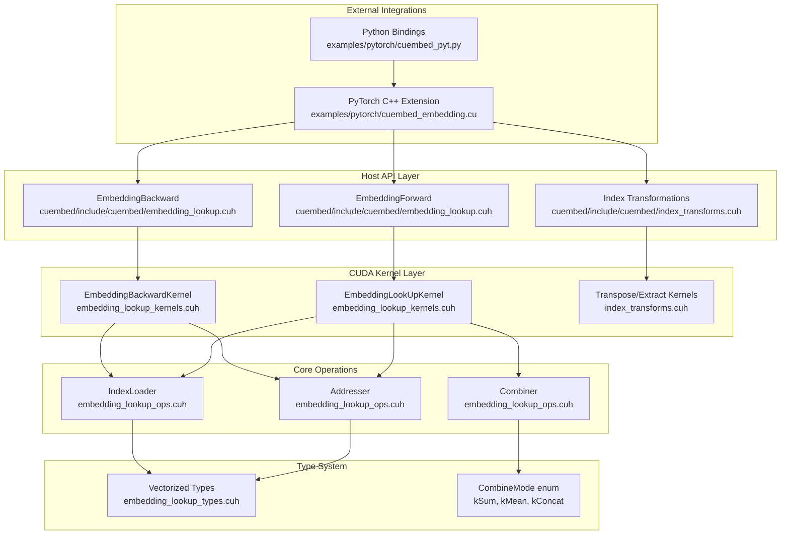
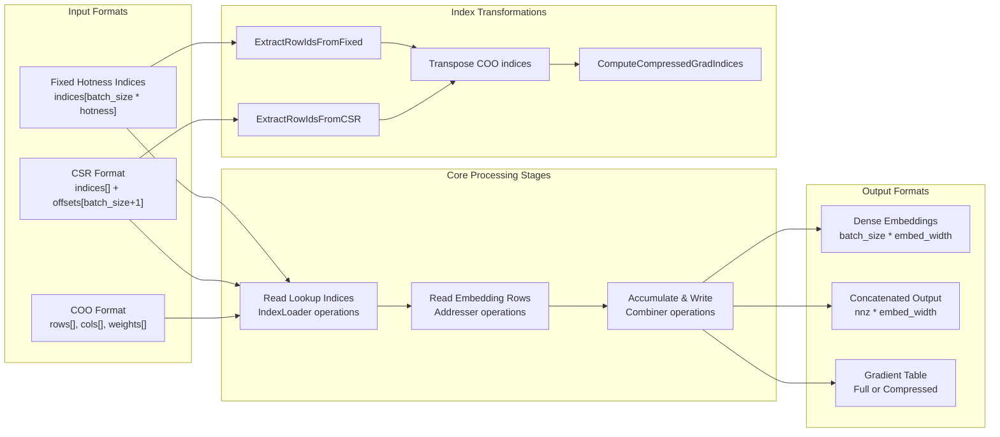
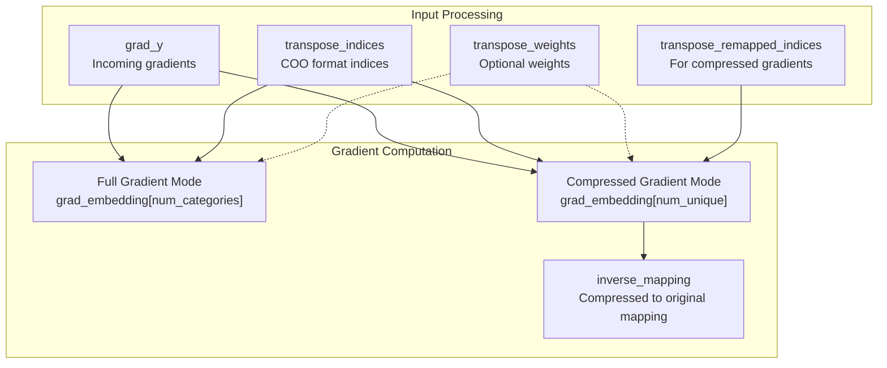

<!-- source: DeepWiki mcp.deepwiki.com · repo NVIDIA/cuEmbed · page 1 Overview · fetched 2026-10-26 -->

# Overview

<details>
<summary>Relevant source files</summary>

The following files were used as context for generating this wiki page:

- [README.md](README.md)
- [cuembed/README.md](cuembed/README.md)

</details>


## Purpose and Scope

This document provides an architectural overview of cuEmbed, an open-source, header-only CUDA kernel library that accelerates embedding lookup operations. cuEmbed is designed to achieve high memory bandwidth utilization through memory-level parallelism optimization and extensive use of C++ templates for compile-time specialization.

For detailed information about specific components, see: [Core Library](#2), [PyTorch Integration](#3), [Testing & Validation](#4), and [Build System](#5).

Sources: [README.md:1-125](), [cuembed/README.md:1-227]()

## Core Architecture

cuEmbed follows a layered architecture with header-only libraries at its core, enabling easy integration into existing CUDA applications. The system is organized around two primary computational patterns: embedding lookup operations and index transformations.

### High-Level System Components



Sources: [README.md:15-17](), [cuembed/README.md:1-5]()

### Data Flow Architecture

The library processes embedding lookups through a three-stage pipeline optimized for memory bandwidth utilization:



Sources: [cuembed/README.md:7-13](), [cuembed/README.md:106-127]()

## Main Operations

### Forward Propagation

The `EmbeddingForward` function supports multiple input formats and reduction modes:

| Parameter | Type | Description |
|-----------|------|-------------|
| `InputT/OutputT` | Template | Element types (fp32, fp16) |
| `IndexT/OffsetT` | Template | Index types (int32_t, int64_t) |
| `fp16_math` | bool | Enable fp16 math operations |
| `params` | Pointer | Embedding table data |
| `indices` | Pointer | Lookup indices array |
| `offsets` | Pointer | CSR offset array (nullptr for fixed) |
| `weights` | Pointer | Per-sample weights (optional) |
| `mode` | enum | `CombineMode::kSum/kMean/kConcat` |

Sources: [cuembed/README.md:16-56]()

### Backward Propagation  

The `EmbeddingBackward` function supports both full and compressed gradient computation:



Sources: [cuembed/README.md:57-104]()

### Index Transformations

cuEmbed provides utilities for converting between different index formats required by forward and backward operations:

| Function | Purpose | Input Format | Output Format |
|----------|---------|--------------|---------------|
| `ExtractRowIdsFromFixed` | Fixed to COO | Fixed hotness | COO rows |
| `ExtractRowIdsFromCSR` | CSR to COO | CSR format | COO rows |  
| `ExtractRowIdsForConcat` | Sequential COO | Length only | COO rows |
| `Transpose` | Sample-first to table-first | COO format | Transposed COO |
| `ComputeCompressedGradIndices` | Dense to compressed mapping | Sorted indices | Remapped indices |

Sources: [cuembed/README.md:106-225]()

## Integration and Usage

### Header-Only Integration

cuEmbed core components are designed as header-only libraries with minimal dependencies, enabling direct integration into existing projects:

```cpp
// Basic forward propagation example from utils/src/embedding_allocation.cu
EmbeddingForward<InputT, OutputT, IndexT, OffsetT, fp16_math>(
    embedding.data().get(),      // params
    options.embed_width(),       // embed_width  
    indices.data().get(),        // indices
    offsets_ptr,                 // offsets (nullptr for fixed)
    weight_ptr,                  // weights (optional)
    options.batch_size(),        // batch_size
    hotness,                     // num_hots (0 for CSR)
    options.combine_mode(),      // mode
    result->data().get()         // ret
);
```

Sources: [README.md:33-67]()

### PyTorch Integration

cuEmbed provides seamless PyTorch integration through custom operations registered as `torch.ops`:

- `cuemb_embedding` - Main embedding lookup operation
- `cuembed_transpose` - Index transpose operation  
- `cuembed_extract_row_ids_from_csr` - CSR to COO conversion

Sources: [README.md:15-17]()

## Supported Configurations

### Current Release Support Matrix

| Feature | Supported | Notes |
|---------|-----------|-------|
| **Data Types** | fp32, fp16 | bf16 planned |
| **Index Types** | int32_t, int64_t | |
| **Forward Layouts** | Fixed hotness, CSR | COO planned |
| **Backward Layouts** | COO | |
| **Reduction Types (Fwd)** | Sum, Mean, Concat | |
| **Reduction Types (Bwd)** | Sum, Concat | Mean planned |
| **Gradient Types** | Full, Compressed | |
| **Hardware** | Volta+ GPUs | |

Sources: [README.md:107-120]()

## Development Status and Requirements

cuEmbed is actively under development with a stable host API. Users should expect changes in kernel APIs and operation abstractions as the library evolves.

### System Requirements

- **CUDA**: nvcc 12.0+
- **Language**: C++17
- **Hardware**: Volta+ GPU architecture
- **Dependencies**: Minimal (header-only core)

### Performance Characteristics

The library is optimized for high memory bandwidth utilization through:
- Memory-level parallelism maximization
- Compile-time specialization via C++ templates
- Optimized kernel launch parameter heuristics
- Vectorized memory operations

Sources: [README.md:11-14](), [README.md:121-125]()

---

