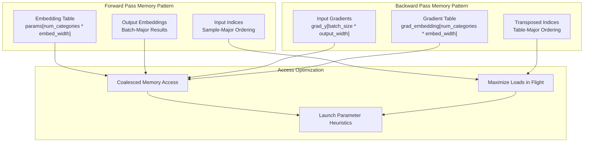

<!-- source: DeepWiki mcp.deepwiki.com · repo NVIDIA/cuEmbed · page 2 Core Library · fetched 2026-10-26 -->

# Core Library

<details>
<summary>Relevant source files</summary>

The following files were used as context for generating this wiki page:

- [cuembed/README.md](cuembed/README.md)

</details>


This document covers the main cuEmbed library components and architecture located in the `cuembed/` directory. The core library provides GPU-accelerated embedding lookup operations through a well-structured C++ API with optimized CUDA kernels. For PyTorch integration details, see [PyTorch Integration](#3). For testing and validation, see [Testing & Validation](#4).

## Architecture Overview

The cuEmbed core library is organized into five main header files, each serving a specific role in the embedding lookup pipeline:

```mermaid
graph TB
    subgraph "Core Library Headers"
        DISPATCH[embedding_lookup.cuh<br/>"Host API & Dispatch"]
        KERNELS[embedding_lookup_kernels.cuh<br/>"CUDA Kernel Implementations"] 
        OPS[embedding_lookup_ops.cuh<br/>"Core Operations & Classes"]
        TYPES[embedding_lookup_types.cuh<br/>"Vectorized Types & Utilities"]
        TRANSFORMS[index_transformations.cuh<br/>"Index Transformation Utils"]
    end
    
    subgraph "Main Entry Points"
        FWD_API[EmbeddingForward]
        BWD_API[EmbeddingBackward]
    end
    
    subgraph "Index Processing"
        EXTRACT_FIXED[ExtractRowIdsFromFixed]
        EXTRACT_CSR[ExtractRowIdsFromCSR] 
        TRANSPOSE[Transpose]
        COMPRESS[ComputeCompressedGradIndices]
    end
    
    subgraph "Core Operations"
        ADDRESSER[Addresser]
        COMBINER[Combiner]
        LOADER[IndexLoader]
    end
    
    subgraph "GPU Execution"
        FWD_KERNEL[EmbeddingLookUpKernel]
        BWD_KERNEL[EmbeddingBackwardKernel]
    end
    
    %% API relationships
    DISPATCH --> FWD_API
    DISPATCH --> BWD_API
    FWD_API --> FWD_KERNEL
    BWD_API --> BWD_KERNEL
    
    %% Component relationships
    KERNELS --> FWD_KERNEL
    KERNELS --> BWD_KERNEL
    OPS --> ADDRESSER
    OPS --> COMBINER
    OPS --> LOADER
    TRANSFORMS --> EXTRACT_FIXED
    TRANSFORMS --> EXTRACT_CSR
    TRANSFORMS --> TRANSPOSE
    TRANSFORMS --> COMPRESS
    
    %% Dependencies
    DISPATCH --> OPS
    DISPATCH --> KERNELS
    DISPATCH --> TYPES
    KERNELS --> OPS
    KERNELS --> TYPES
```

**Sources:** [cuembed/README.md:1-27]()

## Forward and Backward Processing Pipeline

The core library implements a complete forward and backward propagation pipeline for embedding lookups:

```mermaid
graph LR
    subgraph "Input Formats"
        FIXED["Fixed Hotness<br/>indices[batch_size * num_hots]"]
        CSR["CSR Format<br/>indices[nnz], offsets[batch_size+1]"]
        WEIGHTS["Optional Weights<br/>weights[nnz]"]
    end
    
    subgraph "Forward Path"
        FWD_ENTRY[EmbeddingForward]
        ADDRESSER_FWD[Addresser<br/>"Calculate Memory Addresses"]
        LOADER_FWD[IndexLoader<br/>"Load Indices & Weights"]
        COMBINER_FWD[Combiner<br/>"Sum/Mean/Concat"]
        FWD_OUTPUT["Output Embeddings<br/>ret[batch_size * output_width]"]
    end
    
    subgraph "Index Transformation"
        EXTRACT["ExtractRowIds<br/>Fixed/CSR → COO"]
        TRANSPOSE_OP[Transpose<br/>"Sample-first → Table-first"]
        COMPRESS_OP[ComputeCompressedGradIndices<br/>"Dense → Compressed Mapping"]
    end
    
    subgraph "Backward Path"
        BWD_ENTRY[EmbeddingBackward]
        GRAD_INPUT["grad_y[batch_size * output_width]"]
        GRAD_OUTPUT["grad_embedding<br/>Full or Compressed"]
        INVERSE_MAP["inverse_mapping<br/>Compressed → Original IDs"]
    end
    
    %% Forward flow
    FIXED --> FWD_ENTRY
    CSR --> FWD_ENTRY
    WEIGHTS -.-> FWD_ENTRY
    FWD_ENTRY --> LOADER_FWD
    FWD_ENTRY --> ADDRESSER_FWD
    FWD_ENTRY --> COMBINER_FWD
    COMBINER_FWD --> FWD_OUTPUT
    
    %% Index transformation flow
    FIXED --> EXTRACT
    CSR --> EXTRACT
    EXTRACT --> TRANSPOSE_OP
    TRANSPOSE_OP --> COMPRESS_OP
    
    %% Backward flow
    GRAD_INPUT --> BWD_ENTRY
    TRANSPOSE_OP --> BWD_ENTRY
    COMPRESS_OP -.-> BWD_ENTRY
    BWD_ENTRY --> GRAD_OUTPUT
    BWD_ENTRY -.-> INVERSE_MAP
```

**Sources:** [cuembed/README.md:6-104]()

## Component Responsibilities

The core library components are organized by functionality:

| Component | Header File | Primary Functions | Purpose |
|-----------|-------------|-------------------|---------|
| Host API | `embedding_lookup.cuh` | `EmbeddingForward`, `EmbeddingBackward` | Public interface and kernel dispatch |
| CUDA Kernels | `embedding_lookup_kernels.cuh` | `EmbeddingLookUpKernel`, `EmbeddingBackwardKernel` | GPU computation implementation |
| Core Operations | `embedding_lookup_ops.cuh` | `Addresser`, `Combiner`, `IndexLoader` | Fundamental building blocks |
| Types & Utilities | `embedding_lookup_types.cuh` | `CombineMode`, vectorized types | Type definitions and utilities |
| Index Transformations | `index_transformations.cuh` | `Transpose`, `ExtractRowIdsFromCSR` | Format conversions and preprocessing |

**Sources:** [cuembed/README.md:4-5]()

## Memory Access Patterns

The library is designed to maximize memory bandwidth utilization through optimized access patterns:



**Sources:** [cuembed/README.md:11-12]()

## Index Format Support

The library supports multiple index formats to accommodate different use cases:

| Format | Description | Key Parameters | Use Case |
|--------|-------------|----------------|----------|
| Fixed Hotness | Same number of indices per sample | `num_hots > 0`, `offsets = nullptr` | Uniform lookup patterns |
| CSR | Variable indices per sample | `num_hots = 0`, `offsets != nullptr` | Non-uniform lookup patterns |
| COO | Coordinate format | `rows`, `cols`, `weights` arrays | Internal transformations |

The library provides conversion functions between these formats:
- `ExtractRowIdsFromFixed`: Fixed → COO
- `ExtractRowIdsFromCSR`: CSR → COO  
- `Transpose`: Reorder COO by table indices
- `ComputeCompressedGradIndices`: Generate compressed index mapping

**Sources:** [cuembed/README.md:37-40](), [cuembed/README.md:131-225]()

## Combine Modes

The forward pass supports three reduction modes for combining multiple embeddings per sample:

- `CombineMode::kSum`: Element-wise summation of looked-up rows
- `CombineMode::kMean`: Element-wise average of looked-up rows  
- `CombineMode::kConcat`: Concatenation of all looked-up rows

**Sources:** [cuembed/README.md:18](), [cuembed/README.md:53]()

---

