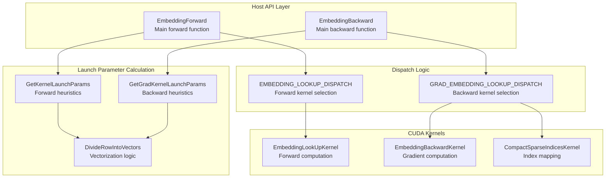
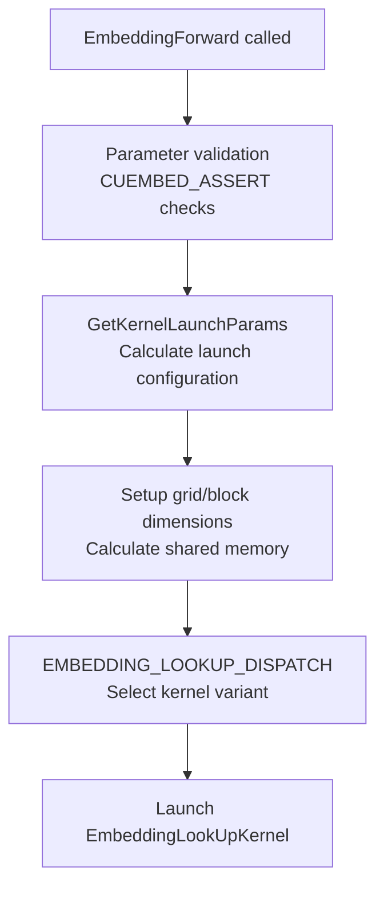
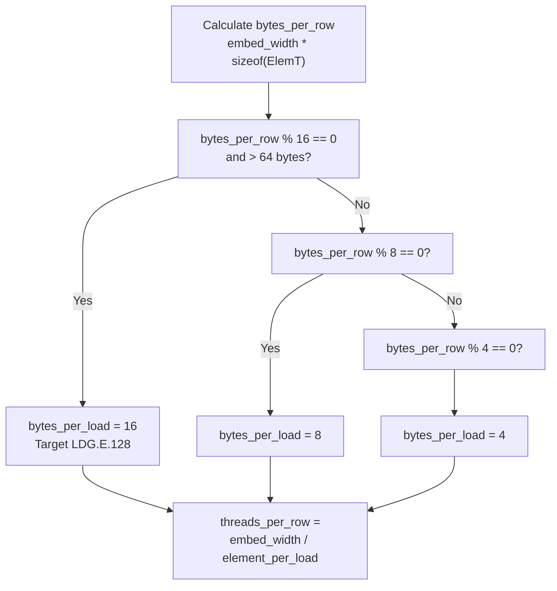
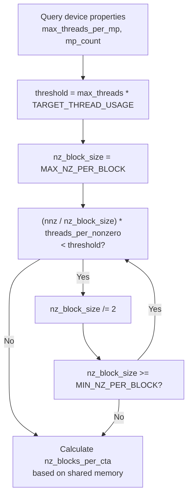
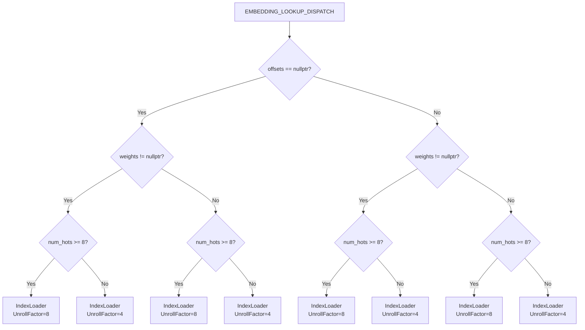

<!-- source: DeepWiki mcp.deepwiki.com · repo NVIDIA/cuEmbed · page 2.1 Host API · fetched 2026-10-26 -->

# Host API

Relevant source files

The following files were used as context for generating this wiki page:

- [cuembed/include/embedding_lookup.cuh](cuembed/include/embedding_lookup.cuh)

The Host API provides the main user-facing interface for cuEmbed's embedding lookup operations. It consists of two primary functions (`EmbeddingForward` and `EmbeddingBackward`) along with supporting utilities for kernel launch parameter calculation and dispatch logic. This API handles parameter validation, memory layout optimization, and efficient dispatching to CUDA kernels based on runtime configuration.

For information about the actual CUDA kernel implementations, see [CUDA Kernels](#2.2). For details about the core operations used within kernels, see [Core Operations](#2.3).

## Overview

The Host API is implemented in a single header file and provides template-based functions that support multiple data types, index formats, and combination modes. The API automatically selects optimal kernel configurations based on embedding dimensions, batch sizes, and hardware characteristics.

**Host API Architecture**

Sources: [cuembed/include/embedding_lookup.cuh:183-308](), [cuembed/include/embedding_lookup.cuh:423-483]()

## Core Functions

### EmbeddingForward

The `EmbeddingForward` function performs forward embedding lookup with support for both fixed and CSR (Compressed Sparse Row) index formats.

| Parameter | Type | Description |
|-----------|------|-------------|
| `params` | `const InputT*` | Pointer to embedding table data |
| `embed_width` | `int` | Number of elements per embedding row |
| `indices` | `const IndexT*` | Lookup indices array |
| `offsets` | `const OffsetT*` | CSR offset array (null for fixed format) |
| `weights` | `const GetElemT<InputT>*` | Optional weights for embedding rows |
| `batch_size` | `int` | Number of samples in the batch |
| `num_hots` | `int` | Fixed number of indices per sample (0 for CSR) |
| `mode` | `CombineMode` | Reduction type (Sum/Mean/Concat) |
| `ret` | `OutputT*` | Output tensor pointer |
| `stream` | `cudaStream_t` | CUDA stream for async execution |

**Function Flow**

Sources: [cuembed/include/embedding_lookup.cuh:245-308]()

### EmbeddingBackward

The `EmbeddingBackward` function computes gradients for the embedding table, supporting both full and compressed gradient formats.

| Parameter | Type | Description |
|-----------|------|-------------|
| `grad_y` | `const GradT*` | Incoming gradient tensor |
| `embed_width` | `int` | Embedding dimension |
| `num_grad_embedding_rows` | `int` | Rows in gradient output |
| `nnz` | `int` | Total number of non-zero indices |
| `transpose_indices` | `const IndexT*` | Transposed lookup indices |
| `transpose_sample_ids` | `const IndexT*` | Transposed sample IDs |
| `transpose_remapped_indices` | `const IndexT*` | Compressed indices (optional) |
| `transpose_weights` | `const GradT*` | Transposed weights (optional) |
| `skip_grad_init` | `bool` | Skip gradient zero-initialization |
| `grad_embedding` | `GradT*` | Output gradient tensor |
| `inverse_mapping` | `IndexT*` | Sparse-to-dense index mapping |
| `stream` | `cudaStream_t` | CUDA stream for async execution |

Sources: [cuembed/include/embedding_lookup.cuh:423-483]()

## Launch Parameter Heuristics

### Vector Load Optimization

The `DivideRowIntoVectors` function determines optimal vectorized memory access patterns:

Sources: [cuembed/include/embedding_lookup.cuh:160-181]()

### Forward Kernel Parameters

The `GetKernelLaunchParams` function calculates optimal launch configuration for forward kernels:

| Configuration | Calculation | Constraints |
|---------------|-------------|-------------|
| `element_per_load` | From `DivideRowIntoVectors` | 1, 2, 4, or 8 elements |
| `threads_per_sample` | `embed_width / element_per_load` | ≤ `MAX_THREADS_PER_CTA` (1024) |
| `samples_per_cta` | `DEFAULT_THREADS_PER_CTA / threads_per_sample` | Limited by shared memory |

Sources: [cuembed/include/embedding_lookup.cuh:186-208]()

### Backward Kernel Parameters

The `GetGradKernelLaunchParams` function uses device-specific heuristics:

Sources: [cuembed/include/embedding_lookup.cuh:348-395]()

## Dispatch Logic

### Forward Dispatch Macro

The `EMBEDDING_LOOKUP_DISPATCH` macro selects appropriate kernel variants based on:

- **Index format**: Fixed hotness vs CSR (presence of `offsets`)
- **Weighting**: Weighted vs unweighted (presence of `weights`)  
- **Unroll factor**: 8 for `num_hots >= 8`, 4 for `num_hots < 8`

**Dispatch Decision Tree**

Sources: [cuembed/include/embedding_lookup.cuh:41-149]()

### Backward Dispatch

The `GRAD_EMBEDDING_LOOKUP_DISPATCH` macro selects backward kernels based on:

- **Element per load**: 1, 2, 4, or 8 elements per vector load
- **Weights**: Presence of `transpose_weights` parameter

Sources: [cuembed/include/embedding_lookup.cuh:314-342]()

## Constants and Configuration

| Constant | Value | Purpose |
|----------|--------|---------|
| `MAX_THREADS_PER_CTA` | 1024 | Maximum threads per CUDA block |
| `DEFAULT_THREADS_PER_CTA` | 256 | Default threads for optimal occupancy |
| `MAX_SHMEM_BYTES_PER_CTA` | 48KB | Maximum shared memory per block |
| `MAX_NZ_PER_BLOCK` | 128 | Maximum non-zeros per backward block |
| `MIN_NZ_PER_BLOCK` | 8 | Minimum non-zeros per backward block |
| `GRAD_KERNEL_TARGET_THREAD_USAGE` | 0.4 | Target GPU utilization for gradients |

Sources: [cuembed/include/embedding_lookup.cuh:33-39](), [cuembed/include/embedding_lookup.cuh:310-312]()

---

