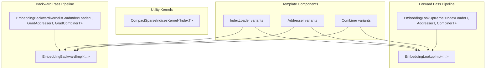
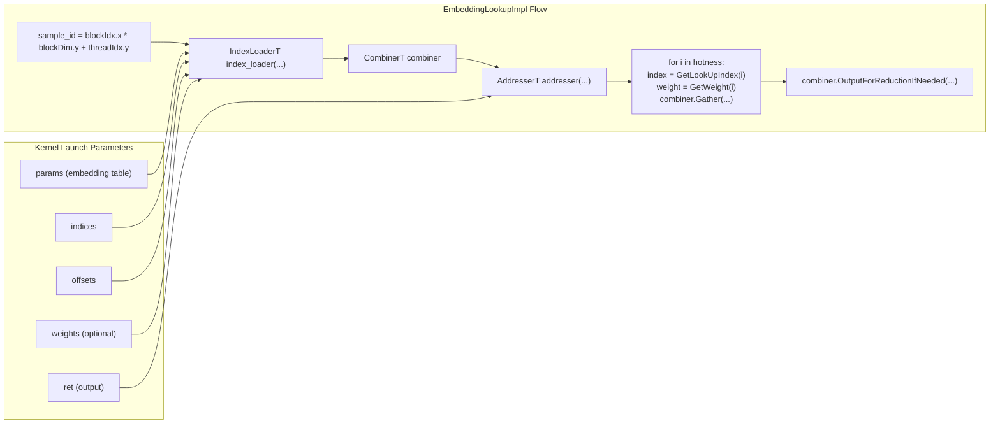
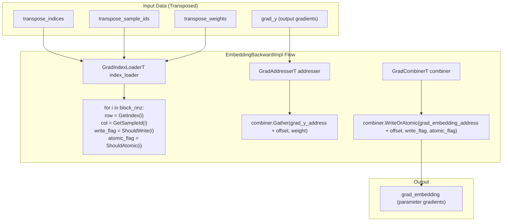
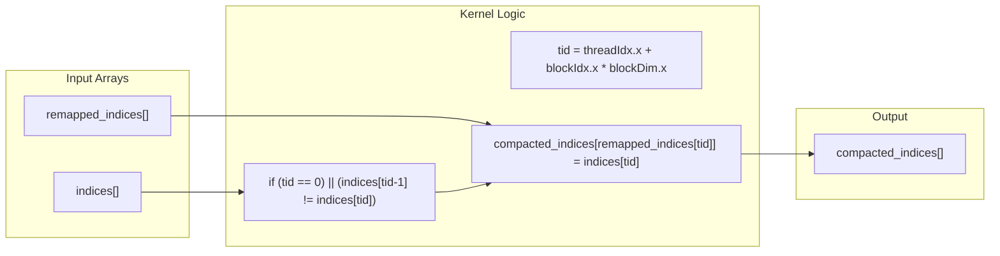

<!-- source: DeepWiki mcp.deepwiki.com · repo NVIDIA/cuEmbed · page 2.2 CUDA Kernels · fetched 2026-10-26 -->

# CUDA Kernels

Relevant source files

The following files were used as context for generating this wiki page:

- [cuembed/include/embedding_lookup_kernels.cuh](cuembed/include/embedding_lookup_kernels.cuh)

This document covers the low-level CUDA kernel implementations that perform the actual embedding computations on the GPU. These kernels handle both forward and backward passes for embedding lookups, with optimizations for different data layouts and weighting schemes.

For information about the host-side dispatch logic that calls these kernels, see [Host API](#2.1). For details about the core operations (IndexLoader, Addresser, Combiner) that these kernels orchestrate, see [Core Operations](#2.3).

## Kernel Architecture

The cuEmbed library implements two primary kernel types: forward pass kernels for embedding lookup and backward pass kernels for gradient computation. Both kernel types use a highly templated design that allows for compile-time specialization based on data layout, weighting schemes, and combining modes.

Sources: [cuembed/include/embedding_lookup_kernels.cuh:1-306]()

## Forward Pass Kernels

The forward pass is implemented through `EmbeddingLookUpKernel`, which serves as the entry point, and `EmbeddingLookupImpl`, which contains the core computation logic.

### EmbeddingLookUpKernel

The main forward kernel is templated on four key components:

- `IndexLoaderT`: Handles loading indices and weights from memory
- `AddresserT`: Computes memory addresses for embedding table access  
- `CombinerT`: Performs reduction or concatenation of embedding vectors
- `UnrollFactor`: Compile-time loop unrolling parameter

The kernel provides two specializations: one for weighted embeddings and one for unweighted embeddings. The unweighted version uses `std::nullptr_t` instead of a weight type to reduce register pressure and improve occupancy.

Sources: [cuembed/include/embedding_lookup_kernels.cuh:117-170]()

### Threading Model and Memory Layout

The forward kernels use a 2D thread block organization optimized for memory coalescing:

| Dimension | Purpose | Size Formula |
|-----------|---------|--------------|
| `blockDim.x` | Elements per embedding vector | `embed_width / elements_per_load` |
| `blockDim.y` | Samples per CTA | `samples_per_cta` |
| `gridDim.x` | Number of CTAs | `batch_size / samples_per_cta` |

Each thread processes multiple embedding elements to maximize memory bandwidth utilization. The `threadIdx.x` dimension handles different elements within an embedding vector, while `threadIdx.y` processes different samples within a batch.

Sources: [cuembed/include/embedding_lookup_kernels.cuh:85-95]()

## Backward Pass Kernels

The backward pass implements gradient computation through `EmbeddingBackwardKernel` and `EmbeddingBackwardImpl`. This kernel processes transposed index data to accumulate gradients efficiently.

### EmbeddingBackwardKernel

The backward kernel is templated on three components:

- `GradIndexLoaderT`: Loads transposed indices and sample IDs
- `GradAddresserT`: Computes addresses for gradient tensors
- `GradCombinerT`: Handles gradient accumulation with atomic operations when needed

The kernel processes blocks of non-zero entries, with each block assigned to a CTA. The `nz_block_size` parameter controls the granularity of work distribution and affects when atomic operations are needed for gradient accumulation.

Sources: [cuembed/include/embedding_lookup_kernels.cuh:236-286]()

### Gradient Threading Model

The backward kernel uses a different 2D block organization focused on processing non-zero gradient entries:

| Dimension | Purpose | Size Formula |
|-----------|---------|--------------|  
| `blockDim.x` | Elements per embedding vector | `embed_width / elements_per_load` |
| `blockDim.y` | Non-zero blocks per CTA | `nonzero_blocks_per_cta` |
| `gridDim.x` | Number of CTAs | `nnz / nz_block_size / nonzero_blocks_per_cta` |

This organization ensures that multiple non-zero entries can be processed in parallel while maintaining efficient memory access patterns for the gradient tensors.

Sources: [cuembed/include/embedding_lookup_kernels.cuh:225-234]()

## Template Specializations

Both forward and backward kernels provide explicit template specializations to optimize for different use cases:

### Weighted vs Unweighted Variants

The kernels use the `IsWeighted` template parameter and function overloading to provide optimized versions:

- **Weighted**: Processes both indices and associated weights, requiring additional register usage
- **Unweighted**: Uses `std::nullptr_t` for weights parameter, reducing register pressure and improving occupancy

The specialization occurs at compile time based on whether a valid weight pointer or `nullptr` is passed to the kernel.

Sources: [cuembed/include/embedding_lookup_kernels.cuh:148-170](), [cuembed/include/embedding_lookup_kernels.cuh:264-286]()

### Launch Bounds Optimization

All kernels use the `LAUNCH_BOUNDS_1024_1` macro, which expands to `__launch_bounds__(1024, 1)`. This hint tells the CUDA compiler to optimize for:

- Maximum 1024 threads per block
- Minimum 1 block per SM for optimal occupancy

Sources: [cuembed/include/embedding_lookup_kernels.cuh:27](), [cuembed/include/embedding_lookup_kernels.cuh:121]()

## Utility Kernels

### CompactSparseIndicesKernel

This utility kernel generates compacted sparse indices for sparse gradient outputs. It processes arrays of indices and identifies the first occurrence of each unique index value:

This kernel enables efficient sparse gradient computation by eliminating duplicate index entries while preserving the mapping to the original dense gradient structure.

Sources: [cuembed/include/embedding_lookup_kernels.cuh:289-302]()

## Memory Access Patterns

The kernel implementations are designed to maximize memory throughput through several optimization strategies:

1. **Coalesced Memory Access**: Thread blocks are organized to ensure adjacent threads access adjacent memory locations
2. **Vectorized Loads**: The `elements_per_load` parameter enables SIMD memory operations
3. **Register Optimization**: Template specializations reduce register usage for improved occupancy
4. **Unroll Factors**: The `UnrollFactor` template parameter enables compile-time loop unrolling for better instruction-level parallelism

The combination of these techniques allows the kernels to achieve high memory bandwidth utilization across different embedding table sizes and batch configurations.

Sources: [cuembed/include/embedding_lookup_kernels.cuh:59-76](), [cuembed/include/embedding_lookup_kernels.cuh:199-219]()

---

