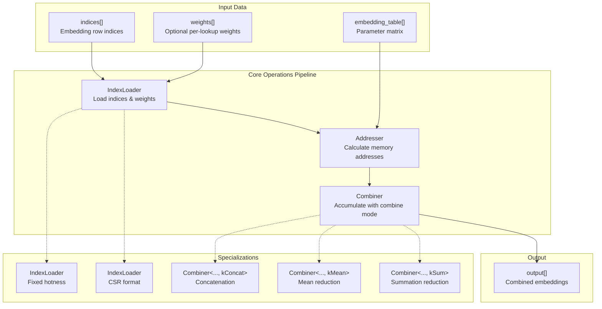
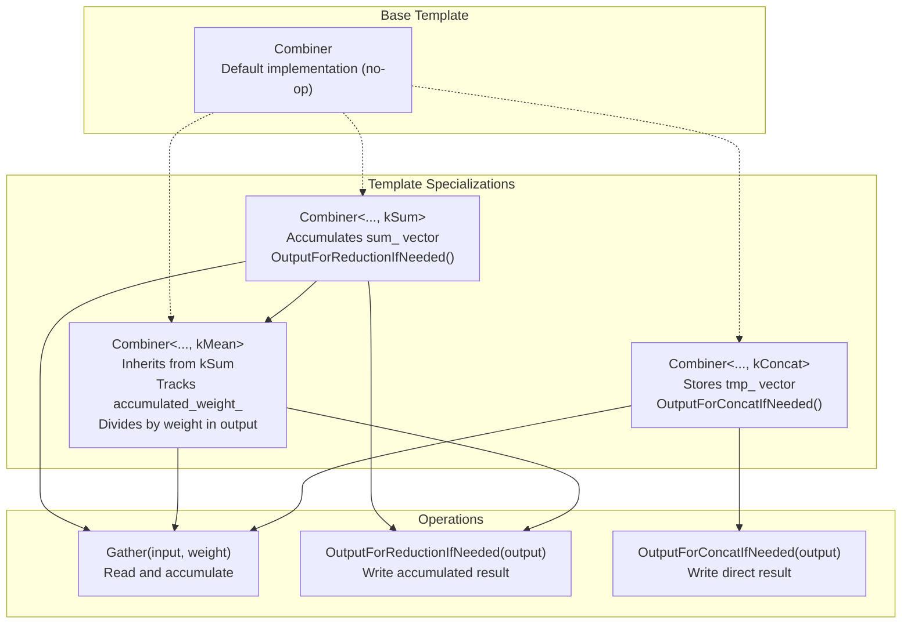
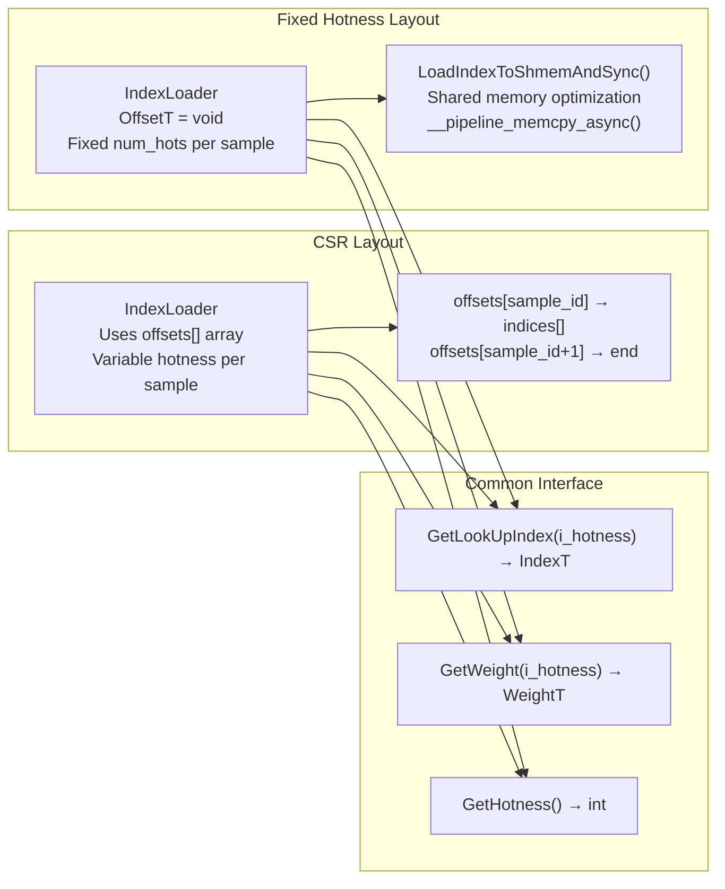
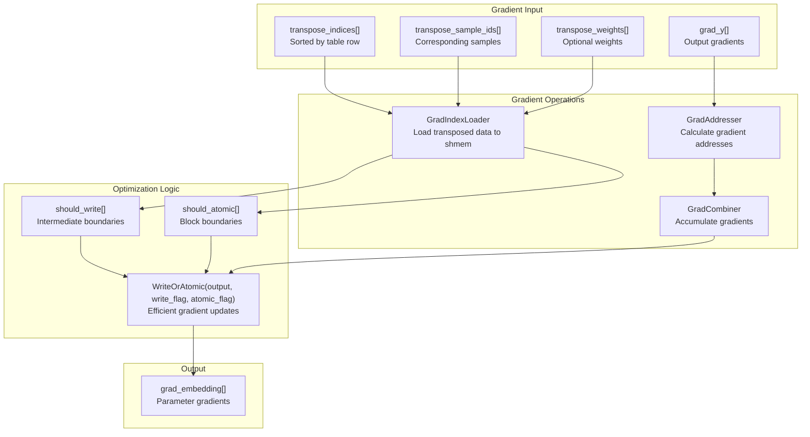
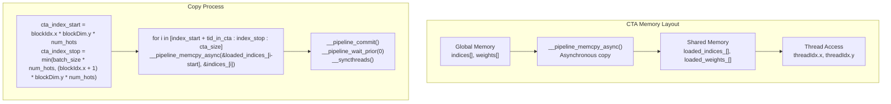

<!-- source: DeepWiki mcp.deepwiki.com · repo NVIDIA/cuEmbed · page 2.3 Core Operations · fetched 2026-10-26 -->

# Core Operations

<details>
<summary>Relevant source files</summary>

The following files were used as context for generating this wiki page:

- [cuembed/include/embedding_lookup_ops.cuh](cuembed/include/embedding_lookup_ops.cuh)

</details>


This document covers the fundamental building blocks that power cuEmbed's embedding lookup operations. The core operations consist of three primary classes for forward pass (`Addresser`, `Combiner`, `IndexLoader`) and their corresponding gradient counterparts for backward pass (`GradAddresser`, `GradCombiner`, `GradIndexLoader`). These classes handle memory addressing, data accumulation with different combine modes, and efficient index loading patterns.

For information about the high-level host API that orchestrates these operations, see [Host API](#2.1). For details about vectorized types and utilities used by these operations, see [Types & Utilities](#2.4).

## Forward Pass Operations Architecture

The forward pass operations work together in a pipeline to perform efficient embedding lookups:



Sources: [cuembed/include/embedding_lookup_ops.cuh:342-496]()

## Addresser Class

The `Addresser` class calculates input and output memory addresses for embedding lookups. It handles different combine modes by adjusting output addressing patterns.

| Template Parameter | Purpose | Example Types |
|-------------------|---------|---------------|
| `InputT` | Embedding element type | `float`, `half` |
| `OutputT` | Output element type | `float`, `half` |
| `IndexT` | Index type | `int64_t`, `int32_t` |
| `InputVecT` | Input vectorization | `float4`, `half8` |
| `OutputVecT` | Output vectorization | `float4`, `half8` |
| `mode` | Combine mode | `kSum`, `kMean`, `kConcat` |

### Key Methods

```mermaid
classDiagram
    class Addresser {
        -const InputT* input_
        -OutputT* output_
        -int embed_width_
        +Addresser(input, output, sample_id, num_hots, embed_width)
        +GetEmbeddingAddress(index) const InputVecT*
        +GetOutputAddress() OutputVecT*
        +GetConcatOutputAddress(i_hotness) OutputVecT*
    }
    
    class "CombineMode Logic" {
        kSum: output_offset = sample_id * embed_width
        kMean: output_offset = sample_id * embed_width  
        kConcat: output_offset = sample_id * num_hots * embed_width
    }
    
    Addresser --> "CombineMode Logic"
```

The addressing logic varies by combine mode:
- **Sum/Mean**: Each sample gets one embedding-width output slot
- **Concat**: Each sample gets `num_hots × embed_width` output slots

Sources: [cuembed/include/embedding_lookup_ops.cuh:78-146]()

## Combiner Class Template System

The `Combiner` class uses template specialization to implement different combine modes efficiently:



### Sum Specialization
The sum combiner accumulates values into an internal `sum_` vector and outputs the result when `OutputForReductionIfNeeded()` is called.

### Mean Specialization  
Inherits from the sum combiner but additionally tracks `accumulated_weight_` and divides the final sum by the total weight.

### Concatenation Specialization
Simply stores the last gathered value in `tmp_` and outputs it directly when `OutputForConcatIfNeeded()` is called.

Sources: [cuembed/include/embedding_lookup_ops.cuh:162-322]()

## IndexLoader Class System

The `IndexLoader` class handles different index layouts through template specialization:



### CSR Specialization
Uses the `offsets` array to determine variable hotness per sample. Calculates `sample_index_start` and `sample_index_stop` to slice the appropriate indices.

### Fixed Hotness Specialization
When `OffsetT` is `void`, assumes fixed hotness. Implements shared memory optimization by loading all indices needed by the CTA (Cooperative Thread Array) into shared memory during construction.

Sources: [cuembed/include/embedding_lookup_ops.cuh:342-496]()

## Backward Pass Operations

The backward pass uses specialized classes to handle gradient computation efficiently:



Sources: [cuembed/include/embedding_lookup_ops.cuh:499-667]()

## Memory Optimization Strategies

### Shared Memory Usage for Fixed Hotness

The fixed hotness `IndexLoader` implements sophisticated shared memory optimization:



Sources: [cuembed/include/embedding_lookup_ops.cuh:454-489]()

### Gradient Memory Management

The `GradIndexLoader` calculates shared memory layout and implements write/atomic flags for efficient gradient updates:

| Memory Section | Type | Purpose |
|----------------|------|---------|
| `sh_transpose_indices` | `IndexT[]` | Embedding row indices |
| `sh_transpose_sample_ids` | `IndexT[]` | Sample identifiers |
| `sh_transpose_weights` | `WeightT[]` | Per-lookup weights |
| `should_write` | `bool[]` | Intermediate write flags |
| `should_atomic` | `bool[]` | Atomic operation flags |

The write/atomic logic optimizes gradient accumulation by avoiding unnecessary atomic operations when possible.

Sources: [cuembed/include/embedding_lookup_ops.cuh:518-564]()

---

