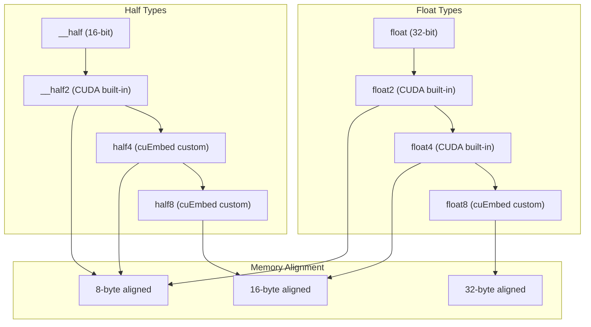
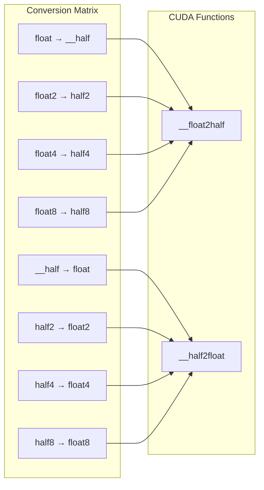
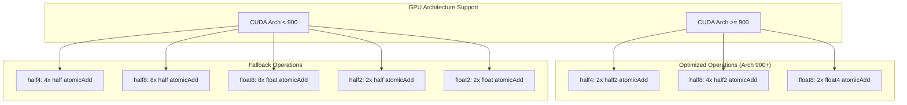
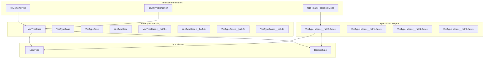
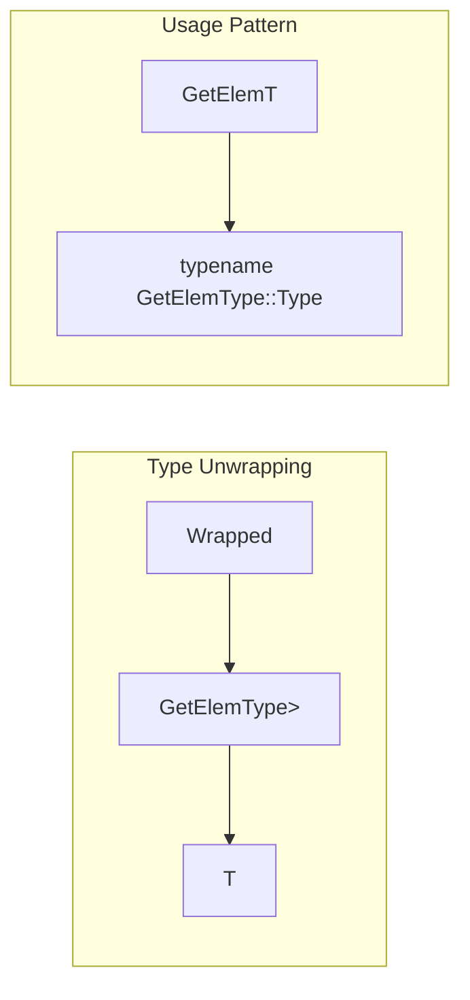

<!-- source: DeepWiki mcp.deepwiki.com · repo NVIDIA/cuEmbed · page 2.4 Types & Utilities · fetched 2026-10-26 -->

# Types & Utilities

Relevant source files

The following files were used as context for generating this wiki page:

- [cuembed/include/embedding_lookup_types.cuh](cuembed/include/embedding_lookup_types.cuh)

This document covers the fundamental data types, type conversion utilities, and vectorized operations that form the foundation of cuEmbed's GPU kernels. These utilities enable efficient memory operations and arithmetic computations across different precision formats (float32 and float16) and vectorization levels.

For information about how these types are used in actual kernel implementations, see [CUDA Kernels](#2.2). For details on the core operations that utilize these types, see [Core Operations](#2.3).

## CombineMode Enumeration

The `CombineMode` enum defines how embedding vectors are aggregated when multiple embeddings belong to the same sample.

| Mode | Description |
|------|-------------|
| `kSum` | Sum all embedding vectors |
| `kMean` | Calculate mean of embedding vectors |
| `kConcat` | Concatenate embedding vectors |

The enumeration is defined in [cuembed/include/embedding_lookup_types.cuh:29]() with a TODO comment indicating that additional modes may be supported in future kernel implementations.

**Sources:** [cuembed/include/embedding_lookup_types.cuh:28-29]()

## Vectorized Type Definitions

cuEmbed defines custom vectorized types for efficient GPU memory operations. These types enable loading and processing multiple elements in a single memory transaction.

### Vectorized Type Architecture

**Sources:** [cuembed/include/embedding_lookup_types.cuh:32-45]()

### Custom Vector Type Definitions

The library defines custom vectorized types with specific memory alignment:

- `float8`: 32-byte aligned structure with 8 float elements (a,b,c,d,e,f,g,h)
- `half8`: 16-byte aligned structure with 8 half elements (a,b,c,d,e,f,g,h)  
- `half4`: 8-byte aligned structure with 4 half elements (x,y,z,w)

**Sources:** [cuembed/include/embedding_lookup_types.cuh:32-45]()

## Type Conversion System

### VecCast Template Function

The `VecCast` template function provides type-safe conversions between different precision formats and vectorization levels.

The default `VecCast` implementation performs no conversion when `ToType` equals `FromType`. Specialized template instantiations handle precision conversions using CUDA's `__float2half` and `__half2float` functions.

**Sources:** [cuembed/include/embedding_lookup_types.cuh:48-144]()

## Vectorized Arithmetic Operations

### Addition Assignment Operators

The library provides `operator+=` overloads for all vectorized types, enabling element-wise addition operations:

| Operator | Purpose |
|----------|---------|
| `half8 += half8` | Element-wise addition of 8-element half vectors |
| `float8 += float8` | Element-wise addition of 8-element float vectors |
| `float4 += float4` | Element-wise addition of 4-element float vectors |
| `float2 += float2` | Element-wise addition of 2-element float vectors |
| `half4 += half4` | Element-wise addition of 4-element half vectors |
| `float += half` | Mixed-precision addition with conversion |
| `float2 += half2` | Mixed-precision vector addition |
| `float4 += half4` | Mixed-precision vector addition |
| `float8 += half8` | Mixed-precision vector addition |

**Sources:** [cuembed/include/embedding_lookup_types.cuh:146-221]()

### Scalar Multiplication Operators

The library implements `operator*` for scalar multiplication across all vectorized types:

- Float vector types can be multiplied by `float` or `__half` scalars
- Half vector types can be multiplied by `__half` or `float` scalars
- Cross-precision multiplication automatically handles type conversion

**Sources:** [cuembed/include/embedding_lookup_types.cuh:223-325]()

## Atomic Operations for Vectorized Types

### VecAtomicAdd Function Template

The `VecAtomicAdd` template provides atomic addition operations for vectorized types, with architecture-specific optimizations.

For CUDA architectures 900 and above, the implementation uses wider atomic operations (e.g., `half2` atomics for `half4`). On older architectures, it falls back to element-wise atomic operations.

**Sources:** [cuembed/include/embedding_lookup_types.cuh:327-493]()

## Type Helper System

### VecTypeHelper Template Structure

The type helper system provides compile-time type selection based on element type, vectorization count, and precision requirements.

### Type Mapping Table

| Base Type | Count | fp16_math | LoadType | ReduceType |
|-----------|-------|-----------|----------|------------|
| `float` | 8 | N/A | `float8` | `float8` |
| `float` | 4 | N/A | `float4` | `float4` |
| `float` | 2 | N/A | `float2` | `float2` |
| `float` | 1 | N/A | `float` | `float` |
| `__half` | 8 | `true` | `half8` | `half8` |
| `__half` | 8 | `false` | `half8` | `float8` |
| `__half` | 4 | `true` | `half4` | `half4` |
| `__half` | 4 | `false` | `half4` | `float4` |
| `__half` | 2 | `true` | `__half2` | `__half2` |
| `__half` | 2 | `false` | `__half2` | `float2` |
| `__half` | 1 | `true` | `__half` | `__half` |
| `__half` | 1 | `false` | `__half` | `float` |

The `fp16_math=false` specializations use higher precision types for reduction operations to maintain numerical accuracy.

**Sources:** [cuembed/include/embedding_lookup_types.cuh:496-581]()

## Utility Type Traits

### GetElemType Template

The `GetElemType` template provides type unwrapping functionality for extracting element types from wrapped structures.

The default implementation returns the input type unchanged. Users can provide specialized implementations for custom wrapper types that require more complex unwrapping behavior.

**Sources:** [cuembed/include/embedding_lookup_types.cuh:582-593]()

---

