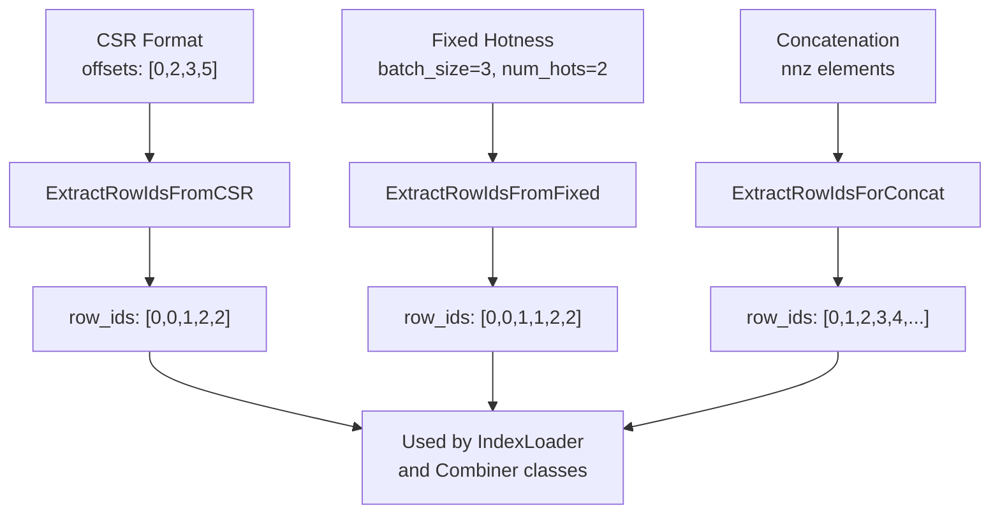
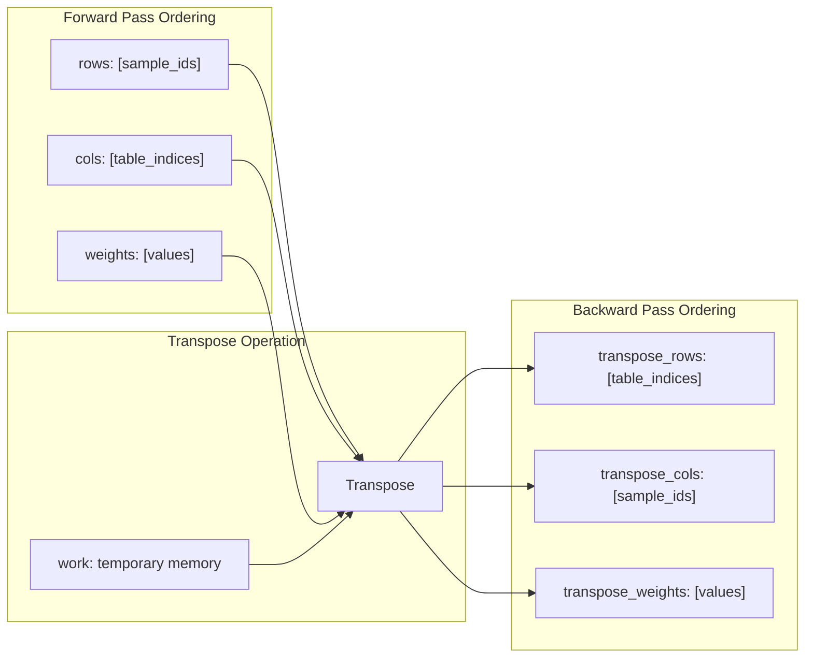
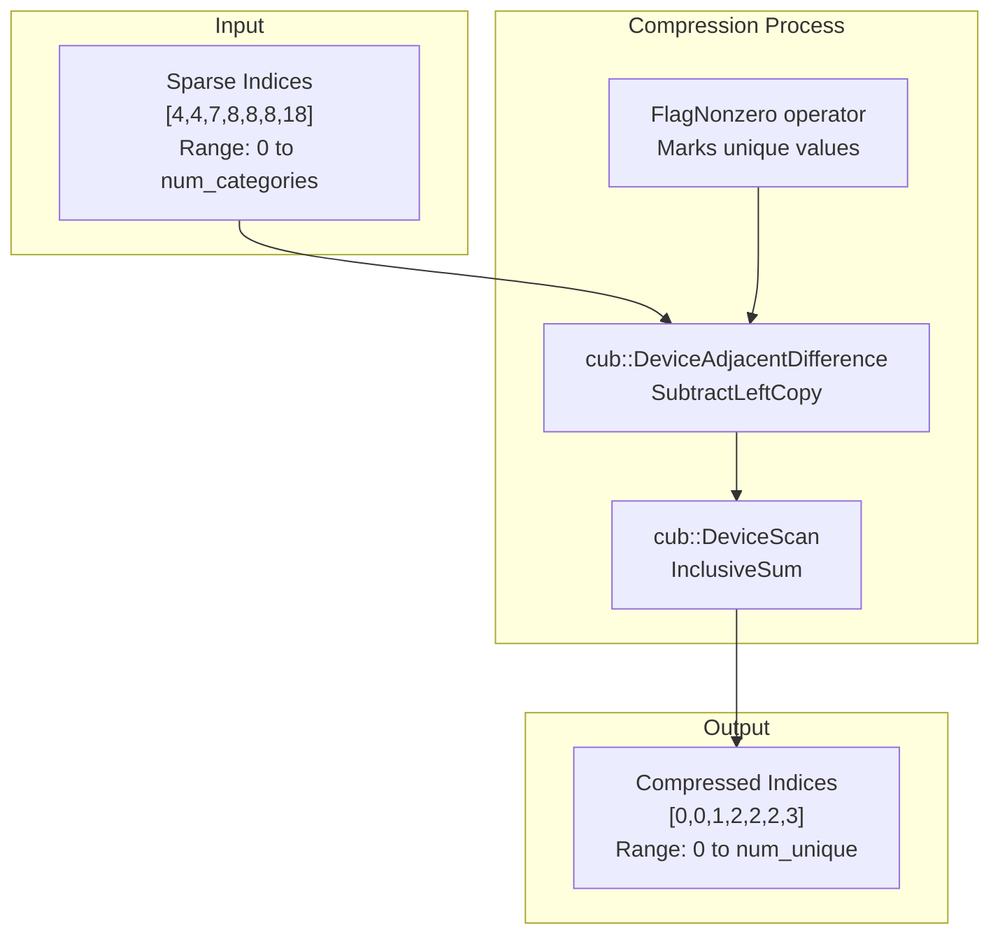
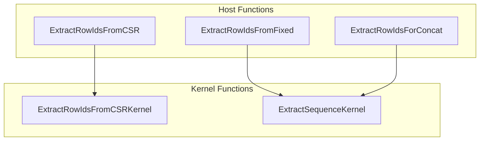

<!-- source: DeepWiki mcp.deepwiki.com · repo NVIDIA/cuEmbed · page 2.5 Index Transformations · fetched 2026-10-26 -->

# Index Transformations

Relevant source files

The following files were used as context for generating this wiki page:

- [cuembed/include/index_transforms.cuh](cuembed/include/index_transforms.cuh)
- [cuembed/include/index_transforms_kernels.cuh](cuembed/include/index_transforms_kernels.cuh)

This document covers the index transformation utilities in cuEmbed that prepare and reformat embedding indices for efficient GPU computation. These transformations handle the conversion between different index formats (CSR, fixed hotness, concatenated) and perform critical reordering operations needed for forward and backward passes.

For information about the core embedding operations that consume these transformed indices, see [Core Operations](#2.3). For details about the CUDA kernels that implement these transformations, see [CUDA Kernels](#2.2).

## Overview

Index transformations in cuEmbed serve three primary purposes:

1. **Row ID Extraction**: Converting various input formats (CSR offsets, fixed hotness patterns) into explicit row ID arrays
2. **Index Transposition**: Reordering indices from sample-first ordering (used in forward pass) to table-first ordering (required for backward pass)  
3. **Index Compression**: Remapping sparse indices to a compressed range for memory-efficient gradient computation

All transformation functions follow a workspace query pattern where the function is first called with `work = nullptr` to determine required temporary memory, then called again with allocated workspace to perform the actual transformation.

## Row ID Extraction Functions

The row ID extraction functions convert implicit index structures into explicit row ID arrays that identify which sample each embedding belongs to.

### ExtractRowIdsFromFixed

The `ExtractRowIdsFromFixed` function generates row IDs for fixed hotness scenarios where each sample has the same number of embeddings.

| Parameter | Type | Description |
|-----------|------|-------------|
| `batch_size` | `int` | Number of samples in the batch |
| `num_hots` | `int` | Number of embeddings per sample |
| `row_ids` | `IndexT*` | Output array of size `batch_size * num_hots` |
| `stream` | `cudaStream_t` | CUDA stream for asynchronous execution |

Sources: [cuembed/include/index_transforms.cuh:45-55]()

### ExtractRowIdsFromCSR

The `ExtractRowIdsFromCSR` function extracts row IDs from Compressed Sparse Row (CSR) format where each sample can have a different number of embeddings.

| Parameter | Type | Description |
|-----------|------|-------------|
| `offsets` | `const OffsetT*` | CSR offset array of size `batch_size + 1` |
| `batch_size` | `int` | Number of samples in the batch |
| `row_ids` | `IndexT*` | Output row ID array |
| `stream` | `cudaStream_t` | CUDA stream for asynchronous execution |

Sources: [cuembed/include/index_transforms.cuh:66-74]()

### ExtractRowIdsForConcat

The `ExtractRowIdsForConcat` function generates sequential row IDs for concatenation scenarios where each embedding forms its own sample.

Sources: [cuembed/include/index_transforms.cuh:85-93]()

## Index Transposition

The transpose operation reorders indices from sample-first ordering (needed for forward pass) to table-first ordering (required for backward pass gradient computation).

### Transpose Function Interface

The main `Transpose` function automatically dispatches to weighted or unweighted variants based on whether the weights parameter is null.

| Parameter | Type | Description |
|-----------|------|-------------|
| `rows` | `const IndexT*` | Input sample indices |
| `cols` | `const IndexT*` | Input table indices |
| `weights` | `const WeightT*` | Input weights (nullable) |
| `nnz` | `int` | Number of nonzero elements |
| `transpose_rows` | `IndexT*` | Output transposed table indices |
| `transpose_cols` | `IndexT*` | Output transposed sample indices |
| `transpose_weights` | `WeightT*` | Output transposed weights |
| `work` | `char*` | Temporary workspace |
| `lwork` | `size_t*` | Workspace size (input/output) |
| `stream` | `cudaStream_t` | CUDA stream for execution |

Sources: [cuembed/include/index_transforms.cuh:224-250]()

### TransposeUnweighted Implementation

For unweighted cases, the function uses CUB's `DeviceRadixSort::SortPairs` to sort by column indices while carrying along the corresponding row indices.

Sources: [cuembed/include/index_transforms.cuh:95-137]()

### TransposeWeighted Implementation

For weighted cases, the function packs indices and weights into `WeightTuple` structures, sorts by column indices, then unpacks the results.

Sources: [cuembed/include/index_transforms.cuh:139-200]()

## Compressed Gradient Indices

The `ComputeCompressedGradIndices` function remaps sparse table indices to a compressed range, reducing memory requirements for gradient computation.

### Algorithm Steps

1. Use `cub::DeviceAdjacentDifference::SubtractLeftCopy` with `FlagNonzero` operator to mark unique values
2. Apply `cub::DeviceScan::InclusiveSum` to compute compressed indices
3. Set first element to zero to establish proper base index

Sources: [cuembed/include/index_transforms.cuh:278-323]()

## Supporting CUDA Kernels

The transformation operations rely on several specialized CUDA kernels defined in the companion header.

### Row ID Extraction Kernels

- `ExtractRowIdsFromCSRKernel`: Each block processes one batch element, with threads collaboratively filling row IDs based on CSR offsets
- `ExtractSequenceKernel`: Generates sequential or repeated indices using integer division

Sources: [cuembed/include/index_transforms_kernels.cuh:28-48]()

### Weight Tuple Manipulation Kernels

For weighted transpose operations, the library uses tuple structures to maintain index-weight associations during sorting.

- `WeightTuple`: Structure combining index and weight values
- `PackToTuple`: Kernel that packs separate index and weight arrays into tuple array
- `ExtractFromTuple`: Kernel that unpacks tuple array back into separate arrays

Sources: [cuembed/include/index_transforms_kernels.cuh:50-81]()

## Memory Management

All transformation functions follow the workspace query pattern:

1. **Query Phase**: Call function with `work = nullptr` to get required workspace size in `lwork`
2. **Allocation Phase**: Allocate workspace memory of size `*lwork`
3. **Execution Phase**: Call function again with allocated workspace

This pattern ensures optimal memory usage by allowing precise workspace allocation based on problem size and avoiding over-allocation.

Sources: [cuembed/include/index_transforms.cuh:41-43](), [cuembed/include/index_transforms.cuh:61-64](), [cuembed/include/index_transforms.cuh:121-124](), [cuembed/include/index_transforms.cuh:173-176](), [cuembed/include/index_transforms.cuh:299-302]()

---

