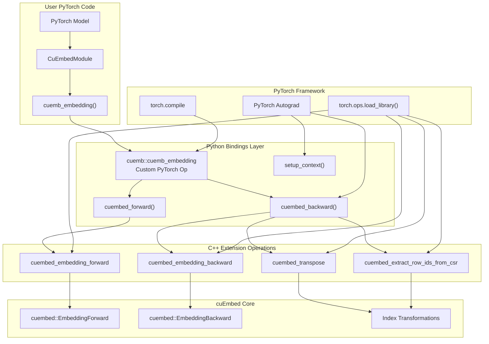
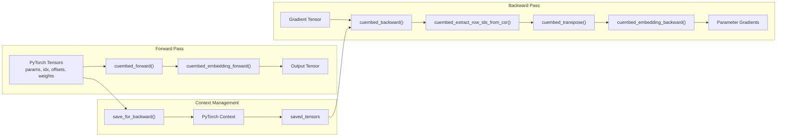

<!-- source: DeepWiki mcp.deepwiki.com · repo NVIDIA/cuEmbed · page 3 PyTorch Integration · fetched 2026-10-26 -->

# PyTorch Integration

<details>
<summary>Relevant source files</summary>

The following files were used as context for generating this wiki page:

- [examples/pytorch/cuembed_pyt.py](examples/pytorch/cuembed_pyt.py)
- [examples/pytorch/cuembed_test.py](examples/pytorch/cuembed_test.py)

</details>


This document covers the PyTorch integration layer that enables cuEmbed to work seamlessly with PyTorch models and training workflows. The integration provides custom PyTorch operations, automatic differentiation support, and compatibility with PyTorch's compilation system.

For detailed information about the Python API and custom operations, see [Python Bindings](#3.1). For the C++ extension implementation details, see [C++ Extension](#3.2).

## Overview

The PyTorch integration enables cuEmbed's CUDA-accelerated embedding lookups to be used as drop-in replacements for PyTorch's `nn.EmbeddingBag` operations. The integration consists of two main layers:

1. **Python Bindings Layer**: Custom PyTorch operations and autograd integration
2. **C++ Extension Layer**: Bridge between PyTorch tensors and cuEmbed kernels

The integration supports all PyTorch features including automatic differentiation, gradient computation, and `torch.compile` optimization.

## Architecture

### Integration Layer Architecture



Sources: [examples/pytorch/cuembed_pyt.py:1-60](), [examples/pytorch/cuembed_test.py:7-14]()

### Operation Flow



Sources: [examples/pytorch/cuembed_pyt.py:16-40]()

## Core Components

### Custom PyTorch Operation

The main entry point is the `cuemb_embedding` custom operation registered with PyTorch:

| Component | Function | Location |
|-----------|----------|----------|
| Registration | `@torch.library.custom_op` | [examples/pytorch/cuembed_pyt.py:47]() |
| Forward Implementation | `cuemb_embedding()` | [examples/pytorch/cuembed_pyt.py:48-50]() |
| Fake Implementation | `cuemb_embedding.register_fake` | [examples/pytorch/cuembed_pyt.py:52-56]() |
| Autograd Registration | `cuemb_embedding.register_autograd` | [examples/pytorch/cuembed_pyt.py:59]() |

### C++ Extension Operations

The C++ extension provides four core operations loaded via `torch.ops.load_library`:

| Operation | Purpose | Usage |
|-----------|---------|-------|
| `cuembed_embedding_forward` | Forward pass computation | [examples/pytorch/cuembed_pyt.py:13]() |
| `cuembed_embedding_backward` | Gradient computation | [examples/pytorch/cuembed_pyt.py:14]() |
| `cuembed_transpose` | Index transformation | [examples/pytorch/cuembed_pyt.py:12]() |
| `cuembed_extract_row_ids_from_csr` | CSR format processing | [examples/pytorch/cuembed_pyt.py:9-11]() |

### Autograd Integration

The autograd system handles automatic differentiation:

- **Context Setup**: `setup_context()` saves tensors and metadata for backward pass [examples/pytorch/cuembed_pyt.py:41-44]()
- **Gradient Computation**: `cuembed_backward()` computes parameter gradients [examples/pytorch/cuembed_pyt.py:19-39]()
- **Gradient Propagation**: Returns gradients for embedding parameters only [examples/pytorch/cuembed_pyt.py:38-39]()

## Usage Patterns

### Basic Usage

The integration supports the same interface as PyTorch's `nn.EmbeddingBag`:

```python
# Direct function call
result = cuemb_embedding(params, indices, offsets, weights)

# Module wrapper  
class CuEmbedModule(nn.Module):
    def forward(self, indices, offsets):
        return cuemb_embedding(self.weight, indices, offsets)
```

### Torch.compile Support

The integration is compatible with PyTorch's compilation system through fake implementations:

- **Fake Implementation**: Provides shape and device inference without computation [examples/pytorch/cuembed_pyt.py:52-56]()
- **Compilation**: Works with `torch.compile()` for optimized execution [examples/pytorch/cuembed_test.py:36-72]()

## Testing and Validation

The integration includes comprehensive testing against PyTorch's reference implementations:

| Test Type | Function | Validation |
|-----------|----------|------------|
| Forward Pass | `test_cuembed()` | Exact equality with `nn.EmbeddingBag` |
| Backward Pass | `test_cuembed()` | `torch.allclose()` due to atomic operations |
| Compilation | `test_cuembed_compile()` | Shape and value correctness |

Sources: [examples/pytorch/cuembed_test.py:15-35](), [examples/pytorch/cuembed_test.py:36-72]()

## Compatibility

The PyTorch integration maintains compatibility with:

- **PyTorch Autograd**: Full gradient computation support
- **PyTorch Compilation**: `torch.compile` optimization
- **Device Placement**: CUDA device tensors
- **Data Types**: `torch.float32` and `torch.long` tensors
- **EmbeddingBag API**: Drop-in replacement for `nn.EmbeddingBag` with `mode='sum'`

Sources: [examples/pytorch/cuembed_pyt.py:1-60](), [examples/pytorch/cuembed_test.py:1-116]()

---

