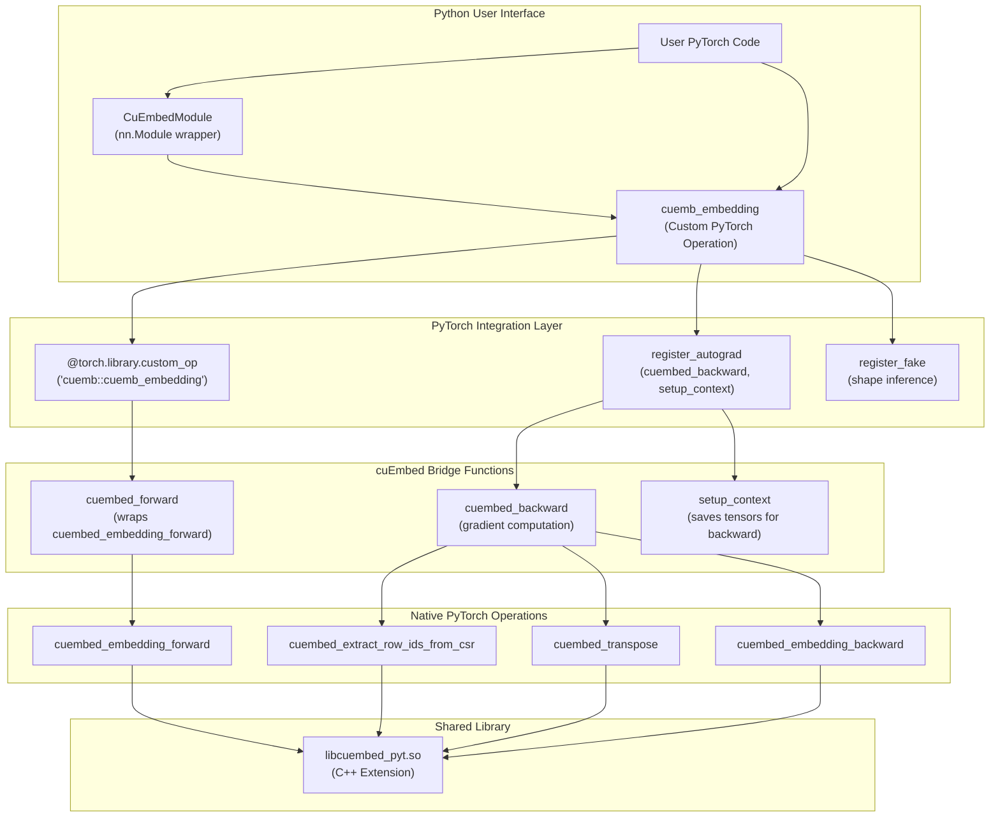
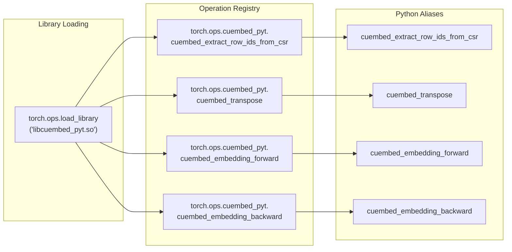
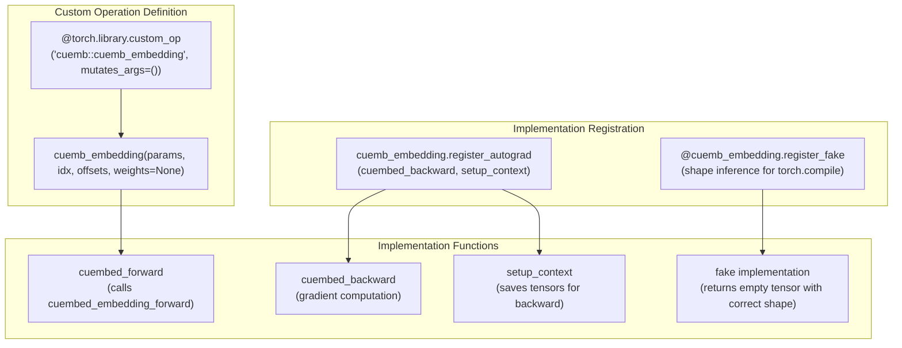
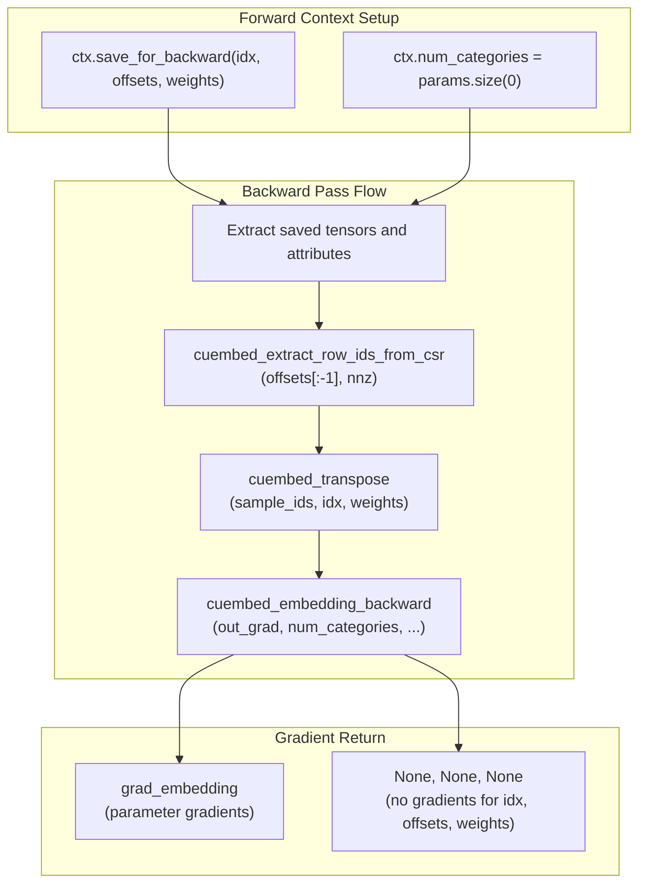
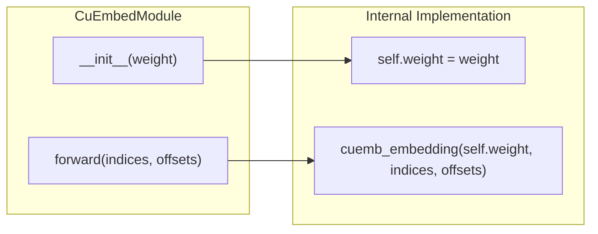

<!-- source: DeepWiki mcp.deepwiki.com · repo NVIDIA/cuEmbed · page 3.1 Python Bindings · fetched 2026-10-26 -->

# Python Bindings

Relevant source files

The following files were used as context for generating this wiki page:

- [examples/pytorch/cuembed_pyt.py](examples/pytorch/cuembed_pyt.py)
- [examples/pytorch/cuembed_test.py](examples/pytorch/cuembed_test.py)

This page documents the Python interface to cuEmbed, which provides seamless integration with PyTorch through custom operations and autograd support. The Python bindings expose cuEmbed's CUDA-accelerated embedding lookup functionality as PyTorch-compatible operations that support both eager execution and compilation with `torch.compile`.

For information about the underlying C++ extension that bridges PyTorch tensors to cuEmbed kernels, see [C++ Extension](#3.2). For details about the core embedding operations being wrapped, see [Host API](#2.1).

## Python API Architecture

The Python bindings create a layered architecture that integrates cuEmbed with PyTorch's ecosystem:

**Sources:** [examples/pytorch/cuembed_pyt.py:1-60]()

## Custom PyTorch Operations

The Python bindings expose four core cuEmbed operations as PyTorch custom operations, loaded from the shared library:

| Operation | PyTorch Function | Purpose |
|-----------|------------------|---------|
| Index Extraction | `cuembed_extract_row_ids_from_csr` | Convert CSR offsets to sample IDs |
| Transpose | `cuembed_transpose` | Reorder indices for backward pass |
| Forward Pass | `cuembed_embedding_forward` | Perform embedding lookup |
| Backward Pass | `cuembed_embedding_backward` | Compute gradients |

These operations are accessed through PyTorch's operator registry after loading the shared library:

**Sources:** [examples/pytorch/cuembed_pyt.py:7-14]()

## Main Custom Operation

The primary interface is the `cuemb_embedding` custom operation, which provides a drop-in replacement for PyTorch's `EmbeddingBag`:

### Operation Registration

The operation is registered using PyTorch's custom operation framework:

**Sources:** [examples/pytorch/cuembed_pyt.py:47-59]()

### Forward Pass Implementation

The forward pass is implemented by the `cuembed_forward` function, which wraps the native operation with a fixed combine mode:

**Sources:** [examples/pytorch/cuembed_pyt.py:16-17]()

## Autograd Integration

The Python bindings provide full autograd support through custom backward pass implementation:

**Sources:** [examples/pytorch/cuembed_pyt.py:19-44]()

### Gradient Computation Details

The backward pass follows these steps:
1. **Context Retrieval**: Extract saved tensors (`idx`, `offsets`, `weights`) and `num_categories` from forward context
2. **Sample ID Extraction**: Convert CSR format offsets to sample IDs using `cuembed_extract_row_ids_from_csr`
3. **Index Transposition**: Reorder data from sample-major to table-major format using `cuembed_transpose`
4. **Weight Handling**: Set transposed weights to `None` if empty (indicating no weights were used in forward pass)
5. **Gradient Computation**: Call `cuembed_embedding_backward` to compute parameter gradients

**Sources:** [examples/pytorch/cuembed_pyt.py:25-36]()

## Module Interface

The `CuEmbedModule` class provides a standard `nn.Module` wrapper for the custom operation:

**Sources:** [examples/pytorch/cuembed_test.py:7-13]()

## torch.compile Support

The Python bindings include full support for PyTorch's compilation system through proper operation registration:

### Fake Implementation for Shape Inference

The `register_fake` decorator provides shape inference without actual computation:

**Sources:** [examples/pytorch/cuembed_pyt.py:52-56]()

### Compilation Testing

The bindings are tested with `torch.compile` to ensure compatibility:

**Sources:** [examples/pytorch/cuembed_test.py:36-72]()

## Usage Examples

### Basic Usage with Weights
**Sources:** [examples/pytorch/cuembed_test.py:15-35]()

### Usage without Weights
**Sources:** [examples/pytorch/cuembed_test.py:91-92]()

### Compiled Module Usage
**Sources:** [examples/pytorch/cuembed_test.py:58-71]()

## Error Handling and Edge Cases

The Python bindings handle several edge cases:
- **Empty Weights**: When `weights=None` in forward pass, the backward pass correctly handles empty weight tensors
- **Gradient Accumulation**: The backward pass uses atomic operations to handle concurrent gradient updates
- **Shape Validation**: The fake implementation ensures correct output shapes for compilation

**Sources:** [examples/pytorch/cuembed_pyt.py:32-33]()

---

