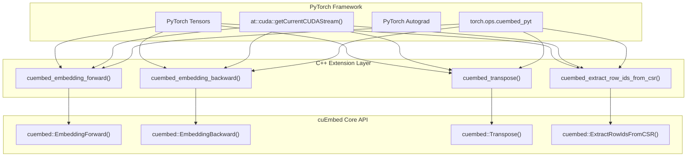
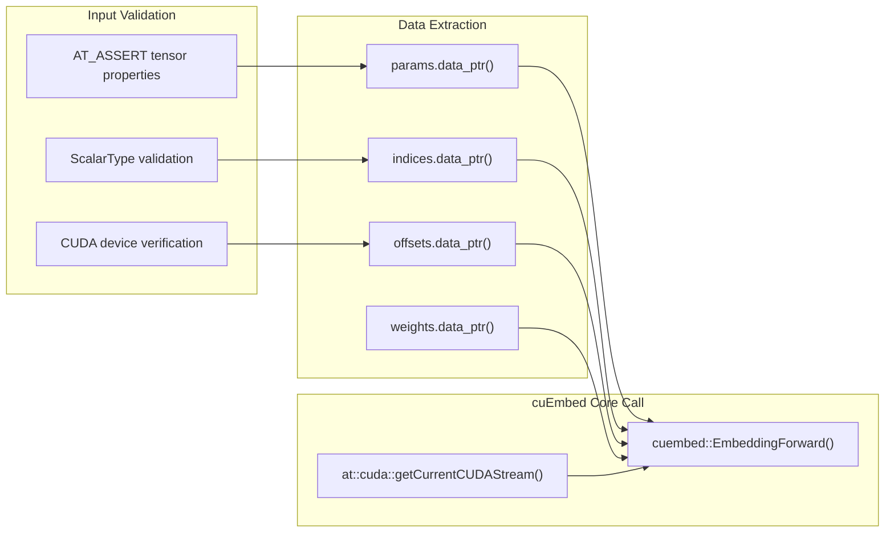
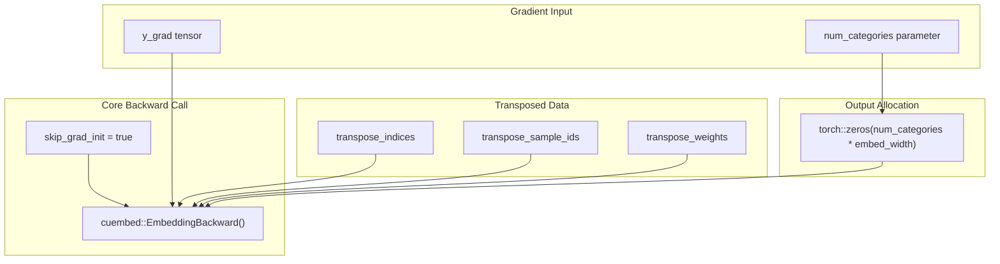
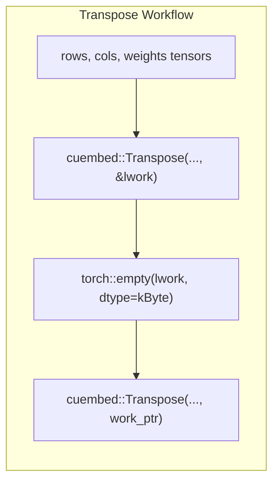
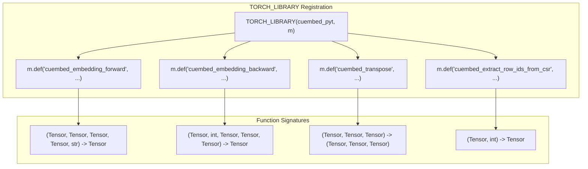

<!-- source: DeepWiki mcp.deepwiki.com · repo NVIDIA/cuEmbed · page 3.2 C++ Extension · fetched 2026-10-26 -->

# C++ Extension

Relevant source files

The following files were used as context for generating this wiki page:

- [examples/pytorch/CMakeLists.txt](examples/pytorch/CMakeLists.txt)
- [examples/pytorch/cuembed_embedding.cu](examples/pytorch/cuembed_embedding.cu)

This document covers the CUDA C++ extension that serves as the low-level bridge between PyTorch tensors and cuEmbed's CUDA kernels. The extension provides custom PyTorch operations that handle tensor validation, type conversion, and direct integration with cuEmbed's core embedding functions.

For information about the Python-level interface and autograd integration, see [Python Bindings](#3.1).

## Architecture Overview

The C++ extension implements a thin wrapper layer that translates PyTorch tensor operations into cuEmbed kernel calls. It consists of four main wrapper functions that are registered as custom PyTorch operations, enabling seamless integration with PyTorch's execution engine and autograd system.

Sources: [examples/pytorch/cuembed_embedding.cu:1-175]()

## Function Implementations

### Forward Pass Integration

The `cuembed_embedding_forward` function handles the forward embedding lookup operation, translating PyTorch tensors to cuEmbed's `EmbeddingForward` API.

The function performs extensive tensor validation and extracts raw pointers for cuEmbed kernel consumption. Key implementation details:

| Validation | Implementation | Line Reference |
|------------|----------------|----------------|
| Device Check | `AT_ASSERT(indices.is_cuda())` | [examples/pytorch/cuembed_embedding.cu:15-17]() |
| Type Check | `AT_ASSERT(params.scalar_type() == torch::ScalarType::Float)` | [examples/pytorch/cuembed_embedding.cu:19]() |
| Contiguity | `AT_ASSERT(params.is_contiguous())` | [examples/pytorch/cuembed_embedding.cu:18]() |
| Optional Weights | Conditional `weights.defined()` checks | [examples/pytorch/cuembed_embedding.cu:20-22]() |

Sources: [examples/pytorch/cuembed_embedding.cu:10-48]()

### Backward Pass Integration

The `cuembed_embedding_backward` function implements gradient computation by calling `cuembed::EmbeddingBackward` with transposed indices and sample IDs.

Sources: [examples/pytorch/cuembed_embedding.cu:114-154]()

### Index Transformation Operations

Two utility functions handle index data transformations required for efficient gradient computation:

#### `cuembed_extract_row_ids_from_csr`
Extracts row IDs from CSR (Compressed Sparse Row) format offsets using `cuembed::ExtractRowIdsFromCSR`.

#### `cuembed_transpose`
Transposes sparse matrix data (rows, columns, weights) using `cuembed::Transpose`, including workspace memory allocation for efficient sorting operations.

Sources: [examples/pytorch/cuembed_embedding.cu:50-63](), [examples/pytorch/cuembed_embedding.cu:65-112]()

## PyTorch Integration Mechanism

### Custom Operation Registration

The extension uses PyTorch's `TORCH_LIBRARY` macro to register all four functions as custom operations in the `cuembed_pyt` namespace:

### CUDA Stream Management

All functions integrate with PyTorch's CUDA stream management using `at::cuda::getCurrentCUDAStream()`, ensuring proper synchronization within PyTorch's execution model.

Sources: [examples/pytorch/cuembed_embedding.cu:156-174]()

## Build Configuration

The C++ extension is built as a shared library `libcuembed_pyt.so` through CMake configuration:

| Component | Configuration | Line Reference |
|-----------|---------------|----------------|
| Target Name | `cuembed_pyt` | [examples/pytorch/CMakeLists.txt:8]() |
| Library Type | `SHARED` | [examples/pytorch/CMakeLists.txt:8]() |
| Source File | `cuembed_embedding.cu` | [examples/pytorch/CMakeLists.txt:8]() |
| Dependencies | `${TORCH_LIBRARIES}`, `Python::Python`, `cuembed_hdrs` | [examples/pytorch/CMakeLists.txt:9]() |
| CUDA Architectures | `7.0;7.5;8.0;9.0` | [examples/pytorch/CMakeLists.txt:3]() |

### Dependencies

- **PyTorch**: Found via `find_package(Torch REQUIRED)`
- **Python Development**: Found via `find_package(Python REQUIRED COMPONENTS Development)`
- **cuEmbed Headers**: Linked as `cuembed_hdrs` target

Sources: [examples/pytorch/CMakeLists.txt:1-10]()

---

