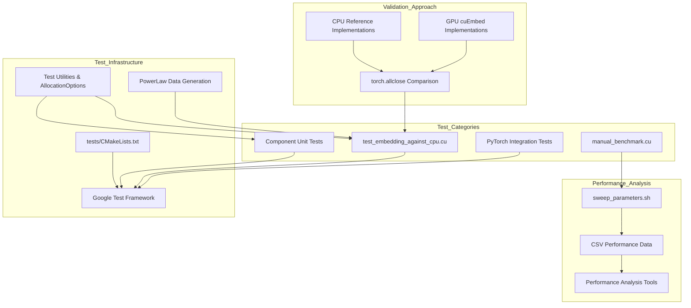
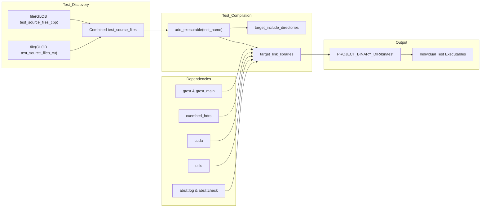
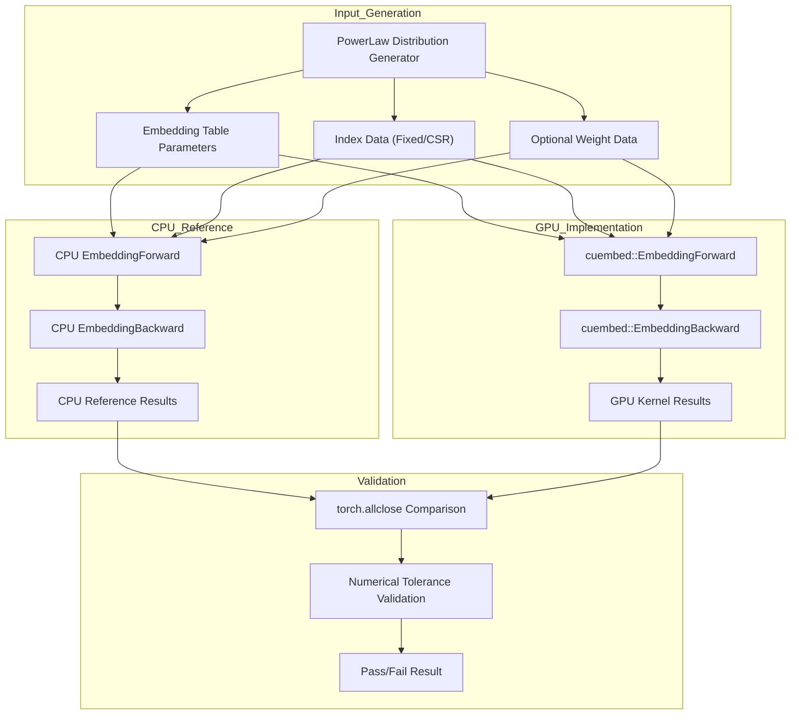
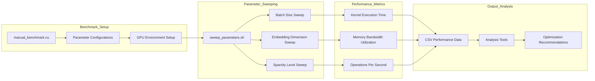

<!-- source: DeepWiki mcp.deepwiki.com · repo NVIDIA/cuEmbed · page 4 Testing & Validation · fetched 2026-10-26 -->

# Testing & Validation

Relevant source files

The following files were used as context for generating this wiki page:

- [tests/CMakeLists.txt](tests/CMakeLists.txt)

This document covers the comprehensive testing and validation strategy for cuEmbed, including correctness validation against CPU reference implementations, component-level unit testing, and performance benchmarking infrastructure. The testing system ensures both functional correctness and performance optimization across different GPU configurations and embedding scenarios.

For information about the core library components being tested, see [Core Library](#2). For PyTorch integration testing, see [PyTorch Integration](#3). For build system configuration, see [Build System](#5).

## Testing Architecture Overview

cuEmbed employs a multi-layered testing strategy that validates both correctness and performance across different dimensions:

### Testing Strategy Diagram

**Sources:** Diagrams from system analysis, [tests/CMakeLists.txt:1-38]()

## Test Categories

The testing framework encompasses several distinct categories, each serving specific validation purposes:

### Correctness Validation

The primary correctness validation compares GPU implementations against CPU reference implementations using `torch.allclose` for numerical precision verification. This ensures that the CUDA-accelerated operations produce mathematically equivalent results to their CPU counterparts.

Key test files:
- `test_embedding_against_cpu.cu` - Main GPU vs CPU validation suite
- Component-specific correctness tests for individual operations

### Unit Testing

Component-level unit tests validate individual classes and operations in isolation:
- `Addresser` class functionality
- `Combiner` operation modes (sum, mean, concat)
- `IndexLoader` data handling
- Forward and backward pass correctness
- Memory allocation and deallocation patterns

### Integration Testing

Integration tests validate the complete pipeline including:
- PyTorch tensor integration
- Autograd compatibility
- Multi-GPU scenarios
- Mixed-precision operations

### Performance Benchmarking

Performance tests measure execution time, memory usage, and throughput across different configurations:
- `manual_benchmark.cu` - Detailed performance measurement
- Parameter sweeping across embedding dimensions, batch sizes, and sparsity patterns
- GPU memory bandwidth utilization analysis

**Sources:** System analysis diagrams, testing strategy documentation

## Test Infrastructure

### Build System Integration

The test build system automatically discovers and compiles all test files:

**Sources:** [tests/CMakeLists.txt:16-37]()

### Test Framework Components

Each test executable is built with the following components:

| Component | Purpose | Linkage |
|-----------|---------|---------|
| `gtest` | Core testing framework | [tests/CMakeLists.txt:27-28]() |
| `gtest_main` | Test runner main function | [tests/CMakeLists.txt:27-28]() |
| `cuembed_hdrs` | cuEmbed header-only library | [tests/CMakeLists.txt:26]() |
| `cuda` | CUDA runtime libraries | [tests/CMakeLists.txt:29]() |
| `utils` | Test utility functions | [tests/CMakeLists.txt:30]() |
| `absl::log` | Abseil logging framework | [tests/CMakeLists.txt:31]() |
| `absl::check` | Abseil assertion macros | [tests/CMakeLists.txt:32]() |

**Sources:** [tests/CMakeLists.txt:24-32]()

## Validation Strategy

### CPU vs GPU Validation Flow

The core validation strategy compares GPU kernel outputs against CPU reference implementations:

**Sources:** System analysis, correctness testing strategy

### Test Data Generation

Test data generation utilizes realistic distribution patterns:

- **PowerLaw Distribution**: Simulates real-world embedding access patterns with high-frequency and long-tail items
- **Configurable Parameters**: Embedding dimensions, batch sizes, sparsity levels
- **AllocationOptions**: Memory allocation testing across different GPU memory configurations
- **Edge Cases**: Empty batches, maximum dimension sizes, boundary conditions

**Sources:** Data generation utilities from system analysis

## Performance Benchmarking

### Benchmark Execution Pipeline

**Sources:** Performance testing infrastructure from system analysis

The benchmarking system provides comprehensive performance analysis across multiple dimensions, enabling optimization decisions based on quantitative measurements of GPU kernel efficiency and memory utilization patterns.

---

