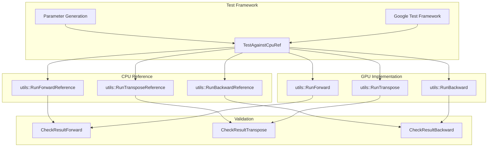
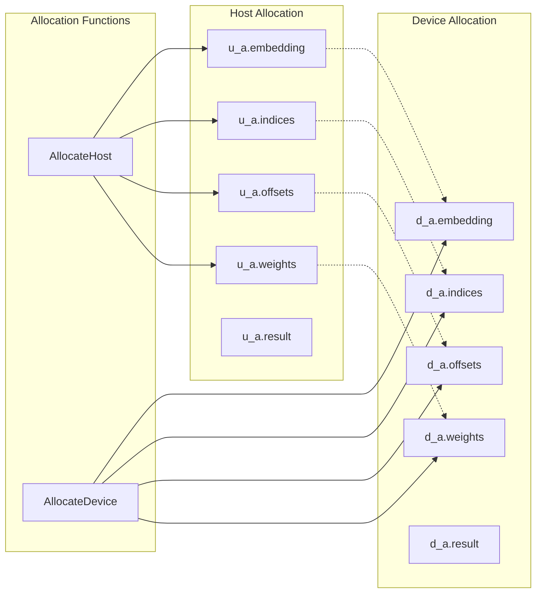
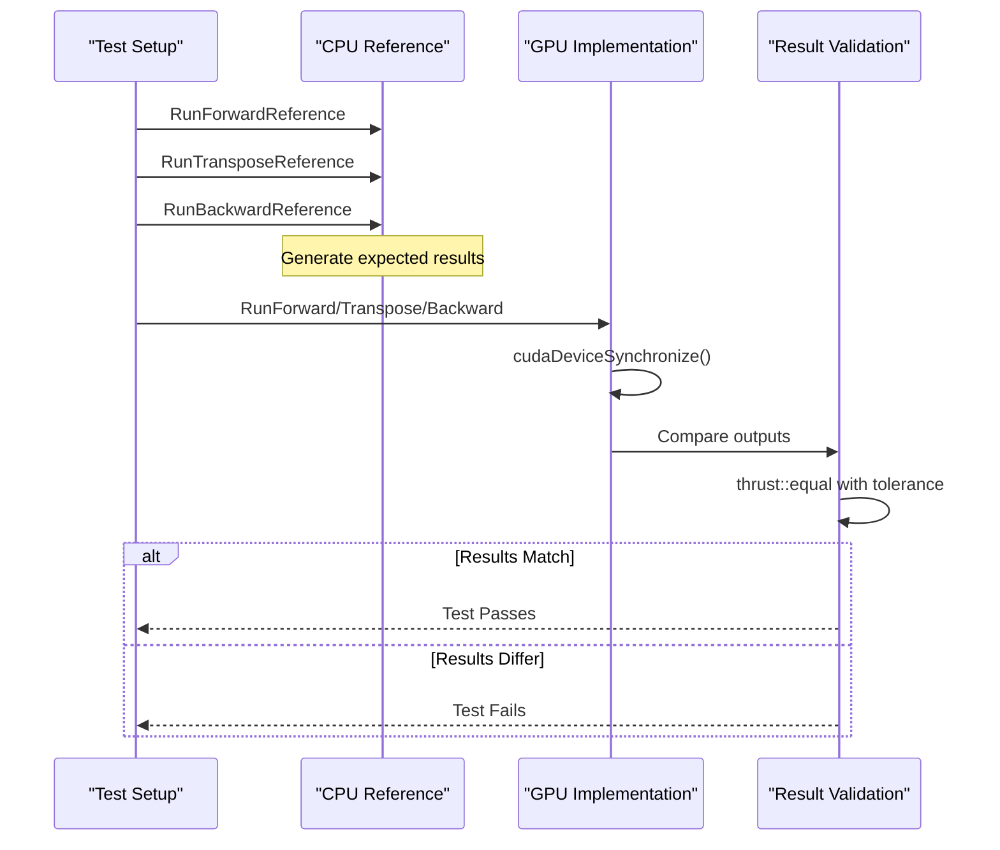

<!-- source: DeepWiki mcp.deepwiki.com · repo NVIDIA/cuEmbed · page 4.1 Correctness Tests · fetched 2026-10-26 -->

# Correctness Tests

<details>
<summary>Relevant source files</summary>

The following files were used as context for generating this wiki page:

- [tests/test_embedding_against_cpu.cu](tests/test_embedding_against_cpu.cu)

</details>


The correctness testing system validates GPU embedding lookup implementations by comparing their outputs against CPU reference implementations. This ensures that the CUDA-accelerated kernels produce mathematically equivalent results across all supported data types, combination modes, and index formats.

For information about performance testing and benchmarking, see [Benchmarking](#4.3). For component-level unit tests, see [Unit Tests](#4.2).

## Test Architecture

The correctness test system is built around comprehensive validation of the core embedding operations: forward lookup, transpose, and backward gradient computation. Each GPU implementation is validated against a corresponding CPU reference implementation using identical input parameters.



Sources: [tests/test_embedding_against_cpu.cu:35-74]()

## Test Implementation

The `TestAgainstCpuRef` template class implements the core validation logic, parameterized by element type (`ElemT`), index type (`IndexT`), and FP16 math mode (`fp16_math`). The class manages both host and device memory allocations through the `UniversalEmbeddingAllocation` and `DeviceEmbeddingAllocation` structures.

### Memory Management



Sources: [tests/test_embedding_against_cpu.cu:38-42](), [tests/test_embedding_against_cpu.cu:220-223]()

### Test Execution Flow

Each test follows a three-phase execution pattern:

1. **Setup Phase**: CPU reference computation generates expected results
2. **Execution Phase**: GPU kernels process identical inputs  
3. **Validation Phase**: Results are compared using appropriate tolerance checks



Sources: [tests/test_embedding_against_cpu.cu:76-85](), [tests/test_embedding_against_cpu.cu:104-135]()

## Parameter Space Coverage

The test suite validates a comprehensive parameter space covering different embedding dimensions, batch sizes, combine modes, and data formats. The parameter space is defined through the `lookup_test_values` collection.

### Test Configuration Matrix

| Parameter | Values |
|-----------|--------|
| Element Types | `float`, `__half` |
| Index Types | `int32_t`, `int64_t` |
| Batch Sizes | 3, 1023 |
| Embedding Widths | 2, 4, 32, 36, 512, 514 |
| Hotness | 4, 26, 63 |
| Combine Modes | `kSum`, `kConcat`, `kMean` |
| Index Formats | Fixed hotness, CSR |
| Weighting | Weighted, Unweighted |
| Gradient Compression | Full, Compressed |

### Type Combinations

The test system validates six distinct type and precision combinations:

```mermaid
graph TD
    subgraph "Test Classes"
        Float32_32["TestAgainstCpuEmbed32Idx32<br/>float, int32_t, false"]
        Float32_64["TestAgainstCpuEmbed32Idx64<br/>float, int64_t, false"]
        Half16_32_32["TestAgainstCpuEmbed16Idx32Reduce32<br/>__half, int32_t, true"]
        Half16_64_32["TestAgainstCpuEmbed16Idx64Reduce32<br/>__half, int64_t, true"]
        Half16_32_16["TestAgainstCpuEmbed16Idx32Reduce16<br/>__half, int32_t, false"]
        Half16_64_16["TestAgainstCpuEmbed16Idx64Reduce16<br/>__half, int64_t, false"]
    end
    
    subgraph "Test Operations"
        TestForward["TestForward"]
        TestTranspose["TestTranspose"]
        TestBackward["TestBackward"]
    end
    
    Float32_32 --> TestForward
    Float32_32 --> TestTranspose
    Float32_32 --> TestBackward
    
    Float32_64 --> TestForward
    Float32_64 --> TestTranspose
    Float32_64 --> TestBackward
    
    Half16_32_32 --> TestForward
    Half16_32_32 --> TestTranspose
    Half16_32_32 --> TestBackward
    
    Half16_64_32 --> TestForward
    Half16_64_32 --> TestTranspose
    Half16_64_32 --> TestBackward
    
    Half16_32_16 --> TestForward
    Half16_32_16 --> TestTranspose
    Half16_32_16 --> TestBackward
    
    Half16_64_16 --> TestForward
    Half16_64_16 --> TestTranspose
    Half16_64_16 --> TestBackward
```



Sources: [tests/test_embedding_against_cpu.cu:303-314](), [tests/test_embedding_against_cpu.cu:392-419]()

## Validation Strategy

### Forward Pass Validation

Forward pass validation ensures that embedding lookup results match between GPU and CPU implementations. The validation accounts for different output sizes based on combine modes:

- **Sum/Mean**: `batch_size * embed_width`
- **Concat**: `batch_size * hotness * embed_width`

For weighted operations, a tolerance of `1e-4f` is applied to account for minor floating-point differences between host and device computations.

### Transpose Validation  

Transpose validation verifies the correctness of index reordering operations by comparing:
- Transposed indices arrays
- Remapped indices for gradient compression
- Sample ID consistency within index groups
- Weight preservation for weighted operations

The validation allows for different orderings of sample IDs within the same index group, as long as the sum remains consistent.

### Backward Pass Validation

Backward pass validation ensures gradient computation correctness by comparing:
- Gradient embedding arrays using exact equality
- Inverse mapping arrays for compressed gradient mode

Sources: [tests/test_embedding_against_cpu.cu:138-164](), [tests/test_embedding_against_cpu.cu:166-207](), [tests/test_embedding_against_cpu.cu:209-218]()

## Test Naming and Organization

Tests are automatically named using a structured format that encodes all parameter variations:

```
Width{embed_width}Batch{batch_size}Hot{hotness}{CombineMode}{IndexFormat}{WeightMode}{GradMode}
```

Example test names:
- `Width32Batch1023Hot26SumCSRWeightCompressedGrad`
- `Width512Batch3Hot63ConcatFixedHotNoWeightFullGrad`

The `INSTANTIATE_TEST_SUITE_P` macros generate comprehensive test suites for each type combination, with the `GenerateTestName` function providing human-readable test identifiers.

Sources: [tests/test_embedding_against_cpu.cu:329-340](), [tests/test_embedding_against_cpu.cu:342-390]()

---

