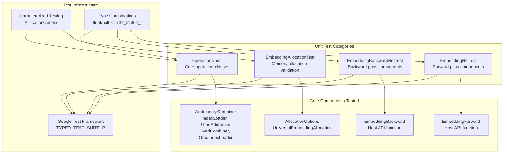
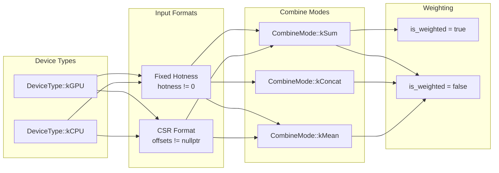
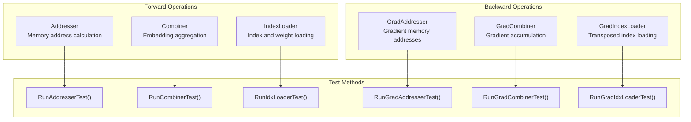

<!-- source: DeepWiki mcp.deepwiki.com · repo NVIDIA/cuEmbed · page 4.2 Unit Tests · fetched 2026-10-26 -->

# Unit Tests

<details>
<summary>Relevant source files</summary>

The following files were used as context for generating this wiki page:

- [tests/test_embedding_allocation.cu](tests/test_embedding_allocation.cu)
- [tests/test_embedding_backward.cu](tests/test_embedding_backward.cu)
- [tests/test_embedding_forward.cu](tests/test_embedding_forward.cu)
- [tests/test_embedding_ops.cu](tests/test_embedding_ops.cu)

</details>


This page documents the component-level unit tests that validate individual cuEmbed operations and classes in isolation. These tests focus on testing the building blocks of the embedding system rather than end-to-end correctness validation.

For comprehensive GPU vs CPU correctness validation, see [Correctness Tests](#4.1). For performance measurement and benchmarking, see [Benchmarking](#4.3).

## Test Architecture

The unit test system is organized around testing individual components of the cuEmbed library using Google Test framework. The tests are designed to validate specific operations, memory allocation patterns, and data type combinations without relying on full system integration.



Sources: [tests/test_embedding_allocation.cu](), [tests/test_embedding_forward.cu](), [tests/test_embedding_backward.cu](), [tests/test_embedding_ops.cu]()

## Allocation Testing

The `EmbeddingAllocationTest` class validates memory allocation patterns and data structure initialization for different embedding configurations.

### Test Coverage

| Test Case | Configuration | Validation Focus |
|-----------|---------------|------------------|
| `FixedHotnessWorks` | Fixed hotness format | Standard allocation sizes |
| `CSRWorks` | CSR format | Variable hotness allocation |
| `SparseGradientWorks` | Compressed gradients | Sparse gradient structures |

### Key Validation Points

The allocation tests verify:

- **Memory sizes**: Embedding table, gradient buffers, and index arrays have correct dimensions
- **Index validity**: No duplicate indices within samples, valid index ranges
- **Weight constraints**: All weights fall within [0.0, 1.0] range
- **Format-specific allocations**: CSR vs fixed hotness memory layouts

The test uses parameterized testing across different `CombineMode` values:

```cpp
INSTANTIATE_TEST_SUITE_P(
    EmbeddingAllocationTest,
    EmbeddingAllocationTest,
    ::testing::Values(CombineMode::kConcat, CombineMode::kSum)
);
```

Sources: [tests/test_embedding_allocation.cu:28-171]()

## Forward Pass Testing  

The `EmbeddingRefTest` template class validates forward pass functionality by comparing GPU and CPU implementations of the `EmbeddingForward` function.

### Test Matrix



### Type Instantiations

The tests are instantiated for multiple data type combinations:

- `EmbedTestTypeCombo<float, int32_t>`
- `EmbedTestTypeCombo<float, int64_t>`  
- `EmbedTestTypeCombo<__half, int32_t>`
- `EmbedTestTypeCombo<__half, int64_t>`

Sources: [tests/test_embedding_forward.cu:38-241]()

## Backward Pass Testing

The `EmbeddingBackwardRefTest` template class validates backward pass gradient computation using the same device and type combination approach as forward testing.

### Gradient Testing Scenarios

| Test Name | Focus | Special Features |
|-----------|-------|------------------|
| `TestFixedHotnessAgainstRef*` | Standard backward pass | GPU/CPU comparison |
| `TestCSRAgainstRef*` | Variable hotness | CSR format support |
| `TestSkipInitGradAgainstRef*` | Gradient initialization | `skip_grad_init` parameter |

### Compressed Gradient Support

The tests validate compressed gradient functionality where gradients are computed only for unique indices rather than the full embedding table:

```cpp
const int num_grad_embedding_rows = 
    (compressed_grad) ? num_unique_ : num_categories_;
IndexType* inverse_mapping = 
    (compressed_grad) ? inverse_mapping_->data().get() : nullptr;
```

Sources: [tests/test_embedding_backward.cu:40-299]()

## Core Operations Testing

The `OperationsTest` template class provides the most comprehensive unit testing by validating individual operation classes in isolation.

### Operation Classes Tested



### Vectorized Type Testing

The operations are tested with different vectorized load types:

| Test Class | Element Type | Vector Type | Index Type |
|------------|--------------|-------------|------------|
| `OperationsTestEmbed32Vec4Idx32` | `float` | `float4` | `int32_t` |
| `OperationsTestEmbed32Vec4Idx64` | `float` | `float4` | `int64_t` |
| `OperationsTestEmbed16Vec4Idx32` | `__half` | `half4` | `int32_t` |
| `OperationsTestEmbed16Vec4Idx64` | `__half` | `half4` | `int64_t` |
| `OperationsTestEmbed32Vec2Idx32` | `float` | `float2` | `int32_t` |
| `OperationsTestEmbed32Vec2Idx64` | `float` | `float2` | `int64_t` |
| `OperationsTestEmbed16Vec2Idx32` | `__half` | `half2` | `int32_t` |
| `OperationsTestEmbed16Vec2Idx64` | `__half` | `half2` | `int64_t` |

### Parameterized Test Configurations

The operations tests use extensive parameterization to cover different embedding scenarios:

```cpp
auto lookup_test_values = testing::Values(
    ALLOC.batch_size(3).embed_width(4).hotness(4).combine_mode(SUM),
    ALLOC.batch_size(3).embed_width(4).hotness(4).combine_mode(SUM).CSR,
    ALLOC.batch_size(257).embed_width(36).hotness(26).combine_mode(SUM),
    ALLOC.batch_size(257).embed_width(68).hotness(33).combine_mode(CONCAT)
);
```

Sources: [tests/test_embedding_ops.cu:59-611]()

## Test Execution and Integration

### Build Integration

The unit tests are integrated into the CMake build system and can be executed as part of the overall test suite. Each test category can be run independently:

- Allocation tests: Focus on memory management validation
- Forward/backward tests: Validate API function correctness  
- Operations tests: Test individual component behavior

### Validation Methodology

All unit tests follow a consistent pattern:

1. **Setup**: Initialize test data using `AllocationOptions` and `UniversalEmbeddingAllocation`
2. **Execute**: Run the component under test with various parameter combinations
3. **Validate**: Compare results against expected values or reference implementations

The tests provide comprehensive coverage of the cuEmbed library's core functionality while maintaining isolation between components for precise error localization.

Sources: [tests/test_embedding_allocation.cu](), [tests/test_embedding_forward.cu](), [tests/test_embedding_backward.cu](), [tests/test_embedding_ops.cu]()

---

