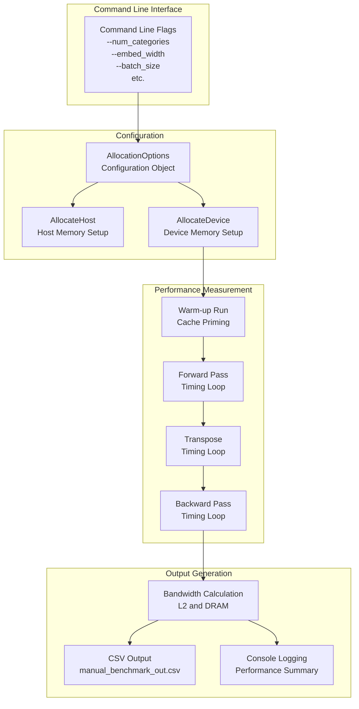
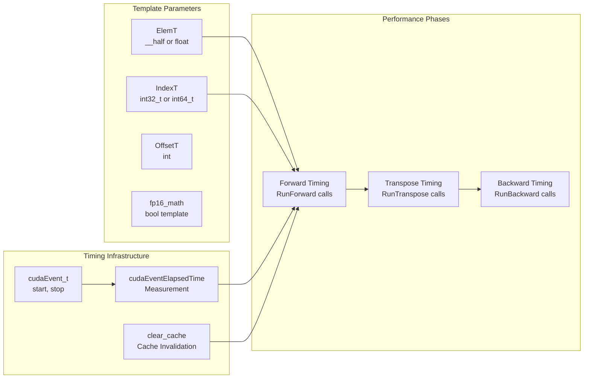
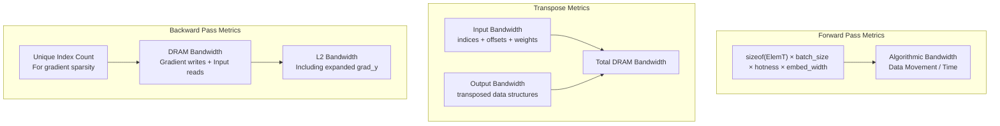
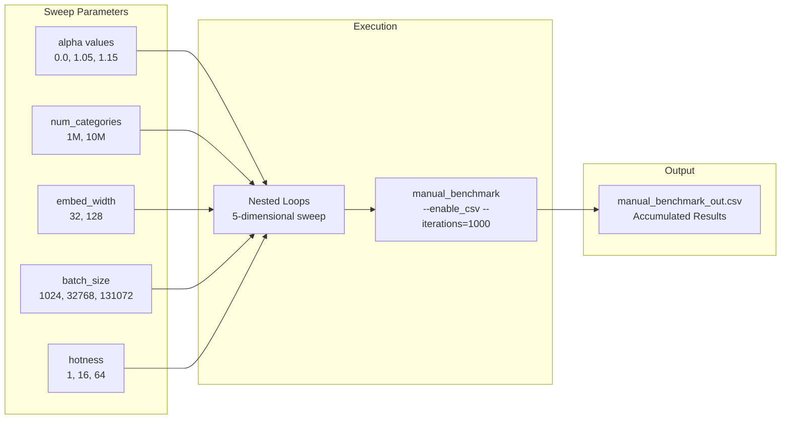
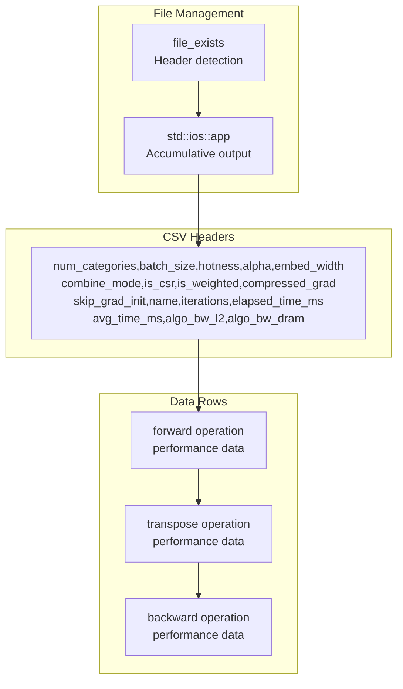
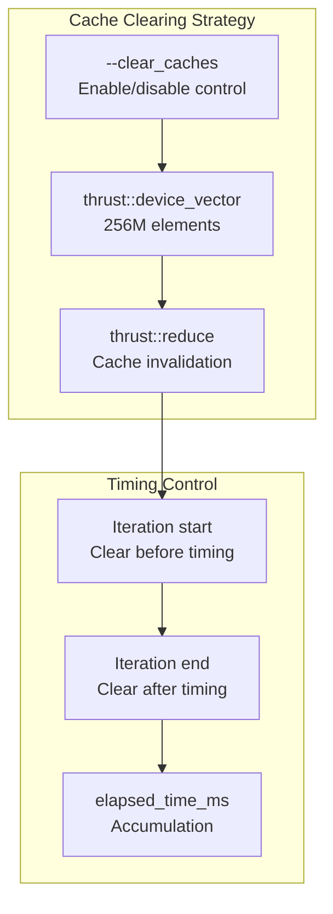
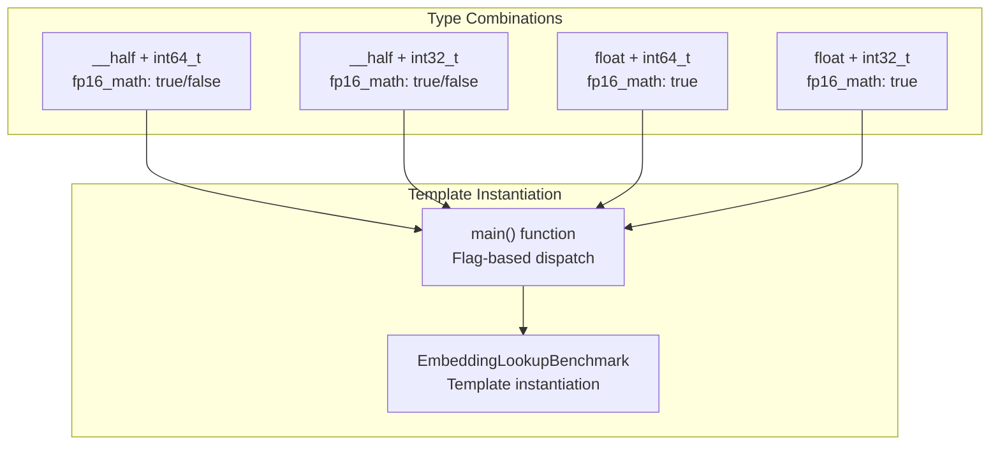

<!-- source: DeepWiki mcp.deepwiki.com · repo NVIDIA/cuEmbed · page 4.3 Benchmarking · fetched 2026-10-26 -->

# Benchmarking

Relevant source files

The following files were used as context for generating this wiki page:

- [benchmarks/CMakeLists.txt](benchmarks/CMakeLists.txt)
- [benchmarks/manual_benchmark.cu](benchmarks/manual_benchmark.cu)
- [benchmarks/sweep_parameters.sh](benchmarks/sweep_parameters.sh)

This document covers the performance measurement and benchmarking infrastructure for cuEmbed. The benchmarking system provides comprehensive performance analysis tools for embedding lookup operations, including forward passes, index transposition, and backward gradient computations. For correctness validation against CPU references, see [Correctness Tests](#4.1). For component-level testing, see [Unit Tests](#4.2).

## Overview

The benchmarking system is built around the `manual_benchmark` executable which provides detailed performance measurements for all major cuEmbed operations. It supports parameter sweeping across different configurations and outputs structured performance data for analysis and optimization.

Sources: [benchmarks/manual_benchmark.cu:1-663](), [benchmarks/CMakeLists.txt:1-33]()

## Benchmarking Architecture

The benchmarking system follows a three-phase measurement approach:

Sources: [benchmarks/manual_benchmark.cu:147-516]()

## Core Benchmarking Function

The `EmbeddingLookupBenchmark` template function orchestrates the entire benchmarking process:

Sources: [benchmarks/manual_benchmark.cu:147-516]()

## Configuration Parameters

The benchmark supports extensive configuration through command-line flags:

| Flag | Default | Description |
|------|---------|-------------|
| `--num_categories` | 1048576 | Number of embedding categories/rows |
| `--embed_width` | 128 | Width of embedding vectors |
| `--batch_size` | 1024 | Batch size for lookup operations |
| `--hotness` | 1 | Number of nonzero indices per sample |
| `--iterations` | 1 | Number of timing iterations |
| `--alpha` | 0.0 | Power law distribution parameter (0.0 = uniform) |
| `--csr_input` | false | Use CSR format for indices |
| `--weighted_sum` | false | Enable weighted summation |
| `--compressed_grad` | true | Compute sparse gradients in backward pass |
| `--fp16_math` | false | Use fp16 arithmetic for fp16 embeddings |
| `--enable_csv` | false | Output results in CSV format |
| `--clear_caches` | true | Clear caches between measurements |

Sources: [benchmarks/manual_benchmark.cu:44-83]()

## Performance Metrics

The benchmarking system calculates multiple bandwidth metrics for each operation phase:

Sources: [benchmarks/manual_benchmark.cu:250-261](), [benchmarks/manual_benchmark.cu:340-354](), [benchmarks/manual_benchmark.cu:444-473]()

## Parameter Sweeping

The `sweep_parameters.sh` script automates benchmarking across parameter combinations:

Sources: [benchmarks/sweep_parameters.sh:18-36]()

## CSV Output Format

When `--enable_csv` is enabled, the benchmark generates structured output:

Sources: [benchmarks/manual_benchmark.cu:104-109](), [benchmarks/manual_benchmark.cu:111-129](), [benchmarks/manual_benchmark.cu:174-188]()

## Cache Management

The benchmarking system includes sophisticated cache management to ensure accurate measurements:

Sources: [benchmarks/manual_benchmark.cu:200-204](), [benchmarks/manual_benchmark.cu:136-144](), [benchmarks/manual_benchmark.cu:214-216](), [benchmarks/manual_benchmark.cu:245-247]()

## Build Configuration

The benchmarking system is built using CMake with specific dependencies:

| Target | Dependencies | Output Location |
|--------|-------------|----------------|
| `manual_benchmark` | cuembed_hdrs, cuda, utils, absl libs | `${CMAKE_BINARY_DIR}/bin/benchmarks` |

Key dependencies include:
- `absl::log`, `absl::flags` for command-line handling
- `cuda` for CUDA runtime
- `utils` for allocation and reference implementations

Sources: [benchmarks/CMakeLists.txt:18-32]()

## Type System Integration

The benchmark supports all cuEmbed type combinations through template specialization:

Sources: [benchmarks/manual_benchmark.cu:563-659]()

---

