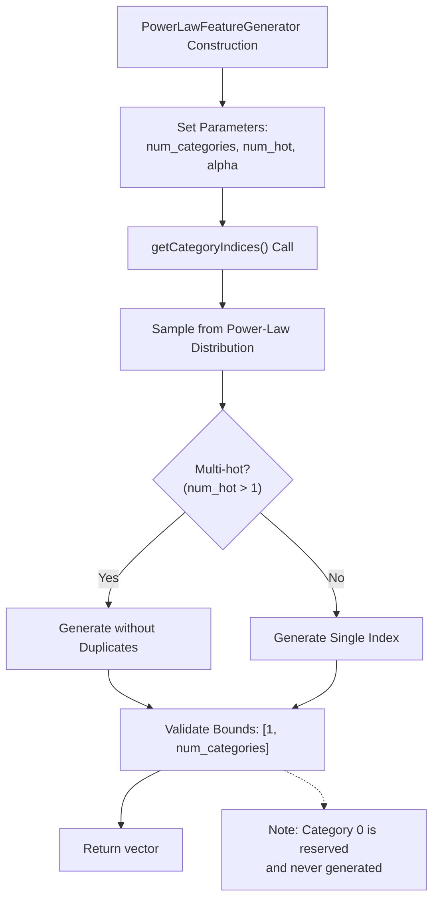
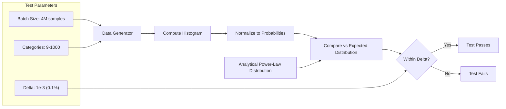

<!-- source: DeepWiki mcp.deepwiki.com · repo NVIDIA/cuEmbed · page 4.4 Data Generation · fetched 2026-10-26 -->

# Data Generation

<details>
<summary>Relevant source files</summary>

The following files were used as context for generating this wiki page:

- [tests/test_datagen.cpp](tests/test_datagen.cpp)

</details>


## Purpose and Scope

This document covers the data generation utilities in cuEmbed, which provide realistic test data for embedding lookup operations. The data generation system creates synthetic embedding indices that follow statistical distributions commonly found in real-world recommendation systems, enabling comprehensive testing and benchmarking of the embedding lookup kernels.

For information about the actual testing framework that uses this generated data, see [Correctness Tests](#4.1) and [Benchmarking](#4.3).

## Overview

The data generation system provides utilities to create synthetic embedding indices that mimic real-world data patterns. The primary focus is on generating category indices that follow power-law distributions, which are characteristic of many recommendation system datasets where a small number of categories are accessed frequently while most categories are accessed rarely.

The system supports both one-hot and multi-hot scenarios, where samples can contain single or multiple category indices respectively. All generated data includes proper bounds checking and duplicate prevention for multi-hot cases.

## Feature Generator Architecture

### Data Generation Class Hierarchy

```mermaid
classDiagram
    class FeatureGenerator~T~ {
        <<abstract>>
        +getCategoryIndices() vector~T~
    }
    
    class PowerLawFeatureGenerator~T~ {
        -num_categories: int
        -num_hot: int
        -alpha: double
        -power_law_type: PowerLawType
        +PowerLawFeatureGenerator(num_categories, num_hot, alpha)
        +getCategoryIndices() vector~T~
    }
    
    class PowerLawType {
        <<enumeration>>
        kPsx
    }
    
    FeatureGenerator~T~ <|-- PowerLawFeatureGenerator~T~
    PowerLawFeatureGenerator~T~ --> PowerLawType
    
    note for FeatureGenerator~T~ : "Base class for all data generators\nSupports int32_t and int64_t index types"
    note for PowerLawFeatureGenerator~T~ : "Generates indices following power-law distribution\nf(i) = i^(-alpha)"
```

Sources: [tests/test_datagen.cpp:22-104]()

### Core Components

The data generation system centers around the `FeatureGenerator<T>` abstract base class, which defines the interface for generating category indices. The template parameter `T` supports both `int32_t` and `int64_t` index types to match the embedding lookup requirements.

The primary concrete implementation is `PowerLawFeatureGenerator<IndexType>`, which generates indices following a power-law distribution. This distribution is characterized by the formula `f(i) = i^(-alpha)`, where `alpha` controls the steepness of the distribution curve.

Sources: [tests/test_datagen.cpp:101](), [tests/test_datagen.cpp:131-134]()

## Power-Law Distribution Generation

### Statistical Properties

The power-law generator produces indices where the probability of selecting category `i` follows:

| Property | Formula | Purpose |
|----------|---------|---------|
| Probability Density | `f(i) = i^(-alpha)` | Base distribution function |
| Expected Probability | `∫[i to i+1] f(x)dx` | Normalized probability for category i |
| Alpha Parameter | Configurable slope | Controls distribution steepness |

The generated distribution is validated against analytical expectations with statistical tests that verify the actual frequency matches the theoretical power-law distribution within configurable tolerance limits.

Sources: [tests/test_datagen.cpp:115-129]()

### Generation Flow



Sources: [tests/test_datagen.cpp:37-45](), [tests/test_datagen.cpp:47-58]()

## Generation Modes

### One-Hot Generation

One-hot generation produces exactly one category index per sample. This mode is used for testing scenarios where each sample belongs to exactly one category, such as classification tasks or single-feature embeddings.

**Configuration Parameters:**
- `num_categories`: Total number of available categories
- `num_hot = 1`: Single index per sample
- `alpha`: Power-law distribution parameter

**Validation:** The generated distribution is statistically validated against the analytical power-law distribution with tolerance of 0.1% deviation from expected probabilities.

Sources: [tests/test_datagen.cpp:109-139]()

### Multi-Hot Generation

Multi-hot generation produces multiple unique category indices per sample. This mode tests scenarios where samples can belong to multiple categories simultaneously, such as multi-label classification or feature combinations.

**Key Properties:**
- No duplicate indices within a sample
- All indices within bounds `[1, num_categories]`
- Configurable number of hot indices per sample

**Quality Assurance:**
- Duplicate detection and prevention
- Bounds validation for all generated indices
- Statistical distribution preservation across multi-hot selections

Sources: [tests/test_datagen.cpp:143-160]()

## Testing and Validation

### Statistical Validation Framework



Sources: [tests/test_datagen.cpp:79-98]()

### Test Coverage

The data generation system includes comprehensive tests that validate both correctness and statistical properties:

| Test Type | Purpose | Key Metrics |
|-----------|---------|-------------|
| Statistical Accuracy | Verify power-law distribution | Probability deviation < 0.1% |
| Bounds Checking | Validate index ranges | All indices ∈ [1, num_categories] |
| Duplicate Prevention | Multi-hot uniqueness | No repeated indices per sample |
| Type Safety | Template instantiation | Support int32_t and int64_t |

The test suite uses large batch sizes (4M samples) to ensure statistical significance and includes both one-hot and multi-hot scenarios with varying numbers of categories.

Sources: [tests/test_datagen.cpp:113](), [tests/test_datagen.cpp:147](), [tests/test_datagen.cpp:166-167]()

## Usage in Testing Context

The data generation utilities integrate with the broader cuEmbed testing framework through the `DataGeneratorTest` template class, which provides standardized testing patterns for validating generator implementations:

**Core Testing Methods:**
- `generateIndices()`: Batch generation with size validation
- `sanityCheckIndices()`: Bounds and uniqueness validation  
- `computeHistogram()`: Statistical distribution analysis
- `checkGeneratorMatchesExpectation()`: Distribution accuracy validation

The testing framework supports parameterized tests across different index types and automatically instantiates tests for both `int32_t` and `int64_t` scenarios.

Sources: [tests/test_datagen.cpp:27-104](), [tests/test_datagen.cpp:162-167]()

---

