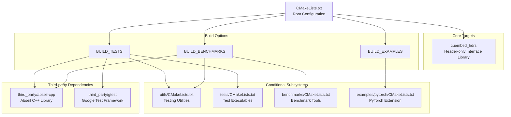
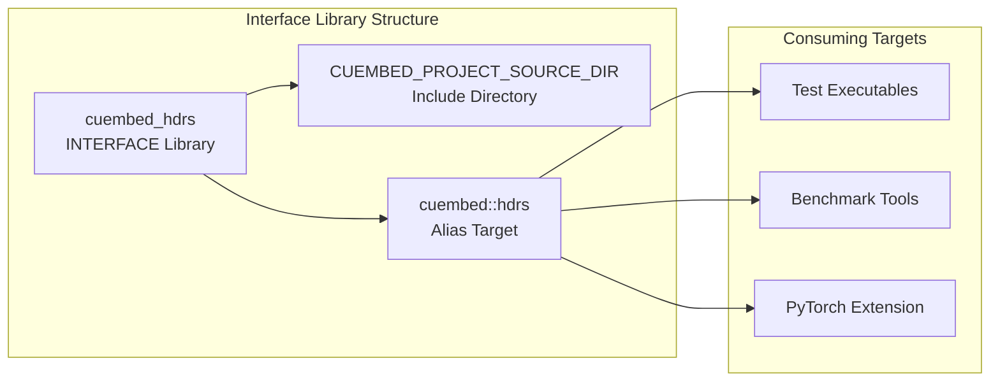
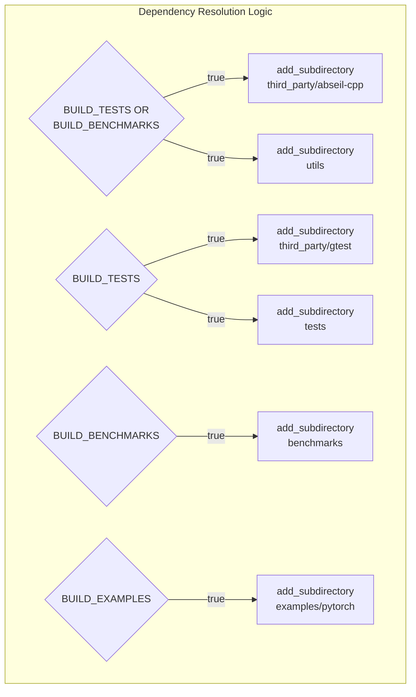

<!-- source: DeepWiki mcp.deepwiki.com · repo NVIDIA/cuEmbed · page 5 Build System · fetched 2026-10-26 -->

# Build System

Relevant source files

The following files were used as context for generating this wiki page:

- [CMakeLists.txt](CMakeLists.txt)

The cuEmbed build system uses CMake to manage compilation, dependency resolution, and target generation across the core library, tests, benchmarks, and PyTorch integration. This system orchestrates the build process for CUDA C++ code and handles integration with third-party libraries.

For detailed CMake configuration options and target definitions, see [CMake Configuration](#5.1). For information about third-party dependency management, see [Dependencies](#5.2).

## Build System Architecture

The build system is structured around a root CMake configuration that conditionally includes subsystems based on build options. The system supports multiple CUDA architectures and integrates with both native C++ testing frameworks and PyTorch extension building.

Sources: [CMakeLists.txt:1-60]()

## Build Configuration Structure

The root CMake configuration establishes the project foundation with CUDA support and defines the primary interface library. The system uses C++17 standard and targets multiple CUDA compute capabilities.

| Configuration | Value | Purpose |
|---------------|-------|---------|
| `CMAKE_CXX_STANDARD` | 17 | C++ language standard |
| `CMAKE_CUDA_ARCHITECTURES` | 70 75 80 90 | Supported GPU architectures |
| `CMAKE_CUDA_FLAGS` | `--ptxas-options=-v` | Enable verbose PTX assembly |
| `ABSL_PROPAGATE_CXX_STD` | ON | Ensure Abseil uses same C++ standard |

The core `cuembed_hdrs` interface library provides header-only access to the cuEmbed functionality:

Sources: [CMakeLists.txt:16-22](), [CMakeLists.txt:34-36]()

## Build Options and Targets

The build system provides three main configuration options that control which subsystems are included in the build:

| Option | Default | Controls | Dependencies |
|--------|---------|----------|-------------|
| `BUILD_TESTS` | ON | Test executables and validation | `gtest`, `abseil-cpp`, `utils` |
| `BUILD_BENCHMARKS` | ON | Performance measurement tools | `abseil-cpp`, `utils` |  
| `BUILD_EXAMPLES` | OFF | PyTorch integration examples | PyTorch libraries |

The conditional inclusion logic ensures dependencies are only built when needed:

Sources: [CMakeLists.txt:26-28](), [CMakeLists.txt:38-60]()

## CUDA Integration

The build system configures CUDA compilation with specific architecture targeting and compiler flags. The `enable_language(CUDA)` directive allows CMake to handle CUDA source files alongside C++ files.

Key CUDA configuration elements:
- **Architecture Support**: Targets compute capabilities 7.0, 7.5, 8.0, and 9.0 for broad GPU compatibility
- **PTX Verbosity**: Enables verbose PTX assembly output for debugging and optimization analysis
- **CUDAToolkit Integration**: Uses `find_package(CUDAToolkit)` for accessing CUDA runtime and driver APIs

Sources: [CMakeLists.txt:19-22](), [CMakeLists.txt:30]()

## Subsystem Integration

The build system serves as the integration point for all major cuEmbed components. Each subsystem maintains its own CMake configuration while relying on the root configuration for common settings and dependencies.

The modular design allows selective building of components based on development needs, whether focusing on core library development, performance analysis, or PyTorch integration work.

Sources: [CMakeLists.txt:1-60]()

---

