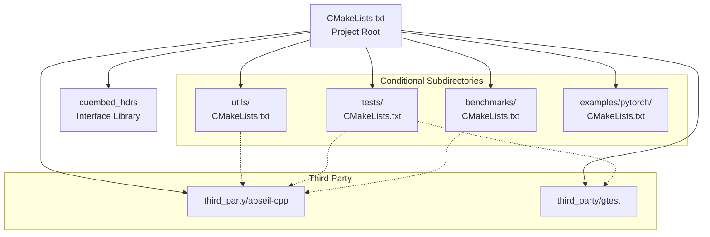
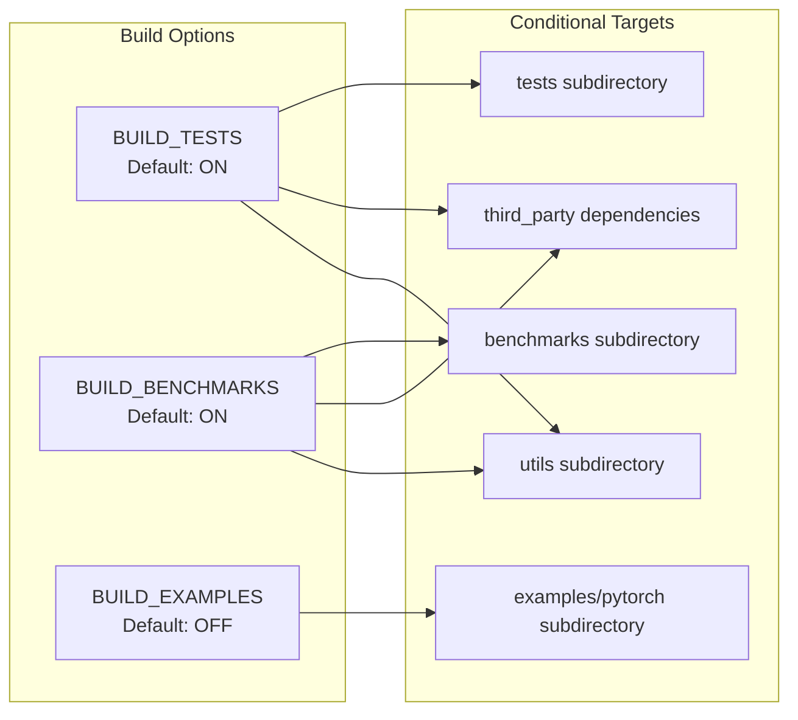
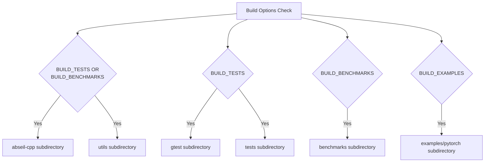
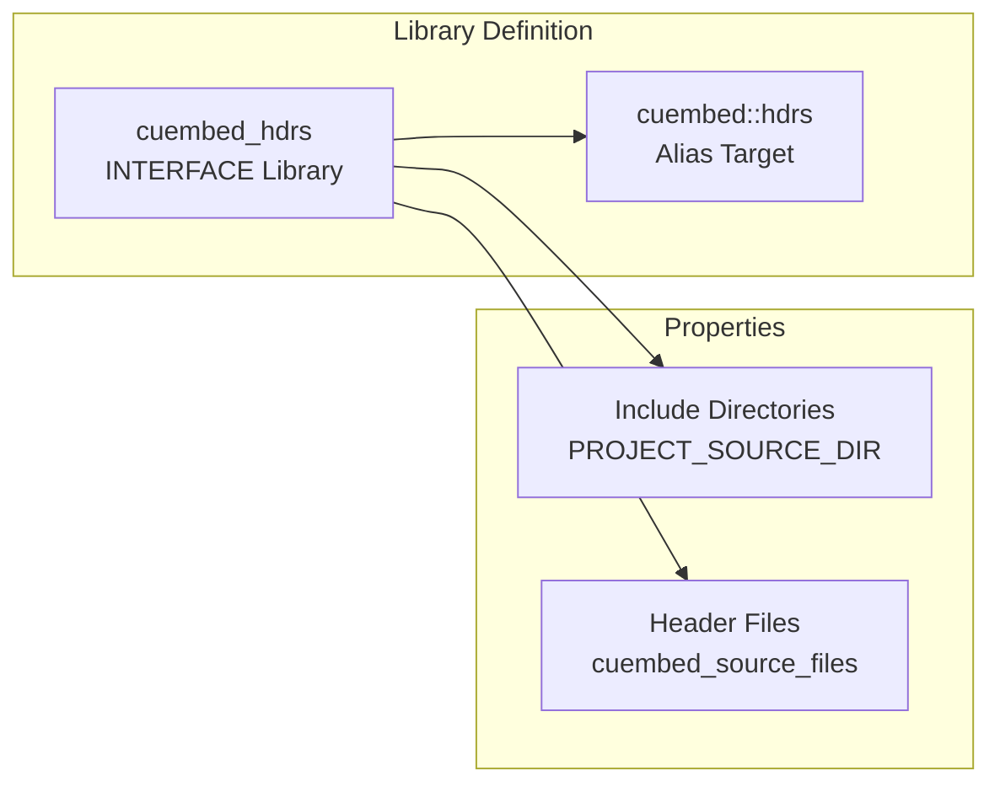

<!-- source: DeepWiki mcp.deepwiki.com · repo NVIDIA/cuEmbed · page 5.1 CMake Configuration · fetched 2026-10-26 -->

# CMake Configuration

<details>
<summary>Relevant source files</summary>

The following files were used as context for generating this wiki page:

- [CMakeLists.txt](CMakeLists.txt)

</details>


This document covers the main CMake build configuration for the cuEmbed project, including project setup, CUDA configuration, build options, and target definitions. The configuration manages dependencies, compiler settings, and conditional build targets for tests, benchmarks, and examples.

For information about specific third-party dependencies, see [Dependencies](#5.2). For CI/CD build automation, see [CI/CD Pipeline](#6.1).

## Project Configuration Overview

The cuEmbed project uses CMake 3.23+ with C++17 standard and CUDA support. The main configuration establishes the project structure and enables conditional compilation of different components.

### CMake Project Structure



Sources: [CMakeLists.txt:16-60]()

### Basic Project Setup

The project configuration establishes fundamental build parameters:

| Configuration | Value | Line Reference |
|--------------|-------|----------------|
| CMake Version | 3.23+ | [CMakeLists.txt:16]() |
| C++ Standard | 17 | [CMakeLists.txt:17]() |
| Languages | CXX, CUDA | [CMakeLists.txt:18-19]() |
| Project Name | `cuembed` | [CMakeLists.txt:18]() |

Sources: [CMakeLists.txt:16-19]()

## Build Options and Targets

The build system provides three main configuration options that control which components are built:

### Build Option Configuration



| Option | Default | Purpose | Dependencies Enabled |
|--------|---------|---------|---------------------|
| `BUILD_TESTS` | ON | Build test executables | gtest, abseil-cpp, utils |
| `BUILD_BENCHMARKS` | ON | Build benchmark tools | abseil-cpp, utils |
| `BUILD_EXAMPLES` | OFF | Build PyTorch examples | PyTorch integration |

Sources: [CMakeLists.txt:26-28](), [CMakeLists.txt:38-60]()

### Target Dependency Flow

The conditional compilation logic creates a dependency chain where utility libraries and third-party dependencies are only built when needed:



Sources: [CMakeLists.txt:38-44](), [CMakeLists.txt:47-60]()

## CUDA Configuration

The build system configures CUDA-specific compiler settings and target architectures for optimal GPU performance across different hardware generations.

### CUDA Architecture Support

The configuration targets multiple CUDA compute capabilities:

| Architecture | Compute Capability | GPU Examples |
|-------------|-------------------|--------------|
| 70 | sm_70 | V100, T4 |
| 75 | sm_75 | RTX 20xx, T4 |
| 80 | sm_80 | A100, RTX 30xx |
| 90 | sm_90 | H100, RTX 40xx |

```cpp
set(CMAKE_CUDA_ARCHITECTURES 70 75 80 90)
set(CMAKE_CUDA_FLAGS "${CMAKE_CUDA_FLAGS} --ptxas-options=-v")
```

The `--ptxas-options=-v` flag enables verbose PTX assembly output for debugging and optimization analysis.

Sources: [CMakeLists.txt:21-22]()

### CUDAToolkit Integration

The build system locates and links against the CUDA Toolkit:

```cmake
find_package(CUDAToolkit)
```

This provides access to CUDA runtime libraries, cuBLAS, cuSPARSE, and other CUDA components required by the embedding kernels.

Sources: [CMakeLists.txt:30]()

## Core Library Target

The main library target is defined as a header-only interface library that provides include paths and dependencies for consuming code.

### cuembed_hdrs Interface Library



The interface library configuration:

```cmake
add_library(cuembed_hdrs INTERFACE ${cuembed_source_files})
target_include_directories(cuembed_hdrs INTERFACE ${CUEMBED_PROJECT_SOURCE_DIR})
add_library(cuembed::hdrs ALIAS cuembed_hdrs)
```

Key characteristics:
- **Interface Library**: Header-only, no compilation artifacts
- **Include Path**: Points to project root for `#include <cuembed/...>` usage
- **Alias**: `cuembed::hdrs` provides namespaced target name
- **Source Variable**: References `cuembed_source_files` (defined elsewhere)

Sources: [CMakeLists.txt:32-36]()

## Abseil Configuration

The build enables Abseil C++ standard propagation to ensure consistent C++ standard usage across all components:

```cmake
set(ABSL_PROPAGATE_CXX_STD ON)
```

This setting ensures that when Abseil is built, it uses the same C++17 standard as the rest of the project, preventing ABI compatibility issues.

Sources: [CMakeLists.txt:24]()

---

