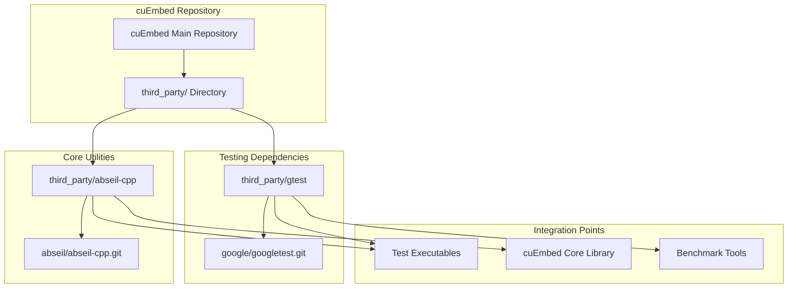
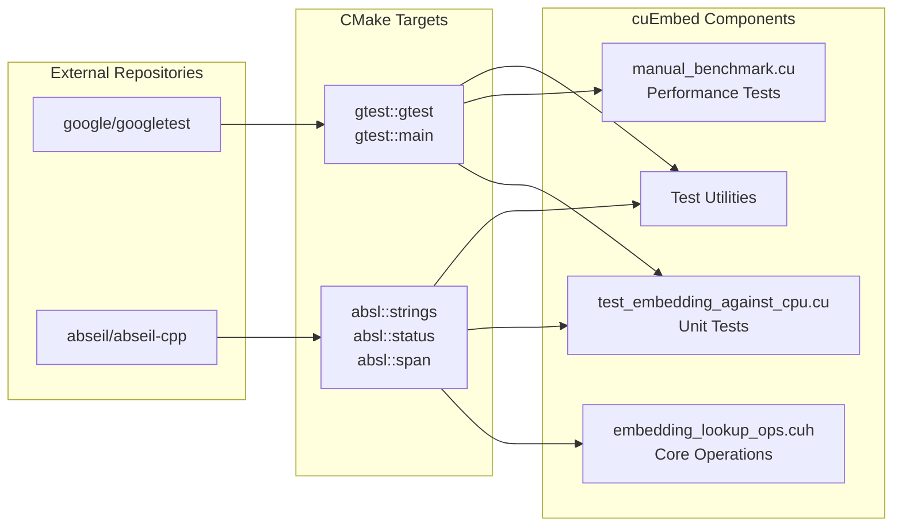
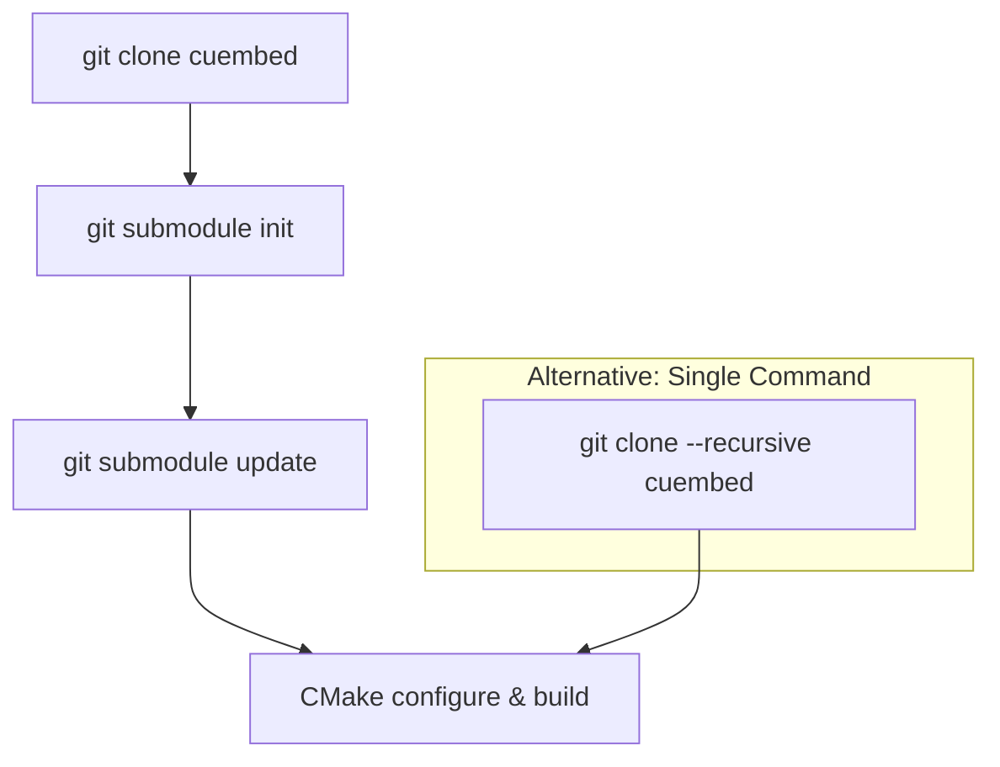
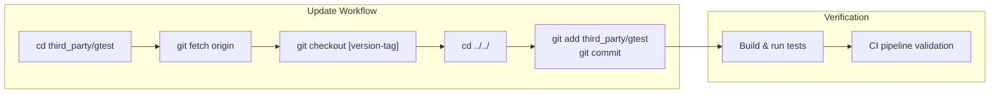

<!-- source: DeepWiki mcp.deepwiki.com · repo NVIDIA/cuEmbed · page 5.2 Dependencies · fetched 2026-10-26 -->

# Dependencies

Relevant source files

The following files were used as context for generating this wiki page:

- [.gitmodules](.gitmodules)

This document covers the third-party dependencies used by cuEmbed, which are managed through Git submodules. These dependencies provide essential functionality for testing infrastructure and core C++ utilities.

For information about the main CMake build configuration that integrates these dependencies, see [CMake Configuration](#5.1).

## Dependency Management Strategy

cuEmbed uses Git submodules to manage its third-party dependencies, providing several advantages:

- **Version Control**: Exact dependency versions are tracked in the main repository
- **Reproducible Builds**: All developers and CI systems use identical dependency versions  
- **Self-Contained**: The repository includes all necessary code without external downloads
- **Offline Development**: Dependencies are available locally after initial checkout

The submodules are configured in [.gitmodules:1-6]() and stored under the `third_party/` directory structure.

## Dependency Architecture

### Submodule Hierarchy

Sources: [.gitmodules:1-6]()

### System Integration Map

Sources: [.gitmodules:1-6]()

## Individual Dependencies

### Google Test Framework

| Property | Value |
|----------|--------|
| **Submodule Path** | `third_party/gtest` |
| **Repository URL** | `https://github.com/google/googletest.git` |
| **Purpose** | Unit testing and validation framework |
| **Usage Areas** | Correctness tests, unit tests, benchmarking |

Google Test provides the testing infrastructure for cuEmbed's comprehensive validation strategy. It is used throughout:

- **Correctness Validation**: GPU vs CPU result comparison tests
- **Unit Testing**: Component-level testing of operations and utilities  
- **Benchmark Infrastructure**: Performance measurement and validation
- **Test Utilities**: Common testing patterns and assertion helpers

The framework integrates with cuEmbed's testing ecosystem to ensure reliability across different CUDA configurations and embedding parameters.

Sources: [.gitmodules:1-3]()

### Abseil C++ Library

| Property | Value |
|----------|--------|
| **Submodule Path** | `third_party/abseil-cpp` |
| **Repository URL** | `https://github.com/abseil/abseil-cpp.git` |
| **Purpose** | Modern C++ utilities and data structures |
| **Usage Areas** | Core library utilities, string processing, container types |

Abseil provides essential C++ utilities that enhance the core cuEmbed implementation:

- **String Utilities**: Efficient string processing and formatting
- **Container Types**: High-performance data structures for index management
- **Status Handling**: Error propagation and status management
- **Span Types**: Safe array and memory view abstractions
- **Utility Functions**: Common algorithms and helper functions

These utilities are integrated throughout the cuEmbed core library to provide robust, efficient implementations while maintaining modern C++ best practices.

Sources: [.gitmodules:4-6]()

## Submodule Management Workflow

### Development Setup

### Dependency Update Process

Sources: [.gitmodules:1-6]()

## Integration with Build System

The Git submodules integrate seamlessly with cuEmbed's CMake build system:

- **Automatic Discovery**: CMake automatically finds and configures the submodule dependencies
- **Target Creation**: Each dependency provides CMake targets that can be linked against
- **Build Integration**: Dependencies are built as part of the main cuEmbed build process
- **Cross-Platform**: Submodule approach works consistently across different development environments

The CMake configuration handles the complexity of dependency management while providing a clean interface for linking against the required libraries.

Sources: [.gitmodules:1-6]()

---

