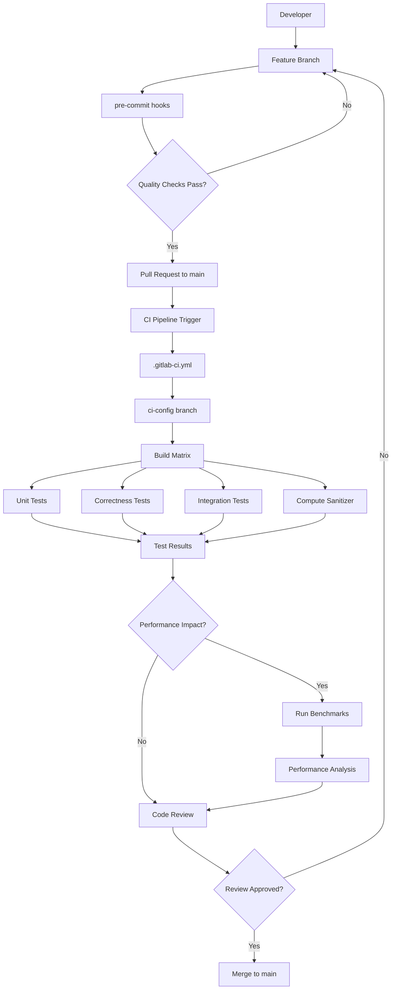
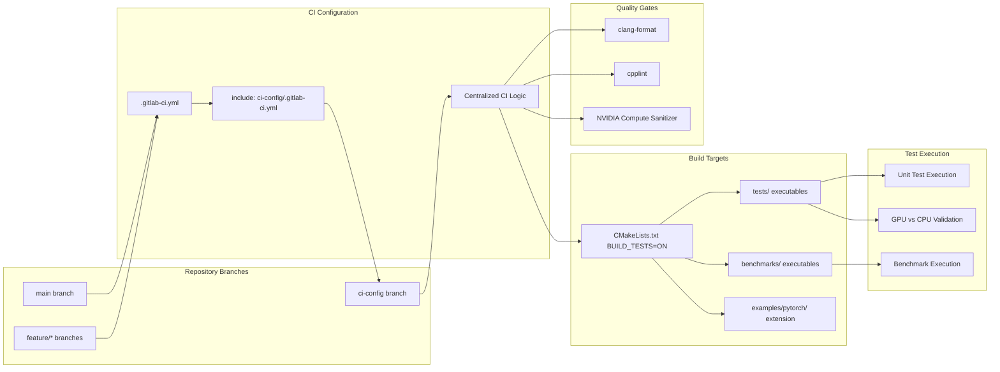
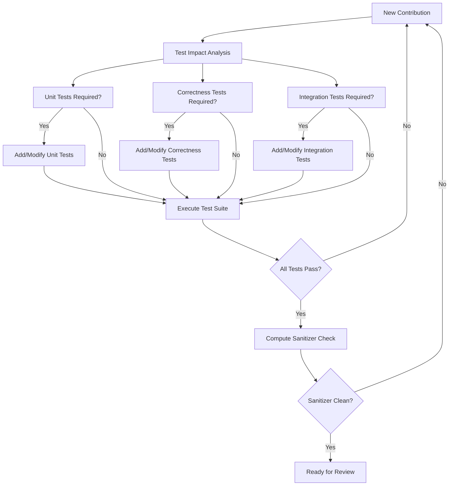

<!-- source: DeepWiki mcp.deepwiki.com · repo NVIDIA/cuEmbed · page 6 Development Workflow · fetched 2026-10-26 -->

# Development Workflow

<details>
<summary>Relevant source files</summary>

The following files were used as context for generating this wiki page:

- [.gitlab-ci.yml](.gitlab-ci.yml)
- [CONTRIBUTING.md](CONTRIBUTING.md)

</details>


## Purpose and Scope

This document covers the development workflow, processes, and tooling used in the cuEmbed project. It provides an overview of the continuous integration pipeline, code quality enforcement, and contribution guidelines that ensure consistent development practices.

For detailed CI/CD pipeline configuration, see [CI/CD Pipeline](#6.1). For specific code formatting and quality tools, see [Code Quality](#6.2). For comprehensive contribution requirements, see [Contributing](#6.3).

## Development Process Overview

The cuEmbed project follows a structured development workflow that emphasizes code quality, comprehensive testing, and performance validation. The process integrates multiple quality gates and automated checks to maintain the library's reliability and performance standards.

### Development Workflow Architecture



Sources: [CONTRIBUTING.md:1-22](), [.gitlab-ci.yml:1-5]()

## CI/CD System Architecture

The cuEmbed project uses GitLab CI with a centralized configuration approach where the main CI logic is maintained in a separate `ci-config` branch, promoting reusability and maintainability across different branches.

### CI/CD Pipeline Structure



Sources: [.gitlab-ci.yml:1-5]()

## Code Quality Requirements

The project enforces strict code quality standards through automated tools and manual review processes. All contributions must pass these quality gates before acceptance.

### Code Quality Enforcement Pipeline

| Stage | Tool | Purpose | Failure Action |
|-------|------|---------|----------------|
| Pre-commit | `clang-format` | Code formatting consistency | Block commit |
| Pre-commit | `cpplint` | C++ style compliance | Block commit |
| CI Build | `NVIDIA Compute Sanitizer` | Memory safety validation | Fail CI |
| Manual Review | Code Review | Logic and design validation | Block merge |

The pre-commit hooks are installed via:
```bash
pip install pre-commit && pre-commit install
```

Quality verification can be run manually:
```bash
pre-commit run --files all
```

Sources: [CONTRIBUTING.md:15-16]()

## Testing Requirements

All contributions must include appropriate test coverage and pass existing test suites. The testing strategy encompasses multiple levels of validation.

### Test Coverage Requirements



Test execution is performed through the CMake build system with `BUILD_TESTS=ON` option. The tests are located in the `tests/` directory and must validate functionality across different configurations and parameter combinations.

Sources: [CONTRIBUTING.md:9-12]()

## Performance Validation Process

Changes that may impact performance require benchmark validation to prevent performance regressions. This process ensures that optimizations are genuine improvements and that feature additions don't negatively affect existing performance characteristics.

### Performance Testing Workflow

The performance validation process uses the benchmarking infrastructure to measure impact:

```bash
cd benchmarks
./sweep_parameters.sh
```

This generates comprehensive performance data in CSV format for analysis. Performance comparisons should be conducted both before and after changes to identify any regressions or improvements.

Performance impact assessment criteria:
- **Significant Impact**: Changes to core kernel implementations, memory access patterns, or algorithmic approaches
- **Moderate Impact**: Changes to host API, indexing logic, or data structure layouts  
- **Minimal Impact**: Documentation, test additions, or build system modifications

Sources: [CONTRIBUTING.md:17-18]()

## Commit and Review Process

The project follows a structured commit and review process that emphasizes clear communication, comprehensive testing, and collaborative improvement of code quality.

### Commit Requirements

All commits must be signed using the `--signoff` flag to certify compliance with the Developer Certificate of Origin:

```bash
git commit -s
# or
git commit --signoff
```

This certification indicates that the contributor has the right to submit the work under the project's open source license and understands the public nature of the contribution.

### Pull Request Guidelines

Pull requests should adhere to specific scope and quality standards:

- **Scope**: Limited, focused changes that address a single concern or feature
- **Target**: All pull requests target the `main` branch
- **Commit Messages**: Clear, descriptive messages that facilitate code review
- **Documentation**: Updated inline documentation and relevant README files
- **Test Coverage**: Appropriate test additions or modifications

The review process involves both automated checks and human review to ensure code quality, correctness, and maintainability.

Sources: [CONTRIBUTING.md:4-8](), [CONTRIBUTING.md:19-20](), [CONTRIBUTING.md:23-62]()

---

