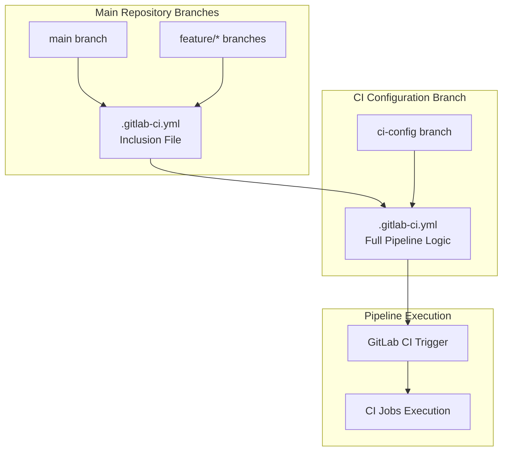
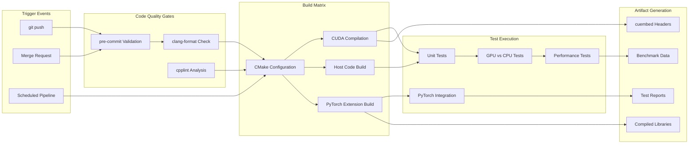
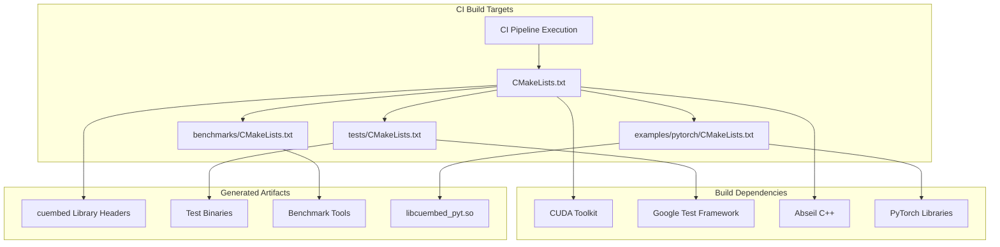
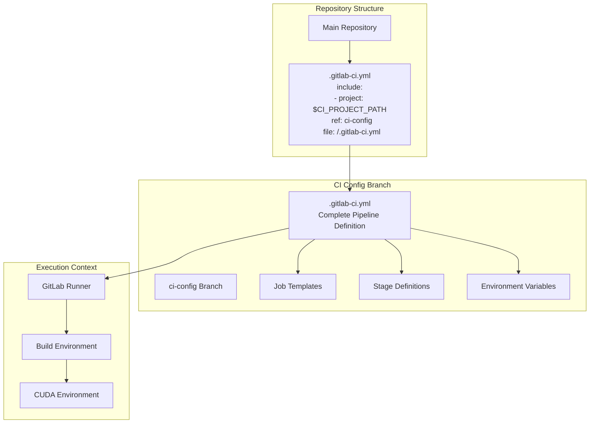

<!-- source: DeepWiki mcp.deepwiki.com · repo NVIDIA/cuEmbed · page 6.1 CI/CD Pipeline · fetched 2026-10-26 -->

# CI/CD Pipeline

Relevant source files

The following files were used as context for generating this wiki page:

- [.gitlab-ci.yml](.gitlab-ci.yml)

This document covers the automated CI/CD pipeline configuration for cuEmbed, including the GitLab CI setup, build automation, and integration with the project's build system. The pipeline ensures code quality, runs comprehensive tests, and validates builds across different configurations.

For information about the underlying build system configuration, see [CMake Configuration](#5.1). For details about code quality tools and pre-commit hooks, see [Code Quality](#6.2).

## Pipeline Architecture

The cuEmbed project uses a centralized CI configuration approach where the main repository references CI logic stored in a separate branch. This design allows for CI configuration updates without affecting the main development branches.

### Centralized CI Configuration

**Pipeline Configuration Structure**
The main repository contains a minimal [.gitlab-ci.yml:1-5]() that includes the full CI configuration from the `ci-config` branch. This approach provides several benefits:

| Benefit | Description |
|---------|-------------|
| **Centralized Management** | CI logic maintained in dedicated branch |
| **Version Control** | CI changes tracked separately from code |
| **Branch Isolation** | Main branches remain clean of CI complexity |
| **Easy Updates** | CI configuration updates without code changes |

Sources: [.gitlab-ci.yml:1-5]()

### CI Pipeline Flow

Sources: [.gitlab-ci.yml:1-5]()

## Integration with Build System

The CI pipeline integrates closely with cuEmbed's CMake-based build system, executing multiple build configurations to ensure compatibility across different environments and use cases.

### Build Configuration Matrix

**Pipeline Build Steps**
The CI pipeline executes builds in the following sequence:

1. **Dependency Resolution**: Validate CUDA toolkit, fetch Git submodules
2. **Core Library Build**: Compile cuEmbed headers and core functionality  
3. **Test Suite Build**: Generate test executables using Google Test
4. **Benchmark Build**: Compile performance measurement tools
5. **PyTorch Extension**: Build Python bindings and shared library
6. **Validation**: Execute test suites and correctness checks

Sources: [.gitlab-ci.yml:2-4]()

## Quality Assurance Integration

The pipeline incorporates multiple quality assurance mechanisms to maintain code standards and prevent regressions.

### Code Quality Pipeline

```mermaid
graph LR
    subgraph "Pre-commit Checks"
        PRECOMMIT_CONFIG[".pre-commit-config.yaml"]
        CLANG_FORMAT["clang-format Validation"]
        CPPLINT["cpplint Style Check"]
    end
    
    subgraph "Build Validation"
        COMPILATION["Compilation Success"]
        WARNINGS["Warning Analysis"]
        CUDA_COMPAT["CUDA Compatibility"]
    end
    
    subgraph "Test Validation"
        UNIT_PASS["Unit Test Success"]
        CORRECTNESS_PASS["Correctness Validation"]
        MEMORY_CHECK["Memory Leak Detection"]
        PERF_REGRESSION["Performance Regression"]
    end
    
    PRECOMMIT_CONFIG --> CLANG_FORMAT
    CLANG_FORMAT --> CPPLINT
    CPPLINT --> COMPILATION
    
    COMPILATION --> WARNINGS
    WARNINGS --> CUDA_COMPAT
    CUDA_COMPAT --> UNIT_PASS
    
    UNIT_PASS --> CORRECTNESS_PASS
    CORRECTNESS_PASS --> MEMORY_CHECK
    MEMORY_CHECK --> PERF_REGRESSION
```

**Quality Gates**
Each pipeline execution must pass through multiple quality gates:

| Gate Type | Validation | Failure Impact |
|-----------|------------|----------------|
| **Style** | `clang-format`, `cpplint` | Pipeline fails early |
| **Build** | Compilation success, warning limits | Blocks deployment |
| **Correctness** | GPU vs CPU validation | Prevents merge |
| **Performance** | Benchmark regression checks | Triggers investigation |

Sources: [.gitlab-ci.yml:2-4]()

## Pipeline Configuration Details

The actual pipeline configuration resides in the `ci-config` branch, referenced through the inclusion mechanism in the main repository.

### Configuration Structure

**Include Configuration**
The [.gitlab-ci.yml:1-5]() file implements the include pattern:

- **project**: References `$CI_PROJECT_PATH` (same repository)
- **ref**: Points to `ci-config` branch
- **file**: Includes `/.gitlab-ci.yml` from that branch

This pattern allows the CI configuration to be versioned independently while maintaining a single source of truth for pipeline logic.

Sources: [.gitlab-ci.yml:1-5]()

---

