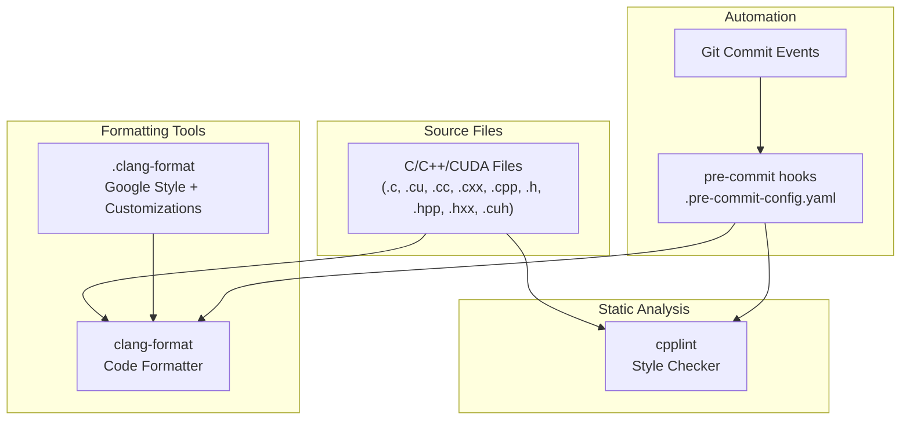
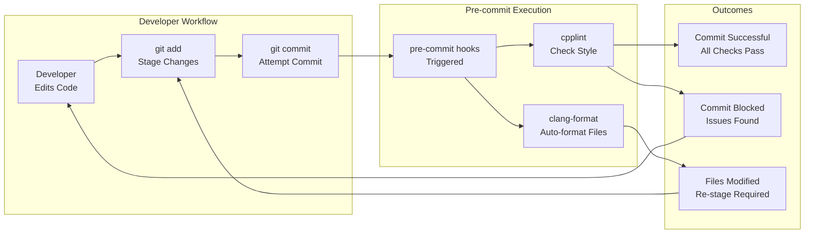

<!-- source: DeepWiki mcp.deepwiki.com · repo NVIDIA/cuEmbed · page 6.2 Code Quality · fetched 2026-10-26 -->

# Code Quality

<details>
<summary>Relevant source files</summary>

The following files were used as context for generating this wiki page:

- [.clang-format](.clang-format)
- [.pre-commit-config.yaml](.pre-commit-config.yaml)

</details>


This document covers the code formatting, static analysis, and automated quality enforcement tools used in the cuEmbed repository. These tools ensure consistent code style and catch common issues before code is committed.

For information about the CI/CD pipeline that runs these checks in automated builds, see [CI/CD Pipeline](#6.1). For contribution guidelines and development setup, see [Contributing](#6.3).

## Code Formatting Standards

The cuEmbed project uses `clang-format` to enforce consistent code formatting across all C/C++/CUDA source files. The configuration is based on the Google C++ Style Guide with specific customizations.

### clang-format Configuration

The formatting rules are defined in [.clang-format:3-8]():

| Setting | Value | Purpose |
|---------|-------|---------|
| `BasedOnStyle` | Google | Uses Google C++ style as foundation |
| `DerivePointerAlignment` | false | Enforces consistent pointer alignment |
| `BinPackArguments` | false | Prevents argument packing on single lines |
| `BinPackParameters` | false | Prevents parameter packing on single lines |
| `StatementMacros` | _Pragma | Treats `_Pragma` as statement macro |

The configuration can be applied manually using the command shown in [.clang-format:1-2]():
```bash
clang-format -i --style=file <file>
```

**Code Quality Tools Architecture**


Sources: [.clang-format:1-9](), [.pre-commit-config.yaml:7-12]()

## Static Analysis

The project uses `cpplint` for static analysis to catch style violations and potential issues that automated formatting cannot address.

### cpplint Integration

The `cpplint` tool is configured as a pre-commit hook in [.pre-commit-config.yaml:13-17]() and applies to the same file extensions as `clang-format`. It performs checks for:

- Header guard conventions
- Include order and grouping  
- Line length limits
- Comment formatting
- Variable naming conventions
- Function parameter alignment

## Pre-commit Hooks

The repository uses pre-commit hooks to automatically run code quality checks before commits are finalized. This prevents poorly formatted or non-compliant code from entering the repository.

### Hook Configuration

The pre-commit configuration in [.pre-commit-config.yaml:4-18]() defines two local hooks:

| Hook | Tool | Files Affected | Action |
|------|------|----------------|--------|
| `clang-format` | clang-format | C/C++/CUDA files | Auto-format in place (`-i` flag) |
| `cpplint` | cpplint | C/C++/CUDA files | Style checking and reporting |

Both hooks target files matching the regex pattern `\.(c|cu|cc|cxx|cpp|h|hpp|hxx|cuh)$`, covering all C/C++/CUDA source and header files.

### Installation and Usage

Developers must install and enable pre-commit hooks using the commands shown in [.pre-commit-config.yaml:2]():

```bash
pip install pre-commit && pre-commit install
```

**Pre-commit Workflow**


Sources: [.pre-commit-config.yaml:1-18]()

## File Coverage

The code quality tools apply to all source files in the cuEmbed repository with the following extensions:

- **C files**: `.c`
- **C++ files**: `.cc`, `.cxx`, `.cpp`  
- **CUDA files**: `.cu`
- **Header files**: `.h`, `.hpp`, `.hxx`, `.cuh`

This comprehensive coverage ensures consistent formatting and style across the entire codebase, including the core library, PyTorch integration, tests, and benchmarks.

Sources: [.pre-commit-config.yaml:12](), [.pre-commit-config.yaml:17]()

---

