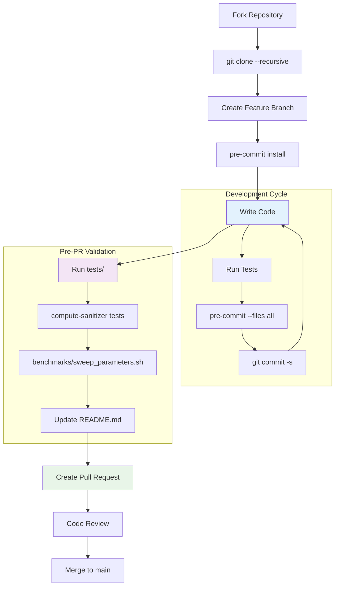
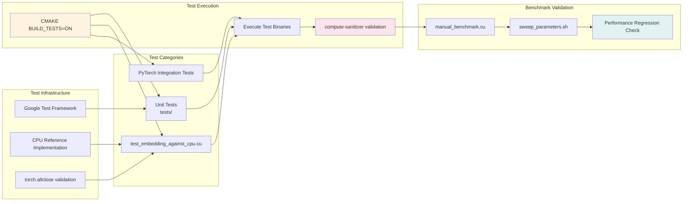
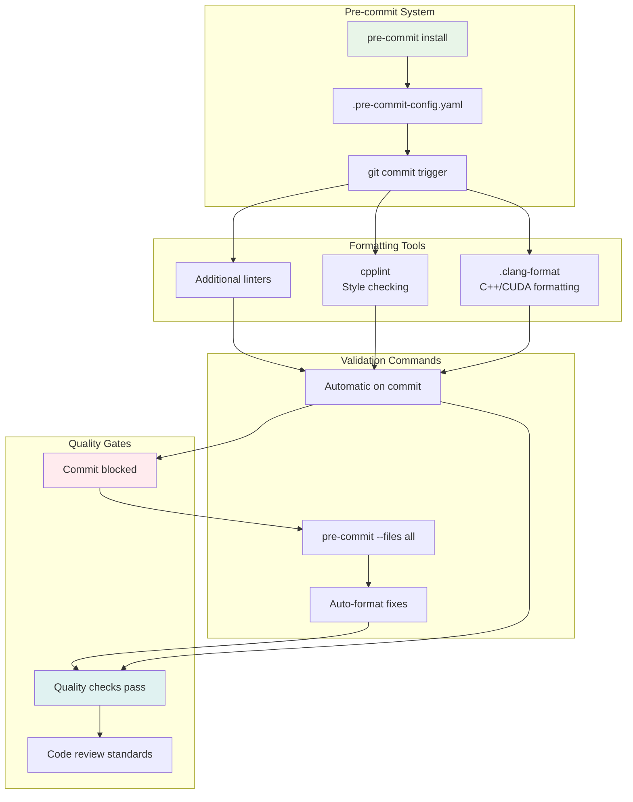

<!-- source: DeepWiki mcp.deepwiki.com · repo NVIDIA/cuEmbed · page 6.3 Contributing · fetched 2026-10-26 -->

# Contributing

<details>
<summary>Relevant source files</summary>

The following files were used as context for generating this wiki page:

- [CONTRIBUTING.md](CONTRIBUTING.md)

</details>


## Purpose and Scope

This document provides comprehensive guidelines for contributing to the cuEmbed project, including development setup, testing requirements, code quality standards, and the submission process. It covers the technical workflow from initial development through pull request acceptance.

For information about the CI/CD pipeline infrastructure, see [CI/CD Pipeline](#6.1). For details about code formatting tools and pre-commit hooks, see [Code Quality](#6.2).

## Development Setup

### Prerequisites

Before contributing to cuEmbed, ensure you have the required development environment:

- CUDA Toolkit (with NVIDIA Compute Sanitizer)
- CMake build system
- Git with submodule support
- Python with pip for pre-commit tools

### Initial Setup

Clone the repository with submodules and configure the development environment:

```bash
git clone --recursive https://github.com/NVIDIA/cuEmbed.git
cd cuEmbed
pip install pre-commit
pre-commit install
```

Enable testing by configuring CMake with the `BUILD_TESTS` option set to `ON` in [CMakeLists.txt:1-50]().

## Contribution Workflow

### Development Process Overview



**Sources:** [CONTRIBUTING.md:1-63]()

### Pull Request Guidelines

All pull requests must target the `main` branch and should be limited in scope with clear commit messages. Each contribution requires:

- Signed commits using `git commit -s` or `--signoff`
- Clear, concise commit messages
- Active participation in code reviews
- Updated documentation where applicable

**Sources:** [CONTRIBUTING.md:4-8](), [CONTRIBUTING.md:19-21]()

## Testing Requirements

### Testing Pipeline Architecture



**Sources:** [CONTRIBUTING.md:9-11]()

### Correctness Validation

All tests located in the `tests/` directory must pass. The primary validation approach compares GPU implementations against CPU reference implementations using the test suite in [test_embedding_against_cpu.cu]().

Tests must also pass validation with NVIDIA Compute Sanitizer:
```bash
compute-sanitizer <test_executable>
```

This tool, included with the CUDA Toolkit, detects memory access errors, race conditions, and other GPU-specific issues.

**Sources:** [CONTRIBUTING.md:9-12]()

### Performance Testing

For changes that may impact performance, run the benchmark suite:

```bash
cd benchmarks
./sweep_parameters.sh
```

This executes [manual_benchmark.cu]() across various parameter configurations and generates performance data. Compare results before and after changes to identify performance regressions.

**Sources:** [CONTRIBUTING.md:17-18]()

## Code Quality Standards

### Code Quality Pipeline



**Sources:** [CONTRIBUTING.md:15-16]()

### Formatting and Linting

All code must adhere to formatting and linting standards enforced by:

- `clang-format` for C++/CUDA code formatting using [.clang-format]()
- `cpplint` for style checking
- Additional pre-commit hooks defined in configuration files

Install and verify compliance with:
```bash
pip install pre-commit && pre-commit install
pre-commit --files all
```

Code that fails these checks will not be accepted for review.

**Sources:** [CONTRIBUTING.md:15-16]()

### Documentation Standards

All new code and features require documentation updates:

- Inline documentation with high-quality docstrings following existing patterns
- Updates to relevant `README.md` files
- Wiki documentation for significant architectural changes

Examples of high-quality docstrings can be found throughout the codebase in core library files.

**Sources:** [CONTRIBUTING.md:13-14]()

## Legal Requirements

### Developer Certificate of Origin

All contributions must be signed using `git commit -s` or `--signoff` to certify compliance with the Developer Certificate of Origin (DCO) Version 1.1.

The DCO certification confirms that contributors have the right to submit their work under the project's open source license and understand that contributions become part of the public record.

| Certification Aspect | Requirement |
|----------------------|-------------|
| **Original Work** | Contribution created in whole or part by contributor |
| **License Compliance** | Based on appropriately licensed previous work |
| **Chain of Custody** | Proper attribution for work from other contributors |
| **Public Record** | Understanding that contributions become public |

The complete DCO text is available in [CONTRIBUTING.md:27-62]().

**Sources:** [CONTRIBUTING.md:19-20](), [CONTRIBUTING.md:23-62]()

## Support and Communication

For questions or issues during the contribution process:

- Open GitHub issues for technical questions or bug reports
- Participate actively in code reviews
- Follow up promptly on review feedback

The project maintainers aim to respond promptly to contributor inquiries and provide guidance throughout the contribution process.

**Sources:** [CONTRIBUTING.md:21-22]()

---

