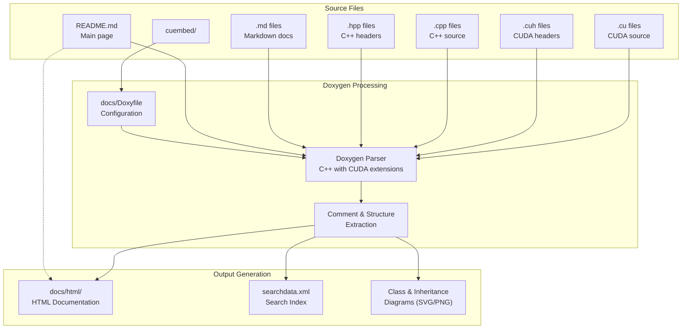
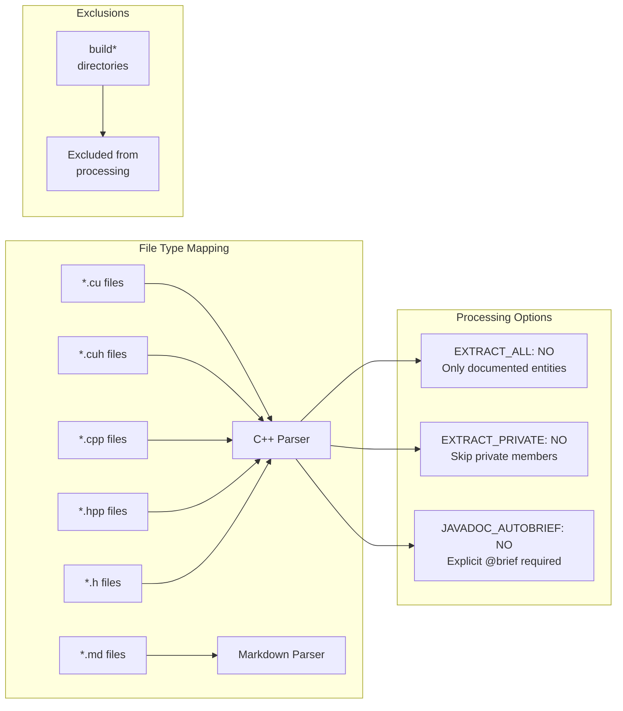
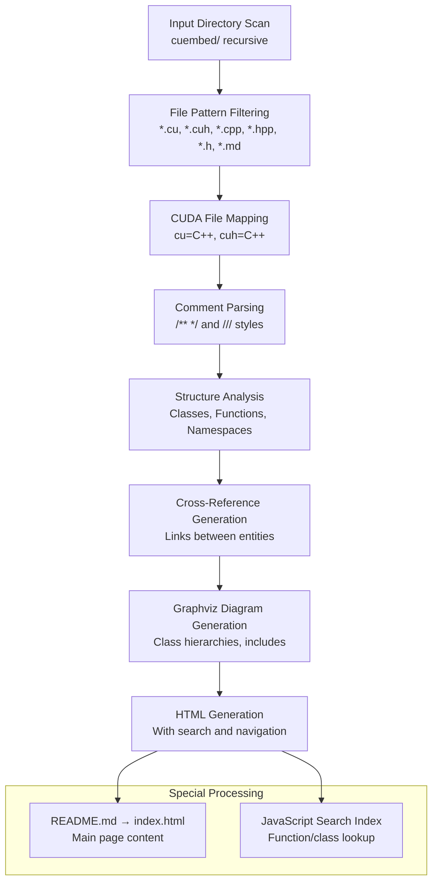
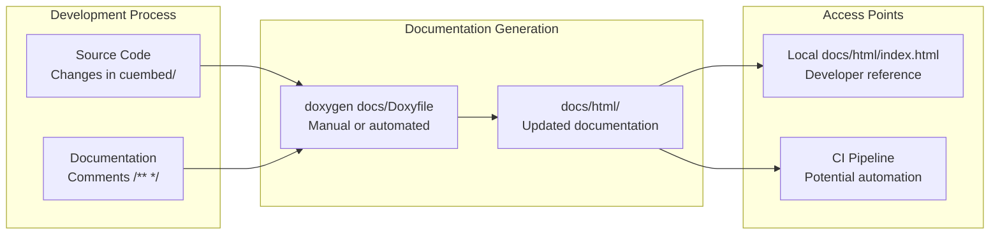

<!-- source: DeepWiki mcp.deepwiki.com · repo NVIDIA/cuEmbed · page 7 Documentation · fetched 2026-10-26 -->

# Documentation

<details>
<summary>Relevant source files</summary>

The following files were used as context for generating this wiki page:

- [docs/Doxyfile](docs/Doxyfile)

</details>


This document covers the automated API documentation generation system for cuEmbed, which uses Doxygen to create comprehensive HTML documentation from source code comments and structure. 

For information about project documentation files like README and contributing guides, see [Project Files](#8). For details about the CI/CD pipeline that may build documentation, see [CI/CD Pipeline](#6.1).

## Documentation Generation System

cuEmbed uses Doxygen as its primary documentation generation tool, configured through a comprehensive `Doxyfile` that processes CUDA and C++ source files to generate HTML API documentation.



**Sources:** [docs/Doxyfile:833-834](), [docs/Doxyfile:860-866](), [docs/Doxyfile:990](), [docs/Doxyfile:1140-1148]()

## Doxygen Configuration

The documentation system is configured through the `docs/Doxyfile`, which defines how source files are processed and what output is generated.

### Core Configuration Settings

| Setting | Value | Purpose |
|---------|-------|---------|
| `PROJECT_NAME` | "cuEmbed" | Sets documentation title |
| `INPUT` | cuembed | Source directory to process |
| `OUTPUT_DIRECTORY` | docs | Documentation output location |
| `RECURSIVE` | YES | Process subdirectories |
| `USE_MDFILE_AS_MAINPAGE` | README.md | Use README as landing page |

### File Processing Rules



**Sources:** [docs/Doxyfile:326-327](), [docs/Doxyfile:860-866](), [docs/Doxyfile:881](), [docs/Doxyfile:471-477]()

## Source Processing Pipeline

The documentation generation follows a structured pipeline that handles CUDA-specific extensions and integrates with standard C++ documentation practices.



**Sources:** [docs/Doxyfile:872](), [docs/Doxyfile:326-327](), [docs/Doxyfile:990](), [docs/Doxyfile:1627](), [docs/Doxyfile:2263-2264]()

## Output Structure and Features

The generated documentation provides comprehensive API coverage with interactive features for navigating the cuEmbed codebase.

### Generated Documentation Features

```mermaid
graph TB
    subgraph "HTML Documentation Structure"
        INDEX["index.html<br/>Main page from README.md"]
        
        subgraph "API Reference"
            CLASSES["Classes<br/>cuembed namespace types"]
            FILES["Files<br/>Source file documentation"] 
            NAMESPACES["Namespaces<br/>cuembed organization"]
        end
        
        subgraph "Interactive Features"
            SEARCH["JavaScript Search<br/>SEARCHENGINE: YES"]
            TREE_VIEW["Navigation Tree<br/>Hierarchical browsing"]
            CROSS_LINKS["Cross-references<br/>Click-to-navigate"]
        end
        
        subgraph "Visual Elements"
            CLASS_GRAPHS["Class Diagrams<br/>Inheritance trees"]
            INCLUDE_GRAPHS["Include Dependencies<br/>File relationships"]
            CALL_GRAPHS["Call Graphs<br/>CALL_GRAPH: NO"]
        end
    end
    
    INDEX --> API Reference
    API Reference --> Interactive Features
    Interactive Features --> Visual Elements
```

### Configuration Options

| Feature | Setting | Status |
|---------|---------|---------|
| HTML Output | `GENERATE_HTML` | Enabled |
| LaTeX Output | `GENERATE_LATEX` | Disabled |
| XML Output | `GENERATE_XML` | Disabled |
| Search Engine | `SEARCHENGINE` | Enabled |
| Class Diagrams | `CLASS_DIAGRAMS` | Enabled |
| Include Graphs | `INCLUDE_GRAPH` | Enabled |
| Call Graphs | `CALL_GRAPH` | Disabled |

**Sources:** [docs/Doxyfile:1140](), [docs/Doxyfile:1701](), [docs/Doxyfile:2003](), [docs/Doxyfile:1627](), [docs/Doxyfile:2241](), [docs/Doxyfile:2359](), [docs/Doxyfile:2380]()

## Integration with Development Workflow

The documentation system is designed to integrate seamlessly with the cuEmbed development process, providing up-to-date API references as code evolves.



### Key Documentation Commands

To generate documentation locally:
```bash
doxygen docs/Doxyfile
```

The generated documentation will be available at `docs/html/index.html`.

**Sources:** [docs/Doxyfile:61](), [docs/Doxyfile:1148]()

---

