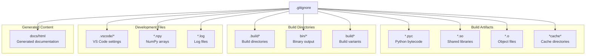
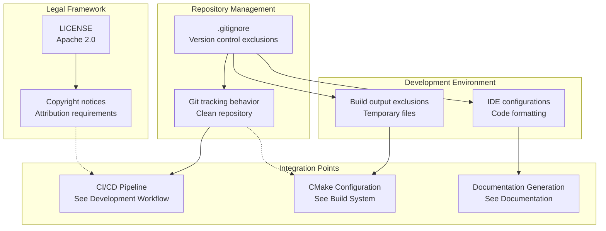

<!-- source: DeepWiki mcp.deepwiki.com · repo NVIDIA/cuEmbed · page 8 Project Files · fetched 2026-10-26 -->

# Project Files

Relevant source files

The following files were used as context for generating this wiki page:

- [.gitignore](.gitignore)
- [LICENSE](LICENSE)

This document covers the standard project configuration files that define licensing, repository behavior, and development environment setup for the cuEmbed project. These files establish the legal framework, version control behavior, and basic project metadata that support the core library functionality.

For build configuration and dependency management, see [Build System](#5). For development workflow and CI/CD configuration, see [Development Workflow](#6). For project documentation files, see [Documentation](#7).

## License

The cuEmbed project is distributed under the Apache License 2.0, as defined in the `LICENSE` file. This is a permissive open-source license that allows for both commercial and non-commercial use, modification, and distribution of the software.

### License Terms

The Apache License 2.0 provides the following key permissions and requirements:

| Permission | Requirement |
|------------|-------------|
| Commercial use | Include license and copyright notice |
| Modification | State changes made to files |
| Distribution | Include license text |
| Patent use | Include license text |
| Private use | Include license text |

The license text follows the standard Apache License 2.0 format with placeholder copyright information at [LICENSE:190-191](). The full license terms are contained in [LICENSE:1-203]().

### Copyright and Attribution

The license requires that any derivative works maintain appropriate copyright notices and attribution as specified in [LICENSE:95-122](). This includes:

- Retaining copyright, patent, trademark, and attribution notices
- Including license text with distributed copies
- Providing notice of any changes made to files
- Including readable attribution notices in derivative works

Sources: LICENSE

## Git Configuration

The repository uses a `.gitignore` file to control which files and directories are excluded from version control tracking. This helps maintain a clean repository by preventing build artifacts, temporary files, and development-specific files from being committed.

### Ignored File Categories

The Git ignore configuration excludes several categories of files:

### File Type Exclusions

The ignore patterns cover specific development and build scenarios:

- **Python artifacts**: `*.pyc` files generated during Python execution [.gitignore:1]()
- **Compiled libraries**: `*.so` shared libraries and `*.o` object files [.gitignore:2-3]()
- **Cache directories**: Any directories containing "cache" in the name [.gitignore:4]()
- **Build outputs**: Multiple build directory patterns including `.build*`, `build*`, and `bin/*` [.gitignore:5,7,9]()
- **Data files**: `*.npy` NumPy array files commonly used in testing [.gitignore:6]()
- **Logs**: `*.log` files generated during execution [.gitignore:8]()
- **Documentation**: Generated HTML documentation in `docs/html` [.gitignore:10]()
- **IDE settings**: VS Code workspace configuration in `.vscode/*` [.gitignore:11]()

Sources: .gitignore

## Project File Ecosystem

The project files work together to establish the development environment and project governance:

## Configuration File References

Several additional project configuration files exist that are documented in other sections of this wiki:

| File | Purpose | Documentation |
|------|---------|---------------|
| `.gitlab-ci.yml` | CI/CD pipeline configuration | [CI/CD Pipeline](#6.1) |
| `.clang-format` | Code formatting standards | [Code Quality](#6.2) |
| `.pre-commit` | Pre-commit hook configuration | [Code Quality](#6.2) |
| `CMakeLists.txt` | Build system configuration | [CMake Configuration](#5.1) |
| `README.md` | Project overview and usage | [Documentation](#7) |
| `CONTRIBUTING.md` | Development guidelines | [Contributing](#6.3) |

These files work together with the license and Git configuration to establish a complete development environment with consistent standards, automated quality control, and clear legal terms.

Sources: LICENSE, .gitignore