# Page: Overview

# Overview

<details>
<summary>Relevant source files</summary>

The following files were used as context for generating this wiki page:

- [README.md](README.md)
- [cuembed/README.md](cuembed/README.md)

</details>


## Purpose and Scope

This document provides an architectural overview of cuEmbed, an open-source, header-only CUDA kernel library that accelerates embedding lookup operations. cuEmbed is designed to achieve high memory bandwidth utilization through memory-level parallelism optimization and extensive use of C++ templates for compile-time specialization.

For detailed information about specific components, see: [Core Library](#2), [PyTorch Integration](#3), [Testing & Validation](#4), and [Build System](#5).

Sources: [README.md:1-125](), [cuembed/README.md:1-227]()

## Core Architecture

cuEmbed follows a layered architecture with header-only libraries at its core, enabling easy integration into existing CUDA applications. The system is organized around two primary computational patterns: embedding lookup operations and index transformations.

### High-Level System Components

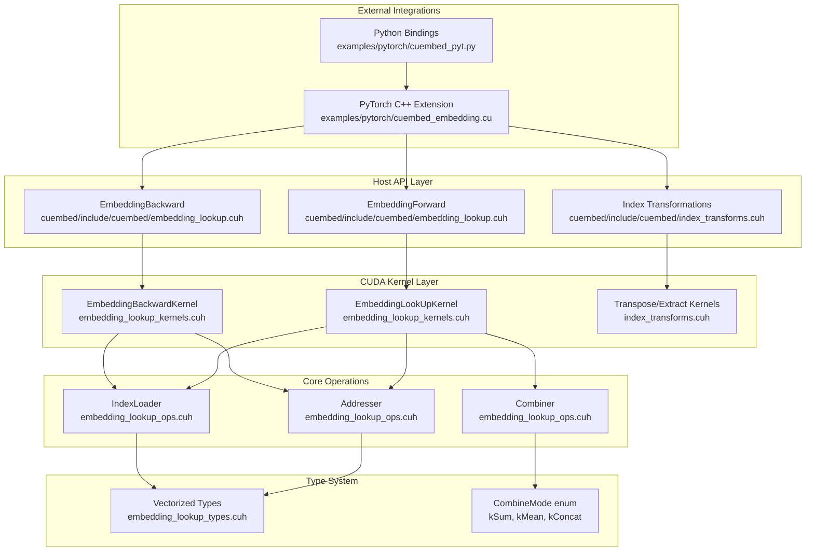

Sources: [README.md:15-17](), [cuembed/README.md:1-5]()

### Data Flow Architecture

The library processes embedding lookups through a three-stage pipeline optimized for memory bandwidth utilization:

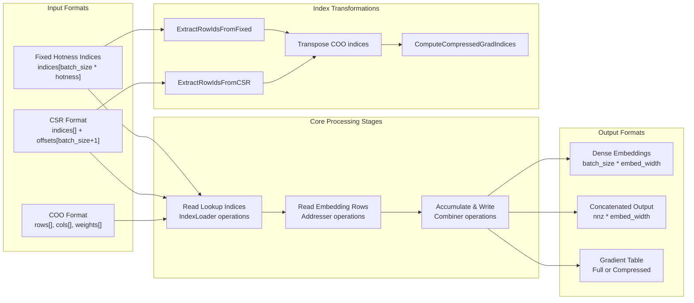

Sources: [cuembed/README.md:7-13](), [cuembed/README.md:106-127]()

## Main Operations

### Forward Propagation

The `EmbeddingForward` function supports multiple input formats and reduction modes:

| Parameter | Type | Description |
|-----------|------|-------------|
| `InputT/OutputT` | Template | Element types (fp32, fp16) |
| `IndexT/OffsetT` | Template | Index types (int32_t, int64_t) |
| `fp16_math` | bool | Enable fp16 math operations |
| `params` | Pointer | Embedding table data |
| `indices` | Pointer | Lookup indices array |
| `offsets` | Pointer | CSR offset array (nullptr for fixed) |
| `weights` | Pointer | Per-sample weights (optional) |
| `mode` | enum | `CombineMode::kSum/kMean/kConcat` |

Sources: [cuembed/README.md:16-56]()

### Backward Propagation  

The `EmbeddingBackward` function supports both full and compressed gradient computation:

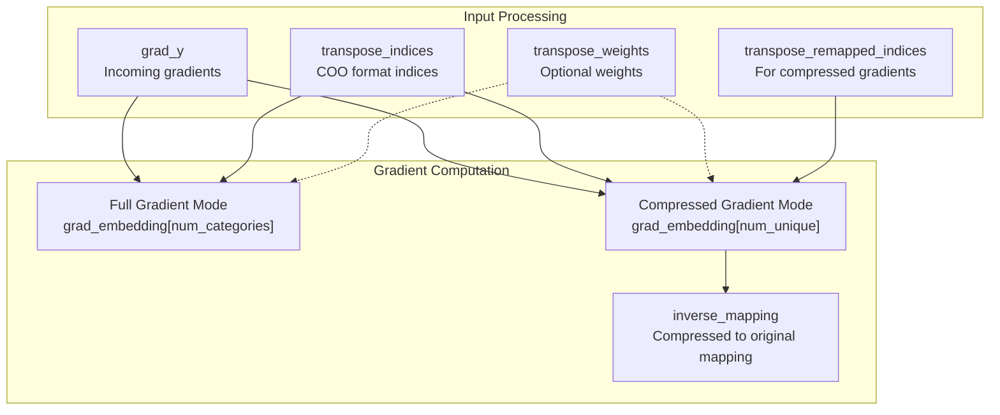

Sources: [cuembed/README.md:57-104]()

### Index Transformations

cuEmbed provides utilities for converting between different index formats required by forward and backward operations:

| Function | Purpose | Input Format | Output Format |
|----------|---------|--------------|---------------|
| `ExtractRowIdsFromFixed` | Fixed to COO | Fixed hotness | COO rows |
| `ExtractRowIdsFromCSR` | CSR to COO | CSR format | COO rows |  
| `ExtractRowIdsForConcat` | Sequential COO | Length only | COO rows |
| `Transpose` | Sample-first to table-first | COO format | Transposed COO |
| `ComputeCompressedGradIndices` | Dense to compressed mapping | Sorted indices | Remapped indices |

Sources: [cuembed/README.md:106-225]()

## Integration and Usage

### Header-Only Integration

cuEmbed core components are designed as header-only libraries with minimal dependencies, enabling direct integration into existing projects:

```cpp
// Basic forward propagation example from utils/src/embedding_allocation.cu
EmbeddingForward<InputT, OutputT, IndexT, OffsetT, fp16_math>(
    embedding.data().get(),      // params
    options.embed_width(),       // embed_width  
    indices.data().get(),        // indices
    offsets_ptr,                 // offsets (nullptr for fixed)
    weight_ptr,                  // weights (optional)
    options.batch_size(),        // batch_size
    hotness,                     // num_hots (0 for CSR)
    options.combine_mode(),      // mode
    result->data().get()         // ret
);
```

Sources: [README.md:33-67]()

### PyTorch Integration

cuEmbed provides seamless PyTorch integration through custom operations registered as `torch.ops`:

- `cuemb_embedding` - Main embedding lookup operation
- `cuembed_transpose` - Index transpose operation  
- `cuembed_extract_row_ids_from_csr` - CSR to COO conversion

Sources: [README.md:15-17]()

## Supported Configurations

### Current Release Support Matrix

| Feature | Supported | Notes |
|---------|-----------|-------|
| **Data Types** | fp32, fp16 | bf16 planned |
| **Index Types** | int32_t, int64_t | |
| **Forward Layouts** | Fixed hotness, CSR | COO planned |
| **Backward Layouts** | COO | |
| **Reduction Types (Fwd)** | Sum, Mean, Concat | |
| **Reduction Types (Bwd)** | Sum, Concat | Mean planned |
| **Gradient Types** | Full, Compressed | |
| **Hardware** | Volta+ GPUs | |

Sources: [README.md:107-120]()

## Development Status and Requirements

cuEmbed is actively under development with a stable host API. Users should expect changes in kernel APIs and operation abstractions as the library evolves.

### System Requirements

- **CUDA**: nvcc 12.0+
- **Language**: C++17
- **Hardware**: Volta+ GPU architecture
- **Dependencies**: Minimal (header-only core)

### Performance Characteristics

The library is optimized for high memory bandwidth utilization through:
- Memory-level parallelism maximization
- Compile-time specialization via C++ templates
- Optimized kernel launch parameter heuristics
- Vectorized memory operations

Sources: [README.md:11-14](), [README.md:121-125]()

---

# Page: Core Library

# Core Library

<details>
<summary>Relevant source files</summary>

The following files were used as context for generating this wiki page:

- [cuembed/README.md](cuembed/README.md)

</details>


This document covers the main cuEmbed library components and architecture located in the `cuembed/` directory. The core library provides GPU-accelerated embedding lookup operations through a well-structured C++ API with optimized CUDA kernels. For PyTorch integration details, see [PyTorch Integration](#3). For testing and validation, see [Testing & Validation](#4).

## Architecture Overview

The cuEmbed core library is organized into five main header files, each serving a specific role in the embedding lookup pipeline:

```mermaid
graph TB
    subgraph "Core Library Headers"
        DISPATCH[embedding_lookup.cuh<br/>"Host API & Dispatch"]
        KERNELS[embedding_lookup_kernels.cuh<br/>"CUDA Kernel Implementations"] 
        OPS[embedding_lookup_ops.cuh<br/>"Core Operations & Classes"]
        TYPES[embedding_lookup_types.cuh<br/>"Vectorized Types & Utilities"]
        TRANSFORMS[index_transformations.cuh<br/>"Index Transformation Utils"]
    end
    
    subgraph "Main Entry Points"
        FWD_API[EmbeddingForward]
        BWD_API[EmbeddingBackward]
    end
    
    subgraph "Index Processing"
        EXTRACT_FIXED[ExtractRowIdsFromFixed]
        EXTRACT_CSR[ExtractRowIdsFromCSR] 
        TRANSPOSE[Transpose]
        COMPRESS[ComputeCompressedGradIndices]
    end
    
    subgraph "Core Operations"
        ADDRESSER[Addresser]
        COMBINER[Combiner]
        LOADER[IndexLoader]
    end
    
    subgraph "GPU Execution"
        FWD_KERNEL[EmbeddingLookUpKernel]
        BWD_KERNEL[EmbeddingBackwardKernel]
    end
    
    %% API relationships
    DISPATCH --> FWD_API
    DISPATCH --> BWD_API
    FWD_API --> FWD_KERNEL
    BWD_API --> BWD_KERNEL
    
    %% Component relationships
    KERNELS --> FWD_KERNEL
    KERNELS --> BWD_KERNEL
    OPS --> ADDRESSER
    OPS --> COMBINER
    OPS --> LOADER
    TRANSFORMS --> EXTRACT_FIXED
    TRANSFORMS --> EXTRACT_CSR
    TRANSFORMS --> TRANSPOSE
    TRANSFORMS --> COMPRESS
    
    %% Dependencies
    DISPATCH --> OPS
    DISPATCH --> KERNELS
    DISPATCH --> TYPES
    KERNELS --> OPS
    KERNELS --> TYPES
```

**Sources:** [cuembed/README.md:1-27]()

## Forward and Backward Processing Pipeline

The core library implements a complete forward and backward propagation pipeline for embedding lookups:

```mermaid
graph LR
    subgraph "Input Formats"
        FIXED["Fixed Hotness<br/>indices[batch_size * num_hots]"]
        CSR["CSR Format<br/>indices[nnz], offsets[batch_size+1]"]
        WEIGHTS["Optional Weights<br/>weights[nnz]"]
    end
    
    subgraph "Forward Path"
        FWD_ENTRY[EmbeddingForward]
        ADDRESSER_FWD[Addresser<br/>"Calculate Memory Addresses"]
        LOADER_FWD[IndexLoader<br/>"Load Indices & Weights"]
        COMBINER_FWD[Combiner<br/>"Sum/Mean/Concat"]
        FWD_OUTPUT["Output Embeddings<br/>ret[batch_size * output_width]"]
    end
    
    subgraph "Index Transformation"
        EXTRACT["ExtractRowIds<br/>Fixed/CSR → COO"]
        TRANSPOSE_OP[Transpose<br/>"Sample-first → Table-first"]
        COMPRESS_OP[ComputeCompressedGradIndices<br/>"Dense → Compressed Mapping"]
    end
    
    subgraph "Backward Path"
        BWD_ENTRY[EmbeddingBackward]
        GRAD_INPUT["grad_y[batch_size * output_width]"]
        GRAD_OUTPUT["grad_embedding<br/>Full or Compressed"]
        INVERSE_MAP["inverse_mapping<br/>Compressed → Original IDs"]
    end
    
    %% Forward flow
    FIXED --> FWD_ENTRY
    CSR --> FWD_ENTRY
    WEIGHTS -.-> FWD_ENTRY
    FWD_ENTRY --> LOADER_FWD
    FWD_ENTRY --> ADDRESSER_FWD
    FWD_ENTRY --> COMBINER_FWD
    COMBINER_FWD --> FWD_OUTPUT
    
    %% Index transformation flow
    FIXED --> EXTRACT
    CSR --> EXTRACT
    EXTRACT --> TRANSPOSE_OP
    TRANSPOSE_OP --> COMPRESS_OP
    
    %% Backward flow
    GRAD_INPUT --> BWD_ENTRY
    TRANSPOSE_OP --> BWD_ENTRY
    COMPRESS_OP -.-> BWD_ENTRY
    BWD_ENTRY --> GRAD_OUTPUT
    BWD_ENTRY -.-> INVERSE_MAP
```

**Sources:** [cuembed/README.md:6-104]()

## Component Responsibilities

The core library components are organized by functionality:

| Component | Header File | Primary Functions | Purpose |
|-----------|-------------|-------------------|---------|
| Host API | `embedding_lookup.cuh` | `EmbeddingForward`, `EmbeddingBackward` | Public interface and kernel dispatch |
| CUDA Kernels | `embedding_lookup_kernels.cuh` | `EmbeddingLookUpKernel`, `EmbeddingBackwardKernel` | GPU computation implementation |
| Core Operations | `embedding_lookup_ops.cuh` | `Addresser`, `Combiner`, `IndexLoader` | Fundamental building blocks |
| Types & Utilities | `embedding_lookup_types.cuh` | `CombineMode`, vectorized types | Type definitions and utilities |
| Index Transformations | `index_transformations.cuh` | `Transpose`, `ExtractRowIdsFromCSR` | Format conversions and preprocessing |

**Sources:** [cuembed/README.md:4-5]()

## Memory Access Patterns

The library is designed to maximize memory bandwidth utilization through optimized access patterns:

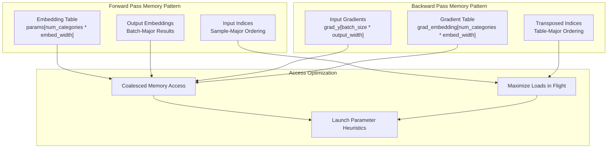

**Sources:** [cuembed/README.md:11-12]()

## Index Format Support

The library supports multiple index formats to accommodate different use cases:

| Format | Description | Key Parameters | Use Case |
|--------|-------------|----------------|----------|
| Fixed Hotness | Same number of indices per sample | `num_hots > 0`, `offsets = nullptr` | Uniform lookup patterns |
| CSR | Variable indices per sample | `num_hots = 0`, `offsets != nullptr` | Non-uniform lookup patterns |
| COO | Coordinate format | `rows`, `cols`, `weights` arrays | Internal transformations |

The library provides conversion functions between these formats:
- `ExtractRowIdsFromFixed`: Fixed → COO
- `ExtractRowIdsFromCSR`: CSR → COO  
- `Transpose`: Reorder COO by table indices
- `ComputeCompressedGradIndices`: Generate compressed index mapping

**Sources:** [cuembed/README.md:37-40](), [cuembed/README.md:131-225]()

## Combine Modes

The forward pass supports three reduction modes for combining multiple embeddings per sample:

- `CombineMode::kSum`: Element-wise summation of looked-up rows
- `CombineMode::kMean`: Element-wise average of looked-up rows  
- `CombineMode::kConcat`: Concatenation of all looked-up rows

**Sources:** [cuembed/README.md:18](), [cuembed/README.md:53]()

---

# Page: Host API

# Host API

<details>
<summary>Relevant source files</summary>

The following files were used as context for generating this wiki page:

- [cuembed/include/embedding_lookup.cuh](cuembed/include/embedding_lookup.cuh)

</details>


The Host API provides the main user-facing interface for cuEmbed's embedding lookup operations. It consists of two primary functions (`EmbeddingForward` and `EmbeddingBackward`) along with supporting utilities for kernel launch parameter calculation and dispatch logic. This API handles parameter validation, memory layout optimization, and efficient dispatching to CUDA kernels based on runtime configuration.

For information about the actual CUDA kernel implementations, see [CUDA Kernels](#2.2). For details about the core operations used within kernels, see [Core Operations](#2.3).

## Overview

The Host API is implemented in a single header file and provides template-based functions that support multiple data types, index formats, and combination modes. The API automatically selects optimal kernel configurations based on embedding dimensions, batch sizes, and hardware characteristics.

**Host API Architecture**

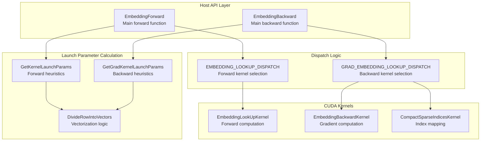

Sources: [cuembed/include/embedding_lookup.cuh:183-308](), [cuembed/include/embedding_lookup.cuh:423-483]()

## Core Functions

### EmbeddingForward

The `EmbeddingForward` function performs forward embedding lookup with support for both fixed and CSR (Compressed Sparse Row) index formats.

| Parameter | Type | Description |
|-----------|------|-------------|
| `params` | `const InputT*` | Pointer to embedding table data |
| `embed_width` | `int` | Number of elements per embedding row |
| `indices` | `const IndexT*` | Lookup indices array |
| `offsets` | `const OffsetT*` | CSR offset array (null for fixed format) |
| `weights` | `const GetElemT<InputT>*` | Optional weights for embedding rows |
| `batch_size` | `int` | Number of samples in the batch |
| `num_hots` | `int` | Fixed number of indices per sample (0 for CSR) |
| `mode` | `CombineMode` | Reduction type (Sum/Mean/Concat) |
| `ret` | `OutputT*` | Output tensor pointer |
| `stream` | `cudaStream_t` | CUDA stream for async execution |

**Function Flow**

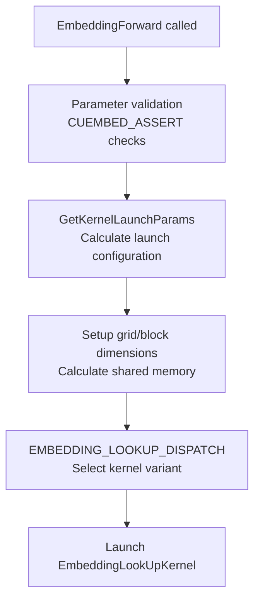

Sources: [cuembed/include/embedding_lookup.cuh:245-308]()

### EmbeddingBackward

The `EmbeddingBackward` function computes gradients for the embedding table, supporting both full and compressed gradient formats.

| Parameter | Type | Description |
|-----------|------|-------------|
| `grad_y` | `const GradT*` | Incoming gradient tensor |
| `embed_width` | `int` | Embedding dimension |
| `num_grad_embedding_rows` | `int` | Rows in gradient output |
| `nnz` | `int` | Total number of non-zero indices |
| `transpose_indices` | `const IndexT*` | Transposed lookup indices |
| `transpose_sample_ids` | `const IndexT*` | Transposed sample IDs |
| `transpose_remapped_indices` | `const IndexT*` | Compressed indices (optional) |
| `transpose_weights` | `const GradT*` | Transposed weights (optional) |
| `skip_grad_init` | `bool` | Skip gradient zero-initialization |
| `grad_embedding` | `GradT*` | Output gradient tensor |
| `inverse_mapping` | `IndexT*` | Sparse-to-dense index mapping |
| `stream` | `cudaStream_t` | CUDA stream for async execution |

Sources: [cuembed/include/embedding_lookup.cuh:423-483]()

## Launch Parameter Heuristics

### Vector Load Optimization

The `DivideRowIntoVectors` function determines optimal vectorized memory access patterns:

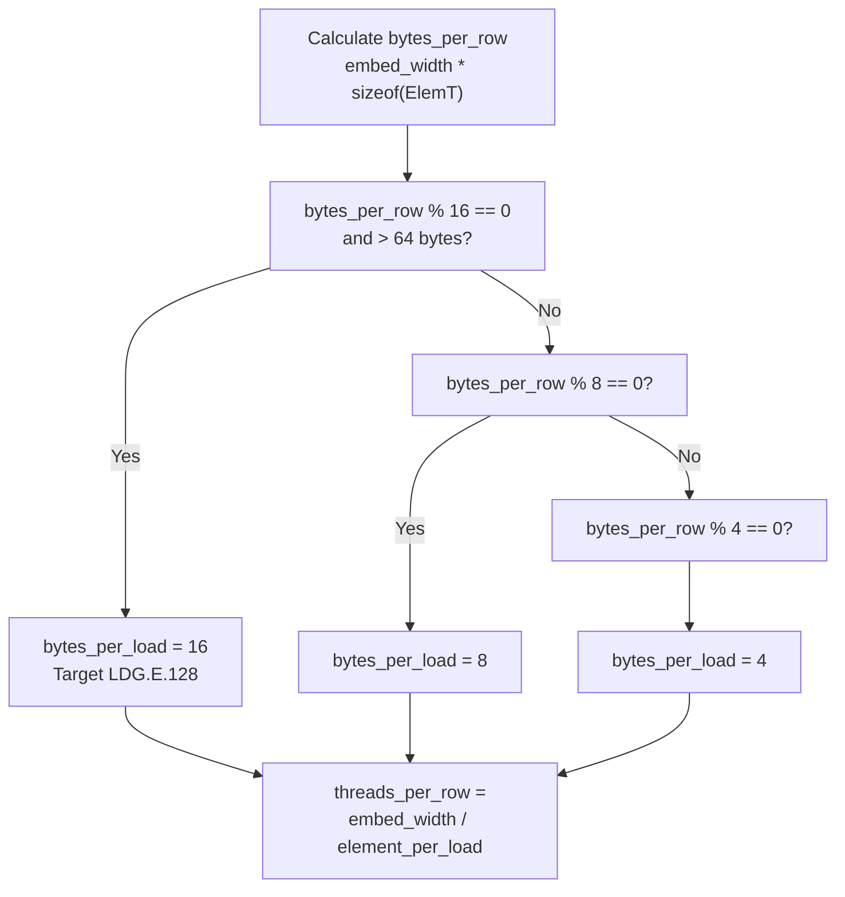

Sources: [cuembed/include/embedding_lookup.cuh:160-181]()

### Forward Kernel Parameters

The `GetKernelLaunchParams` function calculates optimal launch configuration for forward kernels:

| Configuration | Calculation | Constraints |
|---------------|-------------|-------------|
| `element_per_load` | From `DivideRowIntoVectors` | 1, 2, 4, or 8 elements |
| `threads_per_sample` | `embed_width / element_per_load` | ≤ `MAX_THREADS_PER_CTA` (1024) |
| `samples_per_cta` | `DEFAULT_THREADS_PER_CTA / threads_per_sample` | Limited by shared memory |

Sources: [cuembed/include/embedding_lookup.cuh:186-208]()

### Backward Kernel Parameters

The `GetGradKernelLaunchParams` function uses device-specific heuristics:

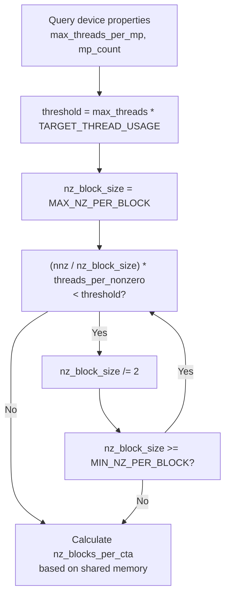

Sources: [cuembed/include/embedding_lookup.cuh:348-395]()

## Dispatch Logic

### Forward Dispatch Macro

The `EMBEDDING_LOOKUP_DISPATCH` macro selects appropriate kernel variants based on:

- **Index format**: Fixed hotness vs CSR (presence of `offsets`)
- **Weighting**: Weighted vs unweighted (presence of `weights`)  
- **Unroll factor**: 8 for `num_hots >= 8`, 4 for `num_hots < 8`

**Dispatch Decision Tree**

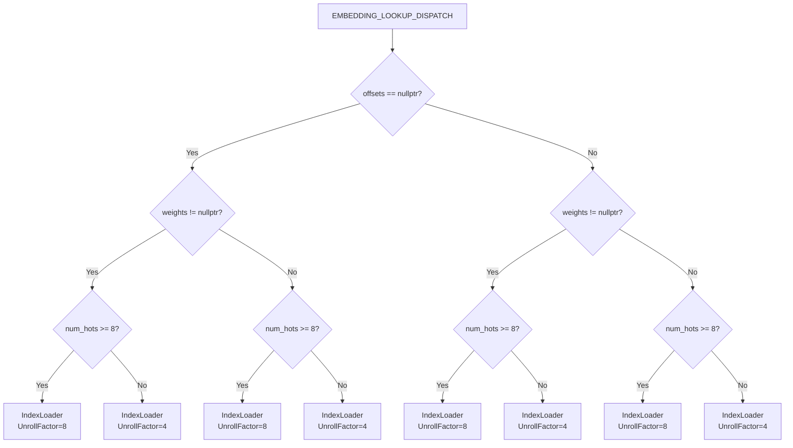

Sources: [cuembed/include/embedding_lookup.cuh:41-149]()

### Backward Dispatch

The `GRAD_EMBEDDING_LOOKUP_DISPATCH` macro selects backward kernels based on:

- **Element per load**: 1, 2, 4, or 8 elements per vector load
- **Weights**: Presence of `transpose_weights` parameter

Sources: [cuembed/include/embedding_lookup.cuh:314-342]()

## Constants and Configuration

| Constant | Value | Purpose |
|----------|--------|---------|
| `MAX_THREADS_PER_CTA` | 1024 | Maximum threads per CUDA block |
| `DEFAULT_THREADS_PER_CTA` | 256 | Default threads for optimal occupancy |
| `MAX_SHMEM_BYTES_PER_CTA` | 48KB | Maximum shared memory per block |
| `MAX_NZ_PER_BLOCK` | 128 | Maximum non-zeros per backward block |
| `MIN_NZ_PER_BLOCK` | 8 | Minimum non-zeros per backward block |
| `GRAD_KERNEL_TARGET_THREAD_USAGE` | 0.4 | Target GPU utilization for gradients |

Sources: [cuembed/include/embedding_lookup.cuh:33-39](), [cuembed/include/embedding_lookup.cuh:310-312]()

---

# Page: CUDA Kernels

# CUDA Kernels

<details>
<summary>Relevant source files</summary>

The following files were used as context for generating this wiki page:

- [cuembed/include/embedding_lookup_kernels.cuh](cuembed/include/embedding_lookup_kernels.cuh)

</details>


This document covers the low-level CUDA kernel implementations that perform the actual embedding computations on the GPU. These kernels handle both forward and backward passes for embedding lookups, with optimizations for different data layouts and weighting schemes.

For information about the host-side dispatch logic that calls these kernels, see [Host API](#2.1). For details about the core operations (IndexLoader, Addresser, Combiner) that these kernels orchestrate, see [Core Operations](#2.3).

## Kernel Architecture

The cuEmbed library implements two primary kernel types: forward pass kernels for embedding lookup and backward pass kernels for gradient computation. Both kernel types use a highly templated design that allows for compile-time specialization based on data layout, weighting schemes, and combining modes.

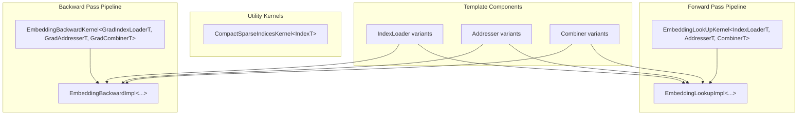

Sources: [cuembed/include/embedding_lookup_kernels.cuh:1-306]()

## Forward Pass Kernels

The forward pass is implemented through `EmbeddingLookUpKernel`, which serves as the entry point, and `EmbeddingLookupImpl`, which contains the core computation logic.

### EmbeddingLookUpKernel

The main forward kernel is templated on four key components:

- `IndexLoaderT`: Handles loading indices and weights from memory
- `AddresserT`: Computes memory addresses for embedding table access  
- `CombinerT`: Performs reduction or concatenation of embedding vectors
- `UnrollFactor`: Compile-time loop unrolling parameter

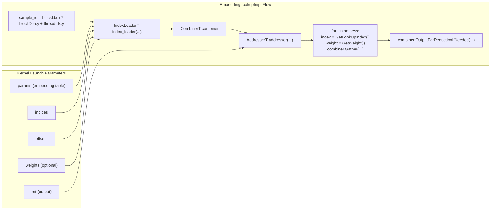

The kernel provides two specializations: one for weighted embeddings and one for unweighted embeddings. The unweighted version uses `std::nullptr_t` instead of a weight type to reduce register pressure and improve occupancy.

Sources: [cuembed/include/embedding_lookup_kernels.cuh:117-170]()

### Threading Model and Memory Layout

The forward kernels use a 2D thread block organization optimized for memory coalescing:

| Dimension | Purpose | Size Formula |
|-----------|---------|--------------|
| `blockDim.x` | Elements per embedding vector | `embed_width / elements_per_load` |
| `blockDim.y` | Samples per CTA | `samples_per_cta` |
| `gridDim.x` | Number of CTAs | `batch_size / samples_per_cta` |

Each thread processes multiple embedding elements to maximize memory bandwidth utilization. The `threadIdx.x` dimension handles different elements within an embedding vector, while `threadIdx.y` processes different samples within a batch.

Sources: [cuembed/include/embedding_lookup_kernels.cuh:85-95]()

## Backward Pass Kernels

The backward pass implements gradient computation through `EmbeddingBackwardKernel` and `EmbeddingBackwardImpl`. This kernel processes transposed index data to accumulate gradients efficiently.

### EmbeddingBackwardKernel

The backward kernel is templated on three components:

- `GradIndexLoaderT`: Loads transposed indices and sample IDs
- `GradAddresserT`: Computes addresses for gradient tensors
- `GradCombinerT`: Handles gradient accumulation with atomic operations when needed

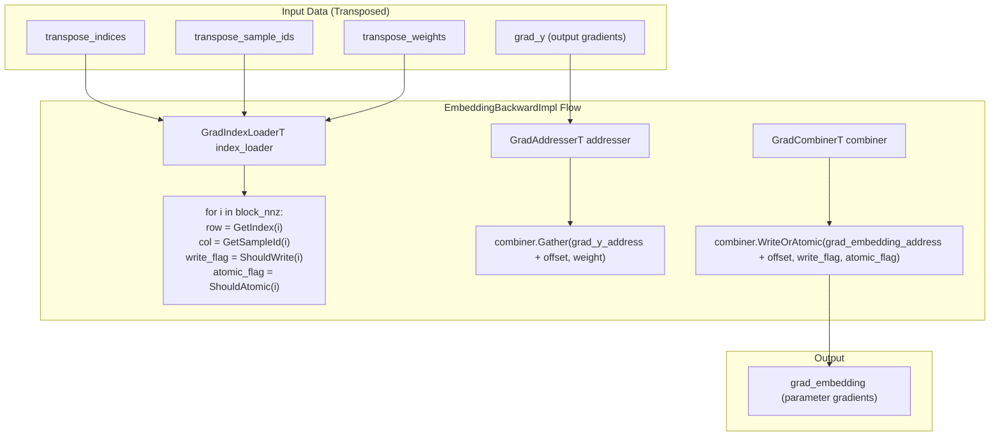

The kernel processes blocks of non-zero entries, with each block assigned to a CTA. The `nz_block_size` parameter controls the granularity of work distribution and affects when atomic operations are needed for gradient accumulation.

Sources: [cuembed/include/embedding_lookup_kernels.cuh:236-286]()

### Gradient Threading Model

The backward kernel uses a different 2D block organization focused on processing non-zero gradient entries:

| Dimension | Purpose | Size Formula |
|-----------|---------|--------------|  
| `blockDim.x` | Elements per embedding vector | `embed_width / elements_per_load` |
| `blockDim.y` | Non-zero blocks per CTA | `nonzero_blocks_per_cta` |
| `gridDim.x` | Number of CTAs | `nnz / nz_block_size / nonzero_blocks_per_cta` |

This organization ensures that multiple non-zero entries can be processed in parallel while maintaining efficient memory access patterns for the gradient tensors.

Sources: [cuembed/include/embedding_lookup_kernels.cuh:225-234]()

## Template Specializations

Both forward and backward kernels provide explicit template specializations to optimize for different use cases:

### Weighted vs Unweighted Variants

The kernels use the `IsWeighted` template parameter and function overloading to provide optimized versions:

- **Weighted**: Processes both indices and associated weights, requiring additional register usage
- **Unweighted**: Uses `std::nullptr_t` for weights parameter, reducing register pressure and improving occupancy

The specialization occurs at compile time based on whether a valid weight pointer or `nullptr` is passed to the kernel.

Sources: [cuembed/include/embedding_lookup_kernels.cuh:148-170](), [cuembed/include/embedding_lookup_kernels.cuh:264-286]()

### Launch Bounds Optimization

All kernels use the `LAUNCH_BOUNDS_1024_1` macro, which expands to `__launch_bounds__(1024, 1)`. This hint tells the CUDA compiler to optimize for:

- Maximum 1024 threads per block
- Minimum 1 block per SM for optimal occupancy

Sources: [cuembed/include/embedding_lookup_kernels.cuh:27](), [cuembed/include/embedding_lookup_kernels.cuh:121]()

## Utility Kernels

### CompactSparseIndicesKernel

This utility kernel generates compacted sparse indices for sparse gradient outputs. It processes arrays of indices and identifies the first occurrence of each unique index value:

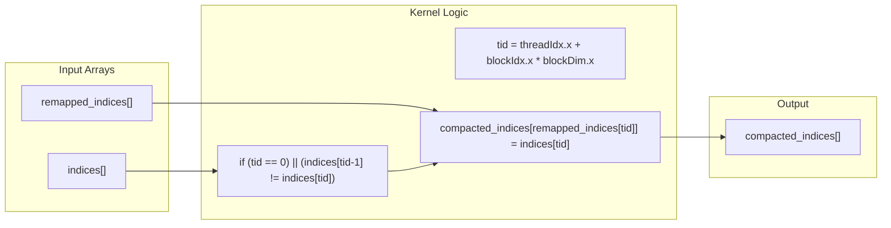

This kernel enables efficient sparse gradient computation by eliminating duplicate index entries while preserving the mapping to the original dense gradient structure.

Sources: [cuembed/include/embedding_lookup_kernels.cuh:289-302]()

## Memory Access Patterns

The kernel implementations are designed to maximize memory throughput through several optimization strategies:

1. **Coalesced Memory Access**: Thread blocks are organized to ensure adjacent threads access adjacent memory locations
2. **Vectorized Loads**: The `elements_per_load` parameter enables SIMD memory operations
3. **Register Optimization**: Template specializations reduce register usage for improved occupancy
4. **Unroll Factors**: The `UnrollFactor` template parameter enables compile-time loop unrolling for better instruction-level parallelism

The combination of these techniques allows the kernels to achieve high memory bandwidth utilization across different embedding table sizes and batch configurations.

Sources: [cuembed/include/embedding_lookup_kernels.cuh:59-76](), [cuembed/include/embedding_lookup_kernels.cuh:199-219]()

---

# Page: Core Operations

# Core Operations

<details>
<summary>Relevant source files</summary>

The following files were used as context for generating this wiki page:

- [cuembed/include/embedding_lookup_ops.cuh](cuembed/include/embedding_lookup_ops.cuh)

</details>


This document covers the fundamental building blocks that power cuEmbed's embedding lookup operations. The core operations consist of three primary classes for forward pass (`Addresser`, `Combiner`, `IndexLoader`) and their corresponding gradient counterparts for backward pass (`GradAddresser`, `GradCombiner`, `GradIndexLoader`). These classes handle memory addressing, data accumulation with different combine modes, and efficient index loading patterns.

For information about the high-level host API that orchestrates these operations, see [Host API](#2.1). For details about vectorized types and utilities used by these operations, see [Types & Utilities](#2.4).

## Forward Pass Operations Architecture

The forward pass operations work together in a pipeline to perform efficient embedding lookups:

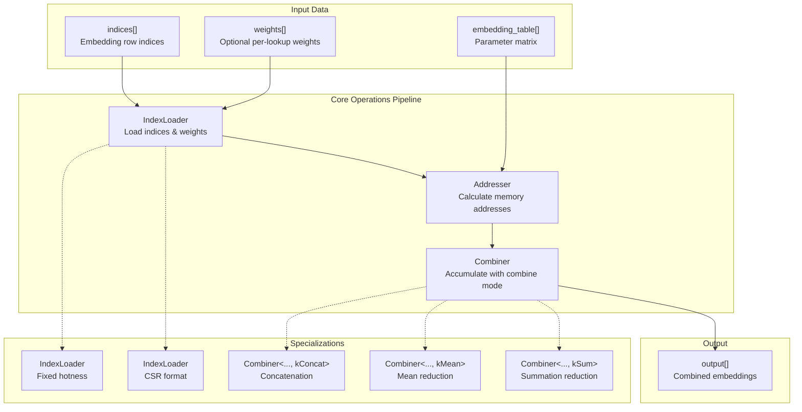

Sources: [cuembed/include/embedding_lookup_ops.cuh:342-496]()

## Addresser Class

The `Addresser` class calculates input and output memory addresses for embedding lookups. It handles different combine modes by adjusting output addressing patterns.

| Template Parameter | Purpose | Example Types |
|-------------------|---------|---------------|
| `InputT` | Embedding element type | `float`, `half` |
| `OutputT` | Output element type | `float`, `half` |
| `IndexT` | Index type | `int64_t`, `int32_t` |
| `InputVecT` | Input vectorization | `float4`, `half8` |
| `OutputVecT` | Output vectorization | `float4`, `half8` |
| `mode` | Combine mode | `kSum`, `kMean`, `kConcat` |

### Key Methods

```mermaid
classDiagram
    class Addresser {
        -const InputT* input_
        -OutputT* output_
        -int embed_width_
        +Addresser(input, output, sample_id, num_hots, embed_width)
        +GetEmbeddingAddress(index) const InputVecT*
        +GetOutputAddress() OutputVecT*
        +GetConcatOutputAddress(i_hotness) OutputVecT*
    }
    
    class "CombineMode Logic" {
        kSum: output_offset = sample_id * embed_width
        kMean: output_offset = sample_id * embed_width  
        kConcat: output_offset = sample_id * num_hots * embed_width
    }
    
    Addresser --> "CombineMode Logic"
```

The addressing logic varies by combine mode:
- **Sum/Mean**: Each sample gets one embedding-width output slot
- **Concat**: Each sample gets `num_hots × embed_width` output slots

Sources: [cuembed/include/embedding_lookup_ops.cuh:78-146]()

## Combiner Class Template System

The `Combiner` class uses template specialization to implement different combine modes efficiently:

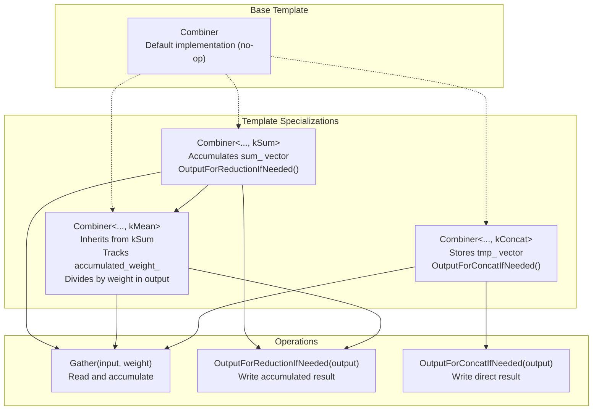

### Sum Specialization
The sum combiner accumulates values into an internal `sum_` vector and outputs the result when `OutputForReductionIfNeeded()` is called.

### Mean Specialization  
Inherits from the sum combiner but additionally tracks `accumulated_weight_` and divides the final sum by the total weight.

### Concatenation Specialization
Simply stores the last gathered value in `tmp_` and outputs it directly when `OutputForConcatIfNeeded()` is called.

Sources: [cuembed/include/embedding_lookup_ops.cuh:162-322]()

## IndexLoader Class System

The `IndexLoader` class handles different index layouts through template specialization:

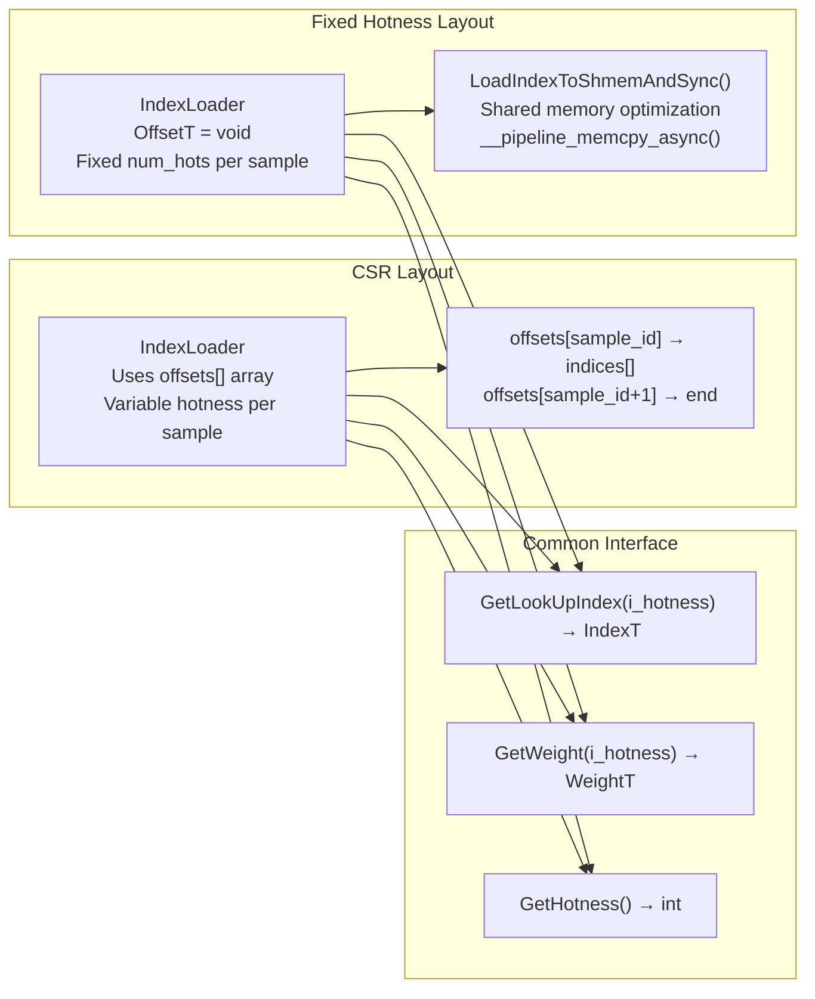

### CSR Specialization
Uses the `offsets` array to determine variable hotness per sample. Calculates `sample_index_start` and `sample_index_stop` to slice the appropriate indices.

### Fixed Hotness Specialization
When `OffsetT` is `void`, assumes fixed hotness. Implements shared memory optimization by loading all indices needed by the CTA (Cooperative Thread Array) into shared memory during construction.

Sources: [cuembed/include/embedding_lookup_ops.cuh:342-496]()

## Backward Pass Operations

The backward pass uses specialized classes to handle gradient computation efficiently:

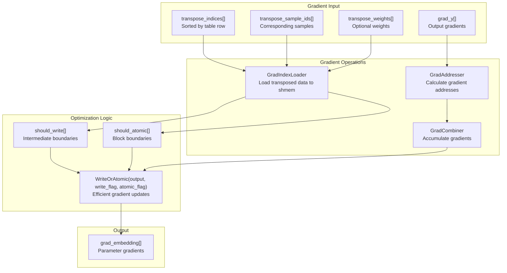

Sources: [cuembed/include/embedding_lookup_ops.cuh:499-667]()

## Memory Optimization Strategies

### Shared Memory Usage for Fixed Hotness

The fixed hotness `IndexLoader` implements sophisticated shared memory optimization:

```mermaid
graph TB
    subgraph "CTA Memory Layout"
        GLOBAL_MEM["Global Memory<br/>indices[], weights[]"]
        PIPELINE["__pipeline_memcpy_async()<br/>Asynchronous copy"]
        SHMEM["Shared Memory<br/>loaded_indices_[], loaded_weights_[]"]
        THREADS["Thread Access<br/>threadIdx.x, threadIdx.y"]
    end
    
    subgraph "Copy Process"
        CTA_RANGE["cta_index_start = blockIdx.x * blockDim.y * num_hots<br/>cta_index_stop = min(batch_size * num_hots, (blockIdx.x + 1) * blockDim.y * num_hots)"]
        ASYNC_COPY["for i in [index_start + tid_in_cta : index_stop : cta_size]<br/>__pipeline_memcpy_async(&loaded_indices_[i-start], &indices_[i])"]
        SYNC_POINT["__pipeline_commit()<br/>__pipeline_wait_prior(0)<br/>__syncthreads()"]
    end
    
    GLOBAL_MEM --> PIPELINE
    PIPELINE --> SHMEM
    SHMEM --> THREADS
    CTA_RANGE --> ASYNC_COPY
    ASYNC_COPY --> SYNC_POINT
```

Sources: [cuembed/include/embedding_lookup_ops.cuh:454-489]()

### Gradient Memory Management

The `GradIndexLoader` calculates shared memory layout and implements write/atomic flags for efficient gradient updates:

| Memory Section | Type | Purpose |
|----------------|------|---------|
| `sh_transpose_indices` | `IndexT[]` | Embedding row indices |
| `sh_transpose_sample_ids` | `IndexT[]` | Sample identifiers |
| `sh_transpose_weights` | `WeightT[]` | Per-lookup weights |
| `should_write` | `bool[]` | Intermediate write flags |
| `should_atomic` | `bool[]` | Atomic operation flags |

The write/atomic logic optimizes gradient accumulation by avoiding unnecessary atomic operations when possible.

Sources: [cuembed/include/embedding_lookup_ops.cuh:518-564]()

---

# Page: Types & Utilities

# Types & Utilities

<details>
<summary>Relevant source files</summary>

The following files were used as context for generating this wiki page:

- [cuembed/include/embedding_lookup_types.cuh](cuembed/include/embedding_lookup_types.cuh)

</details>


This document covers the fundamental data types, type conversion utilities, and vectorized operations that form the foundation of cuEmbed's GPU kernels. These utilities enable efficient memory operations and arithmetic computations across different precision formats (float32 and float16) and vectorization levels.

For information about how these types are used in actual kernel implementations, see [CUDA Kernels](#2.2). For details on the core operations that utilize these types, see [Core Operations](#2.3).

## CombineMode Enumeration

The `CombineMode` enum defines how embedding vectors are aggregated when multiple embeddings belong to the same sample.

| Mode | Description |
|------|-------------|
| `kSum` | Sum all embedding vectors |
| `kMean` | Calculate mean of embedding vectors |
| `kConcat` | Concatenate embedding vectors |

The enumeration is defined in [cuembed/include/embedding_lookup_types.cuh:29]() with a TODO comment indicating that additional modes may be supported in future kernel implementations.

**Sources:** [cuembed/include/embedding_lookup_types.cuh:28-29]()

## Vectorized Type Definitions

cuEmbed defines custom vectorized types for efficient GPU memory operations. These types enable loading and processing multiple elements in a single memory transaction.

### Vectorized Type Architecture

```mermaid
graph TD
    subgraph "Float Types"
        FLOAT["float (32-bit)"]
        FLOAT2["float2 (CUDA built-in)"]
        FLOAT4["float4 (CUDA built-in)"] 
        FLOAT8["float8 (cuEmbed custom)"]
    end
    
    subgraph "Half Types"
        HALF["__half (16-bit)"]
        HALF2["__half2 (CUDA built-in)"]
        HALF4["half4 (cuEmbed custom)"]
        HALF8["half8 (cuEmbed custom)"]
    end
    
    subgraph "Memory Alignment"
        ALIGN8["8-byte aligned"]
        ALIGN16["16-byte aligned"]
        ALIGN32["32-byte aligned"]
    end
    
    FLOAT --> FLOAT2
    FLOAT2 --> FLOAT4
    FLOAT4 --> FLOAT8
    
    HALF --> HALF2
    HALF2 --> HALF4
    HALF4 --> HALF8
    
    HALF4 --> ALIGN8
    FLOAT2 --> ALIGN8
    HALF2 --> ALIGN8
    
    HALF8 --> ALIGN16
    FLOAT4 --> ALIGN16
    
    FLOAT8 --> ALIGN32
```

**Sources:** [cuembed/include/embedding_lookup_types.cuh:32-45]()

### Custom Vector Type Definitions

The library defines custom vectorized types with specific memory alignment:

- `float8`: 32-byte aligned structure with 8 float elements (a,b,c,d,e,f,g,h)
- `half8`: 16-byte aligned structure with 8 half elements (a,b,c,d,e,f,g,h)  
- `half4`: 8-byte aligned structure with 4 half elements (x,y,z,w)

**Sources:** [cuembed/include/embedding_lookup_types.cuh:32-45]()

## Type Conversion System

### VecCast Template Function

The `VecCast` template function provides type-safe conversions between different precision formats and vectorization levels.

```mermaid
graph LR
    subgraph "Conversion Matrix"
        FLOAT_TO_HALF["float → __half"]
        HALF_TO_FLOAT["__half → float"]
        FLOAT2_TO_HALF2["float2 → half2"]
        HALF2_TO_FLOAT2["half2 → float2"]
        FLOAT4_TO_HALF4["float4 → half4"]
        HALF4_TO_FLOAT4["half4 → float4"]
        FLOAT8_TO_HALF8["float8 → half8"]
        HALF8_TO_FLOAT8["half8 → float8"]
    end
    
    subgraph "CUDA Functions"
        F2H["__float2half"]
        H2F["__half2float"]
    end
    
    FLOAT_TO_HALF --> F2H
    HALF_TO_FLOAT --> H2F
    FLOAT2_TO_HALF2 --> F2H
    HALF2_TO_FLOAT2 --> H2F
    FLOAT4_TO_HALF4 --> F2H
    HALF4_TO_FLOAT4 --> H2F
    FLOAT8_TO_HALF8 --> F2H
    HALF8_TO_FLOAT8 --> H2F
```

The default `VecCast` implementation performs no conversion when `ToType` equals `FromType`. Specialized template instantiations handle precision conversions using CUDA's `__float2half` and `__half2float` functions.

**Sources:** [cuembed/include/embedding_lookup_types.cuh:48-144]()

## Vectorized Arithmetic Operations

### Addition Assignment Operators

The library provides `operator+=` overloads for all vectorized types, enabling element-wise addition operations:

| Operator | Purpose |
|----------|---------|
| `half8 += half8` | Element-wise addition of 8-element half vectors |
| `float8 += float8` | Element-wise addition of 8-element float vectors |
| `float4 += float4` | Element-wise addition of 4-element float vectors |
| `float2 += float2` | Element-wise addition of 2-element float vectors |
| `half4 += half4` | Element-wise addition of 4-element half vectors |
| `float += half` | Mixed-precision addition with conversion |
| `float2 += half2` | Mixed-precision vector addition |
| `float4 += half4` | Mixed-precision vector addition |
| `float8 += half8` | Mixed-precision vector addition |

**Sources:** [cuembed/include/embedding_lookup_types.cuh:146-221]()

### Scalar Multiplication Operators

The library implements `operator*` for scalar multiplication across all vectorized types:

- Float vector types can be multiplied by `float` or `__half` scalars
- Half vector types can be multiplied by `__half` or `float` scalars
- Cross-precision multiplication automatically handles type conversion

**Sources:** [cuembed/include/embedding_lookup_types.cuh:223-325]()

## Atomic Operations for Vectorized Types

### VecAtomicAdd Function Template

The `VecAtomicAdd` template provides atomic addition operations for vectorized types, with architecture-specific optimizations.

```mermaid
graph TD
    subgraph "GPU Architecture Support"
        ARCH900["CUDA Arch >= 900"]
        ARCH_OLD["CUDA Arch < 900"]
    end
    
    subgraph "Optimized Operations (Arch 900+)"
        HALF4_OPT["half4: 2x half2 atomicAdd"]
        HALF8_OPT["half8: 4x half2 atomicAdd"] 
        FLOAT8_OPT["float8: 2x float4 atomicAdd"]
    end
    
    subgraph "Fallback Operations"
        HALF4_FALL["half4: 4x half atomicAdd"]
        HALF8_FALL["half8: 8x half atomicAdd"]
        FLOAT8_FALL["float8: 8x float atomicAdd"]
        HALF2_FALL["half2: 2x half atomicAdd"]
        FLOAT2_FALL["float2: 2x float atomicAdd"]
    end
    
    ARCH900 --> HALF4_OPT
    ARCH900 --> HALF8_OPT
    ARCH900 --> FLOAT8_OPT
    
    ARCH_OLD --> HALF4_FALL
    ARCH_OLD --> HALF8_FALL
    ARCH_OLD --> FLOAT8_FALL
    ARCH_OLD --> HALF2_FALL
    ARCH_OLD --> FLOAT2_FALL
```

For CUDA architectures 900 and above, the implementation uses wider atomic operations (e.g., `half2` atomics for `half4`). On older architectures, it falls back to element-wise atomic operations.

**Sources:** [cuembed/include/embedding_lookup_types.cuh:327-493]()

## Type Helper System

### VecTypeHelper Template Structure

The type helper system provides compile-time type selection based on element type, vectorization count, and precision requirements.

```mermaid
graph TB
    subgraph "Template Parameters"
        ELEM_TYPE["T: Element Type"]
        COUNT["count: Vectorization"]
        FP16_MATH["fp16_math: Precision Mode"]
    end
    
    subgraph "Base Type Mapping"
        VTB_FLOAT8["VecTypeBase<float,8>"]
        VTB_FLOAT4["VecTypeBase<float,4>"]
        VTB_FLOAT2["VecTypeBase<float,2>"]
        VTB_FLOAT1["VecTypeBase<float,1>"]
        VTB_HALF8["VecTypeBase<__half,8>"]
        VTB_HALF4["VecTypeBase<__half,4>"]
        VTB_HALF2["VecTypeBase<__half,2>"]
        VTB_HALF1["VecTypeBase<__half,1>"]
    end
    
    subgraph "Specialized Helpers"
        VTH_HALF8_F["VecTypeHelper<__half,8,false>"]
        VTH_HALF4_F["VecTypeHelper<__half,4,false>"]
        VTH_HALF2_F["VecTypeHelper<__half,2,false>"]
        VTH_HALF1_F["VecTypeHelper<__half,1,false>"]
    end
    
    subgraph "Type Aliases"
        LOAD_TYPE["LoadType"]
        REDUCE_TYPE["ReduceType"]
    end
    
    ELEM_TYPE --> VTB_FLOAT8
    COUNT --> VTB_FLOAT8
    FP16_MATH --> VTH_HALF8_F
    
    VTB_FLOAT8 --> LOAD_TYPE
    VTB_FLOAT8 --> REDUCE_TYPE
    VTH_HALF8_F --> LOAD_TYPE
    VTH_HALF8_F --> REDUCE_TYPE
```

### Type Mapping Table

| Base Type | Count | fp16_math | LoadType | ReduceType |
|-----------|-------|-----------|----------|------------|
| `float` | 8 | N/A | `float8` | `float8` |
| `float` | 4 | N/A | `float4` | `float4` |
| `float` | 2 | N/A | `float2` | `float2` |
| `float` | 1 | N/A | `float` | `float` |
| `__half` | 8 | `true` | `half8` | `half8` |
| `__half` | 8 | `false` | `half8` | `float8` |
| `__half` | 4 | `true` | `half4` | `half4` |
| `__half` | 4 | `false` | `half4` | `float4` |
| `__half` | 2 | `true` | `__half2` | `__half2` |
| `__half` | 2 | `false` | `__half2` | `float2` |
| `__half` | 1 | `true` | `__half` | `__half` |
| `__half` | 1 | `false` | `__half` | `float` |

The `fp16_math=false` specializations use higher precision types for reduction operations to maintain numerical accuracy.

**Sources:** [cuembed/include/embedding_lookup_types.cuh:496-581]()

## Utility Type Traits

### GetElemType Template

The `GetElemType` template provides type unwrapping functionality for extracting element types from wrapped structures.

```mermaid
graph LR
    subgraph "Type Unwrapping"
        WRAPPED["Wrapped<T>"]
        GET_ELEM_TYPE["GetElemType<Wrapped<T>>"]
        UNWRAPPED["T"]
    end
    
    subgraph "Usage Pattern"
        GET_ELEM_T["GetElemT<T>"]
        TYPE_ALIAS["typename GetElemType<T>::Type"]
    end
    
    WRAPPED --> GET_ELEM_TYPE
    GET_ELEM_TYPE --> UNWRAPPED
    
    GET_ELEM_T --> TYPE_ALIAS
```

The default implementation returns the input type unchanged. Users can provide specialized implementations for custom wrapper types that require more complex unwrapping behavior.

**Sources:** [cuembed/include/embedding_lookup_types.cuh:582-593]()

---

# Page: Index Transformations

# Index Transformations

<details>
<summary>Relevant source files</summary>

The following files were used as context for generating this wiki page:

- [cuembed/include/index_transforms.cuh](cuembed/include/index_transforms.cuh)
- [cuembed/include/index_transforms_kernels.cuh](cuembed/include/index_transforms_kernels.cuh)

</details>


This document covers the index transformation utilities in cuEmbed that prepare and reformat embedding indices for efficient GPU computation. These transformations handle the conversion between different index formats (CSR, fixed hotness, concatenated) and perform critical reordering operations needed for forward and backward passes.

For information about the core embedding operations that consume these transformed indices, see [Core Operations](#2.3). For details about the CUDA kernels that implement these transformations, see [CUDA Kernels](#2.2).

## Overview

Index transformations in cuEmbed serve three primary purposes:

1. **Row ID Extraction**: Converting various input formats (CSR offsets, fixed hotness patterns) into explicit row ID arrays
2. **Index Transposition**: Reordering indices from sample-first ordering (used in forward pass) to table-first ordering (required for backward pass)  
3. **Index Compression**: Remapping sparse indices to a compressed range for memory-efficient gradient computation

All transformation functions follow a workspace query pattern where the function is first called with `work = nullptr` to determine required temporary memory, then called again with allocated workspace to perform the actual transformation.

## Row ID Extraction Functions

The row ID extraction functions convert implicit index structures into explicit row ID arrays that identify which sample each embedding belongs to.

```mermaid
graph TD
    CSR["CSR Format<br/>offsets: [0,2,3,5]"] --> ExtractCSR["ExtractRowIdsFromCSR"]
    Fixed["Fixed Hotness<br/>batch_size=3, num_hots=2"] --> ExtractFixed["ExtractRowIdsFromFixed"]
    Concat["Concatenation<br/>nnz elements"] --> ExtractConcat["ExtractRowIdsForConcat"]
    
    ExtractCSR --> RowIdsCSR["row_ids: [0,0,1,2,2]"]
    ExtractFixed --> RowIdsFixed["row_ids: [0,0,1,1,2,2]"]
    ExtractConcat --> RowIdsConcat["row_ids: [0,1,2,3,4,...]"]
    
    RowIdsCSR --> Usage["Used by IndexLoader<br/>and Combiner classes"]
    RowIdsFixed --> Usage
    RowIdsConcat --> Usage
```

### ExtractRowIdsFromFixed

The `ExtractRowIdsFromFixed` function generates row IDs for fixed hotness scenarios where each sample has the same number of embeddings.

| Parameter | Type | Description |
|-----------|------|-------------|
| `batch_size` | `int` | Number of samples in the batch |
| `num_hots` | `int` | Number of embeddings per sample |
| `row_ids` | `IndexT*` | Output array of size `batch_size * num_hots` |
| `stream` | `cudaStream_t` | CUDA stream for asynchronous execution |

Sources: [cuembed/include/index_transforms.cuh:45-55]()

### ExtractRowIdsFromCSR

The `ExtractRowIdsFromCSR` function extracts row IDs from Compressed Sparse Row (CSR) format where each sample can have a different number of embeddings.

| Parameter | Type | Description |
|-----------|------|-------------|
| `offsets` | `const OffsetT*` | CSR offset array of size `batch_size + 1` |
| `batch_size` | `int` | Number of samples in the batch |
| `row_ids` | `IndexT*` | Output row ID array |
| `stream` | `cudaStream_t` | CUDA stream for asynchronous execution |

Sources: [cuembed/include/index_transforms.cuh:66-74]()

### ExtractRowIdsForConcat

The `ExtractRowIdsForConcat` function generates sequential row IDs for concatenation scenarios where each embedding forms its own sample.

Sources: [cuembed/include/index_transforms.cuh:85-93]()

## Index Transposition

The transpose operation reorders indices from sample-first ordering (needed for forward pass) to table-first ordering (required for backward pass gradient computation).

### Transpose Function Interface

```mermaid
graph LR
    subgraph "Forward Pass Ordering"
        FwdRows["rows: [sample_ids]"]
        FwdCols["cols: [table_indices]"] 
        FwdWeights["weights: [values]"]
    end
    
    subgraph "Transpose Operation"
        TransposeFunc["Transpose<IndexT, WeightT>"]
        Workspace["work: temporary memory"]
    end
    
    subgraph "Backward Pass Ordering"
        BwdRows["transpose_rows: [table_indices]"]
        BwdCols["transpose_cols: [sample_ids]"]
        BwdWeights["transpose_weights: [values]"]
    end
    
    FwdRows --> TransposeFunc
    FwdCols --> TransposeFunc
    FwdWeights --> TransposeFunc
    Workspace --> TransposeFunc
    
    TransposeFunc --> BwdRows
    TransposeFunc --> BwdCols
    TransposeFunc --> BwdWeights
```

The main `Transpose` function automatically dispatches to weighted or unweighted variants based on whether the weights parameter is null.

| Parameter | Type | Description |
|-----------|------|-------------|
| `rows` | `const IndexT*` | Input sample indices |
| `cols` | `const IndexT*` | Input table indices |
| `weights` | `const WeightT*` | Input weights (nullable) |
| `nnz` | `int` | Number of nonzero elements |
| `transpose_rows` | `IndexT*` | Output transposed table indices |
| `transpose_cols` | `IndexT*` | Output transposed sample indices |
| `transpose_weights` | `WeightT*` | Output transposed weights |
| `work` | `char*` | Temporary workspace |
| `lwork` | `size_t*` | Workspace size (input/output) |
| `stream` | `cudaStream_t` | CUDA stream for execution |

Sources: [cuembed/include/index_transforms.cuh:224-250]()

### TransposeUnweighted Implementation

For unweighted cases, the function uses CUB's `DeviceRadixSort::SortPairs` to sort by column indices while carrying along the corresponding row indices.

Sources: [cuembed/include/index_transforms.cuh:95-137]()

### TransposeWeighted Implementation

For weighted cases, the function packs indices and weights into `WeightTuple` structures, sorts by column indices, then unpacks the results.

Sources: [cuembed/include/index_transforms.cuh:139-200]()

## Compressed Gradient Indices

The `ComputeCompressedGradIndices` function remaps sparse table indices to a compressed range, reducing memory requirements for gradient computation.

```mermaid
graph TD
    subgraph "Input"
        SparseIndices["Sparse Indices<br/>[4,4,7,8,8,8,18]<br/>Range: 0 to num_categories"]
    end
    
    subgraph "Compression Process"
        AdjacentDiff["cub::DeviceAdjacentDifference<br/>SubtractLeftCopy"]
        InclusiveSum["cub::DeviceScan<br/>InclusiveSum"]
        FlagNonzero["FlagNonzero operator<br/>Marks unique values"]
    end
    
    subgraph "Output"
        CompressedIndices["Compressed Indices<br/>[0,0,1,2,2,2,3]<br/>Range: 0 to num_unique"]
    end
    
    SparseIndices --> AdjacentDiff
    FlagNonzero --> AdjacentDiff
    AdjacentDiff --> InclusiveSum
    InclusiveSum --> CompressedIndices
```

### Algorithm Steps

1. Use `cub::DeviceAdjacentDifference::SubtractLeftCopy` with `FlagNonzero` operator to mark unique values
2. Apply `cub::DeviceScan::InclusiveSum` to compute compressed indices
3. Set first element to zero to establish proper base index

Sources: [cuembed/include/index_transforms.cuh:278-323]()

## Supporting CUDA Kernels

The transformation operations rely on several specialized CUDA kernels defined in the companion header.

### Row ID Extraction Kernels

```mermaid
graph TD
    subgraph "Kernel Functions"
        ExtractCSRKernel["ExtractRowIdsFromCSRKernel<OffsetT,IndexT>"]
        ExtractSeqKernel["ExtractSequenceKernel<IndexT>"]
    end
    
    subgraph "Host Functions"
        ExtractCSR["ExtractRowIdsFromCSR"]
        ExtractFixed["ExtractRowIdsFromFixed"]
        ExtractConcat["ExtractRowIdsForConcat"]
    end
    
    ExtractCSR --> ExtractCSRKernel
    ExtractFixed --> ExtractSeqKernel
    ExtractConcat --> ExtractSeqKernel
```

- `ExtractRowIdsFromCSRKernel`: Each block processes one batch element, with threads collaboratively filling row IDs based on CSR offsets
- `ExtractSequenceKernel`: Generates sequential or repeated indices using integer division

Sources: [cuembed/include/index_transforms_kernels.cuh:28-48]()

### Weight Tuple Manipulation Kernels

For weighted transpose operations, the library uses tuple structures to maintain index-weight associations during sorting.

- `WeightTuple`: Structure combining index and weight values
- `PackToTuple`: Kernel that packs separate index and weight arrays into tuple array
- `ExtractFromTuple`: Kernel that unpacks tuple array back into separate arrays

Sources: [cuembed/include/index_transforms_kernels.cuh:50-81]()

## Memory Management

All transformation functions follow the workspace query pattern:

1. **Query Phase**: Call function with `work = nullptr` to get required workspace size in `lwork`
2. **Allocation Phase**: Allocate workspace memory of size `*lwork`
3. **Execution Phase**: Call function again with allocated workspace

This pattern ensures optimal memory usage by allowing precise workspace allocation based on problem size and avoiding over-allocation.

Sources: [cuembed/include/index_transforms.cuh:41-43](), [cuembed/include/index_transforms.cuh:61-64](), [cuembed/include/index_transforms.cuh:121-124](), [cuembed/include/index_transforms.cuh:173-176](), [cuembed/include/index_transforms.cuh:299-302]()

---

# Page: PyTorch Integration

# PyTorch Integration

<details>
<summary>Relevant source files</summary>

The following files were used as context for generating this wiki page:

- [examples/pytorch/cuembed_pyt.py](examples/pytorch/cuembed_pyt.py)
- [examples/pytorch/cuembed_test.py](examples/pytorch/cuembed_test.py)

</details>


This document covers the PyTorch integration layer that enables cuEmbed to work seamlessly with PyTorch models and training workflows. The integration provides custom PyTorch operations, automatic differentiation support, and compatibility with PyTorch's compilation system.

For detailed information about the Python API and custom operations, see [Python Bindings](#3.1). For the C++ extension implementation details, see [C++ Extension](#3.2).

## Overview

The PyTorch integration enables cuEmbed's CUDA-accelerated embedding lookups to be used as drop-in replacements for PyTorch's `nn.EmbeddingBag` operations. The integration consists of two main layers:

1. **Python Bindings Layer**: Custom PyTorch operations and autograd integration
2. **C++ Extension Layer**: Bridge between PyTorch tensors and cuEmbed kernels

The integration supports all PyTorch features including automatic differentiation, gradient computation, and `torch.compile` optimization.

## Architecture

### Integration Layer Architecture

```mermaid
graph TB
    subgraph "User PyTorch Code"
        USER["PyTorch Model"]
        MODULE["CuEmbedModule"]
        EMBEDDING["cuemb_embedding()"]
    end
    
    subgraph "Python Bindings Layer"
        CUSTOM_OP["cuemb::cuemb_embedding<br/>Custom PyTorch Op"]
        FORWARD["cuembed_forward()"]
        BACKWARD["cuembed_backward()"]
        SETUP["setup_context()"]
    end
    
    subgraph "PyTorch Framework"
        AUTOGRAD["PyTorch Autograd"]
        COMPILE["torch.compile"]
        LIBRARY_LOADER["torch.ops.load_library()"]
    end
    
    subgraph "C++ Extension Operations"
        FWD_OP["cuembed_embedding_forward"]
        BWD_OP["cuembed_embedding_backward"] 
        TRANSPOSE_OP["cuembed_transpose"]
        EXTRACT_OP["cuembed_extract_row_ids_from_csr"]
    end
    
    subgraph "cuEmbed Core"
        CORE_FWD["cuembed::EmbeddingForward"]
        CORE_BWD["cuembed::EmbeddingBackward"]
        CORE_TRANSFORMS["Index Transformations"]
    end
    
    %% User interactions
    USER --> MODULE
    MODULE --> EMBEDDING
    EMBEDDING --> CUSTOM_OP
    
    %% Python bindings
    CUSTOM_OP --> FORWARD
    CUSTOM_OP --> BACKWARD
    FORWARD --> FWD_OP
    BACKWARD --> BWD_OP
    BACKWARD --> TRANSPOSE_OP
    BACKWARD --> EXTRACT_OP
    
    %% PyTorch framework integration
    AUTOGRAD --> BACKWARD
    AUTOGRAD --> SETUP
    COMPILE --> CUSTOM_OP
    LIBRARY_LOADER --> FWD_OP
    LIBRARY_LOADER --> BWD_OP
    LIBRARY_LOADER --> TRANSPOSE_OP
    LIBRARY_LOADER --> EXTRACT_OP
    
    %% Core library calls
    FWD_OP --> CORE_FWD
    BWD_OP --> CORE_BWD
    TRANSPOSE_OP --> CORE_TRANSFORMS
    EXTRACT_OP --> CORE_TRANSFORMS
```

Sources: [examples/pytorch/cuembed_pyt.py:1-60](), [examples/pytorch/cuembed_test.py:7-14]()

### Operation Flow

```mermaid
graph LR
    subgraph "Forward Pass"
        INPUT["PyTorch Tensors<br/>params, idx, offsets, weights"]
        FWD_WRAPPER["cuembed_forward()"]
        FWD_CORE["cuembed_embedding_forward()"]
        OUTPUT["Output Tensor"]
    end
    
    subgraph "Backward Pass"
        GRAD_INPUT["Gradient Tensor"]
        BWD_WRAPPER["cuembed_backward()"]
        EXTRACT["cuembed_extract_row_ids_from_csr()"]
        TRANSPOSE["cuembed_transpose()"]
        BWD_CORE["cuembed_embedding_backward()"]
        GRAD_OUTPUT["Parameter Gradients"]
    end
    
    subgraph "Context Management"
        CTX["PyTorch Context"]
        SAVE["save_for_backward()"]
        RESTORE["saved_tensors"]
    end
    
    %% Forward flow
    INPUT --> FWD_WRAPPER
    FWD_WRAPPER --> FWD_CORE
    FWD_CORE --> OUTPUT
    
    %% Context saving
    INPUT --> SAVE
    SAVE --> CTX
    
    %% Backward flow
    GRAD_INPUT --> BWD_WRAPPER
    CTX --> RESTORE
    RESTORE --> BWD_WRAPPER
    BWD_WRAPPER --> EXTRACT
    EXTRACT --> TRANSPOSE
    TRANSPOSE --> BWD_CORE
    BWD_CORE --> GRAD_OUTPUT
```

Sources: [examples/pytorch/cuembed_pyt.py:16-40]()

## Core Components

### Custom PyTorch Operation

The main entry point is the `cuemb_embedding` custom operation registered with PyTorch:

| Component | Function | Location |
|-----------|----------|----------|
| Registration | `@torch.library.custom_op` | [examples/pytorch/cuembed_pyt.py:47]() |
| Forward Implementation | `cuemb_embedding()` | [examples/pytorch/cuembed_pyt.py:48-50]() |
| Fake Implementation | `cuemb_embedding.register_fake` | [examples/pytorch/cuembed_pyt.py:52-56]() |
| Autograd Registration | `cuemb_embedding.register_autograd` | [examples/pytorch/cuembed_pyt.py:59]() |

### C++ Extension Operations

The C++ extension provides four core operations loaded via `torch.ops.load_library`:

| Operation | Purpose | Usage |
|-----------|---------|-------|
| `cuembed_embedding_forward` | Forward pass computation | [examples/pytorch/cuembed_pyt.py:13]() |
| `cuembed_embedding_backward` | Gradient computation | [examples/pytorch/cuembed_pyt.py:14]() |
| `cuembed_transpose` | Index transformation | [examples/pytorch/cuembed_pyt.py:12]() |
| `cuembed_extract_row_ids_from_csr` | CSR format processing | [examples/pytorch/cuembed_pyt.py:9-11]() |

### Autograd Integration

The autograd system handles automatic differentiation:

- **Context Setup**: `setup_context()` saves tensors and metadata for backward pass [examples/pytorch/cuembed_pyt.py:41-44]()
- **Gradient Computation**: `cuembed_backward()` computes parameter gradients [examples/pytorch/cuembed_pyt.py:19-39]()
- **Gradient Propagation**: Returns gradients for embedding parameters only [examples/pytorch/cuembed_pyt.py:38-39]()

## Usage Patterns

### Basic Usage

The integration supports the same interface as PyTorch's `nn.EmbeddingBag`:

```python
# Direct function call
result = cuemb_embedding(params, indices, offsets, weights)

# Module wrapper  
class CuEmbedModule(nn.Module):
    def forward(self, indices, offsets):
        return cuemb_embedding(self.weight, indices, offsets)
```

### Torch.compile Support

The integration is compatible with PyTorch's compilation system through fake implementations:

- **Fake Implementation**: Provides shape and device inference without computation [examples/pytorch/cuembed_pyt.py:52-56]()
- **Compilation**: Works with `torch.compile()` for optimized execution [examples/pytorch/cuembed_test.py:36-72]()

## Testing and Validation

The integration includes comprehensive testing against PyTorch's reference implementations:

| Test Type | Function | Validation |
|-----------|----------|------------|
| Forward Pass | `test_cuembed()` | Exact equality with `nn.EmbeddingBag` |
| Backward Pass | `test_cuembed()` | `torch.allclose()` due to atomic operations |
| Compilation | `test_cuembed_compile()` | Shape and value correctness |

Sources: [examples/pytorch/cuembed_test.py:15-35](), [examples/pytorch/cuembed_test.py:36-72]()

## Compatibility

The PyTorch integration maintains compatibility with:

- **PyTorch Autograd**: Full gradient computation support
- **PyTorch Compilation**: `torch.compile` optimization
- **Device Placement**: CUDA device tensors
- **Data Types**: `torch.float32` and `torch.long` tensors
- **EmbeddingBag API**: Drop-in replacement for `nn.EmbeddingBag` with `mode='sum'`

Sources: [examples/pytorch/cuembed_pyt.py:1-60](), [examples/pytorch/cuembed_test.py:1-116]()

---

# Page: Python Bindings

# Python Bindings

<details>
<summary>Relevant source files</summary>

The following files were used as context for generating this wiki page:

- [examples/pytorch/cuembed_pyt.py](examples/pytorch/cuembed_pyt.py)
- [examples/pytorch/cuembed_test.py](examples/pytorch/cuembed_test.py)

</details>


This page documents the Python interface to cuEmbed, which provides seamless integration with PyTorch through custom operations and autograd support. The Python bindings expose cuEmbed's CUDA-accelerated embedding lookup functionality as PyTorch-compatible operations that support both eager execution and compilation with `torch.compile`.

For information about the underlying C++ extension that bridges PyTorch tensors to cuEmbed kernels, see [C++ Extension](#3.2). For details about the core embedding operations being wrapped, see [Host API](#2.1).

## Python API Architecture

The Python bindings create a layered architecture that integrates cuEmbed with PyTorch's ecosystem:

```mermaid
graph TB
    subgraph "Python User Interface"
        USER_CODE["User PyTorch Code"]
        CUEMBED_MODULE["CuEmbedModule<br/>(nn.Module wrapper)"]
        CUEMB_OP["cuemb_embedding<br/>(Custom PyTorch Operation)"]
    end
    
    subgraph "PyTorch Integration Layer"
        CUSTOM_OP_REG["@torch.library.custom_op<br/>('cuemb::cuemb_embedding')"]
        AUTOGRAD_REG["register_autograd<br/>(cuembed_backward, setup_context)"]
        FAKE_IMPL["register_fake<br/>(shape inference)"]
    end
    
    subgraph "cuEmbed Bridge Functions"
        CUEMBED_FORWARD["cuembed_forward<br/>(wraps cuembed_embedding_forward)"]
        CUEMBED_BACKWARD["cuembed_backward<br/>(gradient computation)"]
        SETUP_CONTEXT["setup_context<br/>(saves tensors for backward)"]
    end
    
    subgraph "Native PyTorch Operations"
        EXTRACT_OP["cuembed_extract_row_ids_from_csr"]
        TRANSPOSE_OP["cuembed_transpose"] 
        FORWARD_OP["cuembed_embedding_forward"]
        BACKWARD_OP["cuembed_embedding_backward"]
    end
    
    subgraph "Shared Library"
        LIBCUEMBED["libcuembed_pyt.so<br/>(C++ Extension)"]
    end
    
    USER_CODE --> CUEMBED_MODULE
    USER_CODE --> CUEMB_OP
    CUEMBED_MODULE --> CUEMB_OP
    
    CUEMB_OP --> CUSTOM_OP_REG
    CUEMB_OP --> AUTOGRAD_REG
    CUEMB_OP --> FAKE_IMPL
    
    CUSTOM_OP_REG --> CUEMBED_FORWARD
    AUTOGRAD_REG --> CUEMBED_BACKWARD
    AUTOGRAD_REG --> SETUP_CONTEXT
    
    CUEMBED_FORWARD --> FORWARD_OP
    CUEMBED_BACKWARD --> EXTRACT_OP
    CUEMBED_BACKWARD --> TRANSPOSE_OP  
    CUEMBED_BACKWARD --> BACKWARD_OP
    
    EXTRACT_OP --> LIBCUEMBED
    TRANSPOSE_OP --> LIBCUEMBED
    FORWARD_OP --> LIBCUEMBED
    BACKWARD_OP --> LIBCUEMBED
```

**Sources:** [examples/pytorch/cuembed_pyt.py:1-60]()

## Custom PyTorch Operations

The Python bindings expose four core cuEmbed operations as PyTorch custom operations, loaded from the shared library:

| Operation | PyTorch Function | Purpose |
|-----------|------------------|---------|
| Index Extraction | `cuembed_extract_row_ids_from_csr` | Convert CSR offsets to sample IDs |
| Transpose | `cuembed_transpose` | Reorder indices for backward pass |
| Forward Pass | `cuembed_embedding_forward` | Perform embedding lookup |
| Backward Pass | `cuembed_embedding_backward` | Compute gradients |

These operations are accessed through PyTorch's operator registry after loading the shared library:

```mermaid
graph LR
    subgraph "Library Loading"
        LOAD_LIB["torch.ops.load_library<br/>('libcuembed_pyt.so')"]
    end
    
    subgraph "Operation Registry"
        EXTRACT_REG["torch.ops.cuembed_pyt.<br/>cuembed_extract_row_ids_from_csr"]
        TRANSPOSE_REG["torch.ops.cuembed_pyt.<br/>cuembed_transpose"]
        FORWARD_REG["torch.ops.cuembed_pyt.<br/>cuembed_embedding_forward"]
        BACKWARD_REG["torch.ops.cuembed_pyt.<br/>cuembed_embedding_backward"]
    end
    
    subgraph "Python Aliases"
        EXTRACT_ALIAS["cuembed_extract_row_ids_from_csr"]
        TRANSPOSE_ALIAS["cuembed_transpose"]
        FORWARD_ALIAS["cuembed_embedding_forward"]
        BACKWARD_ALIAS["cuembed_embedding_backward"]
    end
    
    LOAD_LIB --> EXTRACT_REG
    LOAD_LIB --> TRANSPOSE_REG
    LOAD_LIB --> FORWARD_REG
    LOAD_LIB --> BACKWARD_REG
    
    EXTRACT_REG --> EXTRACT_ALIAS
    TRANSPOSE_REG --> TRANSPOSE_ALIAS
    FORWARD_REG --> FORWARD_ALIAS
    BACKWARD_REG --> BACKWARD_ALIAS
```

**Sources:** [examples/pytorch/cuembed_pyt.py:7-14]()

## Main Custom Operation

The primary interface is the `cuemb_embedding` custom operation, which provides a drop-in replacement for PyTorch's `EmbeddingBag`:

### Operation Registration

The operation is registered using PyTorch's custom operation framework:

```mermaid
graph TB
    subgraph "Custom Operation Definition"
        OP_DECORATOR["@torch.library.custom_op<br/>('cuemb::cuemb_embedding', mutates_args=())"]
        OP_FUNCTION["cuemb_embedding(params, idx, offsets, weights=None)"]
    end
    
    subgraph "Implementation Registration"
        FAKE_REG["@cuemb_embedding.register_fake<br/>(shape inference for torch.compile)"]
        AUTOGRAD_REG["cuemb_embedding.register_autograd<br/>(cuembed_backward, setup_context)"]
    end
    
    subgraph "Implementation Functions"
        FORWARD_IMPL["cuembed_forward<br/>(calls cuembed_embedding_forward)"]
        BACKWARD_IMPL["cuembed_backward<br/>(gradient computation)"]
        CONTEXT_IMPL["setup_context<br/>(saves tensors for backward)"]
        FAKE_IMPL["fake implementation<br/>(returns empty tensor with correct shape)"]
    end
    
    OP_DECORATOR --> OP_FUNCTION
    OP_FUNCTION --> FORWARD_IMPL
    
    FAKE_REG --> FAKE_IMPL
    AUTOGRAD_REG --> BACKWARD_IMPL
    AUTOGRAD_REG --> CONTEXT_IMPL
```

**Sources:** [examples/pytorch/cuembed_pyt.py:47-59]()

### Forward Pass Implementation

The forward pass is implemented by the `cuembed_forward` function, which wraps the native operation with a fixed combine mode:

**Sources:** [examples/pytorch/cuembed_pyt.py:16-17]()

## Autograd Integration

The Python bindings provide full autograd support through custom backward pass implementation:

```mermaid
graph TD
    subgraph "Forward Context Setup"
        SAVE_TENSORS["ctx.save_for_backward(idx, offsets, weights)"]
        SAVE_ATTRS["ctx.num_categories = params.size(0)"]
    end
    
    subgraph "Backward Pass Flow"
        GET_CONTEXT["Extract saved tensors and attributes"]
        EXTRACT_SAMPLES["cuembed_extract_row_ids_from_csr<br/>(offsets[:-1], nnz)"]
        TRANSPOSE_DATA["cuembed_transpose<br/>(sample_ids, idx, weights)"]
        COMPUTE_GRADS["cuembed_embedding_backward<br/>(out_grad, num_categories, ...)"]
    end
    
    subgraph "Gradient Return"
        GRAD_PARAMS["grad_embedding<br/>(parameter gradients)"]
        GRAD_NONE["None, None, None<br/>(no gradients for idx, offsets, weights)"]
    end
    
    SAVE_TENSORS --> GET_CONTEXT
    SAVE_ATTRS --> GET_CONTEXT
    
    GET_CONTEXT --> EXTRACT_SAMPLES
    EXTRACT_SAMPLES --> TRANSPOSE_DATA
    TRANSPOSE_DATA --> COMPUTE_GRADS
    
    COMPUTE_GRADS --> GRAD_PARAMS
    COMPUTE_GRADS --> GRAD_NONE
```

**Sources:** [examples/pytorch/cuembed_pyt.py:19-44]()

### Gradient Computation Details

The backward pass follows these steps:
1. **Context Retrieval**: Extract saved tensors (`idx`, `offsets`, `weights`) and `num_categories` from forward context
2. **Sample ID Extraction**: Convert CSR format offsets to sample IDs using `cuembed_extract_row_ids_from_csr`
3. **Index Transposition**: Reorder data from sample-major to table-major format using `cuembed_transpose`
4. **Weight Handling**: Set transposed weights to `None` if empty (indicating no weights were used in forward pass)
5. **Gradient Computation**: Call `cuembed_embedding_backward` to compute parameter gradients

**Sources:** [examples/pytorch/cuembed_pyt.py:25-36]()

## Module Interface

The `CuEmbedModule` class provides a standard `nn.Module` wrapper for the custom operation:

```mermaid
graph LR
    subgraph "CuEmbedModule"
        INIT["__init__(weight)"]
        FORWARD["forward(indices, offsets)"]
    end
    
    subgraph "Internal Implementation"
        WEIGHT_PARAM["self.weight = weight"]
        CUEMB_CALL["cuemb_embedding(self.weight, indices, offsets)"]
    end
    
    INIT --> WEIGHT_PARAM
    FORWARD --> CUEMB_CALL
```

**Sources:** [examples/pytorch/cuembed_test.py:7-13]()

## torch.compile Support

The Python bindings include full support for PyTorch's compilation system through proper operation registration:

### Fake Implementation for Shape Inference

The `register_fake` decorator provides shape inference without actual computation:

**Sources:** [examples/pytorch/cuembed_pyt.py:52-56]()

### Compilation Testing

The bindings are tested with `torch.compile` to ensure compatibility:

**Sources:** [examples/pytorch/cuembed_test.py:36-72]()

## Usage Examples

### Basic Usage with Weights
**Sources:** [examples/pytorch/cuembed_test.py:15-35]()

### Usage without Weights
**Sources:** [examples/pytorch/cuembed_test.py:91-92]()

### Compiled Module Usage
**Sources:** [examples/pytorch/cuembed_test.py:58-71]()

## Error Handling and Edge Cases

The Python bindings handle several edge cases:
- **Empty Weights**: When `weights=None` in forward pass, the backward pass correctly handles empty weight tensors
- **Gradient Accumulation**: The backward pass uses atomic operations to handle concurrent gradient updates
- **Shape Validation**: The fake implementation ensures correct output shapes for compilation

**Sources:** [examples/pytorch/cuembed_pyt.py:32-33]()

---

# Page: C++ Extension

# C++ Extension

<details>
<summary>Relevant source files</summary>

The following files were used as context for generating this wiki page:

- [examples/pytorch/CMakeLists.txt](examples/pytorch/CMakeLists.txt)
- [examples/pytorch/cuembed_embedding.cu](examples/pytorch/cuembed_embedding.cu)

</details>


This document covers the CUDA C++ extension that serves as the low-level bridge between PyTorch tensors and cuEmbed's CUDA kernels. The extension provides custom PyTorch operations that handle tensor validation, type conversion, and direct integration with cuEmbed's core embedding functions.

For information about the Python-level interface and autograd integration, see [Python Bindings](#3.1).

## Architecture Overview

The C++ extension implements a thin wrapper layer that translates PyTorch tensor operations into cuEmbed kernel calls. It consists of four main wrapper functions that are registered as custom PyTorch operations, enabling seamless integration with PyTorch's execution engine and autograd system.

```mermaid
graph TB
    subgraph "PyTorch Framework"
        PYTORCH_TENSORS["PyTorch Tensors"]
        TORCH_LIBRARY["torch.ops.cuembed_pyt"]
        AUTOGRAD["PyTorch Autograd"]
        CUDA_STREAM["at::cuda::getCurrentCUDAStream()"]
    end
    
    subgraph "C++ Extension Layer"
        CUEMBED_FWD["cuembed_embedding_forward()"]
        CUEMBED_BWD["cuembed_embedding_backward()"]
        CUEMBED_TRANSPOSE["cuembed_transpose()"]
        CUEMBED_EXTRACT["cuembed_extract_row_ids_from_csr()"]
    end
    
    subgraph "cuEmbed Core API"
        CORE_FWD["cuembed::EmbeddingForward()"]
        CORE_BWD["cuembed::EmbeddingBackward()"]
        CORE_TRANSPOSE["cuembed::Transpose()"]
        CORE_EXTRACT["cuembed::ExtractRowIdsFromCSR()"]
    end
    
    PYTORCH_TENSORS --> CUEMBED_FWD
    PYTORCH_TENSORS --> CUEMBED_BWD
    PYTORCH_TENSORS --> CUEMBED_TRANSPOSE
    PYTORCH_TENSORS --> CUEMBED_EXTRACT
    
    CUEMBED_FWD --> CORE_FWD
    CUEMBED_BWD --> CORE_BWD
    CUEMBED_TRANSPOSE --> CORE_TRANSPOSE
    CUEMBED_EXTRACT --> CORE_EXTRACT
    
    CUDA_STREAM --> CUEMBED_FWD
    CUDA_STREAM --> CUEMBED_BWD
    CUDA_STREAM --> CUEMBED_TRANSPOSE
    CUDA_STREAM --> CUEMBED_EXTRACT
    
    TORCH_LIBRARY --> CUEMBED_FWD
    TORCH_LIBRARY --> CUEMBED_BWD
    TORCH_LIBRARY --> CUEMBED_TRANSPOSE
    TORCH_LIBRARY --> CUEMBED_EXTRACT
```

Sources: [examples/pytorch/cuembed_embedding.cu:1-175]()

## Function Implementations

### Forward Pass Integration

The `cuembed_embedding_forward` function handles the forward embedding lookup operation, translating PyTorch tensors to cuEmbed's `EmbeddingForward` API.

```mermaid
graph LR
    subgraph "Input Validation"
        TENSOR_CHECKS["AT_ASSERT tensor properties"]
        TYPE_CHECKS["ScalarType validation"]
        DEVICE_CHECKS["CUDA device verification"]
    end
    
    subgraph "Data Extraction"
        PARAMS_PTR["params.data_ptr<float>()"]
        INDICES_PTR["indices.data_ptr<IndexType>()"]
        OFFSETS_PTR["offsets.data_ptr<IndexType>()"]
        WEIGHTS_PTR["weights.data_ptr<float>()"]
    end
    
    subgraph "cuEmbed Core Call"
        EMBEDDING_FWD["cuembed::EmbeddingForward()"]
        CUDA_STREAM_FWD["at::cuda::getCurrentCUDAStream()"]
    end
    
    TENSOR_CHECKS --> PARAMS_PTR
    TYPE_CHECKS --> INDICES_PTR
    DEVICE_CHECKS --> OFFSETS_PTR
    
    PARAMS_PTR --> EMBEDDING_FWD
    INDICES_PTR --> EMBEDDING_FWD
    OFFSETS_PTR --> EMBEDDING_FWD
    WEIGHTS_PTR --> EMBEDDING_FWD
    CUDA_STREAM_FWD --> EMBEDDING_FWD
```

The function performs extensive tensor validation and extracts raw pointers for cuEmbed kernel consumption. Key implementation details:

| Validation | Implementation | Line Reference |
|------------|----------------|----------------|
| Device Check | `AT_ASSERT(indices.is_cuda())` | [examples/pytorch/cuembed_embedding.cu:15-17]() |
| Type Check | `AT_ASSERT(params.scalar_type() == torch::ScalarType::Float)` | [examples/pytorch/cuembed_embedding.cu:19]() |
| Contiguity | `AT_ASSERT(params.is_contiguous())` | [examples/pytorch/cuembed_embedding.cu:18]() |
| Optional Weights | Conditional `weights.defined()` checks | [examples/pytorch/cuembed_embedding.cu:20-22]() |

Sources: [examples/pytorch/cuembed_embedding.cu:10-48]()

### Backward Pass Integration

The `cuembed_embedding_backward` function implements gradient computation by calling `cuembed::EmbeddingBackward` with transposed indices and sample IDs.

```mermaid
graph TB
    subgraph "Gradient Input"
        Y_GRAD["y_grad tensor"]
        NUM_CATEGORIES["num_categories parameter"]
    end
    
    subgraph "Transposed Data"
        TRANSPOSE_INDICES["transpose_indices"]
        TRANSPOSE_SAMPLES["transpose_sample_ids"]
        TRANSPOSE_WEIGHTS["transpose_weights"]
    end
    
    subgraph "Output Allocation"
        GRAD_EMBEDDING["torch::zeros(num_categories * embed_width)"]
    end
    
    subgraph "Core Backward Call"
        EMBEDDING_BWD["cuembed::EmbeddingBackward()"]
        SKIP_INIT["skip_grad_init = true"]
    end
    
    Y_GRAD --> EMBEDDING_BWD
    NUM_CATEGORIES --> GRAD_EMBEDDING
    TRANSPOSE_INDICES --> EMBEDDING_BWD
    TRANSPOSE_SAMPLES --> EMBEDDING_BWD
    TRANSPOSE_WEIGHTS --> EMBEDDING_BWD
    GRAD_EMBEDDING --> EMBEDDING_BWD
    SKIP_INIT --> EMBEDDING_BWD
```

Sources: [examples/pytorch/cuembed_embedding.cu:114-154]()

### Index Transformation Operations

Two utility functions handle index data transformations required for efficient gradient computation:

#### `cuembed_extract_row_ids_from_csr`
Extracts row IDs from CSR (Compressed Sparse Row) format offsets using `cuembed::ExtractRowIdsFromCSR`.

#### `cuembed_transpose`
Transposes sparse matrix data (rows, columns, weights) using `cuembed::Transpose`, including workspace memory allocation for efficient sorting operations.

```mermaid
graph LR
    subgraph "Transpose Workflow"
        INPUT_DATA["rows, cols, weights tensors"]
        LWORK_QUERY["cuembed::Transpose(..., &lwork)"]
        WORKSPACE_ALLOC["torch::empty(lwork, dtype=kByte)"]
        TRANSPOSE_CALL["cuembed::Transpose(..., work_ptr)"]
    end
    
    INPUT_DATA --> LWORK_QUERY
    LWORK_QUERY --> WORKSPACE_ALLOC
    WORKSPACE_ALLOC --> TRANSPOSE_CALL
```

Sources: [examples/pytorch/cuembed_embedding.cu:50-63](), [examples/pytorch/cuembed_embedding.cu:65-112]()

## PyTorch Integration Mechanism

### Custom Operation Registration

The extension uses PyTorch's `TORCH_LIBRARY` macro to register all four functions as custom operations in the `cuembed_pyt` namespace:

```mermaid
graph TB
    subgraph "TORCH_LIBRARY Registration"
        LIBRARY_DEF["TORCH_LIBRARY(cuembed_pyt, m)"]
        FWD_REG["m.def('cuembed_embedding_forward', ...)"]
        BWD_REG["m.def('cuembed_embedding_backward', ...)"]
        TRANSPOSE_REG["m.def('cuembed_transpose', ...)"]
        EXTRACT_REG["m.def('cuembed_extract_row_ids_from_csr', ...)"]
    end
    
    subgraph "Function Signatures"
        FWD_SIG["(Tensor, Tensor, Tensor, Tensor, str) -> Tensor"]
        BWD_SIG["(Tensor, int, Tensor, Tensor, Tensor) -> Tensor"]
        TRANSPOSE_SIG["(Tensor, Tensor, Tensor) -> (Tensor, Tensor, Tensor)"]
        EXTRACT_SIG["(Tensor, int) -> Tensor"]
    end
    
    LIBRARY_DEF --> FWD_REG
    LIBRARY_DEF --> BWD_REG  
    LIBRARY_DEF --> TRANSPOSE_REG
    LIBRARY_DEF --> EXTRACT_REG
    
    FWD_REG --> FWD_SIG
    BWD_REG --> BWD_SIG
    TRANSPOSE_REG --> TRANSPOSE_SIG
    EXTRACT_REG --> EXTRACT_SIG
```

### CUDA Stream Management

All functions integrate with PyTorch's CUDA stream management using `at::cuda::getCurrentCUDAStream()`, ensuring proper synchronization within PyTorch's execution model.

Sources: [examples/pytorch/cuembed_embedding.cu:156-174]()

## Build Configuration

The C++ extension is built as a shared library `libcuembed_pyt.so` through CMake configuration:

| Component | Configuration | Line Reference |
|-----------|---------------|----------------|
| Target Name | `cuembed_pyt` | [examples/pytorch/CMakeLists.txt:8]() |
| Library Type | `SHARED` | [examples/pytorch/CMakeLists.txt:8]() |
| Source File | `cuembed_embedding.cu` | [examples/pytorch/CMakeLists.txt:8]() |
| Dependencies | `${TORCH_LIBRARIES}`, `Python::Python`, `cuembed_hdrs` | [examples/pytorch/CMakeLists.txt:9]() |
| CUDA Architectures | `7.0;7.5;8.0;9.0` | [examples/pytorch/CMakeLists.txt:3]() |

### Dependencies

- **PyTorch**: Found via `find_package(Torch REQUIRED)`
- **Python Development**: Found via `find_package(Python REQUIRED COMPONENTS Development)`
- **cuEmbed Headers**: Linked as `cuembed_hdrs` target

Sources: [examples/pytorch/CMakeLists.txt:1-10]()

---

# Page: Testing & Validation

# Testing & Validation

<details>
<summary>Relevant source files</summary>

The following files were used as context for generating this wiki page:

- [tests/CMakeLists.txt](tests/CMakeLists.txt)

</details>


This document covers the comprehensive testing and validation strategy for cuEmbed, including correctness validation against CPU reference implementations, component-level unit testing, and performance benchmarking infrastructure. The testing system ensures both functional correctness and performance optimization across different GPU configurations and embedding scenarios.

For information about the core library components being tested, see [Core Library](#2). For PyTorch integration testing, see [PyTorch Integration](#3). For build system configuration, see [Build System](#5).

## Testing Architecture Overview

cuEmbed employs a multi-layered testing strategy that validates both correctness and performance across different dimensions:

### Testing Strategy Diagram

```mermaid
graph TB
    subgraph "Validation_Approach"
        CPU_REF["CPU Reference Implementations"]
        GPU_IMPL["GPU cuEmbed Implementations"] 
        TORCH_ALLCLOSE["torch.allclose Comparison"]
    end
    
    subgraph "Test_Categories"
        CORRECTNESS_TESTS["test_embedding_against_cpu.cu"]
        UNIT_TESTS["Component Unit Tests"]
        INTEGRATION_TESTS["PyTorch Integration Tests"]
        PERFORMANCE_TESTS["manual_benchmark.cu"]
    end
    
    subgraph "Test_Infrastructure"
        GTEST["Google Test Framework"]
        TEST_UTILS["Test Utilities & AllocationOptions"]
        DATA_GEN["PowerLaw Data Generation"]
        CMAKE_TESTS["tests/CMakeLists.txt"]
    end
    
    subgraph "Performance_Analysis"
        PARAM_SWEEP["sweep_parameters.sh"]
        CSV_OUTPUT["CSV Performance Data"]
        BENCHMARK_ANALYSIS["Performance Analysis Tools"]
    end
    
    CPU_REF --> TORCH_ALLCLOSE
    GPU_IMPL --> TORCH_ALLCLOSE
    TORCH_ALLCLOSE --> CORRECTNESS_TESTS
    
    CORRECTNESS_TESTS --> GTEST
    UNIT_TESTS --> GTEST
    INTEGRATION_TESTS --> GTEST
    
    PERFORMANCE_TESTS --> PARAM_SWEEP
    PARAM_SWEEP --> CSV_OUTPUT
    CSV_OUTPUT --> BENCHMARK_ANALYSIS
    
    TEST_UTILS --> CORRECTNESS_TESTS
    TEST_UTILS --> UNIT_TESTS
    DATA_GEN --> CORRECTNESS_TESTS
    CMAKE_TESTS --> GTEST
```

**Sources:** Diagrams from system analysis, [tests/CMakeLists.txt:1-38]()

## Test Categories

The testing framework encompasses several distinct categories, each serving specific validation purposes:

### Correctness Validation

The primary correctness validation compares GPU implementations against CPU reference implementations using `torch.allclose` for numerical precision verification. This ensures that the CUDA-accelerated operations produce mathematically equivalent results to their CPU counterparts.

Key test files:
- `test_embedding_against_cpu.cu` - Main GPU vs CPU validation suite
- Component-specific correctness tests for individual operations

### Unit Testing

Component-level unit tests validate individual classes and operations in isolation:
- `Addresser` class functionality
- `Combiner` operation modes (sum, mean, concat)
- `IndexLoader` data handling
- Forward and backward pass correctness
- Memory allocation and deallocation patterns

### Integration Testing

Integration tests validate the complete pipeline including:
- PyTorch tensor integration
- Autograd compatibility
- Multi-GPU scenarios
- Mixed-precision operations

### Performance Benchmarking

Performance tests measure execution time, memory usage, and throughput across different configurations:
- `manual_benchmark.cu` - Detailed performance measurement
- Parameter sweeping across embedding dimensions, batch sizes, and sparsity patterns
- GPU memory bandwidth utilization analysis

**Sources:** System analysis diagrams, testing strategy documentation

## Test Infrastructure

### Build System Integration

The test build system automatically discovers and compiles all test files:

```mermaid
graph LR
    subgraph "Test_Discovery"
        GLOB_CPP["file(GLOB test_source_files_cpp)"]
        GLOB_CU["file(GLOB test_source_files_cu)"]
        TEST_FILES["Combined test_source_files"]
    end
    
    subgraph "Test_Compilation"
        EXECUTABLE["add_executable(test_name)"]
        INCLUDES["target_include_directories"]
        LIBRARIES["target_link_libraries"]
    end
    
    subgraph "Dependencies"
        GTEST_LIB["gtest & gtest_main"]
        CUEMBED_HDRS["cuembed_hdrs"]
        CUDA_LIB["cuda"]
        UTILS_LIB["utils"]
        ABSEIL["absl::log & absl::check"]
    end
    
    subgraph "Output"
        BIN_DIR["PROJECT_BINARY_DIR/bin/test"]
        TEST_EXECUTABLES["Individual Test Executables"]
    end
    
    GLOB_CPP --> TEST_FILES
    GLOB_CU --> TEST_FILES
    TEST_FILES --> EXECUTABLE
    
    EXECUTABLE --> INCLUDES
    EXECUTABLE --> LIBRARIES
    
    GTEST_LIB --> LIBRARIES
    CUEMBED_HDRS --> LIBRARIES
    CUDA_LIB --> LIBRARIES
    UTILS_LIB --> LIBRARIES
    ABSEIL --> LIBRARIES
    
    LIBRARIES --> BIN_DIR
    BIN_DIR --> TEST_EXECUTABLES
```

**Sources:** [tests/CMakeLists.txt:16-37]()

### Test Framework Components

Each test executable is built with the following components:

| Component | Purpose | Linkage |
|-----------|---------|---------|
| `gtest` | Core testing framework | [tests/CMakeLists.txt:27-28]() |
| `gtest_main` | Test runner main function | [tests/CMakeLists.txt:27-28]() |
| `cuembed_hdrs` | cuEmbed header-only library | [tests/CMakeLists.txt:26]() |
| `cuda` | CUDA runtime libraries | [tests/CMakeLists.txt:29]() |
| `utils` | Test utility functions | [tests/CMakeLists.txt:30]() |
| `absl::log` | Abseil logging framework | [tests/CMakeLists.txt:31]() |
| `absl::check` | Abseil assertion macros | [tests/CMakeLists.txt:32]() |

**Sources:** [tests/CMakeLists.txt:24-32]()

## Validation Strategy

### CPU vs GPU Validation Flow

The core validation strategy compares GPU kernel outputs against CPU reference implementations:

```mermaid
graph TD
    subgraph "Input_Generation"
        EMBEDDING_TABLE["Embedding Table Parameters"]
        INDEX_DATA["Index Data (Fixed/CSR)"]
        WEIGHT_DATA["Optional Weight Data"]
        POWERLAW_GEN["PowerLaw Distribution Generator"]
    end
    
    subgraph "CPU_Reference"
        CPU_FORWARD["CPU EmbeddingForward"]
        CPU_BACKWARD["CPU EmbeddingBackward"] 
        CPU_RESULTS["CPU Reference Results"]
    end
    
    subgraph "GPU_Implementation"
        GPU_FORWARD["cuembed::EmbeddingForward"]
        GPU_BACKWARD["cuembed::EmbeddingBackward"]
        GPU_RESULTS["GPU Kernel Results"]
    end
    
    subgraph "Validation"
        TORCH_COMPARE["torch.allclose Comparison"]
        TOLERANCE_CHECK["Numerical Tolerance Validation"]
        PASS_FAIL["Pass/Fail Result"]
    end
    
    POWERLAW_GEN --> EMBEDDING_TABLE
    POWERLAW_GEN --> INDEX_DATA
    POWERLAW_GEN --> WEIGHT_DATA
    
    EMBEDDING_TABLE --> CPU_FORWARD
    INDEX_DATA --> CPU_FORWARD
    WEIGHT_DATA --> CPU_FORWARD
    CPU_FORWARD --> CPU_BACKWARD
    CPU_BACKWARD --> CPU_RESULTS
    
    EMBEDDING_TABLE --> GPU_FORWARD
    INDEX_DATA --> GPU_FORWARD
    WEIGHT_DATA --> GPU_FORWARD
    GPU_FORWARD --> GPU_BACKWARD
    GPU_BACKWARD --> GPU_RESULTS
    
    CPU_RESULTS --> TORCH_COMPARE
    GPU_RESULTS --> TORCH_COMPARE
    TORCH_COMPARE --> TOLERANCE_CHECK
    TOLERANCE_CHECK --> PASS_FAIL
```

**Sources:** System analysis, correctness testing strategy

### Test Data Generation

Test data generation utilizes realistic distribution patterns:

- **PowerLaw Distribution**: Simulates real-world embedding access patterns with high-frequency and long-tail items
- **Configurable Parameters**: Embedding dimensions, batch sizes, sparsity levels
- **AllocationOptions**: Memory allocation testing across different GPU memory configurations
- **Edge Cases**: Empty batches, maximum dimension sizes, boundary conditions

**Sources:** Data generation utilities from system analysis

## Performance Benchmarking

### Benchmark Execution Pipeline

```mermaid
graph LR
    subgraph "Benchmark_Setup"
        MANUAL_BENCHMARK["manual_benchmark.cu"]
        PARAM_CONFIG["Parameter Configurations"]
        GPU_SETUP["GPU Environment Setup"]
    end
    
    subgraph "Parameter_Sweeping"
        SWEEP_SCRIPT["sweep_parameters.sh"]
        BATCH_SIZES["Batch Size Sweep"]
        EMBED_DIMS["Embedding Dimension Sweep"]
        SPARSITY_LEVELS["Sparsity Level Sweep"]
    end
    
    subgraph "Performance_Metrics"
        EXECUTION_TIME["Kernel Execution Time"]
        MEMORY_BANDWIDTH["Memory Bandwidth Utilization"]
        THROUGHPUT["Operations Per Second"]
    end
    
    subgraph "Output_Analysis"
        CSV_DATA["CSV Performance Data"]
        PERFORMANCE_ANALYSIS["Analysis Tools"]
        OPTIMIZATION_INSIGHTS["Optimization Recommendations"]
    end
    
    MANUAL_BENCHMARK --> PARAM_CONFIG
    PARAM_CONFIG --> GPU_SETUP
    GPU_SETUP --> SWEEP_SCRIPT
    
    SWEEP_SCRIPT --> BATCH_SIZES
    SWEEP_SCRIPT --> EMBED_DIMS  
    SWEEP_SCRIPT --> SPARSITY_LEVELS
    
    BATCH_SIZES --> EXECUTION_TIME
    EMBED_DIMS --> MEMORY_BANDWIDTH
    SPARSITY_LEVELS --> THROUGHPUT
    
    EXECUTION_TIME --> CSV_DATA
    MEMORY_BANDWIDTH --> CSV_DATA
    THROUGHPUT --> CSV_DATA
    CSV_DATA --> PERFORMANCE_ANALYSIS
    PERFORMANCE_ANALYSIS --> OPTIMIZATION_INSIGHTS
```

**Sources:** Performance testing infrastructure from system analysis

The benchmarking system provides comprehensive performance analysis across multiple dimensions, enabling optimization decisions based on quantitative measurements of GPU kernel efficiency and memory utilization patterns.

---

# Page: Correctness Tests

# Correctness Tests

<details>
<summary>Relevant source files</summary>

The following files were used as context for generating this wiki page:

- [tests/test_embedding_against_cpu.cu](tests/test_embedding_against_cpu.cu)

</details>


The correctness testing system validates GPU embedding lookup implementations by comparing their outputs against CPU reference implementations. This ensures that the CUDA-accelerated kernels produce mathematically equivalent results across all supported data types, combination modes, and index formats.

For information about performance testing and benchmarking, see [Benchmarking](#4.3). For component-level unit tests, see [Unit Tests](#4.2).

## Test Architecture

The correctness test system is built around comprehensive validation of the core embedding operations: forward lookup, transpose, and backward gradient computation. Each GPU implementation is validated against a corresponding CPU reference implementation using identical input parameters.

```mermaid
graph TD
    subgraph "Test Framework"
        TestClass["TestAgainstCpuRef<ElemT, IndexT, fp16_math>"]
        GTest["Google Test Framework"]
        ParamGen["Parameter Generation"]
    end
    
    subgraph "CPU Reference"
        CPUForward["utils::RunForwardReference"]
        CPUTranspose["utils::RunTransposeReference"] 
        CPUBackward["utils::RunBackwardReference"]
    end
    
    subgraph "GPU Implementation"
        GPUForward["utils::RunForward"]
        GPUTranspose["utils::RunTranspose"]
        GPUBackward["utils::RunBackward"]
    end
    
    subgraph "Validation"
        ForwardCheck["CheckResultForward"]
        TransposeCheck["CheckResultTranspose"]
        BackwardCheck["CheckResultBackward"]
    end
    
    TestClass --> CPUForward
    TestClass --> CPUTranspose
    TestClass --> CPUBackward
    TestClass --> GPUForward
    TestClass --> GPUTranspose
    TestClass --> GPUBackward
    
    CPUForward --> ForwardCheck
    GPUForward --> ForwardCheck
    CPUTranspose --> TransposeCheck
    GPUTranspose --> TransposeCheck
    CPUBackward --> BackwardCheck
    GPUBackward --> BackwardCheck
    
    ParamGen --> TestClass
    GTest --> TestClass
```

Sources: [tests/test_embedding_against_cpu.cu:35-74]()

## Test Implementation

The `TestAgainstCpuRef` template class implements the core validation logic, parameterized by element type (`ElemT`), index type (`IndexT`), and FP16 math mode (`fp16_math`). The class manages both host and device memory allocations through the `UniversalEmbeddingAllocation` and `DeviceEmbeddingAllocation` structures.

### Memory Management

```mermaid
graph LR
    subgraph "Host Allocation"
        HostEmbed["u_a.embedding"]
        HostIndices["u_a.indices"]
        HostOffsets["u_a.offsets"]
        HostWeights["u_a.weights"]
        HostResult["u_a.result"]
    end
    
    subgraph "Device Allocation"
        DevEmbed["d_a.embedding"]
        DevIndices["d_a.indices"]
        DevOffsets["d_a.offsets"]
        DevWeights["d_a.weights"]
        DevResult["d_a.result"]
    end
    
    subgraph "Allocation Functions"
        AllocHost["AllocateHost"]
        AllocDevice["AllocateDevice"]
    end
    
    AllocHost --> HostEmbed
    AllocHost --> HostIndices
    AllocHost --> HostOffsets
    AllocHost --> HostWeights
    
    AllocDevice --> DevEmbed
    AllocDevice --> DevIndices
    AllocDevice --> DevOffsets
    AllocDevice --> DevWeights
    
    HostEmbed -.-> DevEmbed
    HostIndices -.-> DevIndices
    HostOffsets -.-> DevOffsets
    HostWeights -.-> DevWeights
```

Sources: [tests/test_embedding_against_cpu.cu:38-42](), [tests/test_embedding_against_cpu.cu:220-223]()

### Test Execution Flow

Each test follows a three-phase execution pattern:

1. **Setup Phase**: CPU reference computation generates expected results
2. **Execution Phase**: GPU kernels process identical inputs  
3. **Validation Phase**: Results are compared using appropriate tolerance checks

```mermaid
sequenceDiagram
    participant Setup as "Test Setup"
    participant CPU as "CPU Reference"
    participant GPU as "GPU Implementation" 
    participant Validate as "Result Validation"
    
    Setup->>CPU: RunForwardReference
    Setup->>CPU: RunTransposeReference
    Setup->>CPU: RunBackwardReference
    
    Note over CPU: Generate expected results
    
    Setup->>GPU: RunForward/Transpose/Backward
    GPU->>GPU: cudaDeviceSynchronize()
    
    GPU->>Validate: Compare outputs
    Validate->>Validate: thrust::equal with tolerance
    
    alt Results Match
        Validate-->>Setup: Test Passes
    else Results Differ
        Validate-->>Setup: Test Fails
    end
```

Sources: [tests/test_embedding_against_cpu.cu:76-85](), [tests/test_embedding_against_cpu.cu:104-135]()

## Parameter Space Coverage

The test suite validates a comprehensive parameter space covering different embedding dimensions, batch sizes, combine modes, and data formats. The parameter space is defined through the `lookup_test_values` collection.

### Test Configuration Matrix

| Parameter | Values |
|-----------|--------|
| Element Types | `float`, `__half` |
| Index Types | `int32_t`, `int64_t` |
| Batch Sizes | 3, 1023 |
| Embedding Widths | 2, 4, 32, 36, 512, 514 |
| Hotness | 4, 26, 63 |
| Combine Modes | `kSum`, `kConcat`, `kMean` |
| Index Formats | Fixed hotness, CSR |
| Weighting | Weighted, Unweighted |
| Gradient Compression | Full, Compressed |

### Type Combinations

The test system validates six distinct type and precision combinations:

```mermaid
graph TD
    subgraph "Test Classes"
        Float32_32["TestAgainstCpuEmbed32Idx32<br/>float, int32_t, false"]
        Float32_64["TestAgainstCpuEmbed32Idx64<br/>float, int64_t, false"]
        Half16_32_32["TestAgainstCpuEmbed16Idx32Reduce32<br/>__half, int32_t, true"]
        Half16_64_32["TestAgainstCpuEmbed16Idx64Reduce32<br/>__half, int64_t, true"]
        Half16_32_16["TestAgainstCpuEmbed16Idx32Reduce16<br/>__half, int32_t, false"]
        Half16_64_16["TestAgainstCpuEmbed16Idx64Reduce16<br/>__half, int64_t, false"]
    end
    
    subgraph "Test Operations"
        TestForward["TestForward"]
        TestTranspose["TestTranspose"]
        TestBackward["TestBackward"]
    end
    
    Float32_32 --> TestForward
    Float32_32 --> TestTranspose
    Float32_32 --> TestBackward
    
    Float32_64 --> TestForward
    Float32_64 --> TestTranspose
    Float32_64 --> TestBackward
    
    Half16_32_32 --> TestForward
    Half16_32_32 --> TestTranspose
    Half16_32_32 --> TestBackward
    
    Half16_64_32 --> TestForward
    Half16_64_32 --> TestTranspose
    Half16_64_32 --> TestBackward
    
    Half16_32_16 --> TestForward
    Half16_32_16 --> TestTranspose
    Half16_32_16 --> TestBackward
    
    Half16_64_16 --> TestForward
    Half16_64_16 --> TestTranspose
    Half16_64_16 --> TestBackward
```

Sources: [tests/test_embedding_against_cpu.cu:303-314](), [tests/test_embedding_against_cpu.cu:392-419]()

## Validation Strategy

### Forward Pass Validation

Forward pass validation ensures that embedding lookup results match between GPU and CPU implementations. The validation accounts for different output sizes based on combine modes:

- **Sum/Mean**: `batch_size * embed_width`
- **Concat**: `batch_size * hotness * embed_width`

For weighted operations, a tolerance of `1e-4f` is applied to account for minor floating-point differences between host and device computations.

### Transpose Validation  

Transpose validation verifies the correctness of index reordering operations by comparing:
- Transposed indices arrays
- Remapped indices for gradient compression
- Sample ID consistency within index groups
- Weight preservation for weighted operations

The validation allows for different orderings of sample IDs within the same index group, as long as the sum remains consistent.

### Backward Pass Validation

Backward pass validation ensures gradient computation correctness by comparing:
- Gradient embedding arrays using exact equality
- Inverse mapping arrays for compressed gradient mode

Sources: [tests/test_embedding_against_cpu.cu:138-164](), [tests/test_embedding_against_cpu.cu:166-207](), [tests/test_embedding_against_cpu.cu:209-218]()

## Test Naming and Organization

Tests are automatically named using a structured format that encodes all parameter variations:

```
Width{embed_width}Batch{batch_size}Hot{hotness}{CombineMode}{IndexFormat}{WeightMode}{GradMode}
```

Example test names:
- `Width32Batch1023Hot26SumCSRWeightCompressedGrad`
- `Width512Batch3Hot63ConcatFixedHotNoWeightFullGrad`

The `INSTANTIATE_TEST_SUITE_P` macros generate comprehensive test suites for each type combination, with the `GenerateTestName` function providing human-readable test identifiers.

Sources: [tests/test_embedding_against_cpu.cu:329-340](), [tests/test_embedding_against_cpu.cu:342-390]()

---

# Page: Unit Tests

# Unit Tests

<details>
<summary>Relevant source files</summary>

The following files were used as context for generating this wiki page:

- [tests/test_embedding_allocation.cu](tests/test_embedding_allocation.cu)
- [tests/test_embedding_backward.cu](tests/test_embedding_backward.cu)
- [tests/test_embedding_forward.cu](tests/test_embedding_forward.cu)
- [tests/test_embedding_ops.cu](tests/test_embedding_ops.cu)

</details>


This page documents the component-level unit tests that validate individual cuEmbed operations and classes in isolation. These tests focus on testing the building blocks of the embedding system rather than end-to-end correctness validation.

For comprehensive GPU vs CPU correctness validation, see [Correctness Tests](#4.1). For performance measurement and benchmarking, see [Benchmarking](#4.3).

## Test Architecture

The unit test system is organized around testing individual components of the cuEmbed library using Google Test framework. The tests are designed to validate specific operations, memory allocation patterns, and data type combinations without relying on full system integration.

```mermaid
graph TB
    subgraph "Unit Test Categories"
        ALLOC_TESTS["EmbeddingAllocationTest<br/>Memory allocation validation"]
        FWD_TESTS["EmbeddingRefTest<br/>Forward pass components"]
        BWD_TESTS["EmbeddingBackwardRefTest<br/>Backward pass components"] 
        OPS_TESTS["OperationsTest<br/>Core operation classes"]
    end
    
    subgraph "Core Components Tested"
        ALLOC_OPTIONS["AllocationOptions<br/>UniversalEmbeddingAllocation"]
        FWD_FUNC["EmbeddingForward<br/>Host API function"]
        BWD_FUNC["EmbeddingBackward<br/>Host API function"]
        CORE_OPS["Addresser, Combiner<br/>IndexLoader, GradAddresser<br/>GradCombiner, GradIndexLoader"]
    end
    
    subgraph "Test Infrastructure"
        GTEST["Google Test Framework<br/>TYPED_TEST_SUITE_P"]
        PARAMS["Parameterized Testing<br/>AllocationOptions"]
        TYPE_COMBOS["Type Combinations<br/>float/half × int32_t/int64_t"]
    end
    
    ALLOC_TESTS --> ALLOC_OPTIONS
    FWD_TESTS --> FWD_FUNC
    BWD_TESTS --> BWD_FUNC  
    OPS_TESTS --> CORE_OPS
    
    ALLOC_TESTS --> GTEST
    FWD_TESTS --> GTEST
    BWD_TESTS --> GTEST
    OPS_TESTS --> GTEST
    
    PARAMS --> ALLOC_TESTS
    PARAMS --> OPS_TESTS
    TYPE_COMBOS --> FWD_TESTS
    TYPE_COMBOS --> BWD_TESTS
    TYPE_COMBOS --> OPS_TESTS
```

Sources: [tests/test_embedding_allocation.cu](), [tests/test_embedding_forward.cu](), [tests/test_embedding_backward.cu](), [tests/test_embedding_ops.cu]()

## Allocation Testing

The `EmbeddingAllocationTest` class validates memory allocation patterns and data structure initialization for different embedding configurations.

### Test Coverage

| Test Case | Configuration | Validation Focus |
|-----------|---------------|------------------|
| `FixedHotnessWorks` | Fixed hotness format | Standard allocation sizes |
| `CSRWorks` | CSR format | Variable hotness allocation |
| `SparseGradientWorks` | Compressed gradients | Sparse gradient structures |

### Key Validation Points

The allocation tests verify:

- **Memory sizes**: Embedding table, gradient buffers, and index arrays have correct dimensions
- **Index validity**: No duplicate indices within samples, valid index ranges
- **Weight constraints**: All weights fall within [0.0, 1.0] range
- **Format-specific allocations**: CSR vs fixed hotness memory layouts

The test uses parameterized testing across different `CombineMode` values:

```cpp
INSTANTIATE_TEST_SUITE_P(
    EmbeddingAllocationTest,
    EmbeddingAllocationTest,
    ::testing::Values(CombineMode::kConcat, CombineMode::kSum)
);
```

Sources: [tests/test_embedding_allocation.cu:28-171]()

## Forward Pass Testing  

The `EmbeddingRefTest` template class validates forward pass functionality by comparing GPU and CPU implementations of the `EmbeddingForward` function.

### Test Matrix

```mermaid
graph LR
    subgraph "Device Types"
        GPU_DEV["DeviceType::kGPU"]
        CPU_DEV["DeviceType::kCPU"]
    end
    
    subgraph "Input Formats"
        FIXED["Fixed Hotness<br/>hotness != 0"]
        CSR_FMT["CSR Format<br/>offsets != nullptr"]
    end
    
    subgraph "Combine Modes"
        SUM_MODE["CombineMode::kSum"]
        CONCAT_MODE["CombineMode::kConcat"]
        MEAN_MODE["CombineMode::kMean"]
    end
    
    subgraph "Weighting"
        WEIGHTED["is_weighted = true"]
        UNWEIGHTED["is_weighted = false"]
    end
    
    GPU_DEV --> FIXED
    CPU_DEV --> FIXED
    GPU_DEV --> CSR_FMT
    CPU_DEV --> CSR_FMT
    
    FIXED --> SUM_MODE
    FIXED --> CONCAT_MODE
    FIXED --> MEAN_MODE
    CSR_FMT --> SUM_MODE
    CSR_FMT --> MEAN_MODE
    
    SUM_MODE --> WEIGHTED
    SUM_MODE --> UNWEIGHTED
    CONCAT_MODE --> UNWEIGHTED
    MEAN_MODE --> UNWEIGHTED
```

### Type Instantiations

The tests are instantiated for multiple data type combinations:

- `EmbedTestTypeCombo<float, int32_t>`
- `EmbedTestTypeCombo<float, int64_t>`  
- `EmbedTestTypeCombo<__half, int32_t>`
- `EmbedTestTypeCombo<__half, int64_t>`

Sources: [tests/test_embedding_forward.cu:38-241]()

## Backward Pass Testing

The `EmbeddingBackwardRefTest` template class validates backward pass gradient computation using the same device and type combination approach as forward testing.

### Gradient Testing Scenarios

| Test Name | Focus | Special Features |
|-----------|-------|------------------|
| `TestFixedHotnessAgainstRef*` | Standard backward pass | GPU/CPU comparison |
| `TestCSRAgainstRef*` | Variable hotness | CSR format support |
| `TestSkipInitGradAgainstRef*` | Gradient initialization | `skip_grad_init` parameter |

### Compressed Gradient Support

The tests validate compressed gradient functionality where gradients are computed only for unique indices rather than the full embedding table:

```cpp
const int num_grad_embedding_rows = 
    (compressed_grad) ? num_unique_ : num_categories_;
IndexType* inverse_mapping = 
    (compressed_grad) ? inverse_mapping_->data().get() : nullptr;
```

Sources: [tests/test_embedding_backward.cu:40-299]()

## Core Operations Testing

The `OperationsTest` template class provides the most comprehensive unit testing by validating individual operation classes in isolation.

### Operation Classes Tested

```mermaid
graph TB
    subgraph "Forward Operations"
        ADDRESSER["Addresser<br/>Memory address calculation"]
        COMBINER["Combiner<br/>Embedding aggregation"]
        IDX_LOADER["IndexLoader<br/>Index and weight loading"]
    end
    
    subgraph "Backward Operations"  
        GRAD_ADDRESSER["GradAddresser<br/>Gradient memory addresses"]
        GRAD_COMBINER["GradCombiner<br/>Gradient accumulation"]
        GRAD_IDX_LOADER["GradIndexLoader<br/>Transposed index loading"]
    end
    
    subgraph "Test Methods"
        ADDR_TEST["RunAddresserTest()"]
        COMB_TEST["RunCombinerTest()"]
        IDX_TEST["RunIdxLoaderTest()"]
        GRAD_ADDR_TEST["RunGradAddresserTest()"]
        GRAD_COMB_TEST["RunGradCombinerTest()"]
        GRAD_IDX_TEST["RunGradIdxLoaderTest()"]
    end
    
    ADDRESSER --> ADDR_TEST
    COMBINER --> COMB_TEST
    IDX_LOADER --> IDX_TEST
    GRAD_ADDRESSER --> GRAD_ADDR_TEST
    GRAD_COMBINER --> GRAD_COMB_TEST
    GRAD_IDX_LOADER --> GRAD_IDX_TEST
```

### Vectorized Type Testing

The operations are tested with different vectorized load types:

| Test Class | Element Type | Vector Type | Index Type |
|------------|--------------|-------------|------------|
| `OperationsTestEmbed32Vec4Idx32` | `float` | `float4` | `int32_t` |
| `OperationsTestEmbed32Vec4Idx64` | `float` | `float4` | `int64_t` |
| `OperationsTestEmbed16Vec4Idx32` | `__half` | `half4` | `int32_t` |
| `OperationsTestEmbed16Vec4Idx64` | `__half` | `half4` | `int64_t` |
| `OperationsTestEmbed32Vec2Idx32` | `float` | `float2` | `int32_t` |
| `OperationsTestEmbed32Vec2Idx64` | `float` | `float2` | `int64_t` |
| `OperationsTestEmbed16Vec2Idx32` | `__half` | `half2` | `int32_t` |
| `OperationsTestEmbed16Vec2Idx64` | `__half` | `half2` | `int64_t` |

### Parameterized Test Configurations

The operations tests use extensive parameterization to cover different embedding scenarios:

```cpp
auto lookup_test_values = testing::Values(
    ALLOC.batch_size(3).embed_width(4).hotness(4).combine_mode(SUM),
    ALLOC.batch_size(3).embed_width(4).hotness(4).combine_mode(SUM).CSR,
    ALLOC.batch_size(257).embed_width(36).hotness(26).combine_mode(SUM),
    ALLOC.batch_size(257).embed_width(68).hotness(33).combine_mode(CONCAT)
);
```

Sources: [tests/test_embedding_ops.cu:59-611]()

## Test Execution and Integration

### Build Integration

The unit tests are integrated into the CMake build system and can be executed as part of the overall test suite. Each test category can be run independently:

- Allocation tests: Focus on memory management validation
- Forward/backward tests: Validate API function correctness  
- Operations tests: Test individual component behavior

### Validation Methodology

All unit tests follow a consistent pattern:

1. **Setup**: Initialize test data using `AllocationOptions` and `UniversalEmbeddingAllocation`
2. **Execute**: Run the component under test with various parameter combinations
3. **Validate**: Compare results against expected values or reference implementations

The tests provide comprehensive coverage of the cuEmbed library's core functionality while maintaining isolation between components for precise error localization.

Sources: [tests/test_embedding_allocation.cu](), [tests/test_embedding_forward.cu](), [tests/test_embedding_backward.cu](), [tests/test_embedding_ops.cu]()

---

# Page: Benchmarking

# Benchmarking

<details>
<summary>Relevant source files</summary>

The following files were used as context for generating this wiki page:

- [benchmarks/CMakeLists.txt](benchmarks/CMakeLists.txt)
- [benchmarks/manual_benchmark.cu](benchmarks/manual_benchmark.cu)
- [benchmarks/sweep_parameters.sh](benchmarks/sweep_parameters.sh)

</details>


This document covers the performance measurement and benchmarking infrastructure for cuEmbed. The benchmarking system provides comprehensive performance analysis tools for embedding lookup operations, including forward passes, index transposition, and backward gradient computations. For correctness validation against CPU references, see [Correctness Tests](#4.1). For component-level testing, see [Unit Tests](#4.2).

## Overview

The benchmarking system is built around the `manual_benchmark` executable which provides detailed performance measurements for all major cuEmbed operations. It supports parameter sweeping across different configurations and outputs structured performance data for analysis and optimization.

Sources: [benchmarks/manual_benchmark.cu:1-663](), [benchmarks/CMakeLists.txt:1-33]()

## Benchmarking Architecture

The benchmarking system follows a three-phase measurement approach:

```mermaid
graph TB
    subgraph "Command Line Interface"
        FLAGS["Command Line Flags<br/>--num_categories<br/>--embed_width<br/>--batch_size<br/>etc."]
    end
    
    subgraph "Configuration"
        OPTS["AllocationOptions<br/>Configuration Object"]
        ALLOC_HOST["AllocateHost<br/>Host Memory Setup"]
        ALLOC_DEV["AllocateDevice<br/>Device Memory Setup"]
    end
    
    subgraph "Performance Measurement"
        WARMUP["Warm-up Run<br/>Cache Priming"]
        FORWARD_BENCH["Forward Pass<br/>Timing Loop"]
        TRANSPOSE_BENCH["Transpose<br/>Timing Loop"]  
        BACKWARD_BENCH["Backward Pass<br/>Timing Loop"]
    end
    
    subgraph "Output Generation"
        BANDWIDTH_CALC["Bandwidth Calculation<br/>L2 and DRAM"]
        CSV_OUT["CSV Output<br/>manual_benchmark_out.csv"]
        LOG_OUT["Console Logging<br/>Performance Summary"]
    end
    
    FLAGS --> OPTS
    OPTS --> ALLOC_HOST
    OPTS --> ALLOC_DEV
    ALLOC_DEV --> WARMUP
    WARMUP --> FORWARD_BENCH
    FORWARD_BENCH --> TRANSPOSE_BENCH
    TRANSPOSE_BENCH --> BACKWARD_BENCH
    BACKWARD_BENCH --> BANDWIDTH_CALC
    BANDWIDTH_CALC --> CSV_OUT
    BANDWIDTH_CALC --> LOG_OUT
```

Sources: [benchmarks/manual_benchmark.cu:147-516]()

## Core Benchmarking Function

The `EmbeddingLookupBenchmark` template function orchestrates the entire benchmarking process:

```mermaid
graph LR
    subgraph "Template Parameters"
        ELEM_T["ElemT<br/>__half or float"]
        INDEX_T["IndexT<br/>int32_t or int64_t"] 
        OFFSET_T["OffsetT<br/>int"]
        FP16_MATH["fp16_math<br/>bool template"]
    end
    
    subgraph "Timing Infrastructure"
        CUDA_EVENTS["cudaEvent_t<br/>start, stop"]
        ELAPSED_TIME["cudaEventElapsedTime<br/>Measurement"]
        CACHE_CLEAR["clear_cache<br/>Cache Invalidation"]
    end
    
    subgraph "Performance Phases"
        PHASE1["Forward Timing<br/>RunForward calls"]
        PHASE2["Transpose Timing<br/>RunTranspose calls"]
        PHASE3["Backward Timing<br/>RunBackward calls"]
    end
    
    ELEM_T --> PHASE1
    INDEX_T --> PHASE1
    CUDA_EVENTS --> ELAPSED_TIME
    ELAPSED_TIME --> PHASE1
    CACHE_CLEAR --> PHASE1
    PHASE1 --> PHASE2
    PHASE2 --> PHASE3
```

Sources: [benchmarks/manual_benchmark.cu:147-516]()

## Configuration Parameters

The benchmark supports extensive configuration through command-line flags:

| Flag | Default | Description |
|------|---------|-------------|
| `--num_categories` | 1048576 | Number of embedding categories/rows |
| `--embed_width` | 128 | Width of embedding vectors |
| `--batch_size` | 1024 | Batch size for lookup operations |
| `--hotness` | 1 | Number of nonzero indices per sample |
| `--iterations` | 1 | Number of timing iterations |
| `--alpha` | 0.0 | Power law distribution parameter (0.0 = uniform) |
| `--csr_input` | false | Use CSR format for indices |
| `--weighted_sum` | false | Enable weighted summation |
| `--compressed_grad` | true | Compute sparse gradients in backward pass |
| `--fp16_math` | false | Use fp16 arithmetic for fp16 embeddings |
| `--enable_csv` | false | Output results in CSV format |
| `--clear_caches` | true | Clear caches between measurements |

Sources: [benchmarks/manual_benchmark.cu:44-83]()

## Performance Metrics

The benchmarking system calculates multiple bandwidth metrics for each operation phase:

```mermaid
graph TB
    subgraph "Forward Pass Metrics"
        FWD_BW["Algorithmic Bandwidth<br/>Data Movement / Time"]
        FWD_CALC["sizeof(ElemT) × batch_size × hotness × embed_width"]
    end
    
    subgraph "Transpose Metrics" 
        TRANSPOSE_IN["Input Bandwidth<br/>indices + offsets + weights"]
        TRANSPOSE_OUT["Output Bandwidth<br/>transposed data structures"]
        TRANSPOSE_TOTAL["Total DRAM Bandwidth"]
    end
    
    subgraph "Backward Pass Metrics"
        BWD_DRAM["DRAM Bandwidth<br/>Gradient writes + Input reads"]
        BWD_L2["L2 Bandwidth<br/>Including expanded grad_y"]
        UNIQUE_COUNT["Unique Index Count<br/>For gradient sparsity"]
    end
    
    FWD_CALC --> FWD_BW
    TRANSPOSE_IN --> TRANSPOSE_TOTAL
    TRANSPOSE_OUT --> TRANSPOSE_TOTAL
    UNIQUE_COUNT --> BWD_DRAM
    BWD_DRAM --> BWD_L2
```

Sources: [benchmarks/manual_benchmark.cu:250-261](), [benchmarks/manual_benchmark.cu:340-354](), [benchmarks/manual_benchmark.cu:444-473]()

## Parameter Sweeping

The `sweep_parameters.sh` script automates benchmarking across parameter combinations:

```mermaid
graph LR
    subgraph "Sweep Parameters"
        ALPHA["alpha values<br/>0.0, 1.05, 1.15"]
        CATEGORIES["num_categories<br/>1M, 10M"]
        WIDTH["embed_width<br/>32, 128"]
        BATCH["batch_size<br/>1024, 32768, 131072"]
        HOTNESS["hotness<br/>1, 16, 64"]
    end
    
    subgraph "Execution"
        NESTED_LOOPS["Nested Loops<br/>5-dimensional sweep"]
        BENCHMARK_CALL["manual_benchmark<br/>--enable_csv --iterations=1000"]
    end
    
    subgraph "Output"
        CSV_ACCUMULATE["manual_benchmark_out.csv<br/>Accumulated Results"]
    end
    
    ALPHA --> NESTED_LOOPS
    CATEGORIES --> NESTED_LOOPS  
    WIDTH --> NESTED_LOOPS
    BATCH --> NESTED_LOOPS
    HOTNESS --> NESTED_LOOPS
    NESTED_LOOPS --> BENCHMARK_CALL
    BENCHMARK_CALL --> CSV_ACCUMULATE
```

Sources: [benchmarks/sweep_parameters.sh:18-36]()

## CSV Output Format

When `--enable_csv` is enabled, the benchmark generates structured output:

```mermaid
graph TB
    subgraph "CSV Headers"
        HEADERS["num_categories,batch_size,hotness,alpha,embed_width<br/>combine_mode,is_csr,is_weighted,compressed_grad<br/>skip_grad_init,name,iterations,elapsed_time_ms<br/>avg_time_ms,algo_bw_l2,algo_bw_dram"]
    end
    
    subgraph "Data Rows"
        FWD_ROW["forward operation<br/>performance data"]
        TRANSPOSE_ROW["transpose operation<br/>performance data"]
        BWD_ROW["backward operation<br/>performance data"]
    end
    
    subgraph "File Management"
        FILE_CHECK["file_exists<br/>Header detection"]
        APPEND_MODE["std::ios::app<br/>Accumulative output"]
    end
    
    HEADERS --> FWD_ROW
    FWD_ROW --> TRANSPOSE_ROW
    TRANSPOSE_ROW --> BWD_ROW
    FILE_CHECK --> APPEND_MODE
    APPEND_MODE --> HEADERS
```

Sources: [benchmarks/manual_benchmark.cu:104-109](), [benchmarks/manual_benchmark.cu:111-129](), [benchmarks/manual_benchmark.cu:174-188]()

## Cache Management

The benchmarking system includes sophisticated cache management to ensure accurate measurements:

```mermaid
graph TB
    subgraph "Cache Clearing Strategy"
        CLEAR_BUFFER["thrust::device_vector<int><br/>256M elements"]
        REDUCE_OP["thrust::reduce<br/>Cache invalidation"]
        CLEAR_FLAG["--clear_caches<br/>Enable/disable control"]
    end
    
    subgraph "Timing Control"
        ITER_START["Iteration start<br/>Clear before timing"]
        ITER_END["Iteration end<br/>Clear after timing"]
        ACCUMULATE["elapsed_time_ms<br/>Accumulation"]
    end
    
    CLEAR_FLAG --> CLEAR_BUFFER
    CLEAR_BUFFER --> REDUCE_OP
    REDUCE_OP --> ITER_START
    ITER_START --> ITER_END
    ITER_END --> ACCUMULATE
```

Sources: [benchmarks/manual_benchmark.cu:200-204](), [benchmarks/manual_benchmark.cu:136-144](), [benchmarks/manual_benchmark.cu:214-216](), [benchmarks/manual_benchmark.cu:245-247]()

## Build Configuration

The benchmarking system is built using CMake with specific dependencies:

| Target | Dependencies | Output Location |
|--------|-------------|----------------|
| `manual_benchmark` | cuembed_hdrs, cuda, utils, absl libs | `${CMAKE_BINARY_DIR}/bin/benchmarks` |

Key dependencies include:
- `absl::log`, `absl::flags` for command-line handling
- `cuda` for CUDA runtime
- `utils` for allocation and reference implementations

Sources: [benchmarks/CMakeLists.txt:18-32]()

## Type System Integration

The benchmark supports all cuEmbed type combinations through template specialization:

```mermaid
graph TB
    subgraph "Type Combinations"
        HALF_INT64["__half + int64_t<br/>fp16_math: true/false"]
        HALF_INT32["__half + int32_t<br/>fp16_math: true/false"] 
        FLOAT_INT64["float + int64_t<br/>fp16_math: true"]
        FLOAT_INT32["float + int32_t<br/>fp16_math: true"]
    end
    
    subgraph "Template Instantiation"
        MAIN_DISPATCH["main() function<br/>Flag-based dispatch"]
        BENCHMARK_CALL["EmbeddingLookupBenchmark<br/>Template instantiation"]
    end
    
    HALF_INT64 --> MAIN_DISPATCH
    HALF_INT32 --> MAIN_DISPATCH
    FLOAT_INT64 --> MAIN_DISPATCH
    FLOAT_INT32 --> MAIN_DISPATCH
    MAIN_DISPATCH --> BENCHMARK_CALL
```

Sources: [benchmarks/manual_benchmark.cu:563-659]()

---

# Page: Data Generation

# Data Generation

<details>
<summary>Relevant source files</summary>

The following files were used as context for generating this wiki page:

- [tests/test_datagen.cpp](tests/test_datagen.cpp)

</details>


## Purpose and Scope

This document covers the data generation utilities in cuEmbed, which provide realistic test data for embedding lookup operations. The data generation system creates synthetic embedding indices that follow statistical distributions commonly found in real-world recommendation systems, enabling comprehensive testing and benchmarking of the embedding lookup kernels.

For information about the actual testing framework that uses this generated data, see [Correctness Tests](#4.1) and [Benchmarking](#4.3).

## Overview

The data generation system provides utilities to create synthetic embedding indices that mimic real-world data patterns. The primary focus is on generating category indices that follow power-law distributions, which are characteristic of many recommendation system datasets where a small number of categories are accessed frequently while most categories are accessed rarely.

The system supports both one-hot and multi-hot scenarios, where samples can contain single or multiple category indices respectively. All generated data includes proper bounds checking and duplicate prevention for multi-hot cases.

## Feature Generator Architecture

### Data Generation Class Hierarchy

```mermaid
classDiagram
    class FeatureGenerator~T~ {
        <<abstract>>
        +getCategoryIndices() vector~T~
    }
    
    class PowerLawFeatureGenerator~T~ {
        -num_categories: int
        -num_hot: int
        -alpha: double
        -power_law_type: PowerLawType
        +PowerLawFeatureGenerator(num_categories, num_hot, alpha)
        +getCategoryIndices() vector~T~
    }
    
    class PowerLawType {
        <<enumeration>>
        kPsx
    }
    
    FeatureGenerator~T~ <|-- PowerLawFeatureGenerator~T~
    PowerLawFeatureGenerator~T~ --> PowerLawType
    
    note for FeatureGenerator~T~ : "Base class for all data generators\nSupports int32_t and int64_t index types"
    note for PowerLawFeatureGenerator~T~ : "Generates indices following power-law distribution\nf(i) = i^(-alpha)"
```

Sources: [tests/test_datagen.cpp:22-104]()

### Core Components

The data generation system centers around the `FeatureGenerator<T>` abstract base class, which defines the interface for generating category indices. The template parameter `T` supports both `int32_t` and `int64_t` index types to match the embedding lookup requirements.

The primary concrete implementation is `PowerLawFeatureGenerator<IndexType>`, which generates indices following a power-law distribution. This distribution is characterized by the formula `f(i) = i^(-alpha)`, where `alpha` controls the steepness of the distribution curve.

Sources: [tests/test_datagen.cpp:101](), [tests/test_datagen.cpp:131-134]()

## Power-Law Distribution Generation

### Statistical Properties

The power-law generator produces indices where the probability of selecting category `i` follows:

| Property | Formula | Purpose |
|----------|---------|---------|
| Probability Density | `f(i) = i^(-alpha)` | Base distribution function |
| Expected Probability | `∫[i to i+1] f(x)dx` | Normalized probability for category i |
| Alpha Parameter | Configurable slope | Controls distribution steepness |

The generated distribution is validated against analytical expectations with statistical tests that verify the actual frequency matches the theoretical power-law distribution within configurable tolerance limits.

Sources: [tests/test_datagen.cpp:115-129]()

### Generation Flow

```mermaid
flowchart TD
    START["PowerLawFeatureGenerator Construction"] --> PARAMS["Set Parameters:<br/>num_categories, num_hot, alpha"]
    PARAMS --> GENERATE["getCategoryIndices() Call"]
    GENERATE --> SAMPLE["Sample from Power-Law Distribution"]
    SAMPLE --> CHECK_MULTIHOT{"Multi-hot?<br/>(num_hot > 1)"}
    
    CHECK_MULTIHOT -->|Yes| AVOID_DUPS["Generate without Duplicates"]
    CHECK_MULTIHOT -->|No| SINGLE["Generate Single Index"]
    
    AVOID_DUPS --> VALIDATE["Validate Bounds: [1, num_categories]"]
    SINGLE --> VALIDATE
    
    VALIDATE --> RETURN["Return vector<IndexType>"]
    
    note1["Note: Category 0 is reserved<br/>and never generated"]
    
    VALIDATE -.-> note1
```

Sources: [tests/test_datagen.cpp:37-45](), [tests/test_datagen.cpp:47-58]()

## Generation Modes

### One-Hot Generation

One-hot generation produces exactly one category index per sample. This mode is used for testing scenarios where each sample belongs to exactly one category, such as classification tasks or single-feature embeddings.

**Configuration Parameters:**
- `num_categories`: Total number of available categories
- `num_hot = 1`: Single index per sample
- `alpha`: Power-law distribution parameter

**Validation:** The generated distribution is statistically validated against the analytical power-law distribution with tolerance of 0.1% deviation from expected probabilities.

Sources: [tests/test_datagen.cpp:109-139]()

### Multi-Hot Generation

Multi-hot generation produces multiple unique category indices per sample. This mode tests scenarios where samples can belong to multiple categories simultaneously, such as multi-label classification or feature combinations.

**Key Properties:**
- No duplicate indices within a sample
- All indices within bounds `[1, num_categories]`
- Configurable number of hot indices per sample

**Quality Assurance:**
- Duplicate detection and prevention
- Bounds validation for all generated indices
- Statistical distribution preservation across multi-hot selections

Sources: [tests/test_datagen.cpp:143-160]()

## Testing and Validation

### Statistical Validation Framework

```mermaid
flowchart LR
    GEN["Data Generator"] --> HIST["Compute Histogram"]
    HIST --> NORM["Normalize to Probabilities"]
    NORM --> COMPARE["Compare vs Expected Distribution"]
    COMPARE --> VALIDATE{"Within Delta?"}
    
    EXPECTED["Analytical Power-Law Distribution"] --> COMPARE
    
    VALIDATE -->|Yes| PASS["Test Passes"]
    VALIDATE -->|No| FAIL["Test Fails"]
    
    subgraph "Test Parameters"
        BATCH["Batch Size: 4M samples"]
        DELTA["Delta: 1e-3 (0.1%)"]
        CATEGORIES["Categories: 9-1000"]
    end
    
    BATCH --> GEN
    DELTA --> VALIDATE
    CATEGORIES --> GEN
```

Sources: [tests/test_datagen.cpp:79-98]()

### Test Coverage

The data generation system includes comprehensive tests that validate both correctness and statistical properties:

| Test Type | Purpose | Key Metrics |
|-----------|---------|-------------|
| Statistical Accuracy | Verify power-law distribution | Probability deviation < 0.1% |
| Bounds Checking | Validate index ranges | All indices ∈ [1, num_categories] |
| Duplicate Prevention | Multi-hot uniqueness | No repeated indices per sample |
| Type Safety | Template instantiation | Support int32_t and int64_t |

The test suite uses large batch sizes (4M samples) to ensure statistical significance and includes both one-hot and multi-hot scenarios with varying numbers of categories.

Sources: [tests/test_datagen.cpp:113](), [tests/test_datagen.cpp:147](), [tests/test_datagen.cpp:166-167]()

## Usage in Testing Context

The data generation utilities integrate with the broader cuEmbed testing framework through the `DataGeneratorTest` template class, which provides standardized testing patterns for validating generator implementations:

**Core Testing Methods:**
- `generateIndices()`: Batch generation with size validation
- `sanityCheckIndices()`: Bounds and uniqueness validation  
- `computeHistogram()`: Statistical distribution analysis
- `checkGeneratorMatchesExpectation()`: Distribution accuracy validation

The testing framework supports parameterized tests across different index types and automatically instantiates tests for both `int32_t` and `int64_t` scenarios.

Sources: [tests/test_datagen.cpp:27-104](), [tests/test_datagen.cpp:162-167]()

---

# Page: Build System

# Build System

<details>
<summary>Relevant source files</summary>

The following files were used as context for generating this wiki page:

- [CMakeLists.txt](CMakeLists.txt)

</details>


The cuEmbed build system uses CMake to manage compilation, dependency resolution, and target generation across the core library, tests, benchmarks, and PyTorch integration. This system orchestrates the build process for CUDA C++ code and handles integration with third-party libraries.

For detailed CMake configuration options and target definitions, see [CMake Configuration](#5.1). For information about third-party dependency management, see [Dependencies](#5.2).

## Build System Architecture

The build system is structured around a root CMake configuration that conditionally includes subsystems based on build options. The system supports multiple CUDA architectures and integrates with both native C++ testing frameworks and PyTorch extension building.

```mermaid
graph TD
    CMakeLists["CMakeLists.txt<br/>Root Configuration"]
    
    subgraph "Core Targets"
        cuembed_hdrs["cuembed_hdrs<br/>Header-only Interface Library"]
    end
    
    subgraph "Conditional Subsystems"
        utils_cmake["utils/CMakeLists.txt<br/>Testing Utilities"]
        tests_cmake["tests/CMakeLists.txt<br/>Test Executables"] 
        benchmarks_cmake["benchmarks/CMakeLists.txt<br/>Benchmark Tools"]
        pytorch_cmake["examples/pytorch/CMakeLists.txt<br/>PyTorch Extension"]
    end
    
    subgraph "Third-party Dependencies"
        abseil["third_party/abseil-cpp<br/>Abseil C++ Library"]
        gtest["third_party/gtest<br/>Google Test Framework"]
    end
    
    subgraph "Build Options"
        BUILD_TESTS["BUILD_TESTS"]
        BUILD_BENCHMARKS["BUILD_BENCHMARKS"] 
        BUILD_EXAMPLES["BUILD_EXAMPLES"]
    end
    
    CMakeLists --> cuembed_hdrs
    CMakeLists --> BUILD_TESTS
    CMakeLists --> BUILD_BENCHMARKS
    CMakeLists --> BUILD_EXAMPLES
    
    BUILD_TESTS --> tests_cmake
    BUILD_TESTS --> utils_cmake
    BUILD_TESTS --> gtest
    BUILD_TESTS --> abseil
    
    BUILD_BENCHMARKS --> benchmarks_cmake
    BUILD_BENCHMARKS --> utils_cmake
    BUILD_BENCHMARKS --> abseil
    
    BUILD_EXAMPLES --> pytorch_cmake
```

Sources: [CMakeLists.txt:1-60]()

## Build Configuration Structure

The root CMake configuration establishes the project foundation with CUDA support and defines the primary interface library. The system uses C++17 standard and targets multiple CUDA compute capabilities.

| Configuration | Value | Purpose |
|---------------|-------|---------|
| `CMAKE_CXX_STANDARD` | 17 | C++ language standard |
| `CMAKE_CUDA_ARCHITECTURES` | 70 75 80 90 | Supported GPU architectures |
| `CMAKE_CUDA_FLAGS` | `--ptxas-options=-v` | Enable verbose PTX assembly |
| `ABSL_PROPAGATE_CXX_STD` | ON | Ensure Abseil uses same C++ standard |

The core `cuembed_hdrs` interface library provides header-only access to the cuEmbed functionality:

```mermaid
graph LR
    subgraph "Interface Library Structure"
        cuembed_hdrs["cuembed_hdrs<br/>INTERFACE Library"]
        source_dir["CUEMBED_PROJECT_SOURCE_DIR<br/>Include Directory"]
        alias["cuembed::hdrs<br/>Alias Target"]
    end
    
    subgraph "Consuming Targets"
        tests["Test Executables"]
        benchmarks["Benchmark Tools"]  
        pytorch_ext["PyTorch Extension"]
    end
    
    cuembed_hdrs --> source_dir
    cuembed_hdrs --> alias
    alias --> tests
    alias --> benchmarks
    alias --> pytorch_ext
```

Sources: [CMakeLists.txt:16-22](), [CMakeLists.txt:34-36]()

## Build Options and Targets

The build system provides three main configuration options that control which subsystems are included in the build:

| Option | Default | Controls | Dependencies |
|--------|---------|----------|-------------|
| `BUILD_TESTS` | ON | Test executables and validation | `gtest`, `abseil-cpp`, `utils` |
| `BUILD_BENCHMARKS` | ON | Performance measurement tools | `abseil-cpp`, `utils` |  
| `BUILD_EXAMPLES` | OFF | PyTorch integration examples | PyTorch libraries |

The conditional inclusion logic ensures dependencies are only built when needed:

```mermaid
graph TD
    subgraph "Dependency Resolution Logic"
        condition1{"BUILD_TESTS OR<br/>BUILD_BENCHMARKS"}
        condition2{"BUILD_TESTS"}
        condition3{"BUILD_BENCHMARKS"}
        condition4{"BUILD_EXAMPLES"}
        
        abseil_add["add_subdirectory<br/>third_party/abseil-cpp"]
        utils_add["add_subdirectory<br/>utils"]
        gtest_add["add_subdirectory<br/>third_party/gtest"]
        tests_add["add_subdirectory<br/>tests"]
        benchmarks_add["add_subdirectory<br/>benchmarks"]
        examples_add["add_subdirectory<br/>examples/pytorch"]
    end
    
    condition1 -->|true| abseil_add
    condition1 -->|true| utils_add
    condition2 -->|true| gtest_add
    condition2 -->|true| tests_add
    condition3 -->|true| benchmarks_add  
    condition4 -->|true| examples_add
```

Sources: [CMakeLists.txt:26-28](), [CMakeLists.txt:38-60]()

## CUDA Integration

The build system configures CUDA compilation with specific architecture targeting and compiler flags. The `enable_language(CUDA)` directive allows CMake to handle CUDA source files alongside C++ files.

Key CUDA configuration elements:
- **Architecture Support**: Targets compute capabilities 7.0, 7.5, 8.0, and 9.0 for broad GPU compatibility
- **PTX Verbosity**: Enables verbose PTX assembly output for debugging and optimization analysis
- **CUDAToolkit Integration**: Uses `find_package(CUDAToolkit)` for accessing CUDA runtime and driver APIs

Sources: [CMakeLists.txt:19-22](), [CMakeLists.txt:30]()

## Subsystem Integration

The build system serves as the integration point for all major cuEmbed components. Each subsystem maintains its own CMake configuration while relying on the root configuration for common settings and dependencies.

The modular design allows selective building of components based on development needs, whether focusing on core library development, performance analysis, or PyTorch integration work.

Sources: [CMakeLists.txt:1-60]()

---

# Page: CMake Configuration

# CMake Configuration

<details>
<summary>Relevant source files</summary>

The following files were used as context for generating this wiki page:

- [CMakeLists.txt](CMakeLists.txt)

</details>


This document covers the main CMake build configuration for the cuEmbed project, including project setup, CUDA configuration, build options, and target definitions. The configuration manages dependencies, compiler settings, and conditional build targets for tests, benchmarks, and examples.

For information about specific third-party dependencies, see [Dependencies](#5.2). For CI/CD build automation, see [CI/CD Pipeline](#6.1).

## Project Configuration Overview

The cuEmbed project uses CMake 3.23+ with C++17 standard and CUDA support. The main configuration establishes the project structure and enables conditional compilation of different components.

### CMake Project Structure

```mermaid
graph TD
    ROOT["CMakeLists.txt<br/>Project Root"]
    CUEMBED_HDRS["cuembed_hdrs<br/>Interface Library"]
    
    subgraph "Conditional Subdirectories"
        UTILS["utils/<br/>CMakeLists.txt"]
        TESTS["tests/<br/>CMakeLists.txt"]
        BENCHMARKS["benchmarks/<br/>CMakeLists.txt"]
        EXAMPLES["examples/pytorch/<br/>CMakeLists.txt"]
    end
    
    subgraph "Third Party"
        ABSEIL["third_party/abseil-cpp"]
        GTEST["third_party/gtest"]
    end
    
    ROOT --> CUEMBED_HDRS
    ROOT --> UTILS
    ROOT --> TESTS
    ROOT --> BENCHMARKS
    ROOT --> EXAMPLES
    ROOT --> ABSEIL
    ROOT --> GTEST
    
    UTILS -.-> ABSEIL
    TESTS -.-> GTEST
    TESTS -.-> ABSEIL
    BENCHMARKS -.-> ABSEIL
```

Sources: [CMakeLists.txt:16-60]()

### Basic Project Setup

The project configuration establishes fundamental build parameters:

| Configuration | Value | Line Reference |
|--------------|-------|----------------|
| CMake Version | 3.23+ | [CMakeLists.txt:16]() |
| C++ Standard | 17 | [CMakeLists.txt:17]() |
| Languages | CXX, CUDA | [CMakeLists.txt:18-19]() |
| Project Name | `cuembed` | [CMakeLists.txt:18]() |

Sources: [CMakeLists.txt:16-19]()

## Build Options and Targets

The build system provides three main configuration options that control which components are built:

### Build Option Configuration

```mermaid
graph LR
    subgraph "Build Options"
        BUILD_TESTS["BUILD_TESTS<br/>Default: ON"]
        BUILD_BENCHMARKS["BUILD_BENCHMARKS<br/>Default: ON"]
        BUILD_EXAMPLES["BUILD_EXAMPLES<br/>Default: OFF"]
    end
    
    subgraph "Conditional Targets"
        TESTS_DIR["tests subdirectory"]
        BENCHMARKS_DIR["benchmarks subdirectory"]
        EXAMPLES_DIR["examples/pytorch subdirectory"]
        UTILS_DIR["utils subdirectory"]
        THIRD_PARTY["third_party dependencies"]
    end
    
    BUILD_TESTS --> TESTS_DIR
    BUILD_TESTS --> THIRD_PARTY
    BUILD_BENCHMARKS --> BENCHMARKS_DIR
    BUILD_BENCHMARKS --> THIRD_PARTY
    BUILD_EXAMPLES --> EXAMPLES_DIR
    
    BUILD_TESTS --> UTILS_DIR
    BUILD_BENCHMARKS --> UTILS_DIR
```

| Option | Default | Purpose | Dependencies Enabled |
|--------|---------|---------|---------------------|
| `BUILD_TESTS` | ON | Build test executables | gtest, abseil-cpp, utils |
| `BUILD_BENCHMARKS` | ON | Build benchmark tools | abseil-cpp, utils |
| `BUILD_EXAMPLES` | OFF | Build PyTorch examples | PyTorch integration |

Sources: [CMakeLists.txt:26-28](), [CMakeLists.txt:38-60]()

### Target Dependency Flow

The conditional compilation logic creates a dependency chain where utility libraries and third-party dependencies are only built when needed:

```mermaid
graph TD
    OPTIONS["Build Options Check"]
    THIRD_PARTY_CHECK{"BUILD_TESTS OR<br/>BUILD_BENCHMARKS"}
    ABSEIL["abseil-cpp subdirectory"]
    UTILS["utils subdirectory"]
    
    TEST_CHECK{"BUILD_TESTS"}
    GTEST["gtest subdirectory"]
    TESTS["tests subdirectory"]
    
    BENCH_CHECK{"BUILD_BENCHMARKS"}
    BENCHMARKS["benchmarks subdirectory"]
    
    EXAMPLE_CHECK{"BUILD_EXAMPLES"}
    EXAMPLES["examples/pytorch subdirectory"]
    
    OPTIONS --> THIRD_PARTY_CHECK
    THIRD_PARTY_CHECK -->|Yes| ABSEIL
    THIRD_PARTY_CHECK -->|Yes| UTILS
    
    OPTIONS --> TEST_CHECK
    TEST_CHECK -->|Yes| GTEST
    TEST_CHECK -->|Yes| TESTS
    
    OPTIONS --> BENCH_CHECK
    BENCH_CHECK -->|Yes| BENCHMARKS
    
    OPTIONS --> EXAMPLE_CHECK
    EXAMPLE_CHECK -->|Yes| EXAMPLES
```

Sources: [CMakeLists.txt:38-44](), [CMakeLists.txt:47-60]()

## CUDA Configuration

The build system configures CUDA-specific compiler settings and target architectures for optimal GPU performance across different hardware generations.

### CUDA Architecture Support

The configuration targets multiple CUDA compute capabilities:

| Architecture | Compute Capability | GPU Examples |
|-------------|-------------------|--------------|
| 70 | sm_70 | V100, T4 |
| 75 | sm_75 | RTX 20xx, T4 |
| 80 | sm_80 | A100, RTX 30xx |
| 90 | sm_90 | H100, RTX 40xx |

```cpp
set(CMAKE_CUDA_ARCHITECTURES 70 75 80 90)
set(CMAKE_CUDA_FLAGS "${CMAKE_CUDA_FLAGS} --ptxas-options=-v")
```

The `--ptxas-options=-v` flag enables verbose PTX assembly output for debugging and optimization analysis.

Sources: [CMakeLists.txt:21-22]()

### CUDAToolkit Integration

The build system locates and links against the CUDA Toolkit:

```cmake
find_package(CUDAToolkit)
```

This provides access to CUDA runtime libraries, cuBLAS, cuSPARSE, and other CUDA components required by the embedding kernels.

Sources: [CMakeLists.txt:30]()

## Core Library Target

The main library target is defined as a header-only interface library that provides include paths and dependencies for consuming code.

### cuembed_hdrs Interface Library

```mermaid
graph LR
    subgraph "Library Definition"
        INTERFACE["cuembed_hdrs<br/>INTERFACE Library"]
        ALIAS["cuembed::hdrs<br/>Alias Target"]
    end
    
    subgraph "Properties"
        INCLUDE_DIRS["Include Directories<br/>PROJECT_SOURCE_DIR"]
        SOURCE_FILES["Header Files<br/>cuembed_source_files"]
    end
    
    INTERFACE --> ALIAS
    INTERFACE --> INCLUDE_DIRS
    INTERFACE --> SOURCE_FILES
```

The interface library configuration:

```cmake
add_library(cuembed_hdrs INTERFACE ${cuembed_source_files})
target_include_directories(cuembed_hdrs INTERFACE ${CUEMBED_PROJECT_SOURCE_DIR})
add_library(cuembed::hdrs ALIAS cuembed_hdrs)
```

Key characteristics:
- **Interface Library**: Header-only, no compilation artifacts
- **Include Path**: Points to project root for `#include <cuembed/...>` usage
- **Alias**: `cuembed::hdrs` provides namespaced target name
- **Source Variable**: References `cuembed_source_files` (defined elsewhere)

Sources: [CMakeLists.txt:32-36]()

## Abseil Configuration

The build enables Abseil C++ standard propagation to ensure consistent C++ standard usage across all components:

```cmake
set(ABSL_PROPAGATE_CXX_STD ON)
```

This setting ensures that when Abseil is built, it uses the same C++17 standard as the rest of the project, preventing ABI compatibility issues.

Sources: [CMakeLists.txt:24]()

---

# Page: Dependencies

# Dependencies

<details>
<summary>Relevant source files</summary>

The following files were used as context for generating this wiki page:

- [.gitmodules](.gitmodules)

</details>


This document covers the third-party dependencies used by cuEmbed, which are managed through Git submodules. These dependencies provide essential functionality for testing infrastructure and core C++ utilities.

For information about the main CMake build configuration that integrates these dependencies, see [CMake Configuration](#5.1).

## Dependency Management Strategy

cuEmbed uses Git submodules to manage its third-party dependencies, providing several advantages:

- **Version Control**: Exact dependency versions are tracked in the main repository
- **Reproducible Builds**: All developers and CI systems use identical dependency versions  
- **Self-Contained**: The repository includes all necessary code without external downloads
- **Offline Development**: Dependencies are available locally after initial checkout

The submodules are configured in [.gitmodules:1-6]() and stored under the `third_party/` directory structure.

## Dependency Architecture

### Submodule Hierarchy

```mermaid
graph TB
    subgraph "cuEmbed Repository"
        MAIN["cuEmbed Main Repository"]
        THIRD_PARTY["third_party/ Directory"]
    end
    
    subgraph "Testing Dependencies"
        GTEST_SUB["third_party/gtest"]
        GTEST_REPO["google/googletest.git"]
    end
    
    subgraph "Core Utilities"
        ABSEIL_SUB["third_party/abseil-cpp"] 
        ABSEIL_REPO["abseil/abseil-cpp.git"]
    end
    
    subgraph "Integration Points"
        TEST_TARGETS["Test Executables"]
        CORE_LIB["cuEmbed Core Library"]
        BENCHMARKS["Benchmark Tools"]
    end
    
    MAIN --> THIRD_PARTY
    THIRD_PARTY --> GTEST_SUB
    THIRD_PARTY --> ABSEIL_SUB
    
    GTEST_SUB --> GTEST_REPO
    ABSEIL_SUB --> ABSEIL_REPO
    
    GTEST_SUB --> TEST_TARGETS
    GTEST_SUB --> BENCHMARKS
    ABSEIL_SUB --> CORE_LIB
    ABSEIL_SUB --> TEST_TARGETS
```

Sources: [.gitmodules:1-6]()

### System Integration Map

```mermaid
graph LR
    subgraph "External Repositories"
        GTEST_EXT["google/googletest"]
        ABSEIL_EXT["abseil/abseil-cpp"]
    end
    
    subgraph "cuEmbed Components"
        TESTS["test_embedding_against_cpu.cu<br/>Unit Tests"]
        BENCHMARKS["manual_benchmark.cu<br/>Performance Tests"]
        CORE_OPS["embedding_lookup_ops.cuh<br/>Core Operations"]
        UTILS["Test Utilities"]
    end
    
    subgraph "CMake Targets"
        GTEST_TARGET["gtest::gtest<br/>gtest::main"]
        ABSEIL_TARGETS["absl::strings<br/>absl::status<br/>absl::span"]
    end
    
    GTEST_EXT --> GTEST_TARGET
    ABSEIL_EXT --> ABSEIL_TARGETS
    
    GTEST_TARGET --> TESTS
    GTEST_TARGET --> BENCHMARKS
    GTEST_TARGET --> UTILS
    
    ABSEIL_TARGETS --> CORE_OPS
    ABSEIL_TARGETS --> TESTS
    ABSEIL_TARGETS --> UTILS
```

Sources: [.gitmodules:1-6]()

## Individual Dependencies

### Google Test Framework

| Property | Value |
|----------|--------|
| **Submodule Path** | `third_party/gtest` |
| **Repository URL** | `https://github.com/google/googletest.git` |
| **Purpose** | Unit testing and validation framework |
| **Usage Areas** | Correctness tests, unit tests, benchmarking |

Google Test provides the testing infrastructure for cuEmbed's comprehensive validation strategy. It is used throughout:

- **Correctness Validation**: GPU vs CPU result comparison tests
- **Unit Testing**: Component-level testing of operations and utilities  
- **Benchmark Infrastructure**: Performance measurement and validation
- **Test Utilities**: Common testing patterns and assertion helpers

The framework integrates with cuEmbed's testing ecosystem to ensure reliability across different CUDA configurations and embedding parameters.

Sources: [.gitmodules:1-3]()

### Abseil C++ Library

| Property | Value |
|----------|--------|
| **Submodule Path** | `third_party/abseil-cpp` |
| **Repository URL** | `https://github.com/abseil/abseil-cpp.git` |
| **Purpose** | Modern C++ utilities and data structures |
| **Usage Areas** | Core library utilities, string processing, container types |

Abseil provides essential C++ utilities that enhance the core cuEmbed implementation:

- **String Utilities**: Efficient string processing and formatting
- **Container Types**: High-performance data structures for index management
- **Status Handling**: Error propagation and status management
- **Span Types**: Safe array and memory view abstractions
- **Utility Functions**: Common algorithms and helper functions

These utilities are integrated throughout the cuEmbed core library to provide robust, efficient implementations while maintaining modern C++ best practices.

Sources: [.gitmodules:4-6]()

## Submodule Management Workflow

### Development Setup

```mermaid
flowchart TD
    CLONE["git clone cuembed"]
    INIT["git submodule init"]
    UPDATE["git submodule update"]
    BUILD["CMake configure & build"]
    
    CLONE --> INIT
    INIT --> UPDATE
    UPDATE --> BUILD
    
    subgraph "Alternative: Single Command"
        CLONE_RECURSIVE["git clone --recursive cuembed"]
    end
    
    CLONE_RECURSIVE --> BUILD
```

### Dependency Update Process

```mermaid
flowchart LR
    subgraph "Update Workflow"
        CD_SUB["cd third_party/gtest"]
        FETCH["git fetch origin"]
        CHECKOUT["git checkout [version-tag]"]
        CD_ROOT["cd ../../"]
        COMMIT["git add third_party/gtest<br/>git commit"]
    end
    
    subgraph "Verification"
        BUILD_TEST["Build & run tests"]
        CI_VERIFY["CI pipeline validation"]
    end
    
    CD_SUB --> FETCH
    FETCH --> CHECKOUT  
    CHECKOUT --> CD_ROOT
    CD_ROOT --> COMMIT
    COMMIT --> BUILD_TEST
    BUILD_TEST --> CI_VERIFY
```

Sources: [.gitmodules:1-6]()

## Integration with Build System

The Git submodules integrate seamlessly with cuEmbed's CMake build system:

- **Automatic Discovery**: CMake automatically finds and configures the submodule dependencies
- **Target Creation**: Each dependency provides CMake targets that can be linked against
- **Build Integration**: Dependencies are built as part of the main cuEmbed build process
- **Cross-Platform**: Submodule approach works consistently across different development environments

The CMake configuration handles the complexity of dependency management while providing a clean interface for linking against the required libraries.

Sources: [.gitmodules:1-6]()

---

# Page: Development Workflow

# Development Workflow

<details>
<summary>Relevant source files</summary>

The following files were used as context for generating this wiki page:

- [.gitlab-ci.yml](.gitlab-ci.yml)
- [CONTRIBUTING.md](CONTRIBUTING.md)

</details>


## Purpose and Scope

This document covers the development workflow, processes, and tooling used in the cuEmbed project. It provides an overview of the continuous integration pipeline, code quality enforcement, and contribution guidelines that ensure consistent development practices.

For detailed CI/CD pipeline configuration, see [CI/CD Pipeline](#6.1). For specific code formatting and quality tools, see [Code Quality](#6.2). For comprehensive contribution requirements, see [Contributing](#6.3).

## Development Process Overview

The cuEmbed project follows a structured development workflow that emphasizes code quality, comprehensive testing, and performance validation. The process integrates multiple quality gates and automated checks to maintain the library's reliability and performance standards.

### Development Workflow Architecture

```mermaid
graph TD
    DEV["Developer"] --> FEATURE["Feature Branch"]
    FEATURE --> PRECOMMIT["pre-commit hooks"]
    PRECOMMIT --> QUALITY_PASS{"Quality Checks Pass?"}
    QUALITY_PASS -->|No| FEATURE
    QUALITY_PASS -->|Yes| PR["Pull Request to main"]
    
    PR --> CI_TRIGGER["CI Pipeline Trigger"]
    CI_TRIGGER --> CI_CONFIG[".gitlab-ci.yml"]
    CI_CONFIG --> CI_BRANCH["ci-config branch"]
    CI_BRANCH --> BUILD_MATRIX["Build Matrix"]
    
    BUILD_MATRIX --> UNIT_TESTS["Unit Tests"]
    BUILD_MATRIX --> CORRECTNESS_TESTS["Correctness Tests"]
    BUILD_MATRIX --> INTEGRATION_TESTS["Integration Tests"]
    BUILD_MATRIX --> SANITIZER["Compute Sanitizer"]
    
    UNIT_TESTS --> TEST_RESULTS["Test Results"]
    CORRECTNESS_TESTS --> TEST_RESULTS
    INTEGRATION_TESTS --> TEST_RESULTS
    SANITIZER --> TEST_RESULTS
    
    TEST_RESULTS --> PERF_CHECK{"Performance Impact?"}
    PERF_CHECK -->|Yes| BENCHMARK["Run Benchmarks"]
    PERF_CHECK -->|No| CODE_REVIEW["Code Review"]
    BENCHMARK --> PERF_ANALYSIS["Performance Analysis"]
    PERF_ANALYSIS --> CODE_REVIEW
    
    CODE_REVIEW --> REVIEW_PASS{"Review Approved?"}
    REVIEW_PASS -->|No| FEATURE
    REVIEW_PASS -->|Yes| MERGE["Merge to main"]
```

Sources: [CONTRIBUTING.md:1-22](), [.gitlab-ci.yml:1-5]()

## CI/CD System Architecture

The cuEmbed project uses GitLab CI with a centralized configuration approach where the main CI logic is maintained in a separate `ci-config` branch, promoting reusability and maintainability across different branches.

### CI/CD Pipeline Structure

```mermaid
graph LR
    subgraph "Repository Branches"
        MAIN["main branch"]
        FEATURE["feature/* branches"]
        CI_CONFIG["ci-config branch"]
    end
    
    subgraph "CI Configuration"
        GITLAB_CI[".gitlab-ci.yml"]
        CI_INCLUDE["include: ci-config/.gitlab-ci.yml"]
        CI_LOGIC["Centralized CI Logic"]
    end
    
    subgraph "Build Targets"
        CMAKE_ROOT["CMakeLists.txt BUILD_TESTS=ON"]
        TEST_BUILD["tests/ executables"]
        BENCH_BUILD["benchmarks/ executables"]
        PYT_BUILD["examples/pytorch/ extension"]
    end
    
    subgraph "Quality Gates"
        CLANG_FORMAT["clang-format"]
        CPPLINT["cpplint"]
        COMPUTE_SANITIZER["NVIDIA Compute Sanitizer"]
    end
    
    subgraph "Test Execution"
        UNIT_EXEC["Unit Test Execution"]
        CORRECTNESS_EXEC["GPU vs CPU Validation"]
        PERFORMANCE_EXEC["Benchmark Execution"]
    end
    
    MAIN --> GITLAB_CI
    FEATURE --> GITLAB_CI
    GITLAB_CI --> CI_INCLUDE
    CI_INCLUDE --> CI_CONFIG
    CI_CONFIG --> CI_LOGIC
    
    CI_LOGIC --> CMAKE_ROOT
    CMAKE_ROOT --> TEST_BUILD
    CMAKE_ROOT --> BENCH_BUILD
    CMAKE_ROOT --> PYT_BUILD
    
    CI_LOGIC --> CLANG_FORMAT
    CI_LOGIC --> CPPLINT
    CI_LOGIC --> COMPUTE_SANITIZER
    
    TEST_BUILD --> UNIT_EXEC
    TEST_BUILD --> CORRECTNESS_EXEC
    BENCH_BUILD --> PERFORMANCE_EXEC
```

Sources: [.gitlab-ci.yml:1-5]()

## Code Quality Requirements

The project enforces strict code quality standards through automated tools and manual review processes. All contributions must pass these quality gates before acceptance.

### Code Quality Enforcement Pipeline

| Stage | Tool | Purpose | Failure Action |
|-------|------|---------|----------------|
| Pre-commit | `clang-format` | Code formatting consistency | Block commit |
| Pre-commit | `cpplint` | C++ style compliance | Block commit |
| CI Build | `NVIDIA Compute Sanitizer` | Memory safety validation | Fail CI |
| Manual Review | Code Review | Logic and design validation | Block merge |

The pre-commit hooks are installed via:
```bash
pip install pre-commit && pre-commit install
```

Quality verification can be run manually:
```bash
pre-commit run --files all
```

Sources: [CONTRIBUTING.md:15-16]()

## Testing Requirements

All contributions must include appropriate test coverage and pass existing test suites. The testing strategy encompasses multiple levels of validation.

### Test Coverage Requirements

```mermaid
graph TD
    CONTRIBUTION["New Contribution"] --> TEST_ANALYSIS["Test Impact Analysis"]
    TEST_ANALYSIS --> UNIT_REQ["Unit Tests Required?"]
    TEST_ANALYSIS --> CORRECTNESS_REQ["Correctness Tests Required?"]
    TEST_ANALYSIS --> INTEGRATION_REQ["Integration Tests Required?"]
    
    UNIT_REQ -->|Yes| UNIT_ADD["Add/Modify Unit Tests"]
    CORRECTNESS_REQ -->|Yes| CORRECTNESS_ADD["Add/Modify Correctness Tests"]
    INTEGRATION_REQ -->|Yes| INTEGRATION_ADD["Add/Modify Integration Tests"]
    
    UNIT_ADD --> TEST_EXECUTION["Execute Test Suite"]
    CORRECTNESS_ADD --> TEST_EXECUTION
    INTEGRATION_ADD --> TEST_EXECUTION
    UNIT_REQ -->|No| TEST_EXECUTION
    CORRECTNESS_REQ -->|No| TEST_EXECUTION
    INTEGRATION_REQ -->|No| TEST_EXECUTION
    
    TEST_EXECUTION --> ALL_PASS{"All Tests Pass?"}
    ALL_PASS -->|No| CONTRIBUTION
    ALL_PASS -->|Yes| SANITIZER_CHECK["Compute Sanitizer Check"]
    
    SANITIZER_CHECK --> SANITIZER_PASS{"Sanitizer Clean?"}
    SANITIZER_PASS -->|No| CONTRIBUTION
    SANITIZER_PASS -->|Yes| READY_REVIEW["Ready for Review"]
```

Test execution is performed through the CMake build system with `BUILD_TESTS=ON` option. The tests are located in the `tests/` directory and must validate functionality across different configurations and parameter combinations.

Sources: [CONTRIBUTING.md:9-12]()

## Performance Validation Process

Changes that may impact performance require benchmark validation to prevent performance regressions. This process ensures that optimizations are genuine improvements and that feature additions don't negatively affect existing performance characteristics.

### Performance Testing Workflow

The performance validation process uses the benchmarking infrastructure to measure impact:

```bash
cd benchmarks
./sweep_parameters.sh
```

This generates comprehensive performance data in CSV format for analysis. Performance comparisons should be conducted both before and after changes to identify any regressions or improvements.

Performance impact assessment criteria:
- **Significant Impact**: Changes to core kernel implementations, memory access patterns, or algorithmic approaches
- **Moderate Impact**: Changes to host API, indexing logic, or data structure layouts  
- **Minimal Impact**: Documentation, test additions, or build system modifications

Sources: [CONTRIBUTING.md:17-18]()

## Commit and Review Process

The project follows a structured commit and review process that emphasizes clear communication, comprehensive testing, and collaborative improvement of code quality.

### Commit Requirements

All commits must be signed using the `--signoff` flag to certify compliance with the Developer Certificate of Origin:

```bash
git commit -s
# or
git commit --signoff
```

This certification indicates that the contributor has the right to submit the work under the project's open source license and understands the public nature of the contribution.

### Pull Request Guidelines

Pull requests should adhere to specific scope and quality standards:

- **Scope**: Limited, focused changes that address a single concern or feature
- **Target**: All pull requests target the `main` branch
- **Commit Messages**: Clear, descriptive messages that facilitate code review
- **Documentation**: Updated inline documentation and relevant README files
- **Test Coverage**: Appropriate test additions or modifications

The review process involves both automated checks and human review to ensure code quality, correctness, and maintainability.

Sources: [CONTRIBUTING.md:4-8](), [CONTRIBUTING.md:19-20](), [CONTRIBUTING.md:23-62]()

---

# Page: CI/CD Pipeline

# CI/CD Pipeline

<details>
<summary>Relevant source files</summary>

The following files were used as context for generating this wiki page:

- [.gitlab-ci.yml](.gitlab-ci.yml)

</details>


This document covers the automated CI/CD pipeline configuration for cuEmbed, including the GitLab CI setup, build automation, and integration with the project's build system. The pipeline ensures code quality, runs comprehensive tests, and validates builds across different configurations.

For information about the underlying build system configuration, see [CMake Configuration](#5.1). For details about code quality tools and pre-commit hooks, see [Code Quality](#6.2).

## Pipeline Architecture

The cuEmbed project uses a centralized CI configuration approach where the main repository references CI logic stored in a separate branch. This design allows for CI configuration updates without affecting the main development branches.

### Centralized CI Configuration

```mermaid
graph TB
    subgraph "Main Repository Branches"
        MAIN["main branch"]
        FEATURE["feature/* branches"]
        MAIN_CI[".gitlab-ci.yml<br/>Inclusion File"]
    end
    
    subgraph "CI Configuration Branch"
        CI_BRANCH["ci-config branch"]
        CI_LOGIC[".gitlab-ci.yml<br/>Full Pipeline Logic"]
    end
    
    subgraph "Pipeline Execution"
        TRIGGER["GitLab CI Trigger"]
        JOBS["CI Jobs Execution"]
    end
    
    MAIN --> MAIN_CI
    FEATURE --> MAIN_CI
    MAIN_CI --> CI_LOGIC
    CI_LOGIC --> TRIGGER
    TRIGGER --> JOBS
    
    CI_BRANCH --> CI_LOGIC
```

**Pipeline Configuration Structure**
The main repository contains a minimal [.gitlab-ci.yml:1-5]() that includes the full CI configuration from the `ci-config` branch. This approach provides several benefits:

| Benefit | Description |
|---------|-------------|
| **Centralized Management** | CI logic maintained in dedicated branch |
| **Version Control** | CI changes tracked separately from code |
| **Branch Isolation** | Main branches remain clean of CI complexity |
| **Easy Updates** | CI configuration updates without code changes |

Sources: [.gitlab-ci.yml:1-5]()

### CI Pipeline Flow

```mermaid
graph LR
    subgraph "Trigger Events"
        PUSH["git push"]
        MR["Merge Request"]
        SCHEDULE["Scheduled Pipeline"]
    end
    
    subgraph "Code Quality Gates"
        PRECOMMIT["pre-commit Validation"]
        FORMAT["clang-format Check"]
        LINT["cpplint Analysis"]
    end
    
    subgraph "Build Matrix"
        CMAKE_CONFIG["CMake Configuration"]
        CUDA_BUILD["CUDA Compilation"]
        HOST_BUILD["Host Code Build"]
        PYT_EXT["PyTorch Extension Build"]
    end
    
    subgraph "Test Execution"
        UNIT_TESTS["Unit Tests"]
        CORRECTNESS["GPU vs CPU Tests"]
        INTEGRATION["PyTorch Integration"]
        BENCHMARKS["Performance Tests"]
    end
    
    subgraph "Artifact Generation"
        HEADERS["cuembed Headers"]
        LIBRARIES["Compiled Libraries"]
        TEST_RESULTS["Test Reports"]
        PERF_DATA["Benchmark Data"]
    end
    
    PUSH --> PRECOMMIT
    MR --> PRECOMMIT
    SCHEDULE --> CMAKE_CONFIG
    
    PRECOMMIT --> FORMAT
    FORMAT --> CMAKE_CONFIG
    LINT --> CMAKE_CONFIG
    
    CMAKE_CONFIG --> CUDA_BUILD
    CMAKE_CONFIG --> HOST_BUILD
    CMAKE_CONFIG --> PYT_EXT
    
    CUDA_BUILD --> UNIT_TESTS
    HOST_BUILD --> UNIT_TESTS
    PYT_EXT --> INTEGRATION
    
    UNIT_TESTS --> CORRECTNESS
    CORRECTNESS --> BENCHMARKS
    INTEGRATION --> TEST_RESULTS
    
    BENCHMARKS --> PERF_DATA
    CUDA_BUILD --> HEADERS
    PYT_EXT --> LIBRARIES
```

Sources: [.gitlab-ci.yml:1-5]()

## Integration with Build System

The CI pipeline integrates closely with cuEmbed's CMake-based build system, executing multiple build configurations to ensure compatibility across different environments and use cases.

### Build Configuration Matrix

```mermaid
graph TB
    subgraph "CI Build Targets"
        CI_MAIN["CI Pipeline Execution"]
        CMAKE_ROOT["CMakeLists.txt"]
        CMAKE_TESTS["tests/CMakeLists.txt"]
        CMAKE_BENCH["benchmarks/CMakeLists.txt"]
        CMAKE_PYT["examples/pytorch/CMakeLists.txt"]
    end
    
    subgraph "Build Dependencies"
        CUDA_TOOLKIT["CUDA Toolkit"]
        GTEST["Google Test Framework"]
        ABSEIL["Abseil C++"]
        PYTORCH["PyTorch Libraries"]
    end
    
    subgraph "Generated Artifacts"
        CUEMBED_LIB["cuembed Library Headers"]
        TEST_EXECUTABLES["Test Binaries"]
        BENCH_TOOLS["Benchmark Tools"]
        PYT_EXTENSION["libcuembed_pyt.so"]
    end
    
    CI_MAIN --> CMAKE_ROOT
    CMAKE_ROOT --> CMAKE_TESTS
    CMAKE_ROOT --> CMAKE_BENCH  
    CMAKE_ROOT --> CMAKE_PYT
    
    CMAKE_ROOT --> CUDA_TOOLKIT
    CMAKE_TESTS --> GTEST
    CMAKE_ROOT --> ABSEIL
    CMAKE_PYT --> PYTORCH
    
    CMAKE_TESTS --> TEST_EXECUTABLES
    CMAKE_BENCH --> BENCH_TOOLS
    CMAKE_PYT --> PYT_EXTENSION
    CMAKE_ROOT --> CUEMBED_LIB
```

**Pipeline Build Steps**
The CI pipeline executes builds in the following sequence:

1. **Dependency Resolution**: Validate CUDA toolkit, fetch Git submodules
2. **Core Library Build**: Compile cuEmbed headers and core functionality  
3. **Test Suite Build**: Generate test executables using Google Test
4. **Benchmark Build**: Compile performance measurement tools
5. **PyTorch Extension**: Build Python bindings and shared library
6. **Validation**: Execute test suites and correctness checks

Sources: [.gitlab-ci.yml:2-4]()

## Quality Assurance Integration

The pipeline incorporates multiple quality assurance mechanisms to maintain code standards and prevent regressions.

### Code Quality Pipeline

```mermaid
graph LR
    subgraph "Pre-commit Checks"
        PRECOMMIT_CONFIG[".pre-commit-config.yaml"]
        CLANG_FORMAT["clang-format Validation"]
        CPPLINT["cpplint Style Check"]
    end
    
    subgraph "Build Validation"
        COMPILATION["Compilation Success"]
        WARNINGS["Warning Analysis"]
        CUDA_COMPAT["CUDA Compatibility"]
    end
    
    subgraph "Test Validation"
        UNIT_PASS["Unit Test Success"]
        CORRECTNESS_PASS["Correctness Validation"]
        MEMORY_CHECK["Memory Leak Detection"]
        PERF_REGRESSION["Performance Regression"]
    end
    
    PRECOMMIT_CONFIG --> CLANG_FORMAT
    CLANG_FORMAT --> CPPLINT
    CPPLINT --> COMPILATION
    
    COMPILATION --> WARNINGS
    WARNINGS --> CUDA_COMPAT
    CUDA_COMPAT --> UNIT_PASS
    
    UNIT_PASS --> CORRECTNESS_PASS
    CORRECTNESS_PASS --> MEMORY_CHECK
    MEMORY_CHECK --> PERF_REGRESSION
```

**Quality Gates**
Each pipeline execution must pass through multiple quality gates:

| Gate Type | Validation | Failure Impact |
|-----------|------------|----------------|
| **Style** | `clang-format`, `cpplint` | Pipeline fails early |
| **Build** | Compilation success, warning limits | Blocks deployment |
| **Correctness** | GPU vs CPU validation | Prevents merge |
| **Performance** | Benchmark regression checks | Triggers investigation |

Sources: [.gitlab-ci.yml:2-4]()

## Pipeline Configuration Details

The actual pipeline configuration resides in the `ci-config` branch, referenced through the inclusion mechanism in the main repository.

### Configuration Structure

```mermaid
graph TB
    subgraph "Repository Structure"
        MAIN_REPO["Main Repository"]
        CI_INCLUDE[".gitlab-ci.yml<br/>include:<br/>- project: $CI_PROJECT_PATH<br/>  ref: ci-config<br/>  file: /.gitlab-ci.yml"]
    end
    
    subgraph "CI Config Branch"  
        CI_BRANCH_REPO["ci-config Branch"]
        FULL_CONFIG[".gitlab-ci.yml<br/>Complete Pipeline Definition"]
        JOB_TEMPLATES["Job Templates"]
        STAGE_DEFINITIONS["Stage Definitions"]
        VARIABLES["Environment Variables"]
    end
    
    subgraph "Execution Context"
        GITLAB_RUNNER["GitLab Runner"]
        BUILD_ENV["Build Environment"]
        CUDA_ENV["CUDA Environment"]
    end
    
    MAIN_REPO --> CI_INCLUDE
    CI_INCLUDE --> FULL_CONFIG
    FULL_CONFIG --> JOB_TEMPLATES
    FULL_CONFIG --> STAGE_DEFINITIONS
    FULL_CONFIG --> VARIABLES
    
    FULL_CONFIG --> GITLAB_RUNNER
    GITLAB_RUNNER --> BUILD_ENV
    BUILD_ENV --> CUDA_ENV
```

**Include Configuration**
The [.gitlab-ci.yml:1-5]() file implements the include pattern:

- **project**: References `$CI_PROJECT_PATH` (same repository)
- **ref**: Points to `ci-config` branch
- **file**: Includes `/.gitlab-ci.yml` from that branch

This pattern allows the CI configuration to be versioned independently while maintaining a single source of truth for pipeline logic.

Sources: [.gitlab-ci.yml:1-5]()

---

# Page: Code Quality

# Code Quality

<details>
<summary>Relevant source files</summary>

The following files were used as context for generating this wiki page:

- [.clang-format](.clang-format)
- [.pre-commit-config.yaml](.pre-commit-config.yaml)

</details>


This document covers the code formatting, static analysis, and automated quality enforcement tools used in the cuEmbed repository. These tools ensure consistent code style and catch common issues before code is committed.

For information about the CI/CD pipeline that runs these checks in automated builds, see [CI/CD Pipeline](#6.1). For contribution guidelines and development setup, see [Contributing](#6.3).

## Code Formatting Standards

The cuEmbed project uses `clang-format` to enforce consistent code formatting across all C/C++/CUDA source files. The configuration is based on the Google C++ Style Guide with specific customizations.

### clang-format Configuration

The formatting rules are defined in [.clang-format:3-8]():

| Setting | Value | Purpose |
|---------|-------|---------|
| `BasedOnStyle` | Google | Uses Google C++ style as foundation |
| `DerivePointerAlignment` | false | Enforces consistent pointer alignment |
| `BinPackArguments` | false | Prevents argument packing on single lines |
| `BinPackParameters` | false | Prevents parameter packing on single lines |
| `StatementMacros` | _Pragma | Treats `_Pragma` as statement macro |

The configuration can be applied manually using the command shown in [.clang-format:1-2]():
```bash
clang-format -i --style=file <file>
```

**Code Quality Tools Architecture**
```mermaid
graph TB
    subgraph "Source Files"
        CPP["C/C++/CUDA Files<br/>(.c, .cu, .cc, .cxx, .cpp, .h, .hpp, .hxx, .cuh)"]
    end
    
    subgraph "Formatting Tools"
        CLANG_FORMAT["clang-format<br/>Code Formatter"]
        CLANG_CONFIG[".clang-format<br/>Google Style + Customizations"]
    end
    
    subgraph "Static Analysis"
        CPPLINT["cpplint<br/>Style Checker"]
    end
    
    subgraph "Automation"
        PRE_COMMIT["pre-commit hooks<br/>.pre-commit-config.yaml"]
        GIT_HOOKS["Git Commit Events"]
    end
    
    CPP --> CLANG_FORMAT
    CPP --> CPPLINT
    CLANG_CONFIG --> CLANG_FORMAT
    
    PRE_COMMIT --> CLANG_FORMAT
    PRE_COMMIT --> CPPLINT
    GIT_HOOKS --> PRE_COMMIT
```

Sources: [.clang-format:1-9](), [.pre-commit-config.yaml:7-12]()

## Static Analysis

The project uses `cpplint` for static analysis to catch style violations and potential issues that automated formatting cannot address.

### cpplint Integration

The `cpplint` tool is configured as a pre-commit hook in [.pre-commit-config.yaml:13-17]() and applies to the same file extensions as `clang-format`. It performs checks for:

- Header guard conventions
- Include order and grouping  
- Line length limits
- Comment formatting
- Variable naming conventions
- Function parameter alignment

## Pre-commit Hooks

The repository uses pre-commit hooks to automatically run code quality checks before commits are finalized. This prevents poorly formatted or non-compliant code from entering the repository.

### Hook Configuration

The pre-commit configuration in [.pre-commit-config.yaml:4-18]() defines two local hooks:

| Hook | Tool | Files Affected | Action |
|------|------|----------------|--------|
| `clang-format` | clang-format | C/C++/CUDA files | Auto-format in place (`-i` flag) |
| `cpplint` | cpplint | C/C++/CUDA files | Style checking and reporting |

Both hooks target files matching the regex pattern `\.(c|cu|cc|cxx|cpp|h|hpp|hxx|cuh)$`, covering all C/C++/CUDA source and header files.

### Installation and Usage

Developers must install and enable pre-commit hooks using the commands shown in [.pre-commit-config.yaml:2]():

```bash
pip install pre-commit && pre-commit install
```

**Pre-commit Workflow**
```mermaid
graph LR
    subgraph "Developer Workflow"
        DEV_EDIT["Developer<br/>Edits Code"]
        GIT_ADD["git add<br/>Stage Changes"]
        GIT_COMMIT["git commit<br/>Attempt Commit"]
    end
    
    subgraph "Pre-commit Execution"
        HOOK_TRIGGER["pre-commit hooks<br/>Triggered"]
        CLANG_RUN["clang-format<br/>Auto-format Files"]
        CPPLINT_RUN["cpplint<br/>Check Style"]
    end
    
    subgraph "Outcomes"
        SUCCESS["Commit Successful<br/>All Checks Pass"]
        FAILURE["Commit Blocked<br/>Issues Found"]
        AUTO_FIX["Files Modified<br/>Re-stage Required"]
    end
    
    DEV_EDIT --> GIT_ADD
    GIT_ADD --> GIT_COMMIT
    GIT_COMMIT --> HOOK_TRIGGER
    
    HOOK_TRIGGER --> CLANG_RUN
    HOOK_TRIGGER --> CPPLINT_RUN
    
    CLANG_RUN --> AUTO_FIX
    CPPLINT_RUN --> SUCCESS
    CPPLINT_RUN --> FAILURE
    
    AUTO_FIX --> GIT_ADD
    FAILURE --> DEV_EDIT
```

Sources: [.pre-commit-config.yaml:1-18]()

## File Coverage

The code quality tools apply to all source files in the cuEmbed repository with the following extensions:

- **C files**: `.c`
- **C++ files**: `.cc`, `.cxx`, `.cpp`  
- **CUDA files**: `.cu`
- **Header files**: `.h`, `.hpp`, `.hxx`, `.cuh`

This comprehensive coverage ensures consistent formatting and style across the entire codebase, including the core library, PyTorch integration, tests, and benchmarks.

Sources: [.pre-commit-config.yaml:12](), [.pre-commit-config.yaml:17]()

---

# Page: Contributing

# Contributing

<details>
<summary>Relevant source files</summary>

The following files were used as context for generating this wiki page:

- [CONTRIBUTING.md](CONTRIBUTING.md)

</details>


## Purpose and Scope

This document provides comprehensive guidelines for contributing to the cuEmbed project, including development setup, testing requirements, code quality standards, and the submission process. It covers the technical workflow from initial development through pull request acceptance.

For information about the CI/CD pipeline infrastructure, see [CI/CD Pipeline](#6.1). For details about code formatting tools and pre-commit hooks, see [Code Quality](#6.2).

## Development Setup

### Prerequisites

Before contributing to cuEmbed, ensure you have the required development environment:

- CUDA Toolkit (with NVIDIA Compute Sanitizer)
- CMake build system
- Git with submodule support
- Python with pip for pre-commit tools

### Initial Setup

Clone the repository with submodules and configure the development environment:

```bash
git clone --recursive https://github.com/NVIDIA/cuEmbed.git
cd cuEmbed
pip install pre-commit
pre-commit install
```

Enable testing by configuring CMake with the `BUILD_TESTS` option set to `ON` in [CMakeLists.txt:1-50]().

## Contribution Workflow

### Development Process Overview

```mermaid
graph TD
    FORK["Fork Repository"]
    CLONE["git clone --recursive"]
    BRANCH["Create Feature Branch"]
    SETUP["pre-commit install"]
    
    subgraph "Development Cycle"
        CODE["Write Code"]
        TEST["Run Tests"]
        FORMAT["pre-commit --files all"]
        COMMIT["git commit -s"]
    end
    
    subgraph "Pre-PR Validation"
        CORRECTNESS["Run tests/"]
        SANITIZER["compute-sanitizer tests"]
        BENCHMARK["benchmarks/sweep_parameters.sh"]
        DOCS["Update README.md"]
    end
    
    PR["Create Pull Request"]
    REVIEW["Code Review"]
    MERGE["Merge to main"]
    
    FORK --> CLONE
    CLONE --> BRANCH
    BRANCH --> SETUP
    SETUP --> CODE
    
    CODE --> TEST
    TEST --> FORMAT
    FORMAT --> COMMIT
    COMMIT --> CODE
    
    CODE --> CORRECTNESS
    CORRECTNESS --> SANITIZER
    SANITIZER --> BENCHMARK
    BENCHMARK --> DOCS
    DOCS --> PR
    
    PR --> REVIEW
    REVIEW --> MERGE
    
    style CODE fill:#e3f2fd
    style CORRECTNESS fill:#f3e5f5
    style PR fill:#e8f5e8
```

**Sources:** [CONTRIBUTING.md:1-63]()

### Pull Request Guidelines

All pull requests must target the `main` branch and should be limited in scope with clear commit messages. Each contribution requires:

- Signed commits using `git commit -s` or `--signoff`
- Clear, concise commit messages
- Active participation in code reviews
- Updated documentation where applicable

**Sources:** [CONTRIBUTING.md:4-8](), [CONTRIBUTING.md:19-21]()

## Testing Requirements

### Testing Pipeline Architecture

```mermaid
graph LR
    subgraph "Test Categories"
        UNIT["Unit Tests<br/>tests/"]
        CORRECTNESS["test_embedding_against_cpu.cu"]
        INTEGRATION["PyTorch Integration Tests"]
    end
    
    subgraph "Test Execution"
        BUILD["CMAKE BUILD_TESTS=ON"]
        RUN["Execute Test Binaries"]
        SANITIZER["compute-sanitizer validation"]
    end
    
    subgraph "Benchmark Validation"
        MANUAL["manual_benchmark.cu"]
        SWEEP["sweep_parameters.sh"]
        COMPARISON["Performance Regression Check"]
    end
    
    subgraph "Test Infrastructure"
        GTEST["Google Test Framework"]
        CPU_REF["CPU Reference Implementation"]
        ALLCLOSE["torch.allclose validation"]
    end
    
    BUILD --> UNIT
    BUILD --> CORRECTNESS
    BUILD --> INTEGRATION
    
    UNIT --> RUN
    CORRECTNESS --> RUN
    INTEGRATION --> RUN
    
    RUN --> SANITIZER
    SANITIZER --> MANUAL
    MANUAL --> SWEEP
    SWEEP --> COMPARISON
    
    GTEST --> UNIT
    CPU_REF --> CORRECTNESS
    ALLCLOSE --> CORRECTNESS
    
    style BUILD fill:#fff3e0
    style SANITIZER fill:#fce4ec
    style COMPARISON fill:#e0f2f1
```

**Sources:** [CONTRIBUTING.md:9-11]()

### Correctness Validation

All tests located in the `tests/` directory must pass. The primary validation approach compares GPU implementations against CPU reference implementations using the test suite in [test_embedding_against_cpu.cu]().

Tests must also pass validation with NVIDIA Compute Sanitizer:
```bash
compute-sanitizer <test_executable>
```

This tool, included with the CUDA Toolkit, detects memory access errors, race conditions, and other GPU-specific issues.

**Sources:** [CONTRIBUTING.md:9-12]()

### Performance Testing

For changes that may impact performance, run the benchmark suite:

```bash
cd benchmarks
./sweep_parameters.sh
```

This executes [manual_benchmark.cu]() across various parameter configurations and generates performance data. Compare results before and after changes to identify performance regressions.

**Sources:** [CONTRIBUTING.md:17-18]()

## Code Quality Standards

### Code Quality Pipeline

```mermaid
graph TD
    subgraph "Pre-commit System"
        INSTALL["pre-commit install"]
        HOOKS[".pre-commit-config.yaml"]
        TRIGGER["git commit trigger"]
    end
    
    subgraph "Formatting Tools"
        CLANG_FORMAT[".clang-format<br/>C++/CUDA formatting"]
        CPPLINT["cpplint<br/>Style checking"]
        OTHER["Additional linters"]
    end
    
    subgraph "Validation Commands"
        AUTO_CHECK["Automatic on commit"]
        MANUAL_CHECK["pre-commit --files all"]
        FORMAT_FIX["Auto-format fixes"]
    end
    
    subgraph "Quality Gates"
        PASS["Quality checks pass"]
        FAIL["Commit blocked"]
        REVIEW["Code review standards"]
    end
    
    INSTALL --> HOOKS
    HOOKS --> TRIGGER
    TRIGGER --> CLANG_FORMAT
    TRIGGER --> CPPLINT
    TRIGGER --> OTHER
    
    CLANG_FORMAT --> AUTO_CHECK
    CPPLINT --> AUTO_CHECK
    OTHER --> AUTO_CHECK
    
    AUTO_CHECK --> PASS
    AUTO_CHECK --> FAIL
    MANUAL_CHECK --> FORMAT_FIX
    FORMAT_FIX --> PASS
    
    PASS --> REVIEW
    FAIL --> MANUAL_CHECK
    
    style INSTALL fill:#e8f5e8
    style FAIL fill:#ffebee
    style PASS fill:#e0f2f1
```

**Sources:** [CONTRIBUTING.md:15-16]()

### Formatting and Linting

All code must adhere to formatting and linting standards enforced by:

- `clang-format` for C++/CUDA code formatting using [.clang-format]()
- `cpplint` for style checking
- Additional pre-commit hooks defined in configuration files

Install and verify compliance with:
```bash
pip install pre-commit && pre-commit install
pre-commit --files all
```

Code that fails these checks will not be accepted for review.

**Sources:** [CONTRIBUTING.md:15-16]()

### Documentation Standards

All new code and features require documentation updates:

- Inline documentation with high-quality docstrings following existing patterns
- Updates to relevant `README.md` files
- Wiki documentation for significant architectural changes

Examples of high-quality docstrings can be found throughout the codebase in core library files.

**Sources:** [CONTRIBUTING.md:13-14]()

## Legal Requirements

### Developer Certificate of Origin

All contributions must be signed using `git commit -s` or `--signoff` to certify compliance with the Developer Certificate of Origin (DCO) Version 1.1.

The DCO certification confirms that contributors have the right to submit their work under the project's open source license and understand that contributions become part of the public record.

| Certification Aspect | Requirement |
|----------------------|-------------|
| **Original Work** | Contribution created in whole or part by contributor |
| **License Compliance** | Based on appropriately licensed previous work |
| **Chain of Custody** | Proper attribution for work from other contributors |
| **Public Record** | Understanding that contributions become public |

The complete DCO text is available in [CONTRIBUTING.md:27-62]().

**Sources:** [CONTRIBUTING.md:19-20](), [CONTRIBUTING.md:23-62]()

## Support and Communication

For questions or issues during the contribution process:

- Open GitHub issues for technical questions or bug reports
- Participate actively in code reviews
- Follow up promptly on review feedback

The project maintainers aim to respond promptly to contributor inquiries and provide guidance throughout the contribution process.

**Sources:** [CONTRIBUTING.md:21-22]()

---

# Page: Documentation

# Documentation

<details>
<summary>Relevant source files</summary>

The following files were used as context for generating this wiki page:

- [docs/Doxyfile](docs/Doxyfile)

</details>


This document covers the automated API documentation generation system for cuEmbed, which uses Doxygen to create comprehensive HTML documentation from source code comments and structure. 

For information about project documentation files like README and contributing guides, see [Project Files](#8). For details about the CI/CD pipeline that may build documentation, see [CI/CD Pipeline](#6.1).

## Documentation Generation System

cuEmbed uses Doxygen as its primary documentation generation tool, configured through a comprehensive `Doxyfile` that processes CUDA and C++ source files to generate HTML API documentation.

```mermaid
graph TB
    subgraph "Source Files"
        CUEMBED_DIR["cuembed/"]
        CU_FILES[".cu files<br/>CUDA source"]
        CUH_FILES[".cuh files<br/>CUDA headers"] 
        CPP_FILES[".cpp files<br/>C++ source"]
        HPP_FILES[".hpp files<br/>C++ headers"]
        MD_FILES[".md files<br/>Markdown docs"]
        README["README.md<br/>Main page"]
    end
    
    subgraph "Doxygen Processing"
        DOXYFILE["docs/Doxyfile<br/>Configuration"]
        PARSER["Doxygen Parser<br/>C++ with CUDA extensions"]
        EXTRACTOR["Comment & Structure<br/>Extraction"]
    end
    
    subgraph "Output Generation"
        HTML_OUT["docs/html/<br/>HTML Documentation"]
        SEARCH_IDX["searchdata.xml<br/>Search Index"]
        CLASS_DIAGRAMS["Class & Inheritance<br/>Diagrams (SVG/PNG)"]
    end
    
    CUEMBED_DIR --> DOXYFILE
    CU_FILES --> PARSER
    CUH_FILES --> PARSER
    CPP_FILES --> PARSER
    HPP_FILES --> PARSER
    MD_FILES --> PARSER
    README --> PARSER
    
    DOXYFILE --> PARSER
    PARSER --> EXTRACTOR
    EXTRACTOR --> HTML_OUT
    EXTRACTOR --> SEARCH_IDX
    EXTRACTOR --> CLASS_DIAGRAMS
    
    README -.-> HTML_OUT
```

**Sources:** [docs/Doxyfile:833-834](), [docs/Doxyfile:860-866](), [docs/Doxyfile:990](), [docs/Doxyfile:1140-1148]()

## Doxygen Configuration

The documentation system is configured through the `docs/Doxyfile`, which defines how source files are processed and what output is generated.

### Core Configuration Settings

| Setting | Value | Purpose |
|---------|-------|---------|
| `PROJECT_NAME` | "cuEmbed" | Sets documentation title |
| `INPUT` | cuembed | Source directory to process |
| `OUTPUT_DIRECTORY` | docs | Documentation output location |
| `RECURSIVE` | YES | Process subdirectories |
| `USE_MDFILE_AS_MAINPAGE` | README.md | Use README as landing page |

### File Processing Rules

```mermaid
graph LR
    subgraph "File Type Mapping"
        CU["*.cu files"] --> CPP_PARSER["C++ Parser"]
        CUH["*.cuh files"] --> CPP_PARSER
        CPP["*.cpp files"] --> CPP_PARSER
        HPP["*.hpp files"] --> CPP_PARSER
        H["*.h files"] --> CPP_PARSER
        MD["*.md files"] --> MD_PARSER["Markdown Parser"]
    end
    
    subgraph "Processing Options" 
        CPP_PARSER --> EXTRACT_ALL["EXTRACT_ALL: NO<br/>Only documented entities"]
        CPP_PARSER --> EXTRACT_PRIVATE["EXTRACT_PRIVATE: NO<br/>Skip private members"]
        CPP_PARSER --> JAVADOC["JAVADOC_AUTOBRIEF: NO<br/>Explicit @brief required"]
    end
    
    subgraph "Exclusions"
        BUILD_DIRS["build*<br/>directories"] --> EXCLUDED["Excluded from<br/>processing"]
    end
```

**Sources:** [docs/Doxyfile:326-327](), [docs/Doxyfile:860-866](), [docs/Doxyfile:881](), [docs/Doxyfile:471-477]()

## Source Processing Pipeline

The documentation generation follows a structured pipeline that handles CUDA-specific extensions and integrates with standard C++ documentation practices.

```mermaid
flowchart TD
    INPUT_SCAN["Input Directory Scan<br/>cuembed/ recursive"] --> FILE_FILTER["File Pattern Filtering<br/>*.cu, *.cuh, *.cpp, *.hpp, *.h, *.md"]
    
    FILE_FILTER --> CU_MAPPING["CUDA File Mapping<br/>cu=C++, cuh=C++"]
    
    CU_MAPPING --> COMMENT_PARSE["Comment Parsing<br/>/** */ and /// styles"]
    
    COMMENT_PARSE --> STRUCT_ANALYZE["Structure Analysis<br/>Classes, Functions, Namespaces"]
    
    STRUCT_ANALYZE --> CROSS_REF["Cross-Reference Generation<br/>Links between entities"]
    
    CROSS_REF --> DOT_GRAPHS["Graphviz Diagram Generation<br/>Class hierarchies, includes"]
    
    DOT_GRAPHS --> HTML_GEN["HTML Generation<br/>With search and navigation"]
    
    subgraph "Special Processing"
        README_MAIN["README.md → index.html<br/>Main page content"]
        SEARCH_INDEX["JavaScript Search Index<br/>Function/class lookup"]
    end
    
    HTML_GEN --> README_MAIN
    HTML_GEN --> SEARCH_INDEX
```

**Sources:** [docs/Doxyfile:872](), [docs/Doxyfile:326-327](), [docs/Doxyfile:990](), [docs/Doxyfile:1627](), [docs/Doxyfile:2263-2264]()

## Output Structure and Features

The generated documentation provides comprehensive API coverage with interactive features for navigating the cuEmbed codebase.

### Generated Documentation Features

```mermaid
graph TB
    subgraph "HTML Documentation Structure"
        INDEX["index.html<br/>Main page from README.md"]
        
        subgraph "API Reference"
            CLASSES["Classes<br/>cuembed namespace types"]
            FILES["Files<br/>Source file documentation"] 
            NAMESPACES["Namespaces<br/>cuembed organization"]
        end
        
        subgraph "Interactive Features"
            SEARCH["JavaScript Search<br/>SEARCHENGINE: YES"]
            TREE_VIEW["Navigation Tree<br/>Hierarchical browsing"]
            CROSS_LINKS["Cross-references<br/>Click-to-navigate"]
        end
        
        subgraph "Visual Elements"
            CLASS_GRAPHS["Class Diagrams<br/>Inheritance trees"]
            INCLUDE_GRAPHS["Include Dependencies<br/>File relationships"]
            CALL_GRAPHS["Call Graphs<br/>CALL_GRAPH: NO"]
        end
    end
    
    INDEX --> API Reference
    API Reference --> Interactive Features
    Interactive Features --> Visual Elements
```

### Configuration Options

| Feature | Setting | Status |
|---------|---------|---------|
| HTML Output | `GENERATE_HTML` | Enabled |
| LaTeX Output | `GENERATE_LATEX` | Disabled |
| XML Output | `GENERATE_XML` | Disabled |
| Search Engine | `SEARCHENGINE` | Enabled |
| Class Diagrams | `CLASS_DIAGRAMS` | Enabled |
| Include Graphs | `INCLUDE_GRAPH` | Enabled |
| Call Graphs | `CALL_GRAPH` | Disabled |

**Sources:** [docs/Doxyfile:1140](), [docs/Doxyfile:1701](), [docs/Doxyfile:2003](), [docs/Doxyfile:1627](), [docs/Doxyfile:2241](), [docs/Doxyfile:2359](), [docs/Doxyfile:2380]()

## Integration with Development Workflow

The documentation system is designed to integrate seamlessly with the cuEmbed development process, providing up-to-date API references as code evolves.

```mermaid
graph LR
    subgraph "Development Process"
        CODE_CHANGES["Source Code<br/>Changes in cuembed/"]
        COMMENTS["Documentation<br/>Comments /** */"]
    end
    
    subgraph "Documentation Generation"
        DOXY_BUILD["doxygen docs/Doxyfile<br/>Manual or automated"]
        HTML_OUTPUT["docs/html/<br/>Updated documentation"]
    end
    
    subgraph "Access Points"
        LOCAL_VIEW["Local docs/html/index.html<br/>Developer reference"]
        CI_PUBLISH["CI Pipeline<br/>Potential automation"]
    end
    
    CODE_CHANGES --> DOXY_BUILD
    COMMENTS --> DOXY_BUILD
    DOXY_BUILD --> HTML_OUTPUT
    HTML_OUTPUT --> LOCAL_VIEW
    HTML_OUTPUT --> CI_PUBLISH
```

### Key Documentation Commands

To generate documentation locally:
```bash
doxygen docs/Doxyfile
```

The generated documentation will be available at `docs/html/index.html`.

**Sources:** [docs/Doxyfile:61](), [docs/Doxyfile:1148]()

---

# Page: Project Files

# Project Files

<details>
<summary>Relevant source files</summary>

The following files were used as context for generating this wiki page:

- [.gitignore](.gitignore)
- [LICENSE](LICENSE)

</details>


This document covers the standard project configuration files that define licensing, repository behavior, and development environment setup for the cuEmbed project. These files establish the legal framework, version control behavior, and basic project metadata that support the core library functionality.

For build configuration and dependency management, see [Build System](#5). For development workflow and CI/CD configuration, see [Development Workflow](#6). For project documentation files, see [Documentation](#7).

## License

The cuEmbed project is distributed under the Apache License 2.0, as defined in the `LICENSE` file. This is a permissive open-source license that allows for both commercial and non-commercial use, modification, and distribution of the software.

### License Terms

The Apache License 2.0 provides the following key permissions and requirements:

| Permission | Requirement |
|------------|-------------|
| Commercial use | Include license and copyright notice |
| Modification | State changes made to files |
| Distribution | Include license text |
| Patent use | Include license text |
| Private use | Include license text |

The license text follows the standard Apache License 2.0 format with placeholder copyright information at [LICENSE:190-191](). The full license terms are contained in [LICENSE:1-203]().

### Copyright and Attribution

The license requires that any derivative works maintain appropriate copyright notices and attribution as specified in [LICENSE:95-122](). This includes:

- Retaining copyright, patent, trademark, and attribution notices
- Including license text with distributed copies
- Providing notice of any changes made to files
- Including readable attribution notices in derivative works

Sources: LICENSE

## Git Configuration

The repository uses a `.gitignore` file to control which files and directories are excluded from version control tracking. This helps maintain a clean repository by preventing build artifacts, temporary files, and development-specific files from being committed.

### Ignored File Categories

The Git ignore configuration excludes several categories of files:

```mermaid
graph TD
    subgraph "Build Artifacts"
        PYC["*.pyc<br/>Python bytecode"]
        SO["*.so<br/>Shared libraries"]
        OBJ["*.o<br/>Object files"]
        CACHE["*cache*<br/>Cache directories"]
    end
    
    subgraph "Build Directories"
        BUILD[".build*<br/>Build directories"]
        BIN["bin/*<br/>Binary output"]
        BUILDR["build*<br/>Build variants"]
    end
    
    subgraph "Development Files"
        VSCODE[".vscode/*<br/>VS Code settings"]
        NPY["*.npy<br/>NumPy arrays"]
        LOG["*.log<br/>Log files"]
    end
    
    subgraph "Generated Content"
        DOCS["docs/html<br/>Generated documentation"]
    end
    
    GITIGNORE[".gitignore"] --> PYC
    GITIGNORE --> SO  
    GITIGNORE --> OBJ
    GITIGNORE --> CACHE
    GITIGNORE --> BUILD
    GITIGNORE --> BIN
    GITIGNORE --> BUILDR
    GITIGNORE --> VSCODE
    GITIGNORE --> NPY
    GITIGNORE --> LOG
    GITIGNORE --> DOCS
```

### File Type Exclusions

The ignore patterns cover specific development and build scenarios:

- **Python artifacts**: `*.pyc` files generated during Python execution [.gitignore:1]()
- **Compiled libraries**: `*.so` shared libraries and `*.o` object files [.gitignore:2-3]()
- **Cache directories**: Any directories containing "cache" in the name [.gitignore:4]()
- **Build outputs**: Multiple build directory patterns including `.build*`, `build*`, and `bin/*` [.gitignore:5,7,9]()
- **Data files**: `*.npy` NumPy array files commonly used in testing [.gitignore:6]()
- **Logs**: `*.log` files generated during execution [.gitignore:8]()
- **Documentation**: Generated HTML documentation in `docs/html` [.gitignore:10]()
- **IDE settings**: VS Code workspace configuration in `.vscode/*` [.gitignore:11]()

Sources: .gitignore

## Project File Ecosystem

The project files work together to establish the development environment and project governance:

```mermaid
graph TB
    subgraph "Legal Framework"
        LICENSE_FILE["LICENSE<br/>Apache 2.0"]
        COPYRIGHT["Copyright notices<br/>Attribution requirements"]
    end
    
    subgraph "Repository Management"
        GITIGNORE_FILE[".gitignore<br/>Version control exclusions"]
        VCS_BEHAVIOR["Git tracking behavior<br/>Clean repository"]
    end
    
    subgraph "Development Environment"
        EDITOR_CONFIG["IDE configurations<br/>Code formatting"]
        BUILD_ARTIFACTS["Build output exclusions<br/>Temporary files"]
    end
    
    subgraph "Integration Points"
        CI_SYSTEM["CI/CD Pipeline<br/>See Development Workflow"]
        BUILD_SYSTEM["CMake Configuration<br/>See Build System"]
        DOCS_SYSTEM["Documentation Generation<br/>See Documentation"]
    end
    
    LICENSE_FILE --> COPYRIGHT
    GITIGNORE_FILE --> VCS_BEHAVIOR
    GITIGNORE_FILE --> BUILD_ARTIFACTS
    GITIGNORE_FILE --> EDITOR_CONFIG
    
    VCS_BEHAVIOR --> CI_SYSTEM
    BUILD_ARTIFACTS --> BUILD_SYSTEM
    EDITOR_CONFIG --> DOCS_SYSTEM
    
    COPYRIGHT -.-> CI_SYSTEM
    VCS_BEHAVIOR -.-> BUILD_SYSTEM
```

## Configuration File References

Several additional project configuration files exist that are documented in other sections of this wiki:

| File | Purpose | Documentation |
|------|---------|---------------|
| `.gitlab-ci.yml` | CI/CD pipeline configuration | [CI/CD Pipeline](#6.1) |
| `.clang-format` | Code formatting standards | [Code Quality](#6.2) |
| `.pre-commit` | Pre-commit hook configuration | [Code Quality](#6.2) |
| `CMakeLists.txt` | Build system configuration | [CMake Configuration](#5.1) |
| `README.md` | Project overview and usage | [Documentation](#7) |
| `CONTRIBUTING.md` | Development guidelines | [Contributing](#6.3) |

These files work together with the license and Git configuration to establish a complete development environment with consistent standards, automated quality control, and clear legal terms.

Sources: LICENSE, .gitignore