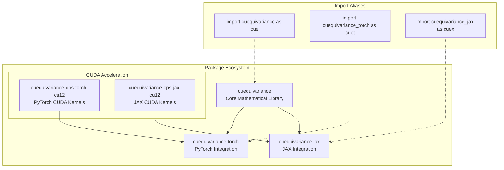
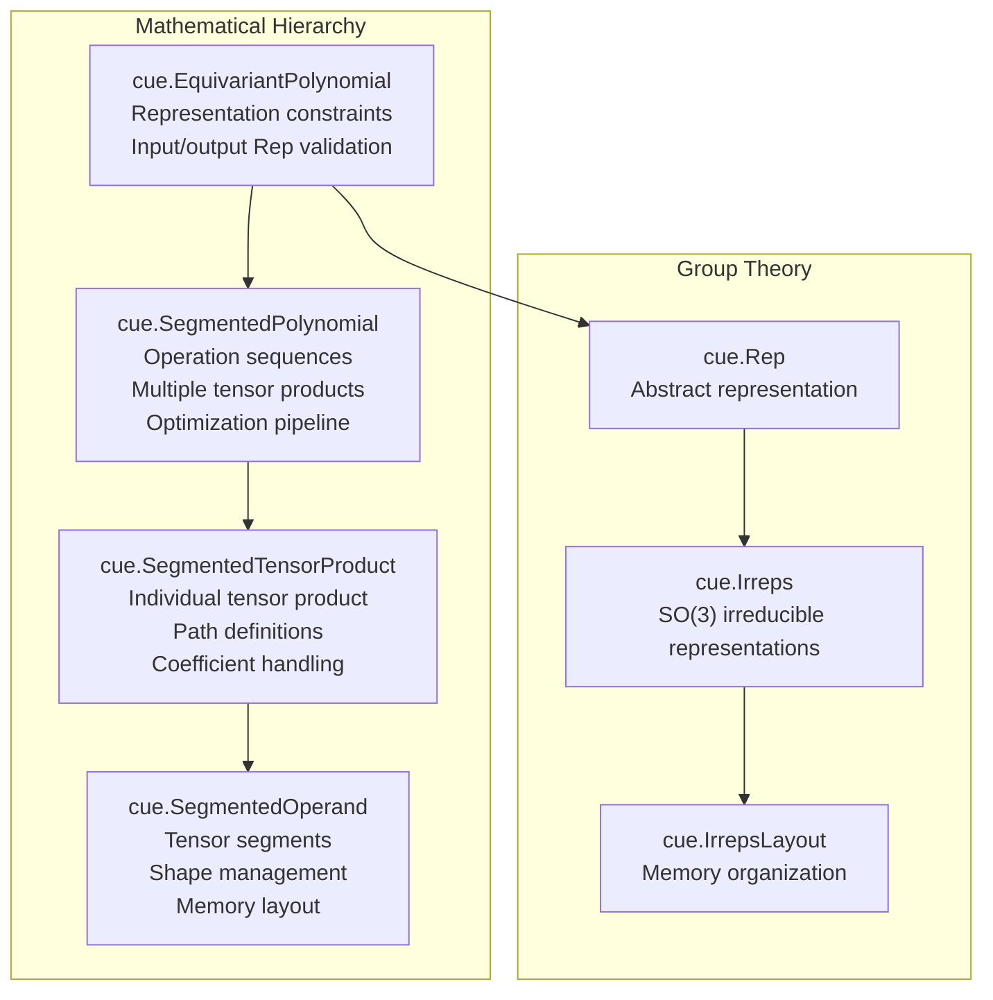
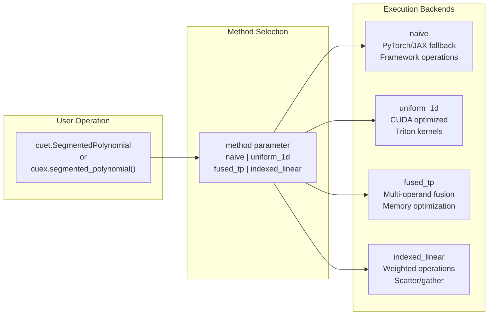
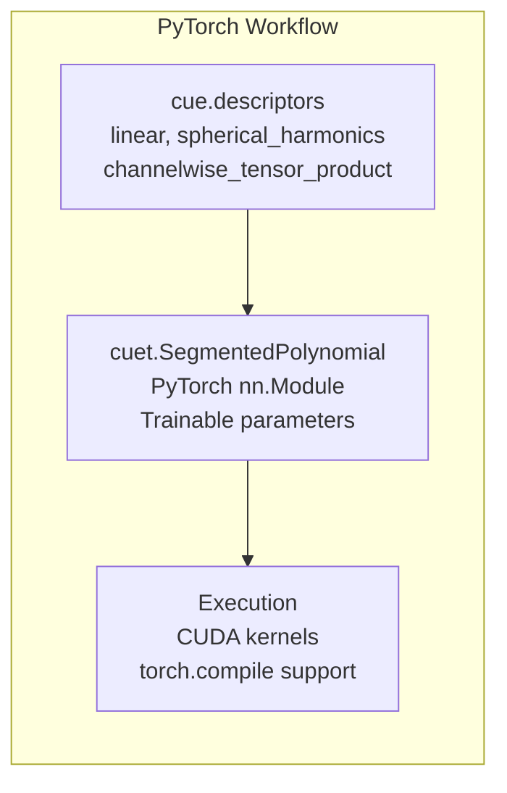
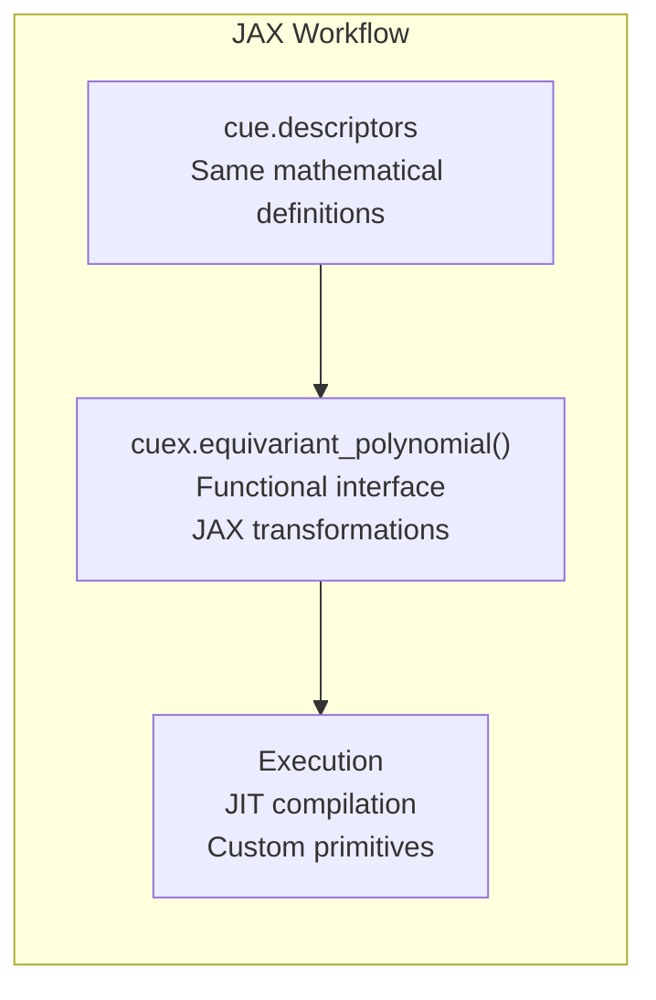

<!-- source: DeepWiki mcp.deepwiki.com · repo NVIDIA/cuEquivariance · page 1 Overview · fetched 2026-10-26 -->

# Overview

Relevant source files

The following files were used as context for generating this wiki page:

- [CHANGELOG.md](CHANGELOG.md)
- [README.md](README.md)
- [VERSION](VERSION)
- [docs/changelog.md](docs/changelog.md)
- [docs/index.rst](docs/index.rst)

This document provides an overview of the cuEquivariance library, its architecture, and core concepts. cuEquivariance is an NVIDIA Python library for building high-performance geometric neural networks using segmented polynomials and optimized CUDA kernels.

For specific installation instructions, see [Installation](#1.1). For detailed version history and breaking changes, see [Version History](#1.2). For mathematical foundations, see [Core Concepts](#2).

## What is cuEquivariance

cuEquivariance enables the construction of equivariant neural networks that respect geometric symmetries. Equivariance is the mathematical formalization of "respecting symmetries" - robust physical models exhibit equivariance with respect to rotations and translations in three-dimensional space, making AI models more data-efficient.

The library provides:
- **Segmented Polynomials**: Flexible mathematical framework for describing equivariant operations
- **Triangular Operations**: Specialized operations for AlphaFold2-style architectures  
- **CUDA Optimization**: High-performance GPU kernels with automatic tuning
- **Dual Bindings**: Support for both PyTorch and JAX frameworks

**Sources**: [README.md:1-6](), [docs/index.rst:19-22]()

## Package Architecture

cuEquivariance is organized into three main packages that provide different levels of functionality:

### Core Package (`cuequivariance`)

The core package contains framework-agnostic mathematical components:
- Group theory foundations (`cue.Rep`, `cue.Irreps`)
- Segmented tensor products (`cue.SegmentedTensorProduct`)
- Polynomial representations (`cue.SegmentedPolynomial`, `cue.EquivariantPolynomial`)
- Mathematical descriptors (`cue.descriptors`)

### Framework Bindings

| Package | Purpose | Key Components |
|---------|---------|----------------|
| `cuequivariance-torch` | PyTorch integration | `cuet.SegmentedPolynomial`, `cuet.TensorProduct`, triangle operations |
| `cuequivariance-jax` | JAX integration | `cuex.segmented_polynomial()`, `cuex.equivariant_polynomial()` |

### CUDA Acceleration

Optimized CUDA kernels provide significant performance improvements:
- **Triton Kernels**: Auto-tuned GPU implementations
- **Custom CUDA**: Specialized operations like `sigmoid_gated_dual_gemm`
- **Fallback Support**: Automatic fallback to framework implementations when needed

**Sources**: [docs/index.rst:57-69](), [README.md:13-22](), [CHANGELOG.md:18]()

## Core Mathematical Framework

The library uses a hierarchical structure to describe equivariant operations:

### Key Classes

- **`cue.EquivariantPolynomial`**: High-level interface ensuring equivariance constraints
- **`cue.SegmentedPolynomial`**: Manages sequences of tensor product operations  
- **`cue.SegmentedTensorProduct`**: Defines specific tensor product computations
- **`cue.SegmentedOperand`**: Handles tensor segmentation and memory layout

**Sources**: [docs/index.rst:75-80](), [CHANGELOG.md:92-94]()

## Execution Methods and Performance

cuEquivariance provides multiple execution backends optimized for different scenarios:

### Execution Methods

| Method | Description | Use Case |
|--------|-------------|----------|
| `naive` | Framework fallback implementation | Development, debugging, unsupported shapes |
| `uniform_1d` | CUDA-optimized for uniform operations | Standard tensor products, best general performance |
| `fused_tp` | Multi-operand tensor product fusion | Complex polynomials, memory-bound operations |
| `indexed_linear` | Scatter/gather with linear operations | Sparse operations, graph neural networks |

### Performance Features

- **Auto-tuning**: Kernel parameters optimized per hardware configuration
- **Precision Control**: TF32, IEEE-754, mixed precision support  
- **Memory Optimization**: Fused operations reduce memory bandwidth requirements
- **Fallback Logic**: Automatic selection based on input shapes and platform capabilities

**Sources**: [CHANGELOG.md:7](), [CHANGELOG.md:34-41](), [CHANGELOG.md:43-48]()

## Framework Integration Patterns

### PyTorch Integration

### JAX Integration  

Both frameworks share the same mathematical descriptors from the core package but provide different execution interfaces optimized for their respective ecosystems.

**Sources**: [docs/index.rst:81-84](), [CHANGELOG.md:124-127](), [CHANGELOG.md:150-152]()

## Specialized Operations

Beyond general tensor products, cuEquivariance provides operations optimized for specific architectures:

### Triangle Operations
- **`cuet.triangle_attention`**: Attention mechanisms for triangular adjacency matrices
- **`cuet.triangle_multiplicative_update`**: AlphaFold2-style triangle multiplicative updates
- **`cuet.attention_pair_bias`**: Pair bias computation with caching support

### Symmetric Operations  
- **`cuet.SymmetricTensorProduct`**: Symmetric contractions and products
- **`cue.descriptors.symmetric_contraction`**: Mathematical descriptor for symmetric operations

**Sources**: [CHANGELOG.md:64-66](), [CHANGELOG.md:6]()

---

