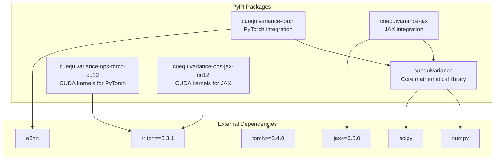
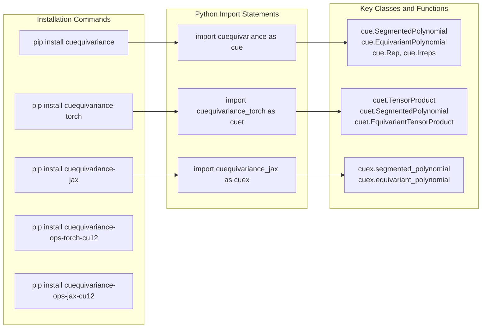
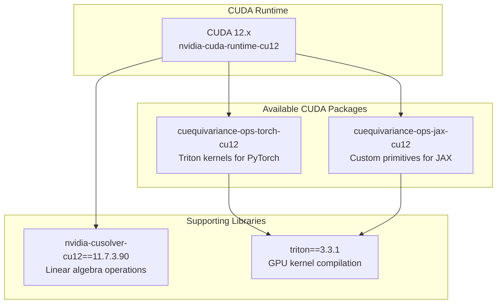

<!-- source: DeepWiki mcp.deepwiki.com · repo NVIDIA/cuEquivariance · page 1.1 Installation · fetched 2026-10-26 -->

# Installation

<details>
<summary>Relevant source files</summary>

The following files were used as context for generating this wiki page:

- [.github/workflows/tests.yml](.github/workflows/tests.yml)
- [README.md](README.md)
- [cuequivariance/pyproject.toml](cuequivariance/pyproject.toml)
- [cuequivariance_jax/pyproject.toml](cuequivariance_jax/pyproject.toml)
- [cuequivariance_torch/pyproject.toml](cuequivariance_torch/pyproject.toml)
- [docs/changelog.md](docs/changelog.md)
- [docs/index.rst](docs/index.rst)

</details>


This document provides instructions for installing cuEquivariance and its components. For information about the underlying concepts and API details, see the [Core Concepts](#2) section.

## System Requirements

Before installing cuEquivariance, ensure your system meets the following requirements:

| Component | Requirement |
|-----------|-------------|
| Python | 3.10, 3.11, or 3.12 |
| Operating System | Linux x86_64/aarch64 |
| CUDA | 12.x (for GPU acceleration) |
| PyTorch | 2.4.0+ (for PyTorch frontend) |
| JAX | 0.5.0+ (for JAX frontend) |

Sources: [cuequivariance/pyproject.toml:27-41](), [cuequivariance_torch/pyproject.toml:27-37](), [cuequivariance_jax/pyproject.toml:27-38](), [docs/index.rst:46-52](), [.github/workflows/tests.yml:17]()

## Package Architecture

cuEquivariance is divided into multiple packages that serve different purposes and can be installed separately.

### Package Dependency Structure



### Import Names and Code Modules



Sources: [README.md:1-22]()

## Installation Methods

### Method 1: Using pip (Recommended)

Choose the packages based on your machine learning framework:

```bash
# For PyTorch users
pip install cuequivariance-torch
pip install cuequivariance-ops-torch-cu12  # CUDA 12 kernels (optional)

# For JAX users  
pip install cuequivariance-jax
pip install cuequivariance-ops-jax-cu12    # CUDA 12 kernels (optional)

# Core library only (no ML frameworks)
pip install cuequivariance
```

**Note**: The `cuequivariance-ops-*-cu12` packages provide optimized CUDA kernels for GPU acceleration. They are optional but recommended for performance.

Sources: [README.md:11-22](), [docs/index.rst:35-44]()

### Method 2: Installation from Source

For development or to access the latest features:

```bash
# Clone the repository
git clone https://github.com/NVIDIA/cuEquivariance.git
cd cuEquivariance

# Install core package in development mode
pip install -e ./cuequivariance

# Install PyTorch frontend (optional)
pip install -e ./cuequivariance_torch

# Install JAX frontend (optional) 
pip install -e ./cuequivariance_jax
```

This method is used in the CI testing pipeline and is recommended for contributors.

Sources: [.github/workflows/tests.yml:30](), [.github/workflows/tests.yml:69-70](), [.github/workflows/tests.yml:101-102]()

## Package Dependencies

The following table shows the dependencies for each package:

| Package | Required Dependencies | Python Requirement |
|---------|----------------------|-------------------|
| `cuequivariance` | `numpy`, `scipy`, `opt_einsum`, `sympy`, `networkx` | >=3.10 |
| `cuequivariance-torch` | `cuequivariance` | >=3.10 |
| `cuequivariance-jax` | `cuequivariance`, `jax`, `packaging` | >=3.10 |

### Additional Dependencies for Optimal Performance

| Framework | Additional Packages | Purpose |
|-----------|-------------------|---------|
| PyTorch | `torch>=2.4.0`, `e3nn` | Core PyTorch functionality and integration |
| JAX | `jax>=0.5.0`, `jax-triton`, `triton==3.3.1` | JAX functionality and CUDA kernel compilation |
| CUDA Ops | `nvidia-cusolver-cu12==11.7.3.90` | CUDA solver library for linear algebra |

Sources: [cuequivariance/pyproject.toml:28-34](), [cuequivariance_torch/pyproject.toml:28-30](), [cuequivariance_jax/pyproject.toml:28-32](), [.github/workflows/tests.yml:65-67](), [.github/workflows/tests.yml:99]()

## CUDA Version Compatibility

### CUDA Support Matrix



**Important**: Only CUDA 12.x is currently supported. The CUDA operations packages are available for Linux x86_64 and aarch64 architectures.

Sources: [docs/index.rst:42-44](), [docs/index.rst:49](), [.github/workflows/tests.yml:66-67]()

## Verifying Your Installation

To verify that cuEquivariance is installed correctly:

```python
# Core library
import cuequivariance as cue
print('cue', cue.__version__)

# PyTorch frontend (if installed)
import cuequivariance_torch as cuet
print('cuet', cuet.__version__)

# JAX frontend (if installed)
import cuequivariance_jax as cuex
print('cuex', cuex.__version__)

# Test basic functionality
rep = cue.Irreps("1e + 2o")  # Test core functionality
print(f"Irreps: {rep}")
```

This verification approach matches the CI testing pattern and uses the conventional import aliases.

Sources: [.github/workflows/tests.yml:71-72](), [.github/workflows/tests.yml:103-104](), [docs/index.rst:60-68]()

## Troubleshooting

If you encounter issues during installation:

1. **CUDA version mismatch**: Ensure you install packages matching your system's CUDA version
2. **Python version error**: Verify you're using Python 3.10 or higher
3. **Import errors**: Check that all required dependencies are installed

For more information about version history and changes, see [Version History](#1.2).

---

