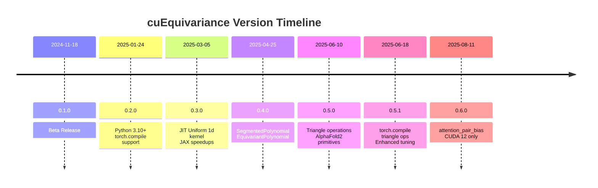
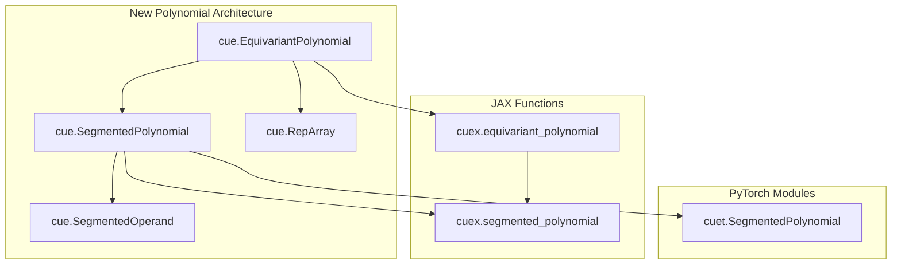
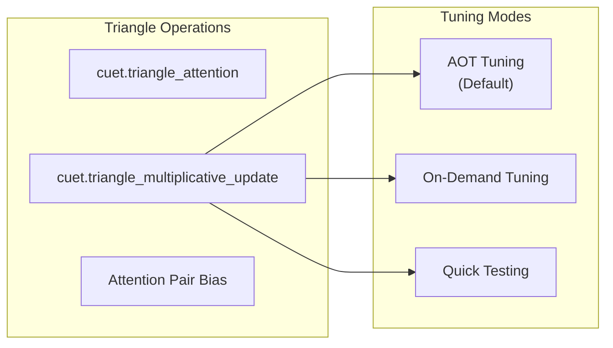
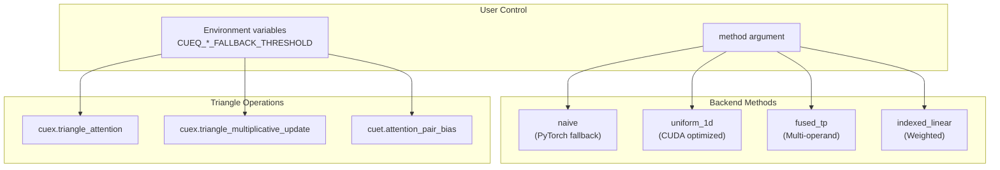

<!-- source: DeepWiki mcp.deepwiki.com · repo NVIDIA/cuEquivariance · page 1.2 Version History · fetched 2026-10-26 -->

# Version History

<details>
<summary>Relevant source files</summary>

The following files were used as context for generating this wiki page:

- [CHANGELOG.md](CHANGELOG.md)
- [VERSION](VERSION)

</details>


This page documents the evolution of cuEquivariance across its released versions, highlighting key features, breaking changes, and improvements. This information is valuable for users migrating between versions or for understanding when specific capabilities were introduced. For installation instructions, see [Installation](#1.1).

## Version Timeline



Sources: [CHANGELOG.md:183](), [CHANGELOG.md:156](), [CHANGELOG.md:115](), [CHANGELOG.md:84](), [CHANGELOG.md:58](), [CHANGELOG.md:28](), [CHANGELOG.md:3]()

## Current Version (0.6.0)

The current version of cuEquivariance is 0.6.0, released on August 11, 2025.

Sources: [VERSION:1](), [CHANGELOG.md:3]()

## Version Details

### Version 0.1.0 (2024-11-18)

This was the initial beta release of cuEquivariance.

Sources: [CHANGELOG.md:94-96]()

### Version 0.2.0 (2025-01-24)

Version 0.2.0 introduced several breaking changes and improvements, with a focus on better PyTorch integration.

#### Key Features

- Experimental support for `torch.compile`
- Added `cue.IrrepsAndLayout` class
- Added `cuex.RepArray` for representation arrays

#### Breaking Changes

- Increased minimum Python version to 3.10
- Input shape requirements changed for `cuet.TensorProduct` and `cuet.EquivariantTensorProduct`
- Replaced function `cuet.spherical_harmonics` with Torch Module `cuet.SphericalHarmonics`
- Various JAX API changes (`cuex.IrrepsArray` became an alias for `cuex.RepArray`)

```mermaid
classDiagram
    class "cue.Rep" {
        <<Abstract class>>
    }
    class "cue.IrrepsAndLayout" {
        Contains irreps and layout
    }
    class "cuex.RepArray" {
        Represents array of representations
    }
    class "cuex.IrrepsArray" {
        Now an alias for RepArray
    }
    
    "cue.Rep" <|-- "cue.IrrepsAndLayout"
    "cuex.RepArray" -- "cuex.IrrepsArray"
```

Sources: [CHANGELOG.md:67-93]()

### Version 0.3.0 (2025-03-05)

Version 0.3.0 brought significant performance improvements, particularly for JAX users, with new kernel implementations.

#### Key Features

- New JIT Uniform 1d kernel with JAX bindings
  - Supports computing any polynomial based on 1d uniform STPs
  - Enables arbitrary derivatives
  - Provides optional fused scatter/gather for inputs and outputs
- Full torch.compile support
- Beta torch bindings to the new JIT Uniform 1d kernel
- Approximately 3x speedup for MACE with cuEquivariance-JAX v0.3.0 compared to cuEquivariance-Torch v0.2.0

#### Breaking Changes

- Removed `cue.TensorProductExecution` and added more lightweight `cue.Operation`
- JAX API changes:
  - Renamed arguments in `cuex.equivariant_tensor_product`
  - Removed `cuex.symmetric_tensor_product`
  - Limited `jax.vmap` support
  - Changed interface of `cuex.tensor_product`
  - Removed `cuex.flax_linen.Linear`

Sources: [CHANGELOG.md:115-155]()

### Version 0.4.0 (2025-04-25)

Version 0.4.0 introduced the new polynomial system architecture with `SegmentedPolynomial` and `EquivariantPolynomial` classes.

#### Key Features

- `cuet.SegmentedPolynomial` module with indexing features
- Full support for float16 and bfloat16 data types
- New core classes: `cue.SegmentedOperand`, `cue.SegmentedPolynomial`, `cue.EquivariantPolynomial`
- Enhanced caching for `cue.descriptor.symmetric_contraction` and `cue.SegmentedTensorProduct.symmetrize_operands`
- JAX ARM configuration support
- `cuex.segmented_polynomial` and `cuex.equivariant_polynomial` functions
- Advanced batching capabilities in JAX with indexed input/output support
- Dead Code Elimination rule for `cuex.segmented_polynomial` primitive

#### Breaking Changes

- Renamed `SegmentedTensorProduct.flop_cost` to `flop` and `memory_cost` to `memory`
- Removed `IrrepsArray` in favor of `RepArray`
- Restructured folder organization with main subfolders `segmented_polynomials` and `group_theory`
- Deprecated `cue.EquivariantTensorProduct` in favor of `cue.EquivariantPolynomial`
- Changed behavior of `cue.SegmentedPolynomial.canonicalize_subscripts` for coefficient subscripts
- Removed support for fp32 math dtype with fp64 IO dtype in fully connected tensor products



Sources: [CHANGELOG.md:84-114]()

### Version 0.5.0 (2025-06-10)

Version 0.5.0 introduced triangle operations for AlphaFold2-style architectures and marked the last release with CUDA 11 support.

#### Key Features

- `cuet.triangle_attention` for triangle attention operations
- `cuet.triangle_multiplicative_update` for triangle multiplicative updates
- `cuex.experimental.indexed_linear` (requires cuBLAS 12.5, not compatible with CUDA 11)
- Added `simplify_irreps3` argument to `cue.descriptors.channelwise_tensor_product`
- Added `permute_inputs` method to `SegmentedPolynomial`
- Performance improvements for uniform 1d segmented polynomials (up to 2x speedup in some cases)

#### Tuning Configuration

Full Ahead-of-Time (AOT) auto-tuning was enabled by default for `cuet.triangle_multiplicative_update`:
- Default: AOT tuning enabled (may take several hours)
- Quick testing: Set `CUEQ_DISABLE_AOT_TUNING = 1` and `CUEQ_DEFAULT_CONFIG = 1`
- On-Demand tuning: Set `CUEQ_DISABLE_AOT_TUNING = 1` only



Sources: [CHANGELOG.md:58-83]()

### Version 0.5.1 (2025-06-18)

Version 0.5.1 focused on improving `torch.compile` support and enhancing tuning configuration options.

#### Key Features

- `torch.compile` support for `cuet.triangle_multiplicative_update`
- Optional precision argument for triangle multiplicative update:
  - `DEFAULT`: Use default precision of `triton.language.dot`
  - `TF32`: Use TensorFloat-32 precision
  - `TF32x3`: Use TensorFloat-32 with 3x accumulation
  - `IEEE`: Use IEEE 754 precision

#### Enhanced Tuning System

- Multi-process tuning support
- Improved cache management with environment variables:
  - `CUEQ_TRITON_TUNING_MODE`: Controls tuning mode (`ONDEMAND`, `AOT`)
  - `CUEQ_TRITON_IGNORE_EXISTING_CACHE`: Ignore cached settings
  - `CUEQ_TRITON_CACHE_DIR`: Specify cache directory location

Sources: [CHANGELOG.md:28-57]()

### Version 0.6.0 (2025-08-11)

Version 0.6.0 is the current release, introducing attention pair bias operations and dropping CUDA 11 support.

#### Key Features

- `cuet.attention_pair_bias` for pair bias tensor operations
- `method` argument for backend control in `cuet.SegmentedPolynomial` and `cuex.segmented_polynomial`
- Torch fallback options for triangle kernels based on sequence lengths
- Support for optional projection and gating biases in `cuex.triangle_multiplicative_update`
- JAX bindings for triangle operations: `cuex.triangle_attention` and `cuex.triangle_multiplicative_update`

#### Breaking Changes

- Dropped CUDA 11 support - only CUDA 12 packages are available (`cuequivariance-ops-torch-cu12`, `cuequivariance-ops-jax-cu12`)
- Simplified precision argument in triangle multiplicative update to None and IEEE-754 options
- Changed from round-towards-zero (RZ) to round-nearest (RN) implementation for better tf32 accuracy

#### Method Selection Architecture



#### Known Issues

- `cuex.triangle_multiplicative_update` requires `triton<=3.3.1` (waiting for jax-triton update)
- `cuet.triangle_multiplicative_update` requires `triton>=3.4.0` on Blackwell GPUs
- `cuex.triangle_multiplicative_update` cannot run on Blackwell GPUs due to triton version constraints
- `cuet.attention_pair_bias` does not yet support caching of projected pairwise tensors

Sources: [CHANGELOG.md:3-27]()

## Evolution of Key Features

The following table summarizes the evolution of key features across versions:

| Feature | 0.1.0 (Beta) | 0.2.0 | 0.3.0 | Upcoming |
|---------|--------------|-------|-------|----------|
| PyTorch Support | ✓ | ✓ | ✓ | ✓ |
| JAX Support | ✓ | ✓ | ✓ | ✓ |
| torch.compile | ✗ | Experimental | ✓ | ✓ |
| Minimum Python | 3.9 | 3.10 | 3.10 | 3.10 |
| JIT Uniform 1d kernel | ✗ | ✗ | ✓ | ✓ |
| SegmentedPolynomial | ✗ | ✗ | ✗ | ✓ |
| EquivariantPolynomial | ✗ | ✗ | ✗ | ✓ |
| Advanced JAX Batching | ✗ | ✗ | Limited | ✓ |

Sources: [CHANGELOG.md:1-96]()

---

