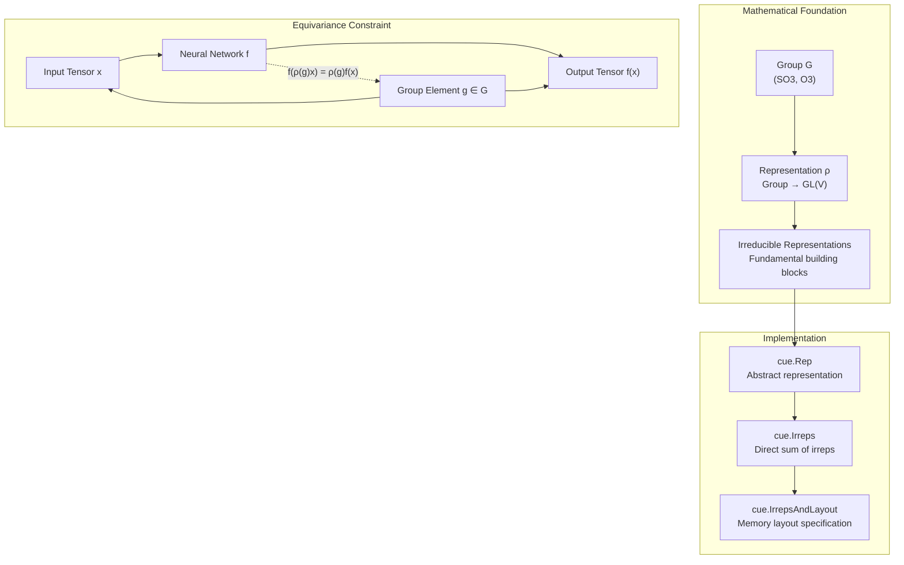
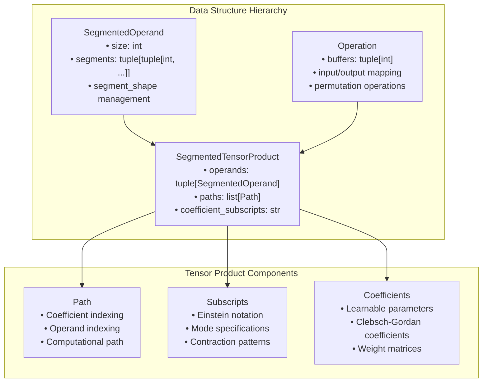
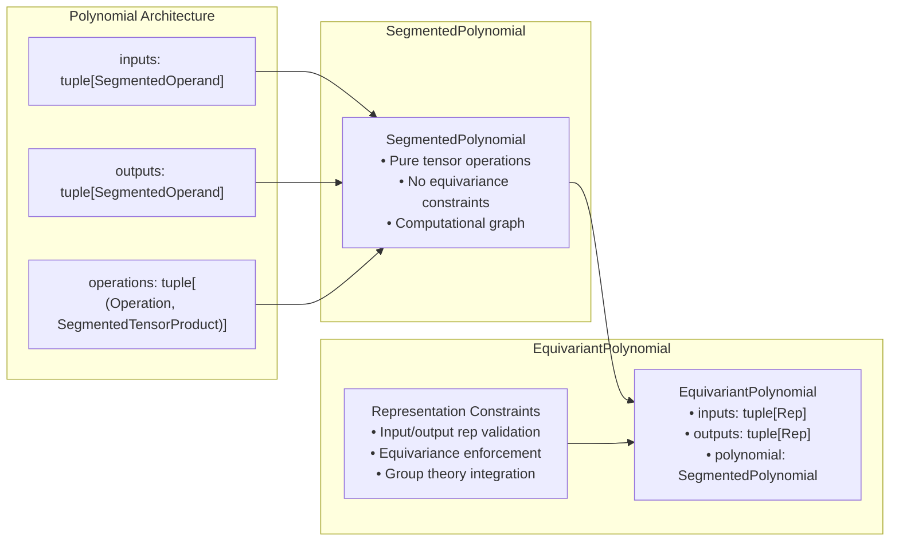
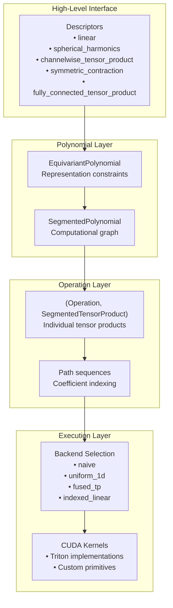
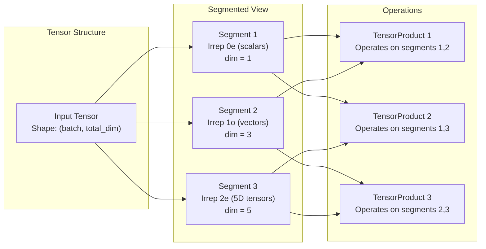

<!-- source: DeepWiki mcp.deepwiki.com · repo NVIDIA/cuEquivariance · page 2 Core Concepts · fetched 2026-10-26 -->

# Core Concepts

Relevant source files

The following files were used as context for generating this wiki page:

- [cuequivariance/cuequivariance/group_theory/equivariant_polynomial.py](cuequivariance/cuequivariance/group_theory/equivariant_polynomial.py)
- [cuequivariance/cuequivariance/segmented_polynomials/segmented_polynomial.py](cuequivariance/cuequivariance/segmented_polynomials/segmented_polynomial.py)

This document covers the fundamental mathematical concepts and core data structures that form the foundation of the cuEquivariance library. These concepts enable the construction of equivariant neural networks through polynomial representations of tensor operations that respect group symmetries.

For framework-specific implementations, see [PyTorch Implementation](#3) and [JAX Implementation](#4). For performance optimization details, see [CUDA Kernels and Tuning](#5.2).

## Mathematical Foundations

The cuEquivariance library is built on mathematical concepts from group theory and representation theory that ensure neural network operations maintain equivariance properties under group transformations.

### Group Theory and Equivariance

The core mathematical principle is that for any group element `g`, the function `f` must satisfy the equivariance constraint: `f(ρ(g)x) = ρ(g)f(x)`, where `ρ` is the group representation.

Sources: [cuequivariance/cuequivariance/group_theory/equivariant_polynomial.py:28-75]()

### Representation Theory Implementation

| Concept | Implementation | Purpose |
|---------|----------------|---------|
| Group | `cue.SO3`, `cue.O3` | Rotation and reflection groups |
| Representation | `cue.Rep` | Abstract group representation |
| Irreducible Representation | `cue.Irrep` | Fundamental representation building blocks |
| Direct Sum | `cue.Irreps` | Combination of multiple irreps |
| Memory Layout | `cue.IrrepsAndLayout` | Tensor layout with representation info |

Sources: [cuequivariance/cuequivariance/group_theory/equivariant_polynomial.py:42-75]()

## Core Data Structures

The library implements several key data structures that work together to represent and compute equivariant operations.

### Segmented Operands and Tensor Products

**SegmentedOperand** represents tensors divided into segments, each with potentially different shapes. This segmentation allows efficient handling of irreducible representations where different irreps may have different dimensions.

**SegmentedTensorProduct** defines how multiple operands are combined through tensor product operations. It contains the computational paths and indexing patterns needed to perform the operations.

**Operation** specifies which operands (identified by buffer indices) participate in a tensor product and how they map to inputs and outputs.

Sources: [cuequivariance/cuequivariance/segmented_polynomials/segmented_polynomial.py:49-51](), [cuequivariance/cuequivariance/segmented_polynomials/segmented_polynomial.py:70-85]()

### Polynomial Representations

The library uses polynomial representations to encode complex equivariant operations as sequences of tensor products.

**SegmentedPolynomial** is the foundational computational representation that defines a sequence of tensor product operations without any group theory constraints. It manages the computational graph and provides core functionality for evaluation, transformation, and automatic differentiation.

**EquivariantPolynomial** extends `SegmentedPolynomial` by adding group representation information for inputs and outputs, ensuring that all operations respect equivariance constraints.

Sources: [cuequivariance/cuequivariance/segmented_polynomials/segmented_polynomial.py:34-51](), [cuequivariance/cuequivariance/group_theory/equivariant_polynomial.py:28-75]()

## Data Flow and Computational Graph

The computational flow proceeds from high-level equivariant specifications down to low-level tensor operations:

The flow starts with high-level descriptors that specify the mathematical operation, proceeds through polynomial representations that encode the computational graph, and ends with optimized kernel implementations.

Sources: [cuequivariance/cuequivariance/segmented_polynomials/segmented_polynomial.py:36-47](), [cuequivariance/cuequivariance/group_theory/equivariant_polynomial.py:28-45]()

## Key Methods and Operations

### SegmentedPolynomial Core Methods

| Method Category | Key Methods | Purpose |
|----------------|-------------|---------|
| Construction | `eval_last_operand()`, `stack()`, `concatenate()` | Building polynomial representations |
| Analysis | `flop()`, `memory()`, `used_inputs()` | Performance and dependency analysis |
| Transformation | `consolidate()`, `fuse_stps()`, `apply_fn()` | Optimization and manipulation |
| Filtering | `filter_keep_operands()`, `compute_only()` | Selective computation |
| Autodiff | `jvp()`, `transpose()`, `backward()` | Automatic differentiation support |

Sources: [cuequivariance/cuequivariance/segmented_polynomials/segmented_polynomial.py:149-1113]()

### EquivariantPolynomial Extensions

The `EquivariantPolynomial` class provides the same interface as `SegmentedPolynomial` but with added representation validation and group theory constraints. Key additional methods include:

- `split_operand_by_irrep()`: Splits operands along irreducible representation boundaries
- Representation-aware stacking and filtering operations
- Automatic validation of representation compatibility

Sources: [cuequivariance/cuequivariance/group_theory/equivariant_polynomial.py:422-474]()

## Memory Layout and Segmentation

The segmented approach allows efficient memory management and computation by grouping tensor elements according to their transformation properties:

This segmentation enables the library to:
- Process only relevant portions of tensors for each operation
- Optimize memory access patterns
- Support heterogeneous irreducible representations efficiently

Sources: [cuequivariance/cuequivariance/segmented_polynomials/segmented_polynomial.py:109-144]()

---

