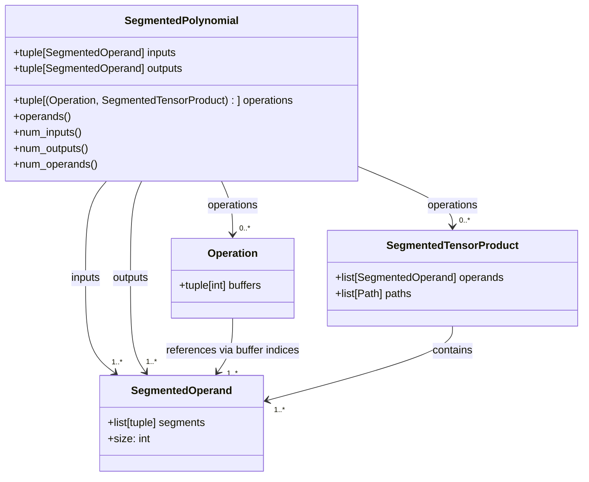
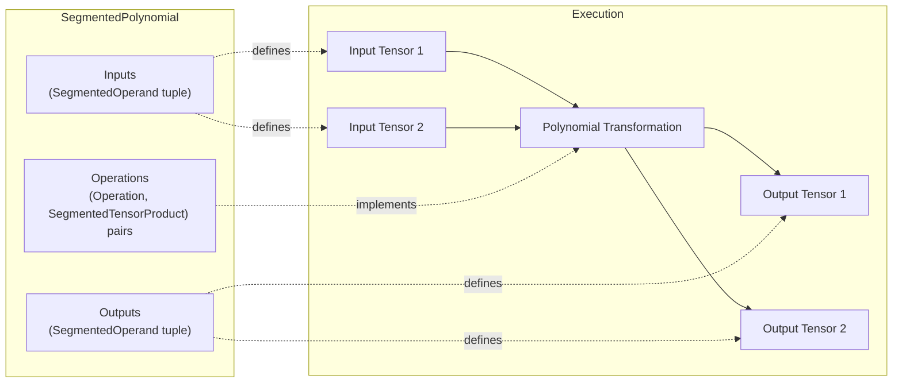
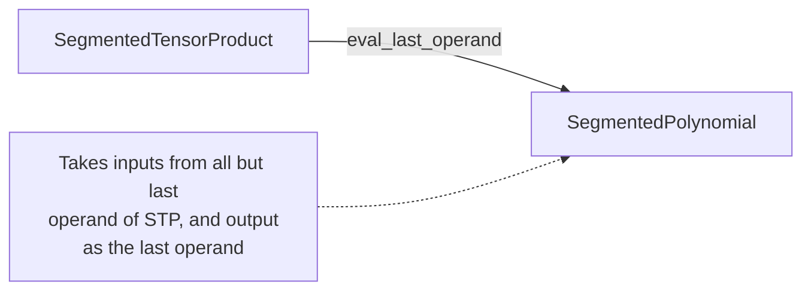
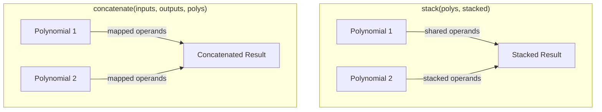
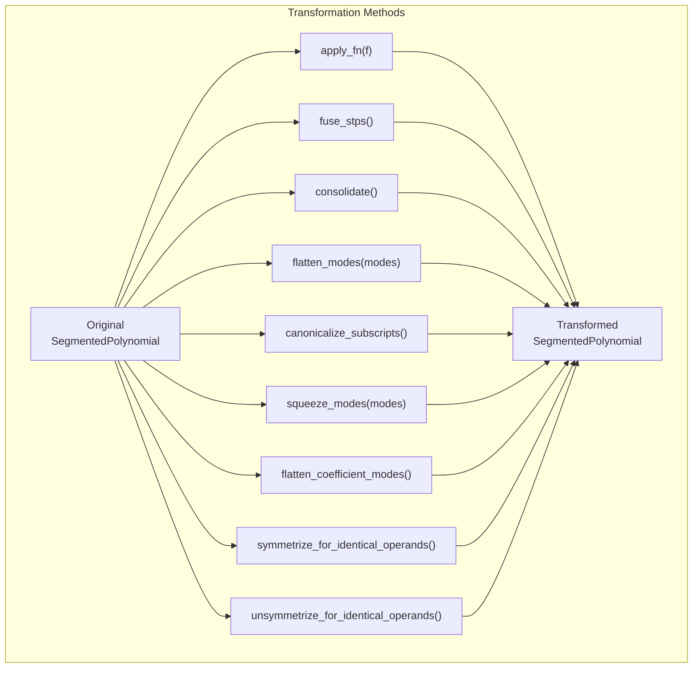
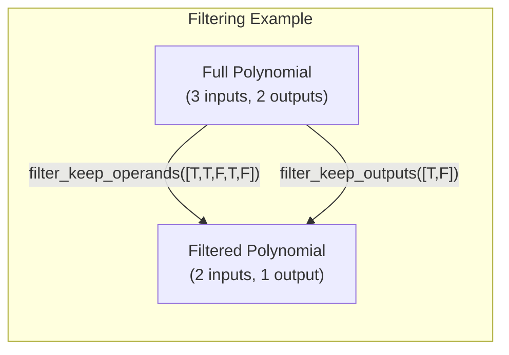
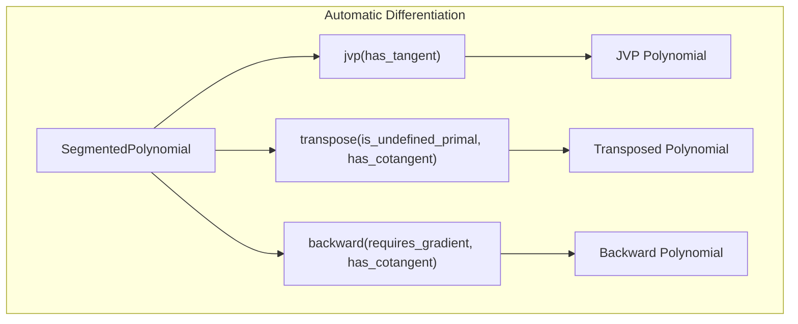
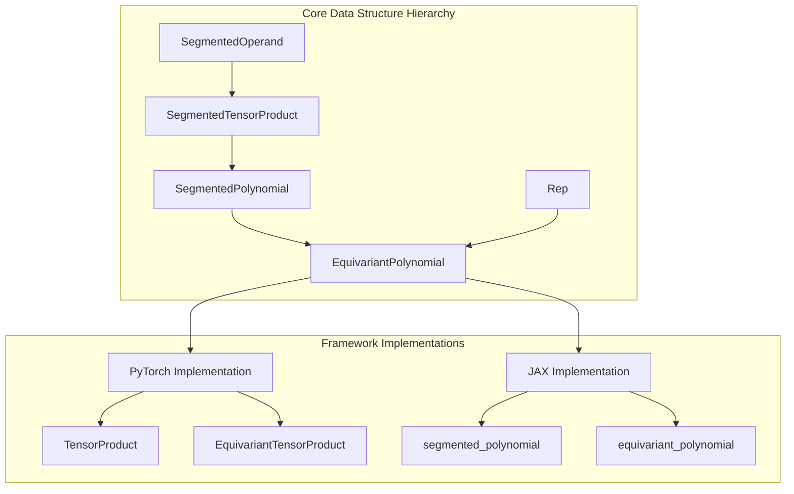

<!-- source: DeepWiki mcp.deepwiki.com · repo NVIDIA/cuEquivariance · page 2.1 SegmentedPolynomial · fetched 2026-10-26 -->

# SegmentedPolynomial

<details>
<summary>Relevant source files</summary>

The following files were used as context for generating this wiki page:

- [cuequivariance/cuequivariance/group_theory/equivariant_polynomial.py](cuequivariance/cuequivariance/group_theory/equivariant_polynomial.py)
- [cuequivariance/cuequivariance/segmented_polynomials/segmented_polynomial.py](cuequivariance/cuequivariance/segmented_polynomials/segmented_polynomial.py)

</details>


## Purpose and Overview

The `SegmentedPolynomial` class is a core data structure in cuEquivariance that represents a polynomial transformation using a collection of segmented tensor products. It provides an abstract representation for tensor operations that can be compiled into efficient CUDA kernels. This class sits between low-level tensor operations and higher-level equivariant neural network layers, serving as the computational backbone for operations like spherical harmonics, tensor products, and linear transformations.

For the equivariance-aware version of this class that includes group representation information, see [EquivariantPolynomial](#2.2).

Sources: [cuequivariance/segmented_polynomials/segmented_polynomial.py:30-108]()

## Structure and Components

A `SegmentedPolynomial` consists of three main components:

1. **Inputs**: A tuple of `SegmentedOperand` objects representing input tensors
2. **Outputs**: A tuple of `SegmentedOperand` objects representing output tensors
3. **Operations**: A tuple of pairs, each containing an `Operation` and a `SegmentedTensorProduct`



Sources: [cuequivariance/segmented_polynomials/segmented_polynomial.py:30-108]()

### Operands and Operations

The `SegmentedPolynomial` maps input tensors to output tensors through a series of operations, where each operation is defined by:

1. An `Operation` object that specifies which input and output operands are involved
2. A `SegmentedTensorProduct` that defines how these operands interact



Sources: [cuequivariance/segmented_polynomials/segmented_polynomial.py:53-84](), [cuequivariance/segmented_polynomials/segmented_polynomial.py:377-404]()

## Construction Methods

The `SegmentedPolynomial` class provides several methods for constructing polynomials:

### Creating Basic Polynomials

The most basic way to create a `SegmentedPolynomial` is to evaluate the last operand of a `SegmentedTensorProduct`:



Sources: [cuequivariance/segmented_polynomials/segmented_polynomial.py:144-158](), [cuequivariance/tests/segmented_polynomials/segmented_polynomial_test.py:36-44]()

### Combining Polynomials

`SegmentedPolynomial` provides methods to combine multiple polynomials:

1. **`stack`**: Combines polynomials by stacking their operands
2. **`stack_tensor_products`**: Creates a polynomial by stacking tensor products
3. **`concatenate`**: Creates a polynomial by concatenating multiple polynomials



Sources: [cuequivariance/segmented_polynomials/segmented_polynomial.py:161-228](), [cuequivariance/segmented_polynomials/segmented_polynomial.py:258-302](), [cuequivariance/tests/segmented_polynomials/segmented_polynomial_test.py:139-165](), [cuequivariance/tests/segmented_polynomials/segmented_polynomial_test.py:323-355]()

## Core Operations

### Evaluation

The `__call__` method allows evaluating the polynomial on input tensors:

```python
def __call__(self, *inputs: np.ndarray) -> list[np.ndarray]:
    # Implementation evaluates the polynomial on input arrays
    # and returns a list of output arrays
```

This is a reference implementation using numpy and may not be optimized for performance. In practice, optimized CUDA kernels would be used in framework-specific implementations.

Sources: [cuequivariance/segmented_polynomials/segmented_polynomial.py:377-404](), [cuequivariance/tests/segmented_polynomials/segmented_polynomial_test.py:58-68]()

### String Representation

The `to_string` method provides a human-readable representation of the polynomial:

```
╭ a=[3:3⨯()] -> B=[8:8⨯()] C=[12:12⨯()]
│  []·a[]➜B[] ───────── num_paths=3
│  []·a[]·a[]➜B[] ───── num_paths=11
│  []·a[]·a[]➜C[] ───── num_paths=11
╰─ []·a[]·a[]·a[]➜C[] ─ num_paths=41
```

Each line represents an operation in the polynomial, showing the operands involved and the number of paths in the segmented tensor product.

Sources: [cuequivariance/segmented_polynomials/segmented_polynomial.py:307-375]()

## Analysis Methods

`SegmentedPolynomial` provides methods to analyze its properties:

| Method | Description | Return Type |
|--------|-------------|-------------|
| `all_same_segment_shape()` | Checks if all operands have the same segment shape | `bool` |
| `used_inputs()` | Gets a list indicating which inputs are used | `list[bool]` |
| `used_outputs()` | Gets a list indicating which outputs are used | `list[bool]` |
| `used_operands()` | Gets a list indicating which operands are used | `list[bool]` |
| `flop(batch_size=1)` | Computes the number of floating point operations | `int` |
| `memory(batch_sizes)` | Computes the memory usage | `int` |

These methods are useful for analyzing the polynomial's computational requirements and optimizing performance.

Sources: [cuequivariance/segmented_polynomials/segmented_polynomial.py:443-508](), [cuequivariance/tests/segmented_polynomials/segmented_polynomial_test.py:154-168]()

## Transformation Methods

`SegmentedPolynomial` provides methods to transform the polynomial:



These methods allow transforming polynomials in various ways:

- `apply_fn`: Apply a function to each tensor product
- `fuse_stps`: Fuse tensor products with identical operations and operands
- `consolidate`: Remove empty segments and squeeze modes
- `flatten_modes`/`squeeze_modes`: Manipulate the mode dimensions
- `symmetrize_for_identical_operands`/`unsymmetrize_for_identical_operands`: Manage symmetries

Sources: [cuequivariance/segmented_polynomials/segmented_polynomial.py:514-680](), [cuequivariance/tests/segmented_polynomials/segmented_polynomial_test.py:273-302]()

## Filtering Methods

`SegmentedPolynomial` provides methods to filter and select parts of the polynomial:

| Method | Description |
|--------|-------------|
| `filter_keep_operands(keep)` | Select which operands to keep |
| `filter_keep_outputs(keep)` | Select which outputs to keep |
| `filter_drop_unsued_operands()` | Remove unused operands |
| `compute_only(keep)` | Only compute selected outputs |

These methods allow selecting subsets of the polynomial's functionality while preserving its structure.



Sources: [cuequivariance/segmented_polynomials/segmented_polynomial.py:686-775](), [cuequivariance/tests/segmented_polynomials/segmented_polynomial_test.py:357-444]()

## Automatic Differentiation

`SegmentedPolynomial` supports automatic differentiation with three primary methods:

1. **`jvp`**: Computes Jacobian-vector products (forward-mode differentiation)
2. **`transpose`**: Transposes the polynomial for reverse-mode differentiation
3. **`backward`**: Computes gradients using reverse-mode differentiation



These methods transform the polynomial to compute derivatives, supporting both forward and reverse-mode automatic differentiation.

Sources: [cuequivariance/segmented_polynomials/segmented_polynomial.py:781-896](), [cuequivariance/tests/segmented_polynomials/segmented_polynomial_test.py:171-270]()

## Usage Examples

### Creating and Evaluating a Simple Dot Product

```python
# Create a segmented tensor product for dot product
stp = cue.SegmentedTensorProduct.from_subscripts("i,j,k+ijk")
i0 = stp.add_segment(0, (3,))  # First vector (size 3)
i1 = stp.add_segment(1, (3,))  # Second vector (size 3)
i2 = stp.add_segment(2, (1,))  # Output scalar
stp.add_path(i0, i1, i2, c=np.eye(3).reshape(3, 3, 1))

# Create a polynomial from the tensor product
poly = cue.SegmentedPolynomial.eval_last_operand(stp)

# Evaluate the polynomial (computes dot product)
a = np.array([1.0, 2.0, 3.0])
b = np.array([4.0, 5.0, 6.0])
[result] = poly(a, b)  # result = a·b = 32.0
```

Sources: [cuequivariance/tests/segmented_polynomials/segmented_polynomial_test.py:20-67]()

### Combining Polynomials

```python
# Create two polynomials
poly1 = ...  # First polynomial
poly2 = ...  # Second polynomial

# Stack the polynomials (combining their outputs)
stacked = cue.SegmentedPolynomial.stack([poly1, poly2], [False, False, True])

# Concatenate the polynomials (keeping separate outputs)
[in_op] = poly1.inputs
[out1] = poly1.outputs
[out2] = poly2.outputs
concatenated = cue.SegmentedPolynomial.concatenate(
    [in_op],
    [out1, out2],
    [(poly1, [0, 1, None]), (poly2, [0, None, 1])]
)
```

Sources: [cuequivariance/tests/segmented_polynomials/segmented_polynomial_test.py:139-355]()

## Integration with Higher-Level Systems

In the cuEquivariance library, `SegmentedPolynomial` is typically used as a computational backend for `EquivariantPolynomial`, which adds group-theoretic equivariance constraints. Most user-facing classes will wrap `SegmentedPolynomial` rather than using it directly.



Sources: [cuequivariance/group_theory/equivariant_polynomial.py:25-208]()

## Performance Considerations

When working with `SegmentedPolynomial`, consider:

1. **Memory Usage**: Use the `memory` method to estimate memory requirements
2. **Computational Cost**: Use the `flop` method to estimate the number of operations
3. **Tensor Products**: Fuse tensor products with `fuse_stps` to reduce overhead
4. **Consolidation**: Use `consolidate` to remove empty segments and compress the representation
5. **Unused Operands**: Remove unused operands with `filter_drop_unsued_operands`

Sources: [cuequivariance/segmented_polynomials/segmented_polynomial.py:443-508](), [cuequivariance/segmented_polynomials/segmented_polynomial.py:570-588]()

---

