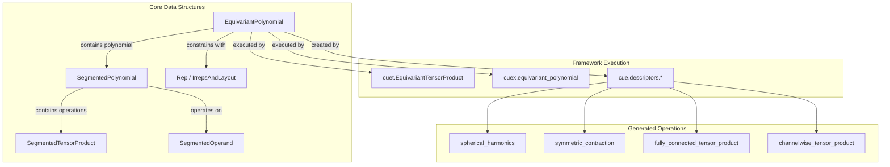
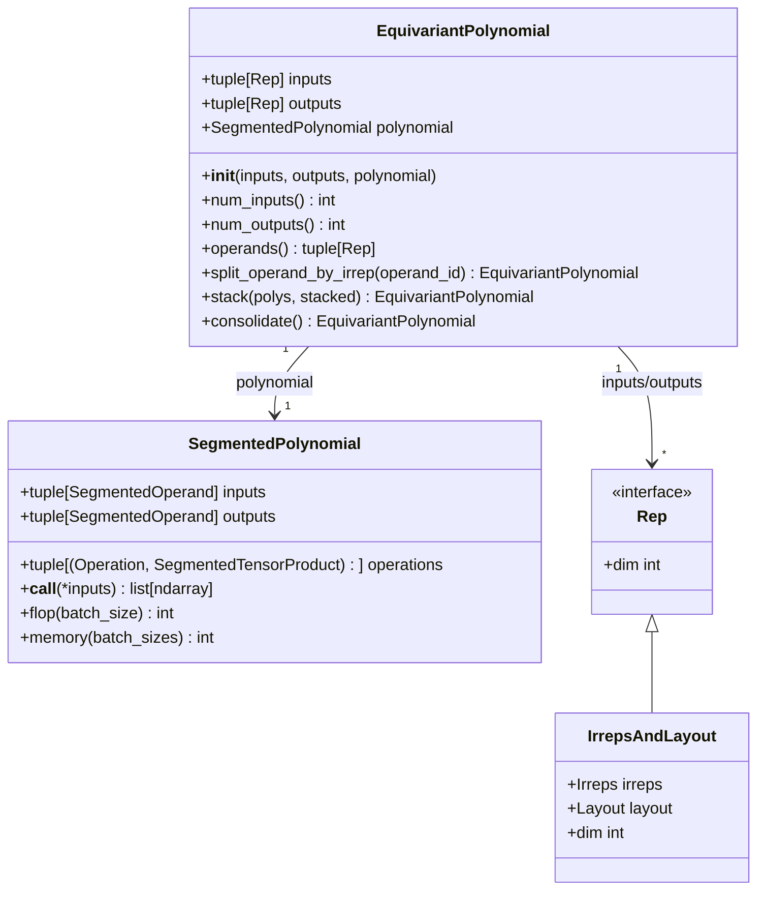
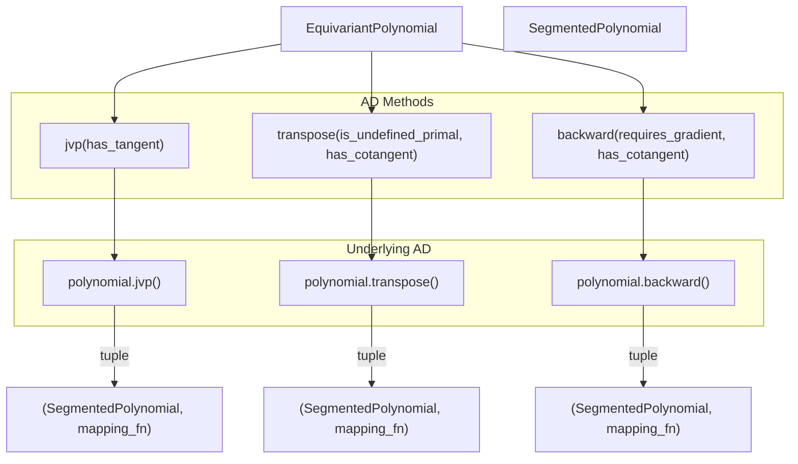

<!-- source: DeepWiki mcp.deepwiki.com · repo NVIDIA/cuEquivariance · page 2.2 EquivariantPolynomial · fetched 2026-10-26 -->

# EquivariantPolynomial

<details>
<summary>Relevant source files</summary>

The following files were used as context for generating this wiki page:

- [cuequivariance/cuequivariance/group_theory/equivariant_polynomial.py](cuequivariance/cuequivariance/group_theory/equivariant_polynomial.py)
- [cuequivariance/cuequivariance/segmented_polynomials/segmented_polynomial.py](cuequivariance/cuequivariance/segmented_polynomials/segmented_polynomial.py)

</details>


The `EquivariantPolynomial` class adds equivariance constraints to polynomial representations by wrapping a `SegmentedPolynomial` with group representation information. Located in [cuequivariance/cuequivariance/group_theory/equivariant_polynomial.py](), it ensures that tensor operations respect symmetry constraints defined by `Rep` objects, making it the primary interface for building equivariant neural networks.

For the underlying computational machinery, see [SegmentedPolynomial](#2.1).

## Relationship to Other Components

`EquivariantPolynomial` sits at a high level in the cuEquivariance architecture, connecting the mathematical foundations of group theory with the computational machinery for tensor operations.

Core Components and Framework Integration



Sources: 
- [cuequivariance/cuequivariance/group_theory/equivariant_polynomial.py:28-75]()
- [cuequivariance/cuequivariance/segmented_polynomials/segmented_polynomial.py:34-51]()

## Core Structure

At its core, an `EquivariantPolynomial` consists of three main components:

EquivariantPolynomial Class Structure



Sources:
- [cuequivariance/cuequivariance/group_theory/equivariant_polynomial.py:28-110]()
- [cuequivariance/cuequivariance/segmented_polynomials/segmented_polynomial.py:49-143]()

### Initialization and Validation

The `__init__` method performs strict validation to ensure equivariance constraints are satisfied:

| Validation | Check | Error Condition |
|------------|-------|-----------------|
| Input count | `len(inputs) == polynomial.num_inputs` | Number mismatch raises `ValueError` |
| Output count | `len(outputs) == polynomial.num_outputs` | Number mismatch raises `ValueError` |
| Dimension compatibility | `rep.dim == operand.size` | Size mismatch raises `AssertionError` |

The validation loop at [cuequivariance/cuequivariance/group_theory/equivariant_polynomial.py:71-74]() ensures each `Rep` dimension matches the corresponding `SegmentedOperand` size.

Sources:
- [cuequivariance/cuequivariance/group_theory/equivariant_polynomial.py:51-74]()

## Class Construction Methods

### Stack Method

The `stack` class method combines multiple `EquivariantPolynomial` instances by stacking their operands. The method uses `cue.concatenate` for `IrrepsAndLayout` operands where stacking is indicated:

```python
# Stack polynomials - operands marked True will be concatenated
stacked_poly = EquivariantPolynomial.stack([poly1, poly2], [False, True])
```

The method validates that:
- All polynomials have the same number of operands
- Non-stacked operands are identical across polynomials  
- Stacked operands are `IrrepsAndLayout` instances

Sources:
- [cuequivariance/cuequivariance/group_theory/equivariant_polynomial.py:118-171]()

## Analysis Methods

`EquivariantPolynomial` provides several methods to analyze its structure:

| Method | Purpose |
|--------|---------|
| `used_inputs()` | Returns a list of boolean values indicating which inputs are used |
| `used_outputs()` | Returns a list of boolean values indicating which outputs are used |
| `used_operands()` | Returns a list of boolean values indicating which operands are used |
| `flop(batch_size=1)` | Computes the number of floating point operations |
| `memory(batch_sizes)` | Computes the memory usage with given batch sizes |
| `all_same_segment_shape()` | Checks if all operands have the same segment shape |

Sources:
- [cuequivariance/cuequivariance/group_theory/equivariant_polynomial.py:232-287]()

## Transformation Methods

These methods delegate to the underlying `SegmentedPolynomial` and return new `EquivariantPolynomial` instances:

### Structure Modifications

| Method | Purpose | Underlying Call |
|--------|---------|-----------------|
| `apply_fn(f)` | Apply function to each `(Operation, SegmentedTensorProduct)` pair | `polynomial.apply_fn(f)` |
| `fuse_stps()` | Fuse identical operations and operands | `polynomial.fuse_stps()` |
| `consolidate()` | Remove empty segments, squeeze modes | `polynomial.consolidate()` |
| `flatten_modes(modes)` | Flatten specified mode subscripts | `polynomial.flatten_modes(modes)` |
| `canonicalize_subscripts()` | Standardize subscript ordering | `polynomial.canonicalize_subscripts()` |
| `squeeze_modes(modes=None)` | Remove size-1 modes | `polynomial.squeeze_modes(modes)` |
| `split_mode(mode, size)` | Split mode into multiple modes | `polynomial.split_mode(mode, size)` |
| `flatten_coefficient_modes()` | Flatten coefficient subscripts | `polynomial.flatten_coefficient_modes()` |

### Symmetrization Operations

| Method | Purpose | Effect on Paths |
|--------|---------|-----------------|
| `symmetrize_for_identical_operands()` | Add symmetric paths for identical operands | Increases `num_paths` |
| `unsymmetrize_for_identical_operands()` | Optimize paths for identical operands | Decreases `num_paths` |

### EquivariantPolynomial-Specific Methods

The `split_operand_by_irrep` method is unique to `EquivariantPolynomial` and splits an `IrrepsAndLayout` operand into separate operands for each `(mul, ir)` pair:

```python
# Split output operand by irreducible representations
split_poly = poly.split_operand_by_irrep(-1)  # Split last operand
```

Sources:
- [cuequivariance/cuequivariance/group_theory/equivariant_polynomial.py:296-474]()
- [cuequivariance/cuequivariance/group_theory/equivariant_polynomial.py:422-474]()

## Filtering Methods

These methods create filtered versions of the polynomial:

| Method | Purpose | Effect |
|--------|---------|--------|
| `filter_keep_operands(keep)` | Select operands to retain | Validates dependencies, updates rep lists |
| `filter_keep_outputs(keep)` | Select outputs to retain | Keeps all inputs, filters outputs |
| `filter_drop_unsued_operands()` | Remove unused operands | Calls `polynomial.used_operands()` |
| `compute_only(keep)` | Compute subset of outputs | Keeps all operands, filters operations |

The `filter_keep_operands` method validates that operations writing to kept operands don't require dropped operands, raising `ValueError` if dependencies are violated.

Sources:
- [cuequivariance/cuequivariance/group_theory/equivariant_polynomial.py:480-560]()

## Automatic Differentiation Support

Automatic Differentiation Method Delegation



Each method delegates to the underlying `SegmentedPolynomial`, then wraps the result with appropriate `Rep` information using the mapping function.

Sources:
- [cuequivariance/cuequivariance/group_theory/equivariant_polynomial.py:566-622]()

## Implementation across Frameworks

The `EquivariantPolynomial` class is used by both PyTorch and JAX implementations:

### Framework Integration

#### JAX Implementation

The `cuex.equivariant_polynomial` function executes an `EquivariantPolynomial` instance:

```python
# Execute EquivariantPolynomial in JAX
outputs = cuex.equivariant_polynomial(
    poly,                    # EquivariantPolynomial instance
    inputs,                  # List of JAX arrays
    outputs_shape_dtype=None, # Optional output specifications
    indices=None,            # Operand indexing
    impl="auto"              # "auto", "cuda", or "jax"
)
```

#### PyTorch Integration

PyTorch uses `EquivariantPolynomial` instances in `cuet.EquivariantTensorProduct` modules, which wrap the polynomial evaluation in PyTorch's autograd system.

Sources:
- [cuequivariance_jax/cuequivariance_jax/equivariant_polynomial.py:16-22]()

## Descriptor Integration

`EquivariantPolynomial` instances are created by descriptor functions in `cue.descriptors`:

### Generated by Descriptors

| Descriptor | Creates | Purpose |
|------------|---------|---------|
| `spherical_harmonics` | Spherical harmonic operations | Compute Y_l^m from 3D vectors |
| `symmetric_contraction` | Weighted tensor products | Sum over symmetric combinations |
| `channelwise_tensor_product` | Element-wise products | Channel-wise equivariant operations |
| `fully_connected_tensor_product` | Linear combinations | Dense equivariant layers |

### Example: Spherical Harmonics

```python
# Create spherical harmonics EquivariantPolynomial
sh_poly = cue.descriptors.spherical_harmonics(cue.SO3(1), [0, 1, 2])
# sh_poly.inputs: [vector_rep] 
# sh_poly.outputs: [scalar_rep, vector_rep, l2_rep]
```

### Example: Split by Irrep

```python
# Split output by irreducible representations
e = cue.descriptors.channelwise_tensor_product(
    cue.Irreps(cue.SO3, "64x0 + 32x1"), 
    cue.Irreps(cue.SO3, "0 + 1")
)
split_e = e.split_operand_by_irrep(-1)  # Split output operand
# Creates separate outputs for each (multiplicity, irrep) pair
```

Sources:
- [cuequivariance/cuequivariance/group_theory/equivariant_polynomial.py:435-443]()

## Comparison with SegmentedPolynomial

While `SegmentedPolynomial` deals with the abstract structure of tensor operations, `EquivariantPolynomial` adds the crucial representation information that ensures operations satisfy equivariance constraints:

| Aspect | SegmentedPolynomial | EquivariantPolynomial |
|--------|---------------------|------------------------|
| Focus | General tensor operations | Equivariant operations |
| Operands | `SegmentedOperand` instances | `Rep` instances |
| Primary use | Computational machinery | Building equivariant networks |
| Key concept | Tensor products | Group representations |

This difference makes `EquivariantPolynomial` the preferred interface for building equivariant neural networks, while `SegmentedPolynomial` handles the lower-level computational details.

Sources:
- [cuequivariance/cuequivariance/group_theory/equivariant_polynomial.py:25-35]()
- [cuequivariance/cuequivariance/segmented_polynomials/segmented_polynomial.py:30-36]()

---

