<!-- source: DeepWiki mcp.deepwiki.com · repo NVIDIA/cuEquivariance · page 2.3 SegmentedTensorProduct · fetched 2026-10-26 -->

# SegmentedTensorProduct

<details>
<summary>Relevant source files</summary>

The following files were used as context for generating this wiki page:

- [.pre-commit-config.yaml](.pre-commit-config.yaml)
- [cuequivariance/cuequivariance/segmented_polynomials/segmented_operand.py](cuequivariance/cuequivariance/segmented_polynomials/segmented_operand.py)
- [cuequivariance/cuequivariance/segmented_polynomials/segmented_tensor_product.py](cuequivariance/cuequivariance/segmented_polynomials/segmented_tensor_product.py)
- [cuequivariance/tests/segmented_polynomials/segmented_polynomial_test.py](cuequivariance/tests/segmented_polynomials/segmented_polynomial_test.py)
- [cuequivariance/tests/segmented_polynomials/segmented_tensor_product_test.py](cuequivariance/tests/segmented_polynomials/segmented_tensor_product_test.py)
- [docs/tutorials/poly.rst](docs/tutorials/poly.rst)
- [docs/tutorials/stp.rst](docs/tutorials/stp.rst)

</details>


`SegmentedTensorProduct` is a core data structure in cuEquivariance that describes segmented tensor product operations. It defines operands with their associated subscripts, segment shapes, and paths that connect segments between operands with scaling coefficients. This class serves as the foundation for building [SegmentedPolynomial](#2.1) and [EquivariantPolynomial](#2.2) objects.

## Data Structure

### Class Definition

`SegmentedTensorProduct` is a frozen dataclass with three core attributes:

**Class Structure Diagram**

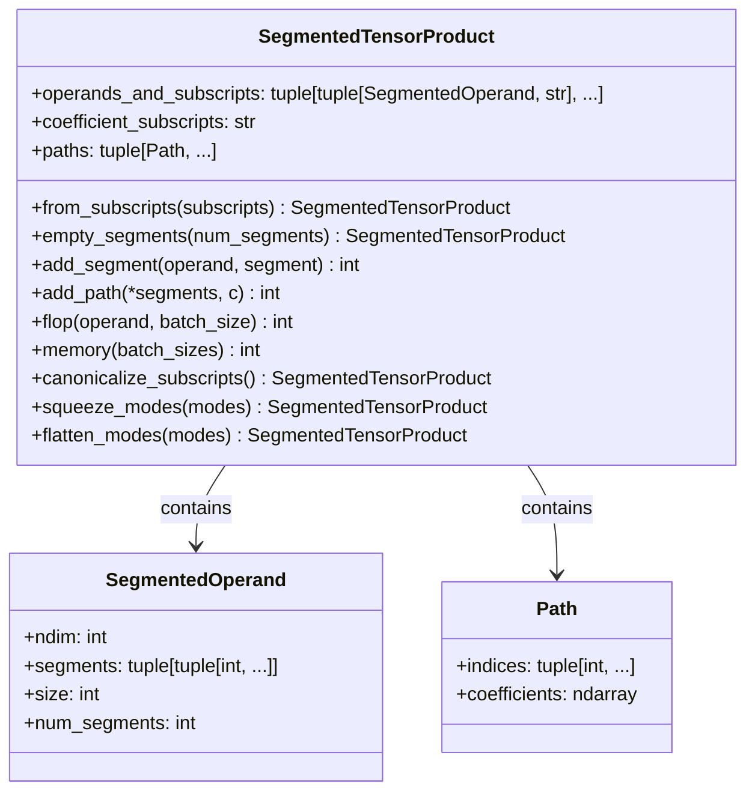

Sources: [cuequivariance/cuequivariance/segmented_polynomials/segmented_tensor_product.py:46-66]()

### Core Attributes

| Attribute | Type | Description |
|-----------|------|-------------|
| `operands_and_subscripts` | `tuple[tuple[SegmentedOperand, str], ...]` | Operands paired with their subscripts |
| `coefficient_subscripts` | `str` | Subscripts describing coefficient tensor dimensions |
| `paths` | `tuple[Path, ...]` | Connections between segments with scaling coefficients |

Each operand contains segments that define tensor block shapes, while paths specify which segments interact and with what coefficients.

Sources: [cuequivariance/cuequivariance/segmented_polynomials/segmented_tensor_product.py:63-65]()

### Subscripts and Einstein Notation

Subscripts follow Einstein notation where repeated indices are summed. The `Subscripts` class parses and validates subscript strings.

**Subscripts Format**
```
operand1_subscripts,operand2_subscripts,...+coefficient_subscripts
```

Examples:
- `"ui,vj,uvk+ijk"` - 3 operands with coefficient subscripts `ijk`
- `"a,ia,ja+ij"` - Linear layer pattern
- `"i,j+ij"` - Outer product

**Subscripts Processing Pipeline**

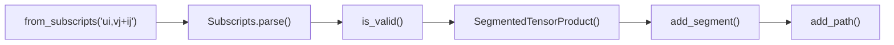

Sources: [cuequivariance/cuequivariance/segmented_polynomials/segmented_tensor_product.py:155-178]()

### Segments

Each `SegmentedOperand` contains segments that define tensor block shapes. Segments specify dimensions for each subscript mode.

**Segment Data Structure**

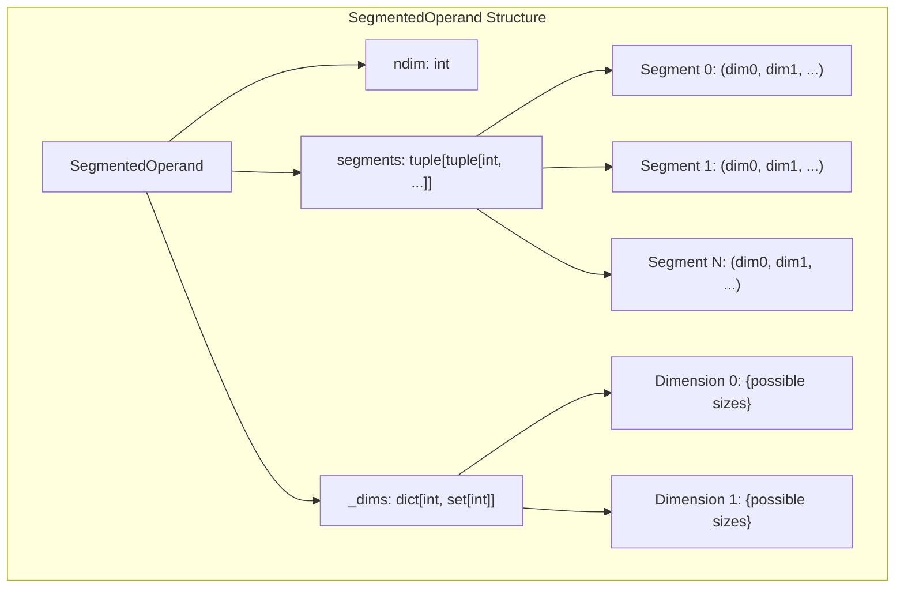

**Key Methods**
- `add_segment(operand_id, dimensions_tuple)` - Add segment to operand
- `segment_slices()` - Get slice objects for each segment  
- `get_dimensions_dict()` - Get all possible dimensions per mode

Sources: [cuequivariance/cuequivariance/segmented_polynomials/segmented_operand.py:23-55](), [cuequivariance/cuequivariance/segmented_polynomials/segmented_tensor_product.py:812-826]()

### Paths

`Path` objects connect segments across operands with scaling coefficients. Each path specifies which segments to contract and the coefficients to apply.

**Path Structure and Operations**

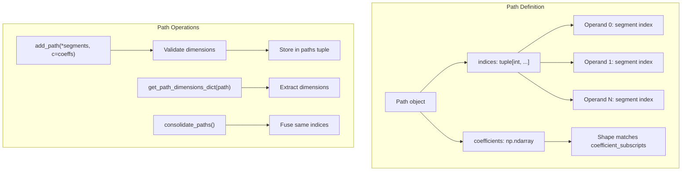

**Path Methods**
- `add_path(*segments, c=coefficients)` - Add path with coefficients
- `get_path_dimensions_dict(path)` - Get dimensions for specific path
- `consolidate_paths()` - Combine paths with identical segment indices

Sources: [cuequivariance/cuequivariance/segmented_polynomials/segmented_tensor_product.py:39](), [cuequivariance/cuequivariance/segmented_polynomials/segmented_tensor_product.py:742-783]()

## Construction

### Factory Methods

**Creation Methods**

| Method | Purpose | Example |
|--------|---------|---------|
| `from_subscripts(subscripts)` | Create from Einstein notation | `from_subscripts("uv,ui,vj+ij")` |
| `empty_segments(num_segments)` | Create with empty operands | `empty_segments([2, 3, 4])` |
| `from_dict(data)` | Deserialize from dictionary | `from_dict(json_data)` |
| `from_base64(data)` | Deserialize from compressed string | `from_base64(encoded_data)` |

**Construction Workflow**

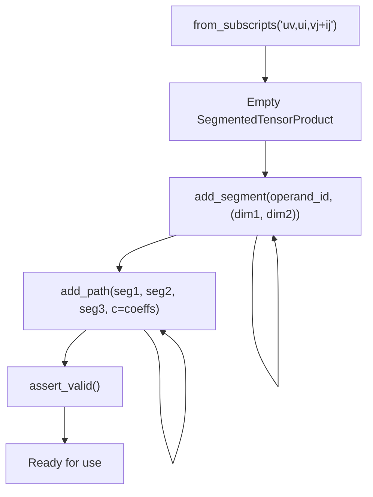

Sources: [cuequivariance/cuequivariance/segmented_polynomials/segmented_tensor_product.py:154-223]()

### Building Process

**Step-by-step Construction**

1. **Add Segments**: Define tensor block shapes for each operand
   ```python
   # Add segment to operand 0 with dimensions (u_dim, v_dim)
   descriptor.add_segment(0, (2, 3))
   
   # Add multiple segments to operand 1  
   descriptor.add_segments(1, [(3, 100), (5, 200)])
   ```

2. **Add Paths**: Connect segments with coefficients
   ```python
   # Connect segment 0 from operands 0,1,2 with scaling coefficients
   descriptor.add_path(0, 1, 0, c=np.array([1.0, 2.0, 0.0]))
   
   # Use None to auto-create segments on-the-fly
   descriptor.add_path(None, None, None, c=coeffs, dims={"u": 4, "v": 5})
   ```

3. **Validate**: Check consistency
   ```python
   descriptor.assert_valid()  # Validates dimensions and paths
   ```

Sources: [docs/tutorials/stp.rst:56-77](), [cuequivariance/cuequivariance/segmented_polynomials/segmented_tensor_product.py:742-783](), [cuequivariance/cuequivariance/segmented_polynomials/segmented_tensor_product.py:121-153]()

## Operations

### Transformation Methods

**Mode Operations**

| Method | Purpose | Effect |
|--------|---------|---------|
| `flatten_modes(modes)` | Remove modes from subscripts | Flattens specified dimensions |
| `squeeze_modes(modes)` | Remove size-1 dimensions | Removes singleton modes |
| `split_mode(mode, size)` | Split mode into chunks | Divides mode into smaller blocks |
| `canonicalize_subscripts()` | Standardize subscript names | Converts to canonical form |

**Path Operations**

| Method | Purpose | Effect |
|--------|---------|---------|
| `consolidate_paths()` | Combine identical paths | Merges paths with same indices |
| `fuse_paths_with_same_indices()` | Sum coefficients | Combines coefficient arrays |
| `normalize_paths_for_operand(op)` | Scale for unit variance | Normalizes output variance |
| `remove_zero_paths()` | Clean up | Removes paths with zero coefficients |

**Transformation Pipeline**

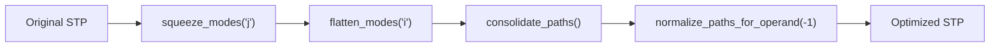

Sources: [cuequivariance/cuequivariance/segmented_polynomials/segmented_tensor_product.py:1088-1143](), [cuequivariance/cuequivariance/segmented_polynomials/segmented_tensor_product.py:1283-1337](), [cuequivariance/cuequivariance/segmented_polynomials/segmented_tensor_product.py:1233-1275]()

### Inspection and Analysis

**Query Methods**

| Method | Return Type | Description |
|--------|-------------|-------------|
| `get_dimensions_dict()` | `dict[str, set[int]]` | All possible dimensions per mode |
| `get_dims(mode)` | `set[int]` | Dimensions for specific mode |
| `flop(operand, batch_size)` | `int` | Computational cost in FLOPs |
| `memory(batch_sizes)` | `int` | Memory usage estimate |
| `coefficients_are_stackable` | `bool` | Whether coefficients have uniform shape |
| `all_segments_are_used()` | `bool` | Whether all segments appear in paths |

**Analysis Workflow**

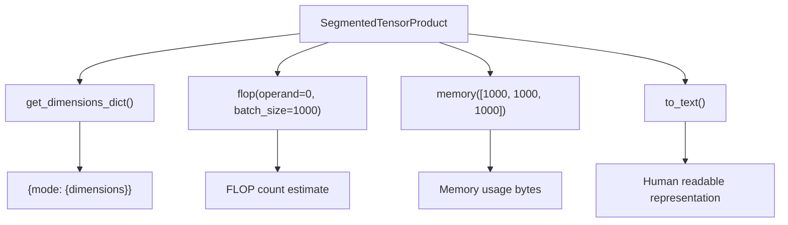

**Performance Metrics**
- FLOP counting uses `opt_einsum` for optimal contraction order
- Memory calculation accounts for all operand sizes
- Cost estimation helps choose efficient execution methods

Sources: [cuequivariance/cuequivariance/segmented_polynomials/segmented_tensor_product.py:459-467](), [cuequivariance/cuequivariance/segmented_polynomials/segmented_tensor_product.py:605-653](), [cuequivariance/cuequivariance/segmented_polynomials/segmented_tensor_product.py:649-653]()

## Framework Integration

### Execution Pipeline

`SegmentedTensorProduct` serves as the foundation for both PyTorch and JAX implementations through different execution paths:

**Framework Integration Architecture**

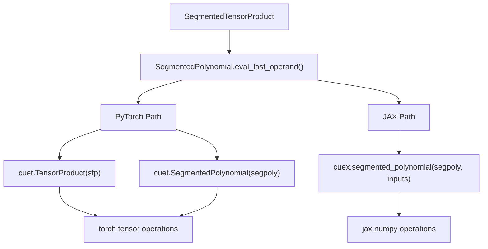

### PyTorch Implementation

PyTorch uses `SegmentedTensorProduct` through wrapper classes:

```python
# Direct tensor product execution
tensor_product = cuet.TensorProduct(descriptor)
output = tensor_product(weight, input)

# Through SegmentedPolynomial for complex operations  
polynomial = cuet.SegmentedPolynomial(segmented_polynomial)
output = polynomial([weight, input])
```

### JAX Implementation  

JAX executes through functional interfaces:

```python
# Functional execution with shape specifications
output = cuex.segmented_polynomial(
    segmented_polynomial, 
    [weight, input],
    [jax.ShapeDtypeStruct(output_shape, dtype)]
)
```

Sources: [docs/tutorials/stp.rst:150-192]()

## Example: Equivariant Linear Layer

### Construction Pattern

The most common `SegmentedTensorProduct` usage is implementing equivariant linear layers with the pattern `"uv,iu,iv"`:

**Linear Layer Architecture**

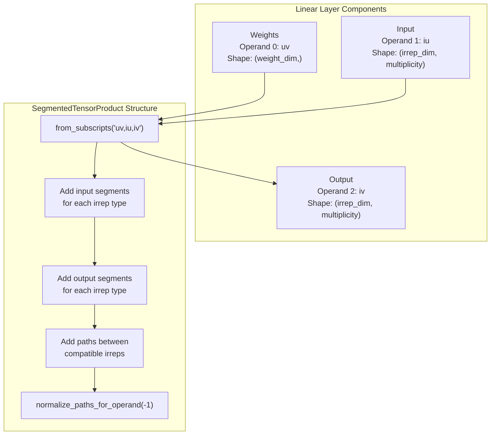

### Implementation Steps

**Step 1: Define irreps**
```python
irreps_in = cue.Irreps("O3", "32x0e + 32x1o")   # Input: 32 scalars + 32 vectors
irreps_out = cue.Irreps("O3", "16x0e + 48x1o")  # Output: 16 scalars + 48 vectors
```

**Step 2: Create descriptor**
```python
d = cue.SegmentedTensorProduct.from_subscripts("uv,iu,iv")
```

**Step 3: Add segments for each irrep**
```python
# Input segments: (irrep_dimension, multiplicity)
for mul, ir in irreps_in:
    d.add_segment(1, (ir.dim, mul))

# Output segments: (irrep_dimension, multiplicity)  
for mul, ir in irreps_out:
    d.add_segment(2, (ir.dim, mul))
```

**Step 4: Connect compatible irreps**
```python
# Only connect irreps of the same type (0e with 0e, 1o with 1o)
for (i1, (mul1, ir1)), (i2, (mul2, ir2)) in itertools.product(
    enumerate(irreps_in), enumerate(irreps_out)
):
    if ir1 == ir2:  # Same irrep type
        d.add_path(None, i1, i2, c=1.0)  # Auto-create weight segment
```

**Step 5: Normalize for unit variance**
```python
d = d.normalize_paths_for_operand(-1)  # Normalize output variance
```

This creates a `SegmentedTensorProduct` with `32*16 + 32*48 = 2048` weight parameters connecting compatible irrep types.

Sources: [docs/tutorials/stp.rst:96-148]()

## Serialization

### Serialization Methods

`SegmentedTensorProduct` supports multiple serialization formats for persistence and transfer:

| Method | Format | Use Case |
|--------|---------|----------|
| `to_dict(extended=False)` | Python dict | In-memory transfer |
| `to_json(extended=False)` | JSON string | Human-readable storage |
| `to_bytes(extended=False)` | Compressed binary | Efficient storage |
| `to_base64(extended=False)` | Base64 string | Text-safe binary |

**Serialization Pipeline**

```mermaid
flowchart LR
    STP["SegmentedTensorProduct"] --> Dict["to_dict()"]
    Dict --> JSON["to_json()"]
    JSON --> Compress["zlib.compress()"]
    Compress --> Base64["to_base64()"]
    
    Base64 --> Decode["from_base64()"]
    Decode --> Decompress["zlib.decompress()"]
    Decompress --> ParseJSON["from_json()"]
    ParseJSON --> RestoreSTP["SegmentedTensorProduct"]
```

**Extended Format**

The `extended=True` option includes additional metadata:
- Segment offsets and sizes
- FLOP counts per operand  
- Memory usage estimates
- Performance metrics

```python
# Basic serialization
data = descriptor.to_base64()
restored = cue.SegmentedTensorProduct.from_base64(data)

# Extended with performance data
extended_data = descriptor.to_dict(extended=True)
print(extended_data['operands'][0]['flops'])  # FLOP count for operand 0
```

Sources: [cuequivariance/cuequivariance/segmented_polynomials/segmented_tensor_product.py:399-458]()

## Architecture Position

### Hierarchy in cuEquivariance

`SegmentedTensorProduct` occupies a foundational position in the library's type hierarchy:

**Data Structure Hierarchy**

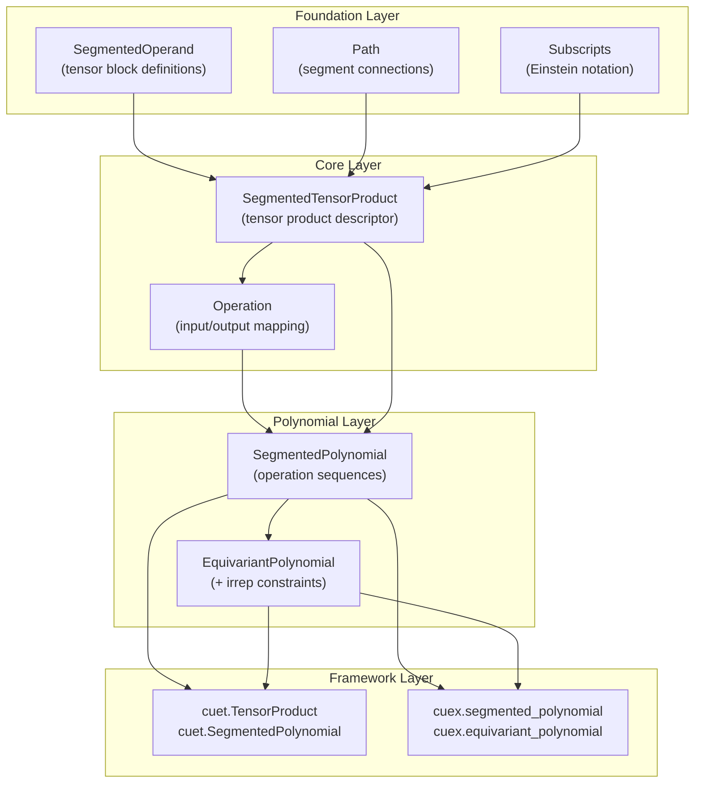

**Key Relationships**
- Contains `SegmentedOperand` instances that define tensor block shapes
- Used by `SegmentedPolynomial` to build operation sequences
- Serves as foundation for both PyTorch and JAX implementations
- Provides core tensor product logic independent of framework details

Sources: [cuequivariance/cuequivariance/segmented_polynomials/segmented_tensor_product.py:46-66]()

## Performance Considerations

When using `SegmentedTensorProduct`, consider:

1. **Flop count**: Use the `flop` method to estimate computational cost
2. **Memory usage**: Use the `memory` method to estimate memory consumption
3. **Consolidation**: Use `consolidate_paths` to potentially improve performance by combining similar paths

Sources: [cuequivariance/cuequivariance/segmented_polynomials/segmented_tensor_product.py:605-653]()

## Summary

The `SegmentedTensorProduct` class provides a flexible foundation for implementing equivariant neural network operations in cuEquivariance. It supports:

- Describing tensor product operations with Einstein notation
- Defining segments with different dimensions for each operand
- Connecting segments through paths with associated coefficients
- Manipulating tensor products through various transformation methods
- Integration with both PyTorch and JAX frameworks

This foundation enables the implementation of complex equivariant neural network architectures while maintaining computational efficiency.

---

