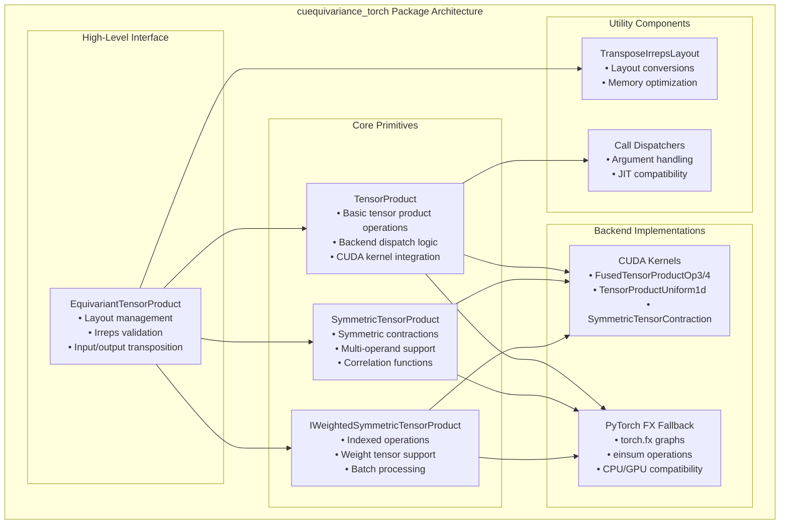
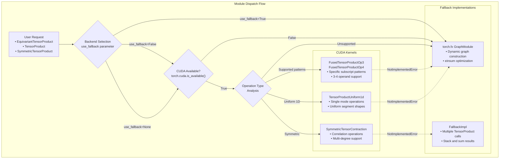
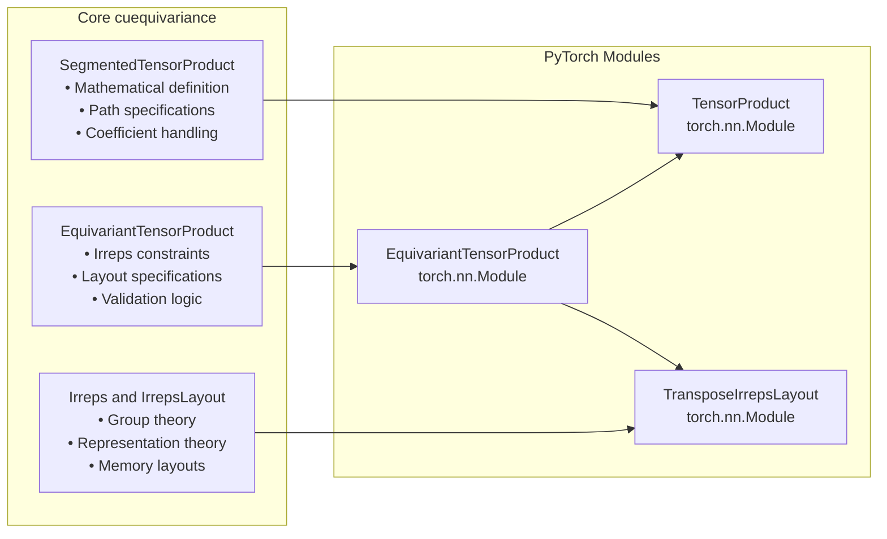

<!-- source: DeepWiki mcp.deepwiki.com · repo NVIDIA/cuEquivariance · page 3 PyTorch Implementation · fetched 2026-10-26 -->

# PyTorch Implementation

Relevant source files

The following files were used as context for generating this wiki page:

- [cuequivariance_torch/cuequivariance_torch/primitives/equivariant_tensor_product.py](cuequivariance_torch/cuequivariance_torch/primitives/equivariant_tensor_product.py)
- [cuequivariance_torch/cuequivariance_torch/primitives/symmetric_tensor_product.py](cuequivariance_torch/cuequivariance_torch/primitives/symmetric_tensor_product.py)
- [cuequivariance_torch/cuequivariance_torch/primitives/tensor_product.py](cuequivariance_torch/cuequivariance_torch/primitives/tensor_product.py)

This document covers the PyTorch-specific implementation of cuEquivariance, which provides high-performance equivariant neural network operations through the `cuequivariance_torch` package. This implementation serves as the primary interface for integrating equivariant operations into PyTorch models and training pipelines.

For JAX-specific implementations, see [JAX Implementation](#4). For core mathematical foundations, see [Core Concepts](#2). For detailed coverage of specific PyTorch components, see [TensorProduct Primitives](#3.1), [SymmetricTensorProduct](#3.2), and [High-Level Operations](#3.4).

## Architecture Overview

The PyTorch implementation is structured around several key modules that provide different levels of abstraction and optimization strategies:

Sources: [cuequivariance_torch/cuequivariance_torch/primitives/tensor_product.py:42-179](), [cuequivariance_torch/cuequivariance_torch/primitives/equivariant_tensor_product.py:111-311](), [cuequivariance_torch/cuequivariance_torch/primitives/symmetric_tensor_product.py:28-98]()

## Core Module Relationships

The PyTorch implementation follows a hierarchical design where high-level modules delegate to specialized implementations based on operation characteristics and backend availability:

Sources: [cuequivariance_torch/cuequivariance_torch/primitives/tensor_product.py:74-92](), [cuequivariance_torch/cuequivariance_torch/primitives/symmetric_tensor_product.py:135-152]()

## Backend Selection Logic

The PyTorch implementation uses a sophisticated backend selection strategy that prioritizes CUDA kernels for performance while maintaining fallback compatibility:

| Backend Type | Implementation | Use Cases | Performance |
|--------------|----------------|-----------|-------------|
| `FusedTensorProductOp3/4` | CUDA Triton kernels | 3-4 operand tensor products with supported patterns | High |
| `TensorProductUniform1d` | CUDA kernels | Single mode, uniform segment operations | High |
| `SymmetricTensorContraction` | CUDA kernels | Symmetric tensor products, correlations | High |
| `torch.fx` graphs | PyTorch fallback | Complex patterns, unsupported operations | Medium |
| `FallbackImpl` | Pure PyTorch | Development, debugging, CPU-only | Low |

The selection process follows this hierarchy:

1. **CUDA Kernel Attempt**: Try specialized CUDA implementations based on operation characteristics
2. **Pattern Matching**: Check if the `SegmentedTensorProduct` matches supported kernel patterns
3. **Fallback Decision**: Use PyTorch implementations if CUDA kernels are unavailable or unsupported

Sources: [cuequivariance_torch/cuequivariance_torch/primitives/tensor_product.py:421-499](), [cuequivariance_torch/cuequivariance_torch/primitives/symmetric_tensor_product.py:222-307]()

## Integration with Core Library

The PyTorch implementation integrates seamlessly with the core `cuequivariance` library through well-defined interfaces:

Key integration points include:

- **Descriptor Consumption**: PyTorch modules accept `SegmentedTensorProduct` descriptors from the core library
- **Layout Management**: `TransposeIrrepsLayout` handles conversions between different irreps memory layouts
- **Validation**: Input shapes and irreps are validated against mathematical constraints
- **Device Management**: Automatic handling of CPU/GPU device placement and data type conversions

Sources: [cuequivariance_torch/cuequivariance_torch/primitives/tensor_product.py:57-66](), [cuequivariance_torch/cuequivariance_torch/primitives/equivariant_tensor_product.py:145-175]()

## Key Implementation Features

### JIT and Compilation Support

The PyTorch implementation is designed to work with PyTorch's compilation and scripting systems:

- **TorchScript Compatibility**: All modules support `torch.jit.script()` compilation
- **Torch Compile Integration**: Compatible with `torch.compile()` for additional optimization
- **Graph Mode Support**: Modules work in both eager and graph execution modes

### Memory and Performance Optimization

- **In-Place Operations**: Where possible, operations are performed in-place to reduce memory allocation
- **Batch Processing**: All operations support batched inputs with automatic broadcasting
- **Type Conversion Prevention**: Coefficient tensors are protected from unwanted dtype conversions using `disable_type_conv`

### Error Handling and Logging

The implementation includes comprehensive error handling and debugging support:

- **Shape Validation**: Runtime assertions for input tensor shapes and dimensions
- **Backend Availability Logging**: Informative messages when CUDA kernels are unavailable
- **Debug Information**: Detailed logging of kernel selection and execution parameters

Sources: [cuequivariance_torch/cuequivariance_torch/primitives/tensor_product.py:181-196](), [cuequivariance_torch/cuequivariance_torch/primitives/tensor_product.py:160-177]()

---

