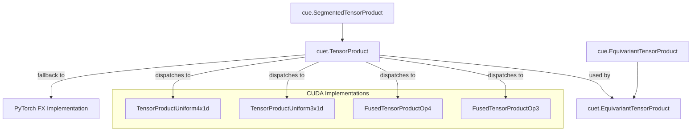
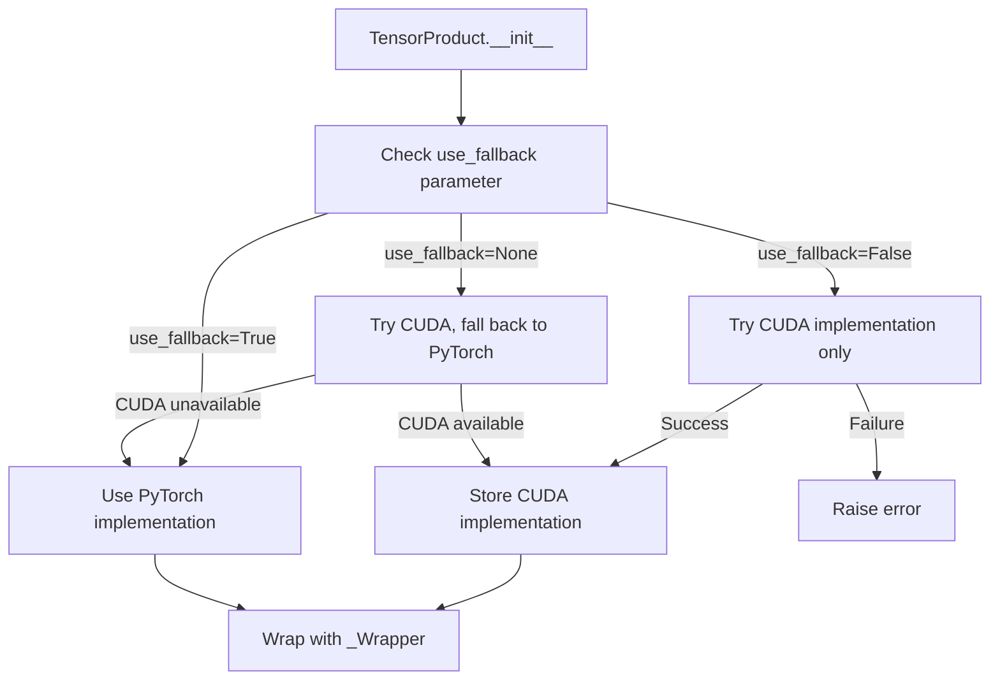
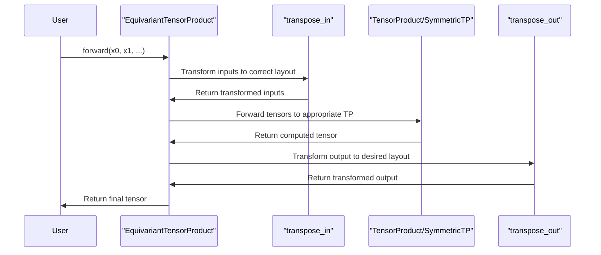
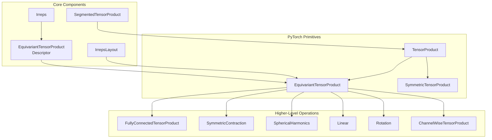

<!-- source: DeepWiki mcp.deepwiki.com · repo NVIDIA/cuEquivariance · page 3.1 TensorProduct Primitives · fetched 2026-10-26 -->

# TensorProduct Primitives

<details>
<summary>Relevant source files</summary>

The following files were used as context for generating this wiki page:

- [cuequivariance_torch/cuequivariance_torch/primitives/equivariant_tensor_product.py](cuequivariance_torch/cuequivariance_torch/primitives/equivariant_tensor_product.py)
- [cuequivariance_torch/cuequivariance_torch/primitives/symmetric_tensor_product.py](cuequivariance_torch/cuequivariance_torch/primitives/symmetric_tensor_product.py)
- [cuequivariance_torch/cuequivariance_torch/primitives/tensor_product.py](cuequivariance_torch/cuequivariance_torch/primitives/tensor_product.py)
- [cuequivariance_torch/tests/layers/tp_conv_fully_connected_test.py](cuequivariance_torch/tests/layers/tp_conv_fully_connected_test.py)
- [cuequivariance_torch/tests/operations/fully_connected_test.py](cuequivariance_torch/tests/operations/fully_connected_test.py)
- [cuequivariance_torch/tests/operations/spherical_harmonics_test.py](cuequivariance_torch/tests/operations/spherical_harmonics_test.py)
- [cuequivariance_torch/tests/primitives/equivariant_tensor_product_test.py](cuequivariance_torch/tests/primitives/equivariant_tensor_product_test.py)
- [cuequivariance_torch/tests/primitives/symmetric_tensor_product_test.py](cuequivariance_torch/tests/primitives/symmetric_tensor_product_test.py)
- [cuequivariance_torch/tests/primitives/tensor_product_test.py](cuequivariance_torch/tests/primitives/tensor_product_test.py)

</details>


## Purpose and Scope

This document describes the TensorProduct primitives in the PyTorch implementation of cuEquivariance. These primitives form the foundational building blocks for creating efficient, equivariant neural network operations. The primitives detailed here include `TensorProduct` and `EquivariantTensorProduct`, which handle tensor product computation while maintaining equivariance properties.

For information about the core SegmentedTensorProduct data structure that these primitives build upon, see [SegmentedTensorProduct](#2.3). For details on symmetric tensor products, see [SymmetricTensorProduct](#3.2).

Sources: [cuequivariance_torch/cuequivariance_torch/primitives/tensor_product.py](), [cuequivariance_torch/cuequivariance_torch/primitives/equivariant_tensor_product.py]()

## Architecture Overview

The TensorProduct primitives bridge abstract mathematical descriptions of tensor products (defined by descriptors) and concrete, efficient implementations in PyTorch. They offer both CUDA-accelerated kernels and PyTorch fallback implementations.

### Relationship Between Primitives



Sources: [cuequivariance_torch/cuequivariance_torch/primitives/tensor_product.py:42-180](), [cuequivariance_torch/cuequivariance_torch/primitives/equivariant_tensor_product.py:111-312]()

## TensorProduct Class

The `TensorProduct` class implements the computation of tensor products defined by a `SegmentedTensorProduct` descriptor.

### Key Features

- Takes a `SegmentedTensorProduct` descriptor that defines the tensor operation
- Supports automatic fallback from CUDA to PyTorch implementation
- Handles input tensors of various batch shapes
- Efficiently computes the output tensor according to the descriptor

### Implementation Details

The implementation intelligently dispatches to specialized CUDA kernels based on the descriptor:

1. `TensorProductUniform3x1d`/`TensorProductUniform4x1d`: For uniform 1D tensor products
2. `FusedTensorProductOp3`/`FusedTensorProductOp4`: For general 3- or 4-operand tensor products
3. PyTorch FX fallback implementation when CUDA is not available or suitable

### TensorProduct Construction and Dispatch Flow



Sources: [cuequivariance_torch/cuequivariance_torch/primitives/tensor_product.py:42-180](), [cuequivariance_torch/cuequivariance_torch/primitives/tensor_product.py:420-498]()

### CUDA Implementation Selection

When dispatching to a CUDA kernel, the implementation follows this strategy:

1. For uniform 1D tensor products with compatible dimensions:
   - Use `TensorProductUniform3x1d` or `TensorProductUniform4x1d`
2. For other supported subscript patterns:
   - Use `FusedTensorProductOp3` or `FusedTensorProductOp4`
3. If no suitable CUDA kernel is found:
   - Fall back to `_tensor_product_fx` (PyTorch implementation)

The supported subscript patterns for CUDA kernels include:
- `u__uw_w`, `_v_vw_w`, `u_v_uv_u`, `u_v_uv_v`, `u_u_uw_w`
- `u_v_uvw_w`, `u_u_u`, `u_v_uv`, `u_uv_v`, `u__u`, `_v_v`

Sources: [cuequivariance_torch/cuequivariance_torch/primitives/tensor_product.py:465-492]()

## EquivariantTensorProduct Class

The `EquivariantTensorProduct` class extends tensor products with equivariance properties, ensuring that outputs transform correctly under group actions.

### Key Features

- Takes an `EquivariantTensorProduct` descriptor that defines both the tensor product and its equivariance properties
- Handles input and output layouts (representations of group-equivariant operations)
- Supports indexed access to the first input tensor
- Transposes inputs and outputs to maintain equivariance

### Implementation Details

The implementation includes specialized handling for different types of operations:

1. For symmetric operations (like SphericalHarmonics), it uses `SymmetricTensorProduct`
2. For indexed operations with two inputs, it uses `IWeightedSymmetricTensorProduct`
3. For general cases, it uses the standard `TensorProduct` primitive

### Computation Flow



Sources: [cuequivariance_torch/cuequivariance_torch/primitives/equivariant_tensor_product.py:262-311]()

## Performance Considerations

The TensorProduct primitives are designed with performance in mind:

- CUDA kernels provide significantly faster execution when available
- Specialized implementations are selected based on tensor product structure
- Batch processing is efficiently handled

Test results show that the CUDA implementations consistently outperform the PyTorch fallback implementations:

```python
# From test file: Performance comparison shows CUDA is faster
t0 = timeit.Timer(lambda: torch.sum(m_custom(*inputs))).timeit(number=10)
t1 = timeit.Timer(lambda: torch.sum(m_fallback(*inputs))).timeit(number=10)
assert t0 < t1  # CUDA implementation must be faster
```

Sources: [cuequivariance_torch/tests/primitives/equivariant_tensor_product_test.py:114-116]()

## Data Type Support

Both primitives support various data types for computation:

| Input dtype | Math computation dtype | Notes |
|-------------|------------------------|-------|
| float32     | float32 or float64     | Standard precision |
| float64     | float64                | High precision |
| float16     | float32                | On hardware with Tensor Cores (NVIDIA GPUs) |
| bfloat16    | float32                | On hardware with Tensor Cores (NVIDIA GPUs) |

The `math_dtype` parameter controls the precision of internal calculations, which can be higher than the input/output precision to maintain numerical stability.

Sources: [cuequivariance_torch/tests/primitives/equivariant_tensor_product_test.py:76-85](), [cuequivariance_torch/tests/primitives/tensor_product_test.py:79-89]()

## Practical Usage Examples

### Basic TensorProduct

```python
# Create a tensor product descriptor
descriptor = cue.SegmentedTensorProduct.from_subscripts("u,v,uv")

# Create the TensorProduct module
tp = cuet.TensorProduct(
    descriptor, 
    device=device, 
    math_dtype=torch.float32
)

# Apply to input tensors
x0 = torch.randn(batch_size, descriptor.operands[0].size)
x1 = torch.randn(batch_size, descriptor.operands[1].size)
output = tp(x0, x1)
```

### EquivariantTensorProduct

```python
# Create an equivariant tensor product descriptor
e = cue.descriptors.fully_connected_tensor_product(
    cue.Irreps("O3", "32x0e + 32x1o"),
    cue.Irreps("O3", "0e + 1o + 2e"),
    cue.Irreps("O3", "32x0e + 32x1o")
)

# Create the EquivariantTensorProduct module
etp = cuet.EquivariantTensorProduct(
    e, 
    layout=cue.ir_mul, 
    device=device
)

# Apply to input tensors
x0 = torch.randn(batch_size, e.inputs[0].dim)
x1 = torch.randn(batch_size, e.inputs[1].dim)
output = etp(x0, x1)
```

### Indexed Operations

EquivariantTensorProduct supports operations where the first input tensor is a weight tensor that should be indexed:

```python
# Create weight tensor with multiple rows
w = torch.randn(num_weights, e.inputs[0].dim)

# Create data tensor
x1 = torch.randn(batch_size, e.inputs[1].dim)

# Create indices tensor for batch
indices = torch.randint(num_weights, (batch_size,))

# Apply with indexed first input
output = etp(w, x1, indices=indices)
```

Sources: [cuequivariance_torch/cuequivariance_torch/primitives/equivariant_tensor_product.py:111-143](), [cuequivariance_torch/cuequivariance_torch/primitives/equivariant_tensor_product.py:262-311]()

## Integration with Higher-Level Operations

The TensorProduct primitives form the foundation for higher-level operations in cuEquivariance:



Sources: [cuequivariance_torch/tests/primitives/equivariant_tensor_product_test.py:28-73]()

## Conclusions

The TensorProduct primitives in cuEquivariance provide:

1. Efficient computation of tensor products with cuDNN-accelerated backends
2. Preservation of equivariance properties critical for equivariant neural networks
3. Support for various data types and computational precision
4. A foundation for building more complex equivariant operations

These primitives are designed to be both performant and flexible, allowing for the creation of sophisticated equivariant neural networks while maintaining compatibility with the PyTorch ecosystem.

---

