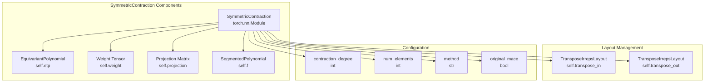
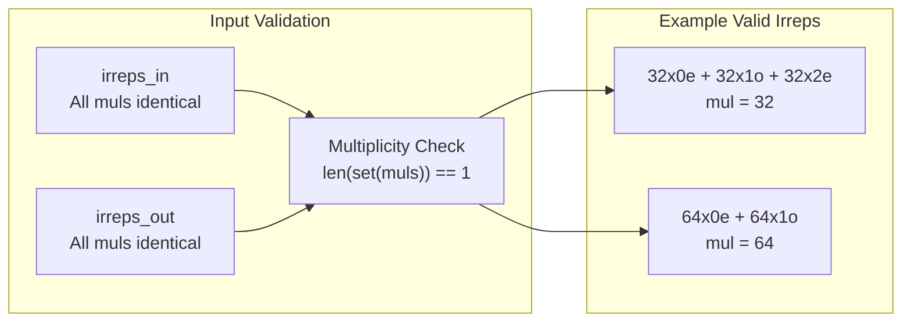
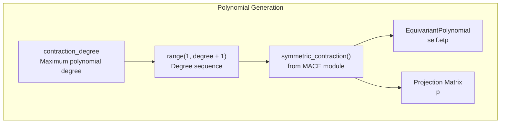
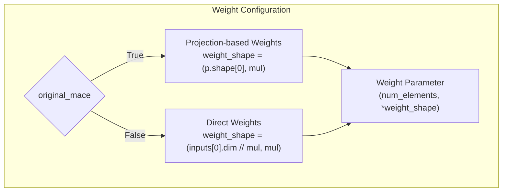
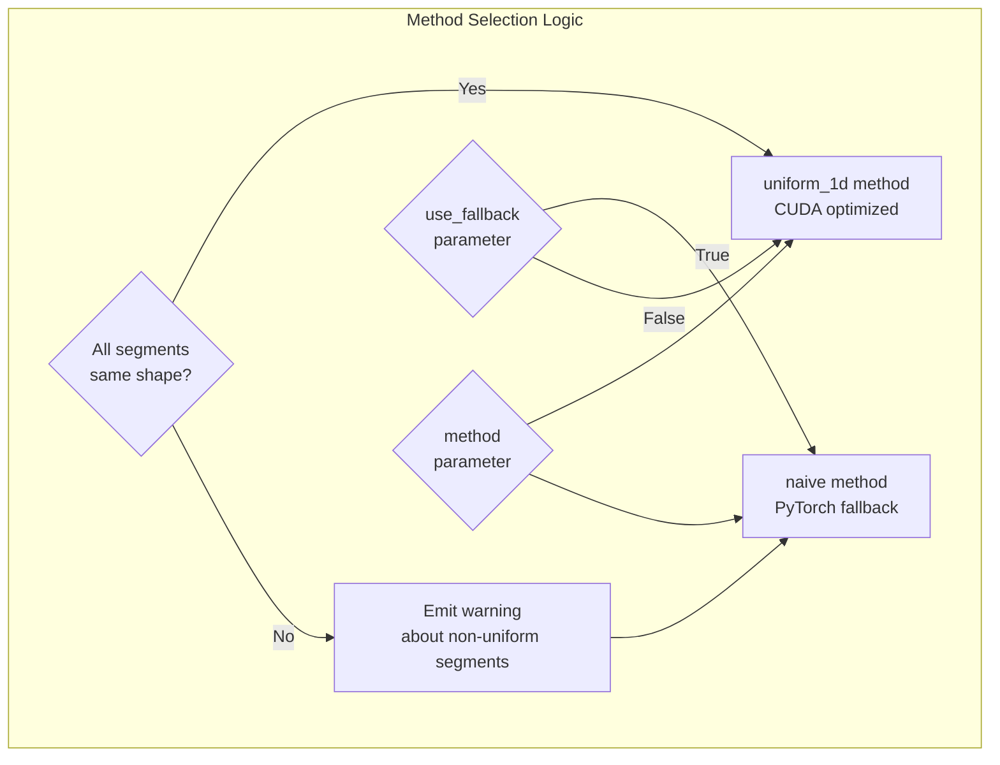
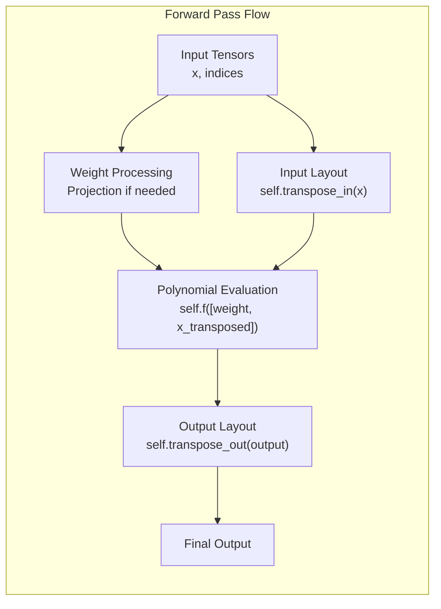
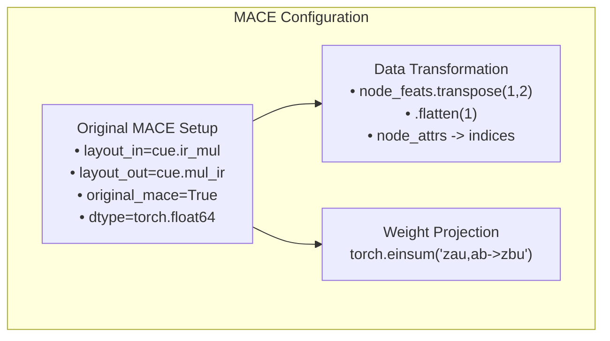
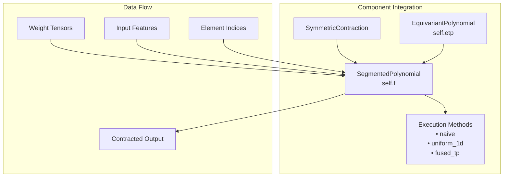
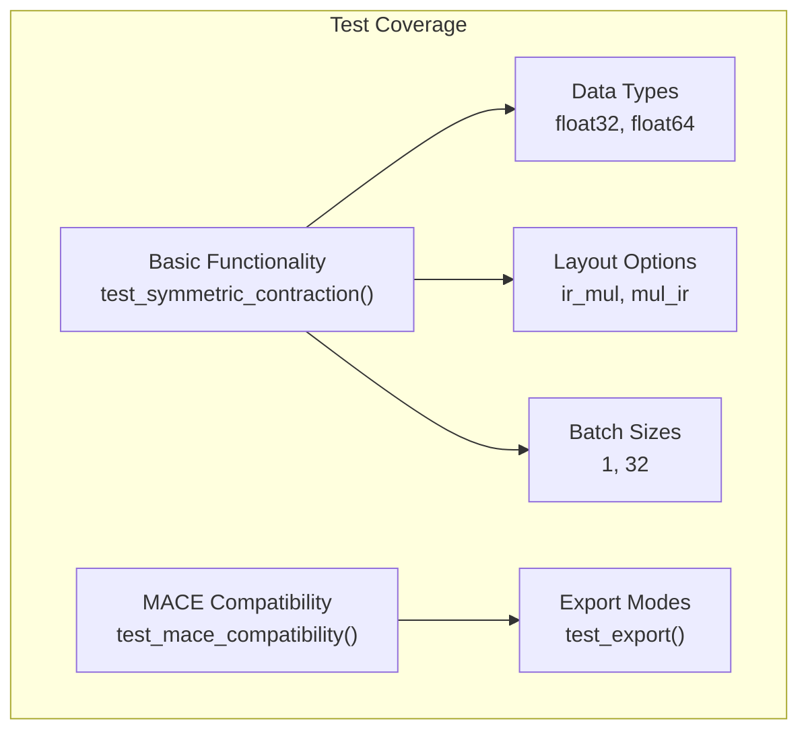

<!-- source: DeepWiki mcp.deepwiki.com · repo NVIDIA/cuEquivariance · page 3.2 SymmetricTensorProduct · fetched 2026-10-26 -->

# SymmetricTensorProduct

<details>
<summary>Relevant source files</summary>

The following files were used as context for generating this wiki page:

- [cuequivariance_torch/cuequivariance_torch/operations/linear.py](cuequivariance_torch/cuequivariance_torch/operations/linear.py)
- [cuequivariance_torch/cuequivariance_torch/operations/symmetric_contraction.py](cuequivariance_torch/cuequivariance_torch/operations/symmetric_contraction.py)
- [cuequivariance_torch/tests/operations/channel_wise_test.py](cuequivariance_torch/tests/operations/channel_wise_test.py)
- [cuequivariance_torch/tests/operations/linear_test.py](cuequivariance_torch/tests/operations/linear_test.py)
- [cuequivariance_torch/tests/operations/rotation_test.py](cuequivariance_torch/tests/operations/rotation_test.py)
- [cuequivariance_torch/tests/operations/symmetric_contraction_test.py](cuequivariance_torch/tests/operations/symmetric_contraction_test.py)

</details>


This document covers symmetric tensor products and symmetric contractions in the PyTorch implementation of cuEquivariance. The primary focus is on the `SymmetricContraction` class, which provides an accelerated implementation of symmetric contraction operations for equivariant neural networks.

For general tensor product operations, see [TensorProduct Primitives](#3.1). For segmented polynomial execution details, see [SegmentedPolynomial](#3.3).

## Core Components

The symmetric tensor product functionality is primarily implemented through the `SymmetricContraction` class, which performs symmetric contraction operations as introduced in the MACE (Multi-Atomic Cluster Expansion) paper.

### SymmetricContraction Class

The `SymmetricContraction` class extends `torch.nn.Module` and provides an optimized implementation of symmetric contractions with support for multiple execution methods and MACE compatibility.



**Sources:** [cuequivariance_torch/cuequivariance_torch/operations/symmetric_contraction.py:32-104]()

### Key Parameters

The `SymmetricContraction` class accepts several critical parameters that define its behavior:

| Parameter | Type | Description |
|-----------|------|-------------|
| `irreps_in` | `cue.Irreps` | Input irreducible representations (all muls must be identical) |
| `irreps_out` | `cue.Irreps` | Output irreducible representations (all muls must be identical) |
| `contraction_degree` | `int` | Maximum degree of polynomial in symmetric contraction |
| `num_elements` | `int` | Number of elements for weight tensor |
| `original_mace` | `bool` | Whether to use original MACE implementation format |
| `method` | `str` | Execution method ("naive", "uniform_1d", etc.) |

**Sources:** [cuequivariance_torch/cuequivariance_torch/operations/symmetric_contraction.py:105-121]()

## Mathematical Foundation

Symmetric contractions operate on irreducible representations with specific multiplicity constraints and perform polynomial operations of specified degrees.

### Irreps Constraints

The symmetric contraction requires that all input and output irreducible representations have identical multiplicities:



**Sources:** [cuequivariance_torch/cuequivariance_torch/operations/symmetric_contraction.py:128-131]()

### Contraction Degree and Polynomial Generation

The symmetric contraction generates an `EquivariantPolynomial` based on the contraction degree:



**Sources:** [cuequivariance_torch/cuequivariance_torch/operations/symmetric_contraction.py:136-139]()

## Implementation Details

### Weight Tensor Management

The class manages weight tensors differently based on the `original_mace` parameter:



**Sources:** [cuequivariance_torch/cuequivariance_torch/operations/symmetric_contraction.py:141-155]()

### Execution Method Selection

The class supports multiple execution methods with automatic fallback logic:



**Sources:** [cuequivariance_torch/cuequivariance_torch/operations/symmetric_contraction.py:175-203]()

### Forward Pass Implementation

The forward pass involves weight processing, polynomial evaluation, and layout transformations:



**Sources:** [cuequivariance_torch/cuequivariance_torch/operations/symmetric_contraction.py:217-241]()

## Usage Patterns

### Basic Usage

The typical usage pattern involves creating a `SymmetricContraction` instance with appropriate irreps and calling it with input tensors and element indices:

```python
# Example configuration
irreps_in = cue.Irreps("O3", "32x0e + 32x1o")
irreps_out = cue.Irreps("O3", "32x0e")
layer = SymmetricContraction(
    irreps_in, irreps_out, 
    contraction_degree=3, 
    num_elements=5,
    layout=cue.ir_mul
)

# Forward pass
output = layer(input_features, element_indices)
```

**Sources:** [cuequivariance_torch/cuequivariance_torch/operations/symmetric_contraction.py:56-61]()

### MACE Compatibility Mode

For compatibility with the original MACE implementation, specific configurations are required:



**Sources:** [cuequivariance_torch/cuequivariance_torch/operations/symmetric_contraction.py:74-96]()

## Integration with Other Components

### Relationship to SegmentedPolynomial

The `SymmetricContraction` relies heavily on the `SegmentedPolynomial` execution engine:



**Sources:** [cuequivariance_torch/cuequivariance_torch/operations/symmetric_contraction.py:205-209]()

### Testing and Validation

The implementation includes comprehensive testing for various configurations:



**Sources:** [cuequivariance_torch/tests/operations/symmetric_contraction_test.py:35-184]()

---

