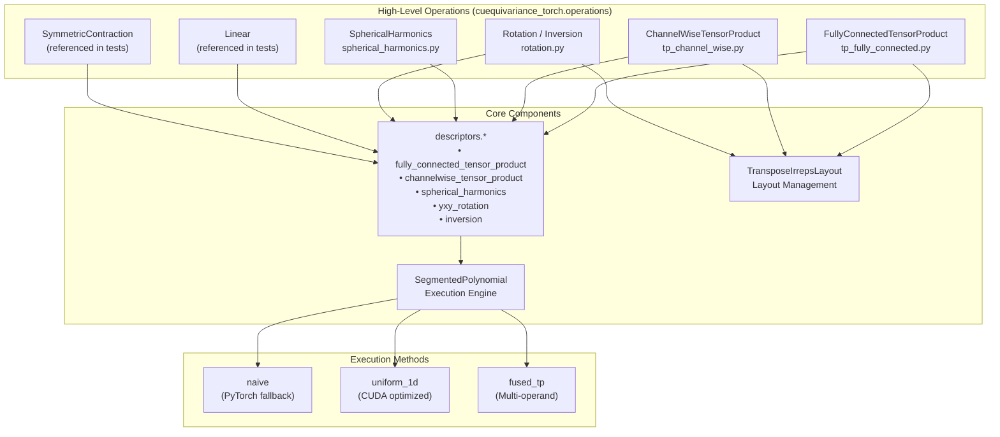
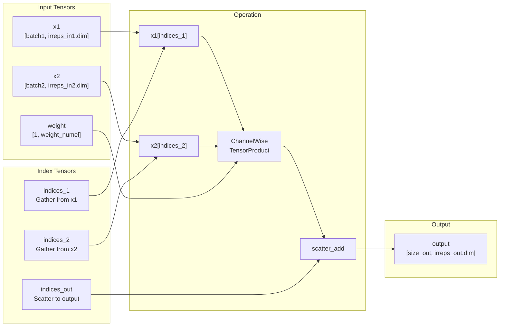
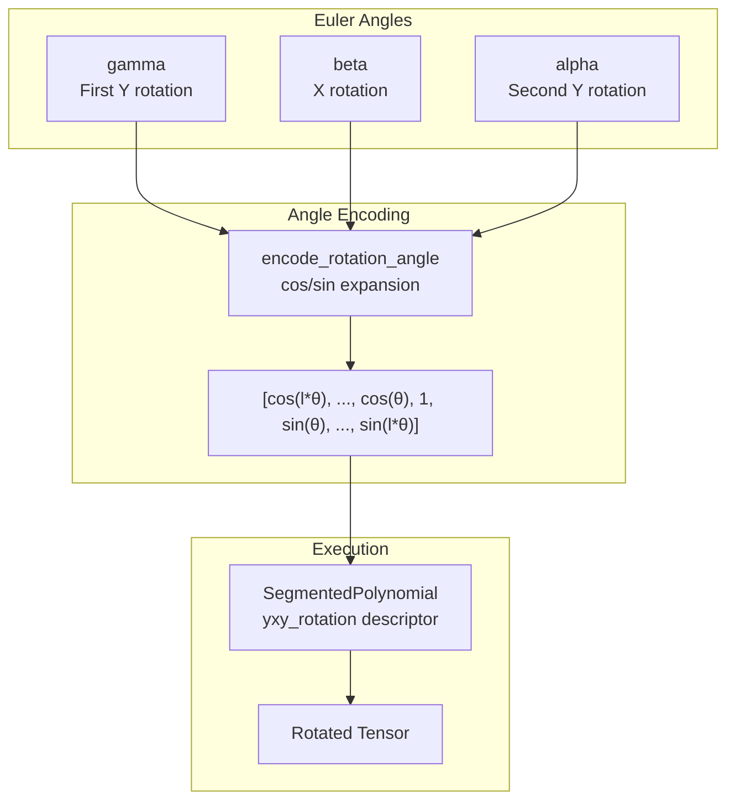
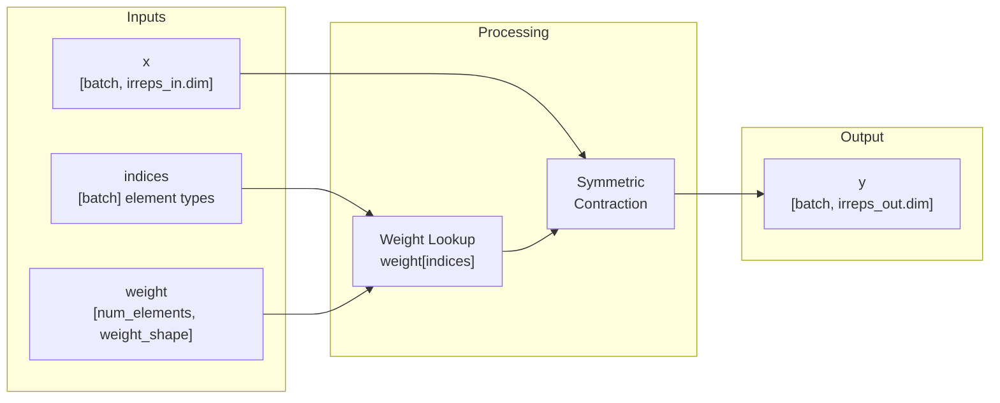

<!-- source: DeepWiki mcp.deepwiki.com · repo NVIDIA/cuEquivariance · page 3.4 High-Level Operations · fetched 2026-10-26 -->

# High-Level Operations

<details>
<summary>Relevant source files</summary>

The following files were used as context for generating this wiki page:

- [cuequivariance_torch/cuequivariance_torch/operations/rotation.py](cuequivariance_torch/cuequivariance_torch/operations/rotation.py)
- [cuequivariance_torch/cuequivariance_torch/operations/spherical_harmonics.py](cuequivariance_torch/cuequivariance_torch/operations/spherical_harmonics.py)
- [cuequivariance_torch/cuequivariance_torch/operations/tp_channel_wise.py](cuequivariance_torch/cuequivariance_torch/operations/tp_channel_wise.py)
- [cuequivariance_torch/cuequivariance_torch/operations/tp_fully_connected.py](cuequivariance_torch/cuequivariance_torch/operations/tp_fully_connected.py)
- [cuequivariance_torch/tests/operations/channel_wise_test.py](cuequivariance_torch/tests/operations/channel_wise_test.py)
- [cuequivariance_torch/tests/operations/linear_test.py](cuequivariance_torch/tests/operations/linear_test.py)
- [cuequivariance_torch/tests/operations/rotation_test.py](cuequivariance_torch/tests/operations/rotation_test.py)
- [cuequivariance_torch/tests/operations/symmetric_contraction_test.py](cuequivariance_torch/tests/operations/symmetric_contraction_test.py)

</details>


This document covers the high-level PyTorch operations provided by `cuequivariance_torch` that build upon the core tensor product primitives. These operations provide convenient, specialized interfaces for common equivariant neural network components such as fully connected layers, channel-wise operations, spherical harmonics computation, and geometric transformations.

For information about the underlying tensor product primitives, see [TensorProduct Primitives](#3.1). For details about the core execution engine, see [SegmentedPolynomial](#3.3).

## Overview

The high-level operations in `cuequivariance_torch` are designed to provide user-friendly interfaces for common equivariant neural network patterns. Each operation internally uses the core `SegmentedPolynomial` execution engine but abstracts away the complexity of descriptor construction and layout management.

**High-Level Operation Architecture**



Sources: [cuequivariance_torch/cuequivariance_torch/operations/tp_fully_connected.py:1-205](), [cuequivariance_torch/cuequivariance_torch/operations/tp_channel_wise.py:1-257](), [cuequivariance_torch/cuequivariance_torch/operations/spherical_harmonics.py:1-93](), [cuequivariance_torch/cuequivariance_torch/operations/rotation.py:1-310]()

## Fully Connected Tensor Product

The `FullyConnectedTensorProduct` class provides a fully connected tensor product layer that computes tensor products between all possible irrep combinations.

### Key Features

| Feature | Description |
|---------|-------------|
| **Weight Management** | Supports shared weights across batch, internal parameter storage |
| **Layout Flexibility** | Independent layouts for each input and output |
| **Execution Methods** | `fused_tp` (default), `naive` fallback |
| **Descriptor** | Uses `descriptors.fully_connected_tensor_product` |

### Implementation Details

The class constructor [cuequivariance_torch/cuequivariance_torch/operations/tp_fully_connected.py:57-154]() handles:

- Descriptor creation using `descriptors.fully_connected_tensor_product(irreps_in1, irreps_in2, irreps_out)`
- Weight tensor initialization with shape `(1, weight_numel)` for shared weights
- Layout transpose modules for input/output format conversion
- Method selection with deprecation handling for `use_fallback` parameter

The forward pass [cuequivariance_torch/cuequivariance_torch/operations/tp_fully_connected.py:163-204]() performs:

1. Input layout transposition
2. Weight validation and selection
3. `SegmentedPolynomial` execution
4. Output layout transposition

Sources: [cuequivariance_torch/cuequivariance_torch/operations/tp_fully_connected.py:30-205]()

## Channel-wise Tensor Product

The `ChannelWiseTensorProduct` class implements channel-wise tensor products with advanced indexing capabilities for sparse operations.

### Advanced Indexing

The channel-wise operation supports sophisticated indexing patterns:

**Indexing Flow Diagram**



### Method Selection Logic

The implementation [cuequivariance_torch/cuequivariance_torch/operations/tp_channel_wise.py:141-169]() automatically selects execution methods:

- **uniform_1d**: Used when `e2.all_same_segment_shape()` returns `True`
- **naive**: Fallback when segments have different shapes
- Warnings are issued for suboptimal method selection

Sources: [cuequivariance_torch/cuequivariance_torch/operations/tp_channel_wise.py:30-257](), [cuequivariance_torch/tests/operations/channel_wise_test.py:225-300]()

## Spherical Harmonics

The `SphericalHarmonics` class computes spherical harmonics from 3D input vectors.

### Mathematical Foundation

The operation transforms 3D vectors into spherical harmonic basis functions:

| Parameter | Description |
|-----------|-------------|
| **ls** | List of spherical harmonic degrees `[0, 1, 2, ...]` |
| **normalize** | Whether to normalize input vectors to unit length |
| **Output Shape** | `(batch, sum(2*l+1 for l in ls))` |

### Implementation

The class [cuequivariance_torch/cuequivariance_torch/operations/spherical_harmonics.py:29-73]() uses:

- `descriptors.spherical_harmonics(cue.SO3(1), self.ls)` for descriptor creation
- `uniform_1d` method by default for CUDA optimization
- Input normalization via `torch.nn.functional.normalize` when enabled

The forward pass [cuequivariance_torch/cuequivariance_torch/operations/spherical_harmonics.py:75-92]() validates input shape and applies optional normalization before computation.

Sources: [cuequivariance_torch/cuequivariance_torch/operations/spherical_harmonics.py:26-93]()

## Rotation and Inversion Operations

The rotation module provides geometric transformation operations for SO3 and O3 representations.

### Rotation Class

The `Rotation` class [cuequivariance_torch/cuequivariance_torch/operations/rotation.py:29-158]() applies rotations using Euler angles:

**Rotation Parameter Encoding**



The angle encoding function [cuequivariance_torch/cuequivariance_torch/operations/rotation.py:160-176]() creates the specific cosine/sine pattern required by the rotation descriptor.

### Inversion Class

The `Inversion` class [cuequivariance_torch/cuequivariance_torch/operations/rotation.py:211-310]() applies parity inversion to O3 representations, flipping the sign of odd-parity irreps while preserving even-parity irreps.

### Utility Functions

The module includes helper functions:

- `vector_to_euler_angles` [cuequivariance_torch/cuequivariance_torch/operations/rotation.py:179-208](): Converts 3D vectors to Euler angles
- `encode_rotation_angle` [cuequivariance_torch/cuequivariance_torch/operations/rotation.py:160-176](): Encodes angles for rotation descriptors

Sources: [cuequivariance_torch/cuequivariance_torch/operations/rotation.py:1-310](), [cuequivariance_torch/tests/operations/rotation_test.py:27-41]()

## Linear Operations

The `Linear` operation provides equivariant linear layers with advanced weight indexing capabilities.

### Weight Indexing Features

Based on test implementations [cuequivariance_torch/tests/operations/linear_test.py:273-321](), the Linear class supports:

| Feature | Description |
|---------|-------------|
| **weight_classes** | Number of distinct weight sets |
| **indices** | Index tensor selecting weights per batch element |
| **shared_weights** | Whether weights are shared across batch |
| **internal_weights** | Whether to create module parameters |

### Execution Methods

The Linear operation supports multiple execution methods:

- **naive**: PyTorch fallback implementation
- **fused_tp**: CUDA-optimized tensor product execution
- **indexed_linear**: Specialized indexed weight access (planned)

Sources: [cuequivariance_torch/tests/operations/linear_test.py:273-322]()

## Symmetric Contractions

The `SymmetricContraction` operation implements MACE-style symmetric contractions for many-body equivariant networks.

### MACE Compatibility

The implementation provides compatibility with the original MACE framework:

| Parameter | Description |
|-----------|-------------|
| **contraction_degree** | Number of bodies in the contraction (e.g., 3 for three-body) |
| **num_elements** | Number of chemical element types |
| **original_mace** | Enable MACE-compatible behavior |

### Test Infrastructure

The symmetric contraction tests [cuequivariance_torch/tests/operations/symmetric_contraction_test.py:75-123]() include:

- Base64-encoded reference data for exact MACE compatibility verification
- Gradient testing for automatic differentiation correctness
- Export testing for JIT compilation and scripting

**Symmetric Contraction Data Flow**



Sources: [cuequivariance_torch/tests/operations/symmetric_contraction_test.py:39-68](), [cuequivariance_torch/tests/operations/symmetric_contraction_test.py:75-123]()

## Common Patterns

All high-level operations share several common implementation patterns:

### Method Selection and Deprecation Handling

Each operation implements consistent method selection logic [cuequivariance_torch/cuequivariance_torch/operations/tp_fully_connected.py:137-148]():

```python
if method is None:
    if use_fallback is None:
        self.method = "default_method"  # e.g., "fused_tp", "uniform_1d"
    else:
        warnings.warn("`use_fallback` is deprecated, please use `method` instead")
        self.method = "naive" if use_fallback else "optimized_method"
else:
    self.method = method
```

### Layout Management

Operations use `TransposeIrrepsLayout` modules for input/output format conversion, allowing flexible irreps layouts while maintaining internal optimization.

### Weight Management

Operations support flexible weight management with `shared_weights` and `internal_weights` parameters for different usage patterns in neural network architectures.

Sources: [cuequivariance_torch/cuequivariance_torch/operations/tp_fully_connected.py:137-154](), [cuequivariance_torch/cuequivariance_torch/operations/tp_channel_wise.py:141-175](), [cuequivariance_torch/cuequivariance_torch/operations/rotation.py:91-125]()

---

