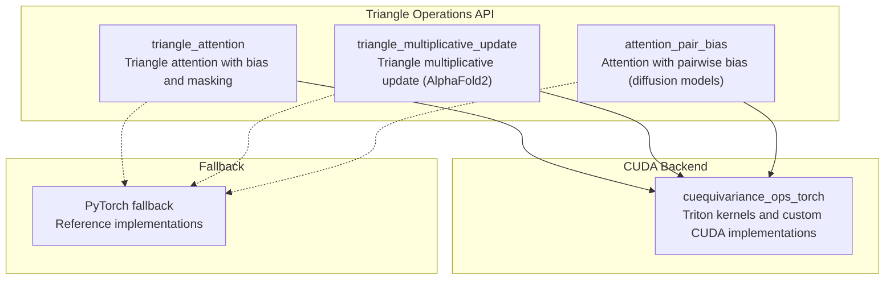
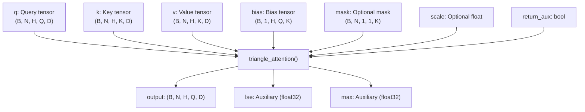
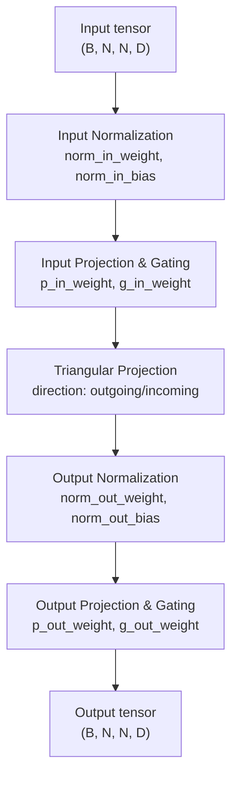
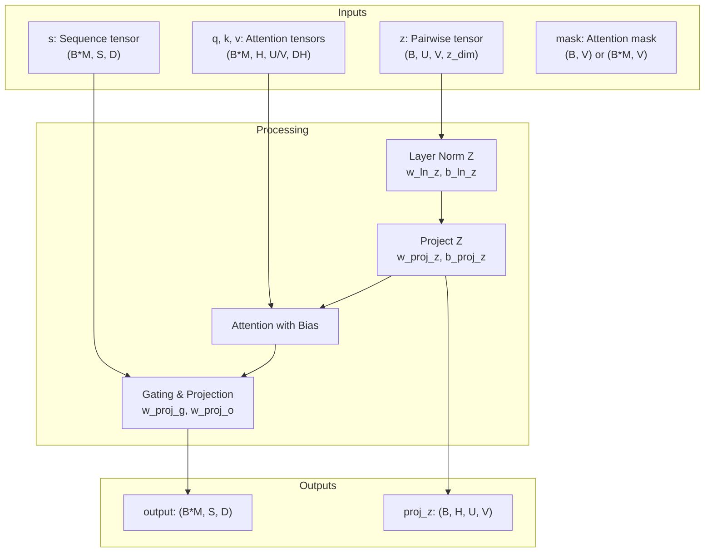
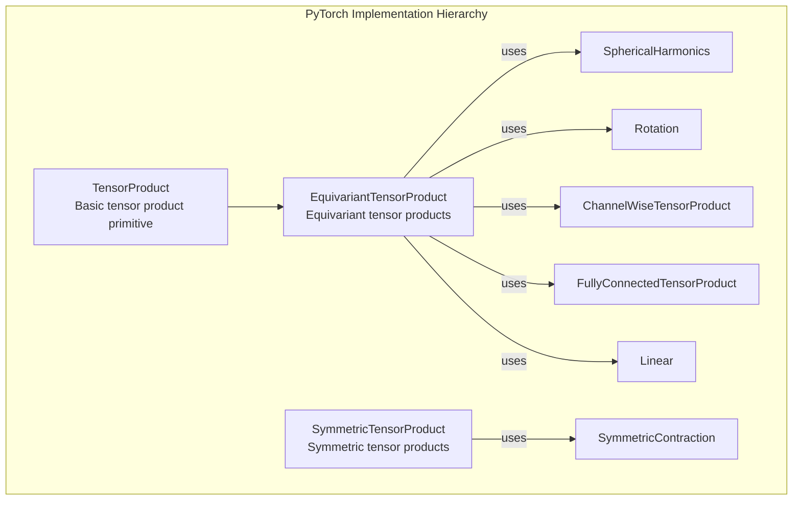

<!-- source: DeepWiki mcp.deepwiki.com · repo NVIDIA/cuEquivariance · page 3.5 Triangle Operations · fetched 2026-10-26 -->

# Triangle Operations

<details>
<summary>Relevant source files</summary>

The following files were used as context for generating this wiki page:

- [cuequivariance_torch/cuequivariance_torch/__init__.py](cuequivariance_torch/cuequivariance_torch/__init__.py)
- [cuequivariance_torch/cuequivariance_torch/primitives/triangle.py](cuequivariance_torch/cuequivariance_torch/primitives/triangle.py)
- [cuequivariance_torch/tests/primitives/triangle_test.py](cuequivariance_torch/tests/primitives/triangle_test.py)

</details>


This page documents the triangle operations provided by the cuEquivariance PyTorch implementation. These operations implement key components from AlphaFold2-style architectures, including triangle attention, triangle multiplicative update, and attention with pairwise bias. These operations are optimized with CUDA kernels and provide automatic fallback to PyTorch implementations.

## Overview of Triangle Operations

cuEquivariance provides three specialized triangle operations that are commonly used in protein folding and diffusion models:



Sources:
- [cuequivariance_torch/primitives/triangle.py:1-409]()
- [cuequivariance_torch/__init__.py:41-46]()

## Triangle Attention

The `triangle_attention` function implements triangle attention with bias and masking. This operation computes attention weights using query-key dot products, applies bias terms, handles masking, and returns the weighted sum of values.

### Mathematical Formulation

The triangle attention operation is defined as:

```math
\text{Attention}_q(Q, K, V, B, M) = \sum_k\left[\text{softmax}_k\left(\begin{cases} 
s\, Q_q \cdot K_k + B_{qk} & \text{if } M_k = 1 \\
-10^9 & \text{otherwise}
\end{cases}\right) V_k \right]
```

Where `s` is the scale factor, `B` is the bias tensor, and `M` is the mask tensor.

### Function Signature and Parameters



| Parameter | Type | Shape | Description |
|-----------|------|-------|-------------|
| q | torch.Tensor | (B, N, H, Q, D) | Query tensor |
| k | torch.Tensor | (B, N, H, K, D) | Key tensor |
| v | torch.Tensor | (B, N, H, K, D) | Value tensor |
| bias | torch.Tensor | (B, 1, H, Q, K) | Bias tensor (cast to float32 internally) |
| mask | torch.Tensor | (B, N, 1, 1, K) | Optional mask tensor (cast to bool internally) |
| scale | float | - | Scale factor (default: 1/sqrt(D)) |
| return_aux | bool | - | Whether to return auxiliary tensors |

### Implementation Notes

- Context is saved automatically for backward pass
- Kernel precision is based on input dtypes; use `torch.backends.cuda.matmul.allow_tf32=True` for TF32
- Full FP32 backward pass is not supported
- For B=1, tensors can omit the batch dimension

Sources:
- [cuequivariance_torch/primitives/triangle.py:25-123]()
- [cuequivariance_torch/tests/primitives/triangle_test.py:22-95]()

## Triangle Multiplicative Update

The `triangle_multiplicative_update` function implements the triangle multiplicative update operation from AlphaFold2. This operation performs triangular projections with normalization and gating, supporting both "outgoing" and "incoming" directions.

### Operation Components

The triangle multiplicative update consists of three main stages:



### Function Signature and Parameters

| Parameter | Type | Shape | Description |
|-----------|------|-------|-------------|
| x | torch.Tensor | (B, N, N, D) | Input tensor |
| direction | str | - | "outgoing" or "incoming" triangular projection |
| mask | torch.Tensor | (B, N, N) | Optional mask tensor |
| norm_in_weight | torch.Tensor | (D,) | Input normalization weight |
| norm_in_bias | torch.Tensor | (D,) | Input normalization bias |
| p_in_weight | torch.Tensor | (2D, D) | Input projection weight |
| p_in_bias | torch.Tensor | (2D,) | Input projection bias |
| g_in_weight | torch.Tensor | (2D, D) | Input gating weight |
| g_in_bias | torch.Tensor | (2D,) | Input gating bias |
| norm_out_weight | torch.Tensor | (D,) | Output normalization weight |
| norm_out_bias | torch.Tensor | (D,) | Output normalization bias |
| p_out_weight | torch.Tensor | (D, D) | Output projection weight |
| p_out_bias | torch.Tensor | (D,) | Output projection bias |
| g_out_weight | torch.Tensor | (D, D) | Output gating weight |
| g_out_bias | torch.Tensor | (D,) | Output gating bias |
| eps | float | - | Numerical stability constant (default: 1e-5) |
| precision | TriMulPrecision | - | Matrix multiplication precision mode |

### Precision Control

The `precision` parameter controls matrix multiplication precision:

| Precision Mode | Description |
|----------------|-------------|
| None | Default behavior based on input dtype and torch.backends.cuda.matmul.allow_tf32 |
| IEEE | Use IEEE 754 precision |

Sources:
- [cuequivariance_torch/primitives/triangle.py:126-249]()
- [cuequivariance_torch/tests/primitives/triangle_test.py:97-119]()

## Attention Pair Bias

The `attention_pair_bias` function implements attention with pairwise bias for diffusion models. This operation automatically chooses between optimized Triton kernels for long sequences and PyTorch fallback for short sequences.

### Operation Overview



### Function Signature and Key Parameters

| Parameter | Type | Shape | Description |
|-----------|------|-------|-------------|
| s | torch.Tensor | (B*M, S, D) | Input sequence tensor |
| q | torch.Tensor | (B*M, H, U, DH) | Query tensor |
| k | torch.Tensor | (B*M, H, V, DH) | Key tensor |
| v | torch.Tensor | (B*M, H, V, DH) | Value tensor |
| z | torch.Tensor | (B, U, V, z_dim) | Pairwise tensor for bias computation |
| mask | torch.Tensor | (B, V) or (B*M, V) | Attention mask |
| num_heads | int | - | Number of attention heads |
| multiplicity | int | - | Diffusion steps multiplicity (default: 1) |
| compute_pair_bias | bool | - | Whether to compute pairwise bias (default: True) |

### Backend Selection

The operation automatically selects between implementations based on sequence length:

| Sequence Length | Backend | Description |
|----------------|---------|-------------|
| ≤ FALLBACK_THRESHOLD | PyTorch | Standard PyTorch operations |
| > FALLBACK_THRESHOLD | Triton Kernels | Optimized CUDA kernels with backend selection |

The Triton backend automatically chooses between CUDNN, Flash Attention, and Efficient Attention based on hardware and input characteristics.

Sources:
- [cuequivariance_torch/primitives/triangle.py:252-408]()
- [cuequivariance_torch/tests/primitives/triangle_test.py:121-184]()

## Integration with PyTorch Framework

These special operations integrate into the PyTorch implementation of cuEquivariance as high-level building blocks for constructing equivariant neural networks.



All of these operations use the `EquivariantTensorProduct` primitive internally and can be exported to various PyTorch deployment formats (JIT, script, compile).

Sources:
- [cuequivariance_torch/tests/operations/spherical_harmonics_test.py:77-99]()
- [cuequivariance_torch/tests/operations/rotation_test.py:70-92]()

## Common Parameters Across Special Operations

Most special operations share these common parameters:

| Parameter | Description |
|-----------|-------------|
| layout | Determines memory layout of tensors, either `cue.ir_mul` or `cue.mul_ir` |
| use_fallback | Controls whether to use CUDA kernel or PyTorch fallback |
| device | Device to place the operation on |
| math_dtype | Data type for internal calculations |

Understanding these parameters is important for optimizing performance and ensuring compatibility with your model architecture.

Sources:
- [cuequivariance_torch/operations/spherical_harmonics.py:28-56]()
- [cuequivariance_torch/operations/rotation.py:34-44]()
- [cuequivariance_torch/operations/tp_channel_wise.py:48-63]()
- [cuequivariance_torch/operations/tp_fully_connected.py:48-63]()

---

