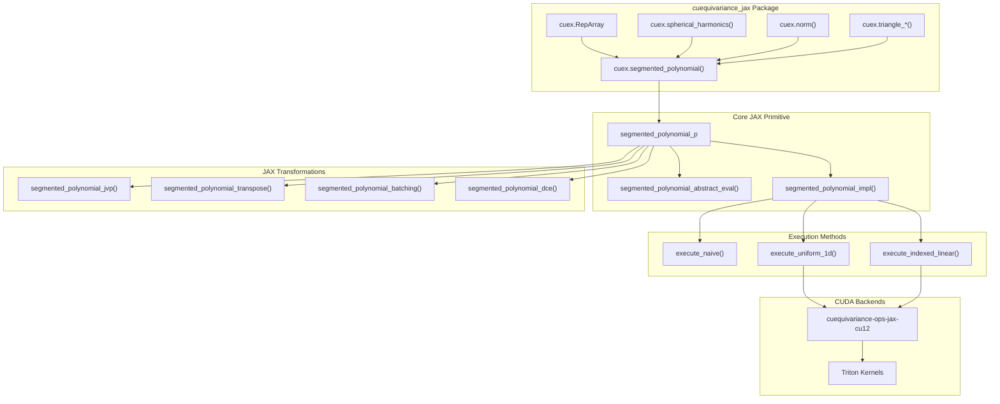
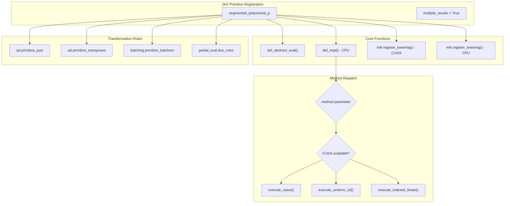
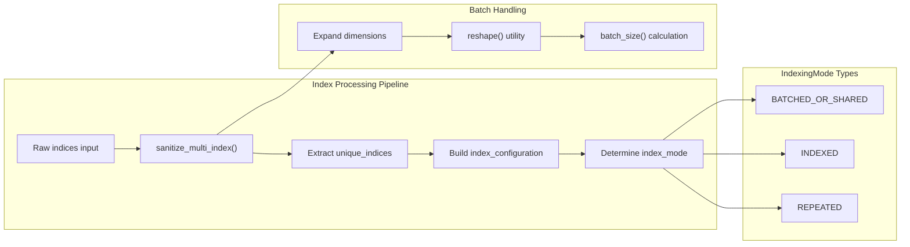

<!-- source: DeepWiki mcp.deepwiki.com · repo NVIDIA/cuEquivariance · page 4 JAX Implementation · fetched 2026-10-26 -->

# JAX Implementation

<details>
<summary>Relevant source files</summary>

The following files were used as context for generating this wiki page:

- [cuequivariance_jax/cuequivariance_jax/segmented_polynomials/segmented_polynomial.py](cuequivariance_jax/cuequivariance_jax/segmented_polynomials/segmented_polynomial.py)
- [cuequivariance_jax/tests/spherical_harmonics_test.py](cuequivariance_jax/tests/spherical_harmonics_test.py)

</details>


The JAX implementation provides a functional API for cuEquivariance operations optimized for JAX's ecosystem. This includes support for JAX transformations (`jit`, `grad`, `vmap`), automatic differentiation, and CUDA acceleration through custom primitives. The implementation centers around the `segmented_polynomial` function and related JAX-specific extensions.

For PyTorch-specific modules and operations, see [PyTorch Implementation](#3). For core mathematical concepts, see [Core Concepts](#2).

## Architecture Overview

The JAX implementation follows a functional programming paradigm with custom JAX primitives for performance-critical operations:



Sources: [cuequivariance_jax/cuequivariance_jax/segmented_polynomials/segmented_polynomial.py:1-783](), [cuequivariance_jax/tests/spherical_harmonics_test.py:1-64]()

## Core API Functions

The JAX implementation provides several key functions accessible through the `cuequivariance_jax` package:

| Function | Purpose | Key Features |
|----------|---------|--------------|
| `cuex.segmented_polynomial()` | Main computation function | Multiple execution methods, indexing support |
| `cuex.RepArray` | Representation-aware arrays | Integration with irreps and multiplication |
| `cuex.spherical_harmonics()` | Spherical harmonics computation | Direct JAX array support |
| `cuex.norm()` | Vector norm calculation | Squared/unsquared options |
| `cuex.triangle_*()` | Triangle operations | AlphaFold2-style attention |

The central function `segmented_polynomial` accepts a `cue.SegmentedPolynomial`, input arrays, output specifications, and optional indices:

```python
def segmented_polynomial(
    polynomial: cue.SegmentedPolynomial,
    inputs: list[jax.Array],
    outputs_shape_dtype: list[jax.ShapeDtypeStruct], 
    indices: None | list[None | jax.Array | tuple[jax.Array | slice]] = None,
    *,
    method: str = "",
    math_dtype: jnp.dtype | None = None,
    name: str | None = None,
    precision: jax.lax.Precision = jax.lax.Precision.HIGHEST,
) -> list[jax.Array]
```

Sources: [cuequivariance_jax/cuequivariance_jax/segmented_polynomials/segmented_polynomial.py:50-145](), [cuequivariance_jax/tests/spherical_harmonics_test.py:28-31]()

## JAX Primitive Implementation

The implementation uses a custom JAX primitive `segmented_polynomial_p` that integrates with JAX's transformation system:



Sources: [cuequivariance_jax/cuequivariance_jax/segmented_polynomials/segmented_polynomial.py:297-298](), [cuequivariance_jax/cuequivariance_jax/segmented_polynomials/segmented_polynomial.py:761-782]()

## Execution Methods

The JAX implementation supports three execution methods with different performance characteristics:

| Method | Description | Platform Support | Indexing Support |
|--------|-------------|-------------------|------------------|
| `"naive"` | Pure JAX implementation | CPU/GPU | Full support |
| `"uniform_1d"` | CUDA-optimized for uniform polynomials | CUDA only | Limited support |
| `"indexed_linear"` | CUDA-optimized for linear layers | CUDA only | Repeats support |

Method selection occurs in `segmented_polynomial_impl()` with automatic fallback to `"naive"` when CUDA is unavailable:

```python
if platform != "cuda" and method != "naive":
    warnings.warn(f"Method '{method}' requires CUDA, but platform is '{platform}'. "
                  "Falling back to 'naive' implementation.")
    method = "naive"
```

The method dispatch routes to specialized execution functions:
- `execute_naive()` for fallback JAX implementation
- `execute_uniform_1d()` for CUDA uniform polynomials  
- `execute_indexed_linear()` for CUDA indexed linear operations

Sources: [cuequivariance_jax/cuequivariance_jax/segmented_polynomials/segmented_polynomial.py:485-524](), [cuequivariance_jax/cuequivariance_jax/segmented_polynomials/segmented_polynomial.py:35-40]()

## JAX Transformations Support

The implementation provides complete support for JAX transformations through dedicated rule functions:

### Forward-Mode Differentiation (JVP)
The `segmented_polynomial_jvp()` function handles forward-mode automatic differentiation by computing the JVP polynomial and remapping indices:

```python
jvp_poly, _ = polynomial.jvp([not isinstance(t, ad.Zero) for t in tangents])
jvp_indices, jvp_index_configuration, jvp_index_mode = _remap_indices_and_config(...)
```

### Reverse-Mode Differentiation (Transpose)
The `segmented_polynomial_transpose()` function implements the transpose rule for reverse-mode differentiation, swapping inputs and outputs according to the cotangent structure.

### Batching (vmap)
The `segmented_polynomial_batching()` function adds batch dimensions and adjusts index configurations to support `jax.vmap` transformations.

### Dead Code Elimination
The `segmented_polynomial_dce()` function optimizes computations by eliminating unused inputs and outputs during compilation.

Sources: [cuequivariance_jax/cuequivariance_jax/segmented_polynomials/segmented_polynomial.py:526-588](), [cuequivariance_jax/cuequivariance_jax/segmented_polynomials/segmented_polynomial.py:590-653](), [cuequivariance_jax/cuequivariance_jax/segmented_polynomials/segmented_polynomial.py:655-709](), [cuequivariance_jax/cuequivariance_jax/segmented_polynomials/segmented_polynomial.py:712-758]()

## Index Handling and Batching

The JAX implementation includes sophisticated index handling through the `IndexingMode` enumeration and configuration system:



The system supports complex indexing patterns including:
- Shared indices across batch dimensions (`slice(None)`)
- Direct array indexing (`jax.Array`)
- Repeated indexing with `cuex.Repeats` for weight sharing

Sources: [cuequivariance_jax/cuequivariance_jax/segmented_polynomials/segmented_polynomial.py:210-269](), [cuequivariance_jax/cuequivariance_jax/segmented_polynomials/indexing_mode.py](), [cuequivariance_jax/cuequivariance_jax/segmented_polynomials/utils.py:42-45]()

## Performance and Optimization

The JAX implementation includes several performance optimization features:

### Automatic Platform Detection
The system automatically detects CUDA availability and falls back to CPU implementations when necessary.

### Polynomial Consolidation
Before execution, polynomials undergo optimization through `polynomial.consolidate()` which:
- Fuses tensor products
- Removes empty segments
- Sorts paths for optimal execution

### Memory Layout Optimization
The implementation uses utilities like `batch_size()` and `reshape()` to optimize memory access patterns for different execution methods.

### Performance Monitoring
When `CUE_PRINT_STATS` environment variable is set, the system reports FLOP counts, memory usage, and arithmetic intensity for performance analysis.

Sources: [cuequivariance_jax/cuequivariance_jax/segmented_polynomials/segmented_polynomial.py:362-363](), [cuequivariance_jax/cuequivariance_jax/segmented_polynomials/segmented_polynomial.py:472-483](), [cuequivariance_jax/cuequivariance_jax/segmented_polynomials/utils.py:42-45]()

---

