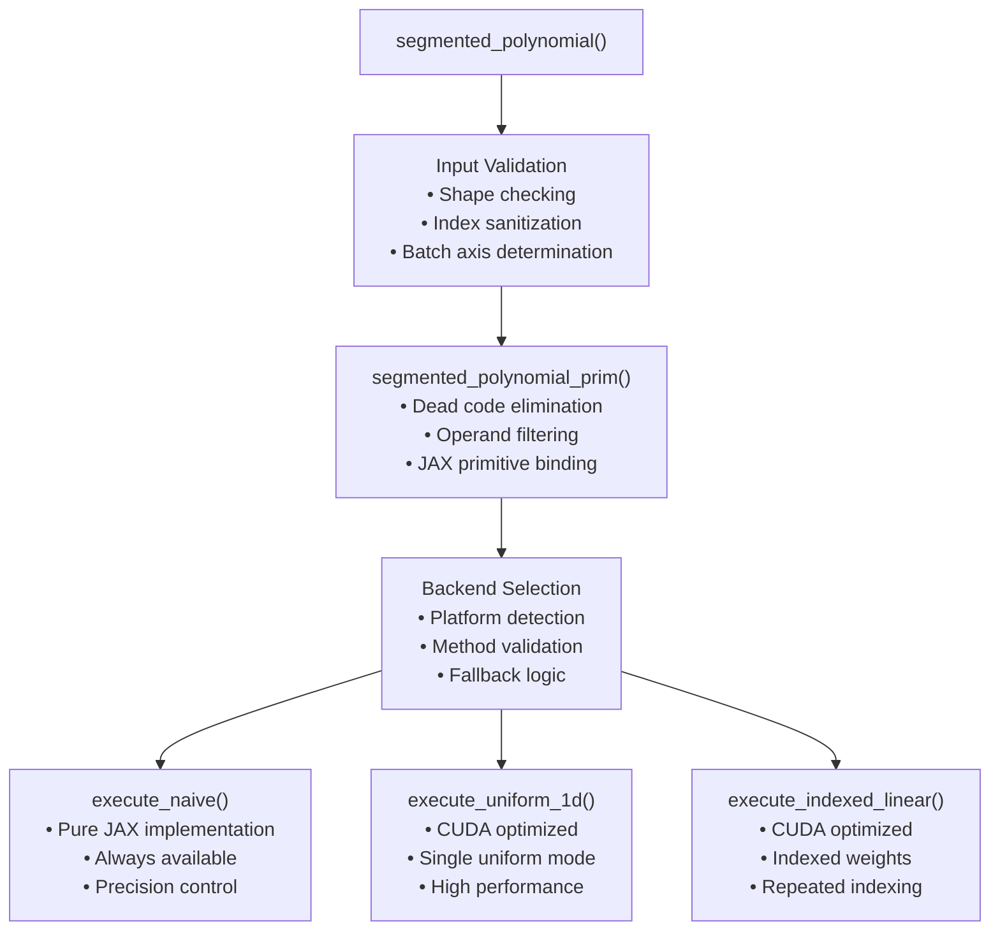
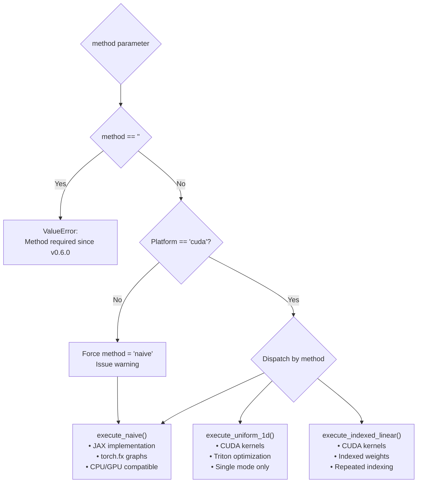
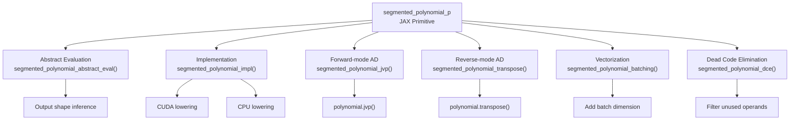
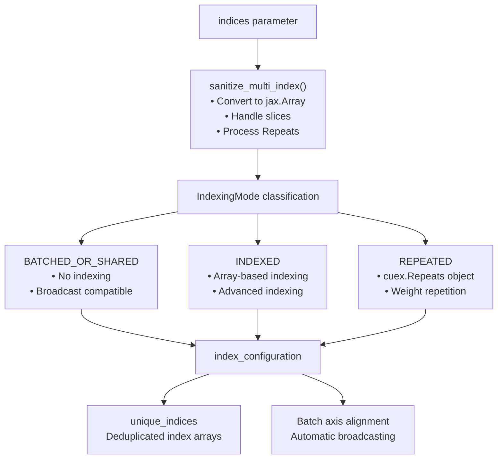
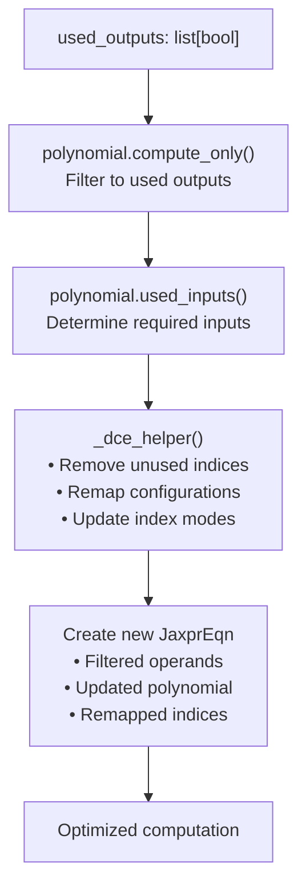

<!-- source: DeepWiki mcp.deepwiki.com · repo NVIDIA/cuEquivariance · page 4.1 segmented_polynomial · fetched 2026-10-26 -->

# segmented_polynomial

Relevant source files

The following files were used as context for generating this wiki page:

- [cuequivariance_jax/cuequivariance_jax/segmented_polynomials/segmented_polynomial.py](cuequivariance_jax/cuequivariance_jax/segmented_polynomials/segmented_polynomial.py)
- [cuequivariance_jax/tests/segmented_polynomial_test.py](cuequivariance_jax/tests/segmented_polynomial_test.py)
- [cuequivariance_jax/tests/spherical_harmonics_test.py](cuequivariance_jax/tests/spherical_harmonics_test.py)

The `segmented_polynomial` function is the primary JAX interface for evaluating segmented polynomial operations in cuEquivariance. It provides a high-level API that automatically selects optimal execution strategies based on the polynomial structure and available hardware, while supporting all JAX transformations including differentiation and vectorization.

This page covers the JAX-specific implementation. For the core mathematical concepts, see [SegmentedPolynomial](#2.1). For the PyTorch equivalent, see [SegmentedPolynomial](#3.3).

## Function Overview

The `segmented_polynomial` function evaluates mathematical operations composed of tensor products, with support for multiple execution backends and comprehensive JAX integration.

The main function signature accepts a `cue.SegmentedPolynomial`, input arrays, output shape specifications, optional indices, and execution parameters:

[cuequivariance_jax/cuequivariance_jax/segmented_polynomials/segmented_polynomial.py:50-60]()

**Sources:** [cuequivariance_jax/cuequivariance_jax/segmented_polynomials/segmented_polynomial.py:50-145]()

## Execution Methods

The function supports three execution methods, each optimized for different polynomial structures and hardware configurations:

| Method | Platform | Use Case | Index Support | Precision Control |
|--------|----------|----------|---------------|-------------------|
| `naive` | Any | General purpose, testing | Full | Yes |
| `uniform_1d` | CUDA | Single uniform mode polynomials | Limited | No |
| `indexed_linear` | CUDA | Linear layers with indexed weights | Repeated only | No |

The method selection includes automatic fallback logic when CUDA methods are requested on non-CUDA platforms:

[cuequivariance_jax/cuequivariance_jax/segmented_polynomials/segmented_polynomial.py:485-493]()

**Sources:** [cuequivariance_jax/cuequivariance_jax/segmented_polynomials/segmented_polynomial.py:74-81](), [cuequivariance_jax/cuequivariance_jax/segmented_polynomials/segmented_polynomial.py:515-524]()

## JAX Primitive Integration

The function implements a complete JAX primitive (`segmented_polynomial_p`) with support for all major JAX transformations:

The primitive registration enables automatic compilation and optimization through JAX's infrastructure:

[cuequivariance_jax/cuequivariance_jax/segmented_polynomials/segmented_polynomial.py:761-782]()

**Automatic Differentiation Support:**
- Forward-mode differentiation through JVP rules
- Reverse-mode differentiation through transpose rules  
- Infinite-order derivatives supported
- Efficient cotangent handling

**Sources:** [cuequivariance_jax/cuequivariance_jax/segmented_polynomials/segmented_polynomial.py:297-298](), [cuequivariance_jax/cuequivariance_jax/segmented_polynomials/segmented_polynomial.py:526-587](), [cuequivariance_jax/cuequivariance_jax/segmented_polynomials/segmented_polynomial.py:590-653]()

## Indexing and Batching

The function supports sophisticated indexing patterns through the `IndexingMode` enumeration and batch axis management:

**Indexing Modes:**
- `BATCHED_OR_SHARED`: Standard broadcasting behavior
- `INDEXED`: Advanced indexing with integer arrays
- `REPEATED`: Weight repetition using `cuex.Repeats`

The batching rule automatically handles vectorization across batch dimensions:

[cuequivariance_jax/cuequivariance_jax/segmented_polynomials/segmented_polynomial.py:655-709]()

**Sources:** [cuequivariance_jax/cuequivariance_jax/segmented_polynomials/segmented_polynomial.py:227-270](), [cuequivariance_jax/cuequivariance_jax/segmented_polynomials/segmented_polynomial.py:655-709]()

## Dead Code Elimination

The implementation includes sophisticated dead code elimination that removes unused operands and optimizes the computation graph:

This optimization is particularly important for large polynomials where only a subset of outputs are needed:

[cuequivariance_jax/cuequivariance_jax/segmented_polynomials/segmented_polynomial.py:712-758]()

**Sources:** [cuequivariance_jax/cuequivariance_jax/segmented_polynomials/segmented_polynomial.py:301-337](), [cuequivariance_jax/cuequivariance_jax/segmented_polynomials/segmented_polynomial.py:712-758]()

## Performance Considerations

The function includes several performance optimizations and monitoring capabilities:

**Math Dtype Handling:**
- Automatic dtype promotion from inputs
- Explicit `math_dtype` parameter for computational precision
- Default to `float32` unless `float64` inputs present

**Statistics and Monitoring:**
When `CUE_PRINT_STATS` environment variable is set, the function reports performance metrics:

[cuequivariance_jax/cuequivariance_jax/segmented_polynomials/segmented_polynomial.py:472-483]()

**Polynomial Optimization:**
- Automatic consolidation of operations
- Operand symmetry handling  
- Path sorting and consolidation

**Sources:** [cuequivariance_jax/cuequivariance_jax/segmented_polynomials/segmented_polynomial.py:271-274](), [cuequivariance_jax/cuequivariance_jax/segmented_polynomials/segmented_polynomial.py:362-363](), [cuequivariance_jax/cuequivariance_jax/segmented_polynomials/segmented_polynomial.py:467-471]()

---

