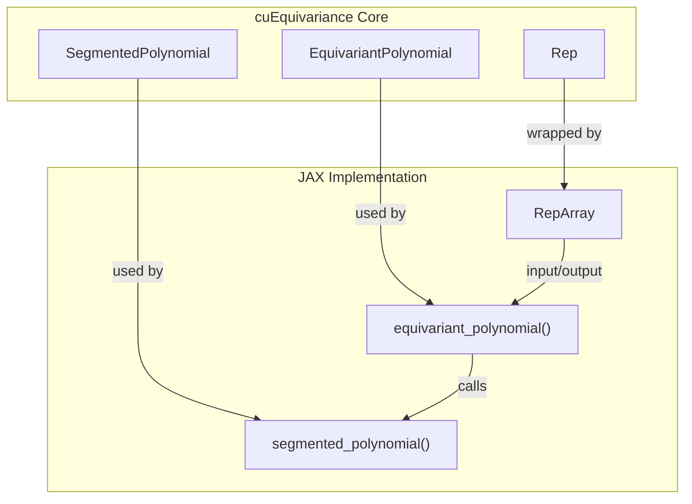
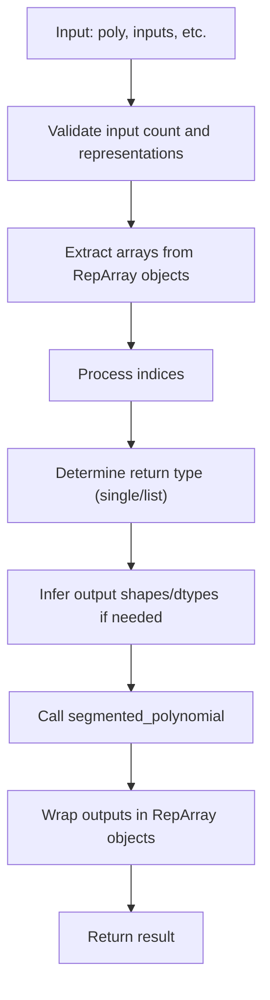
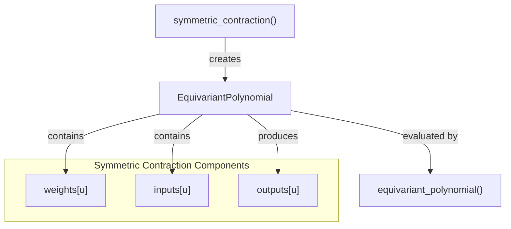

<!-- source: DeepWiki mcp.deepwiki.com · repo NVIDIA/cuEquivariance · page 4.2 equivariant_polynomial · fetched 2026-10-26 -->

# equivariant_polynomial

<details>
<summary>Relevant source files</summary>

The following files were used as context for generating this wiki page:

- [cuequivariance_jax/tests/equivariant_polynomial_test.py](cuequivariance_jax/tests/equivariant_polynomial_test.py)
- [cuequivariance_jax/tests/indexed_linear_test.py](cuequivariance_jax/tests/indexed_linear_test.py)

</details>


## Purpose and Scope

This document details the `equivariant_polynomial` function in the JAX implementation of cuEquivariance. This function serves as a high-level wrapper that evaluates equivariant polynomials - mathematical operations that respect group symmetries - while providing type checking and handling for representation-aware arrays. For information about the underlying segmented polynomial implementation, see [segmented_polynomial](#4.1).

Sources: [cuequivariance_jax/cuequivariance_jax/equivariant_polynomial.py:23-62]()

## Position in System Architecture

`equivariant_polynomial` is a key component of the JAX implementation of cuEquivariance, serving as the interface between the core mathematical foundation of equivariant polynomials and JAX-specific implementation details.



Sources: [cuequivariance_jax/cuequivariance_jax/equivariant_polynomial.py:23-183]()

## Function Signature

```python
def equivariant_polynomial(
    poly: cue.EquivariantPolynomial,
    inputs: list[cuex.RepArray | jax.Array],
    outputs_shape_dtype: list[jax.ShapeDtypeStruct] | jax.ShapeDtypeStruct | None = None,
    indices: None | list[None | jax.Array | tuple[jax.Array | slice]] = None,
    math_dtype: jnp.dtype | None = None,
    name: str | None = None,
    impl: str = "auto",
) -> list[cuex.RepArray] | cuex.RepArray:
```

### Parameters

| Parameter | Type | Description |
|-----------|------|-------------|
| `poly` | `cue.EquivariantPolynomial` | The equivariant polynomial descriptor |
| `inputs` | `list[cuex.RepArray \| jax.Array]` | List of input representation-aware arrays |
| `outputs_shape_dtype` | `list[jax.ShapeDtypeStruct] \| jax.ShapeDtypeStruct \| None` | Shape and dtype specifications for outputs |
| `indices` | `None \| list[None \| jax.Array \| tuple[jax.Array \| slice]]` | Optional indices for inputs and outputs |
| `math_dtype` | `jnp.dtype \| None` | Data type for computational operations |
| `name` | `str \| None` | Optional name for the operation |
| `impl` | `str` | Implementation to use: "auto", "cuda", "jax", or "naive_jax" |

### Return Value

The function returns either a single `RepArray` or a list of `RepArray` objects, depending on the polynomial's output structure.

Sources: [cuequivariance_jax/cuequivariance_jax/equivariant_polynomial.py:23-33]()

## Function Workflow

The workflow of `equivariant_polynomial` involves several steps to ensure proper evaluation of equivariant polynomials:



Sources: [cuequivariance_jax/cuequivariance_jax/equivariant_polynomial.py:101-183]()

## Implementation Details

### Input Validation

`equivariant_polynomial` performs thorough validation of inputs:

1. Checks that the number of inputs matches the expected number in the polynomial
2. Validates that each input has the correct representation
3. Ensures that non-RepArray inputs are only used for scalar representations

```python
# Validation code excerpt
if len(inputs) != poly.num_inputs:
    raise ValueError(f"Unexpected number of inputs. Expected {poly.num_inputs}, got {len(inputs)}.")

for i, (x, rep) in enumerate(zip(inputs, poly.inputs)):
    if isinstance(x, cuex.RepArray):
        assert x.rep(-1) == rep
    else:
        assert x.ndim >= 1
        assert x.shape[-1] == rep.dim
        if not rep.is_scalar():
            raise ValueError(f"Input {i} should be a RepArray unless the input is scalar.")
```

Sources: [cuequivariance_jax/cuequivariance_jax/equivariant_polynomial.py:104-124]()

### Output Shape and Dtype Inference

When not explicitly provided, the function infers output shapes and dtypes:

1. If output indices are provided, `outputs_shape_dtype` must also be provided
2. For standard cases, shapes are inferred by broadcasting input shapes
3. The output data type is determined based on input types

Sources: [cuequivariance_jax/cuequivariance_jax/equivariant_polynomial.py:138-168]()

### Delegation to segmented_polynomial

After processing inputs and determining output specifications, `equivariant_polynomial` delegates the actual computation to `segmented_polynomial`:

```python
outputs = cuex.segmented_polynomial(
    poly.polynomial,
    inputs,
    outputs_shape_dtype,
    indices,
    math_dtype=math_dtype,
    name=name,
    impl=impl,
)
```

After computation, the results are wrapped in `RepArray` objects to maintain representation awareness.

Sources: [cuequivariance_jax/cuequivariance_jax/equivariant_polynomial.py:170-182]()

## Usage Examples

### Basic Example

Computing spherical harmonics of degrees 0, 1, and 2:

```python
# Create spherical harmonics descriptor
e = cue.descriptors.spherical_harmonics(cue.SO3(1), [0, 1, 2])

# Create input vector
with cue.assume(cue.SO3, cue.ir_mul):
    x = cuex.RepArray("1", jnp.array([0.0, 1.0, 0.0]))

# Compute spherical harmonics
result = cuex.equivariant_polynomial(e, [x])
```

### Using Indices

Processing multiple inputs with specific output indices:

```python
# Create indices for outputs
i_out = jnp.array([0, 1, 1], dtype=jnp.int32)

# Create input vectors
with cue.assume(cue.SO3, cue.ir_mul):
    x = cuex.RepArray("1", jnp.array([
        [0.0, 1.0, 0.0],
        [0.0, 0.0, 1.0],
        [1.0, 0.0, 0.0],
    ]))

# Compute with indices
result = cuex.equivariant_polynomial(
  e,
  [x],
  jax.ShapeDtypeStruct((2, e.outputs[0].dim), jnp.float32),
  indices=[None, i_out],
)
```

Sources: [cuequivariance_jax/cuequivariance_jax/equivariant_polynomial.py:64-99]()

## Application in Symmetric Contractions

One important application of `equivariant_polynomial` is in implementing symmetric contractions, which are weighted sums of inputs contracted with themselves a specified number of times.



The symmetric contraction pattern is represented as `weights[u],input[u],output[u]` in terms of subscripts, showing how inputs are combined with weights to produce outputs, all while preserving equivariance properties.

Sources: [cuequivariance/cuequivariance/group_theory/descriptors/symmetric_contractions.py:20-132](),
[cuequivariance/cuequivariance/group_theory/experimental/mace/symmetric_contractions.py:24-73]()

## Summary

The `equivariant_polynomial` function provides a high-level interface for evaluating equivariant polynomials in JAX, handling type checking, representation awareness, and interfacing with the lower-level `segmented_polynomial` implementation. It serves as a bridge between the mathematical foundations of equivariance and efficient JAX-specific implementations.

---

