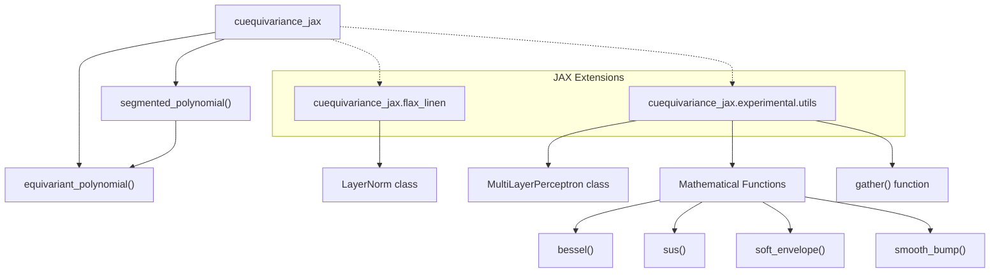
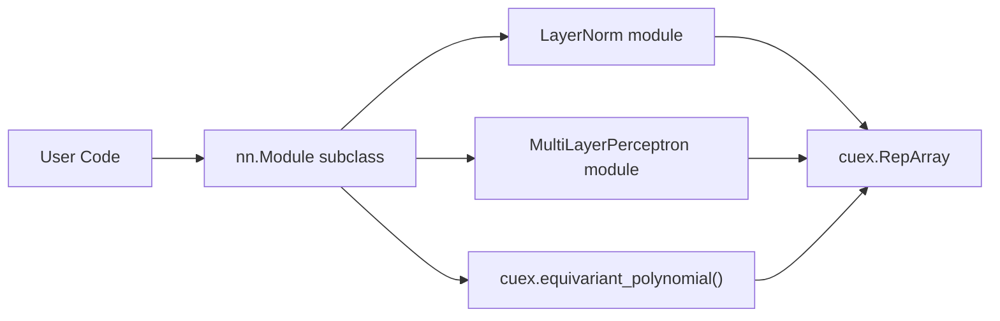

<!-- source: DeepWiki mcp.deepwiki.com · repo NVIDIA/cuEquivariance · page 4.3 JAX Extensions · fetched 2026-10-26 -->

# JAX Extensions

Relevant source files

The following files were used as context for generating this wiki page:

- [cuequivariance_jax/cuequivariance_jax/__init__.py](cuequivariance_jax/cuequivariance_jax/__init__.py)
- [cuequivariance_jax/cuequivariance_jax/experimental/indexed_linear.py](cuequivariance_jax/cuequivariance_jax/experimental/indexed_linear.py)
- [cuequivariance_jax/cuequivariance_jax/segmented_polynomials/segmented_polynomial_indexed_linear.py](cuequivariance_jax/cuequivariance_jax/segmented_polynomials/segmented_polynomial_indexed_linear.py)
- [cuequivariance_jax/cuequivariance_jax/segmented_polynomials/segmented_polynomial_naive.py](cuequivariance_jax/cuequivariance_jax/segmented_polynomials/segmented_polynomial_naive.py)
- [cuequivariance_jax/cuequivariance_jax/segmented_polynomials/segmented_polynomial_uniform_1d.py](cuequivariance_jax/cuequivariance_jax/segmented_polynomials/segmented_polynomial_uniform_1d.py)
- [cuequivariance_jax/cuequivariance_jax/spherical_harmonics.py](cuequivariance_jax/cuequivariance_jax/spherical_harmonics.py)
- [cuequivariance_jax/cuequivariance_jax/triangle/_triangle_attention.py](cuequivariance_jax/cuequivariance_jax/triangle/_triangle_attention.py)
- [cuequivariance_jax/cuequivariance_jax/triangle/_triangle_multiplicative_update.py](cuequivariance_jax/cuequivariance_jax/triangle/_triangle_multiplicative_update.py)
- [cuequivariance_jax/cuequivariance_jax/triangle/_utils.py](cuequivariance_jax/cuequivariance_jax/triangle/_utils.py)
- [cuequivariance_jax/tests/layer_norm_transpose_test.py](cuequivariance_jax/tests/layer_norm_transpose_test.py)
- [cuequivariance_jax/tests/triangle_attention_test.py](cuequivariance_jax/tests/triangle_attention_test.py)
- [cuequivariance_jax/tests/triangle_multiplicative_update_test.py](cuequivariance_jax/tests/triangle_multiplicative_update_test.py)
- [docs/api/cuequivariance_jax.rst](docs/api/cuequivariance_jax.rst)

## Introduction

This page documents the additional utilities and extensions provided for the JAX implementation of cuEquivariance. These extensions build upon the core JAX implementation covered in [segmented_polynomial](#4.1) and [equivariant_polynomial](#4.2), providing higher-level abstractions and utilities for building equivariant neural networks with JAX.

## Flax Integration

cuEquivariance provides integration with Flax, JAX's neural network library, through modules in the `cuequivariance_jax.flax_linen` package. These modules make it easy to incorporate equivariant operations into Flax-based neural networks.

### LayerNorm

The `LayerNorm` module provides layer normalization for equivariant tensors. It's implemented as a Flax Linen module that can be directly used in Flax models.

Sources: [cuequivariance_jax/flax_linen/__init__.py:16-20]()

## Experimental Utilities

cuEquivariance for JAX includes experimental utilities in the `cuequivariance_jax.experimental.utils` module. These utilities provide additional functionality for working with equivariant operations and representations.

### MultiLayerPerceptron

A simple MLP implementation for scalar data that can be used as a Flax module. It doesn't provide equivariance itself but can be used alongside equivariant layers in neural network architectures.

The implementation includes:
- Configurable hidden layer sizes via the `list_neurons` parameter
- Customizable activation functions
- Optional bias terms
- Special initialization for better training dynamics

Sources: [cuequivariance_jax/experimental/utils.py:35-92]()

### Mathematical Utilities

Several mathematical utility functions are provided for use in equivariant networks:

| Function | Description | Source |
|----------|-------------|--------|
| `bessel()` | Implements Bessel functions for use in radial basis functions | [cuequivariance_jax/experimental/utils.py:95-101]() |
| `sus()` | Smooth Unit Step function that transitions from 0 to 1 | [cuequivariance_jax/experimental/utils.py:104-109]() |
| `soft_envelope()` | A smooth C∞ envelope function | [cuequivariance_jax/experimental/utils.py:112-121]() |
| `smooth_bump()` | A non-zero positive function between -1 and 1 | [cuequivariance_jax/experimental/utils.py:124-126]() |

Sources: [cuequivariance_jax/experimental/utils.py:95-126]()

### RepArray Utilities

Utilities for manipulating `RepArray` objects, which are the core data structure for equivariant data in cuEquivariance:

- `gather()`: Gathers data from a `RepArray` based on indices, useful for operations that need to collect or redistribute equivariant features

Sources: [cuequivariance_jax/experimental/utils.py:129-135]()

## JAX Extensions Architecture

The following diagram illustrates how the JAX Extensions fit into the overall cuEquivariance JAX implementation:

Sources: [docs/index.rst:63-67](), [cuequivariance_jax/flax_linen/__init__.py](), [cuequivariance_jax/experimental/utils.py]()

## Integration Flow

The following diagram illustrates how the JAX Extensions are used in a typical application:

Sources: [cuequivariance_jax/experimental/utils.py:35-92](), [cuequivariance_jax/flax_linen/__init__.py:16](), [docs/index.rst:63-67]()

---

