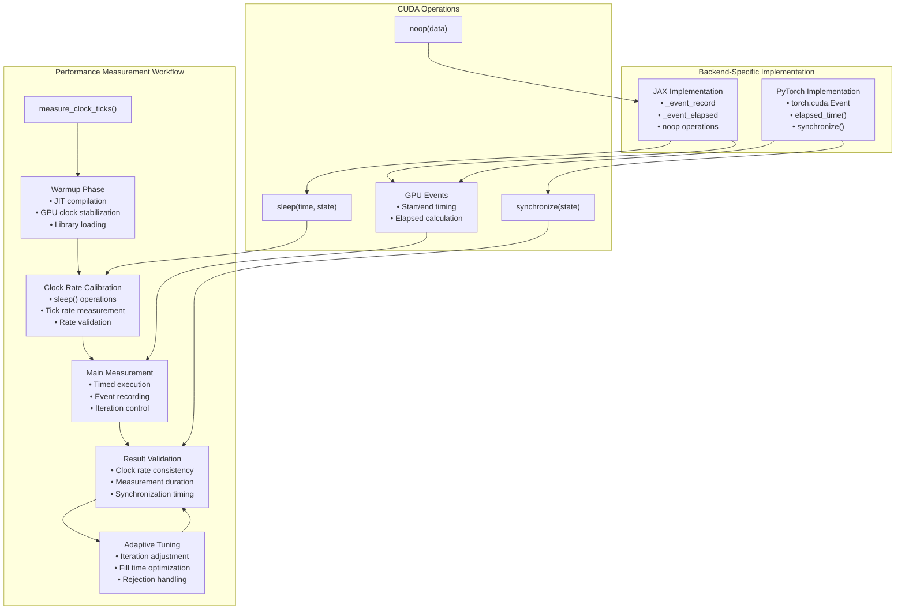
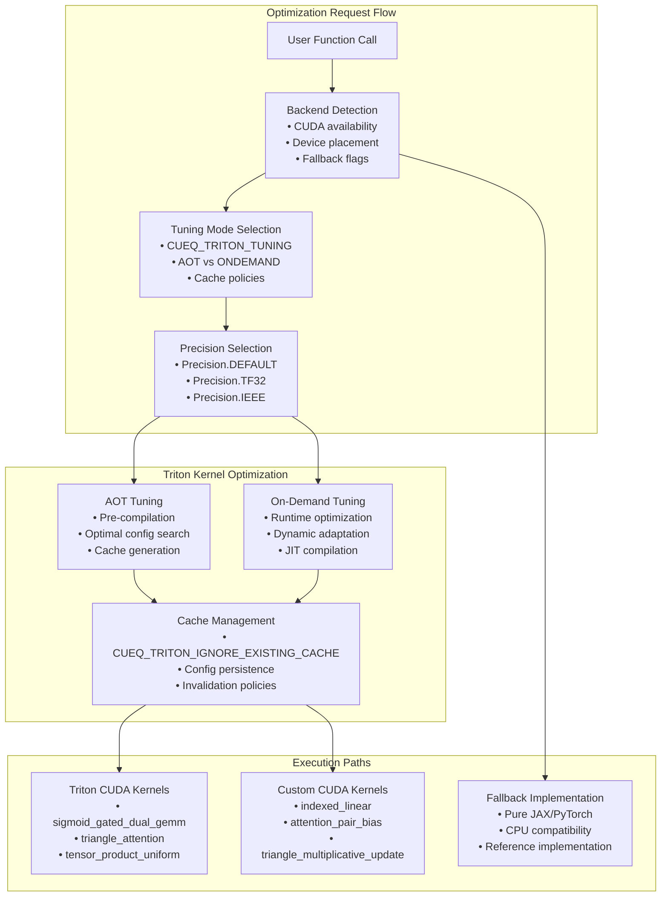
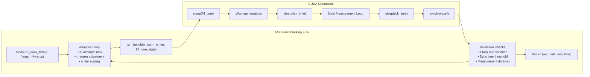
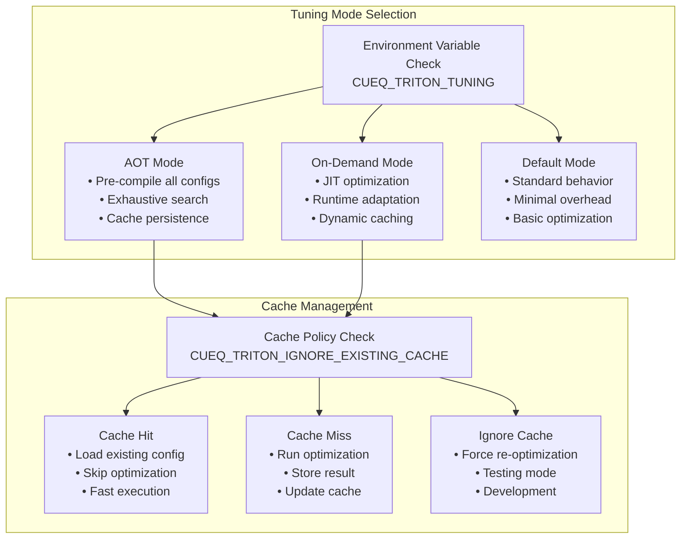

<!-- source: DeepWiki mcp.deepwiki.com · repo NVIDIA/cuEquivariance · page 5 Performance and Optimization · fetched 2026-10-26 -->

# Performance and Optimization

Relevant source files

The following files were used as context for generating this wiki page:

- [cuequivariance_jax/cuequivariance_jax/benchmarking.py](cuequivariance_jax/cuequivariance_jax/benchmarking.py)
- [cuequivariance_jax/tests/benchmarking_test.py](cuequivariance_jax/tests/benchmarking_test.py)
- [cuequivariance_jax/tests/sigmoid_gated_dual_gemm_test.py](cuequivariance_jax/tests/sigmoid_gated_dual_gemm_test.py)
- [cuequivariance_torch/cuequivariance_torch/benchmarking.py](cuequivariance_torch/cuequivariance_torch/benchmarking.py)
- [cuequivariance_torch/tests/benchmarking_test.py](cuequivariance_torch/tests/benchmarking_test.py)

This document covers performance measurement, benchmarking utilities, CUDA kernel optimization, and tuning strategies in the cuEquivariance library. It focuses on the technical implementation of performance-critical components and optimization techniques used across both JAX and PyTorch backends.

For general architecture and backend selection, see [Overview](#1). For specific CUDA kernel implementations, see [CUDA Kernels and Tuning](#5.2). For benchmarking methodology and tools, see [Benchmarking](#5.1).

## Performance Measurement Architecture

The cuEquivariance library implements sophisticated performance measurement infrastructure that handles GPU clock rate calibration, adaptive iteration counting, and proper synchronization across both JAX and PyTorch backends.

Sources: [cuequivariance_jax/cuequivariance_jax/benchmarking.py:25-182](), [cuequivariance_torch/cuequivariance_torch/benchmarking.py:24-158]()

## CUDA Optimization Pipeline

The library employs a multi-layered CUDA optimization strategy with Triton kernel tuning, precision control, and intelligent fallback mechanisms.

Sources: [cuequivariance_jax/tests/sigmoid_gated_dual_gemm_test.py:430-477](), [cuequivariance_jax/tests/sigmoid_gated_dual_gemm_test.py:32-35]()

## Benchmarking Implementation Details

### JAX Benchmarking Architecture

The JAX benchmarking implementation uses sophisticated GPU event timing with clock rate calibration and adaptive measurement strategies.

| Component | Function | Purpose |
|-----------|----------|---------|
| `measure_clock_ticks` | Main benchmark function | Measures execution time in clock ticks |
| `run_bench` | JIT-compiled measurement | Core timing loop with warmup and iteration |
| `sleep` | CUDA sleep operation | Clock rate calibration and stream filling |
| `noop` | No-operation function | Prevents compiler optimizations |
| `_event_record` | GPU event recording | Precise timing measurement |
| `synchronize` | CPU-GPU synchronization | Lag detection and validation |

The measurement process implements multiple validation checks:

- **Clock Rate Consistency**: Validates that before/after clock rates match within 2% tolerance
- **Measurement Duration**: Ensures minimum 20μs total measurement time for accuracy
- **CPU-GPU Synchronization**: Detects and compensates for CPU lag behind GPU
- **Adaptive Iteration**: Automatically adjusts iteration count and warmup based on performance

Sources: [cuequivariance_jax/cuequivariance_jax/benchmarking.py:62-98](), [cuequivariance_jax/cuequivariance_jax/benchmarking.py:108-182]()

### PyTorch Benchmarking Architecture

The PyTorch implementation provides similar functionality with framework-specific optimizations and event handling.

| Component | Implementation | Key Differences from JAX |
|-----------|----------------|-------------------------|
| Event Timing | `torch.cuda.Event(enable_timing=True)` | Direct PyTorch CUDA events |
| Synchronization | `torch.cuda.synchronize()` | Explicit CUDA synchronization |
| Clock Measurement | `sleep(tick_time, x)` | Tensor-based state passing |
| Time Calculation | `start_event.elapsed_time(end_event)` | Native PyTorch timing API |
| Device Handling | `torch.tensor(0, device="cuda")` | Explicit device placement |

The PyTorch benchmarking includes additional safeguards:

- **First Iteration Skip**: Always skips first iteration to allow JIT compilation
- **Increased Fill Time**: Uses longer base fill time (200μs vs 50μs) for stability
- **Stream Filling**: More aggressive stream filling to ensure proper GPU utilization

Sources: [cuequivariance_torch/cuequivariance_torch/benchmarking.py:45-146]()

## Performance Testing and Validation

### Triton Tuning Modes

The library supports multiple Triton tuning strategies controlled by the `CUEQ_TRITON_TUNING` environment variable:

| Mode | Description | Use Case |
|------|-------------|----------|
| `AOT` | Ahead-of-Time tuning | Production deployment with pre-optimized kernels |
| `ONDEMAND` | On-demand tuning | Development and dynamic workloads |
| `None` | Default behavior | Standard operation without explicit tuning |

Cache management is controlled by `CUEQ_TRITON_IGNORE_EXISTING_CACHE` for development and testing scenarios.

Sources: [cuequivariance_jax/tests/sigmoid_gated_dual_gemm_test.py:430-440](), [cuequivariance_jax/tests/sigmoid_gated_dual_gemm_test.py:33-35]()

### Precision Control

Performance is balanced with numerical accuracy through precision mode selection:

| Precision Mode | Matrix Operations | Use Case |
|----------------|------------------|----------|
| `Precision.DEFAULT` | Hardware default (typically TF32) | Balanced performance/accuracy |
| `Precision.TF32` | TensorFloat-32 format | High performance training |
| `Precision.IEEE` | IEEE 754 compliance | Maximum numerical precision |

The precision modes affect GEMM operations in CUDA kernels and can significantly impact performance characteristics.

Sources: [cuequivariance_jax/tests/sigmoid_gated_dual_gemm_test.py:398-427](), [cuequivariance_jax/tests/sigmoid_gated_dual_gemm_test.py:231-280]()

### Fallback and Compatibility

The library implements comprehensive fallback mechanisms for performance and compatibility:

- **CPU Execution**: Automatic fallback to CPU-based reference implementations
- **Dimension Compatibility**: Shape validation and automatic method selection
- **Device Placement**: Proper handling of CPU vs GPU tensor placement
- **Framework Compatibility**: Consistent behavior across JAX and PyTorch

Sources: [cuequivariance_jax/tests/sigmoid_gated_dual_gemm_test.py:536-590](), [cuequivariance_jax/tests/sigmoid_gated_dual_gemm_test.py:608-643]()

---

