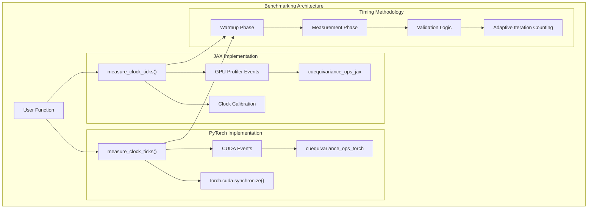
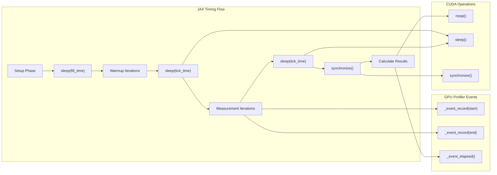
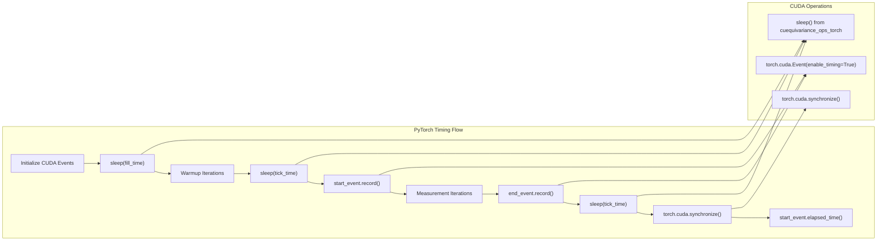
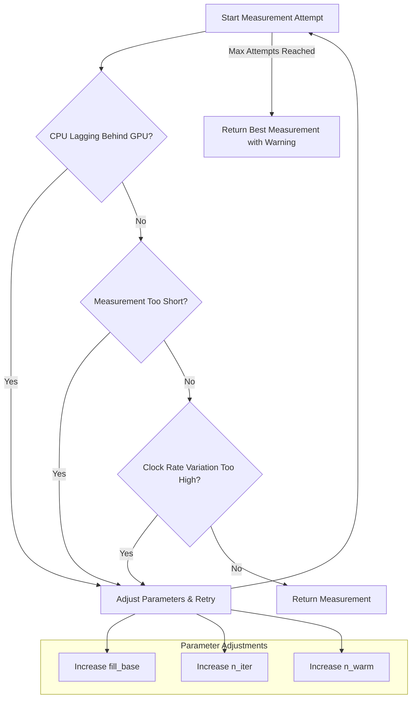

<!-- source: DeepWiki mcp.deepwiki.com · repo NVIDIA/cuEquivariance · page 5.1 Benchmarking · fetched 2026-10-26 -->

# Benchmarking

<details>
<summary>Relevant source files</summary>

The following files were used as context for generating this wiki page:

- [cuequivariance_jax/cuequivariance_jax/benchmarking.py](cuequivariance_jax/cuequivariance_jax/benchmarking.py)
- [cuequivariance_jax/tests/benchmarking_test.py](cuequivariance_jax/tests/benchmarking_test.py)
- [cuequivariance_jax/tests/sigmoid_gated_dual_gemm_test.py](cuequivariance_jax/tests/sigmoid_gated_dual_gemm_test.py)
- [cuequivariance_torch/cuequivariance_torch/benchmarking.py](cuequivariance_torch/cuequivariance_torch/benchmarking.py)
- [cuequivariance_torch/tests/benchmarking_test.py](cuequivariance_torch/tests/benchmarking_test.py)

</details>


This document covers the benchmarking utilities provided by cuEquivariance for measuring execution time and performance across JAX and PyTorch implementations. The benchmarking system provides precise timing measurements using GPU clock ticks and handles the complexities of GPU timing calibration, warmup cycles, and measurement validation.

For information about CUDA kernel optimization and tuning strategies, see [CUDA Kernels and Tuning](#5.2).

## Overview

The cuEquivariance library provides benchmarking utilities in both JAX and PyTorch packages to measure function execution performance. These utilities focus on GPU timing accuracy and provide clock tick measurements that are essential for performance analysis of equivariant operations.



**Sources:** [cuequivariance_jax/cuequivariance_jax/benchmarking.py:1-183](), [cuequivariance_torch/cuequivariance_torch/benchmarking.py:1-159]()

## Core Benchmarking API

Both JAX and PyTorch implementations provide a consistent `measure_clock_ticks` function that returns clock rate and execution time measurements.

### Function Signature

```python
def measure_clock_ticks(f, *args, **kwargs) -> tuple[float, float]:
    """
    Returns:
        tuple: (average_clock_rate_hz, average_time_per_call_seconds)
    """
```

### Usage Pattern

| Framework | Import Path | CUDA Dependency |
|-----------|-------------|-----------------|
| JAX | `cuequivariance_jax.benchmarking.measure_clock_ticks` | `cuequivariance_ops_jax` |
| PyTorch | `cuequivariance_torch.benchmarking.measure_clock_ticks` | `cuequivariance_ops_torch` |

**Sources:** [cuequivariance_jax/cuequivariance_jax/benchmarking.py:25-49](), [cuequivariance_torch/cuequivariance_torch/benchmarking.py:24-42]()

## JAX Implementation Details

The JAX benchmarking implementation uses sophisticated timing calibration and GPU profiler integration for high-precision measurements.



### Key Components

The JAX implementation relies on several CUDA operations from `cuequivariance_ops_jax`:

- **`sleep(duration, state)`**: Precise GPU sleep for timing calibration
- **`noop(data)`**: Prevents compiler optimizations while maintaining data flow
- **`synchronize(state)`**: CPU-GPU synchronization with timing measurement
- **`_event_record()`** and **`_event_elapsed()`**: GPU profiler event timing

**Sources:** [cuequivariance_jax/cuequivariance_jax/benchmarking.py:50-91](), [cuequivariance_jax/cuequivariance_jax/benchmarking.py:22]()

### Adaptive Measurement Algorithm

The JAX implementation includes sophisticated adaptive logic to ensure measurement reliability:

| Validation Check | Threshold | Action |
|------------------|-----------|--------|
| CPU lag detection | `sync_time < target_sync_time` | Increase `fill_base` |
| Minimum duration | `n_iter * avg_time < 20μs` | Increase `n_iter` |
| Clock rate stability | `abs(rate_before - rate_after) > 2%` | Increase `n_warm` |

**Sources:** [cuequivariance_jax/cuequivariance_jax/benchmarking.py:108-182]()

## PyTorch Implementation Details

The PyTorch benchmarking implementation uses CUDA events and torch synchronization for timing measurements.



### Key Differences from JAX

The PyTorch implementation is simpler but follows similar validation principles:

- Uses `torch.cuda.Event` instead of GPU profiler events
- Always skips the first iteration for JIT compilation
- Simpler clock rate validation (2% tolerance)
- Direct CUDA synchronization timing

**Sources:** [cuequivariance_torch/cuequivariance_torch/benchmarking.py:50-147]()

## Measurement Validation Logic

Both implementations include robust validation to ensure measurement reliability:



### Validation Criteria

| Framework | CPU Lag Threshold | Min Duration | Clock Stability |
|-----------|-------------------|--------------|-----------------|
| JAX | `sync_time < tick_time + 20μs` | `n_iter * avg_time < 20μs` | `rate_variation < 2%` |
| PyTorch | `sync_time < 50μs` | `n_iter * avg_time < 20μs` | `rate_variation < 2%` |

**Sources:** [cuequivariance_jax/cuequivariance_jax/benchmarking.py:127-169](), [cuequivariance_torch/cuequivariance_torch/benchmarking.py:108-144]()

## Testing and Validation

Both packages include comprehensive test suites that validate benchmarking functionality:

### Test Coverage

| Test File | Purpose | Key Tests |
|-----------|---------|-----------|
| `cuequivariance_jax/tests/benchmarking_test.py` | JAX validation | Size parametrization, rate/time validation |
| `cuequivariance_torch/tests/benchmarking_test.py` | PyTorch validation | CUDA availability, basic functionality |

The tests validate that:
- Clock rates are positive and reasonable
- Execution times are positive
- Functions work across different input sizes
- CUDA dependencies are properly handled

**Sources:** [cuequivariance_jax/tests/benchmarking_test.py:1-39](), [cuequivariance_torch/tests/benchmarking_test.py:1-37]()

## Integration with Performance Testing

The benchmarking utilities are used throughout the codebase for performance validation, particularly in complex operations like `sigmoid_gated_dual_gemm` which includes extensive benchmarking test cases for different tuning modes and precision settings.

**Sources:** [cuequivariance_jax/tests/sigmoid_gated_dual_gemm_test.py:429-477]()

---

