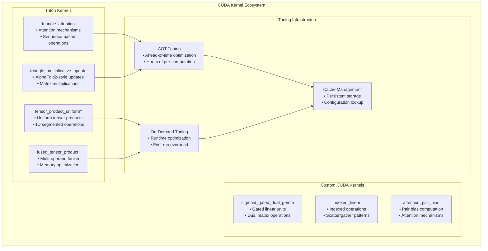
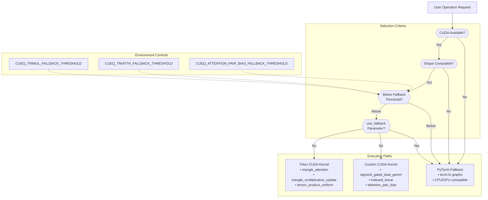
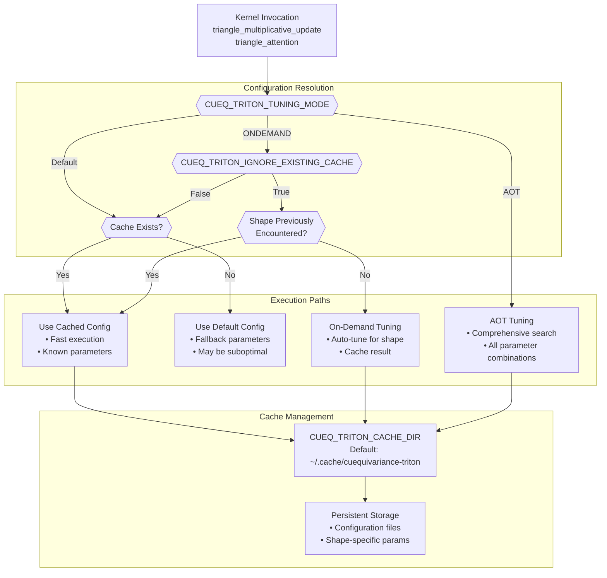
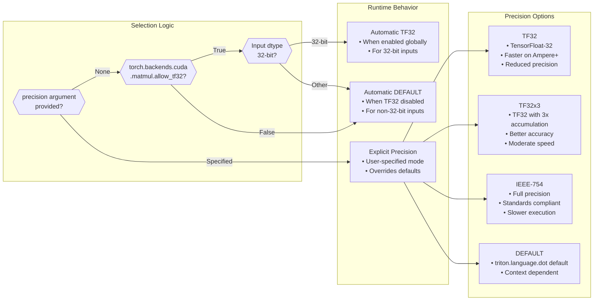
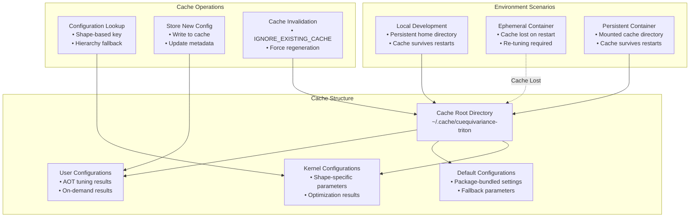

<!-- source: DeepWiki mcp.deepwiki.com · repo NVIDIA/cuEquivariance · page 5.2 CUDA Kernels and Tuning · fetched 2026-10-26 -->

# CUDA Kernels and Tuning

Relevant source files

The following files were used as context for generating this wiki page:

- [CHANGELOG.md](CHANGELOG.md)
- [VERSION](VERSION)

This document covers the CUDA kernel implementations and performance tuning strategies in cuEquivariance. It explains the different types of kernels, auto-tuning mechanisms, cache management, and precision control options available for optimal performance across different hardware configurations.

For general performance measurement and benchmarking approaches, see [Benchmarking](#5.1).

## CUDA Kernel Architecture

cuEquivariance implements high-performance CUDA kernels using two main approaches: Triton-based kernels for complex mathematical operations and custom CUDA kernels for specialized computations.

### Kernel Types and Implementation

Sources: [CHANGELOG.md:1-185]()

### Backend Selection and Fallback Logic

The system automatically selects the most appropriate kernel implementation based on input characteristics and system capabilities:

Sources: [CHANGELOG.md:8]()

## Tuning Modes and Configuration

cuEquivariance provides three distinct tuning modes to balance performance optimization with setup time and computational resources.

### Tuning Mode Overview

| Mode | Environment Variable | Description | Setup Time | Performance |
|------|---------------------|-------------|------------|-------------|
| **Quick Testing** | Default | Uses cached configs, fallback to defaults | Immediate | Good |
| **On-Demand** | `CUEQ_TRITON_TUNING_MODE=ONDEMAND` | Auto-tune on first encounter | Minutes per shape | Better |
| **AOT** | `CUEQ_TRITON_TUNING_MODE=AOT` | Full ahead-of-time tuning | Hours | Optimal |

### Tuning Configuration Flow

Sources: [CHANGELOG.md:43-48](), [CHANGELOG.md:77-82]()

### Environment Variable Configuration

The tuning system is controlled through several environment variables:

| Variable | Purpose | Default | Example Values |
|----------|---------|---------|----------------|
| `CUEQ_TRITON_TUNING_MODE` | Sets tuning strategy | Quick testing | `AOT`, `ONDEMAND` |
| `CUEQ_TRITON_IGNORE_EXISTING_CACHE` | Bypass existing cache | `False` | `1`, `True` |
| `CUEQ_TRITON_CACHE_DIR` | Cache directory location | `~/.cache/cuequivariance-triton` | `/custom/path` |
| `CUEQ_TRIMUL_FALLBACK_THRESHOLD` | Triangle mul fallback limit | `100` | `200`, `50` |
| `CUEQ_TRIATTN_FALLBACK_THRESHOLD` | Triangle attention fallback | `100` | `150`, `75` |
| `CUEQ_ATTENTION_PAIR_BIAS_FALLBACK_THRESHOLD` | Pair bias fallback | `100` | `120`, `80` |

Sources: [CHANGELOG.md:8](), [CHANGELOG.md:48]()

## Precision Control

cuEquivariance supports multiple precision modes for matrix operations, allowing users to balance computational speed with numerical accuracy.

### Precision Modes

Sources: [CHANGELOG.md:19](), [CHANGELOG.md:34-40]()

## Cache Management and Persistence

The caching system ensures that tuning results persist across sessions and processes, with special considerations for containerized environments.

### Cache Architecture

Sources: [CHANGELOG.md:48](), [CHANGELOG.md:81]()

### Container Considerations

When running in containerized environments, cache persistence requires special attention:

- **Default Container Behavior**: Cache stored in container's `/root/.cache` is lost on restart
- **Persistence Solutions**: 
  - Commit container after tuning
  - Mount external cache directory with `CUEQ_TRITON_CACHE_DIR`
  - Use persistent volumes for cache directory

Sources: [CHANGELOG.md:48](), [CHANGELOG.md:81]()

## Performance Considerations

### Multi-GPU Environments

The tuning system has specific behaviors in multi-GPU setups:

- **Tuning Target**: Always performed for GPU-0
- **Heterogeneous GPUs**: May not be optimal for all devices
- **Recommended Configuration**: Use quick testing mode (`CUEQ_DISABLE_AOT_TUNING=1`)

Sources: [CHANGELOG.md:56](), [CHANGELOG.md:82]()

### Hardware-Specific Limitations

| Hardware | Limitation | Workaround |
|----------|------------|------------|
| **Blackwell GPUs** | Requires `triton>=3.4.0` for PyTorch | Install latest Triton from source |
| **JAX on Blackwell** | Requires `triton<=3.3.1` | Currently incompatible |
| **CUDA 11** | No longer supported | Upgrade to CUDA 12 |

Sources: [CHANGELOG.md:18](), [CHANGELOG.md:23-25](), [CHANGELOG.md:55]()

### Fallback Thresholds

The system automatically switches to PyTorch fallback for small sequence lengths to optimize performance:

- **Default Threshold**: 100 for all triangle operations
- **Customization**: Override with environment variables
- **Performance Impact**: PyTorch may be faster for small inputs due to kernel launch overhead

Sources: [CHANGELOG.md:8]()

---

