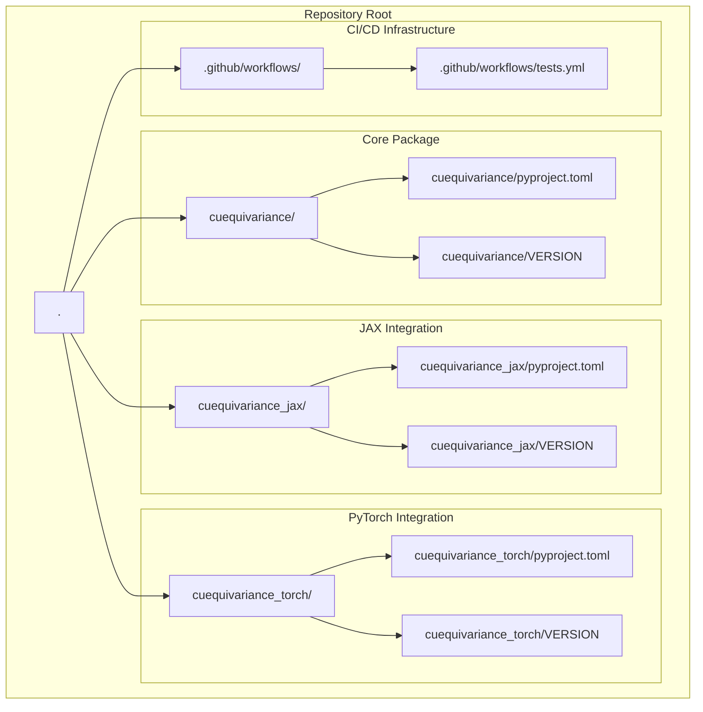
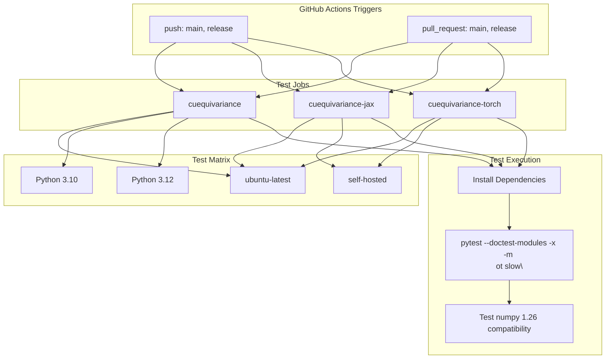
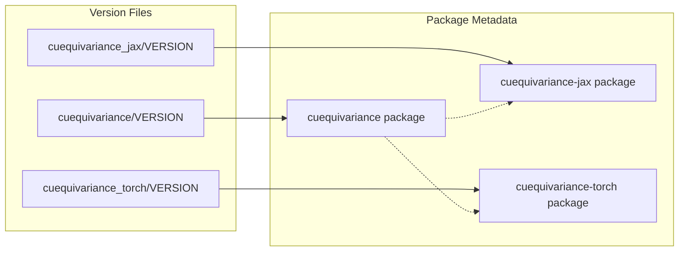

<!-- source: DeepWiki mcp.deepwiki.com · repo NVIDIA/cuEquivariance · page 6 Development · fetched 2026-10-26 -->

# Development

<details>
<summary>Relevant source files</summary>

The following files were used as context for generating this wiki page:

- [.github/workflows/tests.yml](.github/workflows/tests.yml)
- [cuequivariance/pyproject.toml](cuequivariance/pyproject.toml)
- [cuequivariance_jax/pyproject.toml](cuequivariance_jax/pyproject.toml)
- [cuequivariance_torch/pyproject.toml](cuequivariance_torch/pyproject.toml)

</details>


This document covers the development workflows, testing infrastructure, and contribution guidelines for the cuEquivariance library. It provides an overview of the multi-package repository structure, continuous integration pipelines, and development best practices.

For detailed information about specific development processes, see:
- Testing infrastructure and CI/CD pipelines: [Testing](#6.1)
- Documentation build process: [Documentation](#6.2)  
- Package publishing and release workflow: [Release Process](#6.3)

## Repository Architecture

The cuEquivariance library is organized as a multi-package repository with distinct components for core functionality and framework-specific implementations.

### Package Structure



Sources: [cuequivariance/pyproject.toml](), [cuequivariance_jax/pyproject.toml](), [cuequivariance_torch/pyproject.toml](), [.github/workflows/tests.yml]()

### Build System Configuration

Each package uses `hatchling` as the build backend and follows a consistent structure:

| Package | Name | Dependencies | Python Support |
|---------|------|--------------|----------------|
| `cuequivariance` | Core mathematical library | `numpy`, `scipy`, `opt_einsum`, `sympy`, `networkx` | 3.10+ |
| `cuequivariance-jax` | JAX integration | `cuequivariance`, `jax`, `packaging` | 3.10+ |
| `cuequivariance-torch` | PyTorch integration | `cuequivariance` | 3.10+ |

The build configuration is defined in [cuequivariance/pyproject.toml:16-18](), [cuequivariance_jax/pyproject.toml:16-18](), and [cuequivariance_torch/pyproject.toml:16-18]().

Sources: [cuequivariance/pyproject.toml:20-41](), [cuequivariance_jax/pyproject.toml:20-39](), [cuequivariance_torch/pyproject.toml:20-37]()

## Continuous Integration Pipeline

The CI system runs comprehensive tests across multiple Python versions and execution environments using GitHub Actions.

### CI Workflow Structure



Sources: [.github/workflows/tests.yml:1-8](), [.github/workflows/tests.yml:10-17]()

### Package-Specific Testing

#### Core Package Testing
The `cuequivariance` job tests the core mathematical library on Ubuntu with Python 3.10 and 3.12:

```bash
# Install process from CI
python -m uv pip install -e ./cuequivariance 
pytest --doctest-modules -x -m "not slow" cuequivariance
```

The workflow also includes compatibility testing with older numpy versions [.github/workflows/tests.yml:34-39]().

Sources: [.github/workflows/tests.yml:11-40]()

#### JAX Package Testing  
The `cuequivariance-jax` job includes CUDA dependencies and GPU testing capabilities:

```bash
# JAX-specific dependencies
python -m uv pip install -U pytest "jax[cuda12]"
python -m uv pip install nvidia-cusolver-cu12==11.7.3.90
python -m uv pip install jax-triton triton==3.3.1
```

Testing runs with memory preallocation disabled: `XLA_PYTHON_CLIENT_PREALLOCATE=false`.

Sources: [.github/workflows/tests.yml:43-76]()

#### PyTorch Package Testing
The `cuequivariance-torch` job installs PyTorch and e3nn dependencies:

```bash
# PyTorch-specific dependencies  
python -m uv pip install -U pytest torch e3nn
```

Sources: [.github/workflows/tests.yml:77-108]()

## Development Environment Setup

### Local Development Installation

For local development, install packages in editable mode:

```bash
# Install core package
python -m pip install -e ./cuequivariance

# Install framework packages  
python -m pip install -e ./cuequivariance_jax
python -m pip install -e ./cuequivariance_torch
```

### Test Configuration

All packages use pytest with consistent configuration defined in `pyproject.toml`:

```toml
[tool.pytest.ini_options]
markers = [
    "slow: marks tests as slow (deselect with '-m \"not slow\"')",
]
```

The `slow` marker allows excluding computationally expensive tests during development.

Sources: [cuequivariance/pyproject.toml:49-52](), [cuequivariance_jax/pyproject.toml:49-52](), [cuequivariance_torch/pyproject.toml:47-50]()

## Version Management

### Version Synchronization



Each package maintains its version in a dedicated `VERSION` file, referenced by the hatch build system via the pattern `(?P<version>\\d+\\.\\d+\\.\\d+(?:[a-z]+\\d+)?)`.

Sources: [cuequivariance/pyproject.toml:43-44](), [cuequivariance_jax/pyproject.toml:41-43](), [cuequivariance_torch/pyproject.toml:39-41]()

## Development Best Practices

### Code Quality Standards
- All tests must pass before merging
- Doctests are executed as part of the test suite
- Both framework packages depend on the core package for consistency
- Python 3.10+ compatibility is maintained across all packages

### Testing Strategy
- Fast tests run on every push/PR
- Slow tests are marked and can be excluded during development
- GPU tests run on self-hosted runners for JAX and PyTorch packages
- Compatibility testing includes multiple numpy versions

### Dependency Management
The dependency chain ensures proper separation of concerns:
- Core package contains mathematical primitives
- Framework packages add integration layers
- Optional CUDA packages provide performance optimizations

Sources: [.github/workflows/tests.yml](), [cuequivariance/pyproject.toml](), [cuequivariance_jax/pyproject.toml](), [cuequivariance_torch/pyproject.toml]()

---

