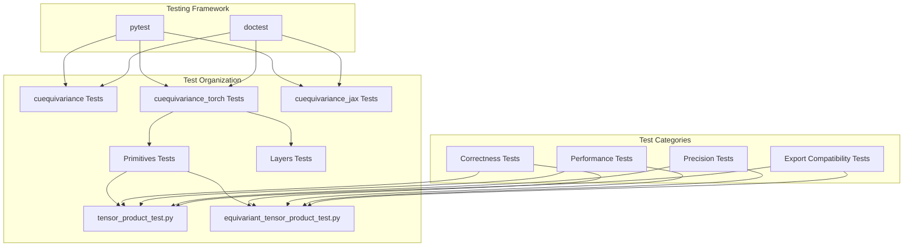
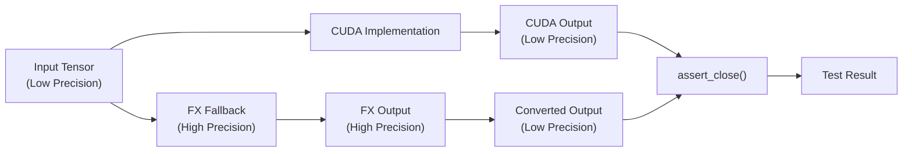
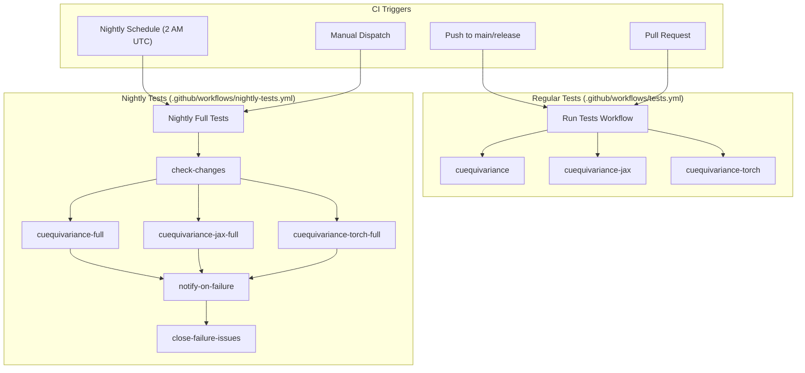
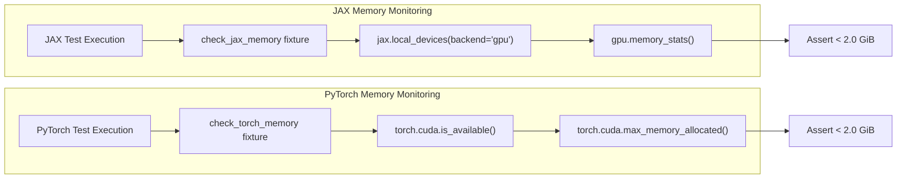

<!-- source: DeepWiki mcp.deepwiki.com · repo NVIDIA/cuEquivariance · page 6.1 Testing · fetched 2026-10-26 -->

# Testing

<details>
<summary>Relevant source files</summary>

The following files were used as context for generating this wiki page:

- [.github/workflows/nightly-tests.yml](.github/workflows/nightly-tests.yml)
- [.github/workflows/tests.yml](.github/workflows/tests.yml)
- [cuequivariance/pyproject.toml](cuequivariance/pyproject.toml)
- [cuequivariance_jax/pyproject.toml](cuequivariance_jax/pyproject.toml)
- [cuequivariance_jax/tests/conftest.py](cuequivariance_jax/tests/conftest.py)
- [cuequivariance_torch/pyproject.toml](cuequivariance_torch/pyproject.toml)
- [cuequivariance_torch/tests/conftest.py](cuequivariance_torch/tests/conftest.py)

</details>


This page documents the testing framework and practices for the cuEquivariance library. It covers how tests are organized, executed, and how to write new tests for the library components. The testing infrastructure ensures that both core functionality and framework-specific implementations (PyTorch and JAX) maintain correctness and performance.

## Testing Structure Overview

cuEquivariance employs a comprehensive testing approach that spans across its core library and framework-specific implementations. Tests are primarily implemented using the pytest framework and are organized by package and functionality.



Sources: [.github/workflows/tests.yml:11-105](), [cuequivariance_torch/tests/primitives/equivariant_tensor_product_test.py:17-23](), [cuequivariance_torch/tests/primitives/tensor_product_test.py:16-26]()

## Test Categories

Tests in cuEquivariance serve various purposes, focusing on different aspects of functionality validation.

### Correctness Tests

Correctness tests verify that operations produce expected outputs and maintain equivariance properties. They typically compare CUDA implementations with reference implementations (PyTorch or JAX fallbacks).

```python
@pytest.mark.parametrize("batch_size", [0, 5])
@pytest.mark.parametrize("dtype, math_dtype, atol, rtol", settings2)
@pytest.mark.parametrize("e, shared_op0", make_descriptors(True))
def test_precision_cuda_vs_fx(...):
    # Test compares CUDA kernel output with PyTorch fallback implementation
    # to ensure numerical accuracy within specified tolerances
```

Sources: [cuequivariance_torch/tests/primitives/equivariant_tensor_product_test.py:131-166]()

### Performance Tests

Performance tests ensure that CUDA implementations are faster than fallback implementations. These tests are crucial for validating the performance benefits of specialized CUDA kernels.

```python
@pytest.mark.parametrize("e", make_descriptors())
@pytest.mark.parametrize("dtype, math_dtype", settings1)
def test_performance_cuda_vs_fx(...):
    # Test measures execution time for CUDA kernel vs PyTorch fallback
    # and verifies performance advantage
```

Sources: [cuequivariance_torch/tests/primitives/equivariant_tensor_product_test.py:88-116]()

### Precision Tests

Precision tests validate numerical accuracy across different data types (float32, float64, float16, bfloat16) and math precision settings, ensuring operations maintain acceptable error margins.



Sources: [cuequivariance_torch/tests/primitives/equivariant_tensor_product_test.py:119-128](), [cuequivariance_torch/tests/primitives/tensor_product_test.py:79-89]()

### Export Compatibility Tests

These tests verify that operations can be properly exported using various PyTorch methods (compile, script, jit) and continue to function correctly afterward.

```python
@pytest.mark.parametrize("e", make_descriptors())
@pytest.mark.parametrize("dtype, math_dtype, atol, rtol", settings2)
@pytest.mark.parametrize("use_fallback", [True, False])
@pytest.mark.parametrize("mode", export_modes)
def test_export(...):
    # Test exports models using different methods and verifies functionality
```

Sources: [cuequivariance_torch/tests/primitives/equivariant_tensor_product_test.py:176-206](), [cuequivariance_torch/tests/primitives/tensor_product_test.py:151-180]()

## Test Parametrization

Tests in cuEquivariance make extensive use of pytest's parametrization feature to test combinations of:

1. **Descriptors**: Different tensor product configurations are generated via helper functions
2. **Data Types**: Tests cover various combinations of input dtypes and computation dtypes
3. **Batch Sizes**: Tests with both batched (batch_size > 0) and unbatched (batch_size = 0) inputs
4. **Implementation Types**: Tests compare CUDA kernels vs fallback implementations
5. **Export Modes**: Various PyTorch export strategies (compile, script, jit)

```python
# Parametrization example for input/math dtypes
settings1 = [
    (torch.float32, torch.float64),  # Input in fp32, compute in fp64
    (torch.float32, torch.float32),  # Input and compute in fp32
    (torch.float64, torch.float64),  # Input and compute in fp64
]
if torch.cuda.is_available() and torch.cuda.get_device_capability()[0] >= 8:
    settings1 += [
        (torch.float16, torch.float32),  # Input in fp16, compute in fp32
        (torch.bfloat16, torch.float32),  # Input in bf16, compute in fp32
    ]
```

Sources: [cuequivariance_torch/tests/primitives/equivariant_tensor_product_test.py:76-85](), [cuequivariance_torch/tests/primitives/tensor_product_test.py:79-89]()

## Continuous Integration

cuEquivariance uses GitHub Actions for comprehensive continuous integration testing with both regular and nightly test workflows.

### CI/CD Workflow Structure



Sources: [.github/workflows/tests.yml:3-8](), [.github/workflows/nightly-tests.yml:3-7](), [.github/workflows/nightly-tests.yml:10-31]()

### Test Matrix

The CI workflows use matrix strategies to test various configurations:

| Workflow | Package | Python Version | Runner | CUDA Support | Test Scope |
|----------|---------|---------------|--------|-------------|------------|
| Regular | cuequivariance | 3.10, 3.12 | ubuntu-latest | No | Fast tests only |
| Regular | cuequivariance_jax | 3.10 | ubuntu-latest | No | Fast tests only |
| Regular | cuequivariance_jax | 3.12 | self-hosted | Yes | Fast tests only |
| Regular | cuequivariance_torch | 3.10 | ubuntu-latest | No | Fast tests only |
| Regular | cuequivariance_torch | 3.12 | self-hosted | Yes | Fast tests only |
| Nightly | cuequivariance | 3.10, 3.12 | ubuntu-latest | No | All tests |
| Nightly | cuequivariance_jax | 3.10 | ubuntu-latest | No | All tests |
| Nightly | cuequivariance_jax | 3.12 | self-hosted | Yes | All tests |
| Nightly | cuequivariance_torch | 3.10 | ubuntu-latest | No | All tests |
| Nightly | cuequivariance_torch | 3.12 | self-hosted | Yes | All tests |

### Test Execution Commands

Regular tests exclude slow-marked tests using pytest markers:
```bash
pytest --doctest-modules -x -m "not slow" cuequivariance
```

Nightly tests include all tests:
```bash
pytest --doctest-modules -x cuequivariance
```

Sources: [.github/workflows/tests.yml:14-17](), [.github/workflows/tests.yml:33](), [.github/workflows/tests.yml:75](), [.github/workflows/nightly-tests.yml:56](), [.github/workflows/nightly-tests.yml:97]()

### Nightly Test Management

The nightly workflow includes intelligent change detection and automated issue management:

- **Change Detection**: Only runs if commits were made in the last 24 hours
- **Failure Tracking**: Automatically creates GitHub issues when tests fail
- **Success Handling**: Automatically closes failure issues when tests pass again

Sources: [.github/workflows/nightly-tests.yml:18-31](), [.github/workflows/nightly-tests.yml:134-182](), [.github/workflows/nightly-tests.yml:183-215]()

## Writing New Tests

When writing new tests for cuEquivariance components, follow these guidelines:

### Test Structure

1. **Test Naming**: Use descriptive names prefixed with `test_` to be automatically discovered by pytest
2. **Parametrization**: Use `@pytest.mark.parametrize` for testing multiple configurations
3. **CUDA Availability**: Check for CUDA availability with `if torch.cuda.is_available():`
4. **Comparison**: For precision tests, use `torch.testing.assert_close()` with appropriate tolerances

### Common Test Pattern

```python
# Example test structure
@pytest.mark.parametrize("descriptor_param", descriptor_options)
@pytest.mark.parametrize("dtype_param", dtype_options)
def test_something(descriptor_param, dtype_param):
    # Skip if CUDA required but not available
    if requires_cuda and not torch.cuda.is_available():
        pytest.skip("CUDA is not available")
    
    # Create model with desired implementation
    model_cuda = Module(use_fallback=False)
    model_fallback = Module(use_fallback=True)
    
    # Generate inputs
    inputs = [create_input(...) for _ in range(n)]
    
    # Get outputs from both implementations
    output_cuda = model_cuda(*inputs)
    output_fallback = model_fallback(*inputs)
    
    # Compare results
    torch.testing.assert_close(output_cuda, output_fallback, atol=atol, rtol=rtol)
```

Sources: [cuequivariance_torch/tests/primitives/equivariant_tensor_product_test.py:134-165](), [cuequivariance_torch/tests/primitives/tensor_product_test.py:96-145]()

### Test Utilities

The repository includes utility functions to help with testing, particularly for different PyTorch export modes:

```python
module_with_mode(mode, module, inputs, math_dtype, tmp_path)
```

This utility helps transform modules using different PyTorch export methods (compile, script, jit) for testing export compatibility.

Sources: [cuequivariance_torch/tests/primitives/equivariant_tensor_product_test.py:204](), [cuequivariance_torch/tests/primitives/tensor_product_test.py:176]()

## Memory Monitoring

cuEquivariance includes automated memory monitoring to prevent excessive GPU memory usage during testing.

### Memory Monitoring Infrastructure



### Memory Limits

Both JAX and PyTorch test suites enforce a 2.0 GiB peak memory usage limit:

- **JAX**: Monitors `peak_bytes_in_use` from GPU memory stats
- **PyTorch**: Monitors `torch.cuda.max_memory_allocated()`

The memory monitoring fixtures are automatically applied to all tests using `autouse=True`.

Sources: [cuequivariance_jax/tests/conftest.py:19-30](), [cuequivariance_torch/tests/conftest.py:19-30]()

## Pytest Configuration

### Test Markers

All packages define the `slow` marker in their `pyproject.toml` files to categorize computationally expensive tests:

```toml
[tool.pytest.ini_options]
markers = [
    "slow: marks tests as slow (deselect with '-m \"not slow\"')",
]
```

This marker system enables:
- **Regular CI**: Runs only fast tests with `-m "not slow"`
- **Nightly CI**: Runs all tests including slow ones
- **Local Development**: Developers can choose test scope

Sources: [cuequivariance/pyproject.toml:49-53](), [cuequivariance_jax/pyproject.toml:49-52](), [cuequivariance_torch/pyproject.toml:47-50]()

## Running Tests Locally

### Basic Test Commands

```bash
# Run fast tests only (excludes slow tests)
pytest --doctest-modules -x -m "not slow" cuequivariance

# Run all tests including slow ones
pytest --doctest-modules -x cuequivariance

# Run with memory debugging
CUDA_LAUNCH_BLOCKING=1 pytest --doctest-modules -x cuequivariance_torch 

# Run specific test file
pytest cuequivariance_torch/tests/primitives/tensor_product_test.py

# Run with JAX memory preallocation disabled
XLA_PYTHON_CLIENT_PREALLOCATE=false pytest --doctest-modules -x cuequivariance_jax
```

### Test Flags

- `-x`: Stop at first failure (useful for debugging)
- `--doctest-modules`: Run doctests in addition to regular tests
- `-m "not slow"`: Skip slow-marked tests

Sources: [.github/workflows/tests.yml:33](), [.github/workflows/tests.yml:75](), [.github/workflows/tests.yml:107](), [.github/workflows/nightly-tests.yml:56](), [.github/workflows/nightly-tests.yml:97]()

## Summary

The testing framework in cuEquivariance provides comprehensive coverage of the library's functionality, ensuring correctness, precision, and performance. By using a combination of correctness tests, performance tests, precision tests, and export compatibility tests, the framework maintains high quality across different configurations and usage patterns.

---

